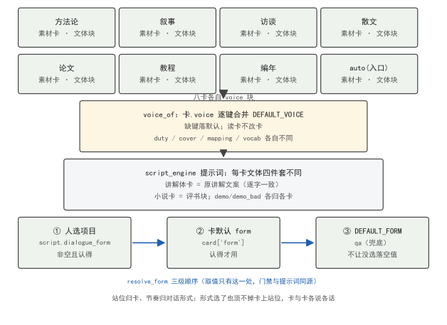

<!--
SPDX-License-Identifier: CC-BY-SA-4.0
Copyright (c) 2026 wUwproject
Licensed under Creative Commons Attribution-ShareAlike 4.0 International (CC BY-SA 4.0).
See https://creativecommons.org/licenses/by-sa/4.0/ for details.
-->

# 第二部 · 10｜文体块分卡：八张素材卡怎么各自说话

> 摘要：podcast-maker 不是只有一种稿。方法论专著、小说、采访稿、论文、教程、传记，各自该有各自的口吻——讲论文不能拿说书的腔，播小说不能上一堂中心思想总结课。v1.5.0 之前，写脚本的「文体口径」只有引擎里那一套讲解体文案，所有素材卡共用。这次改动把文体拆成卡上的 `voice` 块：八张素材卡各自声明自己的 duty / cover / mapping / vocab，取用时由 `voice_of` 逐键合并默认口径，读卡不改卡。核心矛盾一句话：文体是卡的属性，不是全局属性——站位归卡、节奏归形式。本文讲分卡怎么落、三级取值怎么同源、测试怎么钉。

## 一、引子：真实起点

脚本引擎拼提示词时，要往里写一段话告诉模型「这段稿该用什么口吻写」。早期这段代码只有一份固定的讲解体文案：两位主持人、把素材改写成对话、只讲本段素材、每个论断对应素材。这份文案对方法论 / 论文类素材是对的，但对小说、采访、散文、传记就是错的——拿同一套去写小说，模型会一边播故事一边总结中心思想；拿去写采访，会把被访者的话改写成播音腔。

问题不在「文案写错了」，而在「文案只有一份」。素材本身是分类型的：稿件进管道时带着它的范式（`paradigm`），方法论 / 小说 / 采访 / 散文 / 论文 / 教程 / 传记是七种互不重叠的切分单位，`auto` 是入口卡（由探查推断类型），合起来注册了八张。让八张卡说同一种话，等于让八种文体共用一个嗓子。

本文讲三件事：文体块怎么从全局一份拆到卡上、取用时怎么合并、对话形式怎么三级取值不岔开。

## 二、现象：一张口径喂八种文体

先给两个术语的四维展开，后面都建立在这两套口径上。

**素材卡（paradigm card）**：①定义——`paradigms.PARADIGMS` 里注册的一条配置，描述某类素材怎么切、怎么并在一起、怎么讲、两位主持人怎么站；②来源——脚本引擎 `paradigms` 模块，取卡用 `get(kind)`，未知类型落到 `auto`；③边界——七种切分单位互不重叠（methodology / narrative / interview / essay / paper / tutorial / chronicle），`auto` 是入口不是第八种范式，由探查推断；④例子——方法论卡 `form = "qa"`（一问一答），小说卡 `form = "alternate"`（交替讲述），两张卡的站位与节奏完全不同。

**voice（文体块）**：①定义——卡上 `voice` 字段，声明这段稿的 duty（角色任务）/ cover（覆盖口径）/ mapping（对应素材的纪律）/ vocab（词表）等；②来源——`paradigms` 各卡 `voice` 子块；③边界——只描述「口吻」，不描述「两人怎么交错」（后者是 `form` / `cast` 的事），两者不挤同一字段；④例子——方法论卡的 `voice` 与引擎默认文案同文，小说卡的 `voice` 是「双口评书」。

修复前，八张卡的脚本提示词都来自同一份 `DEFAULT_VOICE`（讲解体）。表 1 给出分卡后八张卡各自的默认对话形式与文体定位——这是 v1.5.0 落地后的真实注册：

| 卡 | label | 切分单位 | 默认 form | 文体定位（voice.duty 摘要） |
|---|---|---|---|---|
| methodology | 方法论 / 理论专著 | 论证单元 | qa | 改写成两位主持人对话，讲解体 |
| narrative | 小说 / 故事集 | 情节单元、人物弧段 | alternate | 双口评书，不扮演书中人 |
| interview | 采访稿 / 对话录 | 话题板块 | drill | 访谈还原，贴素材问答原意 |
| essay | 散文 / 随笔 / 专栏 | 单篇或同主题组 | alternate | 围读散文，原文好句直接念 |
| paper | 学术论文 / 技术报告 | 论证链 | qa | 论文讲解，硬信息照原样说 |
| tutorial | 教程 / 教材 | 技能单元 | drill | 教程带练，一步步走会 |
| chronicle | 传记 / 回忆录 / 纪实 | 人生阶段、事件 | drill | 评书式讲述，不上课 |
| auto | 自适应（探查推断） | 由探查推断 | qa | 保守讲解体，宁可保守不猜文体 |

表 1 里 methodogy 与 auto 的 voice 是同一份保守讲解体；narrative / essay / chronicle 是「讲述系」（评书 / 围读），interview / tutorial 是「带练系」（还原 / 带做）。同一份全局文案不可能同时是这几种嗓子——这就是分卡的必要性。

表 1 只列了 form（节奏），站位（cast）是另一维。八张卡的站位各不相同：方法论 A 提问、B 作答、两人同一立场；小说 A / B 都是说书人、在故事外播讲；采访 A 是主持人、B 是被访者、用第一人称原话作答；散文 A / B 是两位读者、谁有感谁先说；论文 A 问方法、B 照论证链答；教程 A 跟做、B 讲解；传记 A 听故事、B 叙述。voice 钉的是口吻，cast 钉的是站位，form 钉的是节奏——三维各管一维，在取值处合流成一段稿。

分卡不只是 duty / cover / mapping 三句站位，词表也跟着卡走——`vocab` 是卡级扩展，不是全局一份。讲述系卡（narrative / chronicle）把语篇动作收窄为「叙述 / 场景 / 引语」三词：叙述是按讲述人口吻摆事，场景是把人放回具体时间地点，引语是转述人物原话（句子带引号里的人话）。围读系卡（essay）加一张「朗读」词：原文的好句子直接念出来，那是作者的文字不是两人的话。这些词基础表里都有，卡只声明「在本卡里怎么用」——`_vocab_block` 判空跳过没收窄的卡，行为零变化。词表一份、取舍归卡，正是撤掉「风格倾向收窄」后定下的分工。

情绪档位（emotion_level）是第三件跟着卡走的事：多张卡设为 `none`（不替角色加戏，语气交台词自己说），讲述系 / 围读系设为 `light`（可用真情绪但收在「略带」，防转折处忽然激动），论文 / 教程设 `none`（步骤叙述不许带心情，否则跟做的人分不清哪句是步骤）。`emotion_level_of` 认不出的值往 `none` 上落——贴错语气会把整期带偏，不贴只是少点收窄，不会弄坏稿子。档位一份、取值只有一处，写脚本与合成两头都从它拿，不许各取一次。

八卡里 `auto` 是入口不是第八种范式——稿件进管道时若人没指定范式，探查先推断类型，推断不出就落到 `auto` 的保守讲解体。分卡的意义正在于：推断得出时按卡说话，推断不出时宁可保守也不拿猜出来的文体改稿。探查、排图、写脚本三处都从 `chosen_of` 取同一条范式，避免各判一遍分叉——卡上写「致谢不播」、探查按通用兜底放行、排图又按卡去排，就会排出一期该念的致谢。顺序只有这一处，推断那一层只在人没指定时兜底。

## 三、错误尝试：用风格倾向收窄词表

最早试过另一条路：保留一份全局讲解体，再用「风格倾向」去收窄词表。具体是给每种风格一个倾向标签，词表按标签收窄。这条路被撤了——词表机制一份、取舍归卡才是正解。

撤掉的理由在源码注释里写得很清楚：语篇标签的词表与释义归 `script_engine` 的 `DISCOURSE_HELP / vocab_words`，只有一份、不按卡也不按风格倾向收窄。档位本身保留（合成侧的 `degree` 还在读它）。一旦「风格」和「卡」两层都去动词表，两份收窄会互相覆盖：卡说这个词该收，风格说该放，最后谁生效看加载顺序，模型每次拿到的口径都不稳。

更深的错是：风格倾向描述的是「语气浓淡」，而 `voice` 描述的是「站在什么位置、讲什么不讲什么」——这是两件不同维度的事，不该用同一个旋钮调。语气交给台词自己说（多张卡 `emotion_level` 设为 `none` 或 `light`，不替角色加戏），站位与覆盖才是卡要钉死的。把两件事混进「风格」，等于用音量旋钮去调音高。

## 四、根因：文体是卡的属性，不是全局属性

根因一句话：**文体（voice）描述的是「这张卡该怎么说话」，它天生挂在卡上，不该全局唯一**。站位、覆盖、对应素材的纪律，每类素材都不一样：方法论要「每个论断对应素材」，小说要「人物对话用引语转述、不总结中心思想」，采访要「贴素材里的问答原意、不编没说过的话」。这些纪律是卡的内容，不是引擎的通用设置。

把 voice 放在全局，等于默认「所有素材都该用讲解体的站位」——而讲解体的站位（A 提问、B 作答、两人同一立场）只适配论证类素材。小说要的是「两位说书人在故事外播讲」，传记要的是「把人的经历当故事讲、不总结经验教训」，站位根本不同。卡上的 `cast` 字段已经写了各自的两人关系，voice 却还是全局一份，于是出现「卡说两人是说书人、提示词却按讲解体写」的岔开——门禁按一种口径判，提示词按另一种写，稿子被带偏还不报错。真实踩过的一次岔开能说明代价：论文卡的 `misc_keep` 写了「摘要」，通用名单里没有「摘要」——不写明，一篇论文的摘要会被当正文按 8 字一句改写成对话，而它本该是这期最凝练的开场；反过来论文的「致谢」要扔、通用名单却把它归保留（通用照顾散文 / 纪实），卡上写了「致谢」落丢弃一侧才对。这类「卡优先于通用」的顺序，前提是卡上得有完整且自洽的声明——`TestEveryCardIsComplete` 钉的就是这个前提。

修的方向是：voice 下沉到卡，取用时逐键合并默认口径，缺键落默认。这样没写 voice 的卡（理论上不该有，但机制要兜底）仍拿到原来的讲解体，写了的卡拿到自己的嗓子；读卡不改卡，合并只发生在取用处一次。

## 五、正确修法：voice_of 逐键合并 + resolve_form 三级同源

v1.5.0 的两处机制：

**其一是 `voice_of(card)` 逐键合并。** 取卡时做一次合并，不写在 `get()` 里（卡是数据，读卡不改卡）：

```python
# podcast_maker/paradigms.py —— voice_of：卡上 voice 逐键覆盖默认讲解体
def voice_of(card):
    v = dict(DEFAULT_VOICE)                       # 默认讲解体口径
    v.update({k: val for k, val in (card.get("voice") or {}).items()
              if val is not None})                # 卡上写的逐键覆盖
    v["vocab"] = dict(v.get("vocab") or {})       # 词表独立深拷贝
    return v
```

要点：①逐键合并——卡只写 `duty` 不写 `cover`，`cover` 仍取默认；②`None` 不覆盖——卡上显式写 `None` 表示「退回默认」，不是「清空」；③词表独立拷贝——`vocab` 是字典，浅合并会共享引用，改一张卡的词表会污染默认。合并只在 `script_engine` 拼提示词 / 词表时调一次，卡本身永远不变。

卡还带 `demo_bad`（写法对照正反例），这是分卡才有的硬约束。小说卡的盲区是承前省略主语的书面句式——读者眼睛有上文锚着，听众耳朵没有；无主语句连发就散架。小说卡列了 `ok / bad / why` 对照：「他逐层剥离…」对、「逐层剥离…」错（没主语不知道谁在剥离）；「林浩指尖摩挲…」对、「指尖摩挲…」错（身体部位顶替人物当主语）。传记卡同理，重灾区是年表式素材的承前省略。这些对照进提示词，模型照着写；它们不是文风建议，是能硬判的结构判据——如「引语＝句子里有引号里的人话」由 `quote_tags` 门禁硬守，不声明的卡这条门禁不出场。

**其二是 `resolve_form(card, chosen)` 三级取值，只有这一处。** 对话形式（两人怎么交错）与 voice（口吻）分开字段，但取值同源：

```python
# podcast_maker/paradigms.py —— resolve_form：对话形式与口吻同源取值
def resolve_form(card, chosen=""):
    key = str(chosen or "").strip()               # ① 人指定的
    if key in DIALOGUE_FORMS: return key
    key = str(card.get("form") or "").strip()      # ② 卡默认 form
    if key in DIALOGUE_FORMS: return key
    return DEFAULT_FORM                           # ③ 兜底 "qa"
```

三级顺序：人在配置里选的（`script.dialogue_form`）＞ 卡的默认 `form` ＞ `DEFAULT_FORM = "qa"`。不让「没选」落成空值——上限总得有一个数，门禁判连说超限靠它；写成空值再让各处各兜一次底，就会出现提示词按一种形式写、门禁按另一种判，`max_run` 从前分散在卡上就是这个毛病。`run_caps(form_key)` 也从同一处查某种形式下 A / B 的连说上限，表里缺数按 1 算——这不是宽松兜底，是让缺数立刻显形：一条形式若连上限都没写，宁可它当场露出来，也不要悄悄按宽松数放过去。补充一句：`run_caps` 与 `resolve_form` 同源取值——某种形式下 A / B 各自连着说的上限从同一处查，提示词写「A 最多连 2 句」和门禁判「A 超 2 句点整段」拿的是同一个数，不会岔。上限与 form 绑死，form 三级取值同源，整条链只有一处出口。

图 1 给出八卡到提示词的链路：卡上 `voice` / `form` 经 `voice_of` 与 `resolve_form` 合并取值，喂进写脚本提示词与门禁，两边取同一份：


*图 1：八张素材卡各自带 `voice` 与 `form`；`voice_of` 逐键合并 `DEFAULT_VOICE` 生成提示词文体块，`resolve_form` 三级取值（人选 ＞ 卡默认 ＞ qa）生成对话形式；提示词与门禁从同一份取值拿上限，不岔开。*

## 六、验证：每张卡都要「完整且自洽」

分卡后最怕两张卡写歪——某张缺了 `form`、或 `cast` 写错角色。验证靠 `tests/test_paradigms.py::TestEveryCardIsComplete` 一组钉，逐张卡断言：

- `test_every_card_has_cast`：每张卡都声明了 `cast`（两位主持人怎么站）；没写站位的卡，提示词里两人关系就空了，这道钉直接 FAIL。
- `test_every_card_declares_a_valid_default_form`：每张卡的 `form` 都在 `DIALOGUE_FORMS` 认得的范围里（qa / alternate / drill / debate / chat / anchor）；写错拼写的 form 会让 `resolve_form` 三级全落空、最后兜底成 `qa`，与卡意图不符，这道钉拦住。
- 另有 `TestEmotionLevel`（档位取值合法）、`TestResolveForm`（三级顺序不被改）、`TestRegisterDefaults`（默认口径不被卡污染）——任何一张卡改歪、或合并逻辑动了引用，整组钉立刻红。`TestResolveForm` 钉死三级顺序不被改：构造「人选 = 空、卡 form = alternate」「人选 = drill、卡 form = qa」两组，断言前者取卡默认 alternate、后者取人选 drill，且任何一级都不回落到空值。顺序一旦被调（比如把卡默认提到人选之前），这道钉 FAIL——它会让「人明确选了 drill 却按卡的 qa 写」的岔开漏过去。`TestRegisterDefaults` 另钉默认口径不被任何卡污染：合并发生在取用处一次，卡本身永远不变。

验证结论是确定的：八张卡的 voice 各自独立、取用时逐键合并默认口径，读卡不改卡；对话形式三级取值同源、提示词与门禁拿同一份上限，不再出现「提示词按一种形式写、门禁按另一种判」。CHANGELOG 记这次为卡级词表扩展 + 文体按素材卡分卡 voice 字段，`test_paradigms` 全过。

## 七、结语

这个改动不是「多写几份文案」，而是把「文体从全局属性」降为「卡的属性」。站位归卡、节奏归形式，两套口径各管一维、在取值处合流——卡说「我是说书人」，形式说「两人交替讲」，提示词与门禁都从这一处拿，稿子才不会被带偏。一句话收口：一种素材一种嗓子，嗓子写在卡上，合并只在取用时发生一次，读卡的人永远不改卡。

落到机制上：voice 是卡的属性，八张卡各自声明 duty / cover / mapping / vocab，`voice_of` 取用时逐键合并默认口径、读卡不改卡；form 是节奏、cast 是站位，两者与 voice 三维各管一维，`resolve_form` 三级取值同源、提示词与门禁从同一处拿上限。分卡不是多写几份文案，是把「文体从全局」降为「卡的属性」，在取值处合流——这才是八种素材各自说话的根。

---

### 引用表（#10）

- [1] podcast-maker · CHANGELOG.md · v1.5.0（#10 voice 字段：文体按素材卡分卡 / 卡级词表扩展）
- [2] podcast_maker/paradigms.py:208（`PARADIGMS`：八卡注册，auto 是入口非第 8 范式）
- [3] podcast_maker/paradigms.py:178（`DEFAULT_VOICE`：讲解体默认口径）
- [4] podcast_maker/paradigms.py:190（`voice_of`：逐键合并，读卡不改卡）
- [5] podcast_maker/paradigms.py:933（`resolve_form`：三级取值同源，DEFAULT_FORM="qa"）
- [6] tests/test_paradigms.py::TestEveryCardIsComplete（每张卡 cast / 默认 form 钉）

### 四检脚注

- 真实性：八卡 label / unit / form / voice 定位均来自仓内 `paradigms.py` 源码与 `test_paradigms.py`；表 1 为分卡后真实注册，无外部引用。
- 底层逻辑：文体是卡的属性、站位与节奏分字段、取值同源不岔开，成立。
- 空推论：无。
- 循环论证：无。
- 结论：四检全 PASS。
