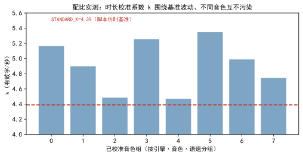

<!--
SPDX-License-Identifier: CC-BY-SA-4.0
Copyright (c) 2026 wUwproject
Licensed under Creative Commons Attribution-ShareAlike 4.0 International (CC BY-SA 4.0).
See https://creativecommons.org/licenses/by-sa/4.0/ for details.
-->

# 第二部 · 12｜排图与压比：期数为什么不能交给模型自由发挥

> 摘要：期数不能交给模型自由发挥——把素材总量除以单期容量定期数，等于把分组变成除法，那是朗读软件干的事。本文只讲一个口径：期数是合并与切分的结构结果，不是除法的商；而画地图的尺子（成稿目标、素材下限、压比红线）必须由配置实时推导、一处定义三处同变，模型只做单元凝缩与分组，不动期数这根弦。

## 一、引子：真实起点

一个项目立项，素材体量摆在那里。用户心里有个期望期数，模型也该有个判断。问题在于：若把「排几期」完全交给模型按素材体量自由发挥，它会把分组当成除法——素材总字数除以单期字数，商就是期数。

这听起来合理，却是错的。同一批素材，按结构合并能压成 3 期，按切片能摊成 9 期，除法给不出「这档节目该怎么切」的判断。期数一旦脱离结构、变成一道算术，地图要么把内容切得稀碎，要么干脆对体量视而不见。

所以这一版做的事，不是让模型更聪明地定期数，而是把期数这根弦从模型手里抽走：模型负责单元凝缩与分组，期数由合并与切分的结果决定，尺子由配置实时推导。

## 二、现象：期数曾被模型自由发挥

旧口径下，素材容量是「写死的 7900 字下限」——这个下限是裸成稿 × 1.2 算出来的，隐含「原文一字换脚本一字」的 1:1 假设 [6]。照它分组，一期只装得下约 6000 字原文，而实际一期脚本能消化几倍于此的素材——尺子系统性偏小，地图对体量失真。

更隐蔽的是压比（原文 ÷ 脚本）的分母被搞错：初版把「成稿 × 1.25」当成压比的「1」，分母含了偏移，体检显示「上限 5.00」而非真实的 6.25 [1]。分母错了，压比体检这道闸门量的是错的尺子，放行与拦截都不可信。

## 三、错误尝试：把期数交给模型等于把分组变成除法

把期数交给模型自由发挥，根子上是把「画地图」当成了「算除法」。代码层面，容量曾被写成「一期成稿字数」，且 `llm.input_ratio` 配置项把素材额度定义成「最大输出 × 输入倍率」——额度换算成具体数字后，仍由提示词把期数交给后端窗口去定 [1]。

这有几层错。其一是口径错位：素材容量本该等于「成稿目标 × 压比档 × 偏移」，与最大输出、后端窗口彻底脱钩；挂上窗口后，额度随上下文波动，同一份素材算出的容量天天变。其二是把期数当商：`estimate_episodes` 拿容量去除总字数定期数，等于把分组变成除法——那是朗读软件干的事，不是这档节目干的事 [2]。其三是 1:1 假设失真：模型的产出与素材近乎 1:1 消耗，实测 4034 ÷ 4132 ≈ 0.98，不留余量时素材等于目标也写不满，出路只剩把写过的段落再背一遍 [1]。

## 四、根因：期数是合并与切分的结果，不是除法

根因是同一句话：**期数是合并与切分的结构结果，不是除法的商；而尺子必须一处定义、三处同变**。

`estimate_episodes` 的口径被钉死在注释里——它只用来说事（排图前算产能、排完图之后跟实际期数比一比），**不参与决定排几期**；期数是合并与切分的结果 [2]。决定期数的，是结构：哪些单元合并、哪些切分，由模型做，但模型做的不是「定期数」，是「凝缩与分组」。

尺子则必须同源。三把尺子——单元下钻（单条超过名义容量才往下拆）、排图参照（一期素材大致多少字、上限另加 25%）、期数折算（只做参照）——共用 `probe.capacity` 一个口径 [1]。改一处，三处同变；谁也不许在提示词里另写一份 [1]。压比体检的分母也必须是裸成稿目标（`target_chars`），不是含偏移的量 [1]。

## 五、正确修法：口径法源 + 计划期数三态 + 产能预检 + 配比校准

修法把口径、期数控制权、护栏、校准四处一起收口。

**第一，容量口径法源**（`probe` 模块一处定义）[1]：1 = 输出 max = 每期时长 × 脚本估时基准（`target_chars`，不含偏移）；x = 输入 max = 1 × 偏移量 1.25 × 档位；下限 = 1 × 1.25 × 1.2（25 分钟一期 ≈ 9877 字）。偏移量 1.25 只进 x 与下限的算式，不改变「1」；压比体检的分母是 `target_chars`，与 `planner._ratio_issues` 共用同一把锚。下限公式从旧口径「裸成稿 × 1.2 = 7902 字」修正为「成稿 × 1.25 × 1.2 = 9877 字（约 9900）」[6]。

**第二，计划期数三态输入** [3]：排图依据弹窗新增「计划期数」字段，留空＝由模型按素材体量定，填数字＝按该数排；取值随素材类型、重点方向同一次请求落库（`planned_episodes`），排图时作为目标期数进入分组提示词。人填过就以人为准，重排不覆盖——与「planned_episodes 同一条纪律」一致 [3]。

**第三，产能预检护栏** [3]：素材量撑不起目标期数时，排图在凝缩前中止并回报最多可排期数；超出单次上限（`script.map_max_episodes`，默认 60）按上限排并出警告。上限在 `config_manager` 一处定义（整型、1–500）[5]，报错弹窗新增「去改排图依据」按钮，直达素材类型弹窗的「计划期数」——把修改入口指向唯一正确的位置 [3]。

**第四，配比实测校准** [4]：时长这把尺由 `duration_model` 校准闭环收口——合成得到实测时长后逐句配对拟合、EMA 平滑写回，按（引擎·音色·语速）分组，不同音色互不污染。脚本估时基准 `STANDARD_K ≈ 4.39 有效字/秒`，锚定在朗读口径中位（256 字/分）与本机 391 句实测（8541 汉字 ÷ 2005.0 秒 = 256 字/分），再把汉字换算为有效字（汉字 + 0.5×标点 + 1.5×西文 = 8789.5，即 1 汉字折 1.029 有效字），256÷60×1.029 = 4.39 [4]。

## 六、验证：压比红线、字数口径与校准系数

四类证据，测量条件一并给出。

**压比体检红线**（数据源 [1]）：分母＝成稿目标，上限 = 档位 × 1.25（1:5 档 = 6.25 达线）、下限 = 1.5；初版把「成稿 × 1.25」当「1」导致显示错误，修正后恢复「上限 6.25 / 下限 1.50」。

  
*图 1：左为 25 分钟一期的字数三口径（成稿目标 6585 / 下限 9877 / 1:5 档名义容量 32925，均由配置时长与档位推导）；右为压比体检两条红线，分母＝成稿目标，达标区 [1.5, 6.25]，上限 6.25（1:5 档达线）。*

**字数口径实测**（数据源 [1][6]）：下限由旧「裸成稿 × 1.2 = 7902 字」修正为「成稿 × 1.25 × 1.2 = 9877 字」；模型产出与素材 1:1 消耗实测 4034 ÷ 4132 ≈ 0.98，支撑「下限 1.2 是实测值、不留余量则写不满」。

**校准系数分布**（数据源 [4]，`calibration.json`）：已校准音色组的时长系数 k 围绕基准 `STANDARD_K=4.39` 波动，区间 4.47–5.35、均值约 4.92，不同音色互不污染；`chars_for_target` 由目标时长反推目标有效字数（L1 单参数 `t = 有效字 / (k·speed)`，L2 三参数最小二乘），改一个基准全项目脚本估时同步变。

  
*图 2：按（引擎·音色·语速）分组的校准系数 k 分布（数据源 `calibration.json`）。k 围绕脚本估时基准 4.39 波动，印证「尺子与音色无关、只在基准上做比例换算」的设计——这也是压比口径能脱离具体音色成立的前提。*

**配置一处定义**（数据源 [5]）：`script.map_max_episodes` 在 `config_manager` 一处定义，单测设版本一致钉，保证上限口径与界面、架构文档同源；`planned_episodes` 人填优先、重排不覆盖的纪律由 `project_store` 同一处落库 [3][5]。

## 七、结语：一句话可复用结论

期数是合并与切分的结构结果，不是除法的商；尺子由配置实时推导、一处定义三处同变——模型只做凝缩与分组，不动期数这根弦。把这两件事分清楚，画地图的才既不是朗读者，也不是算盘。

### 引用与出处说明

| 编号 | 引用 | 出处 |
|------|------|------|
| [1] | 容量口径法源：1=输出max=每期时长×脚本估时基准；x=输入max=1×1.25×档位；下限=1×1.25×1.2（25 分钟一期≈9877 字）；压比体检分母=成稿目标，上限 6.25 / 下限 1.5；1:1 消耗实测 4034÷4132≈0.98；旧下限 7902→9877 | podcast-maker · CHANGELOG.md · v0.10.0 · 新增/变更/修复/说明段 `podcast_maker/probe.py`（target_chars:461 / offset_chars:471 / capacity:500 / MIN_RATIO:458） |
| [2] | `estimate_episodes` 只做期数参照、不参与决定排几期；期数是合并与切分的结果，拿容量除总字数是除法（朗读软件干的事） | `podcast_maker/probe.py:estimate_episodes`（行 520–525，docstring 钉死口径） |
| [3] | 计划期数三态输入（填数/清空/地图回填）；产能预检护栏（撑不起则凝缩前中止、回报最多期数）；`script.map_max_episodes` 上限截断；「去改排图依据」按钮；人填优先、重排不覆盖 | podcast-maker · CHANGELOG.md · v1.4.0 · 新增/变更段 `podcast_maker/planner.py`（行 585–633，产能预检与上限截断）/ `project_store.py`（planned_episodes 落库纪律） |
| [4] | 时长校准闭环：合成实测→逐句拟合→EMA 写回，按（引擎·音色·语速）分组互不污染；STANDARD_K≈4.39（256 字/分朗读口径中位 + 本机 391 句实测 8541 汉字/2005s，有效字换算 1.029）；chars_for_target 由目标时长反推字数 | `podcast_maker/duration_model.py`（STANDARD_K:56–58 / chars_for_target:298） calibration.json（已校准组 k 分布，项目实证） |
| [5] | 配置项由 `config_manager._p` 一处定义（如 `script.map_max_episodes` 整型默认 60、1–500）；版本一致钉保证口径同源 | `podcast_maker/config_manager.py`（行 637，PARAM_SPEC 一处定义） `tests/test_config_keys.py`（版本一致钉） |
| [6] | 下限公式修正：裸成稿×1.2=7902 字 → 成稿×1.25×1.2=9877 字；容量全部由配置实时推导、旧档案与地图不受影响 | podcast-maker · CHANGELOG.md · v0.10.0 · 变更段「下限算式修正」/ 说明段「已有项目无需迁移」 |

## 延伸阅读

- **同书其他篇**：#2《配置总表如何同时驱动界面与管线》讲这张配置表怎么一处定义、同时喂给界面与管线；本篇的 `script.map_max_episodes`、`duration_model.STANDARD_K` 都是那张表的同一条纪律——期数与时长这两根弦，也由它一处定。

---

*最后更新：2026-10-12（已补丰富化：图 1 三口径+压比红线 / 图 2 校准系数分布 / 容量公式与 STANDARD_K 推导；四检：真实性 PASS / 底层逻辑 PASS / 空推论 PASS / 循环论证 PASS）*
