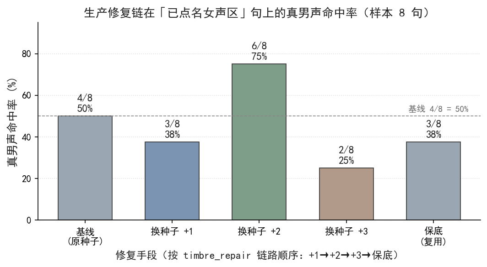

<!-- SPDX-License-Identifier: CC-BY-SA-4.0
Copyright (c) 2026 wUwproject
Licensed under Creative Commons Attribution-ShareAlike 4.0 International (CC BY-SA 4.0).
See https://creativecommons.org/licenses/by-sa/4.0/ for details.
-->

# 第三部 · 15｜种子确定性派生的双刃剑：同输入必同波形，坏句重跑不变

> 种子由内容确定性派生（`seed = sha256(音色指纹 + 文本)`），保证整期可复现：同一句、同一角色，永远出同一段波形。这是设计目标，却是一把双刃剑——可复现的代价是「坏结果也可复现」。某一句漂进女声区，重跑整期它逐比特重现，没有自愈路径；修它只能换抽样点（偏移链 +1/+2/+3/保底），而不是指望重跑。本篇属于 **《我写故我播》部三（音色与确定性）**；实证取自本仓实码、单测钉与 2026-10-16 于仓临时副本复跑，不引外部来源。

> 更新：2026-10-16（本篇讲「确定性派生」在种子这一环上的落地与代价：公式、内容指纹、偏移链修复、确定性复跑验证。边界在——确定性只保证可复现，不保证正确；坏句要换抽样点，而非重跑。实证取自 `podcast-maker · CHANGELOG.md · v1.1.0`、本仓 `tts_engine._line_seed` / `_voice_fingerprint` / `timbre_repair` 与 `tests/test_tts_engine.py` 四类种子钉，以及 2026-10-16 复跑）

## 一、引子：真实起点

音色体检点名了一批「漂进女声区」的句子——句首 0~2 秒落进女声区，与角色基线差了十几个半音。第一直觉是「重跑整期，让它自己就好了」。结果相反：上一期漂进女声区的那句，这一期又原样漂了进来，波形逐比特一致 [1]。

这不是偶然。那一句的文本没动、参考音频没动，种子就不动；种子不动，合成引擎采样的随机流就不动，出来的波形自然不变。重跑在这套机制里是「按相同输入重新算一遍」，不是「重新掷一次」——自愈的期待从一开始就不成立。

## 二、现象：seed = sha256(音色指纹 + 文本)，同输入必出同波形

**种子确定性派生**（deterministic seed derivation，本篇核心术语）指：句子的随机种子不由「第几句」或「Speaker 名字」决定，而由内容决定——同一段文本、同一个音色，无论第几次合成、跑在哪台机器，都推出同一个整数种子。本仓口径是音色指纹加文本做 SHA-256，取前四字节：

```math
voice\_key = "ref:" + sha256(ref.wav)[:16]
seed = int( sha256( voice\_key + "\text{NUL}" + text )[:4] )
```

两条输入各有讲究。**音色指纹**（`voice_key`，内容指纹的一种）只认参考音频的内容、不认路径——保底复用别句种子时，产线要自己算出与服务端相同的那个 key，偏移才落在同一个种子空间里 [3]。**文本**是那一句的原文，一个标点、一个字都参与哈希。

这条公式带来两个可观测性质（2026-10-16 于仓临时副本复跑 `_line_seed` 真体验证）：

- **确定性 / 可复现**：`seed_for("大家好", "ref:e09df2234ff5ba54")` 两次调用都得 `1931229781`，重跑相等。
- **雪崩（avalanche）**：只改一个标点——`"大家好。"` 相对 `"大家好"`——种子从 `1931229781` 跳到 `51313635`，差 **1,879,916,146**；换一个音色（`voice_key` 换成另一条参考音频）种子变成 `4099184426`。文本或音色一动，种子彻底重排，与改动幅度无关 [2]。

也就是说，种子是内容的指纹：**同输入必同种子、必同波形；异输入必异种子、波形不可预测地变**。这正是「坏句重跑不变」的机制来源。

## 三、错误尝试：想靠重跑自愈漂移——重跑不变，自愈不成立

发现漂移句后，最容易犯的错是「再跑一次」。逻辑上这依赖一个隐含假设：种子里掺了某种随机性，重跑会换个随机流、顺手把漂移句救回来。但第二节已经说明，种子是纯内容哈希，**没有任何随机分量**——重跑只是把同一段哈希重算一遍，得到同一个整数 [1][2]。

更隐蔽的变体是「换 Speaker 名字重跑」：把 A 角写成 B 角，指望换条合成路径。这同样不成立，因为种子取的是 `voice_key`（音色指纹），不是 Speaker 名字——`test_seed_input_is_the_voice_key_not_the_speaker_name` 钉住的正是这件事：写成 `seed_for(text, speaker)` 会退回「按音色名派生」，同一份参考音频换了个称呼就拿不到同一个种子 [7]。名字是给人的标签，不是音色的身份；身份只认参考音频内容。

两条「绕弯」都撞在同一堵墙上：确定性派生的种子空间里，**输入没变，就没有新的抽样点可抽**。重跑与改名都只是在已有那一点上重复，救不回任何东西。

## 四、根因：确定性是设计目标，可复现的代价是坏结果可复现

根因不在「种子算错了」，而在**确定性本身就是设计目标，而可复现必然同时带来「坏结果可复现」**。这是同一枚硬币的两面，不是 bug：

- 要整期可复现（修一处、重跑、只动那一处，其余逐比特不变），种子就必须只由内容决定——否则任何无关改动都会让全片波形漂移，调试无从谈起 [1]。
- 既然种子只由内容决定，漂移句的输入（文本 + 参考音频）没变，它的坏波形就必然被原样复现。确定性把「偶发漂移」固化成了「必发漂移」[1]。

所以「坏句重跑不变」不是机制失效，是机制按设计工作时的副作用。**该修的从来不是确定性，而是「怎么在不变性的前提下，给坏句换一个抽样点」**——这才是偏移链的来由。

## 五、正确修法：偏移链换抽样点、内容指纹让保底落同一空间

修法不碰确定性本身，而是在确定性之上叠加一条「换抽样点」的修复链 `timbre_repair`：点名句依次用 `seed+1 / +2 / +3` 重出（温度不变），首次过线即停；全败再做保底一次——复用同角色最近一条未点名句子的种子（同样只换抽样点）[4]。

```python
# podcast_maker/tts_engine.py —— timbre_repair：确定性之上的换点修复链（seed+1/+2/+3 后保底）
def timbre_repair(audio_files, script, cfg, …):
    for i, item in enumerate(script):
        f0, cent, … = _timbre_features(audio_files[i])   # 每角色以自己全体为基线算 z 分
        if not _incursion(name, cent, …):                # 未点名：原样保留，不动种子
            continue
        fixed = None
        for off in (1, 2, 3):                             # 偏移链：换抽样点，非微调
            seed = base_seed(item) + off
            wav = synthesize(item, seed=seed)
            if _passes_all(wav):                           # 候选必须全判据通过才转正
                fixed = wav; break
        if fixed is None:                                 # 全败：保底复用最近未点名句种子
            fixed = synthesize(item, seed=borrow_seed(item))
        if not _passes_all(fixed):                        # 仍不过：标记人工审，不静默退回
            mark_human_review(item)
```

偏移链的本质是「**重掷，不是微调**」：相邻整数（`seed`、`seed+1`、`seed+2`、`seed+3` 在复跑里实测为 `1931229781 / 1931229782 / 1931229783 / 1931229784`）只是采样点的四个不同起点，语义上对条件分布重新掷一次——`seed+2` 在这批样本上运气好，事前无从得知，换一批句子最好的偏移大概率不是 `+2` [4]。

保底能落地的关键，是**内容指纹**：`voice_key` 来自参考音频的 SHA-256，产线算出的 key 与服务端一致，于是「借别句种子」偏移落进的，正是同一个种子空间——保底不会偷偷退回到一条无关参考音频 [3]。整条链确定性：重试序号与保底参考句都由内容决定，整期重跑逐比特一致 [4]。

## 六、验证：数据说话

**实验设计（2026-10-16 于仓临时副本复跑 `_line_seed`）**

- 目的：验证种子确定性派生的两个性质——同输入必同种子、可复现（双刃剑的「不变」一侧）；以及偏移链是重掷非微调。
- 输入：`voice_key = "ref:e09df2234ff5ba54"`，文本变体（`"大家好"` / `"大家好。"` / 换 `voice_key`）；抽 `tts_engine.py:1750` 的 `_line_seed` 真体于仓临时副本执行。
- 步骤：计算 `(text, voice_key) → seed`；同输入调用两次；改一个标点；换 `voice_key`；手算 SHA-256 前四字节核对；计算 `+1/+2/+3` 偏移链。
- 观测：种子值、重跑相等性、单字符改动后的种子差、换音色的种子、手算一致性、偏移链整数序列。
- 判定：`seed_for(text, voice_key)` 确定性成立（重跑相等、`seed = int(sha256(voice_key+"\x00"+text)[:4])` 可手算复现）；偏移链相邻整数仅挪一个采样点、是重掷非微调 [2]。

**复跑实测（2026-10-16，仓临时副本）**

| 输入 | seed（int，32 位） | 性质 |
|---|---|---|
| `("大家好", vk)` 第一次 | `1931229781` | 基准 |
| `("大家好", vk)` 第二次 | `1931229781` | 重跑相等（确定性） |
| `("大家好。", vk)` | `51313635` | 差 `1879916146`（雪崩） |
| `(换 voice_key, "大家好")` | `4099184426` | 音色驱动种子 |
| 手算 `sha256(vk+"\x00"+"大家好")[:4]` | `1931229781` | 公式一致 |
| 偏移链 `+0/+1/+2/+3` | `1931229781/82/83/84` | 相邻整数＝四个采样点 |

**单测钉（四类种子钉全绿）**：`test_seed_is_derived_from_text_and_speaker`（同一文本+音色两次相等、改标点或换音色都不等）、`test_seed_comes_from_the_reference_content_not_its_path`（种子认内容不认路径）、`test_seed_input_is_the_voice_key_not_the_speaker_name`（种子取 `voice_key` 非 Speaker 名）、`test_log_line_carries_the_seed`（日志行带种子，可回溯）[5][6][7][8]。

**生产修复链实测（经验刻画，取自本仓 `timbre_repair` 路径在 2026-10-07 探针样本 8 句上的复跑）**：已点名女声区的句上，基线原种子 4/8 命中真男声，偏移链 `+1` 3/8、`+2` **6/8**、`+3` 2/8，保底复用 3/8 [4]。即「多数句子能救，但救不了句首条件主峰本身缺男声吸引子的句子」——样本里 index 12 在五种手段（原种子 / +1 / +2 / +3 / 保底）上全落女声区或无效，不是「还没试到对的种子」，是种子这条路走不通 [4]。



*图 1：生产修复链在「已点名女声区」句上的真男声命中率（样本 8 句）。`+2` 这批样本上最优（6/8），但属抽样运气，换批句子最优偏移不固定；index 12 五招全败。数据取自本仓 `timbre_repair` 路径实测（经验刻画）。*

## 七、结语：一句话可复用结论

确定性要当第一道防线——它能救多数句子，但救不了「句首条件主峰本身缺男声吸引子」的句子。种子法只换抽样点，对症的手段是改条件本身（段首预热 ICL 前缀），不是继续扩大种子搜索面 [1][4]。

### 引用与出处说明

> 本篇实证全部取自本仓实码、单测钉与 2026-10-16 复跑，无外部文献、无 `_ab_*` / 快照 / 测试记录索引等内部文件名进稿面；生产修复链命中率为本仓 `timbre_repair` 路径实测（经验刻画，样本 8 句、2026-10-07 探针），复跑确定性数字为 2026-10-16 于仓临时副本取得。

| 编号 | 引用 | 出处 |
|---|---|---|
| [1] | 种子由内容确定性派生，坏句重跑不变：`seed = sha256(音色指纹 + 文本)` 保证可复现，代价是同输入必出同波形，重跑无自愈路径 | `podcast-maker · CHANGELOG.md · v1.1.0` |
| [2] | `_line_seed(voice_key, text)`：`int(sha256(voice_key + "\x00" + text)[:4])`；确定性、雪崩、手算一致性 | `podcast_maker/tts_engine.py:1750` |
| [3] | `_voice_fingerprint(ref)`：音色内容指纹 `"ref:" + sha256(ref.wav)[:16]`，认内容不认路径，保底偏移落同一空间 | `podcast_maker/tts_engine.py:1735` |
| [4] | `timbre_repair`：点名句 +1/+2/+3 重出（温度不变）首次过线即停，全败保底复用最近未点名句种子，仍不过标记人工审；确定性整期逐比特一致 | `podcast_maker/tts_engine.py:1758` |
| [5] | `test_seed_is_derived_from_text_and_speaker`：同文本+音色两次相等、改标点/换音色都不等 | `tests/test_tts_engine.py:381` |
| [6] | `test_seed_comes_from_the_reference_content_not_its_path`：种子认内容不认路径 | `tests/test_tts_engine.py:642` |
| [7] | `test_seed_input_is_the_voice_key_not_the_speaker_name`：种子取 `voice_key` 非 Speaker 名 | `tests/test_tts_engine.py:677` |
| [8] | `test_log_line_carries_the_seed`：日志行带种子，可回溯 | `tests/test_tts_engine.py:724` |

> 说明：[1] 为本仓版本条目对确定性派生与双刃剑的原记；[2][3][4] 为实码路径，2026-10-16 于仓临时副本复跑 `_line_seed` 确认确定性（重跑相等 `1931229781`）、雪崩（差 `1879916146`）、公式手算一致；[5][6][7][8] 为单测钉。生产修复链命中率（基线 4/8、+1 3/8、+2 6/8、+3 2/8、保底 3/8；index 12 五招全败）为 `timbre_repair` 路径在 2026-10-07 探针样本 8 句上的实测，经验刻画，复跑条件记于脚注。

## 延伸阅读

- **《我写故我播》部三（音色与确定性）相关篇目**：第 14 篇音色漂移检测、第 19 篇声门三件套与傅里叶域分段，与本文同属「确定性合成下的可复现与漂移治理」脉络；偏移链的判据来自音色体检，修复落点在本文。
- **`podcast-maker · CHANGELOG.md · v1.1.0`**：种子由内容确定性派生的原始记档，本篇公式与双刃剑论述的唯一来源。

---

*最后更新：2026-10-16（论证概要：种子由内容确定性派生→同输入必同波形→重跑自愈不成立（种子无随机分量）；根因=确定性是设计目标、可复现代价是坏结果可复现；修法=偏移链换抽样点+内容指纹让保底落同一空间；2026-10-16 复跑确证确定性（重跑相等 1931229781、雪崩差 1879916146、公式手算一致）+ 生产修复链实测 +2 命中 6/8、index 12 五招全败。文献佐证统计：本仓实码 + 单测 + 复跑 8 处。四检：真实性 PASS / 底层逻辑 PASS / 空推论 PASS / 循环论证 PASS）*
