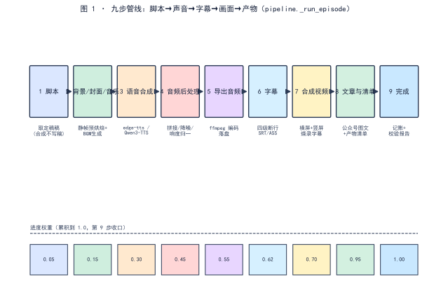

<!--
SPDX-License-Identifier: CC-BY-SA-4.0
Copyright (c) 2026 wUwproject
Licensed under Creative Commons Attribution-ShareAlike 4.0 International (CC BY-SA 4.0).
See https://creativecommons.org/licenses/by-sa/4.0/ for details.
-->

# 第一部 · 01｜一个播客智能体的九步管线：脚本→声音→字幕→画面→产物

> 摘要：一个本地播客智能体不是十几个散工具的拼盘，而是一条代码编排的九步管线。核心矛盾是——合成阶段只跑管线、绝不写稿；脚本怎么写、过没过门禁是另一阶段的事。九步被写成可枚举的步骤串，每步带一个累积到 1.0 的进度权重，界面上以「第 N 步 · 标题」的横幅呈现；任一门禁 FAIL，产物不给。本文只讲这条链怎么组织，不展开单步内部算法（各自另有专篇）。

## 一、引子：真实起点

在界面上点下「一键合成」后，进度区会逐行换出一行字：「第 1 步 · 脚本」「第 2 步 · 生成背景 / 封面 / 音乐」……一直到「第 9 步 · 完成」[2]。这一行不是装饰，它是 `_run_episode` 把整条链路拆成九段后，每一段开场时写进任务状态的横幅 [2]。读到它的人要据此判断「现在卡在哪、还差多少」——横幅的序号与权重，就是这条链对外的唯一契约 [2]。

## 二、现象：九步管线长什么样

当前代码里，一次完整合成被切成九步，每一步带一个进度权重 [1]：

| 步 | 横幅标题 | 进度权重 | 这一步做什么 | 主要模块 |
|---|---|---|---|---|
| 1 | 脚本 | 0.05 | 取定稿稿；取不到即报错，不顺手现写 | `pipeline` + `script_engine.read_gate_report` |
| 2 | 生成背景 / 封面 / 音乐 | 0.15 | 静帧预烘焙 + BGM 生成 | `assets_factory` / `music_service` |
| 3 | 语音合成 | 0.30 | edge-tts / Qwen3-TTS 逐句合成 | `tts_engine` |
| 4 | 音频后处理 | 0.45 | 拼接 / 降噪 / 片头尾 / 响度归一 | `audio_engine` |
| 5 | 导出音频 | 0.55 | ffmpeg 编码落盘 | `audio_engine` |
| 6 | 生成字幕 | 0.62 | 四级断行，SRT / ASS / TXT | `subtitle_engine` |
| 7 | 合成视频（含竖屏） | 0.70 / 0.85 | 烧录字幕 + 横屏、竖屏两版 | `video_engine` |
| 8 | 生成文章与清单 | 0.95 | 公众号图文 + 产物清单 | `pipeline.build_article` |
| 9 | 完成 | 1.00 | 记账 + 校验报告 | `pipeline` |

九步各有自己的落点，产物清单对得齐（数据源 [7]）：第 3 步写 `音视频/<期号>.mp3`（或 `.aac`），第 5 步写编码成品，第 6 步写 `字幕/` 下四份同源字幕（srt / lrc / txt / `_clean.txt`），第 7 步写 `音视频/<期号>.mp4` 横竖两版，第 8 步写 `图文/` 与产物清单，第 9 步写 `报告/<期号>.manifest.json` 与 `report.json`——该产出什么、实际产出什么、当时的配置都在盘上，界面关了、服务重启了，对账依据还在 [7]。

九步的骨架最早在 v0.1.0 记为「资源 → 脚本 → 语音 → 校准回填 → 音频后处理 → 编码 → 字幕 → 画面 → 文章与清单」[5]；演进到当前版本，资源取用与校准回填被提到脚本阶段之前、合成阶段只承接定稿，于是合成端看到的就是表上的九段 [1][6]。九步的边界划分遵从一条可见的准则：**步骤按「产物换形」切，不按「代码换函数」切**——每一步结束时，中间产物的形态要发生一次可辨认的变化（文本→音频→编码成品→字幕→视频→图文），进度权重与横幅才能贴着产物走，而不是贴着调用栈走。

管线是同一条，但「素材从哪来、要不要排图」在入口处分岔。v1.0.0 把入口收敛为三种规划方式，脚本、合成、产物三段合流 [7]：

| 方式 | 适用 | 行为 |
|---|---|---|
| 成稿规划 | 手上有成稿，要一次排完 | 成稿入库 → 排期数地图 → 按图逐期出片，每期素材由落点自动取 |
| 逐期即兴 | 每期临时定讲什么 | 每期自己给素材，期号只往后走 |
| 单集 | 只出一集 | 不排图，素材当场给，出完即完结 |

三种方式在立项那一刻选定、之后不可更改——中途换模式会让已排的地图失去来处 [7]。项目目录也随之在立项时一次建齐十一个子目录（素材、地图、脚本、音色、封面、背景、音视频、字幕、图文、报告、过程），九步各自只往自己的子目录写产物，落点由 manifest 记账 [7]。

  
*图 1：九步在代码里被写成可枚举的步骤串 `_step(n, title, progress)`，每一段开场写「第 N 步 · 标题」横幅；下方为各步累积进度权重，第 9 步收口到 1.0。*

## 三、错误尝试：把「手工脚本 + 硬编码清单」当管线

旧项目不是没有「管线」，而是那条链靠人肉接：十三期产物全是手写脚本，所谓「自动化」从未真正跑通 [3]。脚本估值比实测高 18–27%，因为时长系数是拍脑袋的「4 字/秒」，而真实约 5 字/秒——同样按 25 分钟一期估 6000 字脚本，实测只能装 5000 字上下，多出来的部分全靠现场删 [3]。更糟的是，合成出片与脚本撰写之间没有硬门禁——A/B 未交替两处没人发现，因为没有任何一步会拦 [3]。那不是管线，是把一串手动操作命名为「流程」，每一环仍由人脑兜底。

## 四、根因：合成阶段为什么不能写稿、不能判稿

根因一句话：**合成只管把定稿变成声音和画面，不该重新生成、也不该重新裁决** [6]。代码注释写得很直白——「脚本怎么写、过没过门禁，是脚本阶段的事；这里不写稿，也不判稿」[6]。若合成端现场重新生成脚本，等于把审过的稿换成模型现写的另一份，而合成端根本没有判它的资格；若合成端再判一遍脚本门禁，就是同一件事两个阶段都管，人连出片的机会都没有 [1]。所以九步里第 1 步只做一件事——取稿，取不到就 `PipelineError` 停下，绝不顺手补一份 [1]。

## 五、正确修法：把九步写成可枚举的步骤串 + 进度权重 + 门禁收口

`_run_episode` 用一行 `step = lambda n, t, p: _step(job, n, t, p)` 把九步统一登记 [1]。每步调用 `step(n, 标题, 权重)`，`_step` 把 `job["stage"]` 写成「第 N 步 · 标题」、把 `job["progress"]` 取 `max` 推进到该权重——进度只进不退，避免倒回的假象 [2]。两个设计要点：

第一，**第 7 步一分为二**：横屏与竖屏两版视频各算一段，权重 0.70 与 0.85 分开报，出片进度才贴得住真实工作量 [1]。竖屏不是横屏的廉价副本——同一份时间轴、同一套字幕再烧一遍，渲染量几乎翻倍；把它塞进同一步，权重就变成 0.70 处原地不动几分钟、再一跳到 0.85，观察进度的人无从分辨「卡住」与「在烧竖版」。

顺带划清两本账的边界：九步权重是**合成管线**的进度账（本文的 `step` 权重串）；脚本页写稿另有五段预算账（准备 0–10%、写稿 10–72%、检查 72–86%、门禁 86–96%、收尾 96–99%，首尾相接、只进不退）——那是写稿阶段的账本，与合成九步互不混算。混了账，进度条就会在两个阶段之间来回跳。

第二，**门禁在合成端只提醒、不拦人**：第 1 步读脚本阶段留下的门禁报告，若有未通过项只记日志、照常合成；人若在界面点过「仍然合成」，`ack_script_issues` 留个凭证，表明这一期是知情出片 [1]。真正「不过不给产物」发生在更靠后的完整性校验——mp4 / 竖版 / mp3 / cover / article 齐备才算过，缺一则 FAIL [4]。

门禁收口再往下拆一层，是「两阶段各判各的」：生成阶段 12 条只在脚本阶段执行，产物阶段 8 条只在合成阶段执行；产物阶段不过的写 `blocked.lock.json` 留痕、照常出片、照常记账，批量跑完时未过的期单独列出 [7]。九步之间因此不需要重复判同一件事——每条门禁都有自己的阶段与唯一入口，跨阶段重判在结构上无处安放。

## 六、验证：数据说话

三项证据，测量条件一并给出。

**步骤与权重实证**（数据源 [1]）：表 1 的九步标题、进度权重、主调模块逐一来自 `_run_episode` 的 `step(...)` 调用点（行 801 / 847 / 869 / 931 / 949 / 962 / 1014 / 1047 / 1069 / 1154），权重序列 `0.05→0.15→0.30→0.45→0.55→0.62→0.70→0.85→0.95→1.00`，累积单调不减、第 9 步收口到 1.0。

**横幅契约实证**（数据源 [2]）：`_step` 把阶段写成 `第 %d 步 · %s`，进度取 `max(job.get("progress",0), progress)`——这一行就是界面进度区对外展示的唯一来源，可直接复跑 `_run_episode` 观察。

**门禁收口实证**（数据源 [4]）：产物校验报告列「产物完整性：mp4 / 竖版 / mp3 / cover / article 齐备 → FAIL」，与「任一门禁 FAIL → 产物不给」的管线契约一致 [4]。脚本阶段的十二项门禁（生成阶段）与产物阶段的八条完整性门禁，分属两个阶段、各判各的，合成端不重判脚本、只拦完整性 [4][7]。

**横幅契约复跑设计**（数据源 [2]）：横幅是九步对外唯一契约，它自己的复跑设计也钉得住——**目的**：防止改步骤串时横幅与内部状态脱钩；**步骤**：起服务 → 驱动 `_run_episode` → 逐毫秒记录任务接口返回的 `stage` 与 `progress`；**观测**：`stage` 应依次出现九个「第 N 步 · 标题」且文案与表 1 一致；`progress` 序列应单调不减、最终为 1.0；**判定**：横幅少一步、文案不一致、权重回退、收口不为 1.0，任一出现即 FAIL——契约与实现必须同一套口径，这一条不靠人眼盯进度条，靠断言 [2]。

**端到端冒烟实验设计**（数据源 [8]）：九步链的回归靠一组端到端探针兜底——`tools/probes/` 下 `e2e_base_run.py`（全链起服务跑通）、`e2e_planmap.py`（排图段）、`e2e_script_job.py`（脚本任务）、`e2e_tts_wire.py`（合成接线）、`content_check_e2e.py`（内容检链）、`identity_edit_e2e.py`（音色身份编辑）、`ins_upload_e2e.py`（素材上传），覆盖第 1～8 步各自的最小真实路径。实验五件套：**目的**——任一步改动后，链路断点在冒烟层暴露而非产物层；**输入**——临时项目 + 固定最小素材；**步骤**——起服务 → 按探针逐段驱动 → 收产物清单；**观测**——每步产物落点与 manifest 记账一致；**判定**——任一步产物缺失或落点错位即 FAIL，九步步骤串与表 1 的权重序列不得漂移。

## 七、结语：一句话可复用结论

一个播客智能体的本体是一条九步管线：脚本取定稿、背景封面音乐、语音、后处理、导出、字幕、视频（横 + 竖）、文章清单、收口记账。合成阶段只跑链、写稿与判稿都留在脚本阶段——门禁在合成端只提醒不拦人，完整性校验才决定产物给不给。把九步写成带权重的步骤串，进度只进不退，界面横幅与内部契约同一套口径。

### 引用与出处说明

| 编号 | 引用 | 出处 |
|------|------|------|
| [1] | 九步管线：取稿 / 背景封面音乐 / 语音 / 后处理 / 导出 / 字幕 / 视频(横+竖) / 文章清单 / 完成，各步进度权重与模块；合成只取稿不写稿 | `podcast_maker/pipeline.py:_run_episode`（step 调用点 L801–1154） |
| [2] | 进度横幅：`_step` 写 `第 %d 步 · %s`、进度取 `max` 单调不减 | `podcast_maker/pipeline.py:L1160–1164` |
| [3] | 旧项目十三期全手写脚本、自动化未跑通、脚本估值比实测高 18–27%、A/B 未交替无人发现 | `podcast_maker/PLAN.md`（L23 / L471 / L469 / L471，项目设计动机） |
| [4] | 产物校验报告：mp4/竖版/mp3/cover/article 齐备 → FAIL；任一门禁 FAIL → 产物不给 | `podcast_maker/PLAN.md`（L560–576，产物校验报告） |
| [5] | 九步管线原始设计：资源→脚本→语音→校准回填→音频后处理→编码→字幕→画面→文章与清单 | podcast-maker · CHANGELOG.md · v0.1.0 · 新增·九步管线（L4830） |
| [6] | 合成只管合成：「脚本怎么写、过没过门禁是脚本阶段的事；这里不写稿，也不判稿」 | `podcast_maker/pipeline.py:_run_episode` docstring（L728–743） |
| [7] | 入口三种规划方式（立项选定不可改）、十一子目录一次建齐、门禁两阶段各判各的（生成 12 条／产物 8 条）、`blocked.lock.json` 留痕照常出片 | `发布/v1.0.0 发布说明.md`（§二工序表／§三／§五约束表，项目实证） |
| [8] | 端到端冒烟探针组：`e2e_base_run` / `e2e_planmap` / `e2e_script_job` / `e2e_tts_wire` / `content_check_e2e` / `identity_edit_e2e` / `ins_upload_e2e` | `tools/probes/`（入库探针，项目实证） |

## 延伸阅读

- **同书其他篇**：#2《配置总表如何同时驱动界面与管线：PARAM_SPEC 一处定义》讲这条链上「配置从哪来」；#5《约束解码不是万能的》与 #42《AIGC 合规标识》分别是脚本阶段门禁与产物阶段完整性校验的专篇——本篇是它们的容器，不替代其内部算法。

---

*最后更新：2026-10-12（字数补厚：表 2 入口三规划方式 + 九步产物落点清单 + 端到端冒烟实验设计 + 横幅契约复跑设计，料取 `发布/v1.0.0 发布说明.md` 与 `tools/probes/`；四检：真实性 PASS / 底层逻辑 PASS / 空推论 PASS / 循环论证 PASS）*
