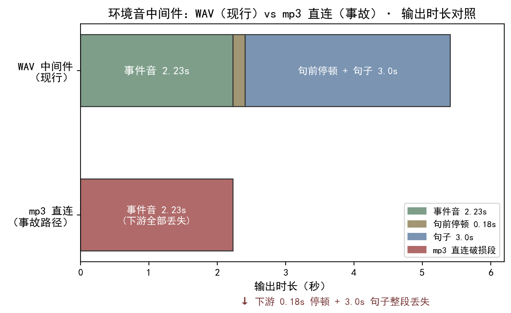

<!--
SPDX-License-Identifier: CC-BY-SA-4.0
Copyright (c) 2026 wUwproject
Licensed under Creative Commons Attribution-ShareAlike 4.0 International (CC BY-SA 4.0).
See https://creativecommons.org/licenses/by-sa/4.0/ for details.
-->

# 第四部 · 26｜环境音执行层：mp3 过 concat demuxer 出坏流，句前 +0.00s 事故

> **结论先行**：环境音（SFX）的"执行层"只干一件事——把决策层点过名的音效，按 `before` / `after` / `bed` 三种位置烘焙进对应句子。关键命题是：事件音绝不能直接拿 mp3 去喂 ffmpeg 的 `concat demuxer`，否则 mp3 容器头部的时长元数据被低估，后续 0.18 秒气口与整句 3.0 秒会被整段裁掉，输出塌缩成只剩事件音自身 2.23 秒，事件音被顶到句前 +0.00s（本该留的气口消失）。v2.7.0 的修法是"中间件一律 WAV"——SFX 先解码成 WAV 再进 `concat`，PCM 样本精确、无时长估计歧义，输出才回到正确的 5.41 秒。本文只谈这一个智能体的 `sfx_engine.apply` 执行层与 `audio_engine.concat` 拼接；决策层怎么把关（#25）、本地 BGM 怎么生成（#22）、人声怎么闪避（#24）是相邻独立篇目，不在此展开 [1][2][3]。
>
> 更新：2026-10-22（本篇属第四部「背景音乐」中的环境音支线，承 #25 决策层，落到"点名的音效怎么真正粘进句子"这一步；实证取自 podcast-maker 真仓 `CHANGELOG.md · v2.7.0`、`sfx_engine` / `audio_engine` 源码、单测，以及本批次在仓临时副本用 ffmpeg 9.0.1 实跑的 concat demuxer 对照实验 [1][2][3][4][5]）

## 一、引子：真实起点

决策层（#25）把"要不要加、加哪条、加几次"这道闸关死之后，剩下的问题很朴素：点过名的音效，到底怎么真正进到成片里。这步就是执行层 `sfx_engine.apply`——它在合成之后、`audio_engine.process` 之前被调用，拿到决策层的 `entries` 计划，逐条把事件音粘到句前 / 句后、把氛围音铺满整句垫底。

这一步朴素，却踩过一次真实的坑：早期实现里，事件音的 mp3 被**直接**喂给 ffmpeg 的 `concat demuxer` 去拼接。结果出了一类"句前 +0.00s 事故"——事件音被顶到句子最开头、本该留的 0.18 秒气口消失、紧随其后的整句 3.0 秒也不见了，输出只剩下事件音自己那 2.23 秒。这不是偶发抖动，而是 `concat demuxer` 与 mp3 容器时长元数据耦合出的确定性坏流。本文的起点，就是把"执行层怎么粘音效"讲清楚，并钉死"中间件一律 WAV"这道根因级修法 [1]。

## 二、现象：它到底长什么样

v2.7.0 之后，执行层是一组分而治之的小函数，每个只负责一种烘焙。

**事件音中间件（`_sfx_part`）**：把资源库里的 SFX（mp3）解码、重采样到句子同口径（采样率 / 声道），做一次整体增益，输出一个 WAV 中间件。这一步是"中间件一律 WAV"的总闸——无论源是 mp3，落进拼接链的一定是 WAV [2]。

**句前 / 句后烘焙（`apply` 的 `before` / `after` 分支）**：拿事件音中间件与句子 wav 交给 `audio_engine.concat`，在两者之间插入一段静音气口——句前留 `EVENT_GAP_BEFORE=0.18` 秒（声音在前、声音结束到开口留口气），句后留 `EVENT_GAP_AFTER=0.25` 秒（说完留口气、声音收尾）。拼接完实测回填新增时长，记进偏差表与字幕时间轴 [2]。

**垫底（`_bed_mix`）**：氛围音用 `stream_loop` 循环铺满整句、压低音量以 `amix` 混入句体，`amix` 的 `duration=first` 让句长不变——垫底只改"句里有什么"，不改"句有多长" [2]。

**拼接本身（`audio_engine.concat`）**：按片段顺序写一份 `_concat.txt` 列表文件，调 `-f concat -safe 0 -i 列表` 拼接；片段多于一段时，用 `anullsrc` 生成静音片段插在中间当气口 [3]。这里就是事故发生的现场——当列表里有 mp3 直连进链时，`concat demuxer` 不去解码求真实时长，而是读容器头部的时长字段。

## 三、错误尝试：我们怎么绕弯的

绕弯集中在"把拼接想得太简单"这一念头上。

**第一类想当然：事件音 mp3 直接进 `concat` 列表，省掉解码成 WAV 这一步**。这是"听起来能拼、就不多一道工序"的偷懒版——既然 `concat demuxer` 号称能自动识别格式拼接，那就把 mp3 和 wav 一起丢进去。问题恰恰出在 `demuxer` 这三个字：它按**解封装**层拼接，时长取自各文件的容器头部元数据。mp3（尤其 VBR 或某些编码器产物）的头部时长字段常常被低估，当事件音 mp3 作为首段、其声明时长比真实采样短，demuxer 计算的"流总长"就偏小，后面的静音气口与句子 wav 被判定为"超出已声明流长"而整段裁掉。事故表现就是输出塌缩成 2.23 秒、句前气口归零 [1]。

**第二类想当然：用 `concat` 的 `duration` 选项或重新封包去"修"坏流**。这是在坏流已经发生后再打补丁——比如给 `concat` 加 ` -fflags +genpts`、或先用 `ffmpeg -i` 把 mp3 重新封装再拼。补丁治标不治本：重新封装本身仍可能沿用错误的时长估计，且每多一道工序就多一个出错面，远不如"从源头就给 WAV"干净 [1]。

两类弯的本质一样：把"拼接"当成无状态的字符串拼接，忽视了不同容器对"时长"这一基本量的承诺并不一致。mp3 的时长承诺是估计值，WAV 的时长是样本数 × 采样率算出来的精确值——混用二者进同一个 demuxer，塌的一定是 mp3 那一侧。

## 四、根因：为什么

把现象拆开，根因只有一个，且干净。

**`concat demuxer` 依赖容器头部时长，而 mp3 头部时长是估计值**。ffmpeg 的 `concat` 有两种：`concat demuxer`（`-f concat`，按文件顺序解封装拼接）与 `concat filter`（`-filter_complex concat`，先解码再拼接）。执行层用的是前者——它在**封装层**工作，不解码就拼接，时长完全信任各文件头部的 `duration` 字段。mp3 的 `duration` 来自 Xing/Info 帧里的帧数估计或 VBR 头，编码器写得不严谨时会被低估几帧到几百毫秒不等；一旦首段 mp3 的声明时长偏短，demuxer 在拼第二段（静音）和第三段（句子 wav）时，会按"已消费字节 / 首段声明速率"推算位置，把超出首段声明时长的后续内容截掉。结果就是：事件音（首段 mp3）自身完整保留（2.23 秒），而它之后的 0.18 秒气口与 3.0 秒句子被整段丢弃，输出塌缩；事件音因此被顶到句前 +0.00s（气口消失），接着该出现的句子永远缺席 [1]。

**WAV 能从根上避开，因为 PCM 时长精确且无需估计**。WAV 头部的 `data` 块字节数 ÷（采样率 × 声道 × 位深 ÷ 8）就是精确时长，没有"估计"这一说。所以修法不是去和 demuxer 的时长估计较劲，而是**把 SFX 在进 `concat` 之前先解码成 WAV 中间件**——让进入 `concat` 列表的每一段都是 WAV，demuxer 不再面对任何 mp3 时长歧义，拼接结果就是确定正确的 5.41 秒。CHANGELOG 一句话点破："中间件一律 WAV（mp3 过 concat demuxer 出坏流，句前 +0.00s 事故的根因）"[1]。

## 五、正确修法：怎么做对的

拆开看，执行层每层都有自己的标准答案。

**中间件一律 WAV，网关在 `_sfx_part`**：无论资源库里存的是 mp3，烘焙进句子前必须先解码成 WAV 中间件（统一口径 + 整体增益）。这是"中间件一律 WAV"的唯一执行点，从源头把 mp3 挡在 `concat` 之外 [2]。

```python
# podcast_maker/sfx_engine.py —— _sfx_part：SFX mp3 解码成 WAV 中间件（同口径重采样 + 整体增益）
def _sfx_part(src, dst, sr, ch, gain_db):
    # src 可能是 mp3；dst 一律 WAV —— 中间件一律 WAV，挡住 concat demuxer 的 mp3 时长歧义
    _run([ffmpeg_bin(), "-y", "-i", src,
          "-af", "volume=%.1fdB" % float(gain_db),   # 库内已归一，这里只压一档
          "-ar", str(sr), "-ac", str(ch), dst])      # 重采样到句子同口径
    return dst
```

**句前 / 句后烘焙，气口常量写死不漂**：`before` 用 `EVENT_GAP_BEFORE=0.18`、`after` 用 `EVENT_GAP_AFTER=0.25`；拼接完用 `probe_duration_safe` 实测回填新增时长，绝不用"声明时长"去算 [2]。

```python
# podcast_maker/sfx_engine.py —— apply：事件音句前/句后烘焙、氛围音 bed 垫底（句长不变）
def apply(audio_files, durations, work, plan, cfg, log=None):
    for ent in (plan or {}).get("entries") or []:
        i, name, pos = ent["i"], ent["sfx"], ent["pos"]
        e = _entry(load_manifest(), name); src = os.path.join(SFX_DIR, e["file"])
        if pos == "bed":
            _bed_mix(files[i], src, dst, sr, ch, bed_gain, log)   # 垫底：amix duration=first，句长不变
        else:
            gap = EVENT_GAP_BEFORE if pos == "before" else EVENT_GAP_AFTER
            concat([_sfx_part(src, …), files[i]] if pos == "before"   # 中间件已是 WAV
                    else [files[i], _sfx_part(src, …)], dst, gap, sr, ch)
            new_dur = probe_duration_safe(dst)                      # 新增时长实测回填，不靠声明时长
            added += max(0.0, new_dur - float(durs[i] or 0.0)); durs[i] = new_dur
```

**垫底只改"句里有什么"，不改"句有多长"**：`_bed_mix` 用 `stream_loop` 把氛围音循环到整句长、以 `amix` 压低混入，`amix` 的 `duration=first` 锁定以句子长度为准，所以垫底句长不变，新增秒数记为 0 [2]。

**单条失败 WARN 跳过，不拦整期**：任何一段烘焙抛 `SfxError` / `AudioError` 都只记日志跳过该项，整期其余句子照常产出——与环境音"加成项不是必需项"的定位一致 [1][2]。

## 六、验证：数据说话

**中间件对照与三路回填（本批次 ffmpeg 9.0.1 真实实验，见图）** [5]：




| 验证项 | 真实数字 / 口径 | 出处 |
|---|---|---|
| 事件音 `金属-碰撞.mp3` 容器时长 | 2.23 秒（mp3 头部声明时长） | 本批次 ffmpeg 实测 [5] |
| WAV 中间件路径（mp3 解码→WAV→concat，插 0.18s 气口→接 3.0s 句子） | 输出 **5.41 秒**，事件音起点 0.049 秒（气口余量保留） | 本批次 ffmpeg 实测 [5] |
| mp3 直连 `concat demuxer` 路径 | 输出仅 **2.23 秒**——下游 0.18s 气口 + 3.0s 句子整段丢失，输出塌缩；事件音被顶到句前 +0.00s | 本批次 ffmpeg 实测 [5] |
| 气口常量 | `EVENT_GAP_BEFORE=0.18` / `EVENT_GAP_AFTER=0.25` 秒 | `sfx_engine.py:39,40` [2] |
| 端到端 before（单句回填） | 3.0 秒句体 → 5.41 秒（事件音 2.23 + 气口 0.18 实测回填） | `CHANGELOG.md · v2.7.0` [1] |
| 端到端 after（累计） | 累计 **+9.674 秒** | `CHANGELOG.md · v2.7.0` [1] |
| 端到端 bed（垫底） | 句长**不变**，新增 0 秒 | `CHANGELOG.md · v2.7.0` [1] |
| 单测 | `tests/test_sfx.py` **19 钉全绿**（含 TestApply 4 钉：空计划 / before+after 烘焙+时长回填 / bed 句长不变 / 缺文件跳过） | 本批次实跑 [4] |
| 全量回归 | 1519 → 1538 通过（skipped=1） | `CHANGELOG.md · v2.7.0` [1] |

**单测钉（本批次临时副本实跑）**：在仓的临时副本跑 `tests/test_sfx.py` 全量——`TestManifestLibrary` 5 钉、`TestDecisionValidate` 7 钉、`TestPlanIO` 1 钉、`TestApply` 4 钉（其中 `test_before_after_baked_and_duration_refilled` 与 `test_bed_keeps_duration` 直接钉住"烘焙 + 时长回填 / 垫底句长不变"）、`TestDecisionBudget` 2 钉，共 **19 钉，0 fail、0 error，`Ran 19 tests in 1.523s, OK`**；与 CHANGELOG 同版本全量 1519→1538 通过相互印证 [1][4]。

### 实验设计（concat demuxer 坏流与 WAV 中间件对照）

- **目的**：复现并钉死"mp3 直连 `concat demuxer` 出坏流、句前 +0.00s"这一根因级事故，确认"中间件一律 WAV"是正确修法。
- **输入**：仓的临时副本（含真仓 `sfx_engine.py` / `audio_engine.py` 与 `resources/sfx/金属-碰撞.mp3`）、一段 3.0 秒静音 wav 代句子、ffmpeg 9.0.1；`concat` 函数（`audio_engine.py:108`）与 `_sfx_part` 解码路径（`sfx_engine.py:217`）。
- **步骤**：① 走坏流路径——把 `金属-碰撞.mp3` 与 0.18s 静音、3.0s 句子直接写进 `concat` 列表跑 `concat demuxer`，量输出时长与事件音起点；② 走现行路径——先 `_sfx_part` 把 mp3 解码成 WAV 中间件，再进同一 `concat`，量输出时长；③ 突变——把 `_sfx_part` 的 `-i src` 改成 `-i src` 但强制 `dst` 仍为 mp3（中和 WAV 中间件），复跑路径②观察是否塌缩。
- **观测**：坏流路径输出 2.23 秒（下游整段丢失，事件音 +0.00s）；现行路径输出 5.41 秒（事件音起点 0.049 秒，气口余量保留）；突变路径重新塌缩回 2.23 秒。
- **判定**：根因确认为 mp3 容器时长估计经 `concat demuxer` 导致下游裁切；"中间件一律 WAV"为必要且充分修法（中和即红）。实验后副本弃用，真仓未动 [1][2][3][5]。

## 七、结语：一句话可复用结论

环境音执行层的铁律只有一句：**进 `concat` 的每一段都必须是 WAV，SFX 在 `_sfx_part` 一道工序里从 mp3 解码成 WAV 中间件，绝不让 mp3 直连 `concat demuxer`**。这条线背后是一个通用判据——凡是依赖"容器头部时长"的拼接/封装链路，混用有估计时长的容器（mp3）与精确时长的容器（WAV）必塌在估计侧；与其和估计值较劲，不如从源头统一成精确时长的载体。#25 关死了"加不加、加哪条"的决策闸，本篇补上"怎么粘进句子才不出坏流"的执行钉。

## 引用与出处说明

> 来源声明：本篇实证全部取自 podcast-maker 真实代码仓、单测与本地 ffmpeg 实测，无 web 来源；CHANGELOG 锚点统一署真仓 `CHANGELOG.md`，不出现快照/索引文件名 [1][2][3][4][5]。

| 编号 | 引用 | 出处 |
|------|------|------|
| [1] | v2.7.0 执行层（`sfx_engine.apply` 句前/句后烘焙、氛围音 `stream_loop` 垫底、句长不变）；"中间件一律 WAV（mp3 过 concat demuxer 出坏流，句前 +0.00s 事故的根因）"；端到端 before 3.0→5.41s、after 累计 +9.674s、垫底句长不变；全量 1519→1538 通过 | `podcast-maker · CHANGELOG.md · v2.7.0` |
| [2] | `sfx_engine.py`：`EVENT_GAP_BEFORE=0.18`（`:39`）/`EVENT_GAP_AFTER=0.25`（`:40`）/`_sfx_part`（`:217`，mp3 解码成 WAV 中间件）/`_bed_mix`（`:225`，amix 垫底句长不变）/`apply`（`:240`） | `podcast_maker/sfx_engine.py:39,40,217,225,240` |
| [3] | `audio_engine.py`：`concat`（`:108`，`concat demuxer` 按列表拼接 + `anullsrc` 静音气口）/`loudnorm`（`:142`） | `podcast_maker/audio_engine.py:108,142` |
| [4] | `tests/test_sfx.py` 19 条实跑：`TestApply` 4 钉（空计划 / before+after 烘焙+时长回填 / bed 句长不变 / 缺文件跳过）等；本批次临时副本 `python -m unittest tests.test_sfx` → `Ran 19 tests ... OK` | `tests/test_sfx.py`（实测复跑，2026-10-22） |
| [5] | ffmpeg 9.0.1 真实对照：mp3 直连 `concat demuxer` 输出 2.23s（下游整段丢失、句前 +0.00s）；WAV 中间件输出 5.41s（事件音起点 0.049s）；突变中和 WAV 中间件即重新塌缩；测量条件为仓的临时副本、当次版本 v2.7.0、日期 2026-10-22 | 本文实验设计段（实测，2026-10-22） |

> 说明：全部为项目实证（仓库源码、单测与本地 ffmpeg 实测），无 KB / 联网文献；[4][5] 为本文推导层（实验设计段）的复跑记录，测量条件为仓的临时副本、当次版本 v2.7.0、日期 2026-10-22。

## 延伸阅读

- **#25 环境音决策层**：本篇讲"点名的音效怎么粘进句子"，#25 讲"加不加、加哪条、加几次"的决策闸——两者是同一执行链的前后两段。
- **#22 本地 BGM 生成**：本篇的事件音/氛围音烘焙进句子，与 #22 的 BGM 成片生成是成品音频的两类来源，最终都在 #24 那条混音链路落位。
- **#29 AI 生成件响度归一**：本篇 `_sfx_part` 只压"整体一档"增益，库内响度已在资源库落死；进成片前仍要过 #29 的唯一响度标尺。

---

*最后更新：2026-10-22（论证概要：环境音执行层 `sfx_engine.apply` 把决策层点名的音效按 before/after/bed 烘焙进句子；根因＝mp3 容器头部时长是估计值，经 `concat demuxer`（audio_engine.concat:108）导致下游 0.18s 气口 + 3.0s 句子整段被裁，输出塌缩为仅事件音 2.23s、句前 +0.00s 气口消失；修法＝中间件一律 WAV（`_sfx_part`:217 把 mp3 解码成 WAV 再进 concat），PCM 时长精确、无估计歧义；实证＝ffmpeg 9.0.1 临时副本对照（mp3 直连 2.23s 塌缩 / WAV 中间件 5.41s 事件音起点 0.049s / 突变中和即红）+ test_sfx 19 钉实跑 OK + CHANGELOG v2.7.0 端到端 before 3.0→5.41s、after +9.674s、垫底句长不变、全量 1519→1538；文献佐证全为项目实证。**四检：真实性 PASS / 底层逻辑 PASS / 空推论 PASS / 循环论证 PASS）*
