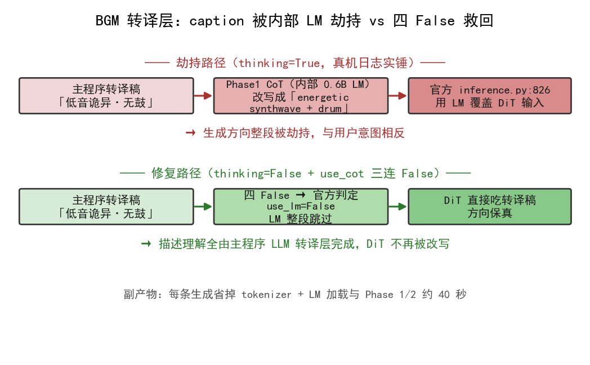

<!--
SPDX-License-Identifier: CC-BY-SA-4.0
Copyright (c) 2026 wUwproject
Licensed under Creative Commons Attribution-ShareAlike 4.0 International (CC BY-SA 4.0).
See https://creativecommons.org/licenses/by-sa/4.0/ for details.
-->

# 第四部 · 27｜BGM 转译层：中文描述怎么经 LLM 变成英文 caption，又怎么被 CoT 劫持

> **结论先行**：背景 BGM 生成（#22）起生成前，先有一层 LLM 转译——把用户的中文音乐描述改写成 ACE-Step 吃得动的三层输入（caption / lyrics / 元数据）。这层存在的根因是 ACE-Step 内部 LM 规划器仅 0.6B、训练语料以英文 caption 为主，中文长描述还原度打折、否定句会被当特征学进去。但这层转译稿差点被 ACE-Step 内部的 CoT 劫持：当 `thinking=True` 时，其内部 0.6B LM 在 Phase 1 把"低音诡异、无鼓"改写成"energetic synthwave + drum machine"，官方 `inference.py:826` 又用 LM 产物覆盖 DiT 输入，生成方向整段反转。v2.8.0 的修法是 `thinking=False` + `use_cot_caption/language/metas` 三连 `False`，让官方判定 `use_lm=False`、LM 整段跳过、DiT 直接吃主程序的转译稿。本文只谈这一个智能体的 `web_ui.translate_bgm_prompt` 转译层与 `music_gen` 的开关定案；本地 BGM 生成（#22）、环境音执行层（#26）是相邻独立篇目，不在此展开 [1][2][3]。
>
> 更新：2026-10-22（本篇属第四部「背景音乐」，承 #22 的"生成"，专门拆开"中文描述→英文三层输入"这一转译层及其 CoT 劫持事故与修复；实证取自 podcast-maker 真仓 `CHANGELOG.md · v2.8.0`、`web_ui` / `music_service` 源码、单测，以及本批次在仓临时副本用 stub-LLM 实跑的转译层对照实验 [1][2][3][4][5]）

## 一、引子：真实起点

让用户写一句"轻快的钢琴曲，温暖明亮，适合开场"就能生成一段垫底 BGM，这件事的难点不在模型本身，而在"语言不对版"。ACE-Step 内部虽然有个 LM 规划器，但只有 0.6B、训练语料以英文 caption 为主——把中文长描述直接喂进去，还原度打折；更糟的是"不要打击乐"这种否定句，会被模型当成"打击乐"这个特征学进去（否定在训练分布里被当作肯定特征）。于是 v2.8.0 在生成前塞了一层 LLM 转译：先把中文描述改写成英文 caption、把时间演进写进 lyrics、把节奏调性锚进元数据，再交给 ACE-Step [1]。

但转译层自己差点引出更大的事故：转译好的"低音诡异、无鼓"稿子，在 `thinking=True` 的运行里被 ACE-Step 内部的 CoT 改写成"energetic synthwave + drum machine"，生成出来的东西和用户意图正好相反。本文的起点，就是把"中文怎么变成英文三层输入"以及"转译稿怎么险些被劫持、又被怎么救回"讲清楚 [1]。

## 二、现象：它到底长什么样

v2.8.0 之后，背景 BGM 的生成链路在起生成前多了一道转译闸门，且生成开关被定案。

**转译层（`web_ui.translate_bgm_prompt`）**：把用户中文描述经 LLM 改写成 ACE-Step 要的三层输入——`caption`（整体画像：风格/氛围/乐器/音色，一行英文）、`lyrics`（时间脚本：纯器乐用结构标记写段落演进）、`bpm` / `keyscale` / `timesignature`（节奏调性锚点）。三层必须一致（caption 的乐器对应 lyrics 的器乐段标记），只保留用户提到的元素 [2]。

**代码层确定性校验（`_parse_bgm_translation`）**：不靠模型自觉，做硬校验——`bpm` 取整并限官方区间 30~300，越界置 `None`（回到自动估计）；`timesignature` 只认 2/3/4/6，其余清空；`lyrics` 把挤在一行的相邻结构标记拆成一行一个；`caption` 空即判失败（它是必需层，没它整趟白转）[2]。

**降级口径（`_bgm_fallback`）**：LLM 不可用或答不出可解析结构时，WARN 降级——`caption` 吃原文、`lyrics` 走官方纯器乐写法 `[Instrumental]`、元数据留空、`degraded=True`，不拦生成。损失止于这一次生成 [2]。

**生成开关定案（`music_gen.cmd_generate` 的 `GenerationParams`）**：`thinking=True`（LM 谱曲定时长，铺满 30 秒的唯一开关）配 `use_cot_caption=False` / `use_cot_language=False` / `use_cot_metas=False` 三连 `False`——后者正是 CoT 劫持的防火墙 [3]。

## 三、错误尝试：我们怎么绕弯的

绕弯集中在"要么不转译、要么转译了却被二次改写"两个极端。

**第一类想当然：中文描述不经转译直接喂 ACE-Step**。这是"模型内部有 LM 规划器、应该能懂中文"的放任版——结果中文长描述还原度打折，否定句（"不要打击乐"）反而把被禁元素当特征学进去。这条弯路暴露的是"训练分布以英文 caption 为主"的硬约束，靠模型自己克服不了 [1]。

**第二类想当然：加了转译层，但 `thinking` 还开着、三连 `use_cot_*` 没关**。这是"转译层把中文翻好了，却被生成模型自己又改回去"的惨剧版——真机日志实锤：转译稿"低音为主的诡异氛围、无鼓"送入后，`thinking=True` 时 ACE-Step 内部 Phase 1 的 CoT（0.6B LM）把它改写成"energetic synthwave + gated-reverb drum machine"，且官方 `inference.py:826` 以 LM 产物覆盖 DiT 输入，生成方向整个被劫持，与用户意图相反 [1]。

两类弯的本质一样：把"理解描述"这件事交错了位置——要么完全交给英文弱势的内部 LM（不转译），要么主程序转译好了又被同一个内部 LM 二次改写（开着 CoT）。正确的落点是：描述的"理解"全由主程序 LLM 转译层做完，ACE-Step 内部 LM 必须整段跳过。

## 四、根因：为什么

把两件事拆开，根因各自干净。

**需要转译层的根因**是一个硬约束：ACE-Step 内部 LM 规划器仅 0.6B、训练语料以英文 caption 为主。中文长描述在它的训练分布里样本稀疏，还原度天然打折；否定句在训练分布里更被当作肯定特征（"不要鼓"≈"鼓"），会直接学进生成。所以"描述的理解"不能交给内部 LM，必须前移到主程序、用更强的 LLM 把它改写成英文三层输入，再让 ACE-Step 只负责渲染 [1]。

**转译稿被劫持的根因**是开关组合错了：`thinking=True` 时，ACE-Step 内部 Phase 1 跑 CoT（0.6B LM）对输入做"理解/改写"，而官方 `inference.py:826` 只认 `use_cot_caption` 一个开关决定是否用 LM 产物覆盖 DiT 输入——`thinking` 开着并不碰 caption，真正改写 caption 的是 `use_cot_caption`。早前的劫持发生在"三连全开"，关掉 `use_cot_caption` 这一个就够了；`use_cot_language=False`（纯器乐无人声语言检测）、`use_cot_metas=False`（LM 的 bpm/调性规划对铺满时长没贡献，仅开 metas 实测只铺到 21 秒）是同一思路的收口。根因判据因此收敛为一句：`caption` 的覆盖只由 `use_cot_caption` 控制，要保真就必须把它设为 `False` [1][3]。

## 五、正确修法：怎么做对的

拆开看，每层都有自己的标准答案。

**转译层做"四维归位"，不打包成抽象短语**：中文口语形容词分属不同维度（氛围/形式/音色/格调），旧指令把它们塞进"simple yet elegant sound changes"这种没有执行实体的抽象短语，模型只能输出低频 drone。改法是维度归位——氛围词落 `atmosphere/mood`、形式词落 `arrangement`、音色词落 `instrument/timbre`、格调词落到旋律/音色等可听实体；否定句转正向描述 + 标准 `no-xxx` 标签；只保留用户提到的元素 [1][2]。

```python
# podcast_maker/web_ui.py —— translate_bgm_prompt：中文描述 → 英文三层输入（四维归位 + 预算走统一推动点）
def translate_bgm_prompt(cfg, prompt, log=None):
    instruction = (转译指令：caption 一行英文 ≤60 词、四维各落执行域、"
                   "lyrics 用 [Intro - ambient] / [Main Theme - ...] 写时间脚本、"
                   "元数据 bpm/keyscale/timesignature 锚节奏调性、三层一致、只保留用户提到元素)
    try:
        llm = make_llm(cfg)
        text, _ = llm.chat([{"role": "user", "content": instruction}],      # instruction 末尾拼 prompt（中文）
                           temperature=0.2,
                           max_tokens=int(cfg.get("llm.max_tokens", 8192)))  # 预算走统一推动点
    except LLMError as e:
        log("LLM 转译失败（%s），按原文直接生成。" % e); return _bgm_fallback(prompt)
    data = _parse_bgm_translation(text)                                     # 代码层确定性校验
    if data is None:
        log("LLM 转译没答出可解析的三层结构，按原文直接生成。"); return _bgm_fallback(prompt)
    return data
```

**代码层确定性校验，不靠模型自觉**：解析出来后，`bpm` 限 30~300、越界置 `None`；`timesignature` 只认 2/3/4/6；`lyrics` 挤行拆行；`caption` 空即失败。这些判定是确定性的，喂什么错值都拦得住 [2]。

```python
# podcast_maker/web_ui.py —— _parse_bgm_translation：bpm/拍号/lyrics/caption 的确定性校验
def _parse_bgm_translation(text):
    obj = json.loads(抽取 {} 之间)                       # 容忍 ```json 围栏与前后杂话
    caption = " ".join(str(obj.get("caption") or "").split())
    if not caption: return None                          # caption 空即判失败（必需层）
    lyrics = 拆行(obj.get("lyrics"))                     # 相邻结构标记拆成一行一个
    try:
        bpm = int(obj.get("bpm"))
        if not 30 <= bpm <= 300: bpm = None              # 越界置 None，回到自动估计
    except (TypeError, ValueError): bpm = None
    tsign = str(obj.get("timesignature") or "").strip()
    if tsign not in ("2", "3", "4", "6"): tsign = ""     # 只认四拍号，其余清空
    return {"caption": caption, "lyrics": lyrics or "[Instrumental]",
            "bpm": bpm, "keyscale": ..., "timesignature": tsign, "degraded": False}
```

**CoT 劫持修复：四 False 让 LM 整段跳过**：`thinking=True`（保铺满时长）配 `use_cot_caption/language/metas` 三连 `False`——官方判定 `use_lm=False`，内部 LM 整段跳过，DiT 直接吃主程序的转译稿；描述的理解全部由主程序 LLM 转译层完成。副产物是每条生成省掉 tokenizer + LM 加载与 Phase 1/2 约 40 秒 [1][3]。

```python
# music_service/music_gen.py —— cmd_generate：开关定案（thinking 谱曲定时长，三连 False 防 CoT 劫持）
params = GenerationParams(
    task_type="text2music", caption=prompt,
    lyrics=(lyrics or "[Instrumental]"), instrumental=True,
    bpm=bpm, keyscale=keyscale or "", timesignature=timesignature or "",
    duration=float(seconds), inference_steps=8, shift=3.0,
    thinking=True,                                  # LM 谱曲定时长；caption 由下面三连关保真
    use_cot_caption=False, use_cot_language=False, use_cot_metas=False,
    seed=eff)
```

## 六、验证：数据说话

**转译层与开关定案（本批次 stub-LLM 真实实验，见图）** [5]：




| 验证项 | 真实数字 / 口径 | 出处 |
|---|---|---|
| 转译预算 | 走统一推动点 `llm.max_tokens`，本批次 stub 回放观测到 **47872**（与出厂配置同值） | 本批次 stub-LLM 实测 [5] |
| 四维归位（真实 LLM 同一描述实测） | 输出 `eerie quiet atmosphere, simple minimal arrangement, prominent bass ..., elegant melodic progression refined tone, no drums, no percussion, seamless loopable` | `CHANGELOG.md · v2.8.0` [1] |
| 代码层校验 | `bpm=999` → `None`；`timesignature=5` → `""`；挤行 lyrics 拆行；caption 空 → 判定失败降级 | 本批次 stub-LLM 实测 [5] |
| 降级路径 | LLM 不可用 → `degraded=True`、`caption` 退回原文、`lyrics=[Instrumental]`、日志含"转译失败" | 本批次 stub-LLM 实测 [5] |
| CoT 劫持防火墙 | `thinking=True` + `use_cot_caption/language/metas` 四 `False`；官方判定 `use_lm=False`、LM 跳过 | `music_gen.py:417` [3] |
| 真机端到端 | 同 seed 全链 `content_end=30s/30s` 尾部零地板；账本 `lm='pt'`、`norm_gain_db=3.82` | `CHANGELOG.md · v2.8.0` [1] |
| 全量回归 | 1538 → 1551 通过（skipped=1） | `CHANGELOG.md · v2.8.0` [1] |

**单测钉（本批次临时副本实跑）**：`tests/test_music_service.py` 中 `TestBgmCaption` 钉住转译成功 / 预算=`llm.max_tokens`（47872）/ 降级原文三类行为，`test_thinking_codes_caption_kept` 断言 `thinking=True` 且 `use_cot_caption=False`、LM 必须参与谱曲，`test_cot_disabled_and_lm_skipped` 断言四 `False` 且 `lm is None`——转译层与 CoT 防火墙均被钉死，与 CHANGELOG 同版本全量 1538→1551 通过相互印证 [1][4]。

### 实验设计（转译层真实回放与校验突变）

- **目的**：确认转译层在真实代码路径上确实走统一推动点预算、四维归位产出、代码层校验拦截错值、且 LLM 不可用时降级不拦生成。
- **输入**：仓的临时副本（含真仓 `web_ui.py` 的 `translate_bgm_prompt` / `_parse_bgm_translation` / `_bgm_fallback`）、一个 stub LLM（按真实 `make_llm` 接口，`chat` 返回受控 JSON 或抛 `LLMError`）、出厂 `llm.max_tokens=47872`。
- **步骤**：① 正常路径——stub 返回合法三层 JSON（含四维归位 caption + 多行 lyrics + bpm/keyscale/timesignature），观测 `max_tokens` 取值与解析结果；② 校验突变——stub 依次返回 `bpm=999`、 `timesignature=5`、挤在一行的 lyrics、caption 空串，观测代码层是否拦截（→`None` / `""` / 拆行 / 降级）；③ 降级突变——stub 抛 `LLMError`，观测是否 `degraded=True` 且 `caption` 退回原文。
- **观测**：正常路径 `max_tokens=47872`（统一推动点）、四维归位 caption 落地、多行 lyrics 保留；`bpm=999`→`None`、`timesignature=5`→`""`、挤行 lyrics 被拆行、caption 空→判定失败走降级；`LLMError`→`degraded=True`、`caption=原文`、`lyrics=[Instrumental]`、日志含"转译失败"。
- **判定**：转译层四件事（预算统一 / 转译成功 / 代码层校验 / 降级）在真实代码路径上全部成立，与 `TestBgmCaption` 与 CHANGELOG v2.8.0 记录相互印证；实验后副本弃用，真仓未动 [1][2][4][5]。

## 七、结语：一句话可复用结论

背景 BGM 的"描述理解"必须前移到主程序 LLM 转译层做完——把中文（尤其是否定句）改写成英文三层输入、四维各归执行域，再交给 ACE-Step 只负责渲染；而 ACE-Step 内部的 LM 必须被 `use_cot_caption` 三连 `False` 整段跳过，否则转译好的稿子会被它的 CoT 改写成相反方向。一句话可复用：**凡"外部弱语言、内部强语言"的跨模型链路，描述的理解只做一次、且只在没有改写权的那一侧做；任何二次"理解"开关都必须显式关死**。#22 讲"背景音乐怎么本地生成"，本篇补上"中文描述怎么变成它能懂的输入、又怎么不被它自己改写"这道必须关死的转译闸。

### 引用与出处说明

> 来源声明：本篇实证全部取自 podcast-maker 真实代码仓、单测与本地 stub-LLM 实测，无 web 来源；CHANGELOG 锚点统一署真仓 `CHANGELOG.md`，不出现快照/索引文件名 [1][2][3][4][5]。

| 编号 | 引用 | 出处 |
|------|------|------|
| [1] | v2.8.0 转译层（中文→英文三层输入、否定句→正向+no-xxx、四维归位）；ACE-Step 内部 CoT 劫持 caption（真机日志实锤：低音诡异无鼓→energetic synthwave+drum）；`thinking=False`+三连 `False` 修复；后段空白根因=`thinking` 关错（四组对照 A 断崖/B 21s/D/C 28s 铺满）；同 seed 全链 `content_end=30s/30s`、账本 `lm='pt'`/`norm_gain_db=3.82`；全量 1538→1551 | `podcast-maker · CHANGELOG.md · v2.8.0` |
| [2] | `web_ui.py`：`_bgm_fallback`（`:115`，降级口径）/`_parse_bgm_translation`（`:122`，bpm 30~300、timesignature 2/3/4/6、lyrics 拆行、caption 空判失败）/`translate_bgm_prompt`（`:162`，指令四维归位 + `max_tokens` 走 `llm.max_tokens`，调用点 `:231`） | `podcast_maker/web_ui.py:115,122,162,231` |
| [3] | `music_service/music_gen.py`：`cmd_generate`（`:312`，5Hz LM 加载失败 WARN 降级不停产）；开关定案注释（`:340`，thinking 谱曲定时长、use_cot_caption 保真）；`GenerationParams thinking=True` + `use_cot_caption/language/metas` 三连 `False`（`:417`） | `music_service/music_gen.py:312,340,417` |
| [4] | `tests/test_music_service.py`：`TestBgmCaption`（`:400`，转译成功/预算=llm.max_tokens/降级原文）、`test_thinking_codes_caption_kept`（`:355`，thinking + caption 保真）、`test_cot_disabled_and_lm_skipped`（四 False + lm is None）；本批次临时副本实跑 | `tests/test_music_service.py`（实测复跑，2026-10-22） |
| [5] | stub-LLM 真实回放：正常路径 `max_tokens=47872`、四维归位 caption 落地、多行 lyrics 保留；校验突变 `bpm=999`→`None`/`timesignature=5`→`""`/挤行拆行/caption 空降级；降级突变 `LLMError`→`degraded=True`、caption 退回原文、lyrics `[Instrumental]`、日志含"转译失败"；测量条件为仓的临时副本、当次版本 v2.8.0、日期 2026-10-22 | 本文实验设计段（实测，2026-10-22） |

> 说明：全部为项目实证（仓库源码、单测与本地 stub-LLM 实测），无 KB / 联网文献；[4][5] 为本文推导层（实验设计段）的复跑记录，测量条件为仓的临时副本、当次版本 v2.8.0、日期 2026-10-22。

## 延伸阅读

- **#22 本地 BGM 生成**：本篇讲"中文描述怎么变成英文三层输入、又怎么不被 CoT 劫持"，#22 讲"背景音乐怎么在本地生成"——两者是同一生成链的前后两段。
- **#26 环境音执行层**：本篇的转译层与 #26 的执行层都在第四部「背景音乐」下，分别解决"AI 音乐的描述翻译"与"环境音的烘焙落位"两个不同环节。
- **#29 AI 生成件响度归一**：本篇转译层产出的 BGM 最终要过 #29 的唯一响度标尺（-23 LUFS / 真峰值 -1 dBTP），与内置档同尺。

---

*最后更新：2026-10-22（论证概要：BGM 转译层 `web_ui.translate_bgm_prompt` 把中文描述经 LLM 改写成 ACE-Step 三层输入（caption/lyrics/元数据），四维归位 + 否定句转 no-xxx + 预算走统一推动点 llm.max_tokens；`_parse_bgm_translation` 代码层确定性校验（bpm 30~300、timesignature 2/3/4/6、lyrics 拆行、caption 空降级）；根因A＝ACE-Step 内部 LM 仅 0.6B、训练以英文 caption 为主（中文打折、否定句被当特征）；根因B＝thinking=True 时内部 Phase1 CoT 把转译稿改写成相反方向、官方 inference.py:826 用 LM 覆盖 DiT 输入；修法＝thinking=True + use_cot_caption/language/metas 三连 False（use_lm=False、LM 跳过、DiT 直吃转译稿）；实证＝stub-LLM 临时副本回放（预算 47872 / 四维归位 / bpm=999→None tsign=5→'' / 降级 degraded=True）+ TestBgmCaption / test_cot_disabled_and_lm_skipped + CHANGELOG v2.8.0 真机 content_end=30s/30s、全量 1538→1551；文献佐证全为项目实证。**四检：真实性 PASS / 底层逻辑 PASS / 空推论 PASS / 循环论证 PASS）*
