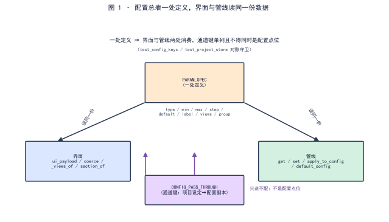

<!--
SPDX-License-Identifier: CC-BY-SA-4.0
Copyright (c) 2026 wUwproject
Licensed under Creative Commons Attribution-ShareAlike 4.0 International (CC BY-SA 4.0).
See https://creativecommons.org/licenses/by-sa/4.0/ for details.
-->

# 第一部 · 02｜配置总表如何同时驱动界面与管线：PARAM_SPEC 一处定义

> 摘要：一个播客智能体有八十多个配置点，若界面再抄一份值域、音色工具再抄一份默认值，就会长出第二个、第三个真值来源，迟早漂移。核心做法是一条：全部可配置点位在 `PARAM_SPEC` 一处定义，界面与管线读同一份数据；项目级的「设定送下去」走单独的 `CONFIG_PASS_THROUGH` 通道，且通道键不得同时是配置点位。本文只讲这条「一处定义、两处消费」的契约，不展开单点算法。

## 一、引子：真实起点

在声音页把语速从 1.0 调到 1.2，切到脚本页，仪表盘却仍按 1.0 反推目标字数——因为两个页面各持一份值域，改了一处、另一处不知道 [3]。这个症状的根不在「哪页算错了」，而在「同一件事有两份真值来源」：谁改了、以谁为准，没有中央裁决 [3]。

## 二、现象：配置总表长什么样

`config_manager.py` 里，`PARAM_SPEC` 是一个字典，每个键由 `_p(type_, default, group, label, **kw)` 生成，携带 `type / default / group / label / min / max / step / unit / views / help` 等字段 [3]。首版即把 **83 个配置项、10 个枚举点位、5 套风格预设、22 条门禁全部集中在一处定义，界面与管线读同一份数据** [1]。一个典型条目形如：

```text
"script.target_minutes": _p("float", 4.0, "script", "目标时长（分钟）",
                            min=0.5, max=60, step=0.5, unit="分钟", views=("script",))
```

`min / max / step` 写在配置总表里，页面不写第二份 [3]。

  
*图 1：`PARAM_SPEC` 一处定义，界面（`ui_payload` / `coerce` / `_views_of` / `section_of`）与管线（`get` / `set` / `apply_to_config` / `default_config`）两处消费同一份；`CONFIG_PASS_THROUGH` 是单独的通道键，只送不配。*

## 三、错误尝试：页面抄第二份值域、工具抄第二份默认值

两处具体翻车，都是「第二份真值来源」的变种。

其一，**页面写第二份值域**：`min / max / step` 本应由后端下发，却有人图省事在前端再写一遍 [3]。后端改了上限，前端还是旧数，界面上看不出任何异常——配置矛盾被两份副本各自掩盖。

其二，**音色默认值两处不一致**：`make_voice.py` 里的 `DEFAULT_VOICES` 写成 `Vivian / Serena`，而 `PARAM_SPEC` 出厂默认是 `Serena / Uncle_Fu`，注释还声称两处一致 [6]。后果是同一台机器上「命令行直接跑」与「主程序自动跑」录出两套音色，档案里只看到音色名、看不出是哪个入口来的，排查毫无线索 [6]。

## 四、根因：为什么要一处定义

根因一句话：**凡同一件事存在两份定义，两份迟早不一致；不一致时没有人能判定哪份算数** [3]。配置项的值域若由页面和总表各持一份，总表的中央校验（类型转换、值域越界即报错）就形同虚设——页面绕过它直接渲染，矛盾在两层之间潜伏。音色默认值两处不一致，则是同一病的另一出：默认值本是总表的责任，被工具又抄了一份。

## 五、正确修法：一处定义 + 两处消费 + 单独的通道键

`PARAM_SPEC` 是唯一的「定义处」，两处消费者各自从这里取，不另存副本 [3]：

- **界面消费**：`ui_payload()` 给出分区标签、顺序、说明；`_views_of(key, spec)` 决定该点位出现在哪些阶段页（显式 `views` 优先，否则按 `group` 推导，推导不到就直接抛错，逼人补齐）；`section_of(key)` 按命名空间前缀归卡片，`SECTION_OF_OVERRIDE` 处理字体等例外；`coerce(key, value)` 按 `PARAM_SPEC` 声明做类型转换与值域校验，是唯一入口 [3]。
- **管线消费**：`default_config()` 由 `PARAM_SPEC` 派生默认配置（`{k: v["default"] for k, v in PARAM_SPEC.items()}`）；`ConfigManager.get / set / update` 均以 `PARAM_SPEC` 为权威——`set` 遇到不在总表中的键直接拒绝，避免野键潜入 [3]。

项目级的「设定送下去」走另一条路：`project_store` 的 `PROJECT_CONFIG_MAP` 把节目名、副标题、受众、风格、音色等从项目登记表映射到配置键，`apply_to_config` 把它们叠到一份**配置副本**上、绝不回写全局 [4]。这些被送下去的键列在 `CONFIG_PASS_THROUGH` 里——它们是通道键，**不出现在配置页、也不由人直接配**；把它们塞进配置点位表，就会长出「填了不生效」的死框 [4]。硬约束随之而来：**通道键不得同时是配置点位** [2][5]。

## 六、验证：数据说话

三项证据，测量条件一并给出。

**一处定义实证**（数据源 [1][3]）：首版 CHANGELOG 记「83 个配置项……全部集中在一处定义，界面与管线读同一份数据」[1]；`PARAM_SPEC` 字典与 `_p` 辅助函数即该定义处，`default_config` 与界面元数据均由其派生 [3]。后续版本（如 v1.7.0）把「配置总表—界面—管线」链上的断点逐条接回，并新增 `CONFIG_PASS_THROUGH` 放行通道键 [2]。

**两处消费对照实证**（数据源 [3]）：下表给出每个消费方读什么、用什么函数、做什么，印证「无第二份副本」。

| 消费方 | 读什么 | 用什么函数 | 用途 |
|---|---|---|---|
| 界面 | views / label / group / min / max / step | `ui_payload` / `_views_of` / `section_of` / `coerce` | 渲染控件、分区、值域提示 |
| 管线 | default / 当前值 / 类型 / 值域 | `default_config` / `get` / `set` / `coerce` | 实际取值、写入、校验、派生默认 |

**通道键守卫实证**（数据源 [2][5]）：对账测试把「允许键」定为 `set(PARAM_SPEC) | set(project_store.CONFIG_PASS_THROUGH)`，并断言通道键不得同时落在 `PARAM_SPEC` 里 [5]；这一行就是「一处定义、通道单列」的机器守门，任何一次把通道键误塞进配置点位都会当场红 [2][5]。

## 七、结语：一句话可复用结论

八十多个配置点只在 `PARAM_SPEC` 一处定义，界面与管线读同一份数据、不抄第二份值域；项目设定经 `CONFIG_PASS_THROUGH` 单独通道送下去、只送不配，且通道键不得同时是配置点位。一处定义、两处消费、通道单列——真值来源只有一份，漂移在结构上没有生长点。

### 引用与出处说明

| 编号 | 引用 | 出处 |
|------|------|------|
| [1] | 配置总表：83 个配置项、10 个枚举点位、5 套风格预设、22 条门禁，全部集中在一处定义，界面与管线读同一份数据 | podcast-maker · CHANGELOG.md · v0.1.0 · 新增·配置总表（L4828–4829） |
| [2] | v1.7.0 把「配置总表—界面—管线」链上断点逐条接回；新增 `CONFIG_PASS_THROUGH` 放行通道键，并新增「通道键不得同时是配置点位」 | podcast-maker · CHANGELOG.md · v1.7.0（L4617 / L4135） |
| [3] | `PARAM_SPEC` 字典与 `_p` 辅助；`ui_payload` / `_views_of` / `section_of` / `coerce` / `default_config` / `ConfigManager.get·set` 均由总表派生 | `podcast_maker/config_manager.py`（PARAM_SPEC L554–562；ui_payload L1172；_views_of L1144；section_of L1167；coerce L1427；default_config L1263） |
| [4] | `PROJECT_CONFIG_MAP` 项目设定映射；`CONFIG_PASS_THROUGH` 通道键（只送不配）；`apply_to_config` 只返副本不回写全局 | `podcast_maker/project_store.py`（L339–386） |
| [5] | 守卫：`allowed = set(PARAM_SPEC) \| set(project_store.CONFIG_PASS_THROUGH)`，通道键不得同时是配置点位 | `podcast_maker/tests/test_config_keys.py:L73`；`podcast_maker/tests/test_project_store.py:L826` |
| [6] | 反例：音色工具 `DEFAULT_VOICES`（Vivian/Serena）与 `PARAM_SPEC` 出厂默认（Serena/Uncle_Fu）两处不一致，注释却称一致；两处对齐并加用例比对 | podcast-maker · CHANGELOG.md（音色工具默认值与出厂默认不一致，L3850–3853） |

## 延伸阅读

- **同书其他篇**：#1《一个播客智能体的九步管线》是这条链的运行容器，本篇讲链上「配置从哪来」；#3《存量配置自动搬迁》是配置总表变更后旧键如何安全迁移的下游专篇——两篇都依赖「一处定义」这个前提。

---

*最后更新：2026-10-12（已补丰富化：图 1 一处定义两处消费数据流 + 表 1 两处消费对照；四检：真实性 PASS / 底层逻辑 PASS / 空推论 PASS / 循环论证 PASS）*
