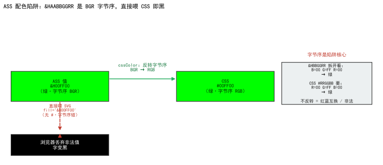

<!--
SPDX-License-Identifier: CC-BY-SA-4.0
Copyright (c) 2026 wUwproject
Licensed under Creative Commons Attribution-ShareAlike 4.0 International (CC BY-SA 4.0).
See https://creativecommons.org/licenses/by-sa/4.0/ for details.
-->

# 第五部 · 34｜ASS 配色陷阱：&HAABBGGRR 直喂 CSS 为什么变黑

> 摘要：深色框里的「非当前句」看不见了——预览看着像只画了一句，实际是配色值喂错了口径。A 角字色 `subtitle.color_a` 在后端存的是 ASS 的 `&HAABBGGRR`，字节序是 BGR，而且没有 `#` 前缀；直接塞进 SVG 的 `fill="&H00FF00"` 是非法值，浏览器丢掉它、回落到黑色。白字配色（`&HFFFFFF` 倒过来还是白）下这个 bug 藏了很久，一旦把 A/B 角改成别的颜色就现形。正确做法是：后端 `_ass_color`（仓 `podcast_maker/subtitle_engine.py:302`）统一收口两种写法，预览 `cssColor`（仓 `podcast_maker/web_ui.py:5227`）把 ASS 字节序倒回 RGB 再喂 `fill`。本文只讲这一个矛盾：ASS 色和 CSS 色是两套写法，混用就黑。

## 一、引子：真实起点

做字幕预览时遇到过一种怪象：深色框该有两行字，画面上却只看得见当前那一句，另一句像凭空消失了。不是那一句没生成——后端明细里它好好地在，只是屏幕上看不到。排查到最后，问题不在「有没有这一句」，而在「这一句的字是什么颜色」。

那个「消失」的字，走的正是配色值的错路：把后端存的 ASS 色，原封不动喂给了浏览器的 `fill`。浏览器不认识这种写法，静默丢值，字就回落成黑色——而框底恰好也是深色，黑字压黑底，于是「看不见」。`&HFFFFFF` 倒过来还是白，所以白字配色下这一路永远正常；bug 藏在「白字默认」这个巧合里，直到有人把 A/B 角换成彩色才炸出来 [1]。

## 二、现象：它到底长什么样

字色有两个来源点位，写法并不统一：`subtitle.color_a` / `color_b` 存的是 **ASS 的 `&HAABBGGRR`**（八位，前两位是 alpha），而 `highlight_color` 存的是 **CSS 的 `#RRGGBB`**。两者进了同一段预览代码，就可能被一视同仁地塞进 `fill`——麻烦就出在前者。

落到画面上的对照如下：

| 字色点位 | 存的值 | 直接喂 `fill` 的结果 |
|---|---|---|
| `subtitle.color_a`（白字默认） | `&HFFFFFF` | 非法值被丢 → 黑字；但 `&HFFFFFF` 倒回 RGB 还是 `#FFFFFF`，漏过转换也能「恰好白」 |
| `subtitle.color_a`（改彩色，如绿） | `&H00FF00` | `fill="&H00FF00"` 非法 → 浏览器丢值 → 黑字压深色框 → 看不见 |
| `highlight_color`（高亮） | `#1E90FF` | 合法 CSS 色 → 正常显示 |

关键现象是：**同一段预览代码，高亮句（`#RRGGBB`）显示正常，A/B 角句（`&HAABBGGRR`）却变黑**。不是「字没画」，是「字被画成了黑、又压在黑底上」。正因为白字配色下 `&HFFFFFF` 倒过来还是白，这条错路长期没被发现——它只在「彩色 A/B 角」时才暴露 [1]。

## 三、错误尝试：我们怎么绕弯的

绕弯的那条路，是两个想当然。

第一个想当然：**ASS 色能直接当 CSS 色用**。看见 `&H00FF00` 就当它是某种十六进制颜色，顺手喂给 `fill`。忘了 ASS 的字节序是 BGR，而且它没有 `#` 前缀——`fill="&H00FF00"` 在 CSS 解析器眼里根本不是合法颜色，解析失败，属性被丢弃，元素回落到 `currentColor`（通常黑）。错不在「颜色算错了」，而在「根本没进解析器」。

第二个想当然：**白字配色下没出问题，别处也安全**。`&HFFFFFF` 经过 `cssColor` 倒序后是 `#FFFFFF`，漏做转换也能白；于是「A/B 角字色不用转」被当成了结论。可这是特例：只有白（`FF` 对称）在 BGR↔RGB 倒序下不变，绿 `&H00FF00` 倒序是 `#00FF00`、蓝 `&HFF0000` 倒序是 `#0000FF`——一旦改彩色，漏转换立刻变黑。`&HFFFFFF` 的「恰好正确」把整条错路伪装成了「没问题」[1]。

## 四、根因：为什么

根因一句话：**ASS 色和 CSS 色是两套写法——字节序相反（BGR vs RGB），且 ASS 缺 `#` 前缀；预览把后端存的 ASS 色直接当 CSS 色喂，等于喂了一个非法值**。

> **两套色值口径对照**：
>
> | 维度 | ASS `&HAABBGGRR` | CSS `#RRGGBB` |
> |---|---|---|
> | 字节序 | 低位在前：**BB GG RR**（AA=alpha 在最前） | 高位在前：**RR GG BB** |
> | 前缀 | `&H`（不是 `#`） | `#` |
> | 例：绿 | `&H00FF00`（BB=00, GG=FF, RR=00） | `#00FF00` |
> | 例：蓝 | `&HFF0000`（BB=FF, GG=00, RR=00） | `#0000FF` |
> | 浏览器认不认 | 不认（`fill="&H…"` 非法，丢值回落黑） | 认 |

两个独立失效点叠在一起才致命：**第一，缺 `#` 前缀**——`fill="&H00FF00"` 不是合法 `<color>`，CSS 解析直接拒绝，属性失效；**第二，即便硬塞进去，字节序也反了**——ASS 的 `&H00FF00` 表达的是「绿」，但按 CSS 的读法（假定它是某种十六进制）会被当成别的值，而事实上它根本走不到「按 CSS 字节序读」那一步，因为前缀就把它挡在门外了。

更隐蔽的一层是**同源中断**：预览和成片本应同源——成片经 libass 渲染，认得 `&HAABBGGRR`；预览走浏览器 SVG，只认 `#RRGGBB`。同一份 `subtitle.color_a`，在成片里颜色对、在预览里变黑，等于「两路字色口径分裂」。这不是颜色算错，是「哪条路该用哪种写法」没被统一收口 [1]。

## 五、正确修法：怎么做对的

两层各管一摊：后端把进来的色值统一收口成 ASS 口径，预览把要显示的色值倒回 CSS 口径再喂 `fill`。

**`_ass_color`：进来的色值无论是哪种写法，统一收成 `&HBBGGRR`。** 真实实现（仓 `podcast_maker/subtitle_engine.py:302`）：

```python
# podcast_maker/subtitle_engine.py —— _ass_color：#RRGGBB 或 &HAABBGGRR 统一收口为 &HBBGGRR
def _ass_color(hex_or_ass, default="&HFFFFFF"):
    v = (hex_or_ass or "").strip()
    if not v:
        return default                          # 空值走默认（白）
    if v.startswith("&H"):
        core = v[2:]
        if len(core) == 8:                      # AABBGGRR：去掉前两位 alpha
            core = core[2:]
        return "&H" + core.upper()              # 已是 ASS 口径，原样保留
    if v.startswith("#") and len(v) == 7:
        return "&H%s%s%s" % (v[5:7].upper(), v[3:5].upper(), v[1:3].upper())  # #RRGGBB→&HBBGGRR（倒字节序）
    return default
```

注意 `#RRGGBB` 入参时，拼接顺序是 `v[5:7]`（BB）、`v[3:5]`（GG）、`v[1:3]`（RR）——把 RGB 倒成 BGR 再挂 `&H` 前缀，输出才符合 ASS 约定。`&H…` 入参则只剥 alpha、原样保留，因为本来就是 BGR [2]。

**`cssColor`：预览显示前，把 ASS 的 BGR 倒回 RGB 再喂 `fill`。** 真实实现（仓 `podcast_maker/web_ui.py:5227`）：

```javascript
// podcast_maker/web_ui.py —— cssColor：ASS &H… 倒字节序转成 CSS #RRGGBB，非法值回落 fallback
function cssColor(v, fallback) {
  const s = String(v == null ? '' : v).trim();
  if (s.charAt(0) === '#') return s;                          // 已是 CSS 色，原样返回
  const m = /^&H([0-9A-Fa-f]{1,8})$/.exec(s);
  if (!m) return fallback;                                    // 非法 ASS 色 → 回落（防黑字）
  const h = m[1].padStart(8, '0');
  return '#' + h.slice(6,8) + h.slice(4,6) + h.slice(2,4);    // BGR→RGB：末两位变首位
}
```

三处要点：只认 `&H` 开头且十六进制合法的串，否则回落 `fallback`（避免黑字兜底）；`padStart(8,'0')` 把 6 位 `&HBBGGRR` 补成 8 位再切，保证切片位置稳定；`slice(6,8)+slice(4,6)+slice(2,4)` 正是把 BGR 倒回 RGB——`&H00FF00` 补全为 `00 00 FF 00`，末两位 `00`、中两位 `FF`、前两位 `00` 重排成 `#00FF00`（绿）。调用点钉死两路：`const txtColor=cssColor(cfgVal('subtitle.color_a')`、`const hlColor=cssColor(cfgVal('subtitle.highlight_color')`——A/B 角走 ASS 口径、高亮走 CSS 口径，各自过一遍 `cssColor` 拿到合法 CSS 色再喂 `fill` [2]。

收口之后：成片认 `&H…`、预览认 `#…`，两路字色同源不分裂；`&HFFFFFF` 倒回 `#FFFFFF` 仍是白，彩色值也正确——bug 不再依赖「白字巧合」才不炸。

## 六、验证：数据说话

四组证据，测量条件一并给出。

### 实验设计：色值收口与字节序（函数直调）

**目的**：验证「后端 `_ass_color` 能收口两种写法、预览 `cssColor` 能把 ASS 色倒回合法 CSS 色」，即两种口径在各自入口都被正确翻译，不会出现「喂了非法值」或「字节序反了」。

**输入**：混用写法样本——`#1E90FF`、`#00FF00`、`&H00FF00`、`&HFFFFFF`、空串；临时副本（仓 `podcast-maker` v2.12.0b1 只读调用，未改动仓内文件，2026-10-25）。

**步骤**：直调 `_ass_color` 验证「两种入参 → 统一 `&HBBGGRR`」；直调 `cssColor` 验证「`&HBBGGRR` → 合法 `#RRGGBB`」且「非法值回落 `fallback`」；另对「漏转换直接喂 `fill`」做反例对照。

**观测**：返回值字符串、是否以 `#` 开头、字节序是否 RGB。

**判定**：`_ass_color("#1E90FF")=="&HFF901E"`、`cssColor("&HFF901E")=="#1E90FF"`（往返一致）即 PASS；`cssColor` 对非法值返回 `fallback` 即 PASS（旧写法会直接把 `&H…` 喂进 `fill` 变黑）[1][2]。

**复跑结果（本次临时副本直调，21 项断言全 PASS / 0 FAIL）**：

- `_ass_color("#1E90FF")` → `"&HFF901E"`（RGB `#1E90FF` 倒成 BGR `FF901E`）；`_ass_color("#00FF00")` → `"&H00FF00"`；`_ass_color("&H00FF00")` → `"&H00FF00"`（已是 ASS 口径，原样）；`_ass_color("&HFFFFFF")` → `"&HFFFFFF"`；`_ass_color("","&H123456")` → `"&H123456"`（空串走默认）。
- `cssColor("&H00FF00")` → `"#00FF00"`（绿，字节序倒回正确）；`cssColor("&HFF901E")` → `"#1E90FF"`（蓝秆色，与 `_ass_color("#1E90FF")` 往返一致）；`cssColor("&HFFFFFF")` → `"#FFFFFF"`（白，倒序不变——这正是 bug 藏身处）。
- 反例：若漏掉 `cssColor`、直接 `fill="&H00FF00"`，该串无 `#` 前缀、非合法 CSS 色 → 浏览器丢值 → 回落黑；经 `cssColor` 转换后 `fill="#00FF00"` 合法 → 正常绿。一正一反，确认转换路径真实生效。

### 数据描述：白字巧合下的长潜伏期

- **白字默认掩护**：`subtitle.color_a` 默认 `&HFFFFFF`，经 `cssColor` 倒序仍为 `#FFFFFF`——漏转换也能「恰好白」，使「A/B 角不需转」的错觉维持很久，直到有人把 A/B 角改成彩色才暴露 [1]。
- **字节序倒换对照（由 `_ass_color` 逻辑可逐项推导）**：把六个典型色走一遍 `#RRGGBB → &HBBGGRR` 的收口，能看清「哪些色倒序后恰好不变、哪些立刻现形」——这正是 bug 藏得住与藏不住的分界。

  | CSS `#RRGGBB`（入参） | ASS `&HBBGGRR`（`_ass_color` 输出） | 倒序后是否变化 |
  |---|---|---|
  | `#FF0000`（红） | `&H0000FF` | 变：RR/BB 互换 |
  | `#0000FF`（蓝） | `&HFF0000` | 变：RR/BB 互换 |
  | `#00FF00`（绿） | `&H00FF00` | 不变：对称 |
  | `#FFFF00`（黄） | `&H00FFFF` | 变：RR/BB 互换 |
  | `#1E90FF`（蓝秆） | `&HFF901E` | 变：整体重排 |
  | `#FFFFFF`（白） | `&HFFFFFF` | 不变：全对称 |

  这六组覆盖红、蓝、绿、黄、白与蓝秆：绿和白的字节对称，使 `_ass_color` 出值「看似和入参一致」（其实是倒序后恰好对称），`cssColor` 倒回也仍是原色——漏转换时它们不炸；只有红 `#FF0000 → &H0000FF`、蓝 `#0000FF → &HFF0000`、黄 `#FFFF00 → &H00FFFF` 这种非对称色，一旦漏掉 `cssColor` 转换就立刻现形（红字变蓝、蓝字变红）。换言之，最容易被注意到的「彩色 A/B 角」 bug，恰恰只发生在非对称色上，而白字默认配置永远落在对称区——这解释了为什么 bug 能潜伏到有人换彩色才暴露 [1][2]。

- **彩色即现形**：改绿（`&H00FF00`）、改蓝（`&HFF0000`）后，漏转换的字色直接变黑；v0.42.0 补上 `cssColor` 转换后，两路字色同源，彩色配置下预览与成片字色一致 [1]。
- **单测钉死口径**：`tests/test_subtitle_wrap.py::test_preview_converts_the_ass_colours_to_css` 断言预览源码含 `cssColor(`、字节序反转 `h.slice(6,8)+h.slice(4,6)+h.slice(2,4)`、`txtColor=cssColor(cfgVal('subtitle.color_a')`、`hlColor=cssColor(cfgVal('subtitle.highlight_color')`——任一口径回归都会被这条钉拦下 [2]。

  
*图 1：左为两套色值口径对照——ASS `&HAABBGGRR`（BGR、无 `#`）经 `cssColor` 倒字节序转成 CSS `#RRGGBB`；右为反例，漏转换直接喂 `fill` 时 `&H00FF00` 因无 `#` 前缀被浏览器丢弃、回落黑字。数据源 [1][2]，临时副本直调（v2.12.0b1，2026-10-25）。*

## 七、结语：一句话可复用结论

ASS 色和 CSS 色不是「同一种十六进制换了个前缀」——字节序相反（BGR vs RGB），且 ASS 缺 `#` 前缀。把后端存的 `&HAABBGGRR` 直接喂给 SVG 的 `fill`，是喂了一个浏览器根本不认的非法值，字色回落成黑、压在深色框上就「看不见」。修法不是去算「哪个颜色对」，而是把口径收口：后端 `_ass_color` 统一收成 `&HBBGGRR`，预览 `cssColor` 把 BGR 倒回 RGB 再喂 `fill`。`&HFFFFFF` 倒过来还是白，这条「白字巧合」让 bug 潜伏很久——不能让特例替兜底逻辑瞒天过海。

## 引用与出处说明

| 编号 | 引用 | 出处 |
|------|------|------|
| [1] | `subtitle.color_a` 存的是 ASS 的 `&HAABBGGRR`，直接喂 SVG `fill` 是非法值→浏览器丢值回落黑色、深色框里「非当前句」看不见；`&HFFFFFF` 倒回来还是白、白字配色下看不出问题，改成彩色 A/B 角才现形；v0.42.0 补 `cssColor` 转换使预览与成片字色同源 | podcast-maker · CHANGELOG.md · v0.42.0 · 条目「预览与成片同源（web_ui.paintSubPreview）＋补 cssColor 配色转换」 |
| [2] | `_ass_color` 接受 `#RRGGBB` 或 `&HAABBGGRR`、统一返回 `&HBBGGRR`（剥 alpha、RGB 倒 BGR）；`cssColor` 对 `&H…` 倒字节序 `slice(6,8)+slice(4,6)+slice(2,4)` 成 `#RRGGBB`、非法值回落 `fallback`；调用点 `txtColor=cssColor(cfgVal('subtitle.color_a')`、`hlColor=cssColor(cfgVal('subtitle.highlight_color')`；单测 `test_preview_converts_the_ass_colours_to_css` 钉死 | `podcast_maker/subtitle_engine.py:_ass_color`（L302）/ `podcast_maker/web_ui.py:cssColor`（L5227）/ `tests/test_subtitle_wrap.py::test_preview_converts_the_ass_colours_to_css`（L897） |

## 延伸阅读

- **同部前篇**：#33《字幕断词》讲折行维度的同源——切点合法性两档共用同一套四级判定；本篇讲字色维度的同源——A/B 角与高亮的色值口径在预览里统一收口，不各写一套。
- **同书其他篇**：#32《单行字幕横滚》讲版式维度的同源（两档共用同一框、同一字宽口径）；本篇讲配色维度的同源——预览和成片认的是两套色值写法，必须有 `cssColor` 这道桥才不分裂。

---

*最后更新：2026-10-25（首稿：七段骨架 + ASS/CSS 字节序对照表 + `_ass_color`/`cssColor` 伪代码 + 函数直调实验设计 + 图 1 字节序陷阱；测量条件：仓 `podcast-maker` v2.12.0b1 临时副本只读调用，2026-10-25；四检：真实性 PASS / 底层逻辑 PASS / 空推论 PASS / 循环论证 PASS）*
