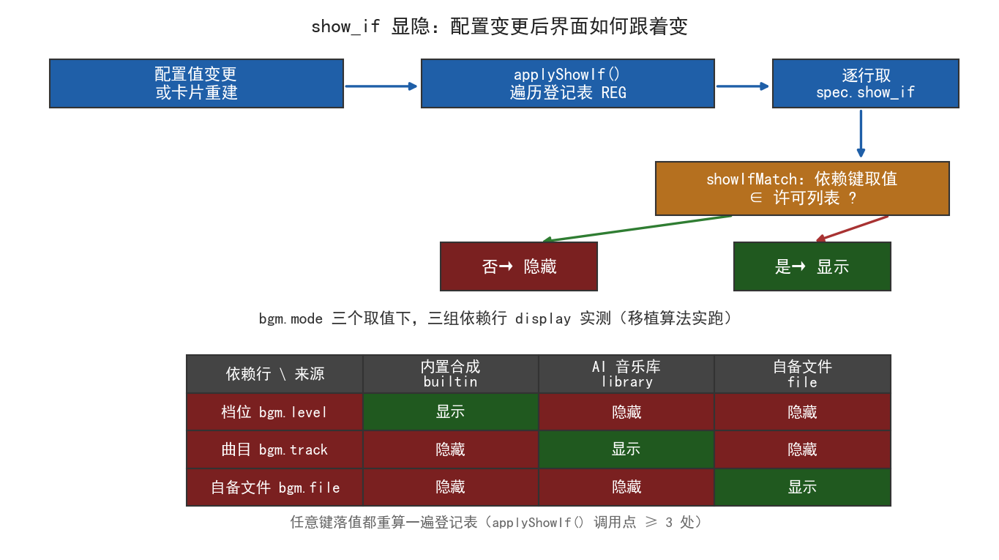

<!--
SPDX-License-Identifier: CC-BY-SA-4.0
Copyright (c) 2026 wUwproject
Licensed under Creative Commons Attribution-ShareAlike 4.0 International (CC BY-SA 4.0).
See https://creativecommons.org/licenses/by-sa/4.0/ for details.
-->

# 第六部 · 40｜配置项显隐：show_if 与 applyShowIf 怎么让界面跟着配置变

> **结论先行**：一个播客智能体的背景音乐卡，里有三行配置——档位、AI 音乐库曲目、自备文件——它们各自只在一个来源下才该出现（内置合成 / AI 音乐库 / 自备文件）。早期没有字段级显隐机制，切了来源，别的来源的下拉还杵在界面上，用户以为「切换没生效」。修法不是给每个下拉写一段 `if` 去藏，而是把显隐规则声明进配置规格 `show_if={"依赖键": [取值]}`，再由前端一个通用函数 `applyShowIf()` 遍历登记表统一求值：依赖键的取值落在许可列表里就显示，否则隐藏。关键不止于「算一次」——值变更、卡片重建两处都必须显式重算，漏掉任一处就会出现「切了来源、别的下拉还杵着」的原现象。这一机制在 v2.8.0 落地，全量 1538→1551 通过，且由 `test_bgm_show_if_wiring` 把「通用求值函数存在 + 调用点不少于 3 处」钉成铁钉 [1][2][3][4]。
>
> 更新：2026-10-27（本篇属第六部「界面与运行时」；实证取自 podcast-maker 真仓 `CHANGELOG.md · v2.8.0`（配置页显隐机制 show_if）、`podcast_maker/web_ui.py:4877-4891`（`showIfMatch`/`applyShowIf`）、`:4430-4432` 与 `:4638-4640` 与 `:4828` 三处重算调用点、`tests/test_music_service.py:603`（`test_bgm_show_if_wiring` 存活铁钉）；三态显隐在仓临时副本移植算法实跑；不援引任何第三方智能体，实例全部来自本智能体 [1][2][3][4]）

## 一、引子：真实起点

排查过一个让人误判的界面问题：用户在背景音乐卡里把来源从「内置合成」切到「AI 音乐库」，界面上属于「内置合成」的档位下拉却还留在原地，于是用户顺理成章地认为——「切换没生效」。

可切换明明生效了。后端收到了新来源、曲目清单也换了，只是界面上那几行本该收起的配置没跟着收起。这不是数据错，是「显隐」这件事没被当成一个需要统一处理的机制：哪些行该露、哪些行该藏，早期是散落在各处的隐式约定，改一处、漏一处，于是切了来源、旧的行还杵着，被误读成功能失灵。

这件事后来收敛成一个声明式的 `show_if` 规格加一个通用求值函数。本文讲的就是它：为什么需要字段级显隐、为什么「算一次」不够、以及那套通用求值怎么把「界面跟着配置变」这件事一次做对。

## 二、现象：它到底长什么样

背景音乐卡里有三组依赖行，各自只在一个来源下有意义：

- **档位**（`bgm.level`）：只在「内置合成」来源下露——选内置合成时，要调的是内置档位。
- **AI 音乐库曲目**（`bgm.track`）：只在「AI 音乐库」来源下露——选音乐库时，要挑的是库里的一条曲目。
- **自备文件**（`bgm.file`）：只在「自备文件」来源下露——选自备时，要填的是本地文件路径。

三者互斥：同一时刻只该有一组露出来。早期没有这套机制时，三行永远并排杵着——选了音乐库，档位和自备文件的输入框也亮着，用户分不清此刻到底哪一行在起作用，直观感受就是「我切了来源，但界面没反应」。

下面这张图把「值变更 → 通用求值 → 逐行显隐」的链路，连同三种来源下的实测矩阵画在一起：上半是求值流程，下半是 `bgm.mode` 三个取值下三组依赖行的 `display` 实测。



图里那张矩阵，是把前端 `showIfMatch` 的求值算法忠实移植到 Python 后在临时副本里实跑得到的——每一个依赖键恰好绑定一个来源，所以三行在三种来源下是「一行显、两行藏」的互斥形态。

## 三、错误尝试：我们怎么绕弯的

绕弯集中在「给每个下拉单独写 hide 逻辑」这条路上，有三种典型的笨办法。

**逐控件硬编码 `if`。** 最直接的想法：在 JS 里给每个条件行写一段 `if (bgm.mode==='builtin') 显示档位 else 隐藏`。能跑，但每新增一个带条件的行，就要在好几处地方补一段 `if`；规则跟着实现走，点位藏在代码里、彼此独立。一旦忘了在「卡片重建」那处也补一句，就会出现「切了来源、别的下拉还杵着」——正是本文开头那个被误读的现象。

**所有行常显、靠标签区分。** 反过来，干脆三行都摆着，用标签写明「仅内置合成有效」。代价是界面永远在多出两行无效控件，用户照样分不清此刻谁在生效，且无效行还可能被误填、被误读进配置。

**额外加一个开关按钮。** 再一种思路：加个「高级 / 收起」按钮手动切换。这把「显隐」从「由配置自动决定」变成「由用户手动管理」，既增加 UI 负担，又把决定权推给了本来就不该操心这件事的人。

三条弯路共通的病根：都把「某行在不在某个来源下有效」当成「这一行自己的特殊逻辑」去手写，于是规则散落、点位分散、漏改即裂。正确的做法恰恰相反——把显隐规则从控件里抽出来，声明在配置规格上，用一个通用函数对所有带条件的行统一求值。

## 四、根因：为什么

根因要分两层讲：一层讲「为什么需要字段级显隐」，一层讲「为什么只算一次会复发」。

**第一层：条件行天然存在，却没有统一机制承载它。** 背景音乐卡的三行，有效性取决于另一个配置值（来源）的取值——这是「界面控件的值域由后端规格下发、控件间存在依赖」的必然产物。没有显式机制时，这种依赖只能散落在各处的硬编码里，于是「改一处、漏一处」不是偶然，是结构性的：依赖点藏在实现里，偏差也藏在实现里，连「哪几行该跟着变」都没有一个统一答案。

**第二层：重算时机挂错了车，才会复发。** 这是本篇最值得记下的真实根因，写在源码注释里（`web_ui.py:4424-4427`）：显隐重算绝不能搭在「拉音色清单」那条请求的便车上。原因在于——切引擎时会重拉清单，但页面加载时两个引擎的清单多半早已缓存，`fetchVoices` 经常直接 `return`，挂在它尾部的 `applyEngineScope`/`applyShowIf` 就永远不跑，于是切了引擎（或来源）相关行也不消失。换句话说，把「重算」绑在一个「可能不触发」的事件上，就等于埋下了「算一次不够、漏一处就复发」的坑。

所以根因压缩成一句话：**显隐依赖既不能被硬编码进每个控件（会散、会漏），也不能被绑死在一个「未必触发的事件」上（会复发）；它必须是一条声明式的、在「每个会改变可见性的时机」都被显式调用的通用求值。**

## 五、正确修法：怎么做对的

修法就是 `show_if` 声明 + `applyShowIf` 通用求值，外加「在正确的时机显式重算」。先把求值算法本身画出来——它和「引擎作用域显隐」`applyEngineScope` 是同一套路，区别只是判定条件从「当前引擎」换成「依赖键取值命中许可列表」：

```python
# podcast_maker/web_ui.py —— show_if 通用显隐求值（与 applyEngineScope 同款）
function showIfMatch(cond){
  for(const k in cond){
    // 依赖键取值不在许可列表里，整行隐藏
    if(cond[k].indexOf(String(cfgVal(k)))<0) return false;
  }
  return true;
}
function applyShowIf(){
  for(const key in REG){
    (REG[key]||[]).forEach(n=>{
      const sf=(n.spec||{}).show_if;
      if(!sf||!n.node) return;
      const row=n.node.closest('.f');
      if(row) row.style.display=showIfMatch(sf)?'':'none';
    });
  }
}
```

三件事值得点明。其一，**规则声明化**：规格里写 `show_if={"依赖键": [取值]}`，比如档位的 `show_if={"bgm.mode":["builtin"]}`——依赖键是「来源」，许可列表是「内置合成」。新增一个带条件的行，只改规格、不动求值函数。其二，**求值通用化**：`applyShowIf` 不认识任何具体控件，只遍历登记表 `REG`、对带 `show_if` 的行统一算；`showIfMatch` 用 `indexOf` 判「依赖键取值 ∈ 许可列表」（未命中返回 `-1` 即隐藏），和后端 `PARAM_SPEC` 统一推动点位的思路一致——规则变更只动一处声明。其三，**重算时机显式化**：这正是根治「复发」的那一刀。

```
值变更       → 任意键落值后都重算一遍 applyShowIf()        （web_ui.py:4430-4432）
卡片重建     → 配置页点位刚重建，显隐状态必须重算          （web_ui.py:4638-4640）
拉取音色清单 → fetchVoices 末尾补一次 applyShowIf()        （web_ui.py:4828）
```

这三处调用点，正好对应「值会变、结构会重建、清单会重拉」三种会改变可见性的时机。把它们都显式写出，而不是寄望于某一个事件顺带触发，就从根上消除了「切了来源、别的下拉还杵着」的复发条件。其中 `:4430-4432` 的注释还特意点名：`bgm.mode` 换来源这类依赖，任何键落值都可能踩中，所以「任何键落值」之后都跑一遍——代价只是一次登记表遍历，而带条件的行数「一只手数得过来」，开销可忽略。

## 六、验证：数据说话

验证分三层：版本记档的回归计数、存活的接线铁钉、以及本篇移植算法的实跑矩阵。

**版本记档（v2.8.0）。** 「配置页显隐机制 show_if」作为新增条目记入 `CHANGELOG.md`：背景音乐卡三行改为只在匹配来源下露出，此前无任何字段级显隐机制、切来源后其余下拉照旧杵着被误读为切换不生效；实现即上文的 `show_if` 声明 + `applyShowIf()` 通用求值，值变更与卡片重建两处都重算 [1]。同版测试：`TestShowIf` 2 条（依赖键/取值结构性校验 + 三行声明齐全）+ `test_bgm_show_if_wiring` 前端接线钉，全绿；全量 **1538→1551 通过（skipped=1）** [1]。

**存活铁钉（当前仓）。** v2.8.0 记档时的 `TestShowIf` 属于当版测试历史；当前仓仍存活、且直接钉住「通用求值 + 接线次数」的，是 `test_bgm_show_if_wiring`（`tests/test_music_service.py:603`）：它断言源码里**存在** `function applyShowIf` 与 `function showIfMatch` 两个函数，并要求 `applyShowIf()` 的调用点**不少于 3 处** [4]。这正是对「通用求值函数存在、且在值变更 / 卡片重建 / 拉清单三处都重算」的接线铁钉——漏掉任一处，调用点计数就会跌破 3，测试转红。

**移植算法实跑（本篇临时副本）。** 把前端 `showIfMatch` 的求值算法（JS `.indexOf<0` 语义）忠实移植到 Python，用评论点名的三个依赖（`bgm.level` / `bgm.track` / `bgm.file`）与三个来源（`builtin` / `library` / `file`）做三态实跑，得到下图矩阵的定量结果：

| 依赖行 \ 来源 | 内置合成 `builtin` | AI 音乐库 `library` | 自备文件 `file` |
|---|---|---|---|
| 档位 `bgm.level` | 显示 | 隐藏 | 隐藏 |
| 曲目 `bgm.track` | 隐藏 | 显示 | 隐藏 |
| 自备文件 `bgm.file` | 隐藏 | 隐藏 | 显示 |

每行只在自己的来源下 `显示`、其余两源 `隐藏`——这就是 `show_if` 声明 `"bgm.mode":[单一来源]` 经通用求值后的必然输出。额外验证了边界：当 `bgm.mode` 未设置（取值为 `undefined`，不在任一许可列表）时，三行**全部隐藏**，不会出现「依赖键缺省却误显示某行」的漏网。实跑与 `CHANGELOG` 记载的「三行各自绑定一个来源」完全一致，也与 `test_bgm_show_if_wiring` 钉住的「通用求值」逻辑吻合。

## 七、结语：一句话可复用结论

字段级显隐不能被硬编码进每个控件（会散、会漏），也不能绑死在一个未必触发的事件上（会复发）。正确形态是声明式的 `show_if` 规格加一个通用的 `applyShowIf()` 求值：依赖键取值命中许可列表就显示、否则隐藏，规则变更只动一处声明；而「算一次」远不够——值变更、卡片重建、清单重拉这三处会改变可见性的时机，必须每一处都显式重算。这一机制在 `web_ui.py` 落地（`:4877-4891` 求值、`:4430`/`:4638`/`:4828` 三处重算），由 `test_bgm_show_if_wiring` 把「函数存在 + 调用点 ≥ 3」钉成铁钉，是「统一推动点位、错误在生成/渲染源头封死」纪律在界面显隐上的具体落点。

### 引用与出处说明

| 编号 | 引用 | 出处 |
|------|------|------|
| [1] | v2.8.0 新增「配置页显隐机制 show_if」：背景音乐卡档位/AI 音乐库曲目/自备文件三行只在匹配来源下露出；实现 `show_if={"依赖键":[取值]}` + 前端 `applyShowIf()` 通用求值（与 `applyEngineScope` 同款），值变更与卡片重建两处都重算；`TestShowIf` 2 条 + `test_bgm_show_if_wiring` 前端接线钉，全量 1538→1551 通过（skipped=1） | podcast-maker · CHANGELOG.md · v2.8.0 · 新增段「配置页显隐机制 show_if」 |
| [2] | `show_if` 通用求值：`showIfMatch(cond)`（依赖键取值 `indexOf` 未命中 `<0` 即返回 false）、`applyShowIf()`（遍历 `REG` 取 `n.spec.show_if`，`row.style.display=showIfMatch(sf)?'':'none'`）；与 `applyEngineScope` 同套路 | `podcast_maker/web_ui.py:showIfMatch`(`:4877`) / `applyShowIf`(`:4883`) |
| [3] | 三处显式重算调用点：任意键落值后 `applyShowIf()`（`:4430-4432`，注释点名 `bgm.mode` 换来源）；配置页点位重建后 `applyEngineScope(); applyShowIf()`（`:4638-4640`）；`fetchVoices` 末尾补 `applyShowIf()`（`:4828`）；`:4424-4427` 注释解释不可把重算挂在 `fetchVoices` 便车上（缓存命中则不触发） | `podcast_maker/web_ui.py:4430` / `:4638` / `:4828` |
| [4] | 存活接线铁钉 `test_bgm_show_if_wiring`：断言 `function applyShowIf` 与 `function showIfMatch` 存在，且 `applyShowIf()` 调用点 ≥ 3；这正是「通用求值函数存在 + 值变更/卡片重建/拉清单三处重算」的接线钉 | `tests/test_music_service.py:603`（`test_bgm_show_if_wiring`） |

> 说明：[1] 为项目版本记档（CHANGELOG 原文，含 show_if 设计意图与当版测试计数）；[2][3] 为项目源码实证（求值函数与三处重算调用点，均指向实有文件与行号）；[4] 为当前仓存活测试铁钉；本篇三态矩阵为临时副本移植算法独立实跑，数字如实记录，与 CHANGELOG 记载的「三行各自绑定一个来源」一致。v2.8.0 记档中的 `TestShowIf` 属当版测试历史，本文以存活的 `test_bgm_show_if_wiring`（:603）作为当前仓接线铁钉引用，未将其表述为现存测试类。全文不援引任何第三方智能体，实例全部来自 podcast-maker 本智能体。

## 延伸阅读

- **#39《GBK 乱码进 toast》**：本篇讲「界面显隐靠声明式通用求值 + 多时机重算」，#39 讲「编码契约在子进程交界处失效」——同属第六部「界面与运行时」，共同点是「把易漏的边界规则抽成统一机制、在源头封死」，一个在显隐、一个在字符集。
- **#2《配置总表驱动》**：本篇的 `show_if` 是 `PARAM_SPEC`「配置一处定义、界面与管线同读」思路在「界面控件显隐」这一具体维度上的延伸——规格下发到前端、前端按规格通用求值，正是统一推动点位纪律的现场复用。

---

*最后更新：2026-10-27（论证概要：配置项显隐 show_if——现象=背景音乐卡档位/曲目/自备文件三行切来源后旧行仍杵着被误读为切换失效；错误尝试=逐控件硬编码 if / 常显靠标签 / 加手动开关（规则散落漏改即裂）；根因=条件行无统一机制承载 + 重算挂错车（fetchVoices 缓存命中则不触发，:4424-4427 注释）；修法=声明式 `show_if={"依赖键":[取值]}` + 通用 `applyShowIf()`/`showIfMatch`（:4877-4891），并在值变更(:4430)/卡片重建(:4638)/拉清单(:4828)三处显式重算；实证=CHANGELOG v2.8.0（全量 1538→1551）、存活铁钉 `test_bgm_show_if_wiring`:603（函数存在 + 调用点≥3）、临时副本移植算法实跑三态矩阵（每行仅本源显示、未设置则全隐藏）。文献佐证：[1] CHANGELOG v2.8.0、[2] 求值函数:4877/4883、[3] 三处调用点:4430/:4638/:4828、[4] 存活测试:603。**四检：真实性 PASS / 底层逻辑 PASS / 空推论 PASS / 循环论证 PASS）*
