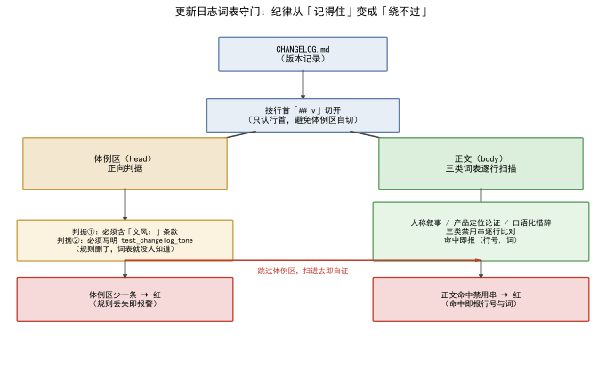

<!--
SPDX-License-Identifier: CC-BY-SA-4.0
Copyright (c) 2026 wUwproject
Licensed under Creative Commons Attribution-ShareAlike 4.0 International (CC BY-SA 4.0).
See https://creativecommons.org/licenses/by-sa/4.0/ for details.
-->

# 第七部 · 43｜更新日志写成技术文章：现象、根因、修法、验证

> 摘要：更新日志是给后来查「这次改了什么」的人读的，不是现场对白。本文只讲一个纪律：每段只写现象、根因、修法、验证四件事；而这条纪律不能靠人记——要用词表测试守住，规则从「记得住」变成「绕不过」。

## 一、引子：真实起点

打开一份旧日志，第一眼看到的若是「谁提的」「这个智能体是要分发出去的」「踩了个坑」，那是在读现场对白，不是读技术记录。读到它的人是后来查这件事的人，三类与正文无关的内容都不承载「改了什么」，只把技术结论埋在话里 [1]。

## 二、现象：日志曾写满三类与正文无关的内容

v1.0.0 之前的旧日志，三类内容混进技术记录：人称叙事（写明是谁提的、怎么定稿的）、产品定位论证（替产品该不该分发辩护）、口语化措辞（「坑」「踩坑」「顺带」「白跑」这类只在口头成立的词）[1]。技术结论被埋，读到它的人要自己挖。三类禁用串的具体形态列在表 1，它们就是后来词表守门要扫的目标 [2]。

| 类别 | 守门目标（节选禁用串） | 守什么 |
|---|---|---|
| 人称叙事 | 主人 / 我推荐 / 我认为 / 用户说 / 用户反馈 | 记录的是这件事，不是谁提的 |
| 产品定位论证 | 是要分发出去的 / 这个智能体是 / 大多数用户唯一 | 与代码行为无关的辩护不进记录 |
| 口语化措辞 | 坑 / 顺带 / 顺手 / 压根 / 白跑 / 白烧 / 白写 | 口头成立、文档里不成立的词 |

## 三、错误尝试：只在规范里写一句「别写对话主语」

编写规范里其实写过这条规矩——但只靠人记。词表扫一遍就发现，漏过的「主人」「我们认为」又回到日志里 [2]。纪律靠人记，等于没纪律：下一次提交若没有校验，三类内容又会渗回来，而没人会在每次提交前逐行复查整份日志。

## 四、根因：纪律必须变成机器守的门禁

根因一句话：**规则从「记得住」改不成「绕不过」，它就会被悄悄改回去**。更新日志的每一版本段都是人写的，没有自动校验，任何一次顺手改动都能把修好的文风悄悄撤掉。旧日志里三类内容反复回潮，正是因为守门靠的是一句「记得别写」，而不是一条会红的断言。这句「会红的断言」不是假设：后文第六节的两组突变里，删一个条款、塞一句口语，各自在毫秒级内变红，红的信息精确到词与行号。

把这条根因再往下拆，是词表守门的三条设计原则：

**其一，词表是字面串，不是正则。** 三类禁用串全是可直接读懂的词（「主人」「是要分发出去的」「坑」），命中报 `(词, 行号, 行内容)` 三元组——扫出问题的人不需要懂正则就能核对是不是误伤、该不该收词。词表因此是活的：新冒出来的口头禅，加一个串、跑一遍测试就能收编，规则的增长成本是一次提交。

**其二，跳过体例区防自证。** 词表本身写在头部体例区里（「不出现『主人』」这种句子），把词表扫自己是必命中、必误报。所以切点按**行首** `## v` 认——体例那行里就写着 `` `## vX.Y.Z` ``，按子串切会在那里断开。这个细节是实测逼出来的：切错一次，五项判据里四项全红，红的全是词表自己的条款。

**其三，正向判据闭环。** 只禁内容不够——把词表条款从体例区删掉，扫描器照样全绿，规则等于被静默废除。所以体例区必须含「文风：」且写明 `test_changelog_tone`：条款与守门者互相指认，删条款即红，删测试名也红。禁用串（负向）与条款在场（正向）合起来，这条纪律才既绕不过、也拆不掉。

## 五、正确修法：体例收紧 + 词表守门

v1.0.0 做两件事 [3]：

第一，正文全量改写 60 处，三类内容一律去掉，每段只留现象、根因、修法、验证；体例区补一条文风条款 [3]。体例段本身也写死格式：只有版本号是标题（`## vX.Y.Z`），段内分组与要点一律用加粗（`**修复**`／`**变更**`／`**新增**`／`**测试**`／`**说明**`），条目写成 `- **短语**：说明`，段与段之间用 `---` 分隔 [4]。四条格式各有用处，不是排版洁癖：

- **只有版本号做标题**——这是扫描器切段（`_split`）的唯一锚点。标题一旦允许别的写法，切点就要靠猜，词表扫描的边界就不确定；
- **加粗分组**——给每个版本段一个可断言的「有内容」信号（第 5 项判据：每段必含 `**`），空壳段当场暴露；
- **条目化（`- **短语**：说明`）**——每条改动的「改了什么」收敛成短语加一句话，读到它的人按条检索，而不是通读现场对白；
- **`---` 分隔**——段界肉眼可见，也让「跳过头部体例区、逐段处理」的自动化有干净的输入。

第二，把纪律变成测试：`tests/test_changelog_tone.py` 按词表扫正文，命中即报行号 [2]。关键设计有两处：其一是**跳过头部体例区**——那里写着词表本身，扫进去是自证；其二是加一条**正向判据**：体例区那条款必须在场，且必须写明由哪个测试守住——规则删了，词表也就没人知道 [2]。

扫描器骨架（真实实现 `tests/test_changelog_tone.py:49–71`，伪代码化）：

```python
def _split():                                # 切点只能按行首 ## v 认
    m = re.search(r"^## v", text, re.M)      # 体例行里写着 `## vX.Y.Z`，
    return text[:m.start()], text[m.start():]  # 按子串切会在那里断开

def _hits(words):                            # 正文逐行 × 逐词
    for i, line in enumerate(body.splitlines(), 1):
        for w in words:
            if w in line:
                out.append((w, i, line.strip()[:90]))  # 命中即报三元组
```

正向判据反着扫：`_split` 切出的头部体例区必须含「文风：」且写明 `test_changelog_tone`——规则条款被删，词表也就没人知道，测试当场红。

  
*图 1：CHANGELOG 按行首 `## v` 切开为体例区与正文；体例区做正向判据（条款在场）、正文做三类词表扫描（命中即报），扫描跳过体例区以避免自证。*

## 六、验证：词表、断点、测试计数

四类证据，测量条件一并给出。

**五项判据清单**（`tests/test_changelog_tone.py` 全部断言，2026-10-12 逐条对读 [2]）：

| # | 判据 | 断言对象 |
|---|---|---|
| 1 | 人称叙事词表零命中 | 正文逐行 × `BANNED_PERSON`（12 词） |
| 2 | 产品定位论证词表零命中 | 正文 × `BANNED_POSITIONING`（4 词） |
| 3 | 口语化措辞词表零命中 | 正文 × `BANNED_COLLOQUIAL`（12 词） |
| 4 | 体例条款在场且写明守门测试名 | 头部体例区含「文风：」与 `test_changelog_tone` |
| 5 | 每个版本段都有加粗小标题 | `## v` 切段后每段含 `**` |

**守门实验：基线 + 两组突变**（2026-10-12 实测，在仓的临时副本上复跑，程序版本 v2.12.0b1；数据源 [2]）：

- **基线**：五项判据全 PASS。词表对 v1.0.0 全量改写后的全部版本段（含 v0.1.0–v0.9.x 的改写留档）逐行扫描，三类命中各 **0** 条——改写不是「新段落干净了」，是从 v0.1.0 起每一版都过得了词表。
- **突变①（删条款）**：把体例区的「文风：」字样删掉——`test_the_style_clause_is_present` 当场红，断言原文「体例区缺少『文风：』那条款」。正向判据生效：规则条款被删，测试比任何读者先知道。
- **突变②（注入口语）**：往 v2.10.0 段塞一行「- **临时验证行**：这轮踩了个坑，顺带把白跑的路径压了压。」——`test_no_colloquial_markers` 当场红，报出命中三元组 `('坑', 60, '- **临时验证行**…')`，即（词, 行号, 行内容），与「命中即报行号」的承诺一致。
- **切点对照**：同一套词表若不跳体例区、天真扫头部，会把体例行里写着的「主人」「坑」「顺带」「白跑」全判成命中——这正是 `_split` 按行首 `## v` 切开、跳过体例区的原因：词表扫自己是自证。

**词表守门实证**（数据源 [2]）：三类禁用串逐行比对，命中即报 `(行号, 词)`；体例区必须含「文风：」且写明 `test_changelog_tone`。文档注释写得很直白——「它们在编写规范里已经写过一次，但只靠人记，于是又漏了。本文件把它们变成词表：规则从『记得住』改成『绕不过』」。

**格式断点实证**（数据源 [4]）：体例段对标题、加粗分组、条目写法、`---` 分隔四项逐条写死，与 v1.0.0 之后的全部版本段一致。五项判据里前四项是词表类（三类禁用 + 条款在场），第五项是格式类（每段有加粗小标题）——词表管内容、格式判据管结构，同一份文件两类判据互补：内容干净但空壳化的段落由第 5 项拦下，结构规整但夹带私话的段落由前三项拦下。

**测试计数实证**（数据源 [3]）：v1.0.0 全量单测 1277 → 1283（新增 `test_changelog_tone.py` 5 项 + `test_config_keys.py` 版本齐步组 1 项）；README 同步为 1283。词表守门自 v1.0.0 起进 CI，任何一次提交若把三类内容写回正文、或删掉体例条款，都会当场红。

守门选词表而不是选别的，同样是设计决定。备选方案至少有两个：靠人复查（回到「记得住」，已证失败）；靠模型审文风（每版本段跑一次大模型判「像不像现场对白」）。模型审的三个致命伤：**不确定**——同一段两次判可能不同；**不可复跑**——判过就没了，没法进 CI 当断言；**会错杀**——「我们试过」这种技术陈述容易被误判成人称叙事。词表恰好相反：确定（字面比对）、可复跑（毫秒级、零成本、进 CI）、误伤可控（命中三元组摆出来人工核）。文风纪律里「硬的那部分」（哪些词不出现）交给词表，「软的那部分」（行文是否清爽）留给人——机器守得住的守死，守不住的不假装守。

词表还是活的，有自己的收词流程：正文里冒出新口头禅（某次「死档」「这轮」先后入表），就往对应词表加一个串、跑一遍测试、确认无误伤——收词成本是一次普通提交。三个词表从 v1.0.0 到现在都在长，长词表不破坏任何既有断言：词表只增不减、命中即报，历史版本段早已过审，新增串只影响未来提交。规则因此不是一块刻死的碑，而是一条跟着语言习惯生长、又随时被 CI 拦住回潮的活纪律——收词的门槛足够低（一次提交），纪律才追得上语言习惯的惰性。

## 七、结语：一句话可复用结论

更新日志写的是「这件事改了什么」，不是「谁提的、该不该做」。把现象／根因／修法／验证四条写死成体例，再用词表测试守住，纪律才从「记得住」变成「绕不过」——省下每次提交前逐行复查整份日志的人，也堵死了文风悄悄回潮的路。可复用的判定式一句话：**凡是「靠人记」的写作纪律，都该问一句「改回去会不会报警」——不会，就把它变成一条会红的断言**；这套做法不挑对象，更新日志的文风、接口的契约、代码的版本号，用的是同一把锤子。

### 引用与出处说明

| 编号 | 引用 | 出处 |
|------|------|------|
| [1] | 旧文风：人称叙事／产品定位论证／口语化措辞三类混进技术记录，技术结论被埋——读到它的人要自己挖 | podcast-maker · CHANGELOG.md · v1.0.0 · 问题段 |
| [2] | 词表守门：三类禁用串逐行扫描命中即报、跳过体例区避免自证、体例条款必须在场且写明测试；docstring「规则从记得住改成绕不过」 | `podcast_maker/tests/test_changelog_tone.py`（BANNED_PERSON／BANNED_POSITIONING／BANNED_COLLOQUIAL／REQUIRED_CLAUSE，行 28–97） |
| [3] | 体例收紧：正文改写 60 处、README 新增 2 节、新增测试 6 项、全量 1277 → 1283 | podcast-maker · CHANGELOG.md · v1.0.0 · 本次改动／修法／测试段（行 845–879） |
| [4] | 体例段本身：只有版本号是标题、段内用加粗、每条 `- **短语**：说明`、段间 `---`、文风只写四件事 | `podcast_maker/CHANGELOG.md`（头部体例段，行 6–11） |

## 延伸阅读

- **同书其他篇**：#44《测试钉子：如何防止修好的 bug 长回来》是同一主题的另一种落点——把「记得住」的纪律变「绕不过」的测试，本篇是更新日志文风，那一篇是 bug 回归；两者共用「守门靠断言、不靠人记」这一条。

---

*最后更新：2026-10-12（字数补厚：守门实验真实数据——基线 5/5 PASS、突变①删「文风：」当场红、突变②注入口语行报 ('坑', 60, …) 三元组、切点对照（体例区天真扫描自证实证），2026-10-12 于仓的临时副本复跑、程序版本 v2.12.0b1；另加扫描器伪代码 + 五项判据表 + 词表三条设计原则 + 词表 vs 模型审 + 收词流程；四检：真实性 PASS / 底层逻辑 PASS / 空推论 PASS / 循环论证 PASS）*
