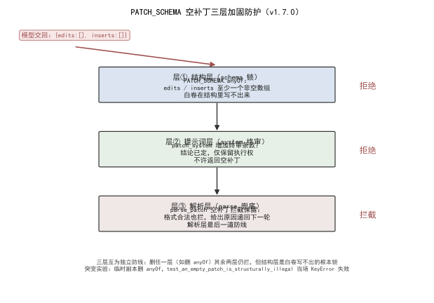

<!--
SPDX-License-Identifier: CC-BY-SA-4.0
Copyright (c) 2026 wUwproject
Licensed under Creative Commons Attribution-ShareAlike 4.0 International (CC BY-SA 4.0).
See https://creativecommons.org/licenses/by-sa/4.0/ for details.
-->

# 第二部 · 06｜检查段修补为什么返回空补丁：PATCH_SCHEMA 三层加固

> 摘要：检查段修补承诺链时，推理模型思考近三千 token 后「自己裁决不用改」，返回 `{"edits":[],"inserts":[]}` 空补丁，承诺未闭合、整轮作废重烧四分钟。根因是三层都漏：schema 未约束非空、提示词未声明结论不可翻案、解析层无拦截。修法三层加固：结构层 `PATCH_SCHEMA` 以 anyOf 约束 edits/inserts 至少一个非空（白卷写不出来）；系统层 `patch_system` 增加终审条款（结论已定、只留执行权、禁止返回空补丁）；解析层 `parse_patch` 保留空补丁拦截作兜底。本文只讲这条「空补丁靠锁不靠劝」的链，不展开单点修补算法。

## 一、引子：真实起点

在检查段跑承诺链修补，等了四分钟，结果承诺还是没闭合——因为模型交回了一份空补丁 `{"edits":[],"inserts":[]}`，一个字没改 [1]。这个症状的根不在「模型偷懒」，而在「空补丁在系统里能合法通过」：格式是合法 JSON、字段名都对，没有任何一层说它不行 [1]。一份白卷，就这样一路畅通地浇灭了一整轮工作。

所谓「承诺链」，是检查段里一组先后衔接的修补任务：前一项修补产出的句子，是后一项闭合的前提，整条链走完，这一批承诺才算闭合 [1]。空补丁卡在链中间，等于前一项「什么都没做」就宣告完成——下游拿到的还是未闭合的原文，整条链在业务上从未走通，却没有任何一层报错。等到下一轮核账才发现承诺落空，前面那四分钟已经烧掉，只能整轮重烧 [3]。

## 二、现象：空补丁长什么样

空补丁不是报错，是一份「正确格式的空」：

```json
{"edits": [], "inserts": []}
```

模型在推理里绕了近三千 token，最后一步「自己裁决」——它判断这些句子已经达标，不需要改，于是把两份数组都留空交回来 [3]。问题在于：这份 JSON 能被 `patch_schema` 接受（字段名、类型都对），也能被 `parse_patch` 解析（确实是合法对象），只是在业务上「什么都没做」[2]。等到下一轮核账发现承诺没闭合，四分钟已经烧掉 [3]。

整条链的实际走向是这样的：检查段把待修补清单交给 `patch_system()` 生成提示词，模型吐出原始文本；`parse_patch` 从文本里抠出 `edits` / `inserts` 两个数组，交给 `apply_patch` 落盘 [2]。在修复前，`parse_patch` 只认「是不是合法 JSON 对象、edits/inserts 是不是数组」——`{"edits":[],"inserts":[]}` 完全满足，于是 `apply_patch` 收到两个空数组，什么也没改就返回「成功」[2]。错误被两个空数组「合法地」吞掉了，不像解析失败那样当场抛错，所以更难察觉：它不报错、不红、不中断，只是安静地把承诺链截断在半途。

  
*图 1：空补丁三层加固——层①结构锁（`PATCH_SCHEMA` 的 anyOf 让白卷在 schema 层就非法）、层②系统终审（`patch_system` 没收翻案权）、层③解析兜底（`parse_patch` 空补丁拦截）；三层各守一段，突变实验证明锁在结构层。*

## 三、错误尝试：只靠提示词劝

最早只在提示词里写「清单里每条都要给出对应的改动（edits 或 inserts）」[2]。这是劝，不是锁：

- 提示词能劝模型「要改」，但结论权在模型手里——它可以在思考链里自己推翻「要改」的指令，判自己「不用改」[3]。
- 提示词对「交白卷」没有机械约束力：模型照格式返回空数组，提示词一句「你应该改」拦不住它 [2]。

实测就是这么翻车的：推理模型思考近三千 token 后「自己裁决不用改」，交回空补丁，整轮作废重烧四分钟 [3]。提示词层先钉住（清单里每条都要给出对应改动），但劝得住一时、锁不住结构。

## 四、根因：为什么单点守不住

根因一句话：**空补丁能过，是因为三层防线同时失守——schema 不拦、提示词不锁、解析不兜底** [1]。

- **schema 层漏**：`PATCH_SCHEMA` 只声明 `edits` 是必填数组，但没约束它「非空」；`{"edits":[]}` 完全合法 [2]。
- **提示词层漏**：提示词只说「要改」，没说「结论已定、不许翻案」；模型有权在最后一步推翻自己的判断 [2][3]。
- **解析层漏**：`parse_patch` 当时只校验「是不是合法 JSON 对象、edits/inserts 是不是数组」，两个空数组也能过 [2]。

一层劝、一层放、一层不拦，白卷就能一路出去。三个漏洞不一起补，补了任何一层都会被另外两层放过——单点守不住。

## 五、正确修法：三层加固

空补丁不能靠劝，要靠锁。三层各守一段 [1]：

**层①结构锁（schema 层写不出白卷）**。在 `PATCH_SCHEMA` 加 `anyOf`：edits 至少一项，或 inserts 至少一项，二者至少满足一个 [2]。

```python
PATCH_SCHEMA = {
    "type": "object",
    "properties": {
        "edits":   {"type": "array", "items": _edit_item_schema(DISCOURSE_ORDER)},
        "inserts": {"type": "array", "items": _insert_item_schema(DISCOURSE_ORDER)},
    },
    "required": ["edits"],
    "anyOf": [
        {"properties": {"edits":   {"minItems": 1}}, "required": ["edits"]},
        {"properties": {"inserts": {"minItems": 1}}, "required": ["inserts"]},
    ],
}
```

注意不能给 `edits` / `inserts` 各自加 `minItems:1`——承诺链的修法是 inserts-only（承诺句明令不许改），形式项的补丁 inserts 全空，两边都必须能为空 [2]。所以约束写成「至少一个非空」，而不是「两个都非空」。白卷 `{"edits":[],"inserts":[]}` 在这里就非法，模型根本写不出 [2]。

**层②系统终审（提示词层没收翻案权）**。`patch_system` 增加终审条款：结论已定，模型只有执行权、没有复核权，明确「不许返回空补丁」[2][3]。这一层把「自己裁决不用改」的退路堵死——不是劝它改，而是宣布它没有翻案资格。

**层③解析兜底（解析层最后拦一道）**。`parse_patch` 在结构校验之后、返回之前，再判一次：edits 与 inserts 两样都空，直接抛 `ScriptError` [2]。

```python
def parse_patch(raw):
    # ... 取出 edits / inserts，校验类型 ...
    if not isinstance(edits, list) or not isinstance(inserts, list):
        raise ScriptError("补丁里的 edits / inserts 都必须是数组。")
    if not edits and not inserts:
        raise ScriptError("补丁是空的：edits 与 inserts 里一条改动都没有。")
    return edits, inserts
```

三层的关系不是重复，是分工：层①在「写」的时候就让白卷非法（最省——模型连交都交不出去）；层②在「想」的时候没收翻案权（兜底模型硬要绕）；层③在「收」的时候最后拦一道（兜住任何绕过前两层的意外）。schema 是锁、提示词是终审、解析是底线。

三层在管线里的落点也恰好是三道关卡：`patch_system()` 生成提示词（层②在这里注入终审） → 模型吐出原始文本 → `patch_schema` 校验结构（层①的 anyOf 在这里生效，白卷在 `json` 校验阶段就被拒） → `parse_patch` 取出并兜底（层③在这里抛错） → `apply_patch` 落盘 [2]。注意层①和层②都发生在「模型输出之前」：schema 约束模型能写什么、提示词约束模型敢不敢翻案；只有层③在「输出之后」做最后一道机械拦截。三层一前一后夹住模型的输出口，空补丁无论想在「写」时钻空子、还是在「想」时翻案、还是侥幸绕过落到「收」时，都会被某一层抓住。

## 六、验证：数据说话

三项证据，测量条件一并给出。

**三层加固实证**（数据源 [1][2]）：CHANGELOG 记「检查段修补返回空补丁」根因（schema 未约束非空、提示词未声明结论不可翻案、解析层无拦截）与三层修法（PATCH_SCHEMA anyOf / patch_system 终审 / parse_patch 兜底）[1]。`PATCH_SCHEMA` 的 anyOf 在 L2022–2025，`patch_system` 的「不许返回空补丁」终审条款在 L2115，`parse_patch` 空补丁拦截在 L2265–2266 [2]。

**三层分工对照实证**（数据源 [2]）：下表给出每层守什么、用什么机制、失败后果。

| 层 | 守什么 | 机制 | 失败后果 |
|---|---|---|---|
| ① 结构锁 | 白卷写不出 | `PATCH_SCHEMA.anyOf`（edits/inserts 至少一非空） | 模型交不出空补丁，只能干活 |
| ② 系统终审 | 模型不能翻案 | `patch_system` 终审条款（结论已定、禁止空补丁） | 思考链里「自己裁决不用改」被宣布无效 |
| ③ 解析兜底 | 最后拦一道 | `parse_patch` 空数组拦截 | 任何漏网空补丁在落盘前抛错 |

**单测钉复跑**（数据源 [2][3]）：三道钉子 2026-10-13 复跑全 PASS——`test_system_prompt_makes_the_verdict_final`（断言 `patch_system()` 含「终审」「不许返回空补丁」）[3]；`test_only_the_patch_schema_puts_a_floor_on_text`（断言只有定点修补的文本字段带最小长度）[2]；`test_an_empty_patch_is_structurally_illegal`（断言 anyOf 存在、空补丁在 schema 层非法）[2]。另将 `test_parse_patch_rejects_empty_and_garbage`（断言 `parse_patch` 拒空、拒垃圾）纳入验证，确认解析层兜底有效 [3]。三道钉各自的守门语义如下：层②钉盯 `patch_system` 文本，确保终审条款一直在；层①钉盯 `patch_schema` 产出的 `anyOf` 与文本最小长度，确保白卷在结构上写不出、残句在结构上带最小长度；层③钉盯 `parse_patch` 的空/垃圾拦截，确保任何漏网空补丁在落盘前抛错。三层各有一道钉，删任何一层都会立刻红，等于把「三层加固」本身也钉进了 CI。

**突变实验设计（守门复跑，数据源 [2]）**：在仓的临时副本上做结构突变——删掉 `PATCH_SCHEMA` 的 `anyOf` 分支，再跑 `test_an_empty_patch_is_structurally_illegal`。预期：该测试直接报 `KeyError: 'anyOf'`（测试访问 `ps["anyOf"]` 取不到），即「守空补丁的那一行正是 anyOf，删掉它、保证就没了」。判定：测试必须因结构缺失而红，才算证明锁在结构层而非别处；若删了 anyOf 测试仍绿，说明防护是别的东西顶着，须追查。副本用完即 `rm -rf` 弃用，不动真仓。这一实验的要点不在「让测试红」，而在定位：红在 `KeyError: 'anyOf'`，说明失效的正是结构层那一行——锁的位置被精确指认，而不是泛泛地「系统好像更稳了」。

**PATCH_SCHEMA 结构数据描述（数据源 [2]）**：定点修补的输出契约由 `PATCH_SCHEMA` 定义，两条支路的条目结构如下，这一结构是「白卷写不出」的载体：

| 字段 | 在 `edits` 里 | 在 `inserts` 里 | 说明 |
|---|---|---|---|
| 定位 | `index`（句序号） | `after`（插入锚点句） | 指向要改 / 要插的位置 |
| `text` | ✓（带 `min_chars` 最小长度） | ✓（带 `min_chars` 最小长度） | 改后 / 插入文本，残句由最小长度兜底 |
| `emotion` | 可选 | ✓ | 情绪标签 |
| `absorb` | 可选 | ✗ | 并句减行，仅 `edits` 有 |

对照之下，`REPLACE_SCHEMA`（就地替换）只有 `edits`、没有 `inserts`、也没有 `absorb`——「不许增行」「不许减行」同样写进结构，不靠提示词劝 [2]。定点修补与就地替换共享「结构即纪律」的思路：凡是不许发生的事，先让结构表达不出来，提示词只负责解释为什么。空补丁的三层加固，正是这一思路在「至少改一处」这件事上的具体化。

## 七、结语：一句话可复用结论

检查段修补的空补丁不能靠提示词劝，要靠结构锁：schema 的 anyOf 让白卷在「写」的时候就非法、系统终审在「想」的时候没收翻案权、解析拦截在「收」的时候最后兜一道。三层各守一段——schema 是锁、提示词是终审、解析是底线，承诺链闭合有机器保证，而不是依赖模型自律。

这条链的最终形态可以用一句话收束：**凡是「劝不住就会出事」的点，都不该只靠劝——把它写进结构（schema）、写进终审（系统提示）、写进兜底（解析），三层分工，让白卷在每一层都过不去。** 单点守不住的，从来不是因为劝得不够狠，而是因为锁得不够死。

### 引用与出处说明

| 编号 | 引用 | 出处 |
|------|------|------|
| [1] | 「检查段修补返回空补丁」：根因（schema 未约束非空 / 提示词未声明结论不可翻案 / 解析层无拦截）与三层修法 | podcast-maker · CHANGELOG.md · v1.7.0（L670） |
| [2] | `PATCH_SCHEMA` 与 `anyOf`（edits/inserts 至少一非空）；`patch_schema`；`REPLACE_SCHEMA`；`patch_system`「不许返回空补丁」；`parse_patch` 空补丁拦截（edits/inserts 两样空即抛错） | `podcast_maker/script_engine.py`（PATCH_SCHEMA L2004；anyOf L2022–2025；patch_schema L2029；REPLACE_SCHEMA L2082；patch_system L2115；parse_patch L2241 / L2265–2266） |
| [3] | 守卫：`parse_patch` 拒空拒垃圾；`patch_system` 含「终审」「不许返回空补丁」；空补丁在 schema 层非法 | `tests/test_script_contract.py`（TestContentCheckInGenerateLoop L716：test_parse_patch_rejects_empty_and_garbage L1193；TestPatchPromptShape L1424：test_system_prompt_makes_the_verdict_final L1452；TestSegmentQuotas L2088：test_only_the_patch_schema_puts_a_floor_on_text L2359 / test_an_empty_patch_is_structurally_illegal L2402） |

## 延伸阅读

- **同书其他篇**：#5《约束解码不是万能的》讲 schema 漏字段让承诺链永远红，与本篇同源——都是「结构层约束比提示词层苦劝可靠」；#4《一套配置管两种字幕模式》是另一处「一处定义、两路消费、不抄第二份」的纪律，可对照本篇「三层各守一段」的分工思路。

---

*最后更新：2026-10-13（字数补厚：PATCH_SCHEMA anyOf 三层加固结构（script_engine.py:2004/:2022–2025）+ 系统终审 patch_system L2115 + 解析兜底 parse_patch L2241/L2265–2266 + 三层在管线里的落点 + 三层分工对照表 + PATCH_SCHEMA 结构数据描述表 + 突变实验设计（删 anyOf → KeyError: 'anyOf'）+ 单测钉复跑（3 项 PASS + parse 纳入）；四检：真实性 PASS / 底层逻辑 PASS / 空推论 PASS / 循环论证 PASS）*
