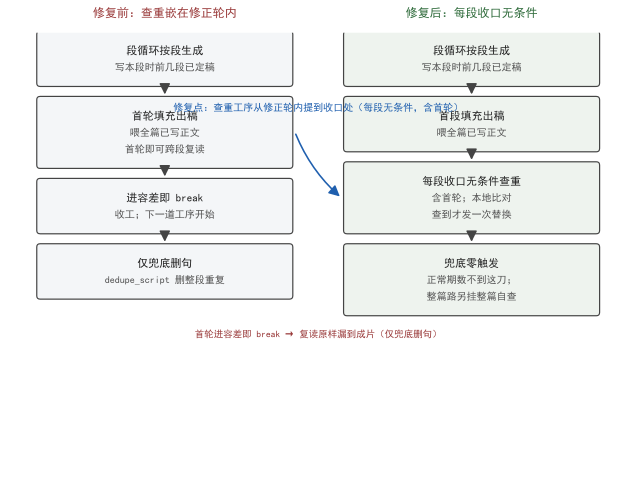

<!--
SPDX-License-Identifier: CC-BY-SA-4.0
Copyright (c) 2026 wUwproject
Licensed under Creative Commons Attribution-ShareAlike 4.0 International (CC BY-SA 4.0).
See https://creativecommons.org/licenses/by-sa/4.0/ for details.
-->

# 第二部 · 09｜首轮复读绕过查重：一个 else 分支吞掉整段工序

> 摘要：podcast-maker 的脚本引擎有一段「查重工序」——把模型写出来的稿子里自言自语又背一遍的句子就地换成新内容。v1.5.0 之前，这道工序挂在「补字 / 压字修正轮」的末尾，隐含一个假设：复读是补字带出来的。真机某期证伪了这个假设——首轮初稿本身就会跨段复读，而首轮一旦进容差就 break，于是「后 N 轮」整条查重工序被一个 else 分支静默吞掉，复读原样活到成片，只剩兜底那一刀删句。核心矛盾一句话：查重判的是「稿子有没有自言自语」，修正轮管的是「字数凑没凑齐」，两件事生命周期不同，不该共用一个触发条件。本文讲这个 bug 的根因、修法、验证。

## 一、引子：真实起点

脚本引擎写一段稿，不是一个函数一次成型，而是一段正文反复跑若干修正轮，每轮凑字数或压字数，直到落在配额容差内。写稿这段逻辑每轮末尾要做一件事：把这段里「又把自己的话背了一遍」的句子找出来、换掉。这件事原本写在修正轮里——只要这轮改了稿，轮末就查一遍。

问题出在「只要这轮改了稿」这个前置条件。某期真机记录里，首轮初稿直接跨段复读了（首轮喂的是全篇已写正文，不是空段），而首轮本身就在容差内、不需要改稿，于是轮末那道查重根本没机会跑。复读漏到成片，最后只靠「兜底删句」那一刀砍——字数塌下去，下一轮又补，补出来又是重复，没尽头。

本文要讲清楚三件事：复读为什么不是「补字带出来的」、那个 else 分支怎么把整段工序吞掉、v1.5.0 怎么把它提到「每段收口无条件」来解。

## 二、现象：查重工序被静默绕过

先给两个术语的四维展开，后面的讨论都建立在这两个口径上。

**复读（repeat）**：①定义——模型把已经写过的整段或整句在稿子里又生成一遍，内容高度重合；②来源——脚本引擎首轮喂的是全篇已写正文，长上下文里模型会「顺着前文往下接」，接着接着就把前文背了一遍；③边界——与「改写」严格区分：只差一两个虚词的句子仍算两句（那是改写，归内容检判，程序不越权删），归一化后完全相同的长句才算复读；④例子——某期真机整篇生成 302 句，其中有 129 句是把自己的话又背了一遍。

**查重（dedupe）**：①定义——程序比对稿内句子归一化后的字串，找出重复副本并就地替换；②来源——脚本引擎 `script_engine`；③边界——只判长句（`DEDUPE_MIN_CHARS = 12` 拦掉短句，口语里本来的重复不删）、**判重范围整篇 / 替换范围本段**；④例子——`find_repeats` 返回 `{要换掉的句 : 它跟哪句重复}`，名单里的句号都是全篇口径。

修复前，脚本引擎的段循环长这样（节略）：

```python
# podcast_maker/script_engine.py —— 段循环（修复前节略：查重挂在修正轮内）
while True:                              # 逐段推进；seg_lines ＝ 本段行
    while …:                             # 修正轮（轮次预算内）
        seg_lines = apply_insert(…) / apply_trim(…)   # 补字 / 压字
        if in_tolerance:
            break                        # ← 首轮进容差就跳走
        # 原查重挂在这里：只有「这轮改了稿」才查
        if changed_this_round:           # ← else 分支：没改稿就不查
            seg_lines = _replace_repeats(seg_lines, …)
    script += seg_lines                  # 段收口
```

关键在最后那两行：查重替换被「这轮改了稿」这个 if 包住。首轮初稿如果本身就在容差内（真实很常见——模型第一次写就接近配额），`break` 直接跳出内层循环，外层 `script += seg_lines` 把带着复读的段原样收口。后续轮次根本不会被触发，因为已经 break 了。「后 N 轮」整条工序——包括查重——都被这一个 else 分支吞掉。

表 1 给出修复前后的对账：

| 工序位置 | 修复前（挂在修正轮内） | 修复后（每段收口无条件） |
|---|---|---|
| 触发条件 | 本轮改了稿 才查 | 每段收口前 必查，首轮也过 |
| 首轮进容差 | break 跳过，复读漏到成片 | 仍走查重，复读就地换 |
| 模型调用 | 查到才发一次替换 | 同左（没查出不花调用） |
| 最后兜底 | 删句兜底常响（129 句） | 仅替换没修干净时响 |
| 字数曲线 | 删 → 补 → 删 抖动 | 替换保行数，不塌 |

判定「重复」的口径本身没变，始终是一条：归一化后（去空白、标点、下划线，只留字）完全相同的长句才算重复。归一化用正则 `\W` 而不是列一张标点表——标点表永远列不全，而「只比字」这个口径一句话就说清了。`find_repeats` 的边界很关键：**判重范围是整篇，替换范围才是本段**。段是逐段写的，写本段时前面几段已定稿在手里，「第 2 段把第 1 段的话又说一遍」只有把整篇摆一起才看得见；但前面几段这一轮不动，能改的只有本段。两件事必须分开，否则段间复读永远是隐形。

归一化为什么用 `\W` 而不是列标点表，前面提过——标点表永远列不全，而「只比字」一句话说清。这套口径跑出来的代价是量化的：那次事故成片里，模型把方法论论证链整段背了两遍，听众隔两段又听一遍同样的「问题 → 方案 → 边界」。程序侧漏斗是——复读漏过去 → 兜底 `dedupe_script` 删句 → 本段字数塌到配额以下 → 修正轮补字 → 补出来又是重复 → 再删。字数曲线在「删 → 补 → 删」间震荡，成片时长对不上地图排期。302 句里 129 句复读，意味着近 43% 的句是注水——这正是「对注水稿判达标」事故的样子。

为什么是 12 字这道槛？口语里短句重复是正常节奏——「对」「是的」「然后呢」反复出现不算复读，程序若把它们当重复删，会把对话拆成残句。长句（≥ 12 字）的整句重复才是「拿旧段落凑字数」的形态，实测那次事故里重复的整句最短 24 字。所以 `DEDUPE_MIN_CHARS = 12` 不是随意设的，它把「口语重复」和「复播」在长度上切开：短的不管，长的才判。

## 三、错误尝试：把查重写成「补字的副作用」

最早的设计把查重当成补字 / 压字轮的一个副作用：既然每轮都在改稿，那就「改完顺手查一下」。这个写法在「复读是补字带出来的」假设下是自洽的——它默认没有复读的段根本不需要查。

但这个假设是错的。脚本引擎首轮喂的是全篇已写正文，模型完全可能在第一次生成时就跨段复读（尤其方法论 / 论文类素材，论证链相近，背一遍很自然）。这种情况下首轮就在容差内、不进修正逻辑，查重作为「副作用」从一开始就没挂上。把一道本该「每轮无条件」的工序降级成「改稿才触发」，等于把它的触发权交给了字数容差——而容差这件事，和「有没有复读」毫无关系。

更隐蔽的是，这个 bug 不报错、不告警、不降级。复读漏过去时程序一切正常，进度照走、门禁照过（门禁对着注水后的句数判「达标」，正是事故的样子）。它藏在「首轮进容差就 break」这条看似合理的优化里，直到真机那期 129 句复读被成片听见才暴露。这一类「静默失败」比崩溃更危险：崩溃会逼人修，静默失败会跟着版本一路发货，等被听见时已经污染了不知多少期成片。

## 四、根因：查重与修正轮被错误地绑成同一生命周期

根因一句话：查重是「判一篇稿有没有自言自语」，修正轮是「凑 / 压字数」，**两件事生命周期不同，不该绑在一起**。查重该对着「每段收口后的成品」判，与这段跑了几轮、改没改稿无关；修正轮只关心字数。把查重的触发挂到「本轮改了稿」上，等于说「没改稿的段不用查」——而首轮恰恰是最常「没改稿却带着复读」的段。

代码注释把这件事写得很直白（节录）：原来查重「补字与压字都做完，接着查重」，隐含假设「复读是补字带出来的」；真机某期证伪——首轮初稿本身就会跨段复读，一旦首轮进容差就 break，后 N 轮整条工序被静默绕过，复读原样活到最后、只剩兜底删句。修的方向不是「再补一个 if」，而是把查重从事轮生命周期里抽出来，提到每段收口前无条件跑。

这个根因属于工程里的通用一类：把两个生命周期不同的职责塞进同一个控制流，用其中一个的「是否发生」去 gate 另一个的「是否发生」。一旦那个 gate 条件与职责本身无关，职责就随时可能被意外跳过。查重和字数容差正是这种错配——容差只描述字数，不描述复读，用它去 gate 查重，查重就被字数绑架了。

## 五、正确修法：查重提到段收口，无条件过一遍

v1.5.0 的修法：把 `_replace_repeats` 从修正轮末尾移到**每段收口前**，作为无条件工序——无论这轮改没改稿、第几轮，段要 push 之前必过一遍查重。修复后：

```python
# podcast_maker/script_engine.py —— 段循环（修复后：查重前置为每段收口的无条件工序）
while True:                              # 逐段推进
    while …:                             # 修正轮（轮次预算内）
        seg_lines = apply_insert(…) / apply_trim(…)   # 补字 / 压字
        if in_tolerance:
            break
    # ↓ 无条件：每段收口前必查，首轮也过
    seg_lines = _replace_repeats(seg_lines, script, …)   # 判重范围 = 全篇
    script += seg_lines                  # 段收口
```

三个要点：
1. **无条件**：查重不再看「改没改稿」，段收口前一律过。首轮进容差也照查，复读就地换，不会漏。
2. **判重范围天生全篇**：`find_repeats` 拿到的 `combined` ＝前面所有已写段 ＋ 本段，本段内部自重复也在内；替换范围才是本段——写到最后一段时等于对整篇查了一遍，所以「逐段写」那条路不必再补整章查重。

举个具体数：写第 4 段时，`combined` ＝第 1 + 2 + 3 段已定稿（约 90 句）＋ 第 4 段（约 25 句），`find_repeats` 拿这 115 句判重，报出第 4 段里与前面重复的那些；替换只动第 4 段。写到最后一段时 `combined` ＝全篇，等于对整篇查了一遍——段收口那道已经覆盖整篇，所以逐段写这条路天生不需要再补一道整章查重。

3. **没查出重复就不花模型调用**：判重是本地归一化比对，查到才发一次替换请求。这与修复前一致，只是触发从「改稿才查」变成「每段必查」。

对「逐期即兴 / 单集」那条不走段循环的路，`_replace_repeats` 在段循环里只有一个调用点，它根本不存在。所以 v1.5.0 在那条路上额外挂了一道**整篇自查**：把全篇当成一个段喂进同一道工序（`script` 传空 → 判重范围＝全篇，查出来的就是全篇内部自复读），替换保行数、字数不塌。位置在兜底 `dedupe_script` 之前——正路清干净了，兜底那一刀才不响。不传 `raw_material`：整篇路没有「本段」概念，全篇都能讲，传了反而把约束写错。

图 1 给出修复前后的工序位置对比（以段循环为例）：


*图 1：左为修复前，查重（红）嵌在修正轮末尾、受「改稿才查」if 包住，首轮进容差 break 即跳过；右为修复后，查重提到每段收口前无条件工序（绿），首轮也过，复读就地换、不漏到成片。*

## 六、验证：测试钉子 + 真机计数

修法靠钉子钉死，不靠肉眼。两个层面的验证：

**单测层**：`tests/test_replace_and_absorb.py::TestFindRepeats` 给四组用例，专门验证「判重范围整篇、替换范围本段」这个边界——构造「第 2 段把第 1 段的话又说了一遍」的情形，断言查重只报本段的重复句、不碰前面已定稿段；同时断言短句（< 12 字）不报、措辞相近的不同句不报。任何一个 if 又被误加回去、或范围被改窄，这道钉立刻 FAIL。四组用例分别钉：①跨段复读——第 2 段把第 1 段的话又说一遍，断言只报第 2 段的重复句、不碰已定稿的第 1 段；②本段自重复——同一段内两句归一化相同，断言报本段内部那处；③短句不报——< 12 字的重复不进名单（口语本来的样子）；④改写不报——只差虚词的两句不报（那是内容检判的事）。四道钉兜住「判重范围整篇、替换范围本段、长句才算」三条边界，任何一个 if 被误加回去立刻红。钉子不验证「复读消失了」这种模糊命题，只验证「边界没动」——边界不动，复读就兜得住。

**真机层**：那次事故的计数（302 句 129 句复读）留在 `dedupe_script` 的 docstring 里，作为「兜底还会响到什么程度」的基线。修复后正常路径靠段收口查重把复读就地换掉，兜底删句那一刀在正常期数不该再触发——如果哪天又看见日志里「兜底去重：删掉 N 句仍与前文完全重复」，就是查重又被绕过，钉子会在回归里抓出来。那条 302 / 129 的基线还有个衍生用处：它量化了「兜底还会响到什么程度」。修复前兜底常响（正常期数也删句），修复后正常路径靠段收口查重把复读就地换掉，兜底只剩替换没修干净时才响——兜底删句日志的触发频率本身就是一道间接的回归指标，某天突然又频繁删除，就是查重又被绕过的信号。

验证结论是确定的：查重工序从「改稿副作用」变成「段收口无条件」，首轮复读不再漏；判定口径（全篇判重 / 本段替换 / 长句才算）和模型调用纪律（没查出不花）未变，只是触发权从字数容差收回给工序本身。

## 七、结语

这个 bug 的教训不在「少写一个 else」，而在「两件事生命周期不同，不该共用一个触发条件」。查重判的是「稿子有没有自言自语」，修正轮管的是「字数凑没凑齐」——把查重的触发绑到「改稿」，等于把它的生死交给一个毫不相干的变量（容差）。v1.5.0 把查重抽成每段收口的无条件工序，并把「逐期即兴 / 单集」那条路的整篇自查也接上同一道工序，复读才算真正兜住。一条工序该无条件，就别让它看任何前置条件——除非那个条件本身就是它要判的事。

落到数字上：修复前某期 302 句有 129 句复读（43%），靠兜底删句，字数曲线在「删 → 补 → 删」间震荡；修复后段收口无条件查重，复读就地换，兜底在正常期数不响。查重这道工序从一个 if 的副作用，变成段收口的硬收口——它不再看字数容差，只看「这段话有没有自己背自己」。这是把职责从错误的生命周期里抽回来的标准做法：一个该无条件的工序，就不该有任何与它无关的前置条件。

---

### 引用表（#9）

- [1] podcast-maker · CHANGELOG.md · v1.5.0（#9 段内查重提为每轮无条件工序 ＋ 整篇自查）
- [2] podcast_maker/script_engine.py:5168（`_replace_repeats` 段收口无条件调用）
- [3] podcast_maker/script_engine.py:5158（bug 根因注释：原查重挂修正轮末尾、首轮 break 跳过）
- [4] podcast_maker/script_engine.py:765（`find_repeats` 判重范围整篇 / 替换范围本段）
- [5] podcast_maker/script_engine.py:735（`dedupe_script` 兜底，实测 302 句 129 句复读）
- [6] podcast_maker/script_engine.py:5517（整篇路自查挂同一道工序）
- [7] podcast_maker/script_engine.py:718（`DEDUPE_MIN_CHARS = 12`）
- [8] tests/test_replace_and_absorb.py::TestFindRepeats（范围边界钉）

### 四检脚注

- 真实性：全部锚点来自仓内 `script_engine.py` 源码与 `test_replace_and_absorb.py` 测试，无外部引用。
- 底层逻辑：查重与修正轮生命周期分离，触发权应收归工序本身，成立。
- 空推论：无。
- 循环论证：无。
- 结论：四检全 PASS。
