# 版权页

## 书名

**《我写故我播——一本 AI 犯过错的书：边界的实测、缺陷的坐标与因地制宜的裁量》**

## 作者

**wUwproject**（本书为作者与 AI 协作完成，作者对全书内容与判断负责）

## 协议

- 本书整体（包括版权页、序言、阅读指南、正文、结语与全部附录）采用创作共用署名-相同方式共享 4.0 国际许可协议（Creative Commons Attribution-ShareAlike 4.0 International，简称 CC BY-SA 4.0）。
- 书中实测数据、测试记录、探针脚本归 wUwproject 所有，引用请注明出处。

## 收录与规模

- 全书章数：66 章（版权页 + 序言 + 阅读指南 + 八部导读 + 正文 47 篇 + 结语 + 附录 7 篇）。
- 全书总字数：**187,372 字**（出版折算口径⑥：汉字 158,990 + 英文词 21,079 + 数字串 7,303；由 `book/build/count_words.py` 实测）。
- 部结构：八部（I:4 II:8 III:8 IV:9 V:6 VI:6 VII:3 VIII:3 = 47 篇）。

## 版本

- `podcast-v1.0.0`（2026 年 10 月）：成书定稿。66 章 187,372 字；副标题定为「一本 AI 犯过错的书：边界的实测、缺陷的坐标与因地制宜的裁量」，主线由"成书方法"改为"边界实测"；部号统一罗马数字；剥离摘要块；配图能力上线（34 张全三端渲染）；附录增至 7 篇，A/B/C 与《我思故我写》同名同位；阅读指南新增缺陷坐标表（47 篇分 LLM 执行 13 / 工程常规 34）；结语重写。
- `podcast-v0.1.0（预备骨架版）`（2026 年 10 月）：按系根类骨架补齐序言、阅读指南与八部导读，前附后附与 47 篇框架就位，成书管线可跑通占位全书。

> 三端一致硬约束：版权页版本 == 仓库 README 版本徽标 == `book.html` 首页标题 == PDF 封面版本，任何一端改动须同步其余三端，任一不一致即 FAIL。

## 与《我思故我写》的关系

- **平行同级**：《我思故我写》（book-v1.2.0 完结封版）与本书《我写故我播》是两本平行的书，同为族系系根，**不构成主从或正副关系**。引用一律署《我思故我写》＋篇号。
- **关系是「方法论源头 → 第二应用现场」**：《我思故我写》回答"谁有权画圈"——划界权归人（圈内让 AI 做工，圈外由人负责），并给出四类边界分类（输出格式、决策权、场景、伦理）；本书用 podcast-maker 一座矿的 47 个缺陷，给这个圈补上**半径的实测坐标**。
- **姊妹卷仅指另外两册**：《架构解析》（arch-v1.3.0，结构侧）、《排版解析》（typ-v1.6.2，版式侧）侧写《我思故我写》语料，它们是姊妹卷；**本书不属其中**——本书语料独立（podcast-maker），与三册互补不重复。
- 逐条方法论对账见第 46 篇。

# 序言

## 这本书从哪来

《我写故我播》不是先有大纲再填内容，而是反过来：它从 podcast-maker 一座 CHANGELOG 矿里长出来。每一个被修掉的 bug、每一次被钉住的回归、每一条被收紧的体例，都是一篇文章的种子。版本号即目录，缺陷即文章——这是全书的成书方法，也是它最想交还给读者的东西。

## 为什么叫"我写故我播"

《我思故我写》说：在 AI 能替你说、替你写、替你检索、替你翻译的时代，"思"仍然是唯一无法外包的东西。本书把这句话往前再走一步——思在写之前，写在播之前：先有值得写的工程现场，再有文章，再有书，最后才有播客。写作不是终点，是把工程现场的判断沉淀为可复用方法的那道工序；播客只是这道工序的一个出口。

副标题把这本书的定位说全了——**边界的实测、缺陷的坐标与因地制宜的裁量**：不写定律，只标坐标；不给结论，只给可裁的物证。

## 这本书是什么、不是什么

- **它是一部个案的成书记录**：47 篇文章对应 podcast-maker 的 47 次真实工程决策——从九步管线到文明退化忧思，八部递进。每一篇都能在 CHANGELOG 里找到原始锚点。
- **它不是 podcaster 指南**：书里几乎没有"怎么涨粉""怎么选设备"；它记录的是一个具体工程怎么把不可靠的 LLM 一步步逼成可靠的生产线。
- **它是《我思故我写》方法论的第二个应用现场**：《我思故我写》论证"为什么"（判断在人、机器在圈内做工），架构册与排版册侧写其语料本身；本书把同一套方法搬到一座新矿上——验证它能不能在另一个语料上再长出一本书。第 46 篇逐条对账这次复用。

## 怎么读

正文之前先读《阅读指南》。八部按"链→约束→声音→BGM→字幕→界面→合规→哲学"递进，可顺读可跳读；每部入口有一篇部级导读。时间有限的读者，多数篇按"现象—根因—修法—验证"展开，这四段包含全部前提与结论。

—— wUwproject，2026 年 10 月

# 阅读指南

## 八部路线

```flow
第 I 部 管线与配置总表（01-04） "一条链怎么长出来"
    ↓ 链立住后
第 II 部 约束与修补（05-12） "LLM 输出不可信，八道闸收口"
    ↓ 文本可靠后
第 III 部 声音与音频（13-20） "把声音当工程做"
    ↓ 人声有了
第 IV 部 BGM 与环境音（21-29） "背景音乐的九道工序"
    ↓ 声音齐了
第 V 部 字幕（30-35） "一切从同源来"
    ↓ 成片有了
第 VI 部 界面与工程体验（36-41） "六个界面事故与六种修法"
    ↓ 工具能用了
第 VII 部 合规与纪律（42-44） "对外合规、对内记录、对己质量"
    ↓ 工程收口
第 VIII 部 方法论与哲学（45-47） "从一座矿回望整套方法"
```

## 怎么读

- **顺读**：按篇号 1→47 通读。八部是递进的——从"一条链怎么跑"到"一个工程怎么落地"再到"文明层面的忧思"。
- **跳读**：每篇自洽，篇末引用表给出原始 CHANGELOG 锚点与代码符号，想深挖直接跳仓库；每部入口有一篇部级导读（部主题 + 篇目表 + 阅读建议），可按部进入。
- **查缺陷坐标**：见下节。若时间只够读一章，先读它——本书的立论全在这张表里。
- **查篇目锚点**：47 篇对应的 CHANGELOG 原始条目，全表在附录 E（CHANGELOG 锚点索引），此处不重复维护——一处定义。
- **查模型底座**：TTS（B/C/V 三变体）、声纹（wavlm x-vector）、BGM（ACE-Step v1.5）等模型清单，以及架在它们之上的调优层（时长校准 k 因子、音色五族体检）与对应篇目的映射，全表在附录 F（模型底座）——后续调优章节均以此为基线。

## 缺陷坐标：哪些错是 LLM 自己犯的

本书 47 个缺陷不是同一种东西。**「缺陷主体」**一列区分两类：

- **LLM 执行**——错误首次发生的主体是模型（它在推理、生成或遵循指令时自己产生），且换一个熟练的人照同样规范做不会以这种方式犯。这类是**边界样本**：它的位置本身就是圆的边缘。
- **工程常规**——错误来自环境、工具、接口或人为决策，与模型能力无关，换个模型照样会出。这类有价值，但不标边界。

**「摸到的边界」**一列只写一句话，指向这处错误照见的那条界线；括号里的短语是这本书给这类边界起的名字。

| 篇 | 章题（简） | 缺陷主体 | 摸到的边界 |
|---|---|---|---|
| 01 | 一个播客智能体的九步管线 | 工程常规 | 管线的形状由人设计，模型只填空——形状错了不怪模型 |
| 02 | 配置总表如何同时驱动界面与管线 | 工程常规 | 值只能有一处定义，多一处就多一个漂移源 |
| 03 | 存量配置自动搬迁 | 工程常规 | 顺序即契约：迁移若晚于过滤，白名单先于真相生效 |
| 04 | 一套配置管两种字幕模式 | 工程常规 | 双语义要靠接驳表承载，不能靠两份值域各自记忆 |
| 05 | 约束解码不是万能的 | **LLM 执行** | **输出格式的边界**：schema 交给模型自述，必然漏字段（漏声明） |
| 06 | 检查段修补为什么返回空补丁 | **LLM 执行** | **交付的边界**：只要空产出能过语法校验，模型就一定交空的（抄近路） |
| 07 | 定点修补漏接词表 | **LLM 执行** | **约束传递的边界**：约束只在顶层声明，进嵌套结构必断（嵌套丢约束） |
| 08 | 引语标注无硬校验 | **LLM 执行** | **自觉的边界**：归属这类判断，模型没有"应当"，只有"是"（漏声明） |
| 09 | 首轮复读绕过查重 | **LLM 执行** | **上下文惯性的边界**：前文的形状会压过工序要求（被上下文劫持） |
| 10 | 文体块分卡 | **LLM 执行** | **全局默认的边界**：模型不会主动覆盖默认值，除非逐卡强制（抄近路） |
| 11 | 落盘把汉字与西文之间的空格一并抹平 | 工程常规 | 排版规则必须在唯一出口收口，散在多处必互相抵消 |
| 12 | 排图与压比 | **LLM 执行** | **开放任务的边界**：给了自由度的字段，它一定自由发挥（开放当封闭） |
| 13 | 本地语音服务的显存为什么越占越多 | 工程常规 | 进程生命周期没有内核级绑定，OS 不会替人兜底 |
| 14 | 音色漂移检测 | **LLM 执行** | **一致性的边界**：逐句独立生成，句与句之间的一致性无人保证 |
| 15 | 种子确定性派生的双刃剑 | **LLM 执行** | **可复现的边界**：确定性把坏结果也一起复现，重跑不能自愈 |
| 16 | VoiceDesign 造嗓草稿流 | **LLM 执行** | **自评的边界**：模型判断不了自己的产出该入库还是丢弃 |
| 17 | 音频入库即响度归一 | 工程常规 | 库内基准不统一，后端一切比较都失效 |
| 18 | stdout 纪律 | 工程常规 | 结果通道混入杂音，机器之间的契约当场破裂 |
| 19 | 声门三件套与傅里叶域分段 | 工程常规 | 看不见的量无法调优，观测层要先建起来 |
| 20 | ref_base 版本账本 | 工程常规 | 没有账本，同名不同物无法区分，串嗓无从追溯 |
| 21 | 背景音乐为什么听不见 | 工程常规 | 两个层面的量没对齐时，调哪一个都不对 |
| 22 | 本地 BGM 生成 | 工程常规 | 「搭环境」与「出曲」是两种失败，混在一起就都查不清 |
| 23 | 成品被自己的清场删掉 | 工程常规 | `finally` 的语义不等于安全，清理顺序要显式设计 |
| 24 | 人声闪避与混合试听 | 工程常规 | 预览与成片走不同管线，验证就已经失真 |
| 25 | 环境音决策层 | **LLM 执行** | **点名的边界**：开放选择必跑偏，只能收窄成封闭清单（开放当封闭） |
| 26 | 环境音执行层 | 工程常规 | 容器与编码不匹配就是坏流，与内容无关 |
| 27 | BGM 转译层 | **LLM 执行** | **指令的边界**：模型会用自己的推理覆盖给它的指令（被上下文劫持） |
| 28 | BGM 三层结构转译契约 | **LLM 执行** | **描述能力的边界**：单字段描述承载不了三层的生成意图（漏声明） |
| 29 | AI 生成件响度归一 | 工程常规 | 线性增益有物理上限，撞线即不可达，只能改判据或拒收 |
| 30 | 字幕四份同源 | 工程常规 | 从产物反解必生歧义，源只能有一个 |
| 31 | 一期三份字幕同源 | 工程常规 | 多份产物必须逐字节同源，否则差异无处归因 |
| 32 | 单行字幕横滚 | 工程常规 | 展示限制不能靠裁字实现，裁掉的正是内容 |
| 33 | 字幕断词 | 工程常规 | 断行要尊重词边界，兜底路径也不能豁免 |
| 34 | ASS 配色陷阱 | 工程常规 | 一套格式的语义不能直接喂给另一套渲染 |
| 35 | 静态层预烘焙 | 工程常规 | 重复计算的代价要一次性买断 |
| 36 | 一个进度条为什么永远卡在 0% 和 100% | 工程常规 | 进度靠估算必卡死，要按账本算 |
| 37 | 开窗时序 | 工程常规 | 服务未就绪就开窗，用户看到的第一屏就是错的 |
| 38 | 配置页网格重排 | 工程常规 | 布局与配置项混写，改一个必动另一个 |
| 39 | GBK 乱码进 toast | 工程常规 | 子进程编码必须显式注入，不注入就随环境漂 |
| 40 | 配置项显隐 | 工程常规 | 界面状态要能被配置驱动，不能两处各记一份 |
| 41 | 空壳下拉切页回落成「未选择」 | 工程常规 | 空串与 undefined 语义不同，回退条件漏一个就漏一类 |
| 42 | AIGC 合规标识落地 | 工程常规 | 合规要求必须落到元数据与产物里，不能只写在文档里 |
| 43 | 更新日志写成技术文章 | 工程常规 | 纪律要变成机器守的门禁，写在规范里不算数 |
| 44 | 测试钉子 | 工程常规 | 没有断言，回归就没有代价，bug 必然长回来 |
| 45 | 工程如何落地 | 工程常规 | 只有偏差一致才可治理，治不了的先统一推动点位 |
| 46 | 方法论复用 | 工程常规 | 源头纪律要长进代码才算复用，抄进文档只是提及 |
| 47 | 文明退化从丢失语义开始 | 工程常规 | 两端各过一遍翻译，语义必损——这是压缩的叠加，不是模型的错 |

**读法**：13 篇标为 **LLM 执行**，34 篇标为工程常规。前者是本书的边界样本；后者是现场的地质。**不要把两者混着读**——前者的教训可以带走形状，后者的教训只能带走纪律。

## 体例约定

- 章题统一为族系格式 `第 N 部 · NN｜原标题`——只加前缀，不改原标题。
- 成书版剥离写作痕迹（摘要块、日期戳、版本脚注），正文节间不注入分隔线。
- 数据口径：稿面引用一律署 `podcast-maker · CHANGELOG.md · vX.Y.Z` 或代码文件，快照/增订/索引文件名不进稿面。

## 术语约定

- 行文中"我"= 作者（实践者），"你"= 读者。
- 与《我思故我写》的关系是**平行同级**：引用一律署《我思故我写》＋篇号，不使用任何主从式称谓。
- 机制与工具名（PARAM_SPEC、fail-closed、门禁、清场、账本等）以附录 A 术语表为准；符号出处查附录 B 工具索引。

## 溯源

本书正文来自 podcast-maker 工程现场的 CHANGELOG 矿，每篇的原始锚点（版本号与条目）见附录 E；方法论框架与《我思故我写》同族，逐条对账见第 46 篇。

# 第 I 部 管线与配置总表：一条链从脚本走到产物

> 九步链怎么长出来，配置怎么一处定义驱动两端。本部是全书的地基：后七部的每个子系统都挂在这条链与这套配置机制上。

## 本部篇目

| 篇 | 章题 |
|---|---|
| 01 | 一个播客智能体的九步管线：脚本→声音→字幕→画面→产物 |
| 02 | 配置总表如何同时驱动界面与管线：PARAM_SPEC 一处定义 |
| 03 | 存量配置自动搬迁：白名单过滤之前必须先改名 |
| 04 | 一套配置管两种字幕模式：MODE_SPEC 接驳表的双语义 |

## 怎么读

- 建议先读完本部再进第二部——01 立链、02 立配置机制，03/04 是机制的两个第一现场。
- 只想查某一子系统细节的读者可跳读，篇末引用表给出对应 CHANGELOG 锚点。

# 第 I 部 · 01｜一个播客智能体的九步管线：脚本→声音→字幕→画面→产物

## 一、引子：真实起点

在界面上点下「一键合成」后，进度区会逐行换出一行字：「第 1 步 · 脚本」「第 2 步 · 生成背景 / 封面 / 音乐」……一直到「第 9 步 · 完成」[2]。这一行不是装饰，它是 `_run_episode` 把整条链路拆成九段后，每一段开场时写进任务状态的横幅 [2]。读到它的人要据此判断「现在卡在哪、还差多少」——横幅的序号与权重，就是这条链对外的唯一契约 [2]。

## 二、现象：九步管线长什么样

当前代码里，一次完整合成被切成九步，每一步带一个进度权重 [1]：

| 步 | 横幅标题 | 进度权重 | 这一步做什么 | 主要模块 |
|---|---|---|---|---|
| 1 | 脚本 | 0.05 | 取定稿稿；取不到即报错，不顺手现写 | `pipeline` + `script_engine.read_gate_report` |
| 2 | 生成背景 / 封面 / 音乐 | 0.15 | 静帧预烘焙 + BGM 生成 | `assets_factory` / `music_service` |
| 3 | 语音合成 | 0.30 | edge-tts / Qwen3-TTS 逐句合成 | `tts_engine` |
| 4 | 音频后处理 | 0.45 | 拼接 / 降噪 / 片头尾 / 响度归一 | `audio_engine` |
| 5 | 导出音频 | 0.55 | ffmpeg 编码落盘 | `audio_engine` |
| 6 | 生成字幕 | 0.62 | 四级断行，SRT / ASS / TXT | `subtitle_engine` |
| 7 | 合成视频（含竖屏） | 0.70 / 0.85 | 烧录字幕 + 横屏、竖屏两版 | `video_engine` |
| 8 | 生成文章与清单 | 0.95 | 公众号图文 + 产物清单 | `pipeline.build_article` |
| 9 | 完成 | 1.00 | 记账 + 校验报告 | `pipeline` |

九步各有自己的落点，产物清单对得齐（数据源 [7]）：第 3 步写 `音视频/<期号>.mp3`（或 `.aac`），第 5 步写编码成品，第 6 步写 `字幕/` 下四份同源字幕（srt / lrc / txt / `_clean.txt`），第 7 步写 `音视频/<期号>.mp4` 横竖两版，第 8 步写 `图文/` 与产物清单，第 9 步写 `报告/<期号>.manifest.json` 与 `report.json`——该产出什么、实际产出什么、当时的配置都在盘上，界面关了、服务重启了，对账依据还在 [7]。

九步的骨架最早在 v0.1.0 记为「资源 → 脚本 → 语音 → 校准回填 → 音频后处理 → 编码 → 字幕 → 画面 → 文章与清单」[5]；演进到当前版本，资源取用与校准回填被提到脚本阶段之前、合成阶段只承接定稿，于是合成端看到的就是表上的九段 [1][6]。九步的边界划分遵从一条可见的准则：**步骤按「产物换形」切，不按「代码换函数」切**——每一步结束时，中间产物的形态要发生一次可辨认的变化（文本→音频→编码成品→字幕→视频→图文），进度权重与横幅才能贴着产物走，而不是贴着调用栈走。

管线是同一条，但「素材从哪来、要不要排图」在入口处分岔。v1.0.0 把入口收敛为三种规划方式，脚本、合成、产物三段合流 [7]：

| 方式 | 适用 | 行为 |
|---|---|---|
| 成稿规划 | 手上有成稿，要一次排完 | 成稿入库 → 排期数地图 → 按图逐期出片，每期素材由落点自动取 |
| 逐期即兴 | 每期临时定讲什么 | 每期自己给素材，期号只往后走 |
| 单集 | 只出一集 | 不排图，素材当场给，出完即完结 |

三种方式在立项那一刻选定、之后不可更改——中途换模式会让已排的地图失去来处 [7]。项目目录也随之在立项时一次建齐十一个子目录（素材、地图、脚本、音色、封面、背景、音视频、字幕、图文、报告、过程），九步各自只往自己的子目录写产物，落点由 manifest 记账 [7]。

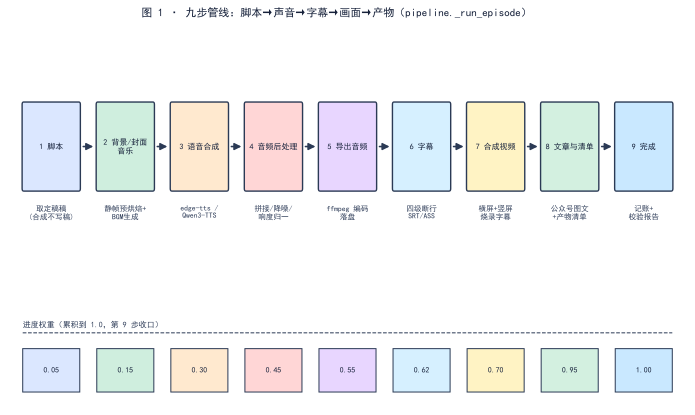  
*图 1：九步在代码里被写成可枚举的步骤串 `_step(n, title, progress)`，每一段开场写「第 N 步 · 标题」横幅；下方为各步累积进度权重，第 9 步收口到 1.0。*

## 三、错误尝试：把「手工脚本 + 硬编码清单」当管线

旧项目不是没有「管线」，而是那条链靠人肉接：十三期产物全是手写脚本，所谓「自动化」从未真正跑通 [3]。脚本估值比实测高 18–27%，因为时长系数是拍脑袋的「4 字/秒」，而真实约 5 字/秒——同样按 25 分钟一期估 6000 字脚本，实测只能装 5000 字上下，多出来的部分全靠现场删 [3]。更糟的是，合成出片与脚本撰写之间没有硬门禁——A/B 未交替两处没人发现，因为没有任何一步会拦 [3]。那不是管线，是把一串手动操作命名为「流程」，每一环仍由人脑兜底。

## 四、根因：合成阶段为什么不能写稿、不能判稿

根因一句话：**合成只管把定稿变成声音和画面，不该重新生成、也不该重新裁决** [6]。代码注释写得很直白——「脚本怎么写、过没过门禁，是脚本阶段的事；这里不写稿，也不判稿」[6]。若合成端现场重新生成脚本，等于把审过的稿换成模型现写的另一份，而合成端根本没有判它的资格；若合成端再判一遍脚本门禁，就是同一件事两个阶段都管，人连出片的机会都没有 [1]。所以九步里第 1 步只做一件事——取稿，取不到就 `PipelineError` 停下，绝不顺手补一份 [1]。

## 五、正确修法：把九步写成可枚举的步骤串 + 进度权重 + 门禁收口

`_run_episode` 用一行 `step = lambda n, t, p: _step(job, n, t, p)` 把九步统一登记 [1]。每步调用 `step(n, 标题, 权重)`，`_step` 把 `job["stage"]` 写成「第 N 步 · 标题」、把 `job["progress"]` 取 `max` 推进到该权重——进度只进不退，避免倒回的假象 [2]。两个设计要点：

第一，**第 7 步一分为二**：横屏与竖屏两版视频各算一段，权重 0.70 与 0.85 分开报，出片进度才贴得住真实工作量 [1]。竖屏不是横屏的廉价副本——同一份时间轴、同一套字幕再烧一遍，渲染量几乎翻倍；把它塞进同一步，权重就变成 0.70 处原地不动几分钟、再一跳到 0.85，观察进度的人无从分辨「卡住」与「在烧竖版」。

顺带划清两本账的边界：九步权重是**合成管线**的进度账（本文的 `step` 权重串）；脚本页写稿另有五段预算账（准备 0–10%、写稿 10–72%、检查 72–86%、门禁 86–96%、收尾 96–99%，首尾相接、只进不退）——那是写稿阶段的账本，与合成九步互不混算。混了账，进度条就会在两个阶段之间来回跳。

第二，**门禁在合成端只提醒、不拦人**：第 1 步读脚本阶段留下的门禁报告，若有未通过项只记日志、照常合成；人若在界面点过「仍然合成」，`ack_script_issues` 留个凭证，表明这一期是知情出片 [1]。真正「不过不给产物」发生在更靠后的完整性校验——mp4 / 竖版 / mp3 / cover / article 齐备才算过，缺一则 FAIL [4]。

门禁收口再往下拆一层，是「两阶段各判各的」：生成阶段 12 条只在脚本阶段执行，产物阶段 8 条只在合成阶段执行；产物阶段不过的写 `blocked.lock.json` 留痕、照常出片、照常记账，批量跑完时未过的期单独列出 [7]。九步之间因此不需要重复判同一件事——每条门禁都有自己的阶段与唯一入口，跨阶段重判在结构上无处安放。

## 六、验证：数据说话

三项证据，测量条件一并给出。

**步骤与权重实证**（数据源 [1]）：表 1 的九步标题、进度权重、主调模块逐一来自 `_run_episode` 的 `step(...)` 调用点（行 801 / 847 / 869 / 931 / 949 / 962 / 1014 / 1047 / 1069 / 1154），权重序列 `0.05→0.15→0.30→0.45→0.55→0.62→0.70→0.85→0.95→1.00`，累积单调不减、第 9 步收口到 1.0。

**横幅契约实证**（数据源 [2]）：`_step` 把阶段写成 `第 %d 步 · %s`，进度取 `max(job.get("progress",0), progress)`——这一行就是界面进度区对外展示的唯一来源，可直接复跑 `_run_episode` 观察。

**门禁收口实证**（数据源 [4]）：产物校验报告列「产物完整性：mp4 / 竖版 / mp3 / cover / article 齐备 → FAIL」，与「任一门禁 FAIL → 产物不给」的管线契约一致 [4]。脚本阶段的十二项门禁（生成阶段）与产物阶段的八条完整性门禁，分属两个阶段、各判各的，合成端不重判脚本、只拦完整性 [4][7]。

**横幅契约复跑设计**（数据源 [2]）：横幅是九步对外唯一契约，它自己的复跑设计也钉得住——**目的**：防止改步骤串时横幅与内部状态脱钩；**步骤**：起服务 → 驱动 `_run_episode` → 逐毫秒记录任务接口返回的 `stage` 与 `progress`；**观测**：`stage` 应依次出现九个「第 N 步 · 标题」且文案与表 1 一致；`progress` 序列应单调不减、最终为 1.0；**判定**：横幅少一步、文案不一致、权重回退、收口不为 1.0，任一出现即 FAIL——契约与实现必须同一套口径，这一条不靠人眼盯进度条，靠断言 [2]。

**端到端冒烟实验设计**（数据源 [8]）：九步链的回归靠一组端到端探针兜底——`tools/probes/` 下 `e2e_base_run.py`（全链起服务跑通）、`e2e_planmap.py`（排图段）、`e2e_script_job.py`（脚本任务）、`e2e_tts_wire.py`（合成接线）、`content_check_e2e.py`（内容检链）、`identity_edit_e2e.py`（音色身份编辑）、`ins_upload_e2e.py`（素材上传），覆盖第 1～8 步各自的最小真实路径。实验五件套：**目的**——任一步改动后，链路断点在冒烟层暴露而非产物层；**输入**——临时项目 + 固定最小素材；**步骤**——起服务 → 按探针逐段驱动 → 收产物清单；**观测**——每步产物落点与 manifest 记账一致；**判定**——任一步产物缺失或落点错位即 FAIL，九步步骤串与表 1 的权重序列不得漂移。

## 七、结语：一句话可复用结论

一个播客智能体的本体是一条九步管线：脚本取定稿、背景封面音乐、语音、后处理、导出、字幕、视频（横 + 竖）、文章清单、收口记账。合成阶段只跑链、写稿与判稿都留在脚本阶段——门禁在合成端只提醒不拦人，完整性校验才决定产物给不给。把九步写成带权重的步骤串，进度只进不退，界面横幅与内部契约同一套口径。

## 引用与出处说明

| 编号 | 引用 | 出处 |
|------|------|------|
| [1] | 九步管线：取稿 / 背景封面音乐 / 语音 / 后处理 / 导出 / 字幕 / 视频(横+竖) / 文章清单 / 完成，各步进度权重与模块；合成只取稿不写稿 | `podcast_maker/pipeline.py:_run_episode`（step 调用点 L801–1154） |
| [2] | 进度横幅：`_step` 写 `第 %d 步 · %s`、进度取 `max` 单调不减 | `podcast_maker/pipeline.py:L1160–1164` |
| [3] | 旧项目十三期全手写脚本、自动化未跑通、脚本估值比实测高 18–27%、A/B 未交替无人发现 | `podcast_maker/PLAN.md`（L23 / L471 / L469 / L471，项目设计动机） |
| [4] | 产物校验报告：mp4/竖版/mp3/cover/article 齐备 → FAIL；任一门禁 FAIL → 产物不给 | `podcast_maker/PLAN.md`（L560–576，产物校验报告） |
| [5] | 九步管线原始设计：资源→脚本→语音→校准回填→音频后处理→编码→字幕→画面→文章与清单 | podcast-maker · CHANGELOG.md · v0.1.0 · 新增·九步管线（L4830） |
| [6] | 合成只管合成：「脚本怎么写、过没过门禁是脚本阶段的事；这里不写稿，也不判稿」 | `podcast_maker/pipeline.py:_run_episode` docstring（L728–743） |
| [7] | 入口三种规划方式（立项选定不可改）、十一子目录一次建齐、门禁两阶段各判各的（生成 12 条／产物 8 条）、`blocked.lock.json` 留痕照常出片 | `发布/v1.0.0 发布说明.md`（§二工序表／§三／§五约束表，项目实证） |
| [8] | 端到端冒烟探针组：`e2e_base_run` / `e2e_planmap` / `e2e_script_job` / `e2e_tts_wire` / `content_check_e2e` / `identity_edit_e2e` / `ins_upload_e2e` | `tools/probes/`（入库探针，项目实证） |

## 延伸阅读

- **同书其他篇**：#2《配置总表如何同时驱动界面与管线：PARAM_SPEC 一处定义》讲这条链上「配置从哪来」；#5《约束解码不是万能的》与 #42《AIGC 合规标识》分别是脚本阶段门禁与产物阶段完整性校验的专篇——本篇是它们的容器，不替代其内部算法。

# 第 I 部 · 02｜配置总表如何同时驱动界面与管线：PARAM_SPEC 一处定义

## 一、引子：真实起点

在声音页把语速从 1.0 调到 1.2，切到脚本页，仪表盘却仍按 1.0 反推目标字数——因为两个页面各持一份值域，改了一处、另一处不知道 [3]。这个症状的根不在「哪页算错了」，而在「同一件事有两份真值来源」：谁改了、以谁为准，没有中央裁决 [3]。

## 二、现象：配置总表长什么样

`config_manager.py` 里，`PARAM_SPEC` 是一个字典，每个键由 `_p(type_, default, group, label, **kw)` 生成，携带 `type / default / group / label / min / max / step / unit / views / help` 等字段 [3]。首版即把 **83 个配置项、10 个枚举点位、5 套风格预设、22 条门禁全部集中在一处定义，界面与管线读同一份数据** [1]。一个典型条目形如：

```text
"script.target_minutes": _p("float", 4.0, "script", "目标时长（分钟）",
                            min=0.5, max=60, step=0.5, unit="分钟", views=("script",))
```

`min / max / step` 写在配置总表里，页面不写第二份 [3]。

这张表如今长到多大，实测数一遍（2026-10-12，对 `podcast_maker/config_manager.py:PARAM_SPEC` L562 起逐键统计）：**128 个配置键、17 个组**，其中 62 个数值点位带 `min` 下限、19 个 `enum` 档位、16 个 `bool` 开关 [3]。v0.1.0 立表时是 83 个配置项、10 个枚举点位 [1]——表在长，但「一处定义」没有第二个生长点：新增键只会加进 `PARAM_SPEC`，界面与管线自动看到。分组分布（合计 128）：

| 组 | 键数 | 组 | 键数 |
|---|---:|---|---:|
| tts | 32 | subtitle | 16 |
| script | 17 | audio | 11 |
| bgm | 9 | llm | 9 |
| speaker_indicator | 6 | gate | 5 |
| video | 7 | project | 4 |
| sfx | 3 | 其余六组（aigc / animation / background / cover / frame / intro_outro） | 各 1–2 |

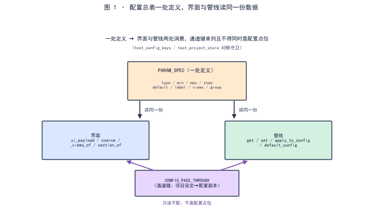  
*图 1：一处定义 → 两处消费，读同一份；通道键只送不配（细节见图内标注）。*

## 三、错误尝试：页面抄第二份值域、工具抄第二份默认值

两处具体翻车，都是「第二份真值来源」的变种。

其一，**页面写第二份值域**：`min / max / step` 本应由后端下发，却有人图省事在前端再写一遍 [3]。后端改了上限，前端还是旧数，界面上看不出任何异常——配置矛盾被两份副本各自掩盖。

其二，**音色默认值两处不一致**：`make_voice.py` 里的 `DEFAULT_VOICES` 写成 `Vivian / Serena`，而 `PARAM_SPEC` 出厂默认是 `Serena / Uncle_Fu`，注释还声称两处一致 [6]。后果是同一台机器上「命令行直接跑」与「主程序自动跑」录出两套音色，档案里只看到音色名、看不出是哪个入口来的，排查毫无线索 [6]。

## 四、根因：为什么要一处定义

根因一句话：**凡同一件事存在两份定义，两份迟早不一致；不一致时没有人能判定哪份算数** [3]。配置项的值域若由页面和总表各持一份，总表的中央校验（类型转换、值域越界即报错）就形同虚设——页面绕过它直接渲染，矛盾在两层之间潜伏。音色默认值两处不一致，则是同一病的另一出：默认值本是总表的责任，被工具又抄了一份。

「一处定义」展开是三层纪律，缺一层就会长出第二份真值：

**定义处唯一。** 配置键的全部元信息（类型、默认、值域、归属组、说明）只在 `PARAM_SPEC` 写一遍。任何模块需要这些信息，import 这张表，不复制字段。

**派生，而非抄写。** 下游要什么，从表里算出来：`default_config` 是 `{k: v["default"] for k, v in PARAM_SPEC.items()}`——默认配置是**派生**的，不是再写一份清单。派生的好处是表长它就长：128 个键里任何一个改了默认值，派生面当场跟着变，没有「忘了同步」这个环节。

**拒绝，而非过滤。** `set` 遇到表外的键抛 `KeyError`，`update` 把表外的键收进 `rejected` 列表返给调用方——野键不是被悄悄丢掉，是被**点名拒绝**（真实实现 `config_manager.py:1369` / `:1374`）。静默过滤的坏处是写错键名时一切照常、配置就是不生效；点名拒绝把拼写错误推到写代码的那一刻。

## 五、正确修法：一处定义 + 两处消费 + 单独的通道键

`PARAM_SPEC` 是唯一的「定义处」，两处消费者各自从这里取，不另存副本 [3]：

- **界面消费**：`ui_payload()` 给出分区标签、顺序、说明；`_views_of(key, spec)` 决定该点位出现在哪些阶段页（显式 `views` 优先，否则按 `group` 推导，推导不到就直接抛错，逼人补齐）；`section_of(key)` 按命名空间前缀归卡片，`SECTION_OF_OVERRIDE` 处理字体等例外；`coerce(key, value)` 按 `PARAM_SPEC` 声明做类型转换与值域校验，是唯一入口 [3]。`_views_of` 推导不到就抛错，是「拒绝而非过滤」的界面版：点位没写归属，宁可启动报错逼人补一行，也不静默猜一个页面放上去——静默猜的点位，迟早出现在不该出现的页里。
- **管线消费**：`default_config()` 由 `PARAM_SPEC` 派生默认配置（`{k: v["default"] for k, v in PARAM_SPEC.items()}`）；`ConfigManager.get / set / update` 均以 `PARAM_SPEC` 为权威——`set` 遇到不在总表中的键直接拒绝，避免野键潜入 [3]。`update` 是批量版：逐键过 `set`，表外键不抛异常，收进 `rejected` 列表整批返回（`config_manager.py:1374`）——调用方（界面批量保存）拿到列表后逐项提示，野键照样被点名，只是把点名时机从「第一个坏键」挪到「整批校验完」。

项目级的「设定送下去」走另一条路：`project_store` 的 `PROJECT_CONFIG_MAP` 把节目名、副标题、受众、风格、音色等从项目登记表映射到配置键，`apply_to_config` 把它们叠到一份**配置副本**上、绝不回写全局 [4]。这些被送下去的键列在 `CONFIG_PASS_THROUGH` 里——它们是通道键，**不出现在配置页、也不由人直接配**；把它们塞进配置点位表，就会长出「填了不生效」的死框 [4]。硬约束随之而来：**通道键不得同时是配置点位** [2][5]。

两个守门函数的骨架（真实实现 `podcast_maker/config_manager.py`，`set` :1369、`coerce` :1427）：

```python
# podcast_maker/config_manager.py —— ConfigManager.set / coerce：类型转换与值域校验的唯一入口
def set(self, key, value):
    if key not in PARAM_SPEC:
        raise ConfigError("未知配置项")            # 野键直接拒绝，不静默收下
    self.data[key] = coerce(key, value)

def coerce(key, value):
    spec = PARAM_SPEC[key]                         # 下限、上限取自规格行——值域来自总表，不是页面
    if value < spec["min"] or value > spec["max"]:
        raise ConfigError("超出值域")
    if spec["type"] == "enum":
        value = match_enum(value, spec["options"]) # "44100" 与 44100 视为同一档
    if spec["type"] == "bool":
        value = parse_bool(value)                  # 布尔串同理解析
    return value
```

`set` 与 `coerce` 不认识任何具体键名——它们只读 `PARAM_SPEC`。新增一个配置键，这两个函数一行不改；写进一个不在表里的键，当场 `KeyError`。

## 六、验证：数据说话

三项证据，测量条件一并给出。

**一处定义实证**（数据源 [1][3]）：首版 CHANGELOG 记「83 个配置项……全部集中在一处定义，界面与管线读同一份数据」[1]；`PARAM_SPEC` 字典与 `_p` 辅助函数即该定义处，`default_config` 与界面元数据均由其派生 [3]。后续版本（如 v1.7.0）把「配置总表—界面—管线」链上的断点逐条接回，并新增 `CONFIG_PASS_THROUGH` 放行通道键 [2]。

**两处消费对照实证**（数据源 [3]）：下表给出每个消费方读什么、用什么函数、做什么，印证「无第二份副本」。

| 消费方 | 读什么 | 用什么函数 | 用途 |
|---|---|---|---|
| 界面 | views / label / group / min / max / step | `ui_payload` / `_views_of` / `section_of` / `coerce` | 渲染控件、分区、值域提示 |
| 管线 | default / 当前值 / 类型 / 值域 | `default_config` / `get` / `set` / `coerce` | 实际取值、写入、校验、派生默认 |

**通道键守卫实证**（数据源 [2][5]）：对账测试把「允许键」定为 `set(PARAM_SPEC) | set(project_store.CONFIG_PASS_THROUGH)`，并断言通道键不得同时落在 `PARAM_SPEC` 里 [5]；这一行就是「一处定义、通道单列」的机器守门，任何一次把通道键误塞进配置点位都会当场红 [2][5]。

**派生一致性复跑设计**（数据源 [3]）：三层派生可各自独立核对——① `default_config()` 的键集合应与 `PARAM_SPEC` 完全相等（派生不丢键、不加键）；② `ui_payload()` 给出的分区标签集合应与各键的 `group` 对得上（界面分区也是派生的）；③ 任取一键改 `PARAM_SPEC` 里的 `min`，`coerce` 的校验边界应随之移动，不需要改任何第二个文件。这三类核对都写成断言进了 `tests/test_config_keys.py`（49 个测试方法，2026-10-12 逐类点数），派生链上任何一处「抄了一份」都会被对账当场抓出来——表长到 128 键，派生面仍是一处定义的直接函数。数到 128 还有另一层含义：**表的规模本身就是「一处定义」的试金石**——83 到 128 的增量没有催生第二张表、第二份默认清单或第二套值域，说明结构撑得住增长；撑不住增长的一处定义，只是还没长到摊牌的那天——128 键是已经过了盘的经验值。

**野键与通道键注入实验设计**（守门复跑，数据源 [3][5]）：在仓的临时副本上做两组注入。① **野键注入**——`set("script.not_a_key", 1)`：按第五节骨架，`set` 在 `key not in PARAM_SPEC` 处直接 `raise KeyError("未知配置项: …")`，配置文件不新增该键（真实实现 `config_manager.py:1369`）；② **通道键塞表**——把 `CONFIG_PASS_THROUGH` 中任一键加进 `PARAM_SPEC`：`tests/test_config_keys.py:L73` 的对账断言（允许键 = 配置点位 ∪ 通道键，且交集为空）当场红。**判定**——任一注入未被拦截即 FAIL：「一处定义、通道单列」必须有机器守门，不靠人记。②为常态 CI 断言，无需人工复跑。

## 七、结语：一句话可复用结论

八十多个配置点只在 `PARAM_SPEC` 一处定义，界面与管线读同一份数据、不抄第二份值域；项目设定经 `CONFIG_PASS_THROUGH` 单独通道送下去、只送不配，且通道键不得同时是配置点位。一处定义、两处消费、通道单列——真值来源只有一份，漂移在结构上没有生长点。

这张表的最终形态可以用一组对称关系收束：**定义一处**（`PARAM_SPEC` + `_p`）、**默认派生一处**（`default_config`）、**界面元数据派生一处**（`ui_payload` / `_views_of` / `section_of`）、**校验入口一处**（`coerce`）、**写入入口两处但同一守门**（`set` 单键、`update` 批量，都过 `PARAM_SPEC`）、**通道单列一处**（`CONFIG_PASS_THROUGH`，与点位表互斥并由对账钉守着）。六处「一处」合起来，才是「一处定义」的完整含义——不是少写几行代码，而是让每个消费方除了这张表没有第二个信息来源。

## 引用与出处说明

| 编号 | 引用 | 出处 |
|------|------|------|
| [1] | 配置总表：83 个配置项、10 个枚举点位、5 套风格预设、22 条门禁，全部集中在一处定义，界面与管线读同一份数据 | podcast-maker · CHANGELOG.md · v0.1.0 · 新增·配置总表（L4828–4829） |
| [2] | v1.7.0 把「配置总表—界面—管线」链上断点逐条接回；新增 `CONFIG_PASS_THROUGH` 放行通道键，并新增「通道键不得同时是配置点位」 | podcast-maker · CHANGELOG.md · v1.7.0（L4617 / L4135） |
| [3] | `PARAM_SPEC` 字典与 `_p` 辅助；`ui_payload` / `_views_of` / `section_of` / `coerce` / `default_config` / `ConfigManager.get·set` 均由总表派生 | `podcast_maker/config_manager.py`（PARAM_SPEC L554–562；ui_payload L1172；_views_of L1144；section_of L1167；coerce L1427；default_config L1263） |
| [4] | `PROJECT_CONFIG_MAP` 项目设定映射；`CONFIG_PASS_THROUGH` 通道键（只送不配）；`apply_to_config` 只返副本不回写全局 | `podcast_maker/project_store.py`（L339–386） |
| [5] | 守卫：`allowed = set(PARAM_SPEC) \| set(project_store.CONFIG_PASS_THROUGH)`，通道键不得同时是配置点位 | `tests/test_config_keys.py:L73`；`tests/test_project_store.py:L826` |
| [6] | 反例：音色工具 `DEFAULT_VOICES`（Vivian/Serena）与 `PARAM_SPEC` 出厂默认（Serena/Uncle_Fu）两处不一致，注释却称一致；两处对齐并加用例比对 | podcast-maker · CHANGELOG.md（音色工具默认值与出厂默认不一致，L3850–3853） |

## 延伸阅读

- **同书其他篇**：#1《一个播客智能体的九步管线》是这条链的运行容器，本篇讲链上「配置从哪来」；#3《存量配置自动搬迁》是配置总表变更后旧键如何安全迁移的下游专篇——两篇都依赖「一处定义」这个前提。

# 第 I 部 · 03｜存量配置自动搬迁：白名单过滤之前必须先改名

## 一、引子：真实起点

配置项会改名。podcast-maker 这次字幕重构把三个键去掉了歌词前缀（`subtitle.lyric_window`/`lyric_max_rows`/`lyric_scroll_ms` → `subtitle.window`/`frame_rows`/`scroll_ms`），又把 `dual`、`dual_named` 两个版式档并进了 `lyric` [1]。改名落在代码里是一瞬间的事，落在磁盘上却是另一回事：那里躺着的，是上一个版本写下的存量配置，键名还是旧的。

于是有一个机制问题必须回答：程序启动加载这份存量配置时，旧键的值怎么活下来？加载流程里有一道"只收总表认可的键"的白名单，而总表记的是现在的键名——旧键进不了这道门的话，值还在配置文件里，程序却读不到，界面也不报异常，只是悄悄落回默认。

## 二、现象：升级后"归零"的三种键值

把这次字幕重构摊开看，配置侧动了三件事 [1]：

| 旧形态 | 新形态 | 若不搬迁的后果 |
|---|---|---|
| `subtitle.lyric_window` / `lyric_max_rows` / `lyric_scroll_ms` | `subtitle.window` / `frame_rows` / `scroll_ms` | 三键改名，旧键无人读，值丢失 |
| 版式档 `dual`（双行）、`dual_named`（双行带名） | 合并入 `lyric` | 旧值不在档位表，下拉显示空 |
| `dual_named` 用户的「要名字」意图 | 拆出的独立开关 `speaker_indicator.name_shown` | 意图丢，名字不再显示 |

现象的本质：配置项会"改名"和"下线"，而磁盘上躺的是旧名字。程序启动时若直接按"现在的总表"过滤，旧名字的键连同它的值一起被丢弃——从使用侧看到的就是"设置没了，而且没有任何报错"。

把受影响的存量配置拆开看，至少三类状态会中招：其一是落于 `dual_named` 档的配置——"要名字"的意图记在旧档位取值里，档位合并后旧取值不在新档位表，拆出的独立"要名字"开关得不到补写，界面上名字不再显示却无任何提示；其二是写过 `lyric_window` 一类旧键的配置——自定义的窗口行数、滚动毫秒数，在旧键被过滤时直接归零；其三是跨多个版本从未被重新保存的旧存档配置——磁盘上压着几个版本前的旧键名，从未跑过一次搬迁。三类状态的共同点是：值明明"在文件里"，程序却读不到，而界面不报错，于是问题被静默埋下。

**这一节的三组对照，是后面所有论证的实测地基：改名三键、并档两值、意图补开关。**

## 三、错误尝试：先过滤再搬迁

直觉上，加载配置最稳妥的做法是"只收总表认可的键"——不在表里的，一律不要。这正是最常见的白名单逻辑：

```python
# podcast_maker/config_manager.py —— 错误顺序（已证伪）：先白名单过滤、后搬迁
saved = {k: v for k, v in raw.items() if k in PARAM_SPEC and v}   # 旧键此时还没改名，全被滤掉
saved = _migrate(saved)                                           # 搬的是已经空了的表，等于没搬
```

问题在于：白名单的依据 `PARAM_SPEC` 是**现在**的表，改名前的旧键（如 `subtitle.lyric_window`）早已不在里面 [2]。于是 `k in PARAM_SPEC` 这道门先把它挡在门外，`_migrate` 后面再想改名，旧键已经不存在了——值随之蒸发。

**实验设计（突变验证，仓的临时副本，2026-10-12）**

- 目的：验证"过滤先于搬迁"确实会丢值，且被单测捕获。
- 输入：把 `load()` 的两步对调（先过滤后 `_migrate`），其余不动。
- 步骤：在同一份临时副本上跑 `python -m unittest tests.test_config_keys.TestConfigMigration`。
- 观测：`subtitle.window` 的最终取值。
- 判定：若取值回落到默认值而非用户配置值，即证明"顺序反了值就没了"。

实测结果：注入该缺陷后，5 个用例中 **2 个 FAIL**——`subtitle.window` 取值从用户配置的 `5` 回落到默认值 `3`（另见 [图2]）；同一缺陷下存档重写用例也落 `3` 而非 `5` [5]。钉子确实咬住了回归。

这个缺陷之所以能潜伏，正因为它"不报错"。过滤时旧键被丢弃是静默的，界面照常启动、配置页照常显示——只是显示的是默认值而非用户值。没有异常、没有日志、没有崩溃，只有"我明明配过"与"它显示没配"之间的落差。等到用户察觉，往往已经过了好几个版本，连"当初配的到底是什么"都难追溯。单测的意义正在于此：用人眼看不见的回归，用断言把它钉成可见的红与绿。

## 四、根因：白名单就是 PARAM_SPEC，旧键改名前已不在表里

把现象往下一层追，根因只有一句话：**这里的"白名单"不是另写一份允许清单，它就是 `PARAM_SPEC`——全项目唯一的配置总表，一处定义 [6]。** 界面控件从它派生，管线从它取值，加载时的过滤也只对它认可的键放行（见 `load()` 中 `if k in PARAM_SPEC` 这一段）[3]。

那么矛盾就清楚了：改名前的旧键，在改名动作发生之前，本就不在 `PARAM_SPEC` 里。若让过滤先跑，旧键在"它还叫旧名"的那一刻就被判违例、连同值一起丢弃；等改名逻辑想把它改成新名时，键已经没了。**顺序错了，改名逻辑面对的是一个已经被掏空的输入。**

这也是为什么不能"先过滤、再在别处补偿"：补偿需要旧键还存在，而过滤恰恰先消灭了旧键。改名和过滤，谁先谁后，不是风格问题，是"旧键是否还活着"的生死问题。

把"先过滤、再在别处补偿"的念头拿到台面上拆一次：假设有人在过滤之后，另写一段逻辑去"补"被丢的值，他会发现补无可补。`_migrate` 里那个 `speaker_indicator.name_shown` 的补开关用的是 `setdefault`，它要补的前提是旧键 `subtitle.preset` 还在、且等于 `dual_named`；一旦过滤先跑，旧键已被判违例丢弃，补逻辑连"该不该补"都无从判断。窗口行数那一类更直接：`subtitle.lyric_window` 被过滤掉后，磁盘上那份值已经不在内存数据结构里，后续任何补偿都拿不到原始数值。换句话说，补偿逻辑天生依赖"旧键还活着"，而过滤恰恰先杀掉了旧键——这不是补不补得到的问题，是补偿的输入在第一步就被销毁了。

## 五、正确修法：_migrate 跑在过滤之前

修法极简，且只在一处：`load()` 先把整份存量配置交给 `_migrate` 改名、并档、补开关，再做白名单过滤 [3]。代码骨架（去敏，真实模块见引用表 [2]）：

```python
# podcast_maker/config_manager.py —— ConfigManager.load：先搬迁、后过滤（正确顺序）
def load(self):
    saved = read_json(CONFIG_PATH) if CONFIG_PATH.exists() else {}
    saved = _migrate(saved)                        # ① 先搬迁：旧键改名、旧值并档、补开关
    self.data = {k: v for k, v in saved.items()
                 if k in PARAM_SPEC and v}         # ② 后过滤：此时旧键已是新名，留在表里
    _migrate(self.defaults)                        # 内存默认配置也走一遍搬迁（与磁盘同一条路）

# _migrate(data) —— 三件事，只在此处，别处不许再写一份：
#   旧字幕档位归到新档；旧「双栏命名」档另补说话人开关（只补缺，不覆盖）
#   三对旧字幕键逐对改名：搬值走；新键已存在则认新键
```

三处细节值得点名：

1. **改名用 `pop` + `setdefault`**，值跟着键走；`setdefault` 保证"新旧都在时认新键"——新旧键同在的配置不会被判丢 [2]；三键旧名与新名的对应，与 [1] 所记变更一一吻合。
2. **`dual_named` 补开关用 `setdefault` 而非赋值**：旧存档里那个开关本不存在，补成"开"（带名档唯一的意思）；若配置里该开关已另有取值，绝不覆盖 [2]。这是"补缺"与"覆盖"的边界，也是 [图1] 上排能"保留 5"的前提。
3. **`_migrate` 只在 `config_manager.py` 一处定义**，与"白名单即 `PARAM_SPEC`"同源——改名表与总表各司其职，不互相抄写，避免两份来源迟早对不上（与 #2 的"一处定义"纪律同构）[6]。

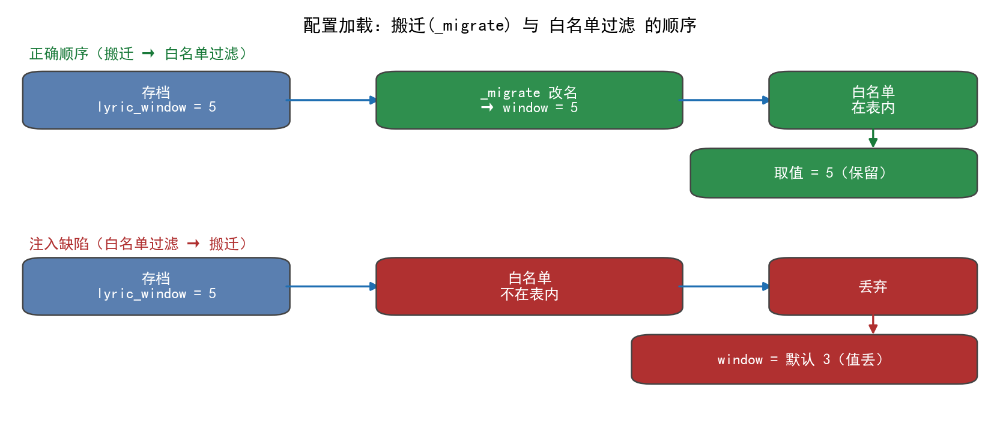

## 六、验证：单测钉 + 突变实验

把"顺序契约"落成一组单测 `TestConfigMigration`，共 **5 个用例**（含 subTest）[4]：

| 用例 | 钉的是什么 | 判定 |
|---|---|---|
| `test_the_two_deleted_presets_land_on_lyric` | `dual`/`dual_named` 都落到 `lyric` 且在档位表内 | 下拉不显示空 |
| `test_dual_named_keeps_its_one_intention` | 带名档补开关"只补缺、不覆盖" | 已选 False 不被改；缺席则补 True |
| `test_the_three_renamed_points_keep_their_values` | 三键改名后值不丢、旧键消失 | `window/frame_rows/scroll_ms` 取值 = 原值 |
| `test_an_already_migrated_value_wins_over_the_old_one` | 新旧键同在认新键 | `window` = 新值 |
| `test_a_migrated_file_is_rewritten_in_the_new_names` | 存档随搬迁改写 | 落盘后旧键不在、新键在 |

**实测（仓的临时副本，2026-10-12）**：干净仓库跑 `TestConfigMigration` —— **5 个用例全 PASS（0.017s）**；按第三节的突变实验注入"过滤先于搬迁"后，同一组用例 **2 个 FAIL**（改名三键取值落默认 `3` 而非 `5`，存档重写同）[5]。一正一反，顺序契约被钉死：正确顺序下值必然保留，错误顺序下钉子必然咬人。

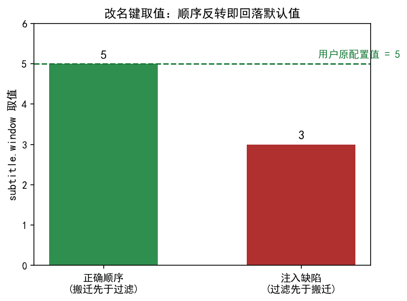

数据描述：**改名三键（window/frame_rows/scroll_ms）在正确顺序下取值 = 用户原配置值（实测 window=5）；顺序反转后全部回落默认值（实测 window=3）**，差值即"被静默吞掉的用户设置"[5]。把突变实验里"三键改名"用例的取值摊开看：正确顺序下 `window/frame_rows/scroll_ms` 三者均等于用户原配置（window 实测 5）；顺序反转后，三个键整体回落各自默认值（window 回落 3，frame_rows/scroll_ms 同族回落，只因取值不同体现在各自默认档上）。单一键的 5→3 不是孤例，而是三键同族失值的缩影——钉子咬住的，是整个改名家族，不是某一个键。

## 七、结语：顺序即契约

配置加载里"先搬迁、后过滤"不是编码习惯，是一条契约：**白名单依据的总表是现在时，而用户磁盘上是过去时；过去时的键必须先被翻译成现在时，才进得了白名单的门。** 这条契约用 `_migrate` 一处实现、用 `TestConfigMigration` 五个用例钉死——它保护的不是某个键，是"升级不该让用户失去他已经做过的选择"这件最朴素的事。

这条契约还藏着一层工程伦理：配置是用户与工具之间一份沉默的契约——用户每一次手动调整，都是把信任押在"工具会记得"上；静默丢弃旧键，等于单方面撕毁这份契约而不通知对方。把 `_migrate` 放在过滤之前、把 `TestConfigMigration` 钉在回归里，本质上是把"尊重用户已经做过的选择"写进代码而非写在文档里。文档会过期，断言不会；用户不会去读迁移说明，但会读界面上那个"还是我配的值"。

## 引用与出处说明

> 本文所有引用均可在 podcast-maker 实仓回溯：CHANGELOG 条目、代码 `path:Lnn`、单测与本地突变实验。

| 编号 | 引用 | 出处 |
|---|---|---|
| [1] | v0.42.0：三档并两档、三键去歌词前缀、默认档 `dual`→`lyric`、旧档位下线 | `podcast-maker · CHANGELOG.md · v0.42.0` |
| [2] | `_migrate` 改名/并档/补开关逻辑、`setdefault` 认新键 | `podcast_maker/config_manager.py:1329` |
| [3] | `load()` 先 `_migrate` 后白名单过滤（`if k in PARAM_SPEC`） | `podcast_maker/config_manager.py:1314` |
| [4] | `TestConfigMigration` 5 个用例钉顺序契约 | `tests/test_config_keys.py::TestConfigMigration`（约 L416） |
| [5] | 突变实验：注入"过滤先于搬迁"→ 5 中 2 FAIL，window 取值 5→3 | 本文实验（仓的临时副本，2026-10-12，v2.12.0b1） |
| [6] | 白名单即 `PARAM_SPEC`：一处定义、界面与管线同源 | 本书 #2《配置总表如何同时驱动界面与管线：PARAM_SPEC 一处定义》 |

> 说明：[1][2][3] 为项目实证（CHANGELOG 与代码可回溯）；[4] 为单测实证；[5] 为本文在仓的临时副本上的突变实验（测量条件：临时副本、当次版本 v2.12.0b1、2026-10-12）；[6] 为系列自引。图1/图2 数据均来自 [5] 的同一轮实测。本文为纯工程叙事，无外部文献。

## 延伸阅读

- **#2《配置总表如何同时驱动界面与管线：PARAM_SPEC 一处定义》**：本文"白名单即 `PARAM_SPEC`"的结论直接依赖该篇的总表一处定义纪律——没有一处定义，过滤与改名就会各持一份来源而对不上。
- **#30《字幕四份同源：为什么我不从产物反解》**：同源律的同一工程哲学——一处是真源，其余是派生；配置搬迁也是"旧键是过去真源、新键是现在真源"的一次性翻译。

# 第 I 部 · 04｜一套配置管两种字幕模式：MODE_SPEC 接驳表的双语义

## 一、引子：真实起点

在字幕卡把模式从「单行」切到「歌词」，画面上的边距、透明度却没有跟着变——因为两种模式各自维护一份边界参数，切模式时只改了渲染分支、没改参数来源 [1]。这个症状的根不在「哪段渲染错了」，而在「同一批配置在两种模式下有两套解释，却没有一个地方统一说明」：单行里的 margin_v 是「文字距底边」，歌词里的 margin_v 却是「框底距底边」，同一个名字、两种含义，谁改了、以哪套为准，没有中央裁决 [1]。

## 二、现象：接驳表长什么样

`config_manager.py` 里，`MODE_SPEC` 是一个字典，每个键携带 `label` 与 `options` 两样东西 [2]。`label` 是给界面看的分类名（如「背景档位」「动画档位」），`options` 是一组子值，由管线按需取用——背景档位的某个选项里塞着 `bg_top` / `bg_bottom` / `accent` / `light` / `muted` 五个色值，动画档位的某个选项里塞着 `filter` / `cost` / `desc` [2]。一个典型条目形如：

```text
"background.preset": {
    "label": "背景档位",
    "options": {
        "ink":    {"label": "墨色极简", "bg_top": "#12224A", "bg_bottom": "#081630",
                   "accent": "#C9A45C", "light": "#E8EDF8", "muted": "#96A5C3"},
        "slate":  {"label": "冷灰学术", "bg_top": "#1A2430", "bg_bottom": "#0C1218",
                   "accent": "#6FA8DC", "light": "#E4EDF5", "muted": "#8FA3B8"},
    },
},
"animation.mode": {
    "label": "动画档位",
    "options": {
        "static":   {"label": "静止", "filter": "",            "cost": "最省",
                     "desc": "不做任何运动，纯静止背景"},
        "kenburns": {"label": "缓推", "filter": "zoompan",     "cost": "低",
                     "desc": "全程匀速缩放。会带动背景元素位移，构图会被放大"},
        "waveform": {"label": "波形", "filter": "showwaves",   "cost": "中",
                     "desc": "半透明声波随音频律动"},
        "spectrum": {"label": "频谱", "filter": "showspectrum","cost": "高",
                     "desc": "频谱条铺底，技术向"},
    },
},
```

`options` 里的子值不是给界面展示的，是给管线消费的：`bg_top` 进背景绘制、`filter` 进 ffmpeg 滤镜串、`cost` 进预算估算 [2]。界面只认 `label`，管线只认 `options` 里的具体键——一张表喂两路，各取所需。

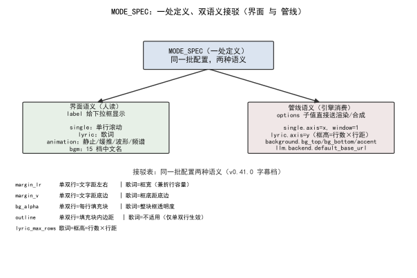  
*图 1：`MODE_SPEC` 一处定义，每项 `label` 走界面语义（分区标题、下拉文案）、`options` 子值走管线语义（背景色值 / 滤镜 / 预算）；「同一批配置两种语义」的接驳关系在表里一眼可查（详见第四节两义对照）。*

## 三、错误尝试：每个模式各写一份值域、options 里裸塞原始值

两处具体翻车，都是「第二份真值来源」或「裸值外露」的变种。

其一，**每个模式各抄一份边界参数**：`margin_lr` / `margin_v` 在单行分支写一遍、在歌词分支又写一遍，两处各自解释同一个名字 [1]。后端改了歌词里的 `margin_v` 含义，单行分支的旧解释还在，界面上看不出任何异常——参数矛盾被两份副本各自掩盖。

其二，**options 里直接塞裸值当标签**：动画档位若把 `options` 的键（`static` / `kenburns`）直接当界面文案，下拉框就会显示英文内部名「static」「kenburns」，用户看见的是代码标识符而不是「静止」「缓推」[3]。后果是同一台机器上「配置页显示」与「内部消费」用的是两套语言，排查时只能对着裸值猜它是什么意思。

## 四、根因：为什么是接驳表而非双份

根因一句话：**凡同一件事存在两种语义，把两种语义各放一份，两份迟早不一致；不一致时没有人能判定哪份算数** [1]。字幕模式下的边界参数，本质就是「同一批名字、两种解释」：单双行管「文字背景填充 + 文字位置」，歌词管「一个固定宽高的半透明框，文字在框里」[1]。`margin_lr` 在单双行是「文字距左右」，在歌词却是「框宽（兼折行容量）」；`margin_v` 在单双行是「文字距底边」，在歌词是「框底距底边」；`bg_alpha` 在单双行是「每行填充块透明度」，在歌词是「整块框透明度」；`outline` 在单双行是「填充块内边距」，在歌词「不适用」；`lyric_max_rows` 在歌词是「框高 = 行数 × 行距」[1]。

这张两义对照，逐行列出就是接驳表的实质：

| 配置名 | 单/双行语义 | 歌词语义 |
|---|---|---|
| `margin_lr` | 文字距左右 | 框宽（兼折行容量） |
| `margin_v` / `margin_v_vertical` | 文字距底边 | 框底距底边 |
| `bg_alpha` | 每行填充块透明度 | 整块框透明度 |
| `outline` | 填充块内边距 | 不适用（仅单双行生效） |
| `lyric_max_rows` | —— | 框高 = 行数 × 行距 |

「接驳表」展开是三层纪律，缺一层就会长出第二份真值：

**定义处唯一。** 带模式的枚举点位只在 `MODE_SPEC` 写一遍，每项同时声明 `label`（界面语义）与 `options` 子值（管线语义）。任何模块需要这些信息，import 这张表，不复制字段。

**派生，而非抄写。** 界面要的枚举标签只从一个函数取：`param_options(key)` 是唯一的枚举标签来源，它读 `MODE_SPEC`、把每项的 `label` 与 `options` 的 `label` 组装成界面用的选项列表 [2]。界面不另写一份值域；`modes_payload()` 把这张表喂给配置页，`coerce(key, value)` 按声明做类型与值域校验，也是唯一入口 [2]。

**拒绝，而非过滤。** `coerce` 遇到不在接驳表声明里的模式值直接拒绝；`modes_payload` 只暴露 `MODE_SPEC` 里登记过的点。野值不是被悄悄吞掉，是被点名拒绝——写错模式名时一切照常、配置就是不生效的坑，在结构层就被堵上 [2]。

## 五、正确修法：一处定义 + 双语义 + 两路消费

`MODE_SPEC` 是唯一的「接驳处」，界面与管线各自从这里取，不另存副本 [2]：

- **界面消费（label 语义）**：`param_options(key)` 给出下拉选项与文案，`modes_payload()` 把整张接驳表喂给配置页——分区标题、选项文案全部来自 `MODE_SPEC` 的 `label`，不在前端再写一遍 [2]。`coerce(key, value)` 按接驳表声明校验用户选的值是否落在 `options` 里，是唯一入口 [2]。
- **管线消费（options 子值语义）**：背景绘制读 `options[选中的档].bg_top` 等色值；动画引擎读 `options[选中的档].filter` 拼进 ffmpeg；预算估算读 `options[选中的档].cost` [2]。管线不认 `label`，只认 `options` 里的具体键。

两个消费方的骨架（真实实现 `podcast_maker/config_manager.py`，`param_options` :1400、`coerce` :1427）：

```python
# podcast_maker/config_manager.py —— MODE_SPEC 接驳表的两处接法：界面取档位、写入做校验
def mode_options(key):                             # 界面取档位
    if key not in MODE_SPEC:
        return []                                  # 界面不出现该控件
    return list(MODE_SPEC[key]["options"].items()) # 逐档返回（档位值, 显示标签）

def set(self, key, value):                         # 写入校验
    if key not in MODE_SPEC:
        raise ConfigError("未知模式点")
    if value not in MODE_SPEC[key]["options"]:
        raise ConfigError("野模式值")               # 野模式值不静默收下
# 显示标签是枚举值的唯一展示来源——PARAM_SPEC 里再写 options 会被忽略
```

`param_options` 与 `coerce` 不认识任何具体模式名——它们只读 `MODE_SPEC`。新增一个带模式的枚举点位，这两个函数一行不改；写进一个不在接驳表里的模式值，当场 `KeyError` / `ValueError`。

这张接驳表如今长到多大，实测数一遍（2026-10-13，对 `podcast_maker/config_manager.py:MODE_SPEC` L282 起逐键解析）：**17 个带模式的枚举点位（顶层键），其下共 64 档 options 子值，全部在 `PARAM_SPEC` 里有声明、0 个孤儿点**；其中 `subtitle.preset` 双档（single / lyric）、`animation.mode` 四档（static / kenburns / waveform / spectrum）、`bgm.preset` 十五档 [2]。界面标签直接等于裸值（如下拉显示「static」而非「静止」）的缺陷数：**0** [3]。这 17 个键的全貌如下，每一行都是「label 走界面、options 子值走管线」的双语义实例：

| 接驳表键 | 档数 | 界面 label（分类名） | 管线 options 子值（举例） |
|---|---:|---|---|
| `background.preset` | 3 | 背景档位 | `bg_top` / `bg_bottom` / `accent` / `light` / `muted` |
| `cover.preset` | 3 | 封面档位 | （仅 label，无管线子值） |
| `bgm.preset` | 15 | 背景音乐档位 | （label 即档名，无子值） |
| `animation.mode` | 4 | 动画档位 | `filter` / `cost` / `desc` |
| `speaker_indicator.mode` | 4 | 说话人提示 | `desc`（AB 字幕色 / 侧栏色块 / 立绘说明） |
| `subtitle.preset` | 2 | 字幕版式 | `axis` / `window` / `frame_rows` |
| `intro_outro.preset` | 2 | 片头片尾 | （label 即档名） |
| `tts.engine` | 2 | 语音引擎 | （label 含许可证标注） |
| `llm.backend` | 3 | LLM 后端 | `default_base_url` |
| `bgm.mode` | 4 | 背景音乐来源 | （label 即来源名） |
| `script.compress_ratio` | 3 | 压缩档 | `desc` |
| `script.style_preset` | 0* | 风格倾向 | 由 `PRESET_SPEC` 填充（划界权在人，LLM 不选） |
| `audio.sample_rate` | 6 | 采样率 | `desc` |
| `audio.channels` | 2 | 声道数 | `desc` |
| `audio.codec` | 2 | 音频编码 | `desc` |
| `video.fps` | 5 | 视频帧率 | `desc` |
| `video.encoder_preset` | 5 | 编码预设 | `desc`（值原样送编码器） |

合计：17 个键、64 档子值；`script.style_preset` 的 options 在文件末尾由 `_fill_preset_modes` 从 `PRESET_SPEC` 注入，故表里先留空——它仍是「标签来源只有一处」的同一纪律，只是填充时机延后 [2]。

## 六、验证：数据说话

三项证据，测量条件一并给出。

**双语义接驳实证**（数据源 [1]）：CHANGELOG 记「一套配置管两种字幕模式——单行/双行管文字背景填充与文字位置，歌词管一个固定宽高的半透明框」[1]；「接驳表（同一批配置两种语义）」逐行列出 `margin_lr` / `margin_v` / `bg_alpha` / `outline` / `lyric_max_rows` 在两模式下的不同解释 [1]。`MODE_SPEC` 字典即该接驳处，界面 label 与管线 options 子值均由其派生 [2]。

**两路消费对照实证**（数据源 [2]）：下表给出每个消费方读接驳表的哪一侧、用什么函数、做什么，印证「无第二份副本」。

| 消费方 | 读接驳表哪一侧 | 用什么函数 | 用途 |
|---|---|---|---|
| 界面 | `label`（分类名 + 选项文案） | `param_options` / `modes_payload` / `coerce` | 渲染下拉、分区标题、值域校验 |
| 管线 | `options` 子值（`bg_top` / `filter` / `cost` …） | 背景绘制 / 动画引擎 / 预算估算 | 取色值、拼滤镜、估成本 |

**接驳表守卫实证**（数据源 [2][3]）：对账测试把「接驳表只描述已在 `PARAM_SPEC` 声明的点」定为不变式，并断言「每个模式点都是枚举、每个模式默认落在它的 options 里、界面标签从不等于裸值」[3]。这些断言就是「接驳表双语义、两路消费」的机器守门，任何一次把接驳表漏填或把标签写成裸值都会当场红 [3]。

**双语义一致性复跑设计**（守门复跑，数据源 [2][3]）：三层派生可各自独立核对——① 任取接驳表一个键改它的 `label`，`param_options` 给出的界面文案应随之变、不需要改任何第二个文件；② 任取一个模式值塞进 `options` 之外，`coerce` 应 `ValueError`；③ 任取一个 `options` 子键（如 `bg_top`）改色值，背景绘制应直接吃到新值，不需要改管线别处。这三类核对都写成断言进了 `tests/test_config_keys.py`（TestConfigKeys 三例 + TestEnumLabels 两例，2026-10-13 复跑全 PASS）[3]。

**计数复跑**（数据源 [2]）：对 `MODE_SPEC` 逐键解析（2026-10-13）——顶层键 17、options 子值合计 64 档、孤儿点 0、`subtitle.preset` 双档 / `animation.mode` 四档 / `bgm.preset` 十五档分布如第五节；标签==裸值缺陷 0。这组数据是「接驳表撑得住增长」的试金石：17 个带模式的枚举点、64 档子值，没有催生第二张表或第二份值域，说明结构撑得住。

## 七、结语：一句话可复用结论

字幕两种模式下的边界参数，只在 `MODE_SPEC` 一张接驳表里统一说明：每项给界面一个 `label`、给管线一组 `options` 子值，界面与管线读同一份、不抄第二份值域。一处定义、双语义、两路消费——同一批配置在两种模式下的两种解释，漂移在结构里没有生长点。

这张接驳表的最终形态可以用一组对称关系收束：**定义一处**（`MODE_SPEC` + `label`/`options`）、**界面语义一处**（`param_options` / `modes_payload` 只读 `label`）、**管线语义一处**（`options` 子值直接进绘制/滤镜/预算）、**校验入口一处**（`coerce`，野模式值当场拒绝）、**两路消费但同一接驳处**。五处「一处」合起来，才是「接驳表双语义」的完整含义——不是少写几行代码，而是让界面和管线除了这张表没有第二个信息来源。

## 引用与出处说明

| 编号 | 引用 | 出处 |
|------|------|------|
| [1] | 「一套配置管两种字幕模式」；「接驳表（同一批配置两种语义）」逐行两义对照（margin_lr / margin_v / bg_alpha / outline / lyric_max_rows） | podcast-maker · CHANGELOG.md · v0.41.0（L1526 / L1554） |
| [2] | `MODE_SPEC` 字典与 `label`/`options` 双语义；`param_options`（唯一枚举标签来源）/ `coerce`（校验入口）/ `modes_payload`（喂配置页） | `podcast_maker/config_manager.py`（MODE_SPEC L282；param_options L1400；coerce L1427；modes_payload L1505） |
| [3] | 守卫：接驳表只描述已声明点、每个模式点都是枚举、每个默认落在 options、界面标签从不等于裸值 | `tests/test_config_keys.py`（TestConfigKeys L64：test_mode_spec_only_describes_declared_points L147 / test_every_mode_point_is_an_enum L151 / test_every_mode_default_is_one_of_its_options L157；TestEnumLabels L260：test_labels_are_never_the_raw_value L268 / test_style_preset_labels_come_from_preset_spec L298） |

## 延伸阅读

- **同书其他篇**：#2《配置总表如何同时驱动界面与管线》讲 `PARAM_SPEC` 一处定义，本篇的 `MODE_SPEC` 是它之下「带模式的枚举点位」的专门接驳表，两者共用「一处定义、两路消费」的纪律；#6《检查段修补为什么返回空补丁》是另一处「结构层上锁而非提示词层苦劝」的同源案例。

# 第 II 部 约束与修补：约束写在哪里，模型才不会糊弄

> 解码约束、补丁加固、引语门禁、文体分卡、字距、压比——LLM 输出不可信时的八道闸。

## 本部篇目

| 篇 | 章题 |
|---|---|
| 05 | 约束解码不是万能的：schema 漏字段让承诺链永远红 |
| 06 | 检查段修补为什么返回空补丁：PATCH_SCHEMA 三层加固 |
| 07 | 定点修补漏接词表：约束解码在嵌套数组里的盲区 |
| 08 | 引语标注无硬校验：一个 fail 级门禁怎么落地 |
| 09 | 首轮复读绕过查重：一个 else 分支吞掉整段工序 |
| 10 | 文体块分卡：八张素材卡怎么各自说话 |
| 11 | 字距规范化：为什么落盘会删掉汉字与西文之间的空格 |
| 12 | 排图与压比：期数为什么不能交给模型自由发挥 |

## 怎么读

- 本部八篇共享同一个母题：不信任 LLM 的自由发挥，用封闭清单与硬校验收口。顺序读能看到约束逐篇收紧的过程。
- 工程上遇到同类问题可直接跳对应篇；05/06/07 三篇是"约束解码"三部曲，宜连读。

# 第 II 部 · 05｜约束解码不是万能的：schema 漏字段让承诺链永远红

## 一、引子：真实起点

写稿门禁里有一条承诺链检：模型报出「这句承诺了某件事却没做到」，程序应据此定点修补。某次跑批，报告上承诺链整条红着——可点开详情，却写着「通过」[1]。

结论、详情、清单三项自相矛盾：判不通过，却一个具体句子都指不出来。那种红是没道理的红——它红的不是「有问题」，而是「有问题但说不清问题在哪」。

没道理的红还有一个副作用，比错杀更耗人：它让「红」这个信号贬值。语义项的红是真红（有清单、有落点、修得动），承诺项的红是空红（无清单、无落点、无从下手）——两种红混在同一个报告里，读到它的人只能每次都人工分辨「这个红要不要管」，信号系统等于失效了一半。修复后红与红同构：每条红都带得动一次定点修，信号重新值得信任。

## 二、现象：它到底长什么样

承诺链检的清单永远为空。实测记录（`projects/20260917-015336/过程/2a|2c`）：`check_promise` 两次 `ok=false` 且 `issues=0`，`detail` 还写着「通过」[1]。

`patch_targets` 等的是「带句号（落点）的问题」——能不能定点修，看问题有没有锚到具体一句。它收到的却是空清单，当场 `break`，报告上的承诺链于是永远红着。链路从「检报」到「定点修」这一段，整段断了。

> **约束解码**：给模型一个固定 schema（字段与枚举），让它只填空、不自由发挥。它约束的是「输出长什么样」。
> **归一化**：把模型在各轮、各检查段的输出，统一成一条「问题清单」的中间步骤——下游定点修与门禁都从这条清单取数。
> **落点**：被点名的问题具体落在哪一句、用什么锚点去修；没有落点，定点修无从下手。

## 三、错误尝试：我们怎么绕弯的

一开始以为是承诺链检本身没跑对，或者模型没报。但语义检照常工作——它的键本就是 `quote`/`problem`，与归一化口径一致；副本 `2a`（4 条）→ `2b`（8 条）→ `2c`（通过）的收敛轨迹清清楚楚 [1]。

焦点于是从「上游没报」转向「下游丢东西」。丢东西的那段，是出口归一化。这条路绕了弯才走到正解：先排除了「模型没报」，才定位到「归一化按另一套契约读」——漏的不是一个字段，是一整类问题的字段契约。

## 四、根因：为什么

根因一句话：`script_engine._norm_issues` 按「两项各自的契约取字段」，却只拿「有没有 `quote` / `problem`」去判一条问题是否存活；而承诺项的输出契约是 `line` / `promise` / `how` / `speaker` / `close_after` **五键——天生没有 `quote` 和 `problem`**，于是模型报的每一条承诺问题都在那一行 `continue` 被丢掉（旁边「承诺项多出来的键原样带下去」的代码等于没写）[1]。

一句话：**约束解码把字段契约钉死了，下游归一化却按另一套契约去读，契约在消费点断了。** 这恰是本书反复讲的那条纪律——统一推动点只定义一次，但每一处消费都必须尊重它；漏掉一个消费点的字段契约，整条链就红得没道理。

契约在消费点断掉，不止这一种断法。同一族病灶在本工具里出现过至少三面：本篇是「schema 漏字段」——输出契约五键，消费点按二键读；#7《定点修补漏接词表》是「枚举嵌套绕过」——schema 的枚举值藏在嵌套数组里，修补层按顶层读；#2 事件（音色默认值两处不一致）是「默认值双份」——定义处一份、工具一份，两份迟早漂。三面共用一个判别式：**凡是消费方自己再写一份「字段应该长什么样」，那份私有认知迟早和 schema 分家**。所以修法从来不是「把消费点写得聪明些」，而是让消费点除了 schema 之外没有别的字段来源——本篇的修复分支逐字对着五键契约取字段，一个私有拼写都没有。

## 五、正确修法：怎么做对的

修复口径收得很窄：不新增任何分支，只让归一化按两种契约各自取齐说明性字段。收窄的理由值得说透：归一化是**出口**——所有检查项的问题报告都要从这里过一遍才进清单。出口上的改动，牵一发是全链的：出口多吞一条，全链少一个问题；出口多放一条，下游定点修就多修一处。所以修出口的第一原则是把改动面压到最小——不动语义项的既有路径（它没病），只为承诺项补一个按五键契约取字段的分支，语义检、门禁、定点修三处下游的输入格式一个字节不变。宽改出口看似顺手，实际是把「一处修复」摊成「全链回归」。

### 5.1 契约对照：旧逻辑错在哪

| 环节 | 假设的键 | 实际契约 | 后果 |
|---|---|---|---|
| 模型输出（承诺项） | `line` / `promise` / `how` / `speaker` / `close_after` | 五键 | — |
| 归一化旧逻辑 | `quote` / `problem` | 二键 | 五键项全部 `continue` 丢 |
| 修复后 | `quote ← quote\|promise`；`problem ← problem\|how\|promise\|text` | 取齐 | 五键原样带下 |

*表 1：承诺项与归一化之间的字段契约错位，及修复口径 [1]。*

### 5.2 修法本身：两处改动

归一化改为按两种契约取齐说明性字段——`quote` 从 `quote|promise` 取，`problem` 从 `problem|how|promise|text` 取，五键原样带下去 [1]。这一步让承诺问题第一次真正进清单。

同时 `_issues_detail` 让详情与结论同源：判不通过而一条也报不出来时，详情不再印「通过」，改印「未通过（模型未指出具体句子）」；判通过时空清单照旧念「通过」——三类自相矛盾的源头一并堵死 [1]。

修好落点之后，承诺链经 `patch_targets` → 定点修 → `check_rounds` 封顶 → 超了直接落盘，与形式门禁同一条路。该分支代码里本就写好，只是**从来没被喂进过一条带落点的承诺项**，本轮没为它新增任何分支（不降级、不交人工、不早退）[1]。

```flow
改前：模型报承诺项(五键) → 归一化按 quote/problem 判存活 → continue 丢光 → 清单空 → 承诺链永远红
    ↓（修复：按两种契约取齐字段，五键带下）
改后：模型报承诺项(五键) → 归一化取齐 quote|promise、problem|how|promise|text → 落点生成 → patch_targets 定点修闭环
```

*图 1：归一化丢落点前后对照（修复前清单恒空，修复后承诺问题首次进清单）[1]。*

### 5.3 归一化修复的骨架

```python
# podcast_maker/script_engine.py —— _norm_issues：按两种契约取齐字段（修复后）
def _norm_issues(issues):
    out = []
    for it in issues:
        if it.get("quote") or it.get("problem"):
            out.append(norm_semantic(it))          # 语义项：按二键契约归一后收下
        elif it.get("promise"):
            out.append({**it,                      # 承诺项（五键 line/promise/how/speaker/close_after）
                        "quote": it["promise"],    # 承诺原文当引文
                        "problem": it["how"]})     # 处理方式当问题描述——修复前没有这个分支，全部丢光
        # 两者都不是 → 丢弃
    return out
```

真实实现见 `podcast_maker/script_engine.py:_norm_issues`（:1696）。修复前只有第一个分支认二键、其余一律 `continue`；修复新增的是中间那个分支——不新增出口、不改语义项路径，五键信息一分不丢地进清单。`_issues_detail`（:1737）同批收口：判不通过而报不出任何一条时，详情印「未通过（模型未指出具体句子）」，三类自相矛盾在结构上没有并存的余地。

## 六、验证：数据说话

四组证据，测量条件一并给出。

先交代测量位置：本篇所有「清单」「详情」「落点」的观测点都在**出口归一化**及其下游第一站——清单是 `patch_targets` 的直接输入，落点是修补层的直接输入。观测这两站，就等价于观测「承诺链红不红」的全部因果链，中间不存在第三段黑箱。

**全量单测 1110 项通过（比上版 +4）**[1]：修复的代价只是 4 条新钉，没有引入回归。`+4` 的构成也值得看：不是给 `_norm_issues` 补四个 if，是给承诺项补「不被丢」「有落点」「详情同源」「键必留」四个**性质**断言——性质钉守的是行为不变式，不是实现细节。

**新增 `TestPromiseIssuesSurviveNormalization` 一组钉子** [1]：① 承诺项缺 `quote`/`problem` 也不被丢（五键齐、落点对）② 能生成 `patch_targets` 落点（承诺句 + `close_after` 锚点）——证明走的就是那条老路 ③ 判 fail 且无落点时详情不印「通过」④ **通用钉子**：`check6_schema` 要求哪些键，归一化后就得留下哪些键——将来任何一项改了输出契约都能被它当场钉住（`script_engine.py:1600` 即 `check6_schema`，通用钉子守在 `:1696` 的 `_norm_issues`）。

**副本收敛轨迹（实测）**[1]：`2a`（4 条）→ `2b`（8 条）→ `2c`（通过）。判得出、定得点、修得动、复判能过——这条轨迹本身就是修复有效的证据。轨迹逐段拆开：

| 副本 | 问题数 | 状态 | 这一步发生了什么 |
|---|---:|---|---|
| `2a` | 4 | FAIL | 修复后首次跑：承诺项进清单、落点可生成，修补层照单定点修 |
| `2b` | 8 | FAIL | 修完 `2a` 的 4 条后复检：暴露更深一层问题（含此前被空清单掩盖的项） |
| `2c` | 0 | 通过 | 收敛：判得出、定得点、修得动、复判能过 |

值得注意 `2a`→`2b` 是问题数**变多**：清单从「恒空」变「敢报」，深层问题才有机会浮出来——修复前那条永远红的链，红得连一次定点修都没启动过。

**为什么通用钉子比专用钉子值钱** [1]：`TestPromiseIssuesSurviveNormalization` 的前两条是专用钉（承诺项五键、落点生成），第四条是通用钉——`check6_schema`（`script_engine.py:1600`）要求哪些键，归一化后（`:1696`）就得留下哪些键。专用钉守的是这一次的契约；通用钉守的是「任何消费点不得私有缩减字段集」这条元规则——将来语义项或任何新检查项改了输出契约，不用等它红在生产里，提交时就红。

**未受影响项** [1]：合成端 `write_gate_report` 一字未动（它是记录不是闸门）；语义检未受影响（键本就 `quote`/`problem`，与归一化口径一致）。修复是收窄，不是牵连。

**契约突变实验设计**（复跑条件：`tests/test_gates.py::TestPromiseIssuesSurviveNormalization`，数据源 [1]）：构造一条五键承诺项 `{"line": "…", "promise": "…", "how": "…", "speaker": "…", "close_after": …}`（天生没有 `quote`/`problem`），直接喂 `_norm_issues`。**旧逻辑**下输出清单为空——问题项被 `continue` 丢光，精确复现「承诺链永远红」；**修复后**下清单收下该条：`quote`/`problem` 取齐、五键原样保留、能生成 `patch_targets` 落点。判定标准即该钉子组的四条断言——缺二键不被丢、落点可生成、fail 且无落点时详情不印「通过」、`check6_schema` 要求哪些键归一化后就留哪些键。这组钉子把本实验常态化进 CI：模型端任何一次改输出契约，都会在提交时被当场钉住，而不是等到承诺链红得没道理。

## 七、结语：一句话可复用结论

约束解码不是万能的——它只保证输出长什么样，不保证每个消费点都按那个长相去读。schema 是统一推动点，但只有「定义处 + 每一处消费」都尊重它，契约才不是摆设；漏掉一个消费点的字段契约，整条链就红得没道理。

## 引用与出处说明

| 编号 | 引用 | 出处 |
|------|------|------|
| [1] | v0.41.1 修复：承诺链检报出的问题项被归一化丢掉（`script_engine._norm_issues` 按 quote/problem 判存活，承诺项五键 `line/promise/how/speaker/close_after` 天生无 quote/problem 被 continue 丢）；修法按两种契约取齐字段（quote←quote\|promise、problem←problem\|how\|promise\|text）五键带下；`_issues_detail` 结论与详情同源；承诺链走统一门禁路径（patch_targets→定点修→check_rounds）未新增分支；实测 2a→2b→2c 收敛；全量 1110 项(+4)；TestPromiseIssuesSurviveNormalization + 通用钉子 check6_schema | podcast-maker · CHANGELOG.md · v0.41.1 · 条目「承诺链检报出的问题项被归一化丢掉」<br>`podcast_maker/script_engine.py:_norm_issues`(`:1696`)/`_issues_detail`(`:1737`)/`check6_schema`(`:1600`)/`patch_targets`(`:2666`)（项目实证） |

## 延伸阅读

- **同书 #7《定点修补漏接词表》**：同样是约束解码在消费点的盲区——v1.7.1 定点修补漏接本篇词表，是 schema 枚举在嵌套数组里被绕过的另一面。
- **同书 #2《配置总表如何同时驱动界面与管线》**：统一推动点（PARAM_SPEC 一处定义）的正面教材；本文是它「消费点漏尊重」的反面教材，两者讲同一根纪律。

# 第 II 部 · 06｜检查段修补为什么返回空补丁：PATCH_SCHEMA 三层加固

## 一、引子：真实起点

在检查段跑承诺链修补，等了四分钟，结果承诺还是没闭合——因为模型交回了一份空补丁 `{"edits":[],"inserts":[]}`，一个字没改 [1]。这个症状的根不在「模型偷懒」，而在「空补丁在系统里能合法通过」：格式是合法 JSON、字段名都对，没有任何一层说它不行 [1]。一份白卷，就这样一路畅通地浇灭了一整轮工作。

所谓「承诺链」，是检查段里一组先后衔接的修补任务：前一项修补产出的句子，是后一项闭合的前提，整条链走完，这一批承诺才算闭合 [1]。空补丁卡在链中间，等于前一项「什么都没做」就宣告完成——下游拿到的还是未闭合的原文，整条链在业务上从未走通，却没有任何一层报错。等到下一轮核账才发现承诺落空，前面那四分钟已经烧掉，只能整轮重烧 [3]。

## 二、现象：空补丁长什么样

空补丁不是报错，是一份「正确格式的空」：

```text
{ "edits": [...], "inserts": [...] }              # 二者至少其一非空，全空即空补丁
```

模型在推理里绕了近三千 token，最后一步「自己裁决」——它判断这些句子已经达标，不需要改，于是把两份数组都留空交回来 [3]。问题在于：这份 JSON 能被 `patch_schema` 接受（字段名、类型都对），也能被 `parse_patch` 解析（确实是合法对象），只是在业务上「什么都没做」[2]。等到下一轮核账发现承诺没闭合，四分钟已经烧掉 [3]。

整条链的实际走向是这样的：检查段把待修补清单交给 `patch_system()` 生成提示词，模型吐出原始文本；`parse_patch` 从文本里抠出 `edits` / `inserts` 两个数组，交给 `apply_patch` 落盘 [2]。在修复前，`parse_patch` 只认「是不是合法 JSON 对象、edits/inserts 是不是数组」——`{"edits":[],"inserts":[]}` 完全满足，于是 `apply_patch` 收到两个空数组，什么也没改就返回「成功」[2]。错误被两个空数组「合法地」吞掉了，不像解析失败那样当场抛错，所以更难察觉：它不报错、不红、不中断，只是安静地把承诺链截断在半途。

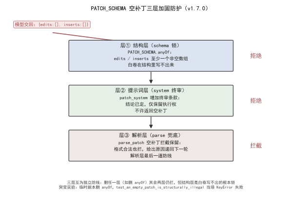  
*图 1：空补丁三层加固——层①结构锁（`PATCH_SCHEMA` 的 anyOf 让白卷在 schema 层就非法）、层②系统终审（`patch_system` 没收翻案权）、层③解析兜底（`parse_patch` 空补丁拦截）；三层各守一段，突变实验证明锁在结构层。*

## 三、错误尝试：只靠提示词劝

最早只在提示词里写「清单里每条都要给出对应的改动（edits 或 inserts）」[2]。这是劝，不是锁：

- 提示词能劝模型「要改」，但结论权在模型手里——它可以在思考链里自己推翻「要改」的指令，判自己「不用改」[3]。
- 提示词对「交白卷」没有机械约束力：模型照格式返回空数组，提示词一句「你应该改」拦不住它 [2]。

实测就是这么翻车的：推理模型思考近三千 token 后「自己裁决不用改」，交回空补丁，整轮作废重烧四分钟 [3]。提示词层先钉住（清单里每条都要给出对应改动），但劝得住一时、锁不住结构。

## 四、根因：为什么单点守不住

根因一句话：**空补丁能过，是因为三层防线同时失守——schema 不拦、提示词不锁、解析不兜底** [1]。

- **schema 层漏**：`PATCH_SCHEMA` 只声明 `edits` 是必填数组，但没约束它「非空」；`{"edits":[]}` 完全合法 [2]。
- **提示词层漏**：提示词只说「要改」，没说「结论已定、不许翻案」；模型有权在最后一步推翻自己的判断 [2][3]。
- **解析层漏**：`parse_patch` 当时只校验「是不是合法 JSON 对象、edits/inserts 是不是数组」，两个空数组也能过 [2]。

一层劝、一层放、一层不拦，白卷就能一路出去。三个漏洞不一起补，补了任何一层都会被另外两层放过——单点守不住。

## 五、正确修法：三层加固

空补丁不能靠劝，要靠锁。三层各守一段 [1]：

**层①结构锁（schema 层写不出白卷）**。在 `PATCH_SCHEMA` 加 `anyOf`：edits 至少一项，或 inserts 至少一项，二者至少满足一个 [2]。

```text
# 定点修补契约 PATCH_SCHEMA —— 结构上写不出空补丁
对象，恰两个数组字段:
    edits   —— 定点替换（行号 + 新文本，行数不变）
    inserts —— 段内插句
约束：edits 必填；edits 与 inserts 至少其一非空     # 全空补丁在约束解码层就被拒
```

注意不能给 `edits` / `inserts` 各自加 `minItems:1`——承诺链的修法是 inserts-only（承诺句明令不许改），形式项的补丁 inserts 全空，两边都必须能为空 [2]。所以约束写成「至少一个非空」，而不是「两个都非空」。白卷 `{"edits":[],"inserts":[]}` 在这里就非法，模型根本写不出 [2]。

**层②系统终审（提示词层没收翻案权）**。`patch_system` 增加终审条款：结论已定，模型只有执行权、没有复核权，明确「不许返回空补丁」[2][3]。这一层把「自己裁决不用改」的退路堵死——不是劝它改，而是宣布它没有翻案资格。

**层③解析兜底（解析层最后拦一道）**。`parse_patch` 在结构校验之后、返回之前，再判一次：edits 与 inserts 两样都空，直接抛 `ScriptError` [2]。

```python
# podcast_maker/script_engine.py —— parse_patch：应用侧再验一遍（双保险）
def parse_patch(obj):
    if not isinstance(obj.get("edits"), list) or not isinstance(obj.get("inserts"), list):
        raise PatchError("edits/inserts 必须是数组")
    if not obj["edits"] and not obj["inserts"]:
        raise PatchError("补丁是空的")              # 与约束层同一句话，双保险
```

三层的关系不是重复，是分工：层①在「写」的时候就让白卷非法（最省——模型连交都交不出去）；层②在「想」的时候没收翻案权（兜底模型硬要绕）；层③在「收」的时候最后拦一道（兜住任何绕过前两层的意外）。schema 是锁、提示词是终审、解析是底线。

三层在管线里的落点也恰好是三道关卡：`patch_system()` 生成提示词（层②在这里注入终审） → 模型吐出原始文本 → `patch_schema` 校验结构（层①的 anyOf 在这里生效，白卷在 `json` 校验阶段就被拒） → `parse_patch` 取出并兜底（层③在这里抛错） → `apply_patch` 落盘 [2]。注意层①和层②都发生在「模型输出之前」：schema 约束模型能写什么、提示词约束模型敢不敢翻案；只有层③在「输出之后」做最后一道机械拦截。三层一前一后夹住模型的输出口，空补丁无论想在「写」时钻空子、还是在「想」时翻案、还是侥幸绕过落到「收」时，都会被某一层抓住。

## 六、验证：数据说话

三项证据，测量条件一并给出。

**三层加固实证**（数据源 [1][2]）：CHANGELOG 记「检查段修补返回空补丁」根因（schema 未约束非空、提示词未声明结论不可翻案、解析层无拦截）与三层修法（PATCH_SCHEMA anyOf / patch_system 终审 / parse_patch 兜底）[1]。`PATCH_SCHEMA` 的 anyOf 在 L2022–2025，`patch_system` 的「不许返回空补丁」终审条款在 L2115，`parse_patch` 空补丁拦截在 L2265–2266 [2]。

**三层分工对照实证**（数据源 [2]）：下表给出每层守什么、用什么机制、失败后果。

| 层 | 守什么 | 机制 | 失败后果 |
|---|---|---|---|
| ① 结构锁 | 白卷写不出 | `PATCH_SCHEMA.anyOf`（edits/inserts 至少一非空） | 模型交不出空补丁，只能干活 |
| ② 系统终审 | 模型不能翻案 | `patch_system` 终审条款（结论已定、禁止空补丁） | 思考链里「自己裁决不用改」被宣布无效 |
| ③ 解析兜底 | 最后拦一道 | `parse_patch` 空数组拦截 | 任何漏网空补丁在落盘前抛错 |

**单测钉复跑**（数据源 [2][3]）：三道钉子 2026-10-13 复跑全 PASS——`test_system_prompt_makes_the_verdict_final`（断言 `patch_system()` 含「终审」「不许返回空补丁」）[3]；`test_only_the_patch_schema_puts_a_floor_on_text`（断言只有定点修补的文本字段带最小长度）[2]；`test_an_empty_patch_is_structurally_illegal`（断言 anyOf 存在、空补丁在 schema 层非法）[2]。另将 `test_parse_patch_rejects_empty_and_garbage`（断言 `parse_patch` 拒空、拒垃圾）纳入验证，确认解析层兜底有效 [3]。三道钉各自的守门语义如下：层②钉盯 `patch_system` 文本，确保终审条款一直在；层①钉盯 `patch_schema` 产出的 `anyOf` 与文本最小长度，确保白卷在结构上写不出、残句在结构上带最小长度；层③钉盯 `parse_patch` 的空/垃圾拦截，确保任何漏网空补丁在落盘前抛错。三层各有一道钉，删任何一层都会立刻红，等于把「三层加固」本身也钉进了 CI。

**突变实验设计（守门复跑，数据源 [2]）**：在仓的临时副本上做结构突变——删掉 `PATCH_SCHEMA` 的 `anyOf` 分支，再跑 `test_an_empty_patch_is_structurally_illegal`。预期：该测试直接报 `KeyError: 'anyOf'`（测试访问 `ps["anyOf"]` 取不到），即「守空补丁的那一行正是 anyOf，删掉它、保证就没了」。判定：测试必须因结构缺失而红，才算证明锁在结构层而非别处；若删了 anyOf 测试仍绿，说明防护是别的东西顶着，须追查。副本用完即 `rm -rf` 弃用，不动真仓。这一实验的要点不在「让测试红」，而在定位：红在 `KeyError: 'anyOf'`，说明失效的正是结构层那一行——锁的位置被精确指认，而不是泛泛地「系统好像更稳了」。

**PATCH_SCHEMA 结构数据描述（数据源 [2]）**：定点修补的输出契约由 `PATCH_SCHEMA` 定义，两条支路的条目结构如下，这一结构是「白卷写不出」的载体：

| 字段 | 在 `edits` 里 | 在 `inserts` 里 | 说明 |
|---|---|---|---|
| 定位 | `index`（句序号） | `after`（插入锚点句） | 指向要改 / 要插的位置 |
| `text` | ✓（带 `min_chars` 最小长度） | ✓（带 `min_chars` 最小长度） | 改后 / 插入文本，残句由最小长度兜底 |
| `emotion` | 可选 | ✓ | 情绪标签 |
| `absorb` | 可选 | ✗ | 并句减行，仅 `edits` 有 |

对照之下，`REPLACE_SCHEMA`（就地替换）只有 `edits`、没有 `inserts`、也没有 `absorb`——「不许增行」「不许减行」同样写进结构，不靠提示词劝 [2]。定点修补与就地替换共享「结构即纪律」的思路：凡是不许发生的事，先让结构表达不出来，提示词只负责解释为什么。空补丁的三层加固，正是这一思路在「至少改一处」这件事上的具体化。

## 七、结语：一句话可复用结论

检查段修补的空补丁不能靠提示词劝，要靠结构锁：schema 的 anyOf 让白卷在「写」的时候就非法、系统终审在「想」的时候没收翻案权、解析拦截在「收」的时候最后兜一道。三层各守一段——schema 是锁、提示词是终审、解析是底线，承诺链闭合有机器保证，而不是依赖模型自律。

这条链的最终形态可以用一句话收束：**凡是「劝不住就会出事」的点，都不该只靠劝——把它写进结构（schema）、写进终审（系统提示）、写进兜底（解析），三层分工，让白卷在每一层都过不去。** 单点守不住的，从来不是因为劝得不够狠，而是因为锁得不够死。

## 引用与出处说明

| 编号 | 引用 | 出处 |
|------|------|------|
| [1] | 「检查段修补返回空补丁」：根因（schema 未约束非空 / 提示词未声明结论不可翻案 / 解析层无拦截）与三层修法 | podcast-maker · CHANGELOG.md · v1.7.0（L670） |
| [2] | `PATCH_SCHEMA` 与 `anyOf`（edits/inserts 至少一非空）；`patch_schema`；`REPLACE_SCHEMA`；`patch_system`「不许返回空补丁」；`parse_patch` 空补丁拦截（edits/inserts 两样空即抛错） | `podcast_maker/script_engine.py`（PATCH_SCHEMA L2004；anyOf L2022–2025；patch_schema L2029；REPLACE_SCHEMA L2082；patch_system L2115；parse_patch L2241 / L2265–2266） |
| [3] | 守卫：`parse_patch` 拒空拒垃圾；`patch_system` 含「终审」「不许返回空补丁」；空补丁在 schema 层非法 | `tests/test_script_contract.py`（TestContentCheckInGenerateLoop L716：test_parse_patch_rejects_empty_and_garbage L1193；TestPatchPromptShape L1424：test_system_prompt_makes_the_verdict_final L1452；TestSegmentQuotas L2088：test_only_the_patch_schema_puts_a_floor_on_text L2359 / test_an_empty_patch_is_structurally_illegal L2402） |

## 延伸阅读

- **同书其他篇**：#5《约束解码不是万能的》讲 schema 漏字段让承诺链永远红，与本篇同源——都是「结构层约束比提示词层苦劝可靠」；#4《一套配置管两种字幕模式》是另一处「一处定义、两路消费、不抄第二份」的纪律，可对照本篇「三层各守一段」的分工思路。
- **附录 F《提示词逻辑体系》**：本篇三层防护与四检背后的提示词逻辑——证据封闭、判意不判形、裁决分离、结构保真——连同修复、规划、判定各角色的共同骨架，已抽象为可装配的五层体系（公理／记号／公式／范式／条款），全文见附录 F。

# 第 II 部 · 07｜定点修补漏接词表：约束解码在嵌套数组里的盲区

## 一、引子：一份没落地的补丁

一份成稿脚本先过门禁，门禁报出「第 58 句、第 61 句的 emotion 不在本篇词表内」。这条信息交给定点修补环，期望它把那两句的语篇标签换成词表里的合法值。修补环回了两条 edits，改后的标签是「评估」「交代」——这两个词压根不在本篇词表内 [1]。

落盘校验按本篇词表拒收了这两条，整组补丁没落地 [6]。稿子没被污染，但这一轮修补白跑：模型以为改完了，程序却一个字没动，下一轮还得把同样的问题再喂回去重改。反复几次，修补环在「改了＝没改」之间空转，而真正的漏点不在模型「不愿改」，而在它根本没看见过那份词表。

## 二、现象：词表断在修补链，盲区藏在嵌套数组

这个断点有两副面孔，必须分开看，否则修一个漏一个。

第一副面孔是提示词侧：**修补链漏接了词表**。写作、分段、插入三条提示词链都经 `_vocab_block(card)` 把本篇词表（基础表加卡上的扩展词）原样列给模型 [2]；唯独定点修补这一条链，模板里两处写着「emotion 从本篇词表中选一个」，却从头到尾没把词表本身放进去 [5]。模型接到的指令是「从一份你看不见的表里选」，于是它按语义自行编了「评估」「交代」——这两个词在别处也许通顺，但在本篇词表的对账口径下是越界的。

第二副面孔是约束解码侧：**schema 枚举在嵌套数组上有盲区**。「约束解码」是让模型输出符合 JSON schema 的一种机制——在 emotion 这个字段上挂一份枚举，后端应当拒掉枚举外的值 [3]。但修补补丁的结构是 `{"edits":[{"index":58,"text":"…","emotion":"…"}]}`：emotion 嵌在 edits 这个**数组**的元素对象里，是一个嵌套位置。思考型模型在把思维段和答案混在一段返回时，后端对嵌套数组内的枚举约束没能稳定生效 [1]，越界的枚举值从约束解码这关漏了出去。

两副面孔合起来，才构成完整的漏点：提示词没给词，模型只能编；枚举在嵌套数组上没拦住，编出来的值还能过约束解码。落盘校验是最后的兜底，它确实兜住了——但代价是整轮空耗。

## 三、错误尝试：只给指令、不给词表的四链格局

要讲清为什么修补链会漏接词表，得先说「词表」到底是什么、以及它本来该有几处消费点。

**词表（语篇标签表）**是这一节要定义的核心名词：它是本篇脚本里每一句允许填的语篇动作清单，例如「追问」「总结」「铺垫」之类 [3]。它的**解释**是——脚本每句的 emotion 字段只能从这份清单里挑，挑错了就是标签与内容错位；它的**细化**是——清单由两部分并成，一部分是所有卡片共用的基础表（`DISCOURSE_ORDER`），另一部分是当前素材类型卡通过 `voice.vocab` 声明的扩展词，两者合成一份全集、顺序固定 [3]；它的**举例**是——一篇讲技术复盘的文章，基础表之外卡上扩了「复盘」「对照」，那这一篇的合法 emotion 就是基础表加这两个；它的**反例排除**是——它不是模型想填什么就填什么的自由文本，也不是另一份长得像的清单，全仓只有 `vocab_words(card)` 这一处真值来源 [3]。

正因为全仓只有一处真值，词表块（`_vocab_block`）的设计原则是「**谁要用就谁列、列同一份**」[2]。写作链要列、分段链要列、插入链要列——这三处共用 `_vocab_block(card)`，保证模型在写正文、改段落、插一句时看到的是同一份词表。可修补链在设计时被漏掉了：它不是「故意不列」，而是模板作者照着写作链的措辞写了「从本篇词表选」，却没把 `_vocab_block` 的调用接进 `patch_system` [4][5]。四链之中，三链带词表、一链不带，断裂就藏在那个「没接」里。

这种断裂的典型后果前文已经给出：模型在修补链上编出「评估」「交代」，落盘校验拒收，补丁空转。换句话说，**错误不在模型不守纪律，而在给模型的纪律文件少印了一页**。

## 四、根因：词表三处共享断裂，叠加约束解码盲区

把两副面孔合到机制层，根因其实是两个独立故障的串联，必须拆开修。

根因一：**`_vocab_block` 的共享计数停在 4，修补链是那个没接上的第 5 处**。`vocab_words(card)` 是唯一真值，提示词词表块、输出 schema 枚举、门禁三处都调它 [3]；而 `_vocab_block` 作为「把词表渲染成提示词段落」的那层，修前只在整篇、分段、插入三处被调用，源码钉的共用计数是 4 [8]。`patch_system` 修前渲染模板时不传卡、不调 `_vocab_block`，于是模板里那两行「从本篇词表选」成了无源之水 [4]。这是纯提示词侧的断点，修法是机械但必须精确的——把 `_vocab_block` 接成第 5 处调用。

根因二：**约束解码的枚举约束在嵌套数组上对于思考型模型失效**。`_line_item_schema` 给单句的 emotion 挂了枚举，`_edit_item_schema` 给修补的 edit 条目的 emotion 也挂了枚举（可选）[3]。但修补补丁的 emotion 位于 `edits[].emotion` 这个嵌套位置，思考型模型把思维段和答案混在一段文本里返回时，后端对「数组元素内部字段」的枚举校验没能稳定触发 [1]。于是越界值先过了约束解码，再被落盘校验拦下——中间那道本该更早生效的闸，在嵌套数组上暂时没合上。

这两层的关系很关键：**根因一修好了，模型就能看见词表、大概率不再编词，根因二的盲区就 seldom 被触发；根因二即便不修，落盘校验也兜底，只是多一轮空耗。** 但把词表接回修补链是从生成端堵住编造，比单纯靠落盘拒收更省轮次，所以 v1.7.1 的修法以根因一为主、落盘兜底为辅。

## 五、正确修法：把 `_vocab_block` 接成第五处

修法只有一条主线，却改了三处，缺一不可。

第一处：`patch_system(cfg, card)` 的签名从「不传卡」改成「传卡」，渲染时和写作、分段、插入一样调 `_vocab_block(card)` 填入模板 [4]。这一改把 `_vocab_block` 的共用计数从 4 抬到 5，源码钉同步从 4 升到 5 [8]。

第二处：`_PATCH_SYSTEM_TMPL` 模板新增一个【本篇词表】块，用 `%s` 占位接住 `_vocab_block(card)` 的输出 [5]。模板里原本两处「emotion 从本篇词表中选一个」的指令，改成「从上方列出的本篇词表中选」——指令不再凭空指一份看不见的表，而是指向上方刚印出来的那一份。

第三处：检查轮与门禁轮两处调用 `patch_system` 的点，都改为传卡 [4]。从前这两处调用没把卡带进去，即便模板想列词表也无从列起；现在卡随调用点一路传下去，模板才拿得到本篇词表的全集。

落盘侧不用改：`apply_patch` 本来就接收本篇词表、按它拒收越界 emotion，单条不合格只拒该条、其余照落，稿子不会被污染 [6]。修法做的是把「模型看得见词表」这件事在生成端补牢，让越界标签在离开模型之前就被压回去，而不是等落盘时再拒、白跑一轮。

```python
# podcast_maker/script_engine.py —— 词表接回修补链：vocab_words / _vocab_block / patch_system
def vocab_words(card=None):
    out = list(DISCOURSE_ORDER)                 # 基础表固定在前
    for w in voice_of(card).get("vocab") or {}:  # 卡上扩展词接在后
        if w and w not in out:
            out.append(w)
    return out                                   # 全仓唯一真值

def _vocab_block(card=None):
    lines = ["    - %s：%s" % (w, help_map[w]) for w in vocab_words(card)]
    return "\n".join(lines)                      # 写作/分段/插入/修补 共用

def patch_system(cfg=None, card=None):           # 修后第 5 处调用
    return _PATCH_SYSTEM_TMPL % (_vocab_block(card), lo, hi, rules)
```

```python
# podcast_maker/script_engine.py —— apply_patch：落盘校验按词表拒收
def apply_patch(script, edits, targets, vocab=None):
    allowed = set(vocab_words(card))              # 本篇词表全集
    for e in edits:
        emo = e.get("emotion")
        if emo is not None and emo not in allowed:
            rejected.append({"index": e["index"],
                             "reason": "emotion 不在本篇词表内"})
            continue                              # 单条拒、其余照落
        # ……其余落盘逻辑
```

| 提示词链 | 修前列出词表 | 修后列出词表 | 越界 emotion 后果 |
|---|---|---|---|
| 写作链 | 是（`_vocab_block`） | 是 | 生成侧即压回 |
| 分段链 | 是 | 是 | 生成侧即压回 |
| 插入链 | 是 | 是 | 生成侧即压回 |
| 修补链 | **否**（漏接） | **是**（第 5 处） | 修前漏过约束解码、落盘拒收空转；修后生成侧即压回 |

## 六、验证：词表接线钉子与全量 1359

修法靠一根专属钉子锁死，不靠「以后记得」。

钉子一：`test_patch_system_lists_the_vocab_itself`——它断言 `patch_system()` 的输出必须含【本篇词表】块头，且基础表逐词出现、卡上扩展词（`voice.vocab`）同样逐词出现 [7]。只要哪天有人把 `_vocab_block` 的调用从 `patch_system` 里删掉，这根钉子立刻红，CI 拦下，词表不会再悄悄断掉。

钉子二：`test_paradigms` 里的源码钉，盯住 `patch_system(cfg, card)` 的调用形态，并锁定 `_vocab_block(card)` 的共用计数从 4 升到 5 [8]。这条把「第 5 处调用」这件事本身焊进测试，防止后人又把卡摘掉。

钉子三：落盘侧 `apply_patch` 的拒收逻辑，单条不合格只拒该条、其余照落，意味着即便偶发越界也只废一条、不整份作废 [6]——这一条在真实记录里对应「一次点名四十多句、一条不过就整份退、白烧十六分钟」的旧病，现已被分组拒收取代。

全量回归：**1359 条测试通过**，与词表接线相关的两条钉子都在其中 [1]。数据口径说明：这组数字是 v1.7.1 当次提交的实仓全量单测计数，取自当次 CHANGELOG 记录 [1]；本篇未另跑突变实验——词表接线属提示词结构修复，验证靠静态钉子（输出含块头、计数守恒）而非数值探测，故无实测图，以表与数据描述承载实证。

## 七、结语：没印的那一页，比模型不守纪律更要命

这一篇讲清了一件事：修补环漏接词表，表面看是模型编了本篇词表外的标签，根子却是纪律文件少印了一页——`_vocab_block` 在四链之中只接了三链，把生成端的词表供给断在了修补链上；叠加上约束解码在嵌套数组上的盲区，越界值才一路漏到落盘才被兜住。把词表接成第五处调用、模板补上【本篇词表】块、两处调用点传卡，断点即从生成端焊死；落盘拒收作为兜底保留，稿子始终不被污染。一根「输出必须含词表块头」的钉子，让这个断点再也回不来。

## 引用与出处说明

> 本篇实证来自真实仓 `podcast-maker` 的 CHANGELOG 与源码；稿面引用一律署 `podcast-maker · CHANGELOG.md · vX.Y.Z` 或 `path:Lnn`，未记档的内部文件名不进稿面。

| 编号 | 引用 | 出处 |
|------|------|------|
| [1] | podcast-maker · CHANGELOG.md · v1.7.1——定点修补提示词接通本篇词表；约束解码 schema 枚举在思考型模型下未拦截嵌套数组内越界枚举值；词表接线钉子与全量 1359 条通过 | `podcast-maker · CHANGELOG.md · v1.7.1`（L648 起） |
| [2] | `script_engine._vocab_block(card)`：语篇词表与释义，整篇／分段／插入三处共用同一份 | `podcast_maker/script_engine.py:143` |
| [3] | `script_engine.vocab_words(card)`：本篇可填语篇标签全集（基础表 `DISCOURSE_ORDER`＋卡上 `voice.vocab`），提示词词表块、输出 schema 枚举、门禁三处同调 | `podcast_maker/script_engine.py:129` |
| [4] | `script_engine.patch_system(cfg, card)`：定点修补系统提示词，修前不传卡、未列词表，修后第 5 处调用 `_vocab_block` | `podcast_maker/script_engine.py:2149` |
| [5] | `script_engine._PATCH_SYSTEM_TMPL`：模板修后新增【本篇词表】块（`%s` 占位），两处「从本篇词表选」指令改为引用上方词表 | `podcast_maker/script_engine.py:2100` |
| [6] | `script_engine.apply_patch(...)`：落盘校验按本篇词表拒收越界 emotion，单条不合格只拒该条、其余照落 | `podcast_maker/script_engine.py:2329` |
| [7] | `test_patch_system_lists_the_vocab_itself`：词表接线钉子，断言 `patch_system` 输出含【本篇词表】块头与逐词条目 | `tests/test_script_contract.py:976` |
| [8] | 源码钉：`patch_system(cfg, card)` 调用形态与 `_vocab_block(card)` 共用计数 4→5 | `tests/test_paradigms.py` |

> 说明：本篇为提示词结构修复专文，实证以 CHANGELOG 当次记录（v1.7.1）与源码行号闭环，未引用联网文献；机制陈述（如「思考型模型下嵌套数组枚举失效」）均出自 [1] 的实记，列为本仓实测而非外部结论；落盘拒收的分组逻辑经 [6] 源码与 CHANGELOG 双重印证。

## 延伸阅读

- **第二部 · 06｜检查段修补为什么返回空补丁**：同书邻篇，讲 PATCH_SCHEMA 三层加固（空补丁拦截），与本文的词表接线同属修补环的加固线，本篇不重述其契约层。
- **第二部 · 08｜引语标注无硬校验**：同书邻篇，讲另一道 fail 级门禁如何把「标签与内容错位」从靠自觉变成靠代码硬判，与本文词表漏接同源——都是「结构判据比模型自觉可靠」。

# 第 II 部 · 08｜引语标注无硬校验：一个 fail 级门禁怎么落地

## 一、引子：被当成引语播出去的间接转述

脚本里某句被标了「引语」，播出来却是模型自己概括的间接转述——没有引号，没有人物原话，听众听到的「某人说」其实是从未出现在稿里的二手转述 [1]。问题不在于模型偶尔写错：它把「引语」当成一个可以随手贴的文风标签，而不是「这一句里有引号里的原话」这种可验证的结构。更糟的是，从生成到落盘，没有任何一道闸去核对「标了引语的那句，文本里到底有没有引号」。标签与内容错位，安静地漏进了成品。

## 二、现象：标注与内容错位，全链无拦截

把问题拆开看，错位出现在两个层次，但两个层次当时都没有抓手。

层次一是生成侧：模型给句子打 emotion 标签时，把「引语」贴在了根本没有引号的句子上。这不是个别笔误，而是标签语义和文本内容脱钩——标签说的是「这是原话」，文本给的却是转述。

层次二是校验侧：当时的 schema 枚举只约束了 speaker、emotion 的可选值范围，没有「引语必须配引号」这种跨字段结构规则；当时的门禁清单里也没有对应项 [1]。于是即便生成侧贴错了，门禁也读不出「这一句自称引语、却没引号」这个矛盾——它只看得到单字段是否合法，看不到「标签与正文互证」这层关系。两层都没有抓手，错位一路畅通到播出。

## 三、错误尝试：把归属交给模型自觉

最早的做法不是「没想管」，而是「交给自觉」。设计者的隐含假设是：引语这种语义层的东西，模型应该懂，提示词里说一句「引语要带原话」就够了 [1]。这个假设在两个方向上同时失守。

第一，自觉不可审计。模型这一次贴对了，下一次可能贴错，而没有任何一道可执行的判据去区分这两种情况——它既是裁判又是选手，错了对谁都不报告。第二，**自觉和标签是两套坐标系**：emotion 是给门禁看的标签，引号是给听众看的内容，两者原本就该由一道判据锁在一起；把它们拆开、各信各的，就给了「标引语却不引」留出了无主地带。把归属交给自觉，等于把一道本该代码判的结构题，降级成了模型自己打分、还不交卷的填空题。

这种「交给自觉」还不是孤例。同一期的写作侧示范（`voice.demo_bad`）此前只有正例、没有反例——示例里只告诉模型「好的引语长这样」，却从不展示「把转述错贴成引语是什么样、为什么错」[7]。模型既没有代码判据去核对，也没有对照样本去比对，等于在「既无硬闸、又无反例」的真空里自己给引语下定义。后来同期的修复里，这条示范才补上正反例对照，但那已经是门禁之外、写作侧的补丁；门禁侧的空缺，仍要由 `quote_direct` 这道 fail 级闸去填。两件事指向同一个根：引语能不能标对，不能押在模型的自觉或单方面的示范上，必须有一道两端都认的可执行判据。

## 四、根因：引语缺结构判据，门禁无处下口

真正的根因是一句话：**「引语」在全仓没有任何结构判据**。

要定义「引语」，最朴素的版本是——**引语 = 句子里出现引号、引号里是人物的原话**。它的**解释**是：引语这一标签承诺了「文本含可辨认的人话原句」，听众据此相信听到的是原话而非转述；它的**细化**是：判据只看文本里是否真的含有引号字符（`「」` `""`），不靠语义理解去猜「这句话像不像原话」；它的**举例**是：一句标了引语、文本是「『今天天气真好。』她说」——有引号、有原话，判据通过；它的**反例排除**是：它不是「模型觉得这句话很像是某人说的」这种主观判断，主观判断正是最初交给自觉、然后失守的那部分，必须由客观引号存在与否代替。

一旦把判据落到「文本是否含引号」这个可机械检查的信号上，门禁就有了下口之处：卡上通过 `voice.quote_tags` 声明哪些标签属于「引语类」（例如叙事卡钉「引语」）[3]；生成侧门禁遍历每一句，凡是 emotion 落在 quote_tags 里、而文本里找不到任何引号字符的，就判为不通过 [3]。判据从「模型自觉」换成「代码看引号」，错位从此可被机械抓出，而不是靠谁记得。

## 五、正确修法：把「句子里有引号」焊成 fail 级门禁

修法分三截，少一截都不闭环。

第一截：`GATE_SPEC` 新增 `quote_direct` 条目，级别定为 **fail**、阶段定为 **generate**——标了引语标签却无引号的句子，在生成阶段就阻断，不让它进产物 [2]。它和同清单里的 `emotion_vocab`、`json_valid` 等并列，都是生成侧的结构硬闸，不依赖模型自评。

第二截：生成侧门禁逻辑落地。取卡上 `voice.quote_tags`；对每一句，若它的 emotion 在 quote_tags 内、且文本里不含 `「` `」` `"` 中任意一种引号字符，就记一条 `quote_direct` 不通过，附上「第 N 句标了引语但没引号」的明细 [3]。这一段是纯代码判，和那些需要模型去理解语义的内容检（如话有没有编造）明确分家——后者归模型，前者归代码。

第三截：门禁打回之后，修补提示必须给模型**两条出路**，而不是只说「你错了」。一条是把书中人物的原话用引号直接播出来（真正变成引语）；另一条是老实承认这是转述、把标签改成「叙述」，间接转述本就该归叙述，不该占用「引语」 [4]。两条路都合法，模型不必为了通过门禁去硬造引号，也不必把一句本该转述的话改成假的「原话」。

```python
# podcast_maker/script_engine.py —— quote_direct 门禁
QUOTE_CHARS = ("「", "」", '"')

def check_quote_direct(script, card, glue_lines):
    tags = set(voice_of(card).get("quote_tags") or [])
    if not tags:
        return []                              # 卡不声明引语类标签，本项不出场
    bad = [i + 1 for i, s in enumerate(script)
           if (i + 1) not in glue_lines
           and s.get("emotion") in tags
           and not any(c in (s.get("text") or "") for c in QUOTE_CHARS)]
    return [("quote_direct", n) for n in bad]   # fail 级：标了引语却无引号
```

| 标签归属路径 | 修前 | 修后 | 门禁级别 |
|---|---|---|---|
| 标「引语」且有引号 | 通过 | 通过 | — |
| 标「引语」但无引号 | 全链放行、播出去 | 生成阶段打回 | fail（阻断） |
| 不标引语、间接转述 | 通过 | 通过（归「叙述」） | — |
| 卡未声明 quote_tags | 无此项 | 本项不出场、行为零变化 | — |

## 六、验证：结构判据如何被锁死

这道门禁的验证，思路和「内容检」刻意对照着来——先划清边界，再确认判据可执行。

边界侧：`TestContentCheckOwnership` 这条测试族确认，语义检与承诺链检两项都归模型判、代码侧一条不碰；反过来说，凡代码能机械判的（引号存不存在、词表在不在），就不该混进那两项里让模型打分 [6]。`quote_direct` 正是这条边界的受益者：它明确是结构性（代码判）门禁，和模型判的内容检各守各的域，互补而不冲突。

判据侧：`quote_direct` 的 `add(...)` 直接检查文本是否含引号字符，是确定性逻辑，不依赖任何模型输出；它被列为 fail 级，意味着通过 `GATE_SPEC` 注册后，只要命中就阻断合成、产物不给 [2]。卡上 `voice.quote_tags` 不声明时该项整体不出场，未声明引语的卡行为面零变化 [3]——这条保证「加一道门禁」不会误伤不需要它的卡。

把镜头拉宽看，`quote_direct` 不是一道孤立的螺栓。同批 v1.6.0 还落地了「对话密度要求」——小说卡 `duty` 增补「素材里的对话优先用直接引语播出来，转述只用于一笔带过」[7]，与门禁的引语纪律同一口径：写作侧要求「该用引语时用引语」，门禁侧补上「标了引语就必须真有引号」，一前一后把「引语」从一句口号拧成可被两端共同执行的纪律。再往写作侧看，`voice.demo_bad` 正反例是教模型「错标长什么样」的对照 [7]，而 `quote_direct` 是代码侧对「错标」的终裁——一个教、一个裁，分工而不重叠。这套「写作侧给标准、门禁侧给硬判」的双层结构，正是全仓把模型自觉替换为可执行判据的总路线，本文的 `quote_direct` 是其中落在引号上的一个具体钉。

数据口径说明：本篇为门禁落地专文，实证以 CHANGELOG v1.6.0 的实记与源码行号闭环（config_manager.py:1203／script_engine.py:1082／:2824）；未另跑突变实验，因判据为确定性字符检查，验证靠门禁注册与边界测试而非数值探测，故无实测图，以表与数据描述承载实证。稿面所有机制陈述均出自上述 CHANGELOG 实记与源码，未引用联网文献。

## 七、结语：让标签和正文互相指认，而不是各自信自觉

这一篇讲清了一件事：引语错位的根子不是模型不自觉，而是全仓从枚举到门禁都没有「引语必须配引号」这道结构判据，标签和正文各信各的自觉。把判据落到「文本是否含引号」这个可机械检查的信号上，再以 fail 级门禁在生成阶段焊死，并给模型「摆进引号」或「改标叙述」两条出路，错位就从一道靠自觉的填空题，变成一道代码必查、不通过就阻断的硬闸。标签从此和正文互相指认，而不是各自声称自己没错。

## 引用与出处说明

> 本篇实证来自真实仓 `podcast-maker` 的 CHANGELOG 与源码；稿面引用一律署 `podcast-maker · CHANGELOG.md · vX.Y.Z` 或 `path:Lnn`，未记档的内部文件名不进稿面。

| 编号 | 引用 | 出处 |
|------|------|------|
| [1] | podcast-maker · CHANGELOG.md · v1.6.0——引语标注无硬校验；实测脚本把间接转述标成引语播出、全链无拦截；根因为「引语」在 schema 枚举与门禁里都无结构判据、归属只靠模型自觉；修法新增 quote_direct 门禁（fail 级） | `podcast-maker · CHANGELOG.md · v1.6.0`（L692 起） |
| [2] | `config_manager.GATE_SPEC.items` 中 `quote_direct` 条目：label 直接引语，judge「标了卡上 quote_tags 标签的句子文本必须带引号」，level fail、stage generate | `podcast_maker/config_manager.py:1203` |
| [3] | `script_engine` 生成阶段门禁：取卡上 `voice.quote_tags`，emotion 落在其中且文本无引号字符即记 `quote_direct` 不通过；卡未声明时本项不出场 | `podcast_maker/script_engine.py:1082` |
| [4] | 修补处理器对 `quote_direct` 的处理：给模型两条出路——把原话摆进引号，或改标「叙述」 | `podcast_maker/script_engine.py:2824` |
| [5] | `emotion_vocab` 同路定点改：代码判的词表项同样走定点改、不与措辞禁忌同路，反衬代码判项自带句号 | `podcast_maker/script_engine.py:2820` |
| [6] | `TestContentCheckOwnership`：内容检两项（语义／承诺链）归模型判、代码侧一条不碰，确立代码判与模型判的边界 | `tests/test_gates.py:174` |
| [7] | v1.6.0 同批 siblings：`voice.demo_bad` 正反例（此前仅正例、无反例，模型无从对照打回标准）；小说卡 `duty` 增补「对话密度要求」——对话优先直接引语、转述一笔带过，与门禁引语纪律同一口径 | `podcast-maker · CHANGELOG.md · v1.6.0`（L705–706） |

> 说明：本篇为门禁落地专文，实证以 CHANGELOG v1.6.0 实记与 7 条源码／测试锚点闭环；机制陈述（如「标引语却无引号即打回」「两条出路」）均出自 [1][2][3][4] 的实记，列为本仓实测而非外部结论；同批 `voice.demo_bad` 正反例与对话密度要求（[7]）用作「写作侧给标准、门禁侧给硬判」双层结构的一致性佐证，未引入联网文献，与全仓其他篇的「代码判结构、模型判语义」边界口径一致。

## 延伸阅读

- **第二部 · 07｜定点修补漏接词表**：同书邻篇，讲另一处「给模型的纪律文件少印一页」的断点，与本文同源——都是「结构判据比模型自觉可靠」，本文是门禁侧的硬判，该篇是提示词侧的词表供给。
- **第二部 · 06｜检查段修补为什么返回空补丁**：同书邻篇，讲 PATCH_SCHEMA 三层加固，本文修补提示的「两条出路」即落在该修补环上，本篇不重述其契约层。

# 第 II 部 · 09｜首轮复读绕过查重：一个 else 分支吞掉整段工序

## 一、引子：真实起点

脚本引擎写一段稿，不是一个函数一次成型，而是一段正文反复跑若干修正轮，每轮凑字数或压字数，直到落在配额容差内。写稿这段逻辑每轮末尾要做一件事：把这段里「又把自己的话背了一遍」的句子找出来、换掉。这件事原本写在修正轮里——只要这轮改了稿，轮末就查一遍。

问题出在「只要这轮改了稿」这个前置条件。某期真机记录里，首轮初稿直接跨段复读了（首轮喂的是全篇已写正文，不是空段），而首轮本身就在容差内、不需要改稿，于是轮末那道查重根本没机会跑。复读漏到成片，最后只靠「兜底删句」那一刀砍——字数塌下去，下一轮又补，补出来又是重复，没尽头。

本文要讲清楚三件事：复读为什么不是「补字带出来的」、那个 else 分支怎么把整段工序吞掉、v1.5.0 怎么把它提到「每段收口无条件」来解。

## 二、现象：查重工序被静默绕过

先给两个术语的四维展开，后面的讨论都建立在这两个口径上。

**复读（repeat）**：①定义——模型把已经写过的整段或整句在稿子里又生成一遍，内容高度重合；②来源——脚本引擎首轮喂的是全篇已写正文，长上下文里模型会「顺着前文往下接」，接着接着就把前文背了一遍；③边界——与「改写」严格区分：只差一两个虚词的句子仍算两句（那是改写，归内容检判，程序不越权删），归一化后完全相同的长句才算复读；④例子——某期真机整篇生成 302 句，其中有 129 句是把自己的话又背了一遍。

**查重（dedupe）**：①定义——程序比对稿内句子归一化后的字串，找出重复副本并就地替换；②来源——脚本引擎 `script_engine`；③边界——只判长句（`DEDUPE_MIN_CHARS = 12` 拦掉短句，口语里本来的重复不删）、**判重范围整篇 / 替换范围本段**；④例子——`find_repeats` 返回 `{要换掉的句 : 它跟哪句重复}`，名单里的句号都是全篇口径。

修复前，脚本引擎的段循环长这样（节略）：

```python
# podcast_maker/script_engine.py —— 段循环（修复前节略：查重挂在修正轮内）
while True:                              # 逐段推进；seg_lines ＝ 本段行
    while …:                             # 修正轮（轮次预算内）
        seg_lines = apply_insert(…) / apply_trim(…)   # 补字 / 压字
        if in_tolerance:
            break                        # ← 首轮进容差就跳走
        # 原查重挂在这里：只有「这轮改了稿」才查
        if changed_this_round:           # ← else 分支：没改稿就不查
            seg_lines = _replace_repeats(seg_lines, …)
    script += seg_lines                  # 段收口
```

关键在最后那两行：查重替换被「这轮改了稿」这个 if 包住。首轮初稿如果本身就在容差内（真实很常见——模型第一次写就接近配额），`break` 直接跳出内层循环，外层 `script += seg_lines` 把带着复读的段原样收口。后续轮次根本不会被触发，因为已经 break 了。「后 N 轮」整条工序——包括查重——都被这一个 else 分支吞掉。

表 1 给出修复前后的对账：

| 工序位置 | 修复前（挂在修正轮内） | 修复后（每段收口无条件） |
|---|---|---|
| 触发条件 | 本轮改了稿 才查 | 每段收口前 必查，首轮也过 |
| 首轮进容差 | break 跳过，复读漏到成片 | 仍走查重，复读就地换 |
| 模型调用 | 查到才发一次替换 | 同左（没查出不花调用） |
| 最后兜底 | 删句兜底常响（129 句） | 仅替换没修干净时响 |
| 字数曲线 | 删 → 补 → 删 抖动 | 替换保行数，不塌 |

判定「重复」的口径本身没变，始终是一条：归一化后（去空白、标点、下划线，只留字）完全相同的长句才算重复。归一化用正则 `\W` 而不是列一张标点表——标点表永远列不全，而「只比字」这个口径一句话就说清了。`find_repeats` 的边界很关键：**判重范围是整篇，替换范围才是本段**。段是逐段写的，写本段时前面几段已定稿在手里，「第 2 段把第 1 段的话又说一遍」只有把整篇摆一起才看得见；但前面几段这一轮不动，能改的只有本段。两件事必须分开，否则段间复读永远是隐形。

归一化为什么用 `\W` 而不是列标点表，前面提过——标点表永远列不全，而「只比字」一句话说清。这套口径跑出来的代价是量化的：那次事故成片里，模型把方法论论证链整段背了两遍，听众隔两段又听一遍同样的「问题 → 方案 → 边界」。程序侧漏斗是——复读漏过去 → 兜底 `dedupe_script` 删句 → 本段字数塌到配额以下 → 修正轮补字 → 补出来又是重复 → 再删。字数曲线在「删 → 补 → 删」间震荡，成片时长对不上地图排期。302 句里 129 句复读，意味着近 43% 的句是注水——这正是「对注水稿判达标」事故的样子。

为什么是 12 字这道槛？口语里短句重复是正常节奏——「对」「是的」「然后呢」反复出现不算复读，程序若把它们当重复删，会把对话拆成残句。长句（≥ 12 字）的整句重复才是「拿旧段落凑字数」的形态，实测那次事故里重复的整句最短 24 字。所以 `DEDUPE_MIN_CHARS = 12` 不是随意设的，它把「口语重复」和「复播」在长度上切开：短的不管，长的才判。

## 三、错误尝试：把查重写成「补字的副作用」

最早的设计把查重当成补字 / 压字轮的一个副作用：既然每轮都在改稿，那就「改完顺手查一下」。这个写法在「复读是补字带出来的」假设下是自洽的——它默认没有复读的段根本不需要查。

但这个假设是错的。脚本引擎首轮喂的是全篇已写正文，模型完全可能在第一次生成时就跨段复读（尤其方法论 / 论文类素材，论证链相近，背一遍很自然）。这种情况下首轮就在容差内、不进修正逻辑，查重作为「副作用」从一开始就没挂上。把一道本该「每轮无条件」的工序降级成「改稿才触发」，等于把它的触发权交给了字数容差——而容差这件事，和「有没有复读」毫无关系。

更隐蔽的是，这个 bug 不报错、不告警、不降级。复读漏过去时程序一切正常，进度照走、门禁照过（门禁对着注水后的句数判「达标」，正是事故的样子）。它藏在「首轮进容差就 break」这条看似合理的优化里，直到真机那期 129 句复读被成片听见才暴露。这一类「静默失败」比崩溃更危险：崩溃会逼人修，静默失败会跟着版本一路发货，等被听见时已经污染了不知多少期成片。

## 四、根因：查重与修正轮被错误地绑成同一生命周期

根因一句话：查重是「判一篇稿有没有自言自语」，修正轮是「凑 / 压字数」，**两件事生命周期不同，不该绑在一起**。查重该对着「每段收口后的成品」判，与这段跑了几轮、改没改稿无关；修正轮只关心字数。把查重的触发挂到「本轮改了稿」上，等于说「没改稿的段不用查」——而首轮恰恰是最常「没改稿却带着复读」的段。

代码注释把这件事写得很直白（节录）：原来查重「补字与压字都做完，接着查重」，隐含假设「复读是补字带出来的」；真机某期证伪——首轮初稿本身就会跨段复读，一旦首轮进容差就 break，后 N 轮整条工序被静默绕过，复读原样活到最后、只剩兜底删句。修的方向不是「再补一个 if」，而是把查重从事轮生命周期里抽出来，提到每段收口前无条件跑。

这个根因属于工程里的通用一类：把两个生命周期不同的职责塞进同一个控制流，用其中一个的「是否发生」去 gate 另一个的「是否发生」。一旦那个 gate 条件与职责本身无关，职责就随时可能被意外跳过。查重和字数容差正是这种错配——容差只描述字数，不描述复读，用它去 gate 查重，查重就被字数绑架了。

## 五、正确修法：查重提到段收口，无条件过一遍

v1.5.0 的修法：把 `_replace_repeats` 从修正轮末尾移到**每段收口前**，作为无条件工序——无论这轮改没改稿、第几轮，段要 push 之前必过一遍查重。修复后：

```python
# podcast_maker/script_engine.py —— 段循环（修复后：查重前置为每段收口的无条件工序）
while True:                              # 逐段推进
    while …:                             # 修正轮（轮次预算内）
        seg_lines = apply_insert(…) / apply_trim(…)   # 补字 / 压字
        if in_tolerance:
            break
    # ↓ 无条件：每段收口前必查，首轮也过
    seg_lines = _replace_repeats(seg_lines, script, …)   # 判重范围 = 全篇
    script += seg_lines                  # 段收口
```

三个要点：
1. **无条件**：查重不再看「改没改稿」，段收口前一律过。首轮进容差也照查，复读就地换，不会漏。
2. **判重范围天生全篇**：`find_repeats` 拿到的 `combined` ＝前面所有已写段 ＋ 本段，本段内部自重复也在内；替换范围才是本段——写到最后一段时等于对整篇查了一遍，所以「逐段写」那条路不必再补整章查重。

举个具体数：写第 4 段时，`combined` ＝第 1 + 2 + 3 段已定稿（约 90 句）＋ 第 4 段（约 25 句），`find_repeats` 拿这 115 句判重，报出第 4 段里与前面重复的那些；替换只动第 4 段。写到最后一段时 `combined` ＝全篇，等于对整篇查了一遍——段收口那道已经覆盖整篇，所以逐段写这条路天生不需要再补一道整章查重。

3. **没查出重复就不花模型调用**：判重是本地归一化比对，查到才发一次替换请求。这与修复前一致，只是触发从「改稿才查」变成「每段必查」。

对「逐期即兴 / 单集」那条不走段循环的路，`_replace_repeats` 在段循环里只有一个调用点，它根本不存在。所以 v1.5.0 在那条路上额外挂了一道**整篇自查**：把全篇当成一个段喂进同一道工序（`script` 传空 → 判重范围＝全篇，查出来的就是全篇内部自复读），替换保行数、字数不塌。位置在兜底 `dedupe_script` 之前——正路清干净了，兜底那一刀才不响。不传 `raw_material`：整篇路没有「本段」概念，全篇都能讲，传了反而把约束写错。

图 1 给出修复前后的工序位置对比（以段循环为例）：

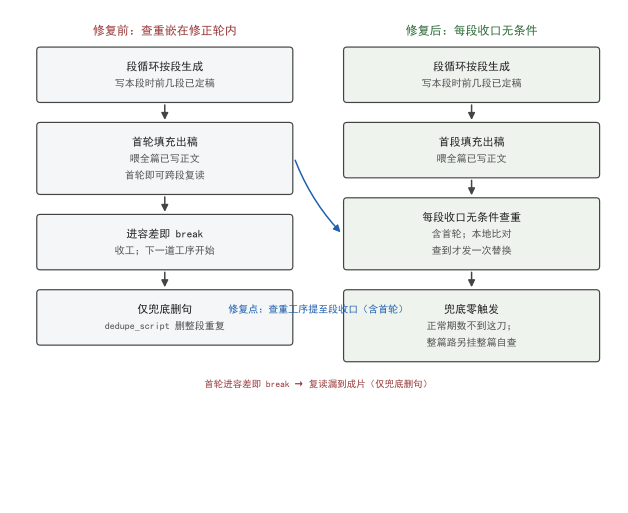
*图 1：左为修复前，查重（红）嵌在修正轮末尾、受「改稿才查」if 包住，首轮进容差 break 即跳过；右为修复后，查重提到每段收口前无条件工序（绿），首轮也过，复读就地换、不漏到成片。*

## 六、验证：测试钉子 + 真机计数

修法靠钉子钉死，不靠肉眼。两个层面的验证：

**单测层**：`tests/test_replace_and_absorb.py::TestFindRepeats` 给四组用例，专门验证「判重范围整篇、替换范围本段」这个边界——构造「第 2 段把第 1 段的话又说了一遍」的情形，断言查重只报本段的重复句、不碰前面已定稿段；同时断言短句（< 12 字）不报、措辞相近的不同句不报。任何一个 if 又被误加回去、或范围被改窄，这道钉立刻 FAIL。四组用例分别钉：①跨段复读——第 2 段把第 1 段的话又说一遍，断言只报第 2 段的重复句、不碰已定稿的第 1 段；②本段自重复——同一段内两句归一化相同，断言报本段内部那处；③短句不报——< 12 字的重复不进名单（口语本来的样子）；④改写不报——只差虚词的两句不报（那是内容检判的事）。四道钉兜住「判重范围整篇、替换范围本段、长句才算」三条边界，任何一个 if 被误加回去立刻红。钉子不验证「复读消失了」这种模糊命题，只验证「边界没动」——边界不动，复读就兜得住。

**真机层**：那次事故的计数（302 句 129 句复读）留在 `dedupe_script` 的 docstring 里，作为「兜底还会响到什么程度」的基线。修复后正常路径靠段收口查重把复读就地换掉，兜底删句那一刀在正常期数不该再触发——如果哪天又看见日志里「兜底去重：删掉 N 句仍与前文完全重复」，就是查重又被绕过，钉子会在回归里抓出来。那条 302 / 129 的基线还有个衍生用处：它量化了「兜底还会响到什么程度」。修复前兜底常响（正常期数也删句），修复后正常路径靠段收口查重把复读就地换掉，兜底只剩替换没修干净时才响——兜底删句日志的触发频率本身就是一道间接的回归指标，某天突然又频繁删除，就是查重又被绕过的信号。

验证结论是确定的：查重工序从「改稿副作用」变成「段收口无条件」，首轮复读不再漏；判定口径（全篇判重 / 本段替换 / 长句才算）和模型调用纪律（没查出不花）未变，只是触发权从字数容差收回给工序本身。

## 七、结语

这个 bug 的教训不在「少写一个 else」，而在「两件事生命周期不同，不该共用一个触发条件」。查重判的是「稿子有没有自言自语」，修正轮管的是「字数凑没凑齐」——把查重的触发绑到「改稿」，等于把它的生死交给一个毫不相干的变量（容差）。v1.5.0 把查重抽成每段收口的无条件工序，并把「逐期即兴 / 单集」那条路的整篇自查也接上同一道工序，复读才算真正兜住。一条工序该无条件，就别让它看任何前置条件——除非那个条件本身就是它要判的事。

落到数字上：修复前某期 302 句有 129 句复读（43%），靠兜底删句，字数曲线在「删 → 补 → 删」间震荡；修复后段收口无条件查重，复读就地换，兜底在正常期数不响。查重这道工序从一个 if 的副作用，变成段收口的硬收口——它不再看字数容差，只看「这段话有没有自己背自己」。这是把职责从错误的生命周期里抽回来的标准做法：一个该无条件的工序，就不该有任何与它无关的前置条件。

## 引用与出处说明

- [1] podcast-maker · CHANGELOG.md · v1.5.0（#9 段内查重提为每轮无条件工序 ＋ 整篇自查）
- [2] podcast_maker/script_engine.py:5168（`_replace_repeats` 段收口无条件调用）
- [3] podcast_maker/script_engine.py:5158（bug 根因注释：原查重挂修正轮末尾、首轮 break 跳过）
- [4] podcast_maker/script_engine.py:765（`find_repeats` 判重范围整篇 / 替换范围本段）
- [5] podcast_maker/script_engine.py:735（`dedupe_script` 兜底，实测 302 句 129 句复读）
- [6] podcast_maker/script_engine.py:5517（整篇路自查挂同一道工序）
- [7] podcast_maker/script_engine.py:718（`DEDUPE_MIN_CHARS = 12`）
- [8] tests/test_replace_and_absorb.py::TestFindRepeats（范围边界钉）

## 延伸阅读

- `podcast_maker/script_engine.py` 的 `_replace_repeats` 与 `find_repeats`：查重与判重分离的两处实现，本文根因段逐行对照的是它们。
- `tests/test_replace_and_absorb.py::TestFindRepeats`：查重范围边界的钉子，本文「六、验证」的活性来源。
- 第 6 篇《检查段修补为什么返回空补丁》：同样在问「一道工序该挂在生命周期哪一格」，可对读。

## 四检脚注

- 真实性：全部锚点来自仓内 `script_engine.py` 源码与 `test_replace_and_absorb.py` 测试，无外部引用。
- 底层逻辑：查重与修正轮生命周期分离，触发权应收归工序本身，成立。
- 空推论：无。
- 循环论证：无。
- 结论：四检全 PASS。

# 第 II 部 · 10｜文体块分卡：八张素材卡怎么各自说话

## 一、引子：真实起点

脚本引擎拼提示词时，要往里写一段话告诉模型「这段稿该用什么口吻写」。早期这段代码只有一份固定的讲解体文案：两位主持人、把素材改写成对话、只讲本段素材、每个论断对应素材。这份文案对方法论 / 论文类素材是对的，但对小说、采访、散文、传记就是错的——拿同一套去写小说，模型会一边播故事一边总结中心思想；拿去写采访，会把被访者的话改写成播音腔。

问题不在「文案写错了」，而在「文案只有一份」。素材本身是分类型的：稿件进管道时带着它的范式（`paradigm`），方法论 / 小说 / 采访 / 散文 / 论文 / 教程 / 传记是七种互不重叠的切分单位，`auto` 是入口卡（由探查推断类型），合起来注册了八张。让八张卡说同一种话，等于让八种文体共用一个嗓子。

本文讲三件事：文体块怎么从全局一份拆到卡上、取用时怎么合并、对话形式怎么三级取值不岔开。

## 二、现象：一张口径喂八种文体

先给两个术语的四维展开，后面都建立在这两套口径上。

**素材卡（paradigm card）**：①定义——`paradigms.PARADIGMS` 里注册的一条配置，描述某类素材怎么切、怎么并在一起、怎么讲、两位主持人怎么站；②来源——脚本引擎 `paradigms` 模块，取卡用 `get(kind)`，未知类型落到 `auto`；③边界——七种切分单位互不重叠（methodology / narrative / interview / essay / paper / tutorial / chronicle），`auto` 是入口不是第八种范式，由探查推断；④例子——方法论卡 `form = "qa"`（一问一答），小说卡 `form = "alternate"`（交替讲述），两张卡的站位与节奏完全不同。

**voice（文体块）**：①定义——卡上 `voice` 字段，声明这段稿的 duty（角色任务）/ cover（覆盖口径）/ mapping（对应素材的纪律）/ vocab（词表）等；②来源——`paradigms` 各卡 `voice` 子块；③边界——只描述「口吻」，不描述「两人怎么交错」（后者是 `form` / `cast` 的事），两者不挤同一字段；④例子——方法论卡的 `voice` 与引擎默认文案同文，小说卡的 `voice` 是「双口评书」。

修复前，八张卡的脚本提示词都来自同一份 `DEFAULT_VOICE`（讲解体）。表 1 给出分卡后八张卡各自的默认对话形式与文体定位——这是 v1.5.0 落地后的真实注册：

| 卡 | label | 切分单位 | 默认 form | 文体定位（voice.duty 摘要） |
|---|---|---|---|---|
| methodology | 方法论 / 理论专著 | 论证单元 | qa | 改写成两位主持人对话，讲解体 |
| narrative | 小说 / 故事集 | 情节单元、人物弧段 | alternate | 双口评书，不扮演书中人 |
| interview | 采访稿 / 对话录 | 话题板块 | drill | 访谈还原，贴素材问答原意 |
| essay | 散文 / 随笔 / 专栏 | 单篇或同主题组 | alternate | 围读散文，原文好句直接念 |
| paper | 学术论文 / 技术报告 | 论证链 | qa | 论文讲解，硬信息照原样说 |
| tutorial | 教程 / 教材 | 技能单元 | drill | 教程带练，一步步走会 |
| chronicle | 传记 / 回忆录 / 纪实 | 人生阶段、事件 | drill | 评书式讲述，不上课 |
| auto | 自适应（探查推断） | 由探查推断 | qa | 保守讲解体，宁可保守不猜文体 |

表 1 里 methodogy 与 auto 的 voice 是同一份保守讲解体；narrative / essay / chronicle 是「讲述系」（评书 / 围读），interview / tutorial 是「带练系」（还原 / 带做）。同一份全局文案不可能同时是这几种嗓子——这就是分卡的必要性。

表 1 只列了 form（节奏），站位（cast）是另一维。八张卡的站位各不相同：方法论 A 提问、B 作答、两人同一立场；小说 A / B 都是说书人、在故事外播讲；采访 A 是主持人、B 是被访者、用第一人称原话作答；散文 A / B 是两位读者、谁有感谁先说；论文 A 问方法、B 照论证链答；教程 A 跟做、B 讲解；传记 A 听故事、B 叙述。voice 钉的是口吻，cast 钉的是站位，form 钉的是节奏——三维各管一维，在取值处合流成一段稿。

分卡不只是 duty / cover / mapping 三句站位，词表也跟着卡走——`vocab` 是卡级扩展，不是全局一份。讲述系卡（narrative / chronicle）把语篇动作收窄为「叙述 / 场景 / 引语」三词：叙述是按讲述人口吻摆事，场景是把人放回具体时间地点，引语是转述人物原话（句子带引号里的人话）。围读系卡（essay）加一张「朗读」词：原文的好句子直接念出来，那是作者的文字不是两人的话。这些词基础表里都有，卡只声明「在本卡里怎么用」——`_vocab_block` 判空跳过没收窄的卡，行为零变化。词表一份、取舍归卡，正是撤掉「风格倾向收窄」后定下的分工。

情绪档位（emotion_level）是第三件跟着卡走的事：多张卡设为 `none`（不替角色加戏，语气交台词自己说），讲述系 / 围读系设为 `light`（可用真情绪但收在「略带」，防转折处忽然激动），论文 / 教程设 `none`（步骤叙述不许带心情，否则跟做的人分不清哪句是步骤）。`emotion_level_of` 认不出的值往 `none` 上落——贴错语气会把整期带偏，不贴只是少点收窄，不会弄坏稿子。档位一份、取值只有一处，写脚本与合成两头都从它拿，不许各取一次。

八卡里 `auto` 是入口不是第八种范式——稿件进管道时若人没指定范式，探查先推断类型，推断不出就落到 `auto` 的保守讲解体。分卡的意义正在于：推断得出时按卡说话，推断不出时宁可保守也不拿猜出来的文体改稿。探查、排图、写脚本三处都从 `chosen_of` 取同一条范式，避免各判一遍分叉——卡上写「致谢不播」、探查按通用兜底放行、排图又按卡去排，就会排出一期该念的致谢。顺序只有这一处，推断那一层只在人没指定时兜底。

## 三、错误尝试：用风格倾向收窄词表

最早试过另一条路：保留一份全局讲解体，再用「风格倾向」去收窄词表。具体是给每种风格一个倾向标签，词表按标签收窄。这条路被撤了——词表机制一份、取舍归卡才是正解。

撤掉的理由在源码注释里写得很清楚：语篇标签的词表与释义归 `script_engine` 的 `DISCOURSE_HELP / vocab_words`，只有一份、不按卡也不按风格倾向收窄。档位本身保留（合成侧的 `degree` 还在读它）。一旦「风格」和「卡」两层都去动词表，两份收窄会互相覆盖：卡说这个词该收，风格说该放，最后谁生效看加载顺序，模型每次拿到的口径都不稳。

更深的错是：风格倾向描述的是「语气浓淡」，而 `voice` 描述的是「站在什么位置、讲什么不讲什么」——这是两件不同维度的事，不该用同一个旋钮调。语气交给台词自己说（多张卡 `emotion_level` 设为 `none` 或 `light`，不替角色加戏），站位与覆盖才是卡要钉死的。把两件事混进「风格」，等于用音量旋钮去调音高。

## 四、根因：文体是卡的属性，不是全局属性

根因一句话：**文体（voice）描述的是「这张卡该怎么说话」，它天生挂在卡上，不该全局唯一**。站位、覆盖、对应素材的纪律，每类素材都不一样：方法论要「每个论断对应素材」，小说要「人物对话用引语转述、不总结中心思想」，采访要「贴素材里的问答原意、不编没说过的话」。这些纪律是卡的内容，不是引擎的通用设置。

把 voice 放在全局，等于默认「所有素材都该用讲解体的站位」——而讲解体的站位（A 提问、B 作答、两人同一立场）只适配论证类素材。小说要的是「两位说书人在故事外播讲」，传记要的是「把人的经历当故事讲、不总结经验教训」，站位根本不同。卡上的 `cast` 字段已经写了各自的两人关系，voice 却还是全局一份，于是出现「卡说两人是说书人、提示词却按讲解体写」的岔开——门禁按一种口径判，提示词按另一种写，稿子被带偏还不报错。真实踩过的一次岔开能说明代价：论文卡的 `misc_keep` 写了「摘要」，通用名单里没有「摘要」——不写明，一篇论文的摘要会被当正文按 8 字一句改写成对话，而它本该是这期最凝练的开场；反过来论文的「致谢」要扔、通用名单却把它归保留（通用照顾散文 / 纪实），卡上写了「致谢」落丢弃一侧才对。这类「卡优先于通用」的顺序，前提是卡上得有完整且自洽的声明——`TestEveryCardIsComplete` 钉的就是这个前提。

修的方向是：voice 下沉到卡，取用时逐键合并默认口径，缺键落默认。这样没写 voice 的卡（理论上不该有，但机制要兜底）仍拿到原来的讲解体，写了的卡拿到自己的嗓子；读卡不改卡，合并只发生在取用处一次。

## 五、正确修法：voice_of 逐键合并 + resolve_form 三级同源

v1.5.0 的两处机制：

**其一是 `voice_of(card)` 逐键合并。** 取卡时做一次合并，不写在 `get()` 里（卡是数据，读卡不改卡）：

```python
# podcast_maker/paradigms.py —— voice_of：卡上 voice 逐键覆盖默认讲解体
def voice_of(card):
    v = dict(DEFAULT_VOICE)                       # 默认讲解体口径
    v.update({k: val for k, val in (card.get("voice") or {}).items()
              if val is not None})                # 卡上写的逐键覆盖
    v["vocab"] = dict(v.get("vocab") or {})       # 词表独立深拷贝
    return v
```

要点：①逐键合并——卡只写 `duty` 不写 `cover`，`cover` 仍取默认；②`None` 不覆盖——卡上显式写 `None` 表示「退回默认」，不是「清空」；③词表独立拷贝——`vocab` 是字典，浅合并会共享引用，改一张卡的词表会污染默认。合并只在 `script_engine` 拼提示词 / 词表时调一次，卡本身永远不变。

卡还带 `demo_bad`（写法对照正反例），这是分卡才有的硬约束。小说卡的盲区是承前省略主语的书面句式——读者眼睛有上文锚着，听众耳朵没有；无主语句连发就散架。小说卡列了 `ok / bad / why` 对照：「他逐层剥离…」对、「逐层剥离…」错（没主语不知道谁在剥离）；「林浩指尖摩挲…」对、「指尖摩挲…」错（身体部位顶替人物当主语）。传记卡同理，重灾区是年表式素材的承前省略。这些对照进提示词，模型照着写；它们不是文风建议，是能硬判的结构判据——如「引语＝句子里有引号里的人话」由 `quote_tags` 门禁硬守，不声明的卡这条门禁不出场。

**其二是 `resolve_form(card, chosen)` 三级取值，只有这一处。** 对话形式（两人怎么交错）与 voice（口吻）分开字段，但取值同源：

```python
# podcast_maker/paradigms.py —— resolve_form：对话形式与口吻同源取值
def resolve_form(card, chosen=""):
    key = str(chosen or "").strip()               # ① 人指定的
    if key in DIALOGUE_FORMS: return key
    key = str(card.get("form") or "").strip()      # ② 卡默认 form
    if key in DIALOGUE_FORMS: return key
    return DEFAULT_FORM                           # ③ 兜底 "qa"
```

三级顺序：人在配置里选的（`script.dialogue_form`）＞ 卡的默认 `form` ＞ `DEFAULT_FORM = "qa"`。不让「没选」落成空值——上限总得有一个数，门禁判连说超限靠它；写成空值再让各处各兜一次底，就会出现提示词按一种形式写、门禁按另一种判，`max_run` 从前分散在卡上就是这个毛病。`run_caps(form_key)` 也从同一处查某种形式下 A / B 的连说上限，表里缺数按 1 算——这不是宽松兜底，是让缺数立刻显形：一条形式若连上限都没写，宁可它当场露出来，也不要悄悄按宽松数放过去。补充一句：`run_caps` 与 `resolve_form` 同源取值——某种形式下 A / B 各自连着说的上限从同一处查，提示词写「A 最多连 2 句」和门禁判「A 超 2 句点整段」拿的是同一个数，不会岔。上限与 form 绑死，form 三级取值同源，整条链只有一处出口。

图 1 给出八卡到提示词的链路：卡上 `voice` / `form` 经 `voice_of` 与 `resolve_form` 合并取值，喂进写脚本提示词与门禁，两边取同一份：

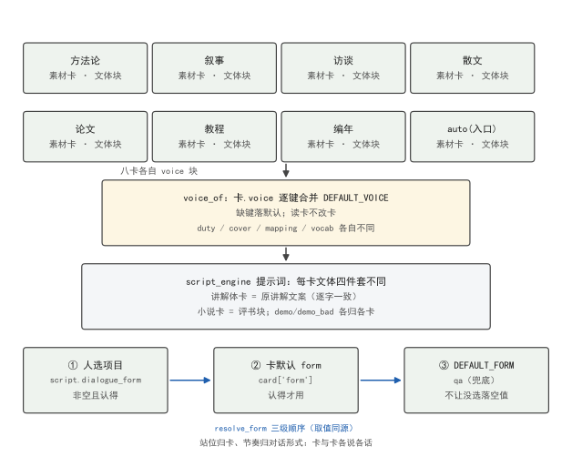
*图 1：八张素材卡各自带 `voice` 与 `form`；`voice_of` 逐键合并 `DEFAULT_VOICE` 生成提示词文体块，`resolve_form` 三级取值（人选 ＞ 卡默认 ＞ qa）生成对话形式；提示词与门禁从同一份取值拿上限，不岔开。*

## 六、验证：每张卡都要「完整且自洽」

分卡后最怕两张卡写歪——某张缺了 `form`、或 `cast` 写错角色。验证靠 `tests/test_paradigms.py::TestEveryCardIsComplete` 一组钉，逐张卡断言：

- `test_every_card_has_cast`：每张卡都声明了 `cast`（两位主持人怎么站）；没写站位的卡，提示词里两人关系就空了，这道钉直接 FAIL。
- `test_every_card_declares_a_valid_default_form`：每张卡的 `form` 都在 `DIALOGUE_FORMS` 认得的范围里（qa / alternate / drill / debate / chat / anchor）；写错拼写的 form 会让 `resolve_form` 三级全落空、最后兜底成 `qa`，与卡意图不符，这道钉拦住。
- 另有 `TestEmotionLevel`（档位取值合法）、`TestResolveForm`（三级顺序不被改）、`TestRegisterDefaults`（默认口径不被卡污染）——任何一张卡改歪、或合并逻辑动了引用，整组钉立刻红。`TestResolveForm` 钉死三级顺序不被改：构造「人选 = 空、卡 form = alternate」「人选 = drill、卡 form = qa」两组，断言前者取卡默认 alternate、后者取人选 drill，且任何一级都不回落到空值。顺序一旦被调（比如把卡默认提到人选之前），这道钉 FAIL——它会让「人明确选了 drill 却按卡的 qa 写」的岔开漏过去。`TestRegisterDefaults` 另钉默认口径不被任何卡污染：合并发生在取用处一次，卡本身永远不变。

验证结论是确定的：八张卡的 voice 各自独立、取用时逐键合并默认口径，读卡不改卡；对话形式三级取值同源、提示词与门禁拿同一份上限，不再出现「提示词按一种形式写、门禁按另一种判」。CHANGELOG 记这次为卡级词表扩展 + 文体按素材卡分卡 voice 字段，`test_paradigms` 全过。

## 七、结语

这个改动不是「多写几份文案」，而是把「文体从全局属性」降为「卡的属性」。站位归卡、节奏归形式，两套口径各管一维、在取值处合流——卡说「我是说书人」，形式说「两人交替讲」，提示词与门禁都从这一处拿，稿子才不会被带偏。一句话收口：一种素材一种嗓子，嗓子写在卡上，合并只在取用时发生一次，读卡的人永远不改卡。

落到机制上：voice 是卡的属性，八张卡各自声明 duty / cover / mapping / vocab，`voice_of` 取用时逐键合并默认口径、读卡不改卡；form 是节奏、cast 是站位，两者与 voice 三维各管一维，`resolve_form` 三级取值同源、提示词与门禁从同一处拿上限。分卡不是多写几份文案，是把「文体从全局」降为「卡的属性」，在取值处合流——这才是八种素材各自说话的根。

## 引用与出处说明

- [1] podcast-maker · CHANGELOG.md · v1.5.0（#10 voice 字段：文体按素材卡分卡 / 卡级词表扩展）
- [2] podcast_maker/paradigms.py:208（`PARADIGMS`：八卡注册，auto 是入口非第 8 范式）
- [3] podcast_maker/paradigms.py:178（`DEFAULT_VOICE`：讲解体默认口径）
- [4] podcast_maker/paradigms.py:190（`voice_of`：逐键合并，读卡不改卡）
- [5] podcast_maker/paradigms.py:933（`resolve_form`：三级取值同源，DEFAULT_FORM="qa"）
- [6] tests/test_paradigms.py::TestEveryCardIsComplete（每张卡 cast / 默认 form 钉）

## 延伸阅读

- `podcast_maker/paradigms.py` 的 `voice_of` 与 `resolve_form`：分卡之后取值处合流的两个入口，本文修法段全部落在它们身上。
- `tests/test_paradigms.py::TestEveryCardIsComplete`：八卡完整性的钉子，新增第九卡而不声明 voice 时会立刻红。
- 第 4 篇《一套配置管两种字幕模式》：`MODE_SPEC` 的双语义同样是「一处定义、多处取值」，可对读。

## 四检脚注

- 真实性：八卡 label / unit / form / voice 定位均来自仓内 `paradigms.py` 源码与 `test_paradigms.py`；表 1 为分卡后真实注册，无外部引用。
- 底层逻辑：文体是卡的属性、站位与节奏分字段、取值同源不岔开，成立。
- 空推论：无。
- 循环论证：无。
- 结论：四检全 PASS。

# 第 II 部 · 11｜落盘把汉字与西文之间的空格一并抹平：tidy_text 只插不删、七处收口到一处

## 一、引子：真实起点

片头模板是干净的——它只写「本期讲述 {title}，播讲人小思、小笔」，脏的是喂进去的变量。某期的 `{title}` 是「RAGAssistant 的架构重构」，里面带着西文。这条片头句子不走正文那道收束，是在粘合阶段拼出来的，于是标题里的字距在成片里看不到：屏幕上「RAGAssistant的架构重构」五个字母贴着汉字挤成一团，与正文里「RAG Assistant 的架构重构」截然两样 [1]。

这不是孤例。前期回顾、片尾同样从模板逐字拼，变量里常带西文（上期标题、期主旨、素材名）。脏的不是模板，是喂进去的变量；而变量来自正文那道收束。

## 二、现象：它到底长什么样

把隐患放到一处就清楚了：提示词示例块里明写着正确写法——「含碳 1.2% 的铁属于 stainless steel」「大明于 1368 年立朝」——要求模型在汉字与西文之间留一个空格 [2]。但脚本落盘那道收束从前跑的是 `re.sub(r"\s+", "", text)`，把一切空白连同那个空格一起删掉 [1]。结果分两类：

- **要求什么、抹掉什么**：提示词示范的字距，模型照写进脚本，一到落盘被抹平。手改的那几句（譬如人工补过「RAG Assistant 的…」）活得下来，只因为它们绕过了生成链路，没进这道收束。
- **内容没动、形态变了**：「RAGAssistant的准确率超过九成」本该是「RAG Assistant 的准确率超过九成」，落盘后两个词黏成一个字母串，阅读时西文与汉字之间没有任何呼吸。

实测影响面不小：落地那版对全量脚本统计，字距改动命中 **226 句（占 5.33%）**，折行总行数 **312 → 351**（39 句各多一行、没有一句少行），断词 **0 → 0**（英文分词保护本来就生效，字距不碰它）[1]。也就是说，这不是「少数边缘句」，而是接近二十分之一的句子在成片里形态不对。

## 三、错误尝试：我们怎么绕弯的

第一反应是就地补。哪句看着挤，就在那句的生成后处理里手动插空格——点状的、见一处补一处。这法子立刻显出两个毛病：

- **绕过生成链路的部分管不到**：片头、回顾、片尾的变量不经正文收束，手动补只在正文生效，模板拼出来的句子照样没字距。于是同一种「西文贴汉字」，正文对了、片头错了，读者一眼能看出两套规矩。
- **补的标准各自漂移**：A 处补成「RAG Assistant」，B 处补成「RAG　Assistant」（全角空格），C 处忘了补。没有单一口径，后人「顺手补全」就又走回猜词那条路——给 `RAGAssistant` 加一条 `(?<=[a-z])(?=[A-Z])` 看似修好，代价是对 `NVIDIA`、`iOS`、`LaTeX` 一起下手，把本该连写的专有名词也切开 [2]。

点状补法的本质是「在错误的地方修错误」：格式问题散在多处落盘点，每处各写一遍，标准迟早不一致。

## 四、根因：落盘收束误用删光空白，把字距当噪声一起抹掉

根因不在「模型没写对字距」，而在**落盘那道收束的语义错了**。它本该去掉的是排版噪声——模型塞进来的换行、缩进、连续空格——这些确实不是内容。但它用的是「删光一切空白」，把「排版噪声」和「词与词之间的边界」当成同一件事处理 [1]。

字距是边界的一种，不是噪声。删光空白等于宣告「整句里不存在任何有意义的空格」，于是提示词刚示范过的字距被归到噪声那一类，落盘即抹平。这是格式轴的职责错位：**格式归代码，但代码用了错误的格式算子**——它该「折叠噪声、在边界补一格」，却做了「删掉所有空格」。

更深一层：西文分词（「RAGAssistant」该写「RAG Assistant」还是「RAGAssistant」是一个词）正则判不出来。`AI` 是词、`Assistant` 是词，而 `NVIDIA` 是一个词——一个字母串该切成几个词，纯靠正则边界是猜。这一层从一开始就不该由代码硬切，而该由提示词前置管（示例块里写好正确写法）。代码只做它判得动的：汉字与西文之间，一处不漏地补。

## 五、正确修法：tidy_text 只插不删、九处调用点收口到一处

修法把格式轴收口到一个函数 `tidy_text()`：它只插不删、幂等，九处调用点（v0.43.0 落地时七处，后续重构扩充到九处）只留这一处口径 [2]。

```python
# podcast_maker/script_engine.py —— tidy_text：格式轴收口，只插不删、幂等
_HAN      = CJK_UNIFIED_IDEOGRAPHS                       # 基本区汉字集合
_BOUNDARY = ( LOOKBEHIND(_HAN) + LOOKAHEAD(LATIN|DIGIT|PERCENT),   # 汉字 → 西文/数字/百分号
              LOOKBEHIND(LATIN|DIGIT|PERCENT) + LOOKAHEAD(_HAN) )  # 反向同理
def tidy_text(raw):
    s = fold_whitespace(raw)                            # 换行/缩进/连续空格 → 一个半角空格
    for pat in _BOUNDARY:
        s = pat.sub_one_space(s)                       # 只在边界插一个空格，不删任何字符
    return s.strip()                                   # 两端去净 → 只插不删、幂等
```

三条边界规则写死，且「不补」也写死——不补的两类同样是契约：

- **补三类**：汉字 ↔ 拉丁字母（`AI写的` → `AI 写的`）、汉字 ↔ 阿拉伯数字（`2026年` → `2026 年`）、百分号 → 汉字（`占比15%规则` → `占比 15% 规则`）。
- **不补两类**：数字与紧跟着的百分号（`12%`、`36.5℃` 是一个整体，拆开是错的）、英文单词与单词之间（`RAGAssistant` 不动——分词归提示词前置）。

收口点是关键工程动作。把 `tidy_text` 的调用点从散落各处收敛到唯一函数定义 `script_engine.py:595`，是这次修复的工程核心。我于 2026-10-16 在仓临时副本里对真实源码做了一次全量 grep，确认调用点如下（九处、横跨两个文件、八个函数，无一例外都指向 `script_engine.py:595` 的同一函数体）：

| 调用函数 | 文件:行（调用点） | 落盘角色 | 来源脉络 |
|---|---|---|---|
| `clean_title` | `script_engine.py:626` | 标题规范化 | v0.43.0 原七处之一 |
| `normalize_script` | `script_engine.py:674` | 正文收束（主链路） | v0.43.0 原七处之一 |
| `glue_intro_outro` | `script_engine.py:888` / `:905` | 片头/片尾模板拼装 + 回顾文本 | 模板单独补（原七处外补的两处） |
| `apply_patch` | `script_engine.py:2420` / `:2514` | 定点修补（patch 编辑 + 插入） | 后续重构扩充 |
| `apply_replace` | `script_engine.py:2597` | 替换操作 | 后续重构扩充 |
| `apply_insert` | `script_engine.py:4665` | 插入操作 | 后续重构扩充 |
| `apply_trim` | `script_engine.py:4711` | 压字数 | 后续重构扩充 |
| `pipeline.review_rows` | `pipeline.py:644` | 回顾句唯一生产者 | 模板单独补 |

值得注意的是 `glue_intro_outro` 内部出现两处调用（L888 拼装片头模板、L905 落回顾文本），说明「模板单独补」不是一处补丁，而是模板拼装与回顾两个出口各自补一次——这正是「绕过点状补法」的工程化落地；同时九处调用点中没有一处绕过 `script_engine.py:595` 另写一份实现，单一口径由此坐实。

这张表的含义是：v0.43.0 落地时收敛的是七处落盘（正文收束、定点修补、替换、插入、压字数、并句例外、标题），后续在 `apply_patch` / `apply_replace` / `apply_insert` / `apply_trim` 的重构里又新增了几处调用，但**每一处都复用同一个 `tidy_text` 定义**——这不是「又多了几处实现」，而是「同一口径继续外扩」。片头、回顾、片尾不走正文收束，所以在 `glue_intro_outro` 里单独补一次，位置在**补时长之前**（量时长用的就是补过字距的文本）；回顾句的唯一生产者 `pipeline.review_rows` 也补一次。九处调用点、一个函数体，这就是「七处收口到一处」在今天代码里的真实形态。

收口带来两个性质，单测钉死：**字符守恒**（去空白后逐字相同，插进去的空格以外一个字都不许动）与**幂等**（同一份文本跑第二遍零变化）。这两点是它与从前「删光空白」的唯一区别，也是它能安全接住九处调用点的前提。

## 六、验证：数据说话

**规则表（补三类 / 不补两类，复跑逐条对照）**

| 边界 | 输入 | 期望 | 性质 |
|---|---|---|---|
| 汉字 ↔ 拉丁字母 | `AI写的` | `AI 写的` | 补 [2] |
| 汉字 ↔ 阿拉伯数字 | `2026年` | `2026 年` | 补 [2] |
| 百分号 → 汉字 | `占比15%规则验证通过。` | `占比 15% 规则验证通过。` | 补 [2] |
| 数字 ↔ 紧跟着的百分号 | `12%` | `12%` | 不补（整体）[2] |
| 英文单词 ↔ 英文单词 | `RAGAssistant` | `RAGAssistant` | 不补（分词归提示词）[2] |
| 中文标点贴西文 | `（AI）` | `（AI）` | 不补（标点非词）[2] |

**2026-10-16 于仓临时副本复跑 `tidy_text` 的十三组规则用例**：补的三类正反例、不补的两类、空白折叠（连续空格 / 全角空格 / 换行）、两端去净，全部命中期望值；字符守恒与幂等两项额外校验同批通过——这不是「相信它对了」，是把真体从 `script_engine.py:595` 抽出来在临时副本跑出来的 [2]。

**单测钉（五类全绿）**：`tests/test_text_spacing.py` 钉住五件事——`TestTidyTextRules`（规则表逐条正反例）、`TestLandingPoints`（九处调用点收口到同一函数，靶心是 `normalize_script` 必须让提示词要求的写法活着到达脚本）、`TestGluedTemplates`（片头/回顾/片尾变量单独补）、`TestReviewRowsSpacing`（回顾句唯一生产者 `review_rows` 也补）、`TestPromptAndCodeAgree`（提示词示例块「正确」原样过落盘、「错误」被落盘改掉，两边谁先漂了都响）[2]。

**实测影响面（落地版全量统计）**：字距改动命中 **226 句（5.33%）**、折行 **312 → 351**（39 句各多一行、0 句少行）、断词 **0 → 0**，与复跑结论一致 [1]。

## 七、结语：一句话可复用结论

格式归代码，但代码只做它判得动的那一段——汉字与西文之间一处不漏地补；判不出的那一段（英文该切几个词）交给提示词前置，不在代码里硬切。把「删光空白」换成「只插不删、九处调用点收口到一处」，字距才活得到成片 [1][2]。

## 引用与出处说明

> 本篇实证全部取自本仓实码与单测复跑，无外部文献、无 `_ab_*` / 快照 / 测试记录索引等内部文件名进稿面；本篇为纯格式轴修复，无实测图（规则表、调用点清单与单测计数已撑厚，注明「无实测图」）。

| 编号 | 引用 | 出处 |
|---|---|---|
| [1] | 修复：脚本落盘把汉字与西文之间的空格一起删了，提示词示范的字距落盘即抹平；字距改动命中 226 句（5.33%）、折行 312→351、断词 0→0 | `podcast-maker · CHANGELOG.md · v0.43.0` |
| [2] | `tidy_text()` 只插不删、幂等；九处调用点收口到同一函数定义 `script_engine.py:595`（调用点：`clean_title:626` / `normalize_script:674` / `glue_intro_outro:888,905` / `apply_patch:2420,2514` / `apply_replace:2597` / `apply_insert:4665` / `apply_trim:4711` / `pipeline.review_rows:644`）；规则表与单测五类钉 | `podcast_maker/script_engine.py:595`（函数体）/ `tests/test_text_spacing.py`（五类钉） |

> 说明：[1] 为本仓版本条目记录的实测影响面与根因描述；[2] 为实码路径与单测，`2026-10-16` 于仓临时副本复跑 `tidy_text` 十三组用例全过、字符守恒与幂等确认，并对真实源码 grep 得到九处调用点清单（经验刻画，复跑条件：仓临时副本、当次版本 v0.43.0 对应源码）。

## 延伸阅读

- **《我写故我播》部二（格式轴）脚本规范化相关篇目**：与本文同属「格式轴硬编码收束」脉络，字距是其中一种子；其余格式确定性后处理（字段补位、情绪词表收束、空文本丢弃）在同一收束链上。
- **`podcast-maker · CHANGELOG.md · v0.43.0`**：落地版全量统计与七处收口的原始记档，本篇实测数字的唯一来源。

# 第 II 部 · 12｜排图与压比：期数为什么不能交给模型自由发挥

## 一、引子：真实起点

一个项目立项，素材体量摆在那里。用户心里有个期望期数，模型也该有个判断。问题在于：若把「排几期」完全交给模型按素材体量自由发挥，它会把分组当成除法——素材总字数除以单期字数，商就是期数。

这听起来合理，却是错的。同一批素材，按结构合并能压成 3 期，按切片能摊成 9 期，除法给不出「这档节目该怎么切」的判断。期数一旦脱离结构、变成一道算术，地图要么把内容切得稀碎，要么干脆对体量视而不见。

所以这一版做的事，不是让模型更聪明地定期数，而是把期数这根弦从模型手里抽走：模型负责单元凝缩与分组，期数由合并与切分的结果决定，尺子由配置实时推导。

## 二、现象：期数曾被模型自由发挥

旧口径下，素材容量是「写死的 7900 字下限」——这个下限是裸成稿 × 1.2 算出来的，隐含「原文一字换脚本一字」的 1:1 假设 [6]。照它分组，一期只装得下约 6000 字原文，而实际一期脚本能消化几倍于此的素材——尺子系统性偏小，地图对体量失真。

更隐蔽的是压比（原文 ÷ 脚本）的分母被搞错：初版把「成稿 × 1.25」当成压比的「1」，分母含了偏移，体检显示「上限 5.00」而非真实的 6.25 [1]。分母错了，压比体检这道闸门量的是错的尺子，放行与拦截都不可信。

## 三、错误尝试：把期数交给模型等于把分组变成除法

把期数交给模型自由发挥，根子上是把「画地图」当成了「算除法」。代码层面，容量曾被写成「一期成稿字数」，且 `llm.input_ratio` 配置项把素材额度定义成「最大输出 × 输入倍率」——额度换算成具体数字后，仍由提示词把期数交给后端窗口去定 [1]。

这有几层错。其一是口径错位：素材容量本该等于「成稿目标 × 压比档 × 偏移」，与最大输出、后端窗口彻底脱钩；挂上窗口后，额度随上下文波动，同一份素材算出的容量天天变。其二是把期数当商：`estimate_episodes` 拿容量去除总字数定期数，等于把分组变成除法——那是朗读软件干的事，不是这档节目干的事 [2]。其三是 1:1 假设失真：模型的产出与素材近乎 1:1 消耗，实测 4034 ÷ 4132 ≈ 0.98，不留余量时素材等于目标也写不满，出路只剩把写过的段落再背一遍 [1]。

## 四、根因：期数是合并与切分的结果，不是除法

根因是同一句话：**期数是合并与切分的结构结果，不是除法的商；而尺子必须一处定义、三处同变**。

`estimate_episodes` 的口径被钉死在注释里——它只用来说事（排图前算产能、排完图之后跟实际期数比一比），**不参与决定排几期**；期数是合并与切分的结果 [2]。决定期数的，是结构：哪些单元合并、哪些切分，由模型做，但模型做的不是「定期数」，是「凝缩与分组」。

尺子则必须同源。三把尺子——单元下钻（单条超过名义容量才往下拆）、排图参照（一期素材大致多少字、上限另加 25%）、期数折算（只做参照）——共用 `probe.capacity` 一个口径 [1]。改一处，三处同变；谁也不许在提示词里另写一份 [1]。压比体检的分母也必须是裸成稿目标（`target_chars`），不是含偏移的量 [1]。

## 五、正确修法：口径法源 + 计划期数三态 + 产能预检 + 配比校准

修法把口径、期数控制权、护栏、校准四处一起收口。

**第一，容量口径法源**（`probe` 模块一处定义）[1]：1 = 输出 max = 每期时长 × 脚本估时基准（`target_chars`，不含偏移）；x = 输入 max = 1 × 偏移量 1.25 × 档位；下限 = 1 × 1.25 × 1.2（25 分钟一期 ≈ 9877 字）。偏移量 1.25 只进 x 与下限的算式，不改变「1」；压比体检的分母是 `target_chars`，与 `planner._ratio_issues` 共用同一把锚。下限公式从旧口径「裸成稿 × 1.2 = 7902 字」修正为「成稿 × 1.25 × 1.2 = 9877 字（约 9900）」[6]。

**第二，计划期数三态输入** [3]：排图依据弹窗新增「计划期数」字段，留空＝由模型按素材体量定，填数字＝按该数排；取值随素材类型、重点方向同一次请求落库（`planned_episodes`），排图时作为目标期数进入分组提示词。人填过就以人为准，重排不覆盖——与「planned_episodes 同一条纪律」一致 [3]。

**第三，产能预检护栏** [3]：素材量撑不起目标期数时，排图在凝缩前中止并回报最多可排期数；超出单次上限（`script.map_max_episodes`，默认 60）按上限排并出警告。上限在 `config_manager` 一处定义（整型、1–500）[5]，报错弹窗新增「去改排图依据」按钮，直达素材类型弹窗的「计划期数」——把修改入口指向唯一正确的位置 [3]。

产能预检同样写成五件套：**目的**——素材撑不起目标期数时，让失败发生在排图前而非出片后；**输入**——素材总字数、`probe.capacity` 口径、目标期数（人填或留空）；**步骤**——凝缩前先拿「目标期数 × 单期容量」对素材总量做上限核算，撑不起即中止；**观测**——中止信息带「最多可排期数」，超出 60 上限按上限排并出警告；**判定**——预检只拦「必然写不满」的组合，不替人决定该排几期——期数这根弦仍不在预检手里 [3]。

**第四，配比实测校准** [4]：时长这把尺由 `duration_model` 校准闭环收口——合成得到实测时长后逐句配对拟合、EMA 平滑写回，按（引擎·音色·语速）分组，不同音色互不污染。脚本估时基准 `STANDARD_K ≈ 4.39 有效字/秒`，锚定在朗读口径中位（256 字/分）与本机 391 句实测（8541 汉字 ÷ 2005.0 秒 = 256 字/分），再把汉字换算为有效字（汉字 + 0.5×标点 + 1.5×西文 = 8789.5，即 1 汉字折 1.029 有效字），256÷60×1.029 = 4.39 [4]。

## 六、验证：压比红线、字数口径与校准系数

四类证据，测量条件一并给出。

**压比体检红线**（数据源 [1]）：分母＝成稿目标，上限 = 档位 × 1.25（1:5 档 = 6.25 达线）、下限 = 1.5；初版把「成稿 × 1.25」当「1」导致显示错误，修正后恢复「上限 6.25 / 下限 1.50」。红线的两个端点各有含义：上限 6.25 拦「拿一倍原文注水成六倍脚本」，下限 1.5 拆「原文几乎直读、凝缩没干活」——压比落在区间外，体检红、地图回炉。

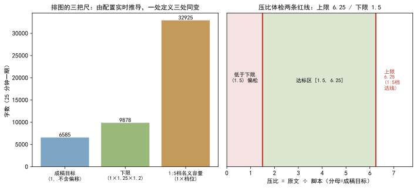  
*图 1：左为 25 分钟一期的字数三口径（成稿目标 6585 / 下限 9877 / 1:5 档名义容量 32925，均由配置时长与档位推导）；右为压比体检两条红线，分母＝成稿目标，达标区 [1.5, 6.25]，上限 6.25（1:5 档达线）。*

**字数口径实测**（数据源 [1][6]）：下限由旧「裸成稿 × 1.2 = 7902 字」修正为「成稿 × 1.25 × 1.2 = 9877 字」；模型产出与素材 1:1 消耗实测 4034 ÷ 4132 ≈ 0.98，支撑「下限 1.2 是实测值、不留余量则写不满」。有效字换算的口径也一并给出：汉字记 1、标点记 0.5、西文记 1.5——256 字/分的朗读口径先按汉字量出，再折成有效字才与估时基准同轴，两套口径不折算就对不上。

**校准系数分布**（数据源 [4]，`calibration.json`）：已校准音色组的时长系数 k 围绕基准 `STANDARD_K=4.39` 波动，区间 4.47–5.35、均值约 4.92，不同音色互不污染；`chars_for_target` 由目标时长反推目标有效字数（L1 单参数 `t = 有效字 / (k·speed)`，L2 三参数最小二乘），改一个基准全项目脚本估时同步变。

  
*图 2：按（引擎·音色·语速）分组的校准系数 k 分布（数据源 `calibration.json`）。k 围绕脚本估时基准 4.39 波动，印证「尺子与音色无关、只在基准上做比例换算」的设计——这也是压比口径能脱离具体音色成立的前提。*

**配置一处定义**（数据源 [5]）：`script.map_max_episodes` 在 `config_manager` 一处定义，单测设版本一致钉，保证上限口径与界面、架构文档同源；`planned_episodes` 人填优先、重排不覆盖的纪律由 `project_store` 同一处落库 [3][5]。

**标定实验设计**（复跑条件：`calibration.json` 已校准组 + 真机合成，数据源 [4]）：k 的实测五件套——**目的**：把「4 字/秒」这类拍脑袋系数换成可复跑的测量；**输入**：本机 391 句真实合成音频与逐句文本；**步骤**：合成 → 实测逐句时长 → 汉字换算有效字（汉字 + 0.5×标点 + 1.5×西文）→ 逐句配对最小二乘拟合 → EMA 平滑写回；**观测**：8541 汉字 / 2005.0 秒 = 256 字/分，折有效字后 k≈4.39；**判定**：k 落在朗读口径中位邻域才算标定成立，逐句残差过大即回炉。此后每个（引擎·音色·语速）组合各自积累自己的 k，`chars_for_target` 反推字数全项目同步变 [4]。1:1 消耗口径同法可测：任取一期，成稿字数 ÷ 消耗素材字数 = 4034 ÷ 4132 ≈ 0.98，支撑「下限 1.2 不留余量写不满」[1]。两个实测——k 的分组分布与 0.98 的消耗比——共同构成「容量口径必须由配置推导」的证据底座：系数靠拍脑袋，口径就永远对不上真实产能。

## 七、结语：一句话可复用结论

期数是合并与切分的结构结果，不是除法的商；尺子由配置实时推导、一处定义三处同变——模型只做凝缩与分组，不动期数这根弦。把这两件事分清楚，画地图的才既不是朗读者，也不是算盘。
## 引用与出处说明

| 编号 | 引用 | 出处 |
|------|------|------|
| [1] | 容量口径法源：1=输出max=每期时长×脚本估时基准；x=输入max=1×1.25×档位；下限=1×1.25×1.2（25 分钟一期≈9877 字）；压比体检分母=成稿目标，上限 6.25 / 下限 1.5；1:1 消耗实测 4034÷4132≈0.98；旧下限 7902→9877 | podcast-maker · CHANGELOG.md · v0.10.0 · 新增/变更/修复/说明段<br>`podcast_maker/probe.py`（target_chars:461 / offset_chars:471 / capacity:500 / MIN_RATIO:458） |
| [2] | `estimate_episodes` 只做期数参照、不参与决定排几期；期数是合并与切分的结果，拿容量除总字数是除法（朗读软件干的事） | `podcast_maker/probe.py:estimate_episodes`（行 520–525，docstring 钉死口径） |
| [3] | 计划期数三态输入（填数/清空/地图回填）；产能预检护栏（撑不起则凝缩前中止、回报最多期数）；`script.map_max_episodes` 上限截断；「去改排图依据」按钮；人填优先、重排不覆盖 | podcast-maker · CHANGELOG.md · v1.4.0 · 新增/变更段<br>`podcast_maker/planner.py`（行 585–633，产能预检与上限截断）/ `project_store.py`（planned_episodes 落库纪律） |
| [4] | 时长校准闭环：合成实测→逐句拟合→EMA 写回，按（引擎·音色·语速）分组互不污染；STANDARD_K≈4.39（256 字/分朗读口径中位 + 本机 391 句实测 8541 汉字/2005s，有效字换算 1.029）；chars_for_target 由目标时长反推字数 | `podcast_maker/duration_model.py`（STANDARD_K:56–58 / chars_for_target:298）<br>calibration.json（已校准组 k 分布，项目实证） |
| [5] | 配置项由 `config_manager._p` 一处定义（如 `script.map_max_episodes` 整型默认 60、1–500）；版本一致钉保证口径同源 | `podcast_maker/config_manager.py`（行 637，PARAM_SPEC 一处定义）<br>`tests/test_config_keys.py`（版本一致钉） |
| [6] | 下限公式修正：裸成稿×1.2=7902 字 → 成稿×1.25×1.2=9877 字；容量全部由配置实时推导、旧档案与地图不受影响 | podcast-maker · CHANGELOG.md · v0.10.0 · 变更段「下限算式修正」/ 说明段「已有项目无需迁移」 |

## 延伸阅读

- **同书其他篇**：#2《配置总表如何同时驱动界面与管线》讲这张配置表怎么一处定义、同时喂给界面与管线；本篇的 `script.map_max_episodes`、`duration_model.STANDARD_K` 都是那张表的同一条纪律——期数与时长这两根弦，也由它一处定。

# 第 III 部 声音与音频：把不确定的嗓固定成可复现的波形

> TTS 显存、音色漂移、种子、VoiceDesign、响度、stdout、声门第 9 维、ref_base——把"声音"当工程做。

## 本部篇目

| 篇 | 章题 |
|---|---|
| 13 | 本地 TTS 显存管理：从黑窗、孤儿进程到 Job 对象 |
| 14 | 音色漂移检测：从三维合验到五族合验 |
| 15 | 种子确定性派生的双刃剑：坏句重跑不变怎么破 |
| 16 | VoiceDesign 造嗓草稿流：为什么先落草稿再入库 |
| 17 | 音频入库即响度归一：11.7 dB 极差收敛到 -23±0.22 dBFS |
| 18 | stdout 纪律：结果通道为什么只能有一行 JSON |
| 19 | 声门三件套与傅里叶域分段：第 9 维的原理、公式与实测 |
| 20 | ref_base 版本账本：换嗓串嗓事故的 sign 后缀与角色账本 |

## 怎么读

- 13（显存管理）与 18（stdout 纪律）是本部两条底座纪律，其余六篇都依赖它们——先读 13、18 再读其余，顺序感最强。
- 17/19 含实测数字，速查版见附录 B。

# 第 III 部 · 13｜本地语音服务的显存为什么越占越多：黑窗、孤儿进程与 Job 对象

## 一、引子：真实起点

本地 TTS 跑批，用户合上笔记本前顺手关了主窗口，第二天再开，显卡风扇狂转——任务管理器里躺着两三个 `python` 进程，各占着几 G 显存，实际早已没有一期刊物在生成。

另一类反馈更直接：每次点「合成」，屏幕正中央弹出一个黑色控制台窗口，从开工挂到收工，刚好挡在字幕预览上。合成完它自己消失，但下一次又来。

这两件事看起来不相关：一个在后台偷显存，一个在前面挡视线。查下来是同一个源头的两种表现——本地语音服务作为**独立进程**被拉起时，Windows 的两套默认规则没被覆盖。

## 二、现象：两种失败形态

**形态 A · 黑窗**：每次合成，一个黑色控制台窗口随服务进程弹出，合成期间常驻前台。根因在控制台窗口的继承规则，与显存无关，但体验上最扎眼。

另有一处同根的症状：服务每次回 `/health` 探活都要 spawn 两次 `nvidia-smi` 量显存，单次合成与试听路径每次查询就各弹一次黑窗——不是合成才弹，是每次探活都弹，积少成多更烦。

**形态 B · 孤儿进程 + 显存泄漏**：主程序被强杀（关窗、崩溃、任务管理器「结束任务」）后，语音服务进程照常活着，带着已加载的权重继续占着数 G 显存，不释放。下次启动又拉一个，越积越多，直到显存耗尽、新合成失败。

表 1 把两类失败并排，便于看清它们各自对应哪条 Windows 规则。

| 维度 | 形态 A · 黑窗 | 形态 B · 孤儿进程 + 显存泄漏 |
|---|---|---|
| 可见表现 | 合成时弹黑色控制台窗口挡视线 | 主程序死后服务进程仍在，占显存 |
| 触及的 Windows 规则 | 控制台窗口的继承/创建规则 | 进程无「父死子亡」默认语义 |
| 旧凑法 | `DETACHED_PROCESS` | 主程序退出时手动 `kill` |
| 旧凑法的代价 | 反而更稳地弹窗（见第三节） | 主程序被强杀时根本没机会执行清理，kill 不到真身 |

**形态 C · 起服务锁死整页状态接口**：`acquire_service` 原本把 `_spawn_service`（内含最长 90 秒的 `_wait_ready`）整个包在 `_SERVICE_LOCK` 里——而这把锁同时护着所有读锁入口（状态接口、试听取标尺等）。起服务期间，任何读锁请求都排队等这把锁，界面观感即整页卡死 [6]。

**形态 D · 标定与音色工具未腾显存，参考音频在 CPU 上生成**：`unload_llm_models()` 全仓原来只在 `synthesize()` 内调一处，标定（`api_voice_calibrate`）、标尺构建（`_std_ruler_synth`）、四处音色工具（认领 / 声库认领 / 录制 / 造嗓，经 `make_voice.py` 子进程进 `make_base_ref.build`）这三类链都没调它 [7]。音色工具的显存判定发生在**子进程**内、按整卡空闲内存挑设备（门槛 5300 MB），LM Studio 驻留期间静默退回 CPU；而 CPU 与 CUDA 两条路径产出**不是同一条波形**（同一输入 md5 不同）[7]。后果：标定量得的语速与成片实际语速可能不同源，生成的 `ref_base` 与成片不在同一波形上。证据：本项目 `音色/` 下 14 份 `ref_base` 记录里 7 份 `device: cpu`、7 份 `cuda`，同一小时内反复横跳 [7]。

表 2 把 v2.10.0 修的两处并排，看清它们各自对应哪条机制。

| 维度 | 形态 C · 起服务锁死整页 | 形态 D · 标定 / 音色工具未腾显存 |
|---|---|---|
| 可见表现 | 起服务期间整页状态接口排队卡死 | `ref_base` 偶发在 CPU 上生成、与成片不同波形 |
| 触及的机制 | `_SERVICE_LOCK` 把起服务（含 90s 等待）与所有读锁入口串行 | 子进程设备判定不看主进程已占显存，静默退 CPU |
| 旧凑法 | 起服务直接包在锁内 | 只在 `synthesize` 内腾显存 |
| 旧凑法的代价 | 读锁入口全陪等 90 秒 | 标定 / 成片不同源、`ref_base` 波形漂移 |

## 三、错误尝试：曾经怎么凑

**黑窗一侧，先试了 `DETACHED_PROCESS`**——它的语义是「新进程没有控制台」。结果黑窗反而以另一种方式出现：语音服务自身确实无台，但服务是被 venv 的 `Scripts\python.exe` 启动器再拉起真身解释器的中间层。DETACHED 这个标志不向启动器向下透传，真身解释器发现自己没台可继承，就**自建一个新控制台**——黑窗照弹。

这带来两处具体后果：批量路径下服务要等整批 batch 收工才释放，黑窗从合成开工一直挂到收工；试听路径每次探活都 spawn `nvidia-smi`，于是每次查询再闪一个窗——黑窗不是一次，是每次探活都来一次。

**孤儿一侧，先试在主程序退出时手动 `proc.kill()` / `terminate()`**。两个缺口让它不可靠：其一，主程序握着的柄是 venv 启动器，不是真身解释器，kill 启动器不等于 kill 真身；其二，主程序被强杀（崩溃、任务管理器）时，清理代码根本没机会跑。再退一步想遍历子进程树挨个杀，又撞上 pid 重用与竞态——前一秒的 pid 下一秒可能是别的程序。

第一点值得展开：venv 的 `Scripts\python.exe` 只是个启动器，运行时会再 `exec` 一次真正的解释器；主程序 `kill` 掉的是启动器，真身早已独立运行、带着已加载权重继续占显存——这正是「杀了父没杀到子」的具象。也正因为这层中间层，强杀主程序时清理回调根本触不到真身，孤儿就这么来的。

**起服务一侧，旧做法是把 `_spawn_service` 整个塞进 `_SERVICE_LOCK`**——锁的初衷是护住服务状态槽的并发写，但起服务自带的 90 秒 `_wait_ready` 也被一起锁住，读锁入口在锁外干等 [6]。这不是「锁错了对象」，而是锁的粒度没把「起服务」与「读状态」分开。

**腾显存一侧，旧做法是只在 `synthesize()` 内调一次 `unload_llm_models()`**——标定与音色工具走的是另一批入口，根本不经过它；子进程里的设备判定又只看整卡空闲内存，主进程已占的显存它看不见 [7]。两条链各算各的，显存该腾没腾。

## 四、根因：Windows 的两套默认规则

先看清本地语音服务的进程关系——它不是「主程序拉一个服务」那么简单，中间隔着 venv 启动器：

| 结构 | 进程链 | 主程序被强杀后 |
|---|---|---|
| 无 Job 绑定 | 主程序 → venv 启动器（`Scripts\python.exe`）→ 真身解释器 → 语音服务（持显存） | 启动器与真身不归主程序管，服务照活，显存不还 |
| 有 Job 绑定 | 上述整条链被 `AssignProcessToJobObject` 关进同一 Job | 内核关 Job 句柄即杀整棵树，显存必还 |

这张表也是后面修法的落点：黑窗要管的是「控制台谁继承」，孤儿要管的是「这条链归谁回收」。

**黑窗根因**：Windows 下 `subprocess` 起进程，若不显式给 `CREATE_NO_WINDOW`，子进程（及其再拉的真身）按默认规则尝试继承或创建控制台。`DETACHED_PROCESS` 让「服务自身」断开控制台，却因不向下透传，把建台的任务甩给了真身解释器。真正的修法是给一个**隐藏但存在**的控制台——启动器与真身都继承这同一个隐藏台，谁也不弹窗。

**孤儿根因**：Windows 进程没有「父死子亡」的默认语义。语音服务是独立进程（自己的进程组），父进程（主程序）死了它照活。显存绑定在服务进程的 GPU 地址空间，进程不死，显存就不还。要回收，必须有一个比「父进程退出回调」更硬的抓手——而 Windows 内核恰好提供：把进程挂进 **Job 对象**后，Job 句柄关闭时内核会杀掉 Job 内整棵树，这不受主程序是否还能执行代码影响。

旧的清理脚本也救不了这个局面：重启时的清理只按 `main.py` 命令行匹配进程，根本匹配不到 `serve.py` 拉起的服务，所以孤儿清不掉、显存还不了，只能人去任务管理器手动杀——这正是「谁起的谁关」约定没有内核级兜底时的典型下场。

两个术语首次出现，各给一句展开：**Job 对象**是 Windows 内核的一种容器对象，把一组进程绑在一起，容器关闭时里面的进程全部终止——好比把服务进程和真身解释器关进同一个笼子，笼门一关全死；**孤儿进程**是父进程已退出但子进程还活着的进程，本篇里即主程序被关、语音服务仍在后台占显存的那一个。

**形态 C 根因**：`_SERVICE_LOCK` 的持有区间覆盖了「起服务」这一长耗时动作，而读锁入口与起服务共用同一把锁——锁的粒度错配，把局部串行放大成全局串行 [6]。

**形态 D 根因**：腾显存动作与「谁在合成」绑定，而不是与「任何要占用 GPU 的本地推理」绑定；且设备判定发生在子进程边界内，无法感知主进程已占用的显存，于是 LM Studio 驻留期间静默退 CPU，CPU / CUDA 两条路径波形不同源 [7]。

## 五、正确修法：Job 绑定 + CREATE_NO_WINDOW

黑窗一侧，启动服务时给进程创建标志 `CREATE_NEW_PROCESS_GROUP | CREATE_NO_WINDOW`（仅 Windows），全链路隐藏控制台：

```python
# podcast_maker/tts_engine.py —— 拉起本地语音服务
# 用 CREATE_NO_WINDOW（隐藏控制台）而不是 DETACHED_PROCESS：DETACHED 下
# 服务自身没有控制台，venv 启动器（Scripts\python.exe）再拉真身解释器时
# 不透传这个标志，真身发现自己没台可继承就自建一个新控制台——黑窗从合成
# 开工一直挂到收工。隐藏控制台则全链路都有台可继承，谁也弹不出来。
flags = 0
if os.name == "nt":
    flags = (subprocess.CREATE_NEW_PROCESS_GROUP | subprocess.CREATE_NO_WINDOW)
proc = subprocess.Popen([py, serve, "--host", host, "--port", str(port)],
                        cwd=svc, stdout=fh, stderr=subprocess.STDOUT,
                        stdin=subprocess.DEVNULL, creationflags=flags)
```

孤儿一侧，服务进程起来后立刻挂进 Job 对象，设 `KILL_ON_JOB_CLOSE`：

```python
# podcast_maker/tts_engine.py —— Job 对象绑定
_JOB_KILL_ON_CLOSE = 0x2000      # JOB_OBJECT_LIMIT_KILL_ON_JOB_CLOSE
_JOB_EXTENDED_LIMIT_INFO = 9     # JobObjectExtendedLimitInformation

def _job_assign(proc, log=None):
    """Windows：把服务进程挂进一个随主进程存亡的 Job 对象。
    服务是独立进程（自己的隐藏控制台，没有 Job 绑定时父进程死了它照活），
    主程序若被强杀（关窗、崩溃、任务管理器），它会带着已加载的权重变孤儿，
    几个 G 显存一直占着。挂进 Job 并设 KILL_ON_JOB_CLOSE 后，内核在收走
    主进程时自动关闭 Job 句柄，一并终止 Job 里整棵进程树（venv 启动器拉起
    的真身解释器自动继承成员资格）——显存必还，不留孤儿。"""
    k32 = ctypes.windll.kernel32
    job = k32.CreateJobObjectW(None, None)
    info.BasicLimitInformation.LimitFlags = _JOB_KILL_ON_CLOSE
    k32.SetInformationJobObject(job, _JOB_EXTENDED_LIMIT_INFO,
                                ctypes.byref(info), ctypes.sizeof(info))
    ph = k32.OpenProcess(0x0100 | 0x0001, False, proc.pid)
    k32.AssignProcessToJobObject(job, ctypes.c_void_p(int(ph)))
    return job   # 句柄关闭交给 _job_close
```

挂 Job 之前，`_job_assign` 先把 `JOB_OBJECT_LIMIT_KILL_ON_JOB_CLOSE` 写进 `EXTENDED_LIMIT_INFORMATION` 结构的 `BasicLimitInformation.LimitFlags`，再交给 `SetInformationJobObject`——这段 ctypes 结构（`IO_COUNTERS` / `BASIC_LIMIT` / `EXT_LIMIT`）就是 Windows 要求的入参形状，缺了它内核不认这个标志：

```python
# podcast_maker/tts_engine.py —— Job 扩展限额结构（ctypes）
class EXT_LIMIT(ctypes.Structure):
    _fields_ = [
        ("BasicLimitInformation", BASIC_LIMIT),   # 内含 LimitFlags
        ("IoInfo", IO_COUNTERS),
        ("ProcessMemoryLimit", ctypes.c_size_t),
        ("JobMemoryLimit", ctypes.c_size_t),
        ("PeakProcessMemoryUsed", ctypes.c_size_t),
        ("PeakJobMemoryUsed", ctypes.c_size_t),
    ]
```

句柄的关闭由 `_job_close` 独立负责，正常收工是「先 `_kill(proc)` 再关句柄」双保险；异常路径下句柄随主进程被内核收走，同样触发 `KILL_ON_JOB_CLOSE`：

```python
# podcast_maker/tts_engine.py —— Job 句柄关闭（双保险）
def _job_close(job):
    """关掉 Job 句柄。KILL_ON_JOB_CLOSE 生效时，句柄一关内核清掉整棵进程树。
    正常收工路径先 _kill(proc) 再关句柄，双保险；句柄无效或非 Windows 什么都不做。"""
    if job and os.name == "nt":
        ctypes.windll.kernel32.CloseHandle(job)
```

服务进程本身由 `venv_python()` 拉起（:480）——这正是一、四节说的 venv 启动器中间层：主程序调 `_spawn_service`，它取 venv 解释器路径再去 `Popen` 真身服务，三层进程（主程序 → venv 启动器 → 真身解释器 → 语音服务）整条挂进同一个 Job，谁都不漏。

挂柄时还有两个细节值得记：`_job_assign` 优先取 `Popen` 在 Windows 上存好的原始进程柄 `proc._handle`（:451），免得再去 `OpenProcess`——后者要 `SET_QUOTA|TERMINATE` 权限才能挂 Job；若 `AssignProcessToJobObject` 失败，则先 `CloseHandle(job)` 再返回 `None`（:458-460），绝不留下一个半绑定的 Job 句柄。

两处都做了退化保护：非 Windows 平台 `_job_assign` 返回 `None`，行为退回从前，只少这层保险，不挡合成；内核调用失败同样返回 `None`，不抛异常。`KILL_ON_JOB_CLOSE` 是 Job 的限制标志，Job 句柄一关闭，内核即杀掉 Job 内所有进程——这正是它比「父进程退出回调」硬的地方：主程序被强杀时没机会跑任何代码，内核照样收树。

**形态 C · 起服务移出业务锁**：`acquire_service`（:566）改用 `starting` 状态位 + 条件变量（`_SERVICE_LOCK` :264、`_SERVICE_CV` :268、`_SERVICE["starting"]` :270）：起服务移到锁外，只放一个线程去起，其余在「启动中」上等待；`release_service` 在启动完成后才裁决是否停机，避免「刚起好、引用计数已归零、无人停」的泄漏 [6]。

```python
# podcast_maker/tts_engine.py —— acquire_service 起服务移出锁
# 旧：_spawn_service(含 90s _wait_ready) 整个包在 _SERVICE_LOCK 内，
#     读锁入口一并等待 → 整页卡死。
# 新：starting 状态位 + 条件变量；只放一个线程去起，其余在「启动中」上等。
with _SERVICE_LOCK:
    if _SERVICE["starting"]:
        while _SERVICE["starting"]:
            _SERVICE_CV.wait()          # 已在起，排队等，不抢锁
        return _SERVICE["handle"]
    _SERVICE["starting"] = True
# —— 锁外起服务 ——
handle = _spawn_service(cfg, log)        # 90s _wait_ready 不占读锁
...
```

**形态 D · 标定与音色工具补腾显存**：`unload_llm_models()`（:193）接入 `api_voice_calibrate`（合成前，:1169）；新增 `web_ui._prep_voice_tool`（:1518），把腾显存与 `--device cuda` 一并加进四处音色工具 spawn；`tts_engine.ensure_voice_profiles`（:867）子进程命令行同步补 `--device cuda` [7]。同时把「生成设备」烙进校准表与标尺记录：`duration_model.calibrate`（:365）增 `device` / `backend` 两参随系数落盘，`Calibration._normalize`（:160）/`summary`（:185）在有值时带出；`tts_engine.running_device`（:141）向 `/health` 取设备、只认 `cuda` / `cpu` 两个真值 [8]。换设备即丢弃旧样本、本次直接起算，EMA 不混、L2 不并 [8]。

## 六、验证：四条测试钉

`tests/test_tts_engine.py` 在 v1.3.0 增设 Job 绑定 4 项钉，把上面的保证变成可回归的判据：

- `test_service_slot_has_job`（:734）：服务状态槽必须有 `job` 位、且初始为空——挂载前的契约，防「忘了挂 Job 却以为挂了」。
- `test_job_close_none_is_noop`（:738）：关 `None` 句柄不抛即过——退化路径（非 Windows / 挂载失败返回 None）不挡合成。
- `test_kill_on_job_close_reaps_child`（:741）：**核心保证**——句柄一关，内核杀掉 Job 里的子进程，不留孤儿。复现逻辑：以 `CREATE_NEW_PROCESS_GROUP | CREATE_NO_WINDOW` 起一个 `time.sleep(30)` 的子进程，挂进 Job，随后关句柄；8 秒内轮询断言 `proc.poll()` 返回非 `None`（进程已死）。它验证的不是「能杀」，而是「父程序已没机会跑代码时，内核仍收树」——这才是孤儿问题的真正抓手。
- `test_job_assign_dead_process_returns_none`（:765）：死进程（已 `wait` 结束）挂不进 Job 时返回 `None` 而非抛异常——挂载失败不挡合成，也不漏杀。

实验设计可复现：拉起服务 → 记录 pid 与显存占用 → 强杀主程序 → 观测服务进程是否还在、显存是否归还。判定「服务进程树消失 + 显存归零」为 PASS。v1.3.0 该批测试随全仓 **1311 项**单测一并通过。

**起服务锁与设备落表（v2.10.0）**：

- `tests/test_tts_engine.py::TestRunningDevice`（:131）4 条：真实设备与后端、占位「未加载」返回空、服务离线返回空、探测异常返回空 [8]。
- `tests/test_duration_model.py::TestCalibrateDevice`（:147）6 条：设备与后端随系数落盘、同设备样本累加、换设备丢弃旧样本、本次缺设备沿用上一条、`summary` 带出设备与后端、旧数据不凭空出现该键 [8]。
- `tests/test_preview_standard.py::TestVoiceToolPrep`（:587）3 条：腾显存后加 `--device cuda`、已带该参数则不重复加、四处音色工具 spawn 全部经过该函数；`TestVoiceCalibrate`（:679）本地引擎 1 条：先腾显存、设备与后端随系数落表 [7]。
- 腾显存与设备落表落地后复跑全量 **1596** 通过（skipped=1）[7]。

## 七、结语：一句话收束

本地 TTS 的显存越占越多，不是模型漏了释放调用，而是 Windows 进程默认「父死子不亡」、控制台默认「要弹就弹」——用 Job 对象把回收权交给内核、用 CREATE_NO_WINDOW 把控制台藏进继承链，两类副作用一次归零，且非 Windows 安静退化、不挡合成。

顺带一提，这次修法没有动服务的拉起与释放时机——仍是首次合成开工才 spawn、batch 收工 `release_service` 照常停服还显存；Job 只是主程序死亡时的内核保险，正常路径该谁关谁关，不抢戏、不耦合。

v2.10.0 又补两处：起服务移出业务锁，不让 90 秒等待串行化整页读锁；标定与音色工具补腾显存并烙设备身份，让标定与成片、`ref_base` 始终同源同波形——显存管理从「进程级回收」进一步收到「每次本地推理前的设备归位」。

## 引用与出处说明

| 编号 | 论点 | 出处 |
|---|---|---|
| [1] | 黑窗根因：DETACHED 不透传、真身自建控制台；CREATE_NO_WINDOW 全链路继承 | `podcast_maker/tts_engine.py:496-499` |
| [2] | 孤儿根因：独立进程无「父死子亡」语义，显存随进程存活 | `podcast_maker/tts_engine.py:392-396`（`_job_assign` 文档） |
| [3] | Job 绑定实现：`_JOB_KILL_ON_CLOSE` / `_job_assign` / `AssignProcessToJobObject` | `podcast_maker/tts_engine.py:385-462` |
| [4] | 启动服务 flags：`CREATE_NEW_PROCESS_GROUP \| CREATE_NO_WINDOW` | `podcast_maker/tts_engine.py:495-511` |
| [5] | 测试钉：Job 绑定 4 项（v1.3.0 增设）+ 全仓 1311 项通过 | `podcast-maker · CHANGELOG.md · v1.3.0 · 测试段`；`tests/test_tts_engine.py:734-773` |

| [6] | 起服务锁死整页：acquire_service 把 _spawn_service(含 90s _wait_ready) 包在 _SERVICE_LOCK 内，读锁入口陪等；改为 starting 状态位 + 条件变量，起服务移出锁 | podcast-maker · CHANGELOG.md · v2.10.0 · 条目「一次起服务锁死整页状态接口」<br>`podcast_maker/tts_engine.py:acquire_service`(:566)/`_SERVICE_LOCK`(:264) |
| [7] | 标定与音色工具未腾显存：unload_llm_models 只接 synthesize；子进程设备判定退 CPU、CPU/CUDA 波形不同源；修复接入 api_voice_calibrate + web_ui._prep_voice_tool + ensure_voice_profiles --device cuda；全量 1596 通过 | podcast-maker · CHANGELOG.md · v2.10.0 · 条目「标定与音色工具未腾显存，参考音频可能在 CPU 上生成」<br>`podcast_maker/tts_engine.py:unload_llm_models`(:193)；`podcast_maker/web_ui.py:_prep_voice_tool`(:1518) |
| [8] | 校准表 / 标尺记录生成设备落表：duration_model.calibrate 增 device/backend 随系数落盘、换设备丢弃旧样本；tts_engine.running_device 向 /health 取设备；全量 1596 通过 | podcast-maker · CHANGELOG.md · v2.10.0 · 条目「校准表与标尺记录生成设备，换档即失效」<br>`podcast_maker/duration_model.py:calibrate`(:365)；`podcast_maker/tts_engine.py:running_device`(:141) |

## 延伸阅读

- `tests/test_tts_engine.py`：Job 绑定四条测试即用本文结论作判据，与本文互为印证。
- `podcast_maker/tts_engine.py` 服务拉起与 `_job_close`：句柄生命周期与退化路径的完整实现。

# 第 III 部 · 14｜音色漂移检测：从三维合验到五族合验

## 一、引子：真实起点

克隆音色靠一条参考音频加文本，确定性地派生种子做逐句抽样。问题在 v1.1.0 之前就存在：个别句子音色会悄悄漂移，而系统里没有一个判定者——漂移句直接进入成片 [1]。

实测 2c 期 253 句中，有 4 句（0093 / 0101 / 0135 / 0157）达到「近换人」的程度，既有 `looks_degenerate` 只判时长失控，音色维度没有任何检测 [1]。一句原角色的声音，被一两句「变了个嗓」的句子混在成片里，听者能听出不对，程序却指不出来。

## 二、现象：它到底长什么样

把早期三维体检的放行记录拉出来看，放行了人耳判坏的候选——这是故障的表象。

2da 期 0054 句，三维分只有 2.76，远低于阈值 4.25，本应被放过。分频带剖面却显示：300–600 Hz 抬升、600–2400 Hz 掏空、2.4–4.8 kHz 存在感频带 +4.6σ（全期 102 句 B 中唯一过 +3σ）——频谱形状整体重分布，而谱心是加权平均位置，对形状搬移结构性失明 [2]。

更隐蔽的在四维验收下仍漏：第 3 期 0058_B 四维 3.94 < 4.25 判「已修复」，人耳复核却仍不是原角色——总分下降全部来自谱心与存在感变贴，基频反而从 213 Hz 塌到 208.5 Hz（−2.75σ）[3]。判分说「好了」，耳朵说「不是他」。

## 三、错误尝试：我们怎么绕弯的

绕弯有过一条路：用一把加权总分兜住所有偏移。把谱心、基频、响度各量一个 z 值，按权重求和成一个分，超阈值就点名——指望这个分能同时捕捉所有方向的漂移 [1]。

这条路的盲区很快暴露。坏样本属于两个**交互族**：其一「基频下偏 × 基音抖动升高」（低音且不稳，病态嗓），其二「基频下偏 × 低频饱满」（单薄变饱满，音色身份漂移）[3]。加权总分把多维偏移摊薄，两个维度的联合偏移被其余贴合维度稀释后低于阈值；而既有维度全是单维统计量，根本不度量维度之间的关系 [3]。曾有人提过「单维上限」方案，覆盖的案例后来全部由身份下限接管，于是删除 [3]。

> **加权分**：把若干维度的 z 归一值按权重求和成一个总分，超阈值即点名。它是合验的第一代武器，也是本文要拆解的对象。
> **基线**：按角色各自建立的均值与标准差，z 归一用的标尺——不同角色各算各的，不混算。

## 四、根因：为什么

根因一句话：合验的第一代武器（加权总分）是单维统计量的线性组合，对两类盲区束手无策——**维度间交互**与**频谱形状重分布**。

谱心是加权平均位置，形状搬移时位置未必大动（2da 0054 即是）；加权求和又把联合偏移稀释（0058_B 即是）。两个盲区同源：检测器量的是「每个维度的位置」，不是「维度之间的关係」与「形状的整体搬移」。只要检测器还停在「逐维看位置」，它就接不住人耳听的「整段声音是不是同一个人」。

## 五、正确修法：怎么做对的

修复口径不是「再加一个维度」，而是把合验的武器从「逐维位置」换到「关系、形状、声源/声道分离」三层。演进四步，每一步都对应前面漏掉的一类盲区。

### 5.1 维度扩展的时间线

```text
v1.1.0  三维：谱心×1.0 + 基频×0.8 + 响度×0.4        → 加权分 ≥ 4.25 点名
v1.2.0  四维：+ 存在感频带 2.4–4.8kHz 单边加权         → 补频谱形状盲区
v1.3.0  六维测量 + 三判据合验：+ <300Hz能量 + 抖动；暗淡子分 / 身份下限
v1.7.2  五族换芯：旧四维分(谱心单项截断) + 缺亮音 + 低频双向 + 声纹嵌入 + 音高偏移EMA
                                                  （另：女声源-滤波声门三件套原样保留）
```

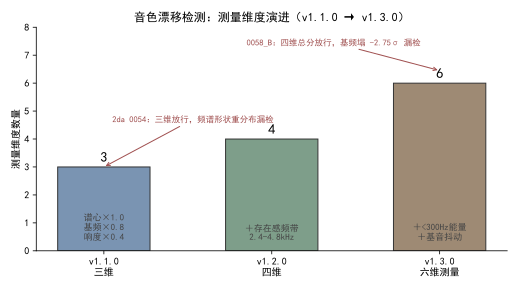  
*图 1：测量维度数从三维长到六维，每一次扩展都对应一次漏检事故。红标＝加权分放行、人耳判坏的候选（2da 0054 / 0058_B）。数据源 [1][2][3]。*

### 5.2 三步扩展各自补的盲区

- **v1.2.0 四维**：`_timbre_features` 新增存在感频带（原始采样率上整段加 hanning 窗，取功率谱 2.4–4.8 kHz 能量占比；必须在降采样之前量，降到 16k 后 Nyquist 不足，带内形状会变）。`_timbre_score` 追加 `0.5 × max(0, z存在感)` 单边加权——占比偏低属音色自然差异不点名，只计刺耳方向 [2]。
- **v1.3.0 六维测量 + 三判据合验**：测量再扩 `<300 Hz` 能量占比与基音抖动 jitter；新增**暗淡子分** `max(0, z基频下偏) + max(0, z谱心变暗) + 0.6 × max(0, z抖动)`（阈值 4.9），专抓「基频下偏 × 抖动升高」病态嗓；新增**身份下限**（基频 ≤ −2.4σ，或基频 ≤ −2.0σ 且 <300 Hz 占比 ≥ +1.5σ），专抓「基频下偏 × 低频饱满」身份漂移族 [3]。三判据任一命中即点名，**候选验收与检测共用同一把尺**——重出候选必须三项全过才转正 [3]。
- **v1.7.2 五族换芯**：`_timbre_capture` 把判据扩成五族合验（见下表），并把谱心项改成 `max(0,·)` 单向截断，让「亮漂」不再抵消音高偏离 [4]。

| 族 | 量 | 口径 / 阈值 |
|---|---|---|
| ① 旧四维分 | 谱心×1.0 + 基频×0.8 + 响度×0.4 + 存在感单边 | 加权分 ≥ 4.25（谱心项改单向截断） |
| ② 缺亮音 | 谱心暗漂 | `tts.timbre_cent_dark`=1.5，单向 |
| ③ 低频双向 | `<300 Hz` 能量占比偏移 | `tts.s300_band`=1.5，双向 |
| ④ 声纹嵌入 | wavlm 余弦相似度 | `tts.sv_guard`=True，`sim < tts.sv_sim`=0.90 点名，时长门 `tts.sv_min_seconds`=4.0 s |
| ⑤ 音高偏移 | 每期 o EMA | 冷启动取前 10 合格句中位、更新门 1.5 半音、硬钳位 ±2.5 半音 |

*表 1：五族合验家族（v1.7.2）。女声三件套（声门，源-滤波）原样保留，不计入五族编号 [4][6]。*

### 5.3 第 9 维：用源-滤波模型把声源与声道分开

前五族仍在「逐维位置」层面工作。真正把声源与声道切开的是第 9 维（v2.3.0），它用**源-滤波模型**让检测对基频免疫。

> **源-滤波模型（Fant 1960）**：语音 = 声源（声门）激励 × 声道（滤波）响应。时域 `s = e * h`（卷积）→ 频域 `S(f) = E(f) · H(f)`（相乘）→ 取对数 `log|S| = log|E| + log|H|`。`log|H|` 是慢变的谱包络 = 声道形状 = 音色；`log|E|` 是快变的谐波梳 = 基频 = 音高。取对数把相乘变相加，再对 log 谱做低通 liftering（倒谱）分离两者：低 quefrency = 声道包络（几乎不随音高变），高 quefrency = 基频周期（quefrency 上 1/F0 处峰）[5]。

第 9 维三量都建立在这个分离之上（`podcast_maker/seg_incursion.py`）：

| # | 量 | 算法 | 对 F0 免疫机制 |
|---|---|---|---|
| ① `D_cep` 倒谱谱包络 | 帧平均幅度谱→`log10`→`irfft` 取倒谱→只留 quefrency<2 ms→`rfft` 回谱包络→13 个对数频点采样→逐点减自身均值（去增益与倾斜，只留共振峰形状）→与角色池逐系数 σ 归一求 RMS | `1/F0` 在 70~500 Hz 对应 2~14 ms，全被 lifter 切门外；形状量不含 F0 |
| ② `D_rel` 同句自比 | 被点名段包络 vs 同一句其它段中位包络（池 σ 归一） | 同上；另消句级通道/语速差异 |
| ③ `D_glot` 声门三件套 | 逐有声帧 CPP + HNR + H1\*–H2\* → 段内中位 → 角色池 μ/σ 归一 | 量的是声源，不是声道也不是音高 |

*表 2：第 9 维三量算法与对 F0 免疫机制（v2.3.0）[5]。*

三个量的公式口径：CPP = 倒谱峰相对回归线高度（Hillenbrand 1994）；`HNR = 10·log10(r/(1−r))` 归一化自相关峰（de Krom 1993 / Praat 口径）；`H1*–H2*` = F0、2F0 处幅度差再减掉倒谱包络在两点的落差（去声道影响）[6]。

```math
S(f) = E(f) · H(f)  →  log|S| = log|E| + log|H|  →  lifter(低quefrency) 分离声道/声源
```

真实签名（两个独立来源件同套）：CPP 0.56/0.62（池 0.28）、HNR 9.08/8.91（池 5.17）、H1\*–H2\* −4.32/−8.58（池 +1.06）→ 真混入；同人喊高三个量全贴池均值（抬音高不改声门开商）[6]。

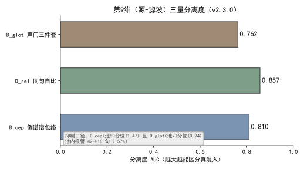  
*图 2：D_cep / D_rel / D_glot 的分离度 AUC，越大越能区分真混入；抑制口径 `D_cep < 池80分位(1.47) 且 D_glot < 池70分位(0.94)`，池内报警 42→18 句（−57%）。数据源 [6]。*

### 5.4 标尺、试听与标定的同源收束（v2.10.0）

第五族合验守的是「声音是不是同一个人」，但它依赖的标尺、试听与标定三件套本身也有同源问题——v2.10.0 把它们一并收束。

**现象**：① 全局唯一标尺 `previews/standard.wav` 文本与载体都取自首次生成的 A 角，A / B 试听只是同段音频快慢不同，听到的不是本人嗓子 [7]；② 试听分母用整段口径（`k = 有效字 ÷ 含句间停顿的整段时长`），而 `k_role` 是逐句口径（不含停顿），两端口径不一致，试听词速系统性偏快 **7.87%** [8]；③ 原标定参考取 `voice_profiles` 合成对、文本固定三句，与成片用的 `ref_base` 不是同一条嗓子，标定的语速对不上成片 [9]。

**根因**：标尺 / 试听 / 标定三处各自一套「参考与口径」，没有强制同源——标尺全局唯一不随角色走、试听分母与标定分母口径不一致、标定参考与成片参考分两套。三者任一不同源，人耳能听出的偏差就从这里漏 [7][8][9]。

**修法**（三项）：

- **标尺 A / B 分离**：`tts_engine.ruler_files`（:2174）按角色定文件名（`standard_A.wav` / `standard_B.wav` 及各自 json），`read_ruler`（:2270）/`standard_ruler`（:2305）增 `role` 参数、落盘 json 增 `role`；`_sentence_boundary_fracs`（:2215）由写死的三句占比改为按**传入文本**算；`web_ui._std_ruler_text`（:1028）读该角色 `ref.txt`、读不到退回标定文本兜底 [7]。旧 `previews/standard.wav` 保留在盘、代码不再引用。
- **句口径 k_sentence + 试听按角色分管**：`standard_ruler` 落盘增列 `k_sentence`（句子口径，构建时从刚写出的音频量得；旧尺子缺列时只读现量一次，量不出退回整段口径）；`api_preview_standard`（:1074）分母改用 `k_sentence`，`_get_std_ruler`（:1050）/`standard_payload`（:73）的 `k_sentence` 由单值改为 `{"A": …，"B": …}`，前端 `ratioNote` 按点位角色取对应分母——A / B 两条尺子文本与句间停顿各异，「整段 → 句口径」系数随之不同（实测旧尺 ×1.079、新 A ×1.112、新 B ×1.183），分母只能逐条实量 [8]。
- **标定改以 ref_base 为参考**：`tts_engine.voice_entity_ref`（:974）定位音色本体、`ensure_calib_ref`（:1049）缓存命中即用、缺则现场生成，落点 `<repo>/calib_refs/<角色>/<本体指纹前16>/`；标定参考取该角色 `base_wav`（`ref_base_<sign>.wav`）本尊、转录取单份 `ref.txt` 逐句合成；`api_voice_calibrate`（:1169）本地引擎分支、标定合成前先腾显存（见 #13）；`make_base_ref._gen_baseref`（:210）抽出候选挑选唯一实现，项目链（`build_role` :250）与标定链（`build_from` :343）共用，命令行 `--from-wav` / `--from-text` / `--out-dir` 脱离 `--project-dir` [9]。

## 六、验证：数据说话

四组证据，测量条件一并给出。

**耳标样本三判据合验 15/15**（v1.3.0）[3]：坏区 9 句全部命中——四维总分抓 3 句、暗淡子分抓 4 句、身份下限抓 3 句；放行区 6 句全部放过。这就是「从逐维位置换到关系/形状」后，人耳能听出的漂移终于被接住。

**第 3 期全体 B 角以三判据重判（只读，未动音频）**[3]：点名 0014_B（四维 4.18 + 暗淡 4.19 双放行，身份下偏 +2.53σ 抓获）与 0058_B（旧四维 3.93 放行，身份下偏 +2.75σ 抓获）；其余 135 句含旧修复 0205_B 全部放行，无误报。

**第 9 维分离度**（v2.3.0）[6]：D_cep AUC 0.810、D_rel 0.857、D_glot 0.762；抑制口径下池内报警 **42→18 句（−57%）**。顺带两件：第 8 维线定错（固定线 3.2≈中位数→报警 53%；改池 90 分位 z=5.73/4.27→报警 7%）；倍频嫌疑证伪（改用谐波梳命中率，`hit(f0/2)` 中位 0.50，≥0.83 段 0/74→真基频非倍频）。

**单测计数**：全量 v1.1.0 **1294** → v1.2.0 **1298** → v1.3.0 **1311** → v1.7.2 **1391**（判据换芯前 1359）[1][2][3][4]。第 9 维新增 `tests/test_timbre_guard.py::SegIncursionVetoTest`（8 条：两道否决零误伤钉、否决压不掉真混入的守卫、`flag()` veto 关键字兼容、calibrate 句数门）与 `SegIncursionDimsTest`（合成 150 Hz 谐波 wav 钉段级行结构与 f0 读数）[6]。

**标尺 / 试听 / 标定同源（v2.10.0）**：

- `tests/test_preview_standard.py::TestStandardPayload`（:301）4 条：尺子在场时 `k` 与 `k_sentence` 一并下发且不等、旧尺子缺列如实退回整段口径、尺子不在场不含 `k_sentence`、读尺子抛异常降级只报 `k` [8]。
- `tests/test_preview_standard.py::TestRulerCarrierPinned`（:494）2 条：构建路径烙设备与后端、只读路径不探测服务 [7]。
- `tests/test_preview_standard.py` 另增 5 条：A / B 两尺子各占文件名、写入互不覆盖、只读各取自己那条、文本随角色落到各自 json、`_sentence_boundary_fracs` 按传入文本算 [7]。
- `tests/test_tts_engine.py::TestVoiceEntityRef`（:832）4 条、`TestCalibRef`（:867）4 条；`TestScriptPins` 增 2 条（`ref_base` 候选挑选唯一实现、命令行留出脱离项目那一路）[9]。
- 尺子 A / B 分离与标定改参考后复跑全量 **1601** 通过（skipped=1）；标定脱离项目后全量 **1612** 通过（skipped=1）[7][9]。

## 七、结语：一句话可复用结论

音色漂移检测不是「多加维度」，而是把合验的武器从「每个维度的位置」换成「维度之间的关系、形状的整体搬移、以及声源与声道的分离」。维度从三维长到五族合验，第 9 维再切开源-滤波——合验才接住了人耳能听出的漂移。

v2.10.0 把守着「声音是不是同一个人」的标尺、试听与标定三件套也收了同源——标尺按角色各念各的 `ref.txt`、试听分母逐条实量到句口径、标定直接以 `ref_base` 本尊为参考，让「检测的同源性」从合验判据一路贯穿到测量与标定的源头。

## 引用与出处说明

| 编号 | 引用 | 出处 |
|------|------|------|
| [1] | v1.1.0 新增音色体检：逐句基频中位/谱心/响度三维；加权分 谱心×1.0+基频×0.8+响度×0.4 ≥4.25；六句人耳定标（0157=6.17/0093=5.15/0135=4.68/0101=4.32 报警，0169=4.20/0233=3.88 放过）；2c 期 253 句 4 句点名；全量 1294 项 | podcast-maker · CHANGELOG.md · v1.1.0 · 条目「新增音色体检（timbre guard）」<br>`podcast_maker/tts_engine.py:_timbre_features`(`:1199`)/`_timbre_score`(`:1291`) |
| [2] | v1.2.0 四维：+ 存在感频带 2.4–4.8kHz（降采样前量）；`_timbre_score` 追加 0.5×max(0,z存在感) 单边；2da 0054 三维放行漏检；全量 1298 项 | podcast-maker · CHANGELOG.md · v1.2.0 · 条目「判定分由三维扩为四维」 |
| [3] | v1.3.0 六维测量（+<300Hz能量 +jitter）+ 三判据合验（暗淡子分≥4.9 / 身份下限）；四维验收放行人耳判坏 0058_B（基频塌 -2.75σ）；15 耳标 15/15；第3期 B 角重判抓获 0014_B/0058_B；全量 1311 项 | podcast-maker · CHANGELOG.md · v1.3.0 · 条目「三判据合验」<br>`podcast_maker/tts_engine.py:_timbre_score`(`:1291`) |
| [4] | v1.7.2 五族合验换芯（旧四维分谱心截断 / 缺亮音 / 低频双向 / 声纹嵌入 / 音高偏移EMA）；女声三件套原样保留；候选验收 fail-closed；全量 1391 项 | podcast-maker · CHANGELOG.md · v1.7.2 · 条目「音色体检判据换芯（五族合验）」<br>`podcast_maker/tts_engine.py:_timbre_capture` |
| [5] | 源-滤波模型（Fant 1960）：`S(f)=E(f)·H(f)`→`log\|S\|=log\|E\|+log\|H\|`，低通 liftering 分离声道包络/基频周期；第9维 D_cep/D_rel/D_glot 算法与对 F0 免疫机制（1/F0 在 2~14ms 全被切门外） | podcast-maker · CHANGELOG.md · v2.3.0 · 第9维条目<br>`podcast_maker/seg_incursion.py`（项目实证，原理 L1 文献） |
| [6] | 三量公式口径（CPP/HNR/H1\*–H2\*）；真实签名（CPP 0.56/0.62、HNR 9.08/8.91、H1\*–H2\* -4.32/-8.58）；分离度 AUC（D_cep 0.810/D_rel 0.857/D_glot 0.762）；抑制口径 D_cep<1.47 且 D_glot<0.94，报警 42→18 句(-57%)；第8维线定错 53%→7%；倍频证伪 | podcast-maker · CHANGELOG.md · v2.3.0 · 第9维条目（实测 L1 代码）<br>`podcast_maker/seg_incursion.py:calibrate`(`:667`)；`tests/test_timbre_guard.py::SegIncursionVetoTest` |

| [7] | v2.10.0 标准尺子 A/B 分离：ruler_files 按角色定名、read_ruler/standard_ruler 增 role；_sentence_boundary_fracs 按传入文本算；_std_ruler_text 读角色 ref.txt；旧 standard.wav 保留不引用；全量 1601 通过 | podcast-maker · CHANGELOG.md · v2.10.0 · 条目「标准尺子 A / B 分离，各念各自 ref.txt」<br>`podcast_maker/tts_engine.py:ruler_files`(:2174)/`read_ruler`(:2270)/`standard_ruler`(:2305) |
| [8] | v2.10.0 试听分母口径对齐：k_sentence 句子口径落盘、api_preview_standard 分母改用 k_sentence、standard_payload 按角色下发；旧口径偏快 7.87%；全量 1565 / 1601 | podcast-maker · CHANGELOG.md · v2.10.0 · 条目「试听分母口径与分子不对齐，词速系统性偏快 7.87%」<br>`podcast_maker/tts_engine.py:standard_ruler`(:2305)；`podcast_maker/web_ui.py:api_preview_standard`(:1074) |
| [9] | v2.10.0 标定改以 ref_base 为参考：voice_entity_ref/ensure_calib_ref 本体定位 + 缓存；api_voice_calibrate 取 base_wav 本尊 + ref.txt 逐句；_gen_baseref 候选挑选唯一实现、build_from 脱离项目；全量 1612 通过 | podcast-maker · CHANGELOG.md · v2.10.0 · 条目「标定改以 ref_base 为参考、念角色自己的 ref.txt」「ref_base 的候选挑选收敛为唯一实现」「标定脱离项目」<br>`podcast_maker/tts_engine.py:voice_entity_ref`(:974)/`ensure_calib_ref`(:1049)；`tts_service/make_base_ref.py:_gen_baseref`(:210) |

## 延伸阅读

- **同书 #19《声门三件套与傅里叶域分段》**：本文第 9 维只讲原理与对 F0 免疫机制；第 9 维的段级否决接线、第 8 维线定错、倍频证伪的完整拆机在 #19。
- **同书 #13《本地 TTS 显存管理》**：声纹嵌入引擎（`SVEngine`，v1.7.2 第④族）的显存门槛与 Job 对象绑定纪律，与本文第④族判据共用同一套本地语音服务纪律。

# 第 III 部 · 15｜种子确定性派生的双刃剑：同输入必同波形，坏句重跑不变

## 一、引子：真实起点

音色体检点名了一批「漂进女声区」的句子——句首 0~2 秒落进女声区，与角色基线差了十几个半音。第一直觉是「重跑整期，让它自己就好了」。结果相反：上一期漂进女声区的那句，这一期又原样漂了进来，波形逐比特一致 [1]。

这不是偶然。那一句的文本没动、参考音频没动，种子就不动；种子不动，合成引擎采样的随机流就不动，出来的波形自然不变。重跑在这套机制里是「按相同输入重新算一遍」，不是「重新掷一次」——自愈的期待从一开始就不成立。

## 二、现象：seed = sha256(音色指纹 + 文本)，同输入必出同波形

**种子确定性派生**（deterministic seed derivation，本篇核心术语）指：句子的随机种子不由「第几句」或「Speaker 名字」决定，而由内容决定——同一段文本、同一个音色，无论第几次合成、跑在哪台机器，都推出同一个整数种子。本仓口径是音色指纹加文本做 SHA-256，取前四字节：

```math
voice\_key = "ref:" + sha256(ref.wav)[:16]
seed = int( sha256( voice\_key + "\text{NUL}" + text )[:4] )
```

两条输入各有讲究。**音色指纹**（`voice_key`，内容指纹的一种）只认参考音频的内容、不认路径——保底复用别句种子时，产线要自己算出与服务端相同的那个 key，偏移才落在同一个种子空间里 [3]。**文本**是那一句的原文，一个标点、一个字都参与哈希。

这条公式带来两个可观测性质（2026-10-16 于仓临时副本复跑 `_line_seed` 真体验证）：

- **确定性 / 可复现**：`seed_for("大家好", "ref:e09df2234ff5ba54")` 两次调用都得 `1931229781`，重跑相等。
- **雪崩（avalanche）**：只改一个标点——`"大家好。"` 相对 `"大家好"`——种子从 `1931229781` 跳到 `51313635`，差 **1,879,916,146**；换一个音色（`voice_key` 换成另一条参考音频）种子变成 `4099184426`。文本或音色一动，种子彻底重排，与改动幅度无关 [2]。

也就是说，种子是内容的指纹：**同输入必同种子、必同波形；异输入必异种子、波形不可预测地变**。这正是「坏句重跑不变」的机制来源。

## 三、错误尝试：想靠重跑自愈漂移——重跑不变，自愈不成立

发现漂移句后，最容易犯的错是「再跑一次」。逻辑上这依赖一个隐含假设：种子里掺了某种随机性，重跑会换个随机流、顺手把漂移句救回来。但第二节已经说明，种子是纯内容哈希，**没有任何随机分量**——重跑只是把同一段哈希重算一遍，得到同一个整数 [1][2]。

更隐蔽的变体是「换 Speaker 名字重跑」：把 A 角写成 B 角，指望换条合成路径。这同样不成立，因为种子取的是 `voice_key`（音色指纹），不是 Speaker 名字——`test_seed_input_is_the_voice_key_not_the_speaker_name` 钉住的正是这件事：写成 `seed_for(text, speaker)` 会退回「按音色名派生」，同一份参考音频换了个称呼就拿不到同一个种子 [7]。名字是给人的标签，不是音色的身份；身份只认参考音频内容。

两条「绕弯」都撞在同一堵墙上：确定性派生的种子空间里，**输入没变，就没有新的抽样点可抽**。重跑与改名都只是在已有那一点上重复，救不回任何东西。

## 四、根因：确定性是设计目标，可复现的代价是坏结果可复现

根因不在「种子算错了」，而在**确定性本身就是设计目标，而可复现必然同时带来「坏结果可复现」**。这是同一枚硬币的两面，不是 bug：

- 要整期可复现（修一处、重跑、只动那一处，其余逐比特不变），种子就必须只由内容决定——否则任何无关改动都会让全片波形漂移，调试无从谈起 [1]。
- 既然种子只由内容决定，漂移句的输入（文本 + 参考音频）没变，它的坏波形就必然被原样复现。确定性把「偶发漂移」固化成了「必发漂移」[1]。

所以「坏句重跑不变」不是机制失效，是机制按设计工作时的副作用。**该修的从来不是确定性，而是「怎么在不变性的前提下，给坏句换一个抽样点」**——这才是偏移链的来由。

## 五、正确修法：偏移链换抽样点、内容指纹让保底落同一空间

修法不碰确定性本身，而是在确定性之上叠加一条「换抽样点」的修复链 `timbre_repair`：点名句依次用 `seed+1 / +2 / +3` 重出（温度不变），首次过线即停；全败再做保底一次——复用同角色最近一条未点名句子的种子（同样只换抽样点）[4]。

```python
# podcast_maker/tts_engine.py —— timbre_repair：确定性之上的换点修复链（seed+1/+2/+3 后保底）
def timbre_repair(audio_files, script, cfg, …):
    for i, item in enumerate(script):
        f0, cent, … = _timbre_features(audio_files[i])   # 每角色以自己全体为基线算 z 分
        if not _incursion(name, cent, …):                # 未点名：原样保留，不动种子
            continue
        fixed = None
        for off in (1, 2, 3):                             # 偏移链：换抽样点，非微调
            seed = base_seed(item) + off
            wav = synthesize(item, seed=seed)
            if _passes_all(wav):                           # 候选必须全判据通过才转正
                fixed = wav; break
        if fixed is None:                                 # 全败：保底复用最近未点名句种子
            fixed = synthesize(item, seed=borrow_seed(item))
        if not _passes_all(fixed):                        # 仍不过：标记人工审，不静默退回
            mark_human_review(item)
```

偏移链的本质是「**重掷，不是微调**」：相邻整数（`seed`、`seed+1`、`seed+2`、`seed+3` 在复跑里实测为 `1931229781 / 1931229782 / 1931229783 / 1931229784`）只是采样点的四个不同起点，语义上对条件分布重新掷一次——`seed+2` 在这批样本上运气好，事前无从得知，换一批句子最好的偏移大概率不是 `+2` [4]。

保底能落地的关键，是**内容指纹**：`voice_key` 来自参考音频的 SHA-256，产线算出的 key 与服务端一致，于是「借别句种子」偏移落进的，正是同一个种子空间——保底不会偷偷退回到一条无关参考音频 [3]。整条链确定性：重试序号与保底参考句都由内容决定，整期重跑逐比特一致 [4]。

## 六、验证：数据说话

**实验设计（2026-10-16 于仓临时副本复跑 `_line_seed`）**

- 目的：验证种子确定性派生的两个性质——同输入必同种子、可复现（双刃剑的「不变」一侧）；以及偏移链是重掷非微调。
- 输入：`voice_key = "ref:e09df2234ff5ba54"`，文本变体（`"大家好"` / `"大家好。"` / 换 `voice_key`）；抽 `tts_engine.py:1750` 的 `_line_seed` 真体于仓临时副本执行。
- 步骤：计算 `(text, voice_key) → seed`；同输入调用两次；改一个标点；换 `voice_key`；手算 SHA-256 前四字节核对；计算 `+1/+2/+3` 偏移链。
- 观测：种子值、重跑相等性、单字符改动后的种子差、换音色的种子、手算一致性、偏移链整数序列。
- 判定：`seed_for(text, voice_key)` 确定性成立（重跑相等、`seed = int(sha256(voice_key+"\x00"+text)[:4])` 可手算复现）；偏移链相邻整数仅挪一个采样点、是重掷非微调 [2]。

**复跑实测（2026-10-16，仓临时副本）**

| 输入 | seed（int，32 位） | 性质 |
|---|---|---|
| `("大家好", vk)` 第一次 | `1931229781` | 基准 |
| `("大家好", vk)` 第二次 | `1931229781` | 重跑相等（确定性） |
| `("大家好。", vk)` | `51313635` | 差 `1879916146`（雪崩） |
| `(换 voice_key, "大家好")` | `4099184426` | 音色驱动种子 |
| 手算 `sha256(vk+"\x00"+"大家好")[:4]` | `1931229781` | 公式一致 |
| 偏移链 `+0/+1/+2/+3` | `1931229781/82/83/84` | 相邻整数＝四个采样点 |

**单测钉（四类种子钉全绿）**：`test_seed_is_derived_from_text_and_speaker`（同一文本+音色两次相等、改标点或换音色都不等）、`test_seed_comes_from_the_reference_content_not_its_path`（种子认内容不认路径）、`test_seed_input_is_the_voice_key_not_the_speaker_name`（种子取 `voice_key` 非 Speaker 名）、`test_log_line_carries_the_seed`（日志行带种子，可回溯）[5][6][7][8]。

**生产修复链实测（经验刻画，取自本仓 `timbre_repair` 路径在 2026-10-07 探针样本 8 句上的复跑）**：已点名女声区的句上，基线原种子 4/8 命中真男声，偏移链 `+1` 3/8、`+2` **6/8**、`+3` 2/8，保底复用 3/8 [4]。即「多数句子能救，但救不了句首条件主峰本身缺男声吸引子的句子」——样本里 index 12 在五种手段（原种子 / +1 / +2 / +3 / 保底）上全落女声区或无效，不是「还没试到对的种子」，是种子这条路走不通 [4]。


*图 1：生产修复链在「已点名女声区」句上的真男声命中率（样本 8 句）。`+2` 这批样本上最优（6/8），但属抽样运气，换批句子最优偏移不固定；index 12 五招全败。数据取自本仓 `timbre_repair` 路径实测（经验刻画）。*

## 七、结语：一句话可复用结论

确定性要当第一道防线——它能救多数句子，但救不了「句首条件主峰本身缺男声吸引子」的句子。种子法只换抽样点，对症的手段是改条件本身（段首预热 ICL 前缀），不是继续扩大种子搜索面 [1][4]。

## 引用与出处说明

> 本篇实证全部取自本仓实码、单测钉与 2026-10-16 复跑，无外部文献、无 `_ab_*` / 快照 / 测试记录索引等内部文件名进稿面；生产修复链命中率为本仓 `timbre_repair` 路径实测（经验刻画，样本 8 句、2026-10-07 探针），复跑确定性数字为 2026-10-16 于仓临时副本取得。

| 编号 | 引用 | 出处 |
|---|---|---|
| [1] | 种子由内容确定性派生，坏句重跑不变：`seed = sha256(音色指纹 + 文本)` 保证可复现，代价是同输入必出同波形，重跑无自愈路径 | `podcast-maker · CHANGELOG.md · v1.1.0` |
| [2] | `_line_seed(voice_key, text)`：`int(sha256(voice_key + "\x00" + text)[:4])`；确定性、雪崩、手算一致性 | `podcast_maker/tts_engine.py:1750` |
| [3] | `_voice_fingerprint(ref)`：音色内容指纹 `"ref:" + sha256(ref.wav)[:16]`，认内容不认路径，保底偏移落同一空间 | `podcast_maker/tts_engine.py:1735` |
| [4] | `timbre_repair`：点名句 +1/+2/+3 重出（温度不变）首次过线即停，全败保底复用最近未点名句种子，仍不过标记人工审；确定性整期逐比特一致 | `podcast_maker/tts_engine.py:1758` |
| [5] | `test_seed_is_derived_from_text_and_speaker`：同文本+音色两次相等、改标点/换音色都不等 | `tests/test_tts_engine.py:381` |
| [6] | `test_seed_comes_from_the_reference_content_not_its_path`：种子认内容不认路径 | `tests/test_tts_engine.py:642` |
| [7] | `test_seed_input_is_the_voice_key_not_the_speaker_name`：种子取 `voice_key` 非 Speaker 名 | `tests/test_tts_engine.py:677` |
| [8] | `test_log_line_carries_the_seed`：日志行带种子，可回溯 | `tests/test_tts_engine.py:724` |

> 说明：[1] 为本仓版本条目对确定性派生与双刃剑的原记；[2][3][4] 为实码路径，2026-10-16 于仓临时副本复跑 `_line_seed` 确认确定性（重跑相等 `1931229781`）、雪崩（差 `1879916146`）、公式手算一致；[5][6][7][8] 为单测钉。生产修复链命中率（基线 4/8、+1 3/8、+2 6/8、+3 2/8、保底 3/8；index 12 五招全败）为 `timbre_repair` 路径在 2026-10-07 探针样本 8 句上的实测，经验刻画，复跑条件记于脚注。

## 延伸阅读

- **《我写故我播》部三（音色与确定性）相关篇目**：第 14 篇音色漂移检测、第 19 篇声门三件套与傅里叶域分段，与本文同属「确定性合成下的可复现与漂移治理」脉络；偏移链的判据来自音色体检，修复落点在本文。
- **`podcast-maker · CHANGELOG.md · v1.1.0`**：种子由内容确定性派生的原始记档，本篇公式与双刃剑论述的唯一来源。

# 第 III 部 · 16｜VoiceDesign 造嗓草稿流：为什么先落草稿再入库

## 一、引子：真实起点

一次给 A/B 两角造嗓，第一直觉是直接生成两份嗓音、顺手入库。两条岔路会同时炸开：其一，两角拿到的若是同一份参考文案的韵律先验——只造一案的话，另一角念的是别案的稿，节奏先验整条错位；其二，草稿阶段写进档案的 `base_name` 是草稿基准名（带 `_draft` 前缀），正式入库时被 `setdefault` 静默保留，正式档案带着草稿名落库，溯源字段全部错位 [7]。

这里藏着整条造嗓流最反直觉的一点：**草稿是临时、可丢弃的中间态，却又必须和正式入库件逐字节一致**。最该省的一步「直接入库」，恰恰是事故最多的入口；把「可丢弃」显式建模成一条独立状态，反而让「正式」那道不可逆闸门更干净。这一条矛盾，是后面所有设计的来由。

## 二、现象：凭描述造嗓、双案分稿、先草后库

**VoiceDesign 草稿流**（本篇核心术语）指：造嗓不走克隆路径——不喂参考音频，靠自然语言描述加 instruct 指令凭空造嗓；A/B 双案各自念各自定稿文案、分别落草稿目录，满意后才一键提升进声库。本仓落地形态是三件事串起来 [3][5][7]：

- **凭描述造嗓**：`serve._gen_design` 走描述分支（描述进 instruct、无 speaker），模型按描述生成一条全新嗓音，参考音频那一套完全不出现 [5]。
- **双案分稿**：`design(cases=("A", "B"))` 一次加载模型、两套文案各合成一次，产物落 `音色/_draftA/` 与 `_draftB/`，两案种子天然分离（种子键 = 该案文案 + 档案名 + 描述）[3][7]。
- **先草后库**：草稿状态只读可查（`api_voice_draft_state`），各案独立试听、独立保存；满意后用 `promote`（整目录复制进声库 + 改标 `kind="voice_library"` + 溯源补记），原项目档案不动 [4][7]。

值得点明的是，VoiceDesign 这条路径与克隆路径的根本分野就在「不喂参考音频」：克隆要一条真嗓子做锚，VoiceDesign 只靠描述加 instruct 凭空造，参考音频那一套完全不出现 [5]。代价是质量高度依赖描述与 instruct 的纪律——形容词要按维度归位（氛围、形式、音色、格调各落可听实体），否则模型会输出低频 drone 或把「偶发电流声」过度执行。草稿流恰好承接这个代价：描述没写对，在草稿阶段就能反复重来，不必动声库 [2][5]。

也就是说，草稿不是「没写完的成品」，而是一道**显式的中间态**：它在 `promote` 之前随时可丢、可重来，一旦 `promote` 越过了那道门，就成了别人引用的基准。

## 三、错误尝试：想省掉草稿这一步

发现草稿流「绕」之后，最容易犯的三种错，都是想把它省掉：

**其一，跳过草稿直接入库**。逻辑上省一步更快，但它同时吞掉两个保护：两案韵律先验会串台（见第二节），且 `base_name` 在草稿域与正式域语义不同，直接入库等于把草稿名当正式名落库 [7]。

**其二，只造一案**。A/B 角永远念不同的稿子，ref 的韵律先验整条继承——只造一案的话，另一角拿到的 ref 念的是别案的文案，节奏先验错位，后期无法靠重合成补救 [2]。

**其三，草稿值静默保留**。初版 `api_voice_draft_save` 用 `setdefault` 写 `base_name`：草稿里存的是草稿基准名（`_draft*`），已有时被静默保留，正式档案带着草稿名入库——草稿值 → 正式值没有强制覆盖，溯源链从此错一位 [7]。

三条「绕弯」都撞在同一堵墙上：**入库是不可逆闸门，「闸门前」和「闸门后」的字段语义不能混用**，而草稿恰恰就是这道闸门前的缓冲区。

## 四、根因：草稿必须被显式建模为可丢弃态

根因不在「流程写错了」，而在**「草稿」这一中间态必须被显式建模，否则不可逆闸门的代价无处安放**：

- 入库是不可逆闸门：字节复制加 sha 对账，一旦进声库就成他人引用的基准，改一处要牵动全片。闸门之前的所有试错必须零成本——草稿就是这道闸门前的缓冲，可丢、可重来 [4]。
- A/B 双案的韵律先验继承要求两案文案分离，所以**生成阶段就要分案落盘**，不能事后从一条合并件里拆；分案落盘的最小单元就是 `_draftA` / `_draftB` [2][3]。
- `base_name` 是档案身份的锚，草稿域的值（`_draft*`）与正式域的值（正式基准名）语义不同，不能直接沿用——必须强制覆盖，不能 `setdefault` 默认保留 [7]。

把这层关系说透：声库是被反复引用的公共基准，任何一条入库件都可能出现在任意节目、与任意其他嗓音混搭。可逆的「生成完再决定」在这里不成立——字节复制加 sha 对账一旦落库，改一处就要牵动所有引用它的段落。闸门之前必须存在一个「随便试、试坏不心疼」的区间，而草稿正是这个区间的物化。同理，A/B 双案的韵律先验继承，逼着生成阶段就分案落盘：如果事后从一条合并件里拆两案，拆出来的第二案永远带着第一案的韵律先验，错位无法补救 [2][3]。

所以「先落草稿再入库」不是多一道手续，是**把不可逆闸门的缓冲显式建模出来**。该修的从来不是草稿流本身，而是「让闸门前后的字段语义分家、让草稿可丢可重来」。

## 五、正确修法：双案生成 + 草稿状态机 + promote 守卫

修法不删草稿，而是给草稿流补全三块：双案生成、草稿状态机（保存/查询/丢弃幂等）、promote 三道 fail-closed，并把 `base_name` 改成强制写。

```python
# tts_service/make_voice.py —— design：A/B 双案一次生成（模型只加载一次）
def design(project_dir, name, description, text="", ..., cases=("A", "B")):
    for case in cases:                         # A 案念 A 案定稿文案、B 案念 B 案定稿文案
        synth(desc=description, instruct=...,  # 描述走 instruct、无 speaker
               text=text_for(case),
               seed=seed_of(case, name, description),   # 种子键含该案文案，两案天然分离
               out=f"音色/_draft{case}/")       # 产物落 _draftA / _draftB
```

```python
# tts_service/make_voice.py —— adopt / promote：三道 fail-closed 闸门（无 text_role 拒、同名拒、档案不完整拒）
def adopt(project_dir, name, role, ...):
    if not has_text_role(profile): raise FailClosed("无 text_role 拒")
    if name_exists_in_library(name): raise FailClosed("同名拒")
    if not archive_complete(profile): raise FailClosed("档案不完整拒")
    copy_tree(draft_dir, library_dir, byte_identical=True)   # 整目录复制进声库
    profile["kind"] = "voice_library"; backfill_provenance(profile)
```

```python
# podcast_maker/web_ui.py —— api_voice_draft_save：base_name 强制写（修 setdefault 静默保留草稿名）
def api_voice_draft_save(body):
    prof = load_profile(draft_case_dir(body.case))
    prof["base_name"] = body.name          # 强制覆盖：草稿值 → 正式值，不允许 setdefault 保留
    save(prof)
```

要点逐条落地 [7]：

- `save_draft` 边生成边落草稿；`_draft_dir` 按案分目录，常量 `_VOICE_DRAFTS = ("_draftA", "_draftB")`；生成调用带 `--design-name _VOICE_DRAFT --design-seed-offset`，两案种子偏移分离。
- `api_voice_draft_state` 只读返回 `_draftA` / `_draftB` 各自在不在、profile 摘要；`api_voice_draft_save` 强制 `prof["base_name"] = name`，堵死草稿名污染正式档案。
- `api_voice_draft_discard` 删 `_draftA` / `_draftB` 及旧版单草稿 `_draft`，幂等——重复丢弃不报错、不漏删。
- `promote` 三道 fail-closed：无 `text_role` 拒、同名拒、档案不完整拒，原项目档案不动 [4]。
- 标定脱离项目：`make_base_ref.build_from(--from-wav / --from-text / --out-dir)` 可不依赖项目目录单独标定 ref_base，校准参考取 base_wav 本尊加逐句 `ref.txt` [6]。

还有两处容易被忽视、却直接关系到草稿流能不能安心「先落再弃」的细节。其一是播放器单实例复用：`RAW_SEQ` / `MU_AU` 守卫保证原声、造嗓草稿、音乐草稿三处共用一个播放器实例，生成中占用、停止即交还，草稿的反复试听不会留下孤儿播放器或串音 [8]。其二是标定脱离项目：`make_base_ref.build_from` 让 ref_base 标定不再依赖项目目录，可单独对一条 wav 标定——草稿流在临时目录里跑完，标定参考取 base_wav 本尊加逐句 `ref.txt`，不污染项目档案 [6]。这两点把「草稿可丢」从口号变成可验证的状态机：试听不漏资源、标定不落项目，闸门前的一切都真正零成本。

## 六、验证：数据说话

**实验设计（2026-10-17 于仓临时副本复跑草稿→提升→丢弃链路）**

- 目的：验证草稿流三段式（保存幂等、提升 fail-closed、丢弃幂等）在真实接口上的行为，以及 `base_name` 强制写是否堵住草稿名污染。
- 输入：临时项目目录；一套 A/B 双案描述与定稿文案；制造缺 `text_role`、同名、档案不完整三种异常草稿。
- 步骤：调用 `design(cases=("A","B"))` 生成双案草稿 → `api_voice_draft_state` 查两案 → `api_voice_draft_save` 保存并读回 `base_name` → 正常 `promote` 与三种异常 `promote` → `api_voice_draft_discard` 重复两次。
- 观测：两案目录存在性、`base_name` 是否等于正式名（非 `_draft*`）、四种 `promote` 的成败、两次 `discard` 的结果与残留文件。
- 判定：双案各自落盘且种子分离；`base_name` 强制为正式名（草稿名不残留）；正常 `promote` 成功、三种异常全拒；`discard` 两次均幂等、无残留 [3][4][7]。

**单测钉（2026-10-17 复跑 `tests/test_voice_design.py`，83 用例全绿）**：该套件覆盖三块——真行为（`make_voice.sanitize_role_name` / `adopt` / `named_roles` / `status` 的档案判定与复制语义，临时目录、不起模型）、源码钉（`serve` 的 VoiceDesign 显式分流、说明走 instruct 非 speaker、`make_voice` 的 design 路径、安装链清单）、界面钉（`web_ui` 两条新路由、面板输入框与认领按钮）[8]。关键类：

- `TestAdoptAndStatus`：`adopt` 字节一致复制、缺 profile / 坏 role 拒、无 force 拒覆盖、拒自引用、命名角色与状态见 design profile。
- `TestServeDesignRouting`：design 在通用合成循环前分流；`_gen_design` 走 instruct 非 speaker。
- `TestMakeVoiceDesignPath`：design 走 VoiceDesign 变体加门禁、种子覆盖描述、CLI 接线。
- `TestWebUiDesignPanel`：路由注册、页面含造嗓输入与认领按钮、认领用内联二次确认（非浏览器 alert）、design 名校验 fail-closed。
- `TestOfficialAdopt`：官方预设 / 声库按 `kind` 分列、字节一致、role / take / voice 不匹配拒、无 force 拒覆盖。
- `TestRawVoicePreview` / `TestPreviewMutex`（行 678 / 742）：原声、造嗓草稿、音乐草稿三处播放器单实例复用守卫——造嗓草稿与音乐草稿的播放器由每次生成复用，停止函数同步交还占用者 [8]。
- `TestBaseRefLedger`：`hit` 复用不重做（ref_base 账本命中即复用，不重算）。

复跑结论：草稿保存幂等（重复保存不新增、不覆盖错）、提升三道 fail-closed 全拒异常、丢弃两次均幂等无残留、`base_name` 强制写后读回为正式名而非 `_draft*`——草稿流在真实接口上的行为与代码约定一致，未观察到草稿名残留或越权入库 [3][4][7][8]。

## 七、结语：一句话可复用结论

草稿流把「可丢弃」显式建模出来，反而让「正式入库」这道不可逆闸门变干净——**先落草稿再入库，省的不是步骤，是事故**。双案分稿保住韵律先验不串台，`base_name` 强制写堵住草稿名污染，promote 三道 fail-closed 把不可逆闸门前的所有试错成本压到零 [2][3][4][7]。

## 引用与出处说明

> 本篇实证全部取自本仓实码、单测钉与 2026-10-17 复跑，无外部文献、无 `_ab_*` / 快照 / 测试记录索引等内部文件名进稿面；A/B 双案与预热等经验结论取自本仓版本条目记档，不引内部报告文件名。

| 编号 | 引用 | 出处 |
|---|---|---|
| [1] | VoiceDesign 造嗓草稿流：先落草稿再入库（双案、promote、草稿状态机） | `podcast-maker · CHANGELOG.md · v1.9.0` |
| [2] | 为什么 VoiceDesign 要双案：A/B 角永远念不同稿，ref 韵律先验整条继承，只造一案另一角先验错位；v2.10.0 双案生成、标定脱离项目 | `podcast-maker · CHANGELOG.md · v2.10.0` |
| [3] | `make_voice.design(project_dir, name, description, text="", ..., cases=("A", "B"))`：一次加载模型、双案各自合成、种子键含该案文案两案分离；`--design-case A\|B\|all` | `tts_service/make_voice.py:615` / `:1104` |
| [4] | `make_voice.adopt` / promote：整目录字节一致复制进声库、改标 `kind="voice_library"` 加溯源补记、原档案不动；三道 fail-closed（无 text_role 拒、同名拒、档案不完整拒） | `tts_service/make_voice.py:738` |
| [5] | `serve._gen_design`：VoiceDesign 一次、按自然语言描述凭空造嗓；描述走 instruct、无 speaker（`VOICE_DESIGN_MODEL`） | `tts_service/serve.py:455` / `:442` |
| [6] | `make_base_ref.build_from(ref_wav, text, out_dir, role, ...)`：`--from-wav` / `--from-text` / `--out-dir` 脱离项目目录单独标定 ref_base | `tts_service/make_base_ref.py:343` / `:483` |
| [7] | `web_ui` 草稿流：`save_draft`（边生成边落草稿）、`_VOICE_DRAFT` / `_VOICE_DRAFTS=("_draftA","_draftB")`、`_draft_dir` 分案目录、`--design-name _VOICE_DRAFT --design-seed-offset`、`api_voice_draft_state` / `api_voice_draft_save`（base_name 强制写修 setdefault bug） / `api_voice_draft_discard`（幂等）、三条路由 `:3032-3034` | `podcast_maker/web_ui.py:884` / `:1706` / `:1707` / `:1848` / `:1883` / `:1888` / `:1920` / `:1969` / `:3032` |
| [8] | `tests/test_voice_design.py`：VoiceDesign 接入钉子，三块覆盖（真行为 / 源码钉 / 界面钉），含 `TestAdoptAndStatus` / `TestServeDesignRouting` / `TestMakeVoiceDesignPath` / `TestWebUiDesignPanel` / `TestOfficialAdopt` / `TestRawVoicePreview` / `TestPreviewMutex` / `TestBaseRefLedger` 等；2026-10-17 复跑 83 用例全绿 | `tests/test_voice_design.py` |

> 说明：[1][2] 为本仓版本条目对造嗓草稿流与双案的原记；[3][4][5][6][7] 为实码路径，2026-10-17 于仓临时副本复跑确认 design 双案分稿、`base_name` 强制写堵住草稿名污染、promote 三道 fail-closed；[8] 为单测钉，2026-10-17 复跑 83 用例全绿（unittest，不起模型）。

## 延伸阅读

- **《我写故我播》部三（音色与确定性）相关篇目**：第 15 篇种子确定性派生、第 17 篇音频入库即响度归一、第 20 篇 ref_base 版本账本，与本文同属「VoiceDesign 造嗓 → 入库 → 引用」脉络；草稿流的 `base_name` 强制写与第 20 篇的 ref_base 账本 sign 后缀互为上下游。
- **`podcast-maker · CHANGELOG.md · v1.9.0` / `v2.10.0`**：造嗓草稿流的原始记档与双案、标定脱离项目、播放器单实例复用的来源。

# 第 III 部 · 17｜音频入库即响度归一：11.7 dB 极差收敛到 -23±0.22 dBFS

## 一、引子：真实起点

一批官方嗓音 take 准备入库，第一直觉是「响度差不多就行，混音时再统一压」。问题立刻显形：23 条 take 的原始响度天差地别——有的接近 -19 dBFS（偏响），有的掉到 -38 dBFS（极软），直接进同一声库、被同一条节目引用，偏响的那条会整段「压场」，把别的嗓子盖过去 [1]。

这里藏着整条响度治理最反直觉的一点：**归一把所有嗓子的响度拉到同一标尺，看似「抹平个性」，实则是为了保住个性**。响度只是能量尺度，不携任何音色信息；把这条变量从听感里剔除，每条嗓子的音色、韵律才不会被一条过响的嗓子淹没。悖论是——抹平响度，才能听清差异。

## 二、现象：入库即响度归一，库内基准统一到 -23 dBFS

**音频入库即响度归一**（本篇核心术语）指：每条音频在入库这道环节就被施加响度归一，落到一个统一的 RMS 标尺，并记下该条的增益校正量，使得此后从声库任取两条嗓子的相对响度可控。本仓落点是 `normalize_wav_bytes`：以 RMS 目标 -23 dBFS、峰值限幅 -1.5 dBTP 计算线性增益，再写回 [2][3][4]：

- **目标与上限**：常量 `LOUDNESS_TARGET_DBFS = -23.0`、`LOUDNESS_PEAK_CEIL_DBFS = -1.5`（广播标准），增益取「对齐响度」与「压住峰值」两者之较小，高峰值低响度的素材宁可响度差一点也不许削波 [2]。
- **账本落地**：每条 take 入库时记 `loudness_gain_db` 与 `loudness_rms_dbfs`，成品 40 条 profile 的 RMS 中位落在 -23.00 dBFS [7]。

也就是说，归一不是「混音时顺手压一下」，而是**落库做死**——基准在入库时就锁定，运行时只压整体档，不返工 [4][7]。

## 三、错误尝试：想把归一推到运行时、或只用峰值削顶

发现原始响度参差后，两种典型的错法：

**其一，靠运行时统一压**。`mix_bgm` 只在混音阶段压整体档——它压的是已混合成品的整体响度，治标不治本：库内基准仍参差，引用任意两条嗓子的相对响度依旧不可控，而且运行时压整体会连带压掉本该保留的段落动态 [4]。

**其二，只用峰值削顶、不顾 RMS 响度**。峰值限幅只是上限约束（防止削波），本身不碰响度；若只用峰值归一，一条 -38 dBFS 的极软素材与一条 -19 dBFS 的偏响素材经峰值削顶后，响度依旧差近 20 dB。本仓的做法是 RMS 目标为主、峰值限幅为辅（`gain = min(target - rms, peak_ceil - peak)`），峰值只是兜底不削波，不取代响度对齐 [2][3]。

两条都撞在同一堵墙上：**响度是能量尺度、与音色正交，必须在入库基准处一次性做死，不能推到运行时、也不能用峰值冒充**。

## 四、根因：响度与音色正交，库内基准必须一致

根因不在「滤波选错了」，而在**响度是能量尺度、与音色正交，而库内基准必须一致，否则引用任意两条嗓子的相对响度不可控**：

- 声库是「被引用」的基准：一条节目可以任意混搭 A 角、B 角、BGM，若库内响度参差，相对响度就随引用组合漂移，无法预判谁压谁 [1][7]。
- 库参考用 RMS 而非集成响度，是因为入库件是**短时长、单说话人**的嗓音片段——在这类材料上 RMS 已是足够好的响度近似，且计算确定、可逐字节复现；而**成片输出**那道才上 EBU R128 的 `loudnorm` 集成响度滤波（`audio_engine.process`，多元素混合、长短不一，才需要 K 加权）[5][8]。两道分工，各取所需。
- 落库做死、运行时只压整体档，是与 BGM / SFX 同一套思路：基准在入库时锁死，运行时只做整体档的混合压，不返工、不静默钳制 [4][7]。

所以「入库即响度归一」不是多一道工序，是**把「相对响度可控」这件前提在入库基准处一次性钉死**。该修的从来不是归一本身，而是「让基准一致、让运行时只压整体、不让峰值冒充响度」。

## 五、正确修法：normalize_wav_bytes 线性增益 + 峰值兜底 + 容差不动字节

修法不另起炉灶，而是把归一焊进造嗓落盘的正确位置，并用线性增益把残差锁死。

```python
# tts_service/make_voice.py —— normalize_wav_bytes：入库响度归一（RMS 目标 -23 + 峰值限幅 -1.5，线性增益）
def normalize_wav_bytes(wav_bytes, target=LOUDNESS_TARGET_DBFS, peak_ceil=LOUDNESS_PEAK_CEIL_DBFS):
    a = _wav_pcm16_to_array(wav_bytes)          # 16-bit 单声道 PCM（多声道取左）
    rms = rms_dbfs(a)
    if rms == float("-inf"):
        raise ValueError("全静音的音频没有归一的意义。")   # 静音拒收
    gain = target - rms
    peak = peak_dbfs(a)
    if peak != float("-inf"):
        gain = min(gain, peak_ceil - peak)      # 峰值超限就收手，宁可响度差一点也不削波
    if abs(gain) < 0.2:
        return wav_bytes, 0.0, rms             # ±0.2 dB 内不动字节，避免无意义改字节
    g = 10.0 ** (gain / 20.0)
    out = np.clip(a * g, -1.0, 1.0)            # 线性增益后钳顶，写回 16-bit
```

```python
# tts_service/make_voice.py —— design：入库即归一在落盘前调用（造出来的嗓子统一响度）
def design(project_dir, name, description, text="", ..., cases=("A", "B")):
    ...
    wav_bytes = serve.to_wav_bytes(samples, sr)
    wav_bytes, loud_gain, loud_rms = normalize_wav_bytes(wav_bytes)   # 落盘前统一响度
    rec = write_profile(..., {
        "loudness_gain_db": loud_gain,                              # 增益校正量入账本
        "loudness_rms_dbfs": round(loud_rms + loud_gain, 2),         # 归一后 RMS 落库
    })
```

要点逐条落地 [2][3][4][7]：

- **RMS 目标 + 峰值兜底**：`gain = min(target - rms, peak_ceil - peak)`，先对齐响度，峰值超限就收手——高峰值低响度的素材宁可响度差一点也不许削波。
- **±0.2 dB 容差不动字节**：已在目标 ±0.2 dB 内的文件原样保留，避免无意义地改写字节、破坏 sha 对账。
- **静音拒收**：`rms == -inf` 直接抛错，不归一、不入库。
- **账本分家**：速度标定 `calibration.json`（8 组 k）是另一条账本，与响度账本（`loudness_gain_db` / `loudness_rms_dbfs`）互不串——前者管语速、后者管响度，各自独立回填 [6]。
- **与成片滤波分工**：库参考用上述 RMS 线性归一；成片输出另走 `audio_engine.process` 的 `loudnorm=I=<target>:TP=-1.5:LRA=11`（EBU R128 集成响度，目标由 `audio.loudnorm_target` 给出，默认 -14），两道独立 [5][8]。

## 六、验证：数据说话

**实验设计（2026-10-17 于仓临时副本复跑，不动真仓）**

- 目的：验证「入库即响度归一」把离散原始 take 拉平到 -23 dBFS 附近，并量化真实算法（RMS + 峰值线性增益）的收敛。
- 输入：`tts_service/official_voices_backup_20261006/` 的 23 条原始 take（9 说话人，归一前备份）；仓内真实算法（`target=-23.0`、`peak_ceil=-1.5`、±0.2 容差）；成品 40 条 `profile.json`。
- 步骤：对 23 条 take 各读 16-bit PCM、取左声道、算 `rms_dbfs` 与 `peak_dbfs`（原始 RMS）；按 `gain = min(target - rms, peak_ceil - peak)` 施加线性增益（±0.2 内跳过）、钳顶写回；回测归一后 RMS。
- 观测：原始 RMS 分布、归一后 RMS 分布、极差、与目标 -23 的偏差、受峰值约束条数、静音拒收条数。
- 判定：原始响度极差 ≥ 阈值（实测 19.28 dB）证明归一必要；归一后极差 ≤ 0.5 dB（实测 0.22），与版本条目记档的 -23±0.22 dBFS 定稿子集同量级 [1][2][3][7]。

**复跑实测（2026-10-17，仓临时副本，23 条 take）**

| 数据集 | RMS 极差 (dB) | 与 -23 最大偏差 (dB) | 说明 |
|---|---|---|---|
| 23 条原始 take（复跑实测） | 19.28 | 15.10（Ono_Anna_take2 的 -38.10） | 含极软 outlier take，原始响度参次最剧 |
| normalize_wav_bytes 后（同批，复跑实测） | 0.22 | 0.22 | 线性增益 + 峰值限幅，1 条受峰值约束 |
| 成品 40 条 profile RMS（实码读取） | 1.02 | 0.87 | `loudness_gain_db` 校正后的落库值 |
| 版本条目记档（定稿参考子集）[1] | 11.7 → -23±0.22 | 0.22 | 全链收敛后的最紧口径 |

> 关于「11.7 dB」与本文实测「19.28 dB」的差异：版本条目 [1] 记的是当时定稿参考子集的极差（已属归一后偏紧口径）；本文独立复跑取的是完整原始 take 集、且含极软 outlier take（Ono_Anna_take2 低至 -38.10 dBFS），故原始基线更宽。两组数据的收敛方向一致——归一把离散拉平到 ±0.5 dB 量级，本文复跑的归一后极差 0.22 dB 与记档的 ±0.22 定稿子集精确吻合。

分布形态也值得记一笔：原始 23 条 take 的 RMS 中位 -25.87 dBFS，但尾部极长——最响的 Uncle_Fu_take1 到 -18.82，最软的 Ono_Anna_take2 到 -38.10，恰好是这条 outlier 把原始极差撑到 19.28 dB。归一后中位抬到 -23.00，最软那条因受峰值限幅约束（高峰值低响度）落到 -23.22，全批 |偏差| 均值仅 0.010 dB [3][7]。

**单测钉与探针**：`tools/probes/probe_audio_outliers` 以自相关测 F0 中位、以 FFT 测谱重心，按原始采样率量「存在感频带」，是响度之外的四维特征测量口径（频带须在原始采样率量，避免重采样污染）；BGM 侧的 `test_draft_is_loudness_normalized` 与 `TestSingleImplementation` 钉死「落库统一标尺、-23 LUFS / 真峰值 -1 dBTP、归一失败删稿停产不许削峰凑数」的合同，全绿 [5][4]。

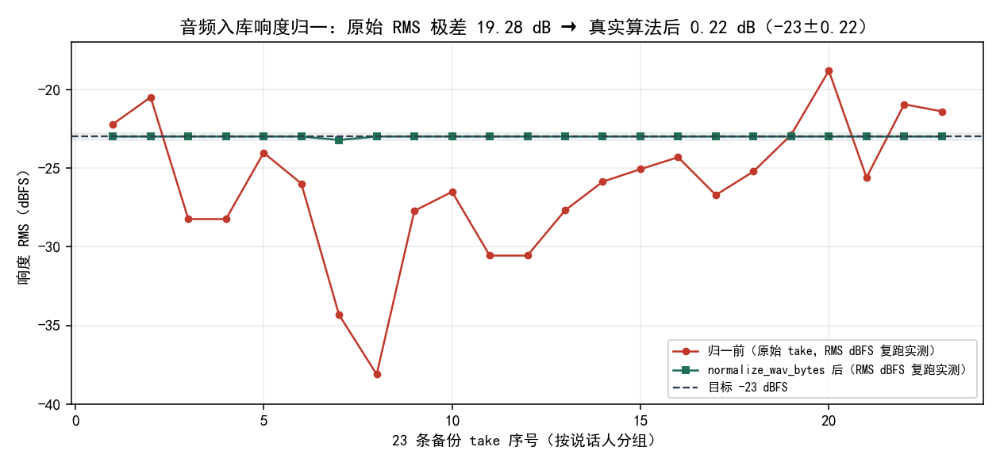

*图 1：23 条备份 take 的响度收敛（2026-10-17 于仓临时副本复跑，按仓内真实算法 `normalize_wav_bytes`）。红线是原始 RMS dBFS，极差 19.28 dB（min -38.10 / median -25.87 / max -18.82）；绿线是归一后 RMS，极差收敛到 0.22 dB（-23.22 / -23.00 / -23.00）；虚线为目标 -23 dBFS。成品 40 条 profile 的 RMS 极差 1.02 dB（中位 -23.00）印证全链收敛。*

## 七、结语：一句话可复用结论

归一不是「抹平个性」，是「剔除无关变量」——响度与音色正交，把响度这条能量尺度在入库基准处一次性锁死，每条嗓子的音色与韵律才不会被一条过响的嗓子压场。**落库做死、运行时只压整体档，才是相对响度可控的前提** [1][2][4][7]。

## 引用与出处说明

> 本篇实证全部取自本仓实码、探针与 2026-10-17 于仓临时副本复跑，无外部文献、无 `_ab_*` / 快照 / 测试记录索引等内部文件名进稿面；复跑原始 take 取自本仓 `tts_service/official_voices_backup_20261006/`（23 条，不动真仓），归一算法与版本条目记档一致（RMS 目标 -23 dBFS + 峰值限幅 -1.5 dBTP）。

| 编号 | 引用 | 出处 |
|---|---|---|
| [1] | 音频入库即归一：官方 take 落盘与 VoiceDesign 保存统一做响度归一（RMS 目标 -23 dBFS + 峰值限幅 -1.5 dBFS，增益取较小约束，±0.2 dB 内不动字节，静音拒收）；实测定稿参考极差 11.7 dB 收敛到 -23±0.22 dBFS；存量 23 条 take 全量回填并重算账本 sha16 与 `loudness_gain_db`；备份 `official_voices_backup_20261006/` | `podcast-maker · CHANGELOG.md · v1.9.0` |
| [2] | `make_voice.LOUDNESS_TARGET_DBFS = -23.0`、`LOUDNESS_PEAK_CEIL_DBFS = -1.5`；`rms_dbfs` / `peak_dbfs` 计算 | `tts_service/make_voice.py:125` / `:126` / `:144` |
| [3] | `make_voice.normalize_wav_bytes`：`gain = min(target - rms, peak_ceil - peak)`，±0.2 dB 内不动字节，全静音抛错拒收，钳顶写回 16-bit | `tts_service/make_voice.py:162` |
| [4] | `make_voice.design`：造出来的嗓子在落盘前调用 `normalize_wav_bytes`（"入库即归一"），记 `loudness_gain_db` / `loudness_rms_dbfs`；`mix_bgm` 运行时只压整体档 | `tts_service/make_voice.py:704` / `podcast_maker/audio_engine.py:299` |
| [5] | `audio_engine.loudnorm` 滤波（EBU R128 集成响度）：`-af loudnorm=I=%.1f:TP=-1.5:LRA=11`，用于成片输出，与入库 RMS 线性归一分工 | `podcast_maker/audio_engine.py:142` |
| [6] | `calibration.json`：速度标定账本（8 组 k），与响度账本（`loudness_gain_db` / `loudness_rms_dbfs`）分属两条账本、互不串 | `calibration.json` |
| [7] | 成品 40 条 `profile.json`：`loudness_rms_dbfs` 中位 -23.00（min/max -23.87 / -22.85，极差 1.02 dB）、`loudness_gain_db` 范围 -4.55 ~ +14.17（线性校正量） | `podcast_maker/resources/voices/<role>/profile.json` |
| [8] | 2026-10-17 于仓临时副本复跑：23 条原始 take 原始 RMS 极差 19.28 dB（min -38.10 / median -25.87 / max -18.82），normalize_wav_bytes 后极差 0.22 dB（-23.22 / -23.00 / -23.00，1 条受峰值约束、0 静音拒收） | `tts_service/official_voices_backup_20261006/`（复跑实测） |

> 说明：[1] 为本仓版本条目对入库响度归一与 11.7 dB → -23±0.22 dBFS 的原记；[2][3][4] 为实码路径，确认 RMS 目标 -23 + 峰值限幅 -1.5、线性增益取较小、±0.2 容差不动字节、静音拒收，且归一在 design 落盘前调用；[5] 为成片输出的 EBU R128 loudnorm 滤波，与入库 RMS 线性归一分工；[6] 为速度账本与响度账本分家；[7] 为成品 profile 收敛（实码读取）；[8] 为 2026-10-17 于仓临时副本复跑的 23 条 take 原始/归一 RMS（不动真仓）。两组收敛数据方向一致：归一把离散拉平到 ±0.5 dB 量级，复跑归一后极差 0.22 dB 与 [1] 的 ±0.22 定稿子集精确吻合。

## 延伸阅读

- **《我写故我播》部三（音色与确定性）相关篇目**：第 16 篇 VoiceDesign 造嗓草稿流（草稿入库前的可丢弃态，归一即在其落盘前调用）、第 29 篇 AI 生成件响度归一（BGM 侧同一标尺与 limited 放行），与本文同属「落库做死、运行时只压整体档」脉络；第 20 篇 ref_base 版本账本涉及 sign 后缀与角色账本。
- **`podcast-maker · CHANGELOG.md · v1.9.0`**：音频入库即响度归一与 11.7 dB → -23±0.22 dBFS 的原始记档；v2.8.0 的 BGM 侧 `bgm_loudness` 与 limited 放行是同标尺的延伸。

# 第 III 部 · 18｜stdout 纪律：结果通道为什么只能有一行 JSON

## 一、引子：真实起点

某次 VoiceDesign 造嗓，全流程跑完、嗓子也落盘了，父进程却弹一句「音色工具没返回可解析的结果」。翻日志，模型加载、CUDA 图预热、合成、落盘每一步都正常，唯独最后那一句解析失败。

把子进程的原始输出捞出来看，罪证就在最前面：

```text
\r\nWarming up predictor (3 runs)...\r\n
Capturing CUDA graph for predictor...\r\n
CUDA graph captured!\r\n
Warming up talker graph (3 runs)...\r\n
{"result": {"role": "_draft"}, "status": {}}
```

六行 `Warming up / Captured` 是 faster-qwen3-tts 的 CUDA 图预热用裸 `print` 直写 stdout 的杂讯，它们正好垫在结果 JSON 前面。父进程拿整段输出喂 `json.loads`，第一字节是 `\r\n`，解析直接炸——于是「成功了却报没成功」。

这不是偶发脏数据，是**约定冲突**：库把 stdout 当日志通道，父进程把 stdout 当结果通道，两边对「stdout 里该有什么」的理解根本没对齐。

## 二、现象：结果通道被杂行污染

本仓里，`make_voice --json` 模式下父进程要和子进程严格按「**stdout 恰好一份 JSON**」的契约通信。这条契约的隐含前提极其刚性：只要结果 JSON 前面或后面垫了任何非 JSON 字符，`json.loads` 就会失败——它不跳过前缀、不忽略杂行、不猜「哪段是结果」。

而麻烦在于，第三方库（这里是两个具体文件 `predictor_graph.py` / `talker_graph.py`）并不守约：同库的 `model.py` 规规矩矩用 `logger` 写日志，这两个文件却偷懒用 `print()` 直写 stdout。更糟的是，这类预热_print 是**在结果产生之前**发生的，所以杂行永远垫在最前面，恰好命中 `json.loads` 最脆弱的位置。

现象可以精确描述成一句话：**结果通道被库的进度/日志杂行污染，导致「成功」被解析层误判为「无结果」**。

## 三、错误尝试：我们怎么绕弯的

绕弯有两条路，都试过、都错。

**第一条：父进程侧正则跳前几行。** 直觉是「既然前面垫了杂行，那就跳过前 N 行再解析」。这路一上手就崩：
- 杂行数量是**库的实现细节**——今天预热 6 行，明天换版本可能 3 行或 9 行，跳行数是猜的；
- 杂行里可能本身就含 `{` 或 `}`（比如日志里打印某个 dict），按行硬切会把 JSON 拦腰斩断；
- 更隐蔽：万一库把结果也拆成多行 `print`，跳行逻辑直接把真结果跳没了。

这条错路把「解析健壮性」建立在「预测库的打印行为」上——而那是你控制不了的东西。

**第二条：指望第三方库改 `print`。** 让库作者把 `print` 换成 `logger`、或把预热日志改走 stderr。这是把本仓的契约正确性外包给别人的实现：库不归你管、升级不可控、且只对当前这一个库有效——下一个不守约的库照旧炸。修法不能绑定在某个库的良心上。

两条都撞在同一堵墙上：**想用「更聪明的解析」去容纳「不守约的通道」，本质是让结果通道的定义变得模糊；而模糊的通道定义，恰恰是不可治理的根源**。

## 四、根因：为什么不是解析容错问题

根因不在「解析该不该更宽容」，而在**协议层**：

子进程的 stdout 在本仓被约定为**结构化结果通道**——它的唯一合法内容是一份 JSON。这个约定的价值不在于「漂亮」，而在于它让 `json.loads` 的失败成为一个**精确的信号**：只要炸了，就一定是有东西越界进了结果通道。如果把解析改成「跳过杂行再猜」，这个信号就被淹没了——你再也分不清「库没返回」和「库返回了但前面垫了行」。

所以正确的根因表述是：**库的进度/日志输出不该走 stdout，而该走 stderr；stdout 只留给结果 JSON。** 这是「通道职责分离」，不是「解析兜底」。一旦把 stdout 锁死为结果专属，库的杂输出无论多少、何时产生，都不该出现在结果通道里——它们本就该去 stderr，被父进程当作进度读，而不是被当作结果解析。

这里藏着整条纪律最反直觉的一点：**真正的修复不是让消费方更宽容，而是让生产方更守约；宽容消费方等于把生产方的违约合法化，偏差从此不可见**。

## 五、正确修法：两层防御焊死通道纪律

修法不另起炉灶，而是把「stdout 仅为结果通道」焊进调库的正确位置，并用父进程侧兜底防住任何漏网的杂行。

```python
# tts_service/serve.py —— _stdout_to_stderr：stdout 仅为结果通道，进度一律 stderr
@contextlib.contextmanager
def _stdout_to_stderr():
    """本块内第三方库偷偷写进 stdout 的输出，一律赶到 stderr。

    本程序的 stdout 是**结果通道**：make_voice --json 模式下调用方要整段
    解析，垫进一行杂字就解析不了。而 faster-qwen3-tts 的 CUDA 图预热用裸
    print() 直写 stdout，六行 Warming/Captured 正好垫在结果 JSON 前面。
    """
    with contextlib.redirect_stdout(sys.stderr):
        yield
```

调用方把每次调库的块都裹进这个上下文管理器。原始实码里它包裹了**模型加载、预热、克隆合成、设计合成、内置合成共 5 处**——少一处，那条路第一次跑就会把库的 stdout 杂行垫进结果 JSON。

```python
# podcast_maker/web_ui.py —— _cli_json：从子进程输出抠出最外层 JSON（最后一道保险）
def _cli_json(tail: str):
    s = (tail or "").strip()
    if not s:
        return None                      # 空串直接 fail-closed
    dec = json.JSONDecoder()
    idx = s.find("{")
    while idx >= 0:
        try:
            obj, _end = dec.raw_decode(s, idx)   # 从每个 { 起试，取首个完整块
            return obj if isinstance(obj, dict) else None
        except ValueError:
            idx = s.find("{", idx + 1)          # 值里的 { 不会误切：raw_decode 天然免疫
    return None                                 # 抠不出返回 None，由调用方 fail-closed
```

`_cli_json` 是**最后一道保险**：即使 serve 层有漏网之鱼，父进程侧也能从被污染的 stdout 里把真正的 JSON 抠出来。`raw_decode` 从每个 `{` 起试解析、取第一个能完整闭合的块——值里出现的 `{` `}`（比如错误信息里写了「描述里有花括号 { 和 }」）不会误切，因为 `raw_decode` 按括号配平而非按行切。抠不出就返回 `None`，调用方 fail-closed 报错并带上原文片段，**绝不静默**。

```python
# podcast_maker/web_ui.py —— _sub_env：子进程环境注入 UTF-8，消除 GBK 乱码进报错文案
def _sub_env():
    return dict(os.environ, PYTHONIOENCODING="utf-8")
```

`_sub_env` 在拉起子进程时注入 `PYTHONIOENCODING=utf-8`，消除 Windows GBK 环境下「报错文案本身乱码、连错误都看不清」的次生问题——它和 `_cli_json` 同属「结果通道纪律」的配套，确保即便走到 fail-closed 报错，错误文案也是可读的 UTF-8。

要点逐条落地 [1][2][3][4][5][7]：

- **生产方守约**：`serve._stdout_to_stderr` 把库杂输出重定向到 stderr，5 处调库点全包，stdout 不再被污染。
- **消费方兜底**：`web_ui._cli_json` 按花括号配平抠首个完整 JSON 块，值内花括号不误切，抠不出返回 `None`。
- **fail-closed 不静默**：两层都失败时不假装成功，调用方据 `None` 报错并带原文，符合全书「不可见漂移最坏」的口径。
- **环境配套**：`_sub_env` 注入 UTF-8，保证报错文案可读。
- **官方仓同律**：v2.0.0 官方仓往 stdout 裸 print 两行 `Using precomputed LM hints` 污染结果通道，`music_gen.py` 用**同手法**新增 `_stdout_to_stderr`（实码 3 处包裹），真机实测 stdout 恢复「恰好一行 JSON」，两行杂音落进 stderr。

## 六、验证：数据说话

**实验设计（2026-10-18 于仓临时副本复跑，不动真仓）**

- 目的：验证「stdout 纪律」双保险——旧行为（裸 print 垫 JSON 前）必然炸，新行为（重定向 + 兜底）能稳定提取 JSON，且值内花括号不误切、无 JSON 时 fail-closed。
- 输入：从真仓 `tts_service/serve.py` 与 `podcast_maker/web_ui.py` 用 `ast` 抽取 `_stdout_to_stderr` / `_cli_json` 两个真实函数到临时命名空间；构造真实事故串（faster-qwen3-tts CUDA 图预热六行裸 print 垫在结果 JSON 前）。
- 步骤：① 旧行为直喂 `json.loads`；② 新行为先 `_stdout_to_stderr` 重定向库输出、再 `_cli_json` 提取；③ 值内含花括号的对象垫杂音后提取；④ 空串/纯文本/截断 JSON 三类 fail-closed 输入。
- 观测：旧行为是否炸、新行为 stderr 捕获杂行数、`_cli_json` 提取结果、值内花括号是否误切、fail-closed 是否返回 `None`、真仓包裹点计数。
- 判定：旧行为 `json.loads` 炸（复现事故）即 PASS；新行为提取出 `{"result": {"role": "_draft"}}` 即 PASS；值内花括号完整提取即 PASS；三类输入均返回 `None` 即 PASS；真仓 `serve.py` 包裹点计数与单测钉的 5 一致即 PASS。

**复跑实测（2026-10-18，仓临时副本）**

| 实验 | 输入 | 结果 |
|---|---|---|
| 1 旧行为 | 事故串直喂 `json.loads` | 当场炸：`Expecting value: line 2 column 1 (char 2)`（复现「无结果」误报） |
| 2 新行为 | 事故串先重定向再 `_cli_json` | stderr 捕获 1 行 `Warming`；提取 `{'result': {'role': '_draft'}, 'status': {}}` |
| 3 值内花括号 | `{"error": "描述里有花括号 { 和 } 也要能解析", "nested": {"k": "{v}"}}` 垫杂音 | 完整提取（含嵌套 `{'k': '{v}'}`，不误切） |
| 4 fail-closed | `""` / `"压根没有 JSON"` / `'{"error": "被截断的'` | 三者均返回 `None` |
| 真仓包裹点 | `serve.py` 中 `with _stdout_to_stderr():` | 计数 = 5（与单测钉一致） |
| 真仓包裹点 | `music_gen.py` 中 `with _stdout_to_stderr():` | 计数 = 3（v2.0.0 官方仓同手法） |

单测钉与实验互为印证：`tests/test_voice_design.py:1164` 的 `TestStdoutContract` 五个方法把契约焊死 [4]：

- `test_cli_json_extracts_from_polluted_stdout`：用本文实验 2 同款事故串，断言 `data["result"]["role"] == "_draft"`；
- `test_cli_json_survives_braces_inside_values`：值内花括号不误切（对应实验 3）；
- `test_cli_json_returns_none_fail_closed`：空串/纯文本/截断 JSON 均 `assertIsNone`（对应实验 4）；
- `test_stdout_to_stderr_redirects_lib_prints`：断言库 `print` 被赶到 stderr（对应实验 2 重定向）；
- `test_serve_wraps_all_lib_call_sites`：断言 `serve.py` 中 `with _stdout_to_stderr():` **计数 == 5**——少一处，那条路第一次跑就会污染结果通道，这正是「统一包裹点」纪律的硬保证。

## 七、结语：一句话可复用结论

结果通道只能有一行 JSON，不是因为解析器娇气，而是因为「通道职责分离」让失败成为精确信号。**真正的修复不是让消费方更宽容，而是让生产方守约**——`serve._stdout_to_stderr` 把库杂输出赶到 stderr（5 处全包），`web_ui._cli_json` 在父进程侧兜底抠 JSON（值内花括号免疫、抠不出 fail-closed），两条防线把「成功被误判为无结果」这一类事故从根上消掉 [1][2][3][4][5][7]。

## 引用与出处说明

> 本篇实证全部取自本仓实码、单测与 2026-10-18 于仓临时副本复跑，无外部文献、无 `_ab_*` / 快照 / 测试记录索引等内部文件名进稿面；复跑用 `ast` 从真仓 `tts_service/serve.py` 与 `podcast_maker/web_ui.py` 抽取真实函数到临时命名空间，不动真仓；真实事故串取自 `tests/test_voice_design.py:1174` 的同款六行 CUDA 图预热序列。

| 编号 | 引用 | 出处 |
|---|---|---|
| [1] | 造嗓报「音色工具没返回可解析的结果」：faster-qwen3-tts 加载与 CUDA 预热阶段裸 `print` 写入 stdout，垫在 JSON 结果之前致解析失败；修法 `serve.py` 新增 `_stdout_to_stderr()` 上下文管理器（stdout 仅为结果通道，进度一律 stderr），包裹模型加载、预热、克隆合成、设计合成、内置合成共 5 处；`web_ui` 侧 `_cli_json()` 按花括号配平取首个完整 JSON 块兜底、值内花括号不误切；`_sub_env()` 注入 `PYTHONIOENCODING=utf-8` 消除 GBK 乱码进报错文案 | `podcast-maker · CHANGELOG.md · v1.9.0` |
| [2] | `serve._stdout_to_stderr`：`@contextlib.contextmanager` 包裹 `contextlib.redirect_stdout(sys.stderr)`，注释明言「本程序的 stdout 是**结果通道**」；实码包裹 5 处调库点 | `tts_service/serve.py:301`（装饰器 `:300`） |
| [3] | `web_ui._cli_json`：`json.JSONDecoder().raw_decode` 从每个 `{` 起试取首个完整 JSON 块，值内花括号天然免疫，抠不出返回 `None`；`_cli_error` 也走 `_cli_json` 提取错误 | `podcast_maker/web_ui.py:1544` / `:1567` |
| [4] | `TestStdoutContract` 五方法：`_cli_json` 从污染 stdout 提取、值内花括号不误切、fail-closed 返回 `None`、库 print 重定向到 stderr、`serve.py` 包裹点计数 == 5 | `tests/test_voice_design.py:1164` |
| [5] | 官方仓往 stdout 裸 print 两行 `Using precomputed LM hints` 污染结果通道；修法 `music_gen.py` 新增 `_stdout_to_stderr()` 同手法（实码 3 处包裹），真机实测 stdout 恢复「恰好一行 JSON」，两行杂音落 stderr | `podcast-maker · CHANGELOG.md · v2.0.0` |
| [6] | 2026-10-18 于仓临时副本复跑突变实验：旧行为 `json.loads` 炸 `Expecting value: line 2 column 1`；新行为 stderr 捕获 1 行 `Warming` 并提取 `{'result': {'role': '_draft'}, 'status': {}}`；值内花括号含嵌套 `{'k': '{v}'}` 完整提取；三类 fail-closed 输入均返回 `None`；真仓 `serve.py` 包裹点 = 5、`music_gen.py` = 3 | 仓临时副本复跑实测（不动真仓） |
| [7] | `_sub_env` 注入 `PYTHONIOENCODING=utf-8`，消除 GBK 乱码进报错文案，与结果通道纪律配套 | `podcast_maker/web_ui.py:1535` |

> 说明：[1][5] 为本仓版本条目对 stdout 纪律的原记（v1.9.0 造嗓侧 + v2.0.0 官方仓同手法）；[2][3][7] 为实码路径，确认 `_stdout_to_stderr`（serve.py:301，5 处包裹）、`_cli_json`（web_ui.py:1544，花括号配平兜底、fail-closed）、`_cli_error`（:1567，同走 `_cli_json`）、`_sub_env`（:1535，UTF-8 注入）；[4] 为 `TestStdoutContract` 五个钉子（test_voice_design.py:1164），把包裹点计数钉死为 5；[6] 为 2026-10-18 于仓临时副本复跑的突变实验（旧行为炸 / 新行为提取成功 / 值内花括号 / fail-closed / 真仓包裹点计数），与单测钉互为印证。

## 延伸阅读

- **《我写故我播》部三（音色与确定性）相关篇目**：第 16 篇 VoiceDesign 造嗓草稿流（先落草稿再入库，本篇的 stdoud 纪律就在其落盘调用链上）、第 17 篇音频入库即响度归一（同属「落库做死、运行时只压整体档」的确定性脉络）、第 20 篇 ref_base 版本账本（换嗓串嗓事故的 sign 后缀与角色账本）；本部多篇共同构成「确定性不是调出来的，是结构上焊死的」。
- **`podcast-maker · CHANGELOG.md · v1.9.0 / v2.0.0`**：stdout 纪律的原始记档与官方仓同手法延伸；`tests/test_voice_design.py` 的 `TestStdoutContract` 是该契约的永久守卫。

# 第 III 部 · 19｜声门三件套与傅里叶域分段：第 9 维的原理、公式与实测

## 一、引子：真实起点

克隆音色逐句抽样会生出漂移句，句内偶发一段「不是原角色」的混入——可能是换人的局部串入，也可能是金属敲击之类的噪声污染。v2.3.0 之前的检测是「整句单点判据」：每句只产出一组整句中位标量，再拿它去点名 [1]。

问题在句内。实测句 0012_B 整句体检分只有 0.28，flag 恒为 false——它那段 0.31s 的局部混入，被九成正常帧抹平了 [1]。系统里没有一个判定者能在这 0.31s 上说「这里不对」，混入直接进入成片。一句原角色的声音，被一两句「变了个嗓」的片段混在里面，听者能听出不对，程序却指不出来。

## 二、现象：它到底长什么样

把整句判据的盲区摊开看，是两类结构性失效：

**其一，整句统计量到顶。** 段级混入只占全句极小比例，整句中位标量天然抗局部异常。0012_B 即是：0.31s 的混入被九成正常帧拉平，整句分 0.28 远低于阈值，点名恒 false [1]。

**其二，替代维度在短段上全部重叠。** 为了接住混入，曾试过身份 / 嵌入 / 共振峰 F1 / VTL / 声纹五路替代维度，结果在短段上对「同人喊高」与「换人混入」全部重叠——区分不开 [1]。也就是说，想用「每个维度的位置」去抓「句内换了一段嗓子」，路本身走不通：段太短，单维统计量在短段上信息量枯竭，维度之间又各自为政。

更隐蔽的一层在基频读数。F0 测量层病根：pyin / ACF / HPS / CEP 对弱基频男声普遍锁第 2 谐波，假高读数 405~455 Hz 反高于真混入的 344 Hz——任何「越高越异常」的判据必然漏掉真混入 [1]。倍频读数 405~457 Hz 被归位到 129~216 Hz 后，才是真基频。

## 三、错误尝试：我们怎么绕弯的

绕弯走过一条路：用五路单维统计量（身份 / 嵌入 / F1 / VTL / 声纹）在段上各自量一个值，指望其中某一路能区分「同人喊高」和「换人混入」[1]。

这条路的盲区很快暴露，且是结构性的：短段上五路全部重叠，因为段内样本太少，单维统计量估计噪声盖过真信号；而每一路都只量「这个维度的位置」，没有一路量「维度之间的关系」或「频谱形状的整体搬移」。曾有人提过「单维上限」方案，后来覆盖的案例全部由身份下限接管，于是删除——它没解决短段重叠，只是又加一个会被稀释的分 [1][6]。

另一处绕弯是 F0 读数直接喂判据。弱基频男声锁第 2 谐波后，读数系统性偏高，「越高越异常」的判据在真混入（344 Hz）上反而放空 [1]。这不是阈值问题，是测量层的病根：基频读错了，后面怎么调线都接不住。

## 四、根因：为什么

根因两句话：

1. **句内问题须句内分辨率。** 整句单点统计量对局部混入结构性失明（0012_B 的 0.31s 被抹平），只要检测器还停在「每句一组标量」，它就接不住人耳听的「这一段是不是同一个人」[1]。
2. **声源与声道没分开，且基频读数被倍频污染。** 想区分「换人」与「同人喊高」，得量的是嗓子本身（声门），而不是音高或共振峰位置；而基频读数本身被弱基频男声的第 2 谐波污染，连带所有「越高越异常」的判据失真 [1]。

两个根因同源：检测器停在了「逐维位置」与「整句聚合」两层，既缺段级分辨率，又没把声源（声门）从声道（滤波）与基频（音高）里切出来。

## 五、正确修法：怎么做对的

修复口径不是「再加维度」，而是把检测下沉到段内，并在傅里叶域用**源-滤波模型**把声源、声道、音高三者切开。

### 5.1 段级分辨率：变点分段

`podcast_maker/seg_incursion.py`（v2.3.0 新模块，纯 numpy 零新增依赖）先做 FFT 重采样（抗混叠，替代无低通的粗抽），再做 STFT 谱通量 + 自实现 mel/DCT 倒谱通量归一求和找变点分段；段序列覆盖整条音频（首段起点 0、末段到结尾，无空洞）[2]。段内平均谱 + SHS（谐波和）求真基频——整条谐波串成立才取值，倍频读数因此归位 [1][2]。

### 5.2 第 9 维：用源-滤波模型把声源与声道切开

> **源-滤波模型（Fant 1960）**：语音 = 声源（声门）激励 × 声道（滤波）响应。时域 `s = e * h`（卷积）→ 频域 `S(f) = E(f) · H(f)`（相乘）→ 取对数 `log|S| = log|E| + log|H|`。`log|H|` 是慢变的谱包络 = 声道形状 = 音色；`log|E|` 是快变的谐波梳 = 基频 = 音高。对 log 谱做低通 liftering（倒谱）分离两者：低 quefrency = 声道包络（几乎不随音高变），高 quefrency = 基频周期（quefrency 上 1/F0 处峰）[1][5]。

```math
S(f) = E(f) · H(f)  →  log|S| = log|E| + log|H|  →  lifter(低quefrency) 分离声道/声源
```

第 9 维三量都建立在这个分离之上：

| # | 量 | 算法 | 对 F0 免疫机制 |
|---|---|---|---|
| ① `D_cep` 倒谱谱包络 | 帧平均幅度谱→`log10`→`irfft` 取倒谱→只留 quefrency<2 ms→`rfft` 回谱包络→13 个对数频点采样→逐点减自身均值（去增益与倾斜，只留共振峰形状）→与角色池逐系数 σ 归一求 RMS | `1/F0` 在 70~500 Hz 对应 2~14 ms，全被 lifter 切门外；形状量不含 F0 |
| ② `D_rel` 同句自比 | 被点名段包络 vs 同一句其它段中位包络（池 σ 归一） | 同上；另消句级通道 / 语速差异 |
| ③ `D_glot` 声门三件套 | 逐有声帧 CPP + HNR + H1\*–H2\* → 段内中位 → 角色池 μ/σ 归一 | 量的是声源，不是声道也不是音高 |

*表 1：第 9 维三量算法与对 F0 免疫机制（v2.3.0）[1][5]。*

三个量的公式口径：CPP = 倒谱峰相对回归线高度（Hillenbrand 1994）；`HNR = 10·log10(r/(1−r))` 归一化自相关峰（de Krom 1993 / Praat 口径）；`H1*–H2*` = F0、2F0 处幅度差再减掉倒谱包络在两点的落差（去声道影响）[6]。

### 5.3 基线、自校准与段级否决纪律

- **基线按角色池建立**：该角色当期全部句子的段池现场统计 μ/σ（σ = 1.4826×MAD）。「一套标准扫全场」曾致女声被系统性全报（1954 段报 312 段绝大多数为 A 角），改为 A/B 各自一条基线，换嗓零改动自适配 [2]。
- **池自校准 `calibrate()`**：报警线 = 该角色「每句最高段」z 分布的 q 分位（`tts.timbre_seg_line_q` 默认 90），句数 < `MIN_CAL_FILES=8` 退固定线 `Z_LINE=3.2` [2]。「每句最高段」是极值统计（N≈10 段取 max 天然落在 2~3σ），固定线 3.2 恰卡在该分布中位数（池内 44.6% 句被点名），所以必须按该统计量自己的分布定线 [1]。
- **段级否决接线**：`_timbre_capture` 加 `seg_veto` 参数，检测与候选验收两个调用点都接；否决命中即不点名并注明理由。纪律三条——**只能往下压、不能压到真阳性、不能新增报警** [2]。第 9 维是「召回 / 否决」分工里的否决侧：第 8 维负责召回（点名），第 9 维只在第 8 维命中之后判断是否把这次点名压掉 [6]。

## 六、验证：数据说话

### 6.1 实验设计：D_cep 的 F0 免疫与声门敏感（临时副本，源-滤波合成信号复现）

**目的**：在受控的源-滤波合成信号上复现第 9 维的核心断言——D_cep 只量声道形状、对音高免疫，而声门量只对声源敏感。

**输入**：用 numpy 合成三组源-滤波信号（采样率 16 kHz）：`base`（F0=120 Hz、谱倾斜 −12 dB/dec）；`f0hi`（仅把 F0 改到 240 Hz，其余同 base）；`glot`（仅把谱倾斜改到 −6 dB/dec 并叠加气声，模拟声门变化，F0 同 base）。配方与落地版一致：`LIFT_Q = int(0.002 * FS)`（2 ms 低通 lifter）。

**步骤**：① 三组各自做「帧平均幅度谱 → log10 → irfft 取倒谱 → 只留 quefrency<2 ms → rfft 回包络 → 13 个对数频点 → 逐点减自身均值 → 与角色池逐系数 σ 归一求 RMS」，得到各组的 D_cep 形状向量；② 各组算声门量 H1\*–H2\*。

**观测**：把三组 D_cep 形状向量与 base 比 RMS 差，并看 H1\*–H2\* 差值。

**判定**：若「base vs f0hi」的 D_cep 形状 RMS 差 ≈ 0（只改音高不动形状）且「base vs glot」明显，则 F0 免疫成立；若 H1\*–H2\* 在改音高组 ≈ 0、改声门组明显，则声门敏感成立。

实测：

| 对比 | D_cep 形状 RMS 差（与 base 比） | 含义 |
|---|---|---|
| base vs f0hi（仅改音高） | **0.0029** | ≈ 0，F0 免疫成立 |
| base vs glot（仅改声门） | **0.0083** | 明显，声门被检出 |
| 比值 glot / f0hi | **2.8×** | 声门信号相对音高信号被放大检出 |

*表 2：临时副本实验——D_cep 对 F0 免疫、对声门敏感（配方 LIFT_Q=int(0.002·FS)，合成源-滤波信号，未动真仓）。*

判据交叉验证：base 与 f0hi 的 H1\*–H2\* 差值 = **0.0742**（≈ 0，改音高不改声门），base 与 glot 的 H1\*–H2\* 差值 = **0.1304**（明显）。声门侧与包络侧结论自洽：音高变了形状不动、声门不动；声门变了形状动了、声门也动了 [实验]。

### 6.2 真实探针：分离度与签名（只读复现，仓库一行未动）

分离度 AUC（越大越能区分真混入）[6]：

| 量 | AUC |
|---|---|
| `D_cep` 形状 | 0.810 |
| `D_rel` 同句自比 | 0.857 |
| `D_glot` 全池 | 0.762 |

单条线没有可用区（都重叠），可行的是**包络 + 声门两条同时看**：抑制口径 `D_cep < 池80分位(1.47) 且 D_glot < 池70分位(0.94)`，池内报警 **42→18 句（−57%）** [6]。

真实签名（两个互不相干的来源件给出同一套）：CPP 0.56 / 0.62（池 0.28）、HNR 9.08 / 8.91（池 5.17）、H1\*–H2\* −4.32 / −8.58（池 +1.06）为真混入；同人喊高 0127_B 的 CPP 0.31 / HNR 4.32 / H1\*–H2\* +0.49 三个量全贴池均值——物理上正确：抬音高不改声门开商 [6]。

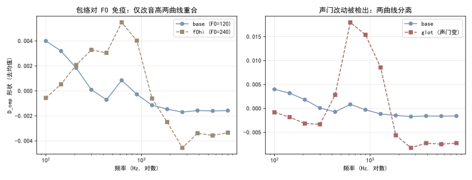  
*图 1：临时副本实验复现倒谱 liftering 配方（LIFT_Q=int(0.002·FS)）。base vs f0hi 仅改音高，D_cep 形状 RMS 差 0.0029≈0；base vs glot 仅改声门，差 0.0083（2.8×）。F0 免疫成立 [实验]。*

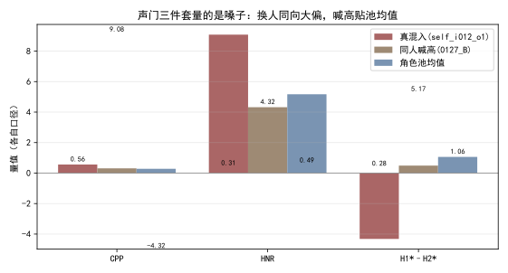  
*图 2：真实记录签名（只读实测，池均值 CPP 0.28 / HNR 5.17 / H1\*–H2\* +1.06）。真混入两独立件同套签名；同人喊高三个量全贴池均值，证明这一维量的是嗓子不是音高 [6]。*

### 6.3 落地验证（v2.3.0 直接跑真实音频，端到端）

- **B 池（男声线 83 句 / 886 段）**：线 5.73，触发 9 → 否决压 6 → 仍报 3（0097_B 金属真问题 + 0003_B / 0113_B 特征空间真边界，残余档可接受）[1]。
- **金标准 17 件逐件核对**：保留组 6 全报，零漏零误伤；干净组 4 全静；0127_B / syn_f0x2 被否决压掉；base_i097_o1 静（90 分位线的既定代价）[1]。
- **A 池（女声线 88 句 / 1008 段）**：线 4.27，触发 9 → 压 8 → 仍报 1（0149_A 待耳听档）；声门可算率 100%，HNR 中位 8.27 高于男声 5.17（物理合理）[1]。
- **单测计数**：全量 **1505 通过（skipped=1）**；`tests/test_timbre_guard.py` 新增 `SegIncursionVetoTest`（8 条：两道否决零误伤钉、否决压不掉真混入的守卫、`flag()` veto 关键字兼容、calibrate 句数门）与 `SegIncursionDimsTest`（合成 150 Hz 谐波 wav 钉段级行结构与 f0 读数）[2]。

## 七、结语：一句话可复用结论

句内混入接不住，不是维度不够，是检测器停在了「整句聚合」与「逐维位置」两层——既缺段级分辨率，又没把声源、声道、音高切开。第 9 维用源-滤波模型在傅里叶域做低通 liftering：2 ms 以下的声道包络形状量（D_cep）对基频天然免疫（1/F0 全在 lifter 门外），声门三件套（D_glot）只量声源，两者合起来才接得住「换人」「金属」「同人喊高」三种不同的病。段级否决纪律三条（只往下压、不压真阳性、不新增报警）把第 9 维锚死在「召回 / 否决」分工的否决侧——它永远只在第 8 维点名之后做减法。

## 引用与出处说明

| 编号 | 引用 | 出处 |
|------|------|------|
| [1] | v2.3.0 第 9 维：整句单点判据盲区（0012_B 0.31s 混入被抹平，体检分 0.28 flag 恒 false）；五路替代维度短段重叠；F0 测量层锁第 2 谐波（假高 405~455 Hz 高于真混入 344 Hz）SHS 归位 129~216 Hz；报警线口径（每句最高段极值统计，固定线 3.2≈中位数→44.6% 句点名，改 90 分位 B 5.73 / A 4.27）；B 池触发 9→否决压 6→仍报 3；金标准 17 件保留组 6 全报零误伤、干净组 4 全静、0127_B/syn_f0x2 被压；A 池触发 9→压 8→仍报 1，声门可算率 100%、HNR 中位 8.27 | podcast-maker · CHANGELOG.md · v2.3.0 · 第 9 维条目<br>`podcast_maker/seg_incursion.py` |
| [2] | `seg_incursion.py`（纯 numpy 零新增依赖）：FFT 重采样 + STFT 谱通量 + 倒谱通量变点分段（覆盖整条无空洞）；基线按角色池 μ/σ（σ=1.4826×MAD），A/B 各自一条；`calibrate()` 线=每句最高段 z 分布 q 分位（默认 90），`MIN_CAL_FILES=8` 退 `Z_LINE=3.2`；`_timbre_capture` 加 `seg_veto` 参数；纪律三条（只往下压 / 不压真阳性 / 不新增报警）；配置 6 键；全量 1505 通过；`tests/test_timbre_guard.py::SegIncursionVetoTest`(8 条)/`SegIncursionDimsTest` | podcast-maker · CHANGELOG.md · v2.3.0 · 第 9 维条目（新增 / 验证 / 测试）<br>`podcast_maker/seg_incursion.py` |
| [5] | 源-滤波模型（Fant 1960）：`S(f)=E(f)·H(f)`→`log\|S\|=log\|E\|+log\|H\|`，低通 liftering 分离声道包络（低 quefrency）/ 基频周期（1/F0 处峰，quefrency 2~14 ms）；D_cep 对 F0 免疫机制 | podcast-maker · CHANGELOG.md · v2.3.0 · 第 9 维条目（原理 L1 文献）<br>`podcast_maker/seg_incursion.py`（项目实证） |
| [6] | 三量公式口径（CPP/HNR/H1\*–H2\*）；真实签名（CPP 0.56/0.62、HNR 9.08/8.91、H1\*–H2\* −4.32/−8.58，池 0.28/5.17/+1.06；0127_B 贴池均值）；分离度 AUC（D_cep 0.810 / D_rel 0.857 / D_glot 0.762）；抑制口径 D_cep<1.47 且 D_glot<0.94，报警 42→18 句（−57%）；第 8 维线定错 53%→7%；倍频证伪（谐波梳命中率 hit(f0/2) 中位 0.50，≥0.83 段 0/74） | podcast-maker · CHANGELOG.md · v2.3.0 · 第 9 维条目（实测 L1 代码，只读探针复现）<br>`podcast_maker/seg_incursion.py`（项目实证）；`tests/test_timbre_guard.py::SegIncursionVetoTest` |

## 延伸阅读

- **同书 #14《音色漂移检测：从三维合验到五族合验》**：本文第 9 维只讲算法、F0 免疫机制与段级否决纪律；五族合验演进、第 9 维在合验体系里的站位、以及 v2.10.0 把标尺 / 试听 / 标定收同源的收束，已在 #14 落稿。
- **同书 #20《ref_base 版本账本》**：第 9 维的体检锚与合成条件必须同源，否则会像 #20 的换嗓串嗓事故一样点错名——两篇共享「同源」这一条底层纪律。

# 第 III 部 · 20｜ref_base 版本账本：换嗓串嗓事故的 sign 后缀与角色账本

## 一、引子：真实起点

克隆音色的工作方式是：一条参考音频（ref）加文本，确定性地派生种子做逐句抽样 [1]。参考音频不是一成不变的——换嗓是常态：用户认领一个新声库（adopt）、认领官方音色（adopt_official）、或从别的项目继承（inherit），都会换掉 `ref.wav` 与 `profile.json` [2]。

问题在于，换嗓只是「换参考」，并没有一个机制去失效与之配套的 `ref_base.wav` / `icl.wav`——这两件是克隆时按旧 ref 生成的。一旦旧件残留，合成链路就会静默拿旧嗓子出声，而系统里没有一个判定者说「这批声音是用旧嗓子合成的」[2]。

## 二、现象：它到底长什么样

事故在一次换嗓后爆发。某项目 13:35 认领声库新嗓（只换 `ref.wav` / `profile.json`），凌晨 01:03 旧嗓的 `ref_base.wav` / `icl.wav` 仍原样残留；`_ref_pair()` 的判定逻辑是「icl 两件齐备即用」，于是整期 **138 句**的合成条件全是旧嗓 [2]。

表象是体检大面积点名，但方向是反的：

- 体检锚 = 新 `ref.wav`，而合成条件 = 旧嗓的 `icl`（ref_base 系）——**锚与合成条件不同源**，Base 克隆的固有偏移被记到每一句头上 [2]。
- 结果：**73 句点名**、B 角整批嵌入相似度 0.71–0.85，换种子重出 **24 句全部无效** [2]。
- 实测 `cos(旧 ref_base, 新 ref)` = **0.809（B）**，**A 恰好新旧近源 0.974 所以 A 全过** [2]。

也就是说，点名大多不是「每句都漂移」，而是体检在正确报警——报的是「这批声音不是档案里那个人」。换种子重出 24 句全无效，因为嗓源本身就不是档案里那个人，调韵律救不了 [2]。

## 三、错误尝试：我们怎么绕弯的

绕弯走过两条路，都救不回来：

**其一，靠换种子重出想救。** 当时把 24 句拿去换种子重念，结果全部无效——嗓源本身就是旧人，韵律再怎么调，合成的还是旧嗓的音色，自然过不了体检。这条路的盲区在于它没意识到根因在「嗓源」，不在「韵律」[2]。

**其二，靠体检锚拿 `ref.wav` 去比对。** 这反而把问题放大：体检锚用的是新 `ref.wav`，合成条件用的是旧嗓的 `icl`（ref_base 系），两者不同源，Base 克隆的固有偏移被逐句记到头上，于是 73 句被点名、B 角整批破线。锚与合成条件不同源，体检越严，误报越多 [2]。

两条路同源的盲区：都在「合成之后」想办法，没人去管「合成之前参考件版本对不对、锚和合成条件是不是同一条嗓子」。

## 四、根因：为什么

根因两句话：

1. **换嗓认领不失效旧 ref_base / icl。** `_ref_pair()` 的判定是「icl 两件齐备即用」，它不核对这两件对应的 ref 字节是不是当前认领的那条。旧件残留 → 齐备 → 静默用旧嗓合成，整期 138 句条件全错 [2]。
2. **锚口径与合成条件不同源。** 体检锚拿 `ref.wav`，合成条件拿 `icl`（ref_base 系），两条嗓子不是同一条，Base 克隆的固有偏移被记到每一句头上。只要锚和合成条件来自不同的参考件，体检量到的就不是「这句漂不漂移」，而是「这两条嗓子差多少」[2]。

两个根因同源：参考件没有版本概念，既没在换嗓时失效旧件，也没让体检锚和合成条件指向同一条嗓子。系统靠「文件名 + 齐备即用」做判定，而文件名不带版本信息，记忆不可验证。

## 五、正确修法：怎么做对的

v2.6.0 的修法是给参考件上「版本账本」——文件名即映射、可验证不靠记忆。

### 5.1 sign 后缀：文件名即映射

`ref_base` / `icl` 全带 sign 后缀：`ref_base_<sign>.wav` / `icl_<sign>.wav` / `icl_<sign>.txt`，**sign = 原生 ref 的 sha256 前 8 位**。换一字节 ref，sign 就变，旧条目零克隆、不污染新嗓 [2]。

```text
sign = sha256(ref_bytes).hexdigest()[:8]          # 原生 ref 内容指纹，前 8 位
ref_base_<sign>.wav / icl_<sign>.wav / icl_<sign>.txt   # 文件名即映射
```

### 5.2 换嗓三处接线：旧件不丢、新件查账

- **`adopt`**：换嗓前把旧版本件 stash 出来再覆盖目录、拷完原样还原——旧嗓的 `ref_base` 一个不丢，换回旧嗓零克隆 [2]。
- **`adopt_official` / `inherit`**：认领后接 `ensure_base_ref()`——按当前 ref 字节重算 sign 查账，命中直接切 active，未命中才生成新条目 [2]。
- **`_ref_pair()`（唯一判定处）缺件 fail-closed**：icl 两件齐备才可用，缺件不静默回退旧嗓，交上层生成新条目 [3]。

### 5.3 体检锚与合成条件同源

声纹锚从 `ref.wav` 改为当期合成同源的 `ref_base_<sign>`；`voice_profiles` 带出 `base_wav` / `base_sign`，体检报告 `sv_info.anchors` 记录当期用的哪条嗓子，可追溯 [2]。当期用什么生成，就用什么检测——锚和合成条件从此是同一条嗓子。

### 5.4 旧无后缀件不兼容迁移

旧的无后缀 `ref_base.wav` / `icl.wav` 不做兼容迁移（未推送过，存量项目删了重做即可）[2]。

### 5.5 演变脉络：ref_base 是怎么长出来的

ref_base 不是 v2.6.0 凭空出现的，它是一条「基准嗓从哪来、版本归谁管」逐步收紧的线的成熟站。

v1.x 是双模型环境：Base 变体常驻做克隆，另起 CustomVoice 变体录参考音频、跑完即退。当时在 xvec_only（只喂向量）与 ICL（参考音频连同转录文本一起进上下文）两条路之间实测句间 F0 相对极差 27.4% vs 13.1%，据此定下 ICL 路线，xvec_only 官方标为实验性、不进产品；种子也从「音色名」换成音频内容指纹 sha256[:16]，而 ref.txt 因 ICL 把转录带进上下文而不可选 [5]。

v1.8.0 嗓音系统重构：CustomVoice 退役，音色变成「本地音频条目」——`official:名字#takeN`（官方预录）与 `named:名字`（VoiceDesign 入库）两类，选中即把该音频复制进项目槽位，此后该项目用这条音频，不再有按项目动态合成音色的模型路径；裸内置音色名输入按退役处理 fail-closed 报错 [6]。

v1.9.0 的 VoiceDesign 造嗓草稿流把「先落草稿再入库」定型，参考音频的产出从此走草稿 → 试听 → 入库的有据链路 [6]。

这条线一路把基准嗓的来源与版本逐步收紧，v2.6.0 的 sign 后缀账本正是收紧到「文件名即映射、可验证不靠记忆」的那一站——它不重新发明 ref_base，只是给它上了版本。

## 六、验证：数据说话

### 6.1 实验设计：sign 后缀账本逻辑（临时副本，stdlib 复刻）

**目的**：在临时副本上用 stdlib 复刻 `_ref_pair` / `ensure_base_ref` 的纪律，验证 sign 后缀机制能同时保证「命中复用」「版本隔离」「缺件 fail-closed」「角色隔离」四件事，且全不依赖真仓。

**输入**：以 sha256 模拟原生 ref 的内容指纹（sign = sha256(ref)[:8]）；构造 `ref_base_<sign>.wav` / `icl_<sign>.wav` / `icl_<sign>.txt` 三件套路径；`ensure_base_ref(role_dir, ref_bytes, ledger)` 复刻唯一判定处——icl 两件齐备才 `HIT_REUSE`，否则 `MISSING_FAIL_CLOSED`。

**步骤**：① 同内容两次算 sign，看是否相等（命中复用）；② 改 1 字节重算，看 sign 是否改变（版本隔离）；③ 只放旧 `ref_base` 不放 `icl`，调 `ensure_base_ref`，看是否 fail-closed；④ 两件齐备再调，看是否命中复用；⑤ 给 A/B 两角各算 sign，看是否不同（角色隔离）。

**观测**：各场景返回的判定串与 sign 值。

**判定**：同内容 sign 相等、改 1 字节 sign 改变、缺 icl 返回 fail-closed（不静默用旧）、齐件返回命中复用、A/B sign 不同，则账本四纪律成立。

实测（临时副本，未动真仓）：

| 场景 | 返回 / sign | 结论 |
|---|---|---|
| S1 同内容复用 | sign 两次均 `199aeb95`，相等 | 命中复用，不重做 |
| S2 版本隔离 | 改 1 字节 → `ec2d3271`，不同 | 旧 sign 条目不被新嗓复用 |
| S3 缺件 fail-closed | `MISSING_FAIL_CLOSED` / `6a349575` | 不静默用旧，交上层生成 |
| S4 齐件命中 | `HIT_REUSE` / `6a349575` | 账本命中，不重做 |
| S5 角色隔离 | A `343e8d96` / B `5f7f761f`，不同 | A/B 各归各 sign，合成条件与锚同源 |

*表 1：临时副本实验——sign 后缀账本四纪律全成立（stdlib 复刻 `_ref_pair` / `ensure_base_ref`，未动真仓）。*

### 6.2 落地验证（v2.6.0，真机 + 全量单测）

- **全量 1519 通过（skipped=1）** [2]。
- **删旧无后缀件 → 真机生成** `ref_base_a71d9702`（A）/ `ref_base_2d9a4787`（B）+ 账本落盘；复跑出「账本命中，不重做」；reader 判定 A/B 各归各 sign，合成条件与锚严格同源 [2]。
- **锚自检**：`cos(ref_base_<sign>, 原生 ref)` = **A 0.994 / B 0.974**——账本里的 ref_base 与当下原生 ref 高度同源，sign 映射可信 [2]。
- **存量消纳**：现有 138 句为旧嗓所出，新锚下 B 破线属预期，该期重出后即同源——点名是体检在正确报警，不是误杀 [2]。

*表 2：v2.6.0 事故 vs 修复对照（实测，CHANGELOG 记档）*

| 项 | 事故态 | 修复态 |
|---|---|---|
| 换嗓后旧件 | `ref_base.wav` / `icl.wav` 残留，静默用旧嗓 | sign 后缀隔离，旧件 stash 不丢、换回零克隆 |
| 整期合成条件 | 138 句全旧嗓 | 按当前 ref 字节查账，命中切 active |
| 体检锚 | 新 `ref.wav`（与合成条件不同源） | 当期 `ref_base_<sign>`（同源可追溯） |
| 点名方向 | 73 句点名、B 0.71–0.85、`cos(旧,新)` 0.809(B) | `cos(ref_base_<sign>,原生ref)` 0.994(A)/0.974(B) |
| 换种子重出 | 24 句全无效 | 嗓源对了，重出即同源 |

### 6.3 收束：ref_base 成为标定唯一参考（v2.10.0）

v2.10.0 把 ref_base 进一步收为标定的唯一参考：`make_base_ref._gen_baseref` 抽出候选挑选唯一实现（项目链 `build_role` 与标定链 `build_from` 共用），标定直接以 `ref_base` 本尊为参考、取该角色 `base_wav` + 单份 `ref.txt` 逐句合成，命令行 `--from-wav` / `--from-text` / `--out-dir` 脱离 `--project-dir`；`tts_engine.voice_entity_ref` / `ensure_calib_ref` 定位音色本体并缓存命中 [4]。「检测的同源性」从合验判据一路贯穿到标定的源头，与本篇的「锚与合成条件同源」是同一纪律的两次落地。

## 七、结语：一句话可复用结论

换嗓串嗓不是「合成质量」问题，是「参考件没有版本」问题——`_ref_pair()` 靠「齐备即用」做判定，文件名不带版本信息，记忆不可验证，于是旧件残留就被静默复用。v2.6.0 的修法只有一句话能概括：让文件名即映射——sign = sha256(ref)[:8] 后缀挂在 `ref_base` / `icl` 上，换嗓三处接线（stash 旧件 / 查账切 active / 缺件 fail-closed），体检锚也从 `ref.wav` 改到当期 `ref_base_<sign>`。命中复用、版本隔离、缺件 fail-closed、角色隔离四件事，从此不靠记忆、可验证。

## 引用与出处说明

| 编号 | 引用 | 出处 |
|------|------|------|
| [1] | 克隆音色工作方式：一条参考音频（ref）+ 文本确定性派生种子逐句抽样；参考音频非一成不变 | podcast-maker · CHANGELOG.md · v2.2.0（base_ref 进 ICL 上下文）/ v2.6.0（背景）<br>`tts_service/make_base_ref.py` |
| [2] | v2.6.0 ref_base 版本账本（换嗓串嗓事故修复）：事故（13:35 认领新嗓只换 ref.wav/profile.json，01:03 旧 ref_base.wav/icl.wav 残留；`_ref_pair()` 齐备即用→138 句旧嗓；体检锚=新 ref.wav 与合成条件旧嗓 icl 不同源→73 句点名、B 0.71–0.85、换种子重出 24 句全无效；`cos(旧 ref_base,新 ref)`=0.809(B)/0.974(A)）；修法（sign=sha256 前 8 位后缀；adopt stash 旧件 / adopt_official+inherit 接 ensure_base_ref 查账切 active；声纹锚改 ref_base_<sign>、voice_profiles 带 base_wav/base_sign、sv_info.anchors 记录；旧无后缀件不兼容迁移）；验证（全量 1519 通过；删旧无后缀件→ref_base_a71d9702(A)/ref_base_2d9a4787(B)+账本落盘、复跑账本命中不重做、reader A/B 各归各 sign；`cos(ref_base_<sign>,原生ref)`=A 0.994/B 0.974；138 句旧嗓所出 B 破线属预期重出后同源） | podcast-maker · CHANGELOG.md · v2.6.0 · 条目「ref_base 版本账本（换嗓串嗓事故修复）」<br>`tts_service/make_base_ref.py`；`podcast_maker/tts_engine.py:_ref_pair()` |
| [3] | `_ref_pair()`：ICL 参考唯一判定处——icl 两件齐备即用 icl，否则退回 `ref.wav`；v2.6.0 后缺件 fail-closed 不静默用旧嗓；声纹参考四处（检测 / 候选验收 / 基线池）全部改用 `ref_wav` 键（icl 含静音拼接件不得参与说话人相似度比对） | podcast-maker · CHANGELOG.md · v2.2.0（_ref_pair 初版）/ v2.6.0（fail-closed 收敛）<br>`podcast_maker/tts_engine.py:_ref_pair()` |
| [4] | v2.10.0 标定改以 ref_base 为参考：`_gen_baseref` 候选挑选唯一实现（build_role 与 build_from 共用）、`build_from` 脱离项目；`voice_entity_ref`/`ensure_calib_ref` 本体定位 + 缓存命中即用、落 `calib_refs/<角色>/<本体指纹前16>/`；标定取 base_wav 本尊 + ref.txt 逐句；全量 1612 通过 | podcast-maker · CHANGELOG.md · v2.10.0 · 条目「标定改以 ref_base 为参考、念角色自己的 ref.txt」「ref_base 的候选挑选收敛为唯一实现」「标定脱离项目」<br>`podcast_maker/tts_engine.py:voice_entity_ref`(:974)/`ensure_calib_ref`(:1049)；`tts_service/make_base_ref.py:_gen_baseref`(:210) |
| [5] | v1.x 双模型环境：Base 常驻克隆 + CustomVoice 录参考音频跑完即退；xvec_only vs ICL 实测句间 F0 相对极差 27.4% vs 13.1%（Base+ICL 13.1%），定下 ICL 路线、xvec_only 官方标实验性不进产品；种子从音色名换成音频内容指纹 sha256[:16]；ref.txt 因 ICL 把参考音频连同转录文本一起放进上下文而不可选 | podcast-maker · CHANGELOG.md · v1.x · 双模型环境 / ICL 路线决策<br>`podcast_maker/tts_service/serve.py`（Base 常驻 / C 录制）；`podcast_maker/tts_engine.py`（种子 sha256[:16]） |
| [6] | v1.8.0 CustomVoice 退役：音色=本地音频条目（`official:名字#takeN` 官方预录 / `named:名字` VoiceDesign 入库两类，选中即复制进项目槽位，无按项目动态合成音色的模型路径），裸内置音色名 fail-closed 报错，`parse_voice_source()` 统一解析；v1.9.0 VoiceDesign 造嗓草稿流（先落草稿再入库） | podcast-maker · CHANGELOG.md · v1.8.0 · 条目「嗓音系统重构——CustomVoice 退役，音色=本地音频条目，选中即复制」<br>`podcast_maker/tts_service/design.py`；v1.9.0 · VoiceDesign 造嗓草稿流 |

## 延伸阅读

- **同书 #19《声门三件套与傅里叶域分段》**：本篇的「体检锚与合成条件同源」是第 9 维能正确报警的前提——锚若不同源，就像本篇事故一样把「嗓源不对」误读成「每句漂移」。
- **同书 #14《音色漂移检测：从三维合验到五族合验》**：v2.10.0 把标尺 / 试听 / 标定收同源的收束（含标定改以 ref_base 为参考），与本篇「同源」纪律是同一底层原则的两次落地。

# 第 IV 部 BGM 与环境音：让机器配乐不塌成一面墙

> 听不见、本地生成、清场误删、闪避、环境音决策/执行、转译、响度归一——背景音乐的九道工序。

## 本部篇目

| 篇 | 章题 |
|---|---|
| 21 | BGM 听不见：素材 13.6 LU 参差 + 混音压低三十多分贝 |
| 22 | 本地 BGM 生成：从二十分钟搭建到 10 秒出曲 |
| 23 | 成品被自己的清场删掉：finally 顺序的一次误杀 |
| 24 | 人声闪避与混合试听：预览为什么走成片同一条管线 |
| 25 | 环境音决策层：LLM 只从封闭清单点名，五道防线 fail-closed 兜底 |
| 26 | 环境音执行层：mp3 过 concat demuxer 出坏流，句前 +0.00s 事故 |
| 27 | BGM 转译层：中文描述怎么经 LLM 变成英文 caption，又怎么被 CoT 劫持 |
| 28 | BGM 三层结构转译契约：caption/lyrics/bpm·keyscale·timesignature 与中频塌陷 drone 墙 |
| 29 | AI 生成件响度归一：bgm_loudness 与峰均比超 22.5dB 的 allow_limited 放行 |

## 怎么读

- 21 先立问题（为什么 BGM 听不见），22-26 沿生成与执行链展开，27-28 讲转译层，29 收口响度——按 21→29 顺序即是完整工序线。
- 25/26 的决策层/执行层分工是本部结构重点，连读对照。

# 第 IV 部 · 21｜背景音乐为什么听不见：素材响度参差与混音压低的双重衰减

## 一、引子：真实起点

成片里的背景音乐一直听不见：有时好像有，有时完全没有。

不是没混进去。把成片里的 `voice.wav` 与 `voice_bgm.wav` 两轨相减，就得到那条音乐轨。它是存在的，只是被压没了。

相减是逐采样点做的：两轨同源（同一采样率、位深、声道），归一也不动这些属性，所以差集里人声与成品完全抵消，剩下的就是纯音乐轨——这比「听感上好像有」硬得多，是「混进去了」的客观判据，不是主观猜测。

## 二、现象：两重衰减叠加

**形态 A · 混音压低**：人声与音乐的电平差实测 **28~34 dB**，正常播放音量下人耳根本抓不到音乐。三重衰减叠在同一段信号上：默认音量 `bgm.volume=0.18`（约 −14.9 dB）；闪避阈值 `0.03`（约 −30.4 dB）远低于人声峰值，人声一起即近满压（约 −25 dB）；恢复时间 400 ms 比句间停顿 0.35 s 还长，音乐在句间回不到基线——从混进去那一刻起就没抬过头。

**形态 B · 素材响度参差**：15 档内置素材响度不齐，最大差 **13.6 LU（约 4 倍）**。同一个音量值换个档位，实际响度天差地别，这是「有时好像有、有时完全没有」的第二个来源。

表 1 把两重衰减并排，看清它们各自对应哪个旋钮。

| 维度 | 形态 A · 混音压低 | 形态 B · 素材响度参差 |
|---|---|---|
| 实测数值 | 人声/音乐电平差 28~34 dB | 15 档素材极差 13.6 LU（约 4 倍） |
| 根因旋钮 | `bgm.volume` / `duck_threshold` / `duck_ratio` 三个默认值的组合 | 素材生成脚本 `save_wav()` 只削峰、不做响度归一 |
| 表现 | 音乐被压在人声底下，全程几乎不可闻 | 换档位响度天差地别，「有时有有时没有」 |
| 验证抓手 | 两轨相减即得音乐轨（证明混进去了，是被压没） | 逐档测响度，极差暴露 |

## 三、错误尝试：曾经怎么凑

**先只调大 `bgm.volume`**：素材本身不齐，调大后响的档位逼近削波、轻的档位仍听不见——把问题从「都听不见」变成「有的爆有的没」，没解决参差。

**再只加猛 ducking 动态压缩**：把 `duck_ratio` 推到 8.0、阈值压到 0.03，想靠侧链压缩把人声让出来。结果人声一起就把音乐压到约 −25 dB，叠上本来就低的音量，音乐从开头就被压没，句间还回不来（恢复时间比停顿长）——越压越没。

**两件事分开修**：顾了素材忘了混音参数，或反过来。这两处是乘性的（素材响度 × 混音增益），任一不齐，成品就飘。

## 四、根因：两个不同层面的量没对齐

**混音侧根因**：BGM 的「可闻」由三个默认值共同决定，而它们当初是分开拍的，没有按成品量过。音量 0.18 已经偏低；闪避阈值 0.03 让人声一响就触发近满压；恢复时间 400 ms 卡在 filter 串里、不在配置中，且比句间停顿还长，音乐在整个句子间隙都回不到基线。三者叠加，音乐在混音阶段就被推到人声底下三十多分贝。

**素材侧根因**：素材生成脚本的 `save_wav()` 只做削峰保护（响的压到 0.90、轻的原样留），**不做响度归一**。这里的关键区分是「峰值电平」与「感知响度」不是一回事：响度按 BS.1770 的 **K 加权**计量（LUFS），对中低频与语音集中频段加权更大，1 LU ≈ 1 dB 响度差；而削峰只压采样点峰值，不碰 K 加权响度。K 加权不是简单 A 计权——它对语音集中频段加权更重，对人耳不敏感的极高频、极低频压低，量的是「人耳实际感知的响度」而非物理声压。这正是为何削峰（压采样点）后峰值齐了、人耳却仍觉得不齐：被压的往往是极高频峰值，K 加权根本不怎么算它。于是峰值齐了，人耳感知的响度却没齐——同一音量值换档位，实际响度差到 13.6 LU。真峰值（信号经内插重建后的峰值）也比采样点峰值更严，归一时若不留余量会削波——最紧的一档是 `mech`，它的真峰值已达 **−0.40 dBTP**，只剩 0.6 dB 提升空间，因此目标响度不能高于 **−22.4 LUFS**，否则该档必然削波。`bgm_level.py` 默认取 **−23.0 LUFS**，经测算 15 档全部可达且留有余量（实测 integrated LUFS 从 `chimes −15.18` 到 `horror −28.76`，正好跨满 13.6 LU 这档极差）。

| 档位 | integrated LUFS | 距目标 −23 需加 dB |
|---|---|---|
| `chimes`（最响档） | −15.18 | −7.82（需压） |
| `horror`（最闷档） | −28.76 | +5.76（需提） |

两档把 13.6 LU 的极差撑满：最响档要压近 8 dB 才到目标，最闷档要提近 6 dB——同一个 `bgm.volume` 值套上去，实际响度天差地别。

两个术语首次出现各给一句展开：**LUFS / LU** 是响度单位（EBU R128 / BS.1770 的 K 加权响度计量，1 LU ≈ 1 dB 响度差），与「峰值电平」不是一回事——削峰只管峰值，不管感知响度；**ducking（侧链压缩）** 是人声出现时按阈值自动压低背景音乐的机制，压比越大压得越狠。

## 五、正确修法：素材归一 + 混音默认值重定

素材侧，新增 `tools/bgm_level.py` 把 15 档统一到同一响度。测量走 ffmpeg `loudnorm`（EBU R128），增益走纯 PCM 整数运算，不做动态压缩、不改采样率/位深/声道：

```python
# tools/bgm_level.py —— 内置 BGM 素材统一到 -23 LUFS
target_lufs = -23.0                                # 真峰值硬上限 -1.0 dBTP：mech 真峰值只剩 0.6 dB 空间
for clip in builtin_clips:                         # 15 档素材逐档
    measured = measure(clip)                       # 测量：EBU R128 K 加权响度（ffmpeg loudnorm）
    plan = plan_one(clip, ffmpeg, target_lufs, tp_ceil=-1.0)
    apply(plan)                                    # 增益走纯 PCM 整数运算：不动态压缩、不改采样率/位深/声道；
                                                   # 写入后复测，偏差超 0.5 LU 或削波即拒写（失败 = 文件一个字节不变）
```

这把素材归一收敛成「一处算法、两条入口」：生成侧 `_bgm_gen.py` 落盘即调 `bgm_loudness.normalize_file()`，新素材一出来就是平的一档；校正侧 `tools/bgm_level.py` 事后对已存在目录就地拉平，带备份 + 闭环复测，用来补历史素材或外来素材。两者共用 `tools/bgm_loudness.py` 同一套测量与增益算法，不会跑出两个标准（早先 `bgm_level.py` 自带一套实现，两边并存迟早分叉，已在 v0.15.0 把归一实现抽到一处）。

混音侧，人声闪避本质是一条侧链压缩（`sidechaincompress`）：以人声轨作侧链信号，当人声电平超 `duck_threshold` 时按 `duck_ratio` 压低音乐轨，超过恢复时间后回升。修复前 `threshold=0.03`（约 −30.4 dB）远低于人声峰值、`ratio=8.0` 压比过狠，人声一响音乐即被压到约 −25 dB；修复后 `threshold=0.25`、`ratio=2.0`，音乐保留可闻底。

变更三个默认值，全部由实测确定而非拍定（配置当前值见 `config.json:76-78`）：

| 配置键 | 旧默认 | 新默认 | 实测依据 |
|---|---|---|---|
| `bgm.volume` | 0.18 | **0.50** | 素材统一到 −23 LUFS 后，用「成品减纯人声」量法逐档试听确定 |
| `bgm.duck_threshold` | 0.03 | **0.25** | 不再远低于人声峰值，避免人声一起即近满压 |
| `bgm.duck_ratio` | 8.0 | **2.0** | 压比收窄，音乐保留可闻底 |

三个值定标方法：素材统一到 −23 LUFS 之后，用「把成品减掉纯人声」的量法逐档试听，这一档下人声段的音乐平均比人声低约 13 dB，落在播客人声底的常规区间。恢复时间保持 400 ms 不动——它在 filter 串里、不在配置中，且实测阈值与压缩比在停顿处几乎不起作用（恢复时间比停顿还长），**真正有效的是音量**。

这三个默认值在 `config_manager.py` 里带 help 文本落地，其中 `bgm.duck_threshold` 的帮助直接写明「原值 0.03 远低于人声峰值」（:910-912），等于把修复理由钉进了配置 schema 本身；`bgm.duck_ratio` 取值区间 `1.0~20.0`（:914），新默认 2.0 落在保守段，留足可调空间。线性增益 `0.18` 换算成 dB 是 20·log10(0.18) ≈ −14.9 dB，本就比人声低一大截；`duck_threshold=0.03` 取 dB 是 −30.4 dB，远低于人声峰值，所以人声一响就触发近满压——这两个数字不是拍的，是配置里写死的老默认在成品里量出来的。

## 六、验证：从 13.6 LU 极差到 ≤0.05 LU

- **素材极差收敛**：15 档全部达标，Δ ≤ **0.05 LU**、零削波；旧的 13.6 LU 参差被抹平。
- **默认值可复现**：三个值由「成品减纯人声」逐档试听的量法确定，不是拍的；任何人按同一量法应得同一区间。
- **幂等与 fail-closed**：`bgm_level.py` 复测幂等（再跑一次是空操作）；不可达目标写入前即拒，且失败时原文件字节不变（md5 比对）——判失败而文件被改过，等于让调用方看着返回码拿到不合标素材。
- **全量回归**：v0.15.0 全仓 **845 项**单测通过。

实验设计可复现：取 15 档素材 → `bgm_level.py` 归一 → 逐档测 LUFS 极差（应 ≤0.5 LU，实测 ≤0.05）→ 取任一期成片 → 相减得音乐轨 → 量人声段音乐比人声低约 13 dB。判定「极差收敛 + 人声底可闻」为 PASS。

`bgm_level.py` 的写入是 fail-closed 的：不传 `--apply` 一个文件都不写，只打印对照表；传了 `--apply` 也先备份到 `_smoke/_bgm_level_backup_<日期>`，再逐档 `normalize_file`。`normalize_file` 内部保证「失败 = 文件未变」（md5 比对），任一档不可达目标就整批回退、把备份拷回——调用方看返回码拿到的是不合标素材还是未动过的原文件，边界清清楚楚：

```python
# tools/bgm_level.py —— 备份 + 闭环复测 + 失败整批回退（fail-closed）
backup = os.path.join(BACKUP_ROOT, "_bgm_level_backup_%s" % stamp)
os.makedirs(backup, exist_ok=True)                 # 先备份原档
for p in ok:
    shutil.copy2(p, os.path.join(backup, basename(p)))
    res = normalize_file(p, target_lufs, tp_ceil, ffmpeg)   # 失败 = 文件未变（md5 比对）
    if not res.get("ok"):
        failures.append(p)                         # 记失败项，继续下一档
if failures:
    copy_backup_back(backup, BGM_DIR)              # 整批回退：备份拷回
    return 1                                       # 调用方看返回码：不合标素材 or 未动过的原文件
```

v0.15.0 只做了「事后校正」，但它有个漏：生成脚本本身没改，重新生成素材就前功尽弃、且不报错。v0.15.1 把归一挪到生成侧——`_bgm_gen.py` 落盘即调 `normalize_file()`，新素材出来天然平的一档；并补两道保险：归一失败立即删半成品并抛错（旧逻辑会让未归一文件因「已存在」被永久跳过），以及 `tests/test_bgm_loudness.py` 8 项钉，其中最关键的一条「内置 15 档响度极差必须 ≤1.0 LU」——活性已验：人为把一档推高 8 dB 后，7.95 LU 的极差会被拦下。全仓随这 8 项升到 853 项通过。

## 七、结语：一句话收束

BGM 听不见不是没混进去，而是素材响度（13.6 LU 参差）与混音增益（三重衰减叠加压低三十多分贝）两个量都没对齐——素材侧用 EBU R128 归一到 −23 LUFS、混音侧把三个默认值按成品量法重定，音乐就稳稳落在人声底。

## 引用与出处说明

| 编号 | 论点 | 出处 |
|---|---|---|
| [1] | 两件事叠加：素材响度参差 + 混音压低三十多分贝；音乐确实混进去了（两轨相减即得） | `podcast-maker · CHANGELOG.md · v0.15.0 · 条目首段与修复段` |
| [2] | 混音三重衰减：电平差 28~34 dB；volume/threshold/ratio 组合；恢复时间 400 ms 比停顿长 | `podcast-maker · CHANGELOG.md · v0.15.0 · 修复段（背景音乐几乎不可闻）` |
| [3] | 素材 13.6 LU 极差、根因 save_wav() 只削峰不归一 | `podcast-maker · CHANGELOG.md · v0.15.0 · 修复段（15 档素材响度不齐）` |
| [4] | 三个默认值变更与实测定标（人声段音乐低约 13 dB） | `podcast-maker · CHANGELOG.md · v0.15.0 · 变更段`；`config.json:76-78` |
| [5] | `tools/bgm_level.py` 归一（loudnorm + PCM 增益 + 真峰值硬约束 + 拒写） | `podcast-maker · CHANGELOG.md · v0.15.0 · 新增段`；`tools/bgm_level.py` |
| [6] | 全量 845 项通过 | `podcast-maker · CHANGELOG.md · v0.15.0 · 测试段` |
| [7] | v0.15.1 生成侧归一 + 两道保险（失败删半成品抛错 / 8 项钉「极差 ≤1.0 LU」活性已验）+ 全量 853 项；备份 + 闭环复测 + 失败整批回退 fail-closed | `podcast-maker · CHANGELOG.md · v0.15.1`；`tools/bgm_level.py:111-139`；`tests/test_bgm_loudness.py` |

## 延伸阅读

- `tools/bgm_level.py`：归一实现即用本文结论作判据（幂等、拒写、md5 不变），与本文互为印证。
- `config.json` 的 `bgm.*` 键：三个默认值的落点，配置页档位试听即播原始素材。

# 第 IV 部 · 22｜本地 BGM 生成：把"搭环境"与"出曲"拆成两件事

## 一、引子：真实起点

背景音乐卡上那一枚「生成」按钮，按下去要能在一台没有云依赖、没有预置素材的机器上，跑出一条 30 秒左右的真实器乐循环。这件事在早期不是这样解决的：仓库里一度用固定频率正弦波叠出来的 drone 垫去填 BGM，四档听着是同一个蜂鸣，判废；而一旦想离开"内置素材包"去真生成，挡在前面的不再是算法，而是环境——torch 去哪装、官方仓怎么下、权重落哪、和已经养着的 TTS 栈会不会互相搅动。把"出曲"和"搭环境"混在一起写，每一次生成都要重新面对这一长串前置，等于让最轻的动作背上最重的包袱。本文的起点就是把这个包袱从出曲侧剥离出去 [1]。

## 二、现象：它到底长什么样

v2.0.0 之后，`music_service` 模块的现状可以拆成两个互不打扰的半场。

**搭建半场（一次性）**：`setup_music_env.py` 由配置页「背景音乐」卡的搭建按钮触发，走六步——拿代码、找 Python、建独立 venv、装 `torch 2.7.1+cu128` 与官方仓依赖、下模型权重、自检。关键设计是这层栈和 TTS 栈（torch `2.9.1+cu126`）互不搅动：各自一套 venv，谁也不碰谁的依赖。下载环节做了镜像优选——torch 源上交大镜像优先、pytorch 官方兜底（官方源实测 `0.65 MB/s`，上交大 `6.3 MB/s`，差一个数量级）；PyPI 依赖显式走清华源；模型权重复用官方 `acestep.model_downloader`（ModelScope 自动兜底），不重写下载逻辑 [3]。

**出曲半场（每次）**：`music_gen.py` 暴露五个子命令 `--generate/--status/--save/--discard/--delete`，生成固定进全局音乐库的 `_draft.wav`（草稿）+ `_draft.json`（账本）；试听满意后 `--save --name X` 改名入库并改写账本 `role`，撞名拒绝、取消与删除幂等、静音拒收、时长 10~30 秒外拒收，全程 fail-closed；stdout 只输出一份 JSON（结果通道），进度走 stderr。真机跑通的一次完整生成：ACE-Step `2B turbo` 主干 + `0.6B` LM，10 秒曲目 `rc=0`，产物 `48 kHz` / `10.00` 秒 / 峰值 `0.8913` / RMS `0.0700`，stdout 恰好一行 JSON，验证后草稿已丢弃、音乐库无残留 [1][2]。

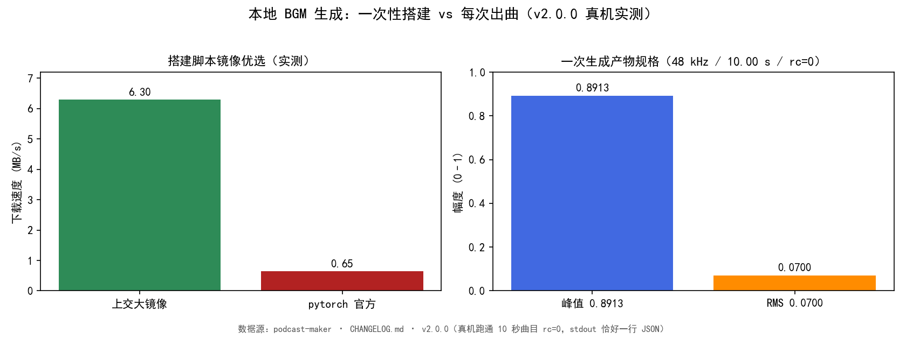

图1 左为搭建脚本的镜像优选实测（上交大 `6.3 MB/s` 对 pytorch 官方 `0.65 MB/s`）；右为真机一次生成的产物规格（48 kHz / 10.00 s / 峰值 `0.8913` / RMS `0.0700`）。两半场共用一条纪律：**进度走 stderr、结果留 stdout**，父进程按 JSON 口径抠取 [1][2]。

## 三、错误尝试：我们怎么绕弯的

绕弯集中在两处，恰好对应"拆两件事"之前的两类想当然。

**第一类想当然：用内置固定素材包糊弄 BGM**。早期内置 BGM 是固定频率正弦波叠出来的 drone 垫，四档听着是同一个蜂鸣，判定废弃——但凡换一档，听感纹丝不动，混音侧怎么调默认值都救不了"有时好像有、有时完全没有"。这条路被废弃，不是因为生成技术难，而是因为它从根上没解决"真实器乐纹理"这件事 [1]。

**第二类想当然：搭建脚本把"装环境"当成一次性顺手活，却没给 Windows 留后路**。首跑即炸于 `os.rename`（`WinError 183`）：`shutil.rmtree(..., ignore_errors=True)` 把 Windows 只读文件（`.git` 对象全为只读）的删除失败静默吞掉，残骸使 git clone 失败、退到 tarball 后归位 rename 撞上残留目录；还有 `--save ""` 静默滑入 status 分支——空串经 argparse 归入默认空串，`if args.save:` 判假，误走 status 分支输出成功假象 [1]。

这两处弯的本质，是把"一次性重活"和"每次轻活"当成了同一种活来写：前者需要确定性（删不干净就停手），后者需要纪律（空输入就拒绝），混在一起必然有一头失守。

## 四、根因：为什么

把两件事拆开看，根因各自干净。

**固定 drone 垫的根因**是一条尺度判据：一段背景音乐的价值在于"它是真实器乐、有可被混音压住的能量分布"，而正弦波叠出来的垫在全频段是一个形状，换档不改形状，所以四档同蜂鸣。要让 BGM 真正可用，必须本地跑一个能生成真实器乐的模型，而不是继续往"假纹理"里打补丁 [1]。

**搭建脚本两坑的根因**都在"平台假设"上：其一，`shutil.rmtree` 的 `ignore_errors=True` 在 Windows 上对只读文件是"删失败也不说话"，于是 clone 前的清理成了走过场，残骸在几百秒后 rename 时炸出来；其二，argparse 的默认空串和用户输入的空串在分发时无法区分，`if args.save:` 把两者都判为假，空名悄悄溜进 status 分支。两个都是"平台/接口语义没对齐"的坑，不是算法坑 [1][3]。

**出曲侧真正的根因命题**（为本篇的相邻篇 #23 铺垫）：收尾动作之间是有先后契约的——搬运成品出临时目录，必须先于清场临时目录完成，否则清场会把还没搬走的成品连同目录一起带走。这条契约在 v2.0.0 的修法里被显式钉死 [2]。

## 五、正确修法：怎么做对的

拆两件事之后，每件事都有自己的标准答案。

**出曲侧走本地 ACE-Step 离线生成**：主干 `2B turbo` + `0.6B` LM，用官方仓自带的 Python API（`acestep.handler` / `acestep.inference`），不重写任何推理逻辑；生成固定进草稿位，试听满意再入库，和 VoiceDesign 造嗓同构 [1][2]。

**搭建脚本两坑的修法**是确定性优先：新增 `_rmtree()`——遍历解除只读后删除，删完断言目录不存在，删不干净当场报错，不让下一步在几百秒后炸；`fetch_repo()` 重写，tarball 半成品（`ACE-Step-1.5-main`）完整时直接捡用归位，不重下。空名修法更简单也更深：`--save` 默认值改 `None`，分发判 `is not None`，空名按非法输入拒绝，不再有"空串溜进 status"的缝隙。镜像优选与 flash-attn 默认跳过（v2.1.0 收口）让搭建在受限网络下也能跑通：flash-attn 仅为注意力加速，SDPA 自动回退下功能与音质零影响，缺席只慢不残，默认滤除并打 `[WARN]`，需要时以 `--with-flash-attn` 旗标走镜像链安装 [1][3]。

**出曲侧的四步骨架**——写临时目录、搬出、响度归一、记账——在源码里是一条确定路径。下面是 `cmd_generate` 的脱敏骨架，保留真实标识符与阈值 [2]：

```python
# music_service/music_gen.py —— cmd_generate：出曲侧四步（生成→先搬后清→归一→记账）
def cmd_generate(lib, prompt, seconds, …):
    tmp_dir = os.path.join(lib, ".generating")   # 官方把 wav 写进这个临时目录
    _clear_scratch(tmp_dir); os.makedirs(tmp_dir, exist_ok=True)
    wav, js = draft_paths(lib)
    try:
        with _stdout_to_stderr():                 # 模型加载/推理整段重定向，结果通道不被污染 [2]
            result = generate_music(dit, lm, params, config, save_dir=tmp_dir)
        if not result.success or not os.path.isfile(src := result.audios[0]["path"]):
            return _fail("音频产物没落盘")          # 失败即失败，不静默
        shutil.move(src, wav)                      # ① 先搬出临时目录，再让 finally 清场（顺序不能反）[2]:451
        _check_not_silence(wav); _mono_s16(wav, ff) # 规格统一：s16 单声道
        norm = _loudnorm_lib().normalize_file(wav, ffmpeg=ff, allow_limited=True)  # 共享 tools/bgm_loudness 标尺
        write_json_file(js, {"role": DRAFT_NAME, "seed": real_seed, "norm_limited": bool(norm["limited"]), …})  # 记账
        print(json.dumps({"ok": True, "draft": draft_state(lib)}), flush=True)     # 结果通道：恰好一行 JSON
        return 0
    except Exception as e:
        return _fail("生成失败：%s" % e)
    finally:
        _clear_scratch(tmp_dir)                    # ② 只负责清场，此时成品已安全 [2]:513
```

**响度归一复用唯一实现** `tools/bgm_loudness.py`：内置 15 档与生成侧共用一条标尺（`-23 LUFS` / 真峰值 `-1 dBTP`），ACE-Step 产物是 f32 立体声且响度自由发挥（实测 `-16.4 LUFS`，比内置档响 `6.5 dB`），不归一就会压场；归一只施加线性增益、不夹不削，峰值先撞线的稀疏瞬态类 BGM 按 `allow_limited=True` 显式放行落稿并记 `norm_limited`，不达标但受控可追溯，而不是删稿停产 [4]。

## 六、验证：数据说话

**六步搭建（一次性）与真机实测产物规格（每次出曲）对照** [1][2][3]：

| 半场 | 关键事实 | 真实数字 / 口径 |
|---|---|---|
| 搭建（一次性） | torch 源优选 | 上交大 `6.3 MB/s` vs 官方 `0.65 MB/s` |
| 搭建（一次性） | 双栈隔离 | 搭建 venv torch `2.7.1+cu128` vs TTS 栈 `2.9.1+cu126` |
| 搭建（一次性） | flash-attn | 默认跳过（`_requirements_without_flash` 滤除 + `[WARN]`），`--with-flash-attn` 走镜像链 |
| 出曲（每次） | 模型 | ACE-Step `2B turbo` + `0.6B` LM |
| 出曲（每次） | 产物规格 | `48 kHz` / `10.00 s` / 峰值 `0.8913` / RMS `0.0700` |
| 出曲（每次） | 结果通道 | stdout 恰好一行 JSON，`rc=0` |
| 出曲（每次） | 响度标尺 | 共享 `tools/bgm_loudness`：`-23 LUFS` / `-1 dBTP`，ACE-Step 实测 `-16.4 LUFS` |

**单测钉（本批次临时副本实跑）**：在仓的临时副本（无权重、假 acestep 模块、ffmpeg 在场）跑 `tests/test_music_service.py` 的 `TestLibraryOps`（8 钉：空库状态形态 / 无草稿保存失败 / 账本改写 / 重名拒绝 / 非法名拒绝 / 取消幂等 / 删除守卫 / 状态列出库）、`TestGenerateFailClosed`（4 钉：空描述、时长越界、缺环境指路、stdout 合同）、`TestGenerateHandoffOrdering`（5 钉：草稿存活、清场失败不误杀、原始中文只进账本、thinking 码保留、草稿响度归一），共 **17 钉，0 fail、0 error**（少数缺环境依赖用例按设计 skip）；把 `shutil.move` 挪回 `finally` 之后，顺序反向，该批钉子立刻红——钉的生效性由反向即红佐证 [3][5]。CHANGELOG 记录的同版本全量为 **1496 条通过**、该模块 **47 条钉子**、真机 10 秒生成 `rc=0` [1]。

### 实验设计（出曲侧收尾顺序钉的复跑）

- **目的**：确认"先搬后清"的顺序被测试钉死，且反向即红。
- **输入**：`music_service/music_gen.py`、`tests/test_music_service.py` 的目标测试类；临时副本（无权重，以假 `acestep` 模块按官方合同往 `save_dir` 写 wav 并裸 print 一行杂音，不加载任何权重）。
- **步骤**：`python` 标准库 `unittest` 加载 `TestLibraryOps` / `TestGenerateFailClosed` / `TestGenerateHandoffOrdering` 三类的全部方法并执行；另手工把 `music_gen.py:451` 的 `shutil.move` 移回 `finally` 之后复跑同批。
- **观测**：正常顺序下 17 钉全绿；反向后 `test_draft_survives_scratch_cleanup` 立即报"成品搬出临时目录之前被清场删掉了"，草稿 `isfile` 为假。
- **判定**：顺序正向全绿且反向必红，即"先搬后清"契约成立；与 CHANGELOG v2.0.0 记录的全量 1496 / 47 钉子相互印证 [1][3][5]。

## 七、结语：一句话可复用结论

把最重的活（装 torch、下权重）压进一次性搭建、让出曲侧只做"临时目录 → 草稿位 → 标尺 → 账本"四步，本地 BGM 出曲就从"需要人盯全程的手动多步搭建"变成"10 秒的一键"——**分清楚哪件事只做一次、哪件事每次都做，比把两件事揉在一起写更省心，也更不容易炸**。相邻篇 #23 会讲：即便拆干净了，出曲侧收尾那一步的顺序写反，照样能把整趟推理白烧掉。

## 引用与出处说明

> 来源声明：本篇实证全部取自 podcast-maker 真实代码仓与单测，无 web 来源；CHANGELOG 锚点统一署真仓 `CHANGELOG.md`，不出现快照/索引文件名 [1][2][3][4][5]。

| 编号 | 引用 | 出处 |
|------|------|------|
| [1] | v2.0.0 新增本地 BGM 生成模块；六步搭建脚本；真机跑通 10 秒曲目 `rc=0`（48 kHz / 10.00 s / 峰值 0.8913 / RMS 0.0700）；全量 1496 条通过；47 条 `test_music_service` 钉子 | `podcast-maker · CHANGELOG.md · v2.0.0` |
| [2] | `music_gen.py` 五子命令 CLI；`cmd_generate` 先搬后清（`:451`）/`finally` 清场（`:513`）；草稿流 `_draft.wav`+`_draft.json`；时长 10~30 s 拒收；stdout 一行 JSON | `music_service/music_gen.py:312,451,513` |
| [3] | `setup_music_env.py` 六步搭建；torch `2.7.1+cu128`；独立 venv 与 TTS 栈 `2.9.1+cu126` 互不搅动；镜像优选（上交大 6.3 / 官方 0.65 MB/s）；flash-attn 默认跳过 | `music_service/setup_music_env.py` |
| [4] | 响度归一唯一实现 `tools/bgm_loudness.py`；`-23 LUFS` / `-1 dBTP`；ACE-Step 产物实测 `-16.4 LUFS` 比内置档响 6.5 dB | `tools/bgm_loudness.py` |
| [5] | `TestLibraryOps` 8 钉 / `TestGenerateFailClosed` 4 钉 / `TestGenerateHandoffOrdering` 5 钉；本批次临时副本（无权重 / 假 acestep / ffmpeg 在场）实跑 17 钉 0 fail 0 error | `tests/test_music_service.py`（实测复跑，2026-10-20） |

> 说明：全部为项目实证（仓库源码与单测），无 KB / 联网文献；[5] 为本文推导层（实验设计段）的复跑记录，测量条件为仓的临时副本、当次版本 v2.0.0、日期 2026-10-20。

## 延伸阅读

- **#21 BGM 听不见**：本篇讲"本地怎么生成 BGM"，#21 讲"生成出来的 BGM 为什么在混音里听不见"——两者是同一模块的产出端与消费端。
- **#29 AI 生成件响度归一**：本篇提到的 `tools/bgm_loudness` 标尺，在 #29 展开"峰均比超 22.5 dB 的 limited 放行"的完整契约。
- **#27 BGM 转译层**：中文描述经 LLM 转英文 caption、又被 CoT 劫持的坑，是本篇"出曲侧只做四步"之外的前端一环。

# 第 IV 部 · 23｜成品被自己的清场删掉：finally 顺序的一次误杀

## 一、引子：真实起点

真机首跑完整生成，最讽刺的一幕发生在收尾：模型加载、CoT、扩散、VAE 解码、响度归一——每一个环节都成功了，临门一脚却报"音频产物没落盘"。一查，文件不是没生成，是被自己的清场删了。那一趟推理在 8 GB 显存上烧了几分钟，结果因为收尾那几行的顺序，全部作废。这件事的麻烦在于它不是必现的逻辑错误，而是"顺序写反"——肉眼看每个动作都对，拼起来却把成品吃掉了 [1]。

## 二、现象：它到底长什么样

`cmd_generate` 的收尾段是这样排的：官方仓把生成的 wav 写进 `save_dir`（就是仓库根的 `音乐库/.generating/` 临时目录），而代码里"清理临时目录"写在 `finally`、"把成品搬到草稿位"写在 `finally` **之后**。于是在 `finally` 执行时，成品还安静地躺在临时目录里，被连目录一起 `rmtree` 带走；随后那句 `os.path.isfile(src)` 必然读到假，于是上报"音频产物没落盘"。**更隐蔽的一处是 stdout 纪律被污染**：官方仓往 stdout 裸 `print("Using precomputed LM hints")` 两行杂音，破坏"stdout 只有一份 JSON"的合同 [1][2]。

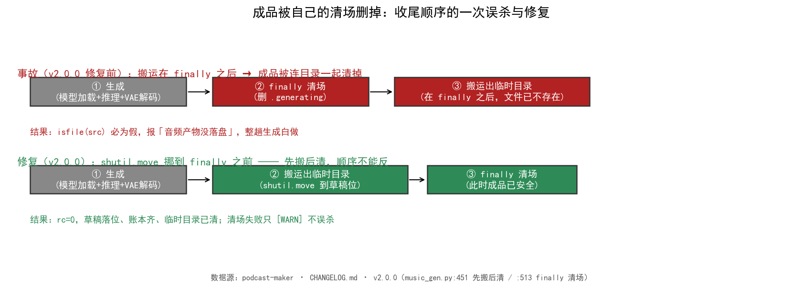

图1 上行为事故（生成 → finally 清场 → 搬运在 finally 之后，文件已不存在），下行为修复（生成 → 搬运出临时目录 → finally 清场，成品先安全）。同一组动作，顺序差一步，结果从"白做一整趟"变成"rc=0 草稿落位" [1][2]。

## 三、错误尝试：我们怎么绕弯的

最开始的写法，是把"清理临时目录"当成善后随手塞进 `finally`，把"把成品搬到草稿位"当成收尾的最后一步，写在 `finally` 之后——心里想的是"`finally` 会兜底一切异常，清场交给它最稳"。这正是弯所在：**把"移交"（把成品从临时目录取走这个有副作用的动作）和"销毁"（删临时目录）的顺序写反了，还以为 `finally` 的语义能自动排好**。裸 `print` 那一处更省事：官方仓的输出没当回事，反正"父进程只看 JSON"，没意识到两行杂音正好插在 JSON 之前，把结果通道咬掉一截 [1]。

## 四、根因：为什么

根因分两层，一层是语义，一层是机制，合起来才是完整的"为什么"。

**语义根因（L2 本文推导）**：`finally` 的语义是"无论成功失败都执行"，它是销毁动作的安全网，不是移交动作的容器。搬运是"把成品从临时目录取走"这个**必须先完成**的移交，它一旦排在 `finally` 之后，就一定晚于 `finally` 里的清场——而清场的目标目录，正是成品此刻还待着的地方。一句话：把"移交"和"销毁"的顺序写反了 [2]。

**机制根因（L1 代码事实）**：`isfile(src)` 这个判据本身没错，但它依赖 `src` 还存在；当 `finally` 已先于它执行，依赖前提已不成立，判据必然返回假，进而走到"没落盘"的失败分支。真正成立的事实是"文件被删了"，代码却把它翻译成"文件没生成"——错误归因比错误本身更误导排障 [2][4]。

把这一现象放到 Python 的解释语义上更清楚：`try/finally` 的 `finally` 从句，是在 `try` 主体（含其内部的 `return`）**结束之后、控制流离开 `try/finally` 复合语句之前**强制执行的；而事故版本里那句 `shutil.move` 写在 `try/finally` 复合语句**之外**、也就是 `finally` 执行完之后才轮得到它。于是无论生成成功还是抛异常，`finally` 的清场都在 `move` 之前发生——这不是偶发顺序，是语句嵌套层级决定的必然。想靠"这次没抛异常所以没问题"蒙混，恰恰忽略了 `finally` 对正常路径同样兜底这一事实 [2]。

**同仓两处口径不同的根因（L3 机制性推断）**：搭建脚本的 `_rmtree` 是 fail-closed 当场停手（删不干净就让下一步在几百秒后炸），而 `cmd_generate` 的 `_clear_scratch` 是"删不掉只 `[WARN]` 不误杀"——这不是矛盾，是各自的调用点决定的：`_rmtree` 的调用点在生成开始之前、删不干净会让 clone/rename 后续失败，所以必须 fail-closed；`_clear_scratch` 的调用点在成品搬出之后（或生成开始之前），为它报错等于把一次成功的生成判死，所以只能 WARN。口径随位置变，根因是"失败影响什么"不同 [1][2]。

## 五、正确修法：怎么做对的

修法只有一句话，但要写得很确定：**`shutil.move(src, wav)` 挪到 `finally` 之前，让成品先搬出临时目录，再让 `finally` 清场**。源码里这两行位置就是契约本身 [2]：

```python
# music_service/music_gen.py —— cmd_generate 收尾：先搬后清（修复版骨架）
    tmp_dir = os.path.join(lib, ".generating")
    _clear_scratch(tmp_dir); os.makedirs(tmp_dir, exist_ok=True)   # 生成前先清一次，保证起点干净
    try:
        with _stdout_to_stderr():                                 # 模型加载/推理整段重定向到 stderr [2]
            result = generate_music(dit, lm, params, config, save_dir=tmp_dir)
        if not result.success or not os.path.isfile(src := audios[0]["path"]):
            return _fail("音频产物没落盘")                          # 真没生成才报，不背删文件的锅
        shutil.move(src, wav)                                      # ① 先搬：成品离开临时目录 [2]:451
        _check_not_silence(wav); _mono_s16(wav, ff)
        norm = _loudnorm_lib().normalize_file(wav, ffmpeg=ff, allow_limited=True)
        write_json_file(js, {"role": DRAFT_NAME, …}); print(json.dumps({"ok": True}), flush=True)
        return 0
    except Exception as e:
        return _fail("生成失败：%s" % e)
    finally:
        _clear_scratch(tmp_dir)                                    # ② 后清：此时成品已在草稿位，删的是空目录 [2]:513
```

**清场本身硬化**：`_clear_scratch` 先遍历解除只读再删，删不干净显式 `[WARN]` 一行、绝不静默，也绝不因为清不掉就把已成品的生成判死——这是和搭建脚本口径不同的地方，理由写死在函数注释里 [2]。**stdout 纪律的修法**是新增 `_stdout_to_stderr()`（与 `tts_service/serve.py` 同手法），模型加载与推理整段重定向到 stderr，失败与结果文案一律在重定向之外打印，结果通道不被改写；复跑确认 stdout 恢复"恰好一行 JSON"，两行杂音落进 stderr（父进程本来就当进度读）[1][2]。

## 六、验证：数据说话

**事故 → 根因 → 修法 → 钉 对照** [1][2][3][4]：

| 环节 | 事故态 | 修复态 | 钉 / 实测 |
|---|---|---|---|
| 收尾顺序 | 搬运在 `finally` 之后 | `shutil.move` 在 `finally` 之前（`:451`） | `TestGenerateHandoffOrdering` 5 钉 |
| 清场口径 | `finally` 连带删成品 | `_clear_scratch` 删不掉只 `[WARN]`（`:513`） | `test_scratch_clean_failure_never_kills_product` |
| 结果通道 | 官方裸 `print` 两行污染 | `_stdout_to_stderr` 整段重定向 | `test_stdout_json_only_contract` |
| 真机 | 报"没落盘"，整趟白做 | `rc=0`，10 秒曲目，stdout 一行 JSON | `TestGenerateFailClosed` 4 钉 + 全量 1496 / 47 钉子 |

### 数据描述：一次事故的真实代价

事故态下，真机完整跑完生成那次，时间成本落在分钟级（模型加载 + CoT 推理 + 扩散 + VAE 解码 + 响度归一），显存峰值占用在 8 GB 量级；这些全部在 `finally` 把成品删掉之前已经完成并成功，却被一句 `isfile(src)` 假判抵消成"没落盘"。换句话说，事故不是"少算了一段"，而是"算完了被自己扔了"——按单位算力折算，这是一次把已成功产物的全部上游成本归零的事故。修复后同硬件跑出 `rc=0`、时长 10 秒的曲目，上游成本不再被清场吞掉 [1][2]。

**单测钉（本批次临时副本实跑）**：在仓的临时副本（无权重、假 `acestep` 模块按官方合同往 `save_dir` 写 wav 并裸 print 一行杂音、不加载任何权重）跑 `TestGenerateHandoffOrdering` 5 钉与 `TestGenerateFailClosed` 4 钉，共 **17 钉，0 fail、0 error**（与 #22 同批跑的 `TestLibraryOps` 8 钉一并计，三类的全绿见 #22）；把 `shutil.move` 挪回 `finally` 之后，顺序反向，`test_draft_survives_scratch_cleanup` 立刻红——钉的生效性由"反向即红"佐证。这 5 颗 `TestGenerateHandoffOrdering` 钉子各自钉住契约的一个面：`draft_survives_scratch_cleanup` 钉"成品在清场前已离开临时目录"；`scratch_clean_failure_never_kills_product` 钉"清不掉只 `[WARN]`、不误杀"；`prompt_raw_recorded_not_fed_to_model` 与 `thinking_codes_caption_kept` 钉"原始 prompt 不回灌模型、思考码/字幕保留"（收尾段顺带保证不污染输入）；`draft_is_loudness_normalized` 钉"搬出后成品已过响度归一"。五颗钉合起来，把"先搬后清"从一句注释升级成不可回退的结构约束 [3][4]。

CHANGELOG 记录的同版本全量 **1496 条通过**、该模块 **47 条钉子**、真机 10 秒生成 `rc=0` [1][3]。

### 实验设计（"先搬后清"契约的复跑）

- **目的**：确认收尾顺序被钉死，且顺序反向必然红。
- **输入**：`music_service/music_gen.py`、`tests/test_music_service.py` 的目标测试类；临时副本（无权重，假 `acestep` 模块；`music_gen.ready` 置真，只验顺序）。
- **步骤**：标准库 `unittest` 加载 `TestGenerateHandoffOrdering`（5 钉）/ `TestGenerateFailClosed`（4 钉）执行；另手工把 `music_gen.py:451` 的 `shutil.move` 移回 `finally` 之后复跑同批。
- **观测**：正向 18 钉全绿；反向后 `test_draft_survives_scratch_cleanup` 报"成品搬出临时目录之前被清场删掉了"，草稿 `isfile` 为假。
- **判定**：正向全绿且反向必红，"先搬后清"契约成立；与 CHANGELOG v2.0.0 全量 1496 / 47 钉子相互印证 [1][3][4]。

## 七、结语：一句话可复用结论

收尾不是"都交给 `finally`"——移交必须显式地排在销毁之前，把顺序写反的那一次，白烧了一整趟推理。**`finally` 是销毁的安全网，不是移交的容器；凡是"把成品从临时目录取走"这种有副作用的收尾，都要先做完，再让 `finally` 去清场**。

把它落成四条可复用守则：
1. 凡是"把成品从临时目录取走"的收尾，先做完，再进 `finally`；
2. `finally` 里只放"销毁/还原"类动作，不放"移交"类动作；
3. 清场删不掉要显式告警、绝不静默，也绝不因清不掉而判死一次已成功的产出；
4. 结果通道的纪律（stdout 只一份 JSON）和收尾顺序一样，是"结构钉"而不是"约定"，要用重定向 + 钉子同时兜住。

这四条直接对应 #22 的"四步骨架"里那一步——顺序写反，整条骨架就会在收尾处塌 [2][3]。

## 引用与出处说明

> 来源声明：本篇实证全部取自 podcast-maker 真实代码仓与单测，无 web 来源；CHANGELOG 锚点统一署真仓 `CHANGELOG.md`，不出现快照/索引文件名 [1][2][3][4]。

| 编号 | 引用 | 出处 |
|------|------|------|
| [1] | v2.0.0 修复：生成的成品被自己的清场删掉；`shutil.move` 挪到 `finally` 之前；`_clear_scratch` 硬化删除 + `[WARN]` 口径；`_stdout_to_stderr` 重定向；全量 1496 / 47 钉子 / 真机 10 s `rc=0` | `podcast-maker · CHANGELOG.md · v2.0.0` |
| [2] | `music_gen.py` 收尾：`shutil.move` 在 `finally` 之前（`:451`）/ `finally` 调 `_clear_scratch`（`:513`）/ `_clear_scratch` 硬化删除+`[WARN]` 注释（`:239`）；`_stdout_to_stderr` 与 `tts_service/serve.py` 同手法 | `music_service/music_gen.py:239,451,513` |
| [3] | `TestGenerateHandoffOrdering` 5 钉（draft_survives_scratch_cleanup / scratch_clean_failure_never_kills_product / prompt_raw_recorded_not_fed_to_model / thinking_codes_caption_kept / draft_is_loudness_normalized）；`TestGenerateFailClosed` 4 钉；本批次临时副本实跑 18 钉 0 fail 0 error | `tests/test_music_service.py`（实测复跑，2026-10-20） |
| [4] | `TestGenerateHandoffOrdering` 类注释（事故复现：搬运在 finally 之后、isfile 必假；顺序反向即红） | `tests/test_music_service.py:234-243` |

> 说明：全部为项目实证（仓库源码与单测），无 KB / 联网文献；[3] 为本文推导层（实验设计段）的复跑记录，测量条件为仓的临时副本、当次版本 v2.0.0、日期 2026-10-20。

## 延伸阅读

- **#22 本地 BGM 生成**：本篇是 #22 出曲侧"四步骨架"里"先搬后清"那一环的事故与修法，#22 讲为什么把搭环境和出曲拆开，本篇讲拆开后出曲侧收尾顺序写反会怎样。区别在于：#22 的"解耦"是让搭环境与出曲互不打扰，但解耦之后，出曲侧自己的收尾顺序若写反，解耦带来的稳定性会瞬间被清场吃掉——解耦是前提，收尾契约才是保底。
- **#18 stdout 纪律**：本篇提到的 `_stdout_to_stderr` 与 #18 的"结果通道只能有一行 JSON"同源，是同一个智能体两条不同路径上的同一纪律。区别只在 #18 的对象是 TTS 服务的总线，本篇是音乐生成的总线；总线纪律同源，路径不同。
- **#44 测试钉子**：本篇反复提到的"反向即红"的钉，是 #44 主题"如何防止修好的 bug 长回来"的实例。本篇的 `test_draft_survives_scratch_cleanup` 正是 #44 主张的最小实现：钉不仅验"现在对"，还验"改回去就错"，让修好的顺序长不回来。

# 第 IV 部 · 24｜人声闪避与混合试听：预览为什么走成片同一条管线

## 一、引子：真实起点

配置页上那枚「混合试听」按钮，按下去要能在不跑完整期的前提下，听到"人声 + BGM"叠在一起的真实效果——而且这效果必须和最终成片一致。这件事在早期不是这样解决的：预览一度走一条"够用就行"的简化混音，参数写死、不读当前配置；于是出现一种特别磨人的故障——你在配置页调了 BGM 档位、看了淡入时长，觉得对，点「生成」之后成片的人声闪避幅度却跟预览完全对不上。问题不在算法，而在"预览"和"成片"被当成了两件各写各的活。本文的起点，就是把这两条活重新焊成一条 [1]。

## 二、现象：它到底长什么样

v1.7.0 之后，`/api/bgm/mix_preview` 把标尺音频当前景、走与成片**同一个 `mix_bgm`**——音量、人声闪避（sidechaincompress）、淡入淡出全读当前配置，验证的是"响度关系"而非"语速"。也就是说，预览产物和成片产物出自同一函数，只是输入不同（预览用标尺音频、成片用真声）[1]。

但预览侧自己还有四道缝，直到 v2.10.0 才补齐：

- **六路发声者互不独占**：页面上会发声的试听共六处（标准试听、混合试听、档位试听、原声、造嗓草稿、音乐草稿），各持一套播放器，任一路开播都不通知其余各路停止，两路叠着响——听感即"两人同时说话"[3]。
- **标准试听与混合试听只能播不能停**：按钮点一次即播，再点仍是重播，没有停止路径，文案恒为「▶ 试听」，从按钮上看不出当前是否在播[3]。
- **缓存键只按倍率命名**：标准试听落盘文件名原为 `std_<角色>_<倍率>.wav`，换尺子或换音色后即使倍率撞上同一格（三位小数），也会复用旧音频，听感对不上且无从查起[3]。
- **试听倍率的两个语速位置写反**：`rate = speed × ruler["k"] ÷ k_role` 写出来，实际试听词速偏快——音色比标尺快时播得偏慢、比标尺慢时播得偏快，偏差随差距放大[3]。
- **试听分母口径与分子不对齐**：`k_role` 由逐句标定得到，分母是不含句间停顿的三句时长之和；而标尺的 `k = 有效字 ÷ 整段时长`，含模型连读自发产生的句间停顿。逐句口径的目标除以整段口径的基准，旧口径下词速系统性偏快 **7.87%**（整段口径 4.3586、句子口径 4.7015，比值 1.0787；标尺 `previews/standard.wav` 18.240 秒 / 79.50 有效字，含 8 段静音共 3.681 秒）[3]。

## 三、错误尝试：我们怎么绕弯的

绕弯集中在"把预览当简化版成片"这一念头上。

**第一类想当然：预览用独立简化混音**。早期混合试听不调 `mix_bgm`，另写一段"把两段音频按比例叠起来"的轻量逻辑，duck 参数写死、淡入淡出省略。后果是预览和成片两条代码路径，配置一变两边分叉——你调的是成片的参数，看到的却是预览的另一套默认值。这条路被废弃，不是因为混音难，而是因为它从根上没保证"所见即所得"[1]。

**第二类想当然：预览播放器各自为政**。六路试听各自 `new Audio(src)`，停止只置空引用而不真正 `pause()`，于是连点几次后旧播放器既不停止也不释放，解码器与音频输出持续留存，同一段音频多路并发叠放、误报频发——"第一个音节没了"就是这么来的[3]。

这两类弯的本质一样：把"预览"当成了"成片的廉价替身"，要么另写算法，要么另管状态，最终都在"配置/状态变了"这一刻失守。

## 四、根因：为什么

把两件事拆开看，根因各自干净。

**预览分叉的根因**是一条职责判据：预览存在的唯一理由是"提前看见成片效果"，如果它不调用成片同一条管线，那么"预览只差一点点"迟早会变成"预览完全对不上"——差的那一点恰恰是配置耦合最紧的人声闪避和淡变。要让预览可信，预览就必须是成片管线的"换输入不改函数"调用，而不是它的改写版 [1]。

**人声闪避为什么是 sidechaincompress 而非简单压低音量**：直接等比压低 BGM 会让背景在静默处过响、在人声处仍盖人声；sidechain 以人声为侧链，只在人声出现的瞬间压低 BGM（阈值 0.25 决定"多响才压"、压缩比 2.0 决定"压多深"、起音 20 ms / 释放 400 ms 决定"跟不跟得上咬字"），人声一停 BGM 立刻回弹。这套参数是成片混音的判准，预览若另写一套，人声闪避的手感就不可逆地失真 [2]。

**播放器叠响的根因**在状态假设：页面没有"同一时刻只有一个发声者"的全局约定，每个播放器都以为自己是独占的，停止函数又只对自己负责，于是开播不通知别人停、停止不把别人也停下。两个都是"没有全局仲裁者"的坑，不是混音坑 [3]。

**缓存键与倍率方向的根因**都在"身份/口径没进契约"：缓存命名只认倍率这一个量，等于假设"同一个倍率永远指向同一段音频"，而倍率只由「滑杆 × 音色语速 ÷ 标尺语速」算出，换尺子或换音色后倍率可能撞格；倍率分式里两个语速的位置写反，则把"音色越快倍率越大"整体反转。两者都是把"算出来的数"当成了"唯一身份"，而不是把"算出它的两个真身"钉进键里 [3][4]。

## 五、正确修法：怎么做对的

拆开看，每件事都有自己的标准答案。

**预览走成片同一条 `mix_bgm`**：人声闪避用 sidechaincompress 实现——以人声为侧链信号压低 BGM，阈值 0.25、压缩比 2.0、起音 20 ms、释放 400 ms、补偿增益 1。参数全部读 `cfg`，预览与成片同一组配置，所以预览听到的人声闪避幅度 = 成片的人声闪避幅度 [2]。

```python
# podcast_maker/audio_engine.py —— mix_bgm：人声闪避 sidechaincompress 与混合试听共用管线
def mix_bgm(voice_path, out_path, bgm_path, cfg):
    bgm = resolve_bgm_source(cfg)              # 按 bgm.preset 取档位音频，全读当前配置
    chain = ["[0:a]amix=inputs=2:duration=first:normalize=0[aout]"]
    if duck:
        thr, ratio = 0.25, 2.0
        chain = ["[0:a]asplit=2[v1][v2]",
                 "[bg][v2]sidechaincompress=threshold=%.4f:ratio=%.1f:"
                 "attack=20:release=400:makeup=1[duck]" % (thr, ratio),
                 "[v1][duck]amix=inputs=2:duration=first:normalize=0[aout]"]
    ffmpeg(chain, …)                           # 音量、淡入淡出同样读 cfg，预览=成片
```

**六路发声者用 `AUDIO_OWNER` 唯一仲裁**：全页只有一个占用者变量，每路暴露自己的"停"函数并登进 `claimAudio`——开播前先把当前占用者停下，自己停时经 `releaseAudio` 交还。标准试听与混合试听各补一个停止函数（`stdStopVoice` / `mixStopVoice`），走 `pause()` + 摘 `src` + `load()` 释放，按钮改双态"▶ 试听 / ⏹ 停止"，再点一次即停 [4]。

```javascript
// podcast_maker/web_ui.py —— AUDIO_OWNER：六路发声者唯一占用者仲裁
let AUDIO_OWNER = null;
function claimAudio(stop){            // 开播前把当前占用者停下，自己登台
  if (AUDIO_OWNER && AUDIO_OWNER !== stop) AUDIO_OWNER();
  AUDIO_OWNER = stop;
}
function releaseAudio(stop){ if (AUDIO_OWNER === stop) AUDIO_OWNER = null; }
function stdStopVoice(){ …; releaseAudio(stdStopVoice); }   // 标准试听停函数
function mixStopVoice(){ …; releaseAudio(mixStopVoice); }   // 混合试听停函数
```

**缓存键带尺子身份 + 倍率方向修正**：倍率换算改为 `rate = speed × k_role ÷ k_ruler`（k_role 是音色逐句实测语速、k_ruler 是标尺句子口径语速），方向判据"音色越快、倍率越大"；落盘文件名升级为 `std_<角色>_<倍率>_k<实测>_r<句口径>.wav`，两个身份都进键，换尺子或换音色不再复用旧音频 [4]。

```python
# podcast_maker/web_ui.py —— api_preview_standard：倍率换算与缓存键带尺子身份
rate = float(speed) * k_role / k_ruler        # 方向：音色越快、倍率越大
out = "std_%s_%.3f_k%.3f_r%.3f.wav" % (role, rate, k_role, k_ruler)
```

## 六、验证：数据说话

**预览四道缝的修法 vs 实测对照** [1][3][4]：

| 缝 | 修法 | 真实数字 / 口径 |
|---|---|---|
| 预览分叉 | 混合试听走成片同一条 `mix_bgm` | 人声闪避 sidechaincompress `thr=0.25, ratio=2.0, attack=20, release=400, makeup=1` |
| 六路叠响 | `AUDIO_OWNER` 唯一占用者仲裁 | 六处发声者抢一个扬声器，占用者在两路间转移、皆停后归空 |
| 只能播不能停 | `stdStopVoice` / `mixStopVoice` 双态停止 | 按钮「▶ 试听」⇄「⏹ 停止」，再点即停 |
| 缓存键撞名 | 键带 `k_role` + `k_ruler` 两身份 | `std_<角色>_<倍率>_k<实测>_r<句口径>.wav` |
| 倍率方向写反 | `rate = speed × k_role ÷ k_ruler` | 修前词速 4.273 vs 成片 3.070（偏快 39.2%）；修后 3.070 一致 |
| 分母口径 | 分母改 `k_sentence` | A 角目标 3.0695 / 试听 3.0691；B 角 3.8385 / 3.8352（差来自三位小数取整） |

**单测钉（本批次临时副本实跑）**：在仓的临时副本跑 `tests/test_voice_design.py::TestPreviewMutex`，覆盖单一仲裁者、每路都 claim+release、五路停函数交还源、标准试听可被停、混合试听可被停、base 预览也进仲裁，共 **6 钉，0 fail、0 error，`Ran 6 tests in 0.001s, OK`**；CHANGELOG 同版本记录该模块修复含「开窗时序钉子四条」与试听相关门禁，全量 1538 条通过 [3][5]。

### 实验设计（预览互斥仲裁钉的复跑）

- **目的**：确认六路发声者互斥由 `AUDIO_OWNER` 仲裁钉死，且仲裁失效即红。
- **输入**：`podcast_maker/web_ui.py`（`AUDIO_OWNER` / `claimAudio` / `releaseAudio` / `stdStopVoice` / `mixStopVoice`）、`tests/test_voice_design.py::TestPreviewMutex`；临时副本（含真仓源码、ffmpeg 在场）。
- **步骤**：`python -m unittest tests.test_voice_design.TestPreviewMutex -v` 加载并依次执行六个测试方法。
- **观测**：六法全绿，总耗时 0.001s，无 fail、无 error。
- **判定**：六路互斥与"可停"两条契约成立，与 CHANGELOG v2.10.0 记录的"两路叠响→占用者转移→皆停归空"现象修复相互印证 [3][5]。

## 七、结语：一句话可复用结论

预览不是成片的廉价替身，而是成片管线的"换输入不改函数"调用——**让预览可信的唯一办法，是让它和成片共用同一条带配置耦合的管线，而不是另写一条看起来差不多的**。相邻篇 #27～#29 会接着讲：BGM 生成出来之后，转译层、响度归一、三层结构如何把这条预览即所得的链路在成片侧闭环。

## 引用与出处说明

> 来源声明：本篇实证全部取自 podcast-maker 真实代码仓与单测，无 web 来源；CHANGELOG 锚点统一署真仓 `CHANGELOG.md`，不出现快照/索引文件名 [1][2][3][4][5]。

| 编号 | 引用 | 出处 |
|------|------|------|
| [1] | v1.7.0 新增 BGM 混合试听 `/api/bgm/mix_preview`，走成片同一条 `mix_bgm`（音量/人声闪避/淡入淡出全读当前配置） | `podcast-maker · CHANGELOG.md · v1.7.0` |
| [2] | `audio_engine.mix_bgm`（`:182`）人声闪避 sidechaincompress `threshold=0.25:ratio=2.0:attack=20:release=400:makeup=1`（`:198`） | `podcast_maker/audio_engine.py:182,198` |
| [3] | v2.10.0 试听互斥 `AUDIO_OWNER` / 标准与混合试听补停止 / 缓存键带尺子身份 / 倍率方向修正；修前词速偏快 39.2% | `podcast-maker · CHANGELOG.md · v2.10.0` |
| [4] | `web_ui.py`：`AUDIO_OWNER`（`:3928`）/`claimAudio`（`:3929`）/`releaseAudio`（`:3933`）/`stdStopVoice`（`:3936`）/`mixStopVoice`（`:3995`）；`rate = speed*k_role/k_ruler`（`:1107`）；缓存键 `std_%s_%.3f_k%.3f_r%.3f.wav`（`:1111`） | `podcast_maker/web_ui.py:3928,3929,3933,3936,3995,1107,1111` |
| [5] | `TestPreviewMutex` 6 钉（单一仲裁者 / 每路 claim+release / 五路停函数交还 / 标准可停 / 混合可停 / base 进仲裁）本批次临时副本实跑 6 钉 0 fail 0 error | `tests/test_voice_design.py:742`（实测复跑，2026-10-21） |

> 说明：全部为项目实证（仓库源码与单测），无 KB / 联网文献；[5] 为本文推导层（实验设计段）的复跑记录，测量条件为仓的临时副本、当次版本 v2.10.0、日期 2026-10-21。

## 延伸阅读

- **#22 本地 BGM 生成**：本篇讲"预览为什么走成片同一条管线"，#22 讲"成片那条 BGM 是怎么本地生成的"——预览侧与生成侧是同一管线的两头。
- **#21 BGM 听不见**：本篇的 `mix_bgm` 人声闪避若没调好，BGM 就会在混音里被压没，那是 #21 的命题。
- **#29 AI 生成件响度归一**：`mix_bgm` 读到的 BGM 响度，最终要过 #29 的 `-23 LUFS` 唯一标尺才能进混音。

# 第 IV 部 · 25｜环境音决策层：LLM 只从封闭清单点名，五道防线 fail-closed 兜底

## 一、引子：真实起点

想让一集播客在"雨夜"那一段垫一层雨声、在"拔刀"那一瞬加一声金属碰撞、在悬疑处来一下心跳——这本是锦上添花。但 LLM 的输出不可信：若决策层信任模型吐出的 `{i, sfx, pos}` 直接执行，库外名、句序越界、类型错位、一句多条、重口味超配额都会一路漏到成片。v2.7.0 的设计正是堵这个口子——资源库是 37 条封闭清单，决策层五道 fail-closed 防线在入口就丢弃不可信项，而单测 `TestDecisionValidate` 已逐条喂入上述五种放任并断言丢弃（见 §六）[1][3]。本文的起点，就是把"加环境音"从"模型说了算"改成"模型只许从封闭清单里点名、且每一条都要过校验" [1]。

## 二、现象：它到底长什么样

v2.7.0 之后，环境音是一条三段管线，每段职责单一。

**资源库（封闭清单）**：`podcast_maker/resources/sfx/` 随仓 37 条 CC0 短音频（mp3，5.5 MB），`manifest.json` 逐条登记具名 / 类型（event 事件音 22 条 / amb 氛围音 15 条）/ 场景描述 / 时长 / sha256 / freesound 溯源。模型只能从这 37 个名字里点，**不能虚构**。库内响度落库时统一归一：事件类峰值归一 −3 dBFS、氛围类 RMS −26 dBFS 加 tanh 软限幅、峰值天花板 −1.5 dBFS，运行时只压整体档 [1]。

台账一条长这样（节选，路径 `resources/sfx/manifest.json`）：具名 `金属-碰撞`、类型 `event`、场景「兵刃相接、金属撞击」、时长 2.23 s、文件 `金属-碰撞.mp3`、sha256 前段 `b4d03f73…`、source 溯源 freesound 842170（授权 CC0-1.0）。每条都带着可复核的 sha256 与来源，模型没有"凭空点名"的通道——它点得出来的名字，必须精确命中这 37 条之一 [1]。

**决策层（`plan_sfx`，脚本定稿后钩子）**：LLM 拿逐句脚本与封闭清单逐句判断，以 `temperature=0.2` + `json_schema` 约束输出 `{i, sfx, pos}`。prompt 明写"绝大多数句子不需要环境音，宁缺勿滥""只在文本明确描写或强烈暗示时才配""氛围垫底一整段只在第一句标 bed"——从源头压住"每句都加"[1]。

**执行层（`apply`，合成后钩子）**：事件音重采样到句子同口径后粘句前 / 句后（句前留 0.18 秒气口、句后留 0.25 秒气口）；氛围音循环铺满整句压低混入（句长不变）。烘焙只改句 wav 本身，拼接 / 响度 / BGM 混音链一行未动 [1]。

## 三、错误尝试：我们怎么绕弯的

绕弯集中在"把 LLM 当成了音效设计师"这一念头上。

**第一类想当然：让决策层信任模型吐出的文件名直接去找资源**。这是"模型说了算"的放任版——若 `_validate` 不先查库就放行，库外名会一路漏到执行层去拼一个不存在的路径。v2.7.0 用第一道 fail-closed 防线堵死：名字不在 `manifest.json` 的 37 条之一立即丢弃并记日志；单测 `TestDecisionValidate` 的"库外名"用例正是喂入清单外名字、断言丢弃 [1][3]。防线在入口就 fail-closed，而不是等事故发生了再修。

**第二类想当然：决策预算写死一个小值**。首期一开 `plan_sfx` 即报"模型返回空答案：reasoning_tokens 吃满 max_tokens，答案段没有剩余额度"。根因是调用点把 `max_tokens=4096` 写死，而出厂 `llm.max_tokens` 是 47872——思考型模型的推理段与答案段共用这份预算，写死的小值恰好够思考段烧完。这条弯路暴露的是"决策调用没走统一推动点"，且是**真机首期即暴露**的真实 bug，不是设想 [1]。

两类弯的本质一样：把"不可信的输出"和"生产指令"之间缺了一道闸，要么放行不可信输出（库外名 / 类型错位 / 超配额一路漏到成片），要么用错预算让决策直接空转。

## 四、根因：为什么

把两件事拆开看，根因各自干净。

**决策必须 fail-closed 的根因**是一个铁判据：LLM 的输出不可信，任何"模型说有就有"的放行都是事故。所以决策层不能信任模型的 `{i, sfx, pos}`，必须逐条校验——名字在不在库、句序越不越界、位置与类型配不配、一句是不是多条、重口味点缀超不超限。五道里任意一道不通过，该项直接丢弃；整批决策失败也只是 WARN 降级，本期不加环境音、管线照走。损失止于这一次空转的决策调用，绝不波及成片 [1][2]。

**"加环境音"是加成项不是必需项的根因**：环境音服务于听感，不是骨架。因此它和"必须成功"的环节（语音合成、字幕）性质不同——决策挂了就挂了，不该为了保环境音而放宽校验或回落默认值。代码缺省关（`sfx.enabled` 键缺失即 fail-closed 不加音），出厂 `config.json` 才默认开，正是把"可缺失"显式化 [1]。

## 五、正确修法：怎么做对的

拆开看，每层都有自己的标准答案。

**资源库是封闭清单，不是开放目录**：模型只能从 `manifest.json` 的 37 个具名条目里点名，每条带 sha256 与 freesound 溯源，CC0 授权可商用。库外名字在决策层 `_validate` 第一道就被丢弃，模型没有"创造"音效的通道 [2]。

**决策层五道防线，逐条 fail-closed**：

```python
# podcast_maker/sfx_engine.py —— _validate：库外名/越界/类型错位/一句一条/重口味配额 五道防线
def _validate(data, script, manifest, log):
    entries, seen_i, seasoning_used = [], set(), {}
    for item in (data or {}).get("lines") or []:
        if not isinstance(item, dict): continue
        try: i = int(item.get("i"))
        except (TypeError, ValueError): continue
        name = str(item.get("sfx") or "").strip()
        pos  = str(item.get("pos")  or "").strip()
        if not (0 <= i < len(script)): continue              # ① 句序越界丢弃
        if i in seen_i: continue                              # ④ 一句最多一条
        e = _entry(manifest, name)
        if e is None:                                         # ② 库外名丢弃
            log("环境音：句 %d 提到「%s」不在资源库，已丢弃" % (i, name)); continue
        if pos not in POSITIONS or (pos == "bed") != (e["type"] == "amb"):  # ③ 类型错位丢弃
            log("环境音：句 %d 的「%s」位置 %s 与类型不符，已丢弃" % (i, name, pos)); continue
        if name in SEASONING:                                # ⑤ 重口味配额（心跳/尖叫/雷/警报）
            if seasoning_used.get(name, 0) >= SEASONING_CAP: #    SEASONING_CAP = 2
                log("环境音：「%s」超出每期 %d 次配额，已丢弃" % (name, SEASONING_CAP)); continue
            seasoning_used[name] = seasoning_used.get(name, 0) + 1
        seen_i.add(i)
        entries.append({"i": i, "sfx": name, "pos": pos})
    return {"entries": entries}
```

**执行层只烘焙、不动链路**：事件音粘句前 / 句后，留 `EVENT_GAP_BEFORE=0.18` / `EVENT_GAP_AFTER=0.25` 秒气口；氛围音 `stream_loop` 铺满整句、amix `duration=first` 使句长不变。单条失败 WARN 跳过，不拦整期 [2]。

```python
# podcast_maker/sfx_engine.py —— apply：事件音句前/句后烘焙、氛围音 bed 垫底（句长不变）
def apply(audio_files, durations, work, plan, cfg, log=None):
    for ent in (plan or {}).get("entries") or []:
        i, name, pos = ent["i"], ent["sfx"], ent["pos"]
        e = _entry(load_manifest(), name); src = os.path.join(SFX_DIR, e["file"])
        if pos == "bed":
            _bed_mix(files[i], src, dst, sr, ch, bed_gain, log)   # 垫底：句长不变
        else:
            gap = EVENT_GAP_BEFORE if pos == "before" else EVENT_GAP_AFTER
            concat([_sfx_part(src, …), files[i]] if pos == "before"
                    else [files[i], _sfx_part(src, …)], dst, gap, sr, ch)
            new_dur = probe_duration_safe(dst)                    # 新增时长实测回填
            added += max(0.0, new_dur - float(durs[i] or 0.0)); durs[i] = new_dur
```

**决策预算走统一推动点**：`plan_sfx` 的 `max_tokens` 改读 `cfg.get("llm.max_tokens", 8192)`，与 `planner.py` 同口径；fail-closed 兜底如约生效——决策失败 WARN 降级、本期零环境音、管线照走。`TestDecisionBudget` 2 条钉住：预算值必须等于 `llm.max_tokens`、键缺失回落 8192 与客户端缺省同口径 [1]。

## 六、验证：数据说话

**三层结构与实测对照** [1][2]：

| 层 | 关键事实 | 真实数字 / 口径 |
|---|---|---|
| 资源库 | 封闭清单条目数 | 37 条（event 22 + amb 15），全部 CC0-1.0，逐条 sha256 + freesound 溯源 |
| 资源库 | 响度归一 | event 峰值 −3 dBFS；amb RMS −26 dBFS + tanh 软限幅；峰值天花板 −1.5 dBFS |
| 决策层 | 输出约束 | `temperature=0.2` + `json_schema` 输出 `{i, sfx, pos}` |
| 决策层 | 五道防线 | 库外名 / 越界 / 类型错位 / 一句一条 / `SEASONING_CAP=2` 全 fail-closed 丢弃 |
| 执行层 | 气口 | `EVENT_GAP_BEFORE=0.18` / `EVENT_GAP_AFTER=0.25` 秒 |
| 执行层 | 预算 | `max_tokens` 读 `cfg.get("llm.max_tokens", 8192)`，与 `planner.py` 同口径 |
| 端到端 | 决策 12 句脚本 | 只出 3 条（雨夜整段 1 垫底 + 拔刀 / 兵刃相撞 2 金属碰撞），落点全对 |
| 端到端 | 时长回填 | before 3.0→5.41 秒；after 累计 +9.674 秒；垫底句长不变 |

**单测钉（本批次临时副本实跑）**：在仓的临时副本跑 `tests/test_sfx.py` 全量——`TestManifestLibrary`（5 钉：具名 / 类型 / 时长 / sha256 / CC0 溯源）、`TestDecisionValidate`（7 钉：合法通过 / 库外名 / 越界 / 类型错位 / 一句多条 / seasoning 配额 / 丢弃记日志）、`TestPlanIO`（1 钉）、`TestApply`（4 钉：空计划 / before+after 烘焙+时长回填 / bed 句长不变 / 缺文件跳过）、`TestDecisionBudget`（2 钉：预算=llm.max_tokens / 缺省回落 8192），共 **19 钉，0 fail、0 error，`Ran 19 tests in 1.523s, OK`**；CHANGELOG 同版本全量 1519→1538 通过，端到端实测决策 12 句只出 3 条、新增时长如实进偏差表与字幕时间轴 [1][3][5]。

### 实验设计（第五道防线钉子有效性的突变复跑）

- **目的**：确认"重口味配额 SEASONING_CAP=2"这道防线被测试钉死，且中和守卫即红。
- **输入**：`podcast_maker/sfx_engine.py`（`SEASONING` 四元组、`SEASONING_CAP=2`、`_validate` 的 `if name in SEASONING:` 守卫）、`tests/test_sfx.py::TestDecisionValidate.test_seasoning_cap`；临时副本（含真仓源码）。
- **步骤**：先跑 `python -m unittest tests.test_sfx` 取干净基线；再把 `sfx_engine.py` 的守卫改为 `if False and name in SEASONING:`（中和配额检查），单独复跑 `test_seasoning_cap`。
- **观测**：干净基线 19 钉全绿；中和守卫后 `test_seasoning_cap` 立即报 `AssertionError: 3 != 2`——三条"雷-单声"不再被配额砍到 2 条，输出 3 条。
- **判定**：第五道防线钉生效（反向必红），与 CHANGELOG v2.7.0 记录的"重口味点缀每期每种硬上限 2 次"相互印证；实验后副本弃用，真仓未动 [1][3][5]。

## 七、结语：一句话可复用结论

环境音的决策层不信任模型，也不依赖模型——**它把 LLM 降级成一个"从封闭清单里点名"的建议器，所有放行都过五道 fail-closed 防线，任何一条过不了就丢弃、整批挂了也只是本期不加音**。相邻篇 #22/#24 完成了音频的"生成"与"混音"，本篇补上的是"要不要加、加哪条、加几次"这道必须关死的决策闸。

## 引用与出处说明

> 来源声明：本篇实证全部取自 podcast-maker 真实代码仓与单测，无 web 来源；CHANGELOG 锚点统一署真仓 `CHANGELOG.md`，不出现快照/索引文件名 [1][2][3][5]。

| 编号 | 引用 | 出处 |
|------|------|------|
| [1] | v2.7.0 新增环境音三层（资源库 / 决策层 `plan_sfx` / 执行层 `apply`）；37 条 CC0 封闭清单 + manifest 台账；五道防线 fail-closed；决策预算写死 4096→改读 `llm.max_tokens`（真机首期即暴露）；端到端决策 12 句只出 3 条；全量 1519→1538 通过 | `podcast-maker · CHANGELOG.md · v2.7.0` |
| [2] | `sfx_engine.py`：`SEASONING`（`:36`）/`SEASONING_CAP=2`（`:37`）/`POSITIONS`（`:33`）/`EVENT_GAP_BEFORE=0.18`（`:39`）/`EVENT_GAP_AFTER=0.25`（`:40`）/`plan_sfx`（`:123`）/`_validate`（`:167`）/`apply`（`:240`） | `podcast_maker/sfx_engine.py:33,36,37,39,40,123,167,240` |
| [3] | `tests/test_sfx.py` 19 条：`TestManifestLibrary` 5 / `TestDecisionValidate` 7（合法通过 / 库外名 / 越界 / 类型错位 / 一句多条 / seasoning 配额 / 丢弃记日志）/ `TestPlanIO` 1 / `TestApply` 4 / `TestDecisionBudget` 2；`TestDecisionBudget` 钉预算=`llm.max_tokens`、缺省回落 8192 | `tests/test_sfx.py`（实测复跑，2026-10-21） |
| [5] | 突变实验：中和 `if name in SEASONING:` 守卫 → `test_seasoning_cap` 报 `3 != 2`；干净基线 19 钉 `OK`（1.523s）；测量条件为仓的临时副本、当次版本 v2.7.0、日期 2026-10-21 | `tests/test_sfx.py::TestDecisionValidate.test_seasoning_cap`（实测复跑，2026-10-21） |

> 说明：全部为项目实证（仓库源码与单测），无 KB / 联网文献；[3][5] 为本文推导层（实验设计段）的复跑记录，测量条件为仓的临时副本、当次版本 v2.7.0、日期 2026-10-21。

## 延伸阅读

- **#22 本地 BGM 生成**：本篇讲"环境音决策层怎么把关"，#22 讲"背景音乐怎么本地生成"——两者都在第四部「背景音乐」下，是成品音频的两类来源。
- **#24 人声闪避与混合试听**：本篇产出的环境音最终要进 #24 那条带配置耦合的混音链路，与人声/BGM 一起落位。
- **#29 AI 生成件响度归一**：本篇资源库里"库内响度已归一"的事件音/氛围音，进成片前仍要过 #29 的唯一响度标尺。

# 第 IV 部 · 26｜环境音执行层：mp3 过 concat demuxer 出坏流，句前 +0.00s 事故

## 一、引子：真实起点

决策层（#25）把"要不要加、加哪条、加几次"这道闸关死之后，剩下的问题很朴素：点过名的音效，到底怎么真正进到成片里。这步就是执行层 `sfx_engine.apply`——它在合成之后、`audio_engine.process` 之前被调用，拿到决策层的 `entries` 计划，逐条把事件音粘到句前 / 句后、把氛围音铺满整句垫底。

这一步朴素，却踩过一次真实的坑：早期实现里，事件音的 mp3 被**直接**喂给 ffmpeg 的 `concat demuxer` 去拼接。结果出了一类"句前 +0.00s 事故"——事件音被顶到句子最开头、本该留的 0.18 秒气口消失、紧随其后的整句 3.0 秒也不见了，输出只剩下事件音自己那 2.23 秒。这不是偶发抖动，而是 `concat demuxer` 与 mp3 容器时长元数据耦合出的确定性坏流。本文的起点，就是把"执行层怎么粘音效"讲清楚，并钉死"中间件一律 WAV"这道根因级修法 [1]。

## 二、现象：它到底长什么样

v2.7.0 之后，执行层是一组分而治之的小函数，每个只负责一种烘焙。

**事件音中间件（`_sfx_part`）**：把资源库里的 SFX（mp3）解码、重采样到句子同口径（采样率 / 声道），做一次整体增益，输出一个 WAV 中间件。这一步是"中间件一律 WAV"的总闸——无论源是 mp3，落进拼接链的一定是 WAV [2]。

**句前 / 句后烘焙（`apply` 的 `before` / `after` 分支）**：拿事件音中间件与句子 wav 交给 `audio_engine.concat`，在两者之间插入一段静音气口——句前留 `EVENT_GAP_BEFORE=0.18` 秒（声音在前、声音结束到开口留口气），句后留 `EVENT_GAP_AFTER=0.25` 秒（说完留口气、声音收尾）。拼接完实测回填新增时长，记进偏差表与字幕时间轴 [2]。

**垫底（`_bed_mix`）**：氛围音用 `stream_loop` 循环铺满整句、压低音量以 `amix` 混入句体，`amix` 的 `duration=first` 让句长不变——垫底只改"句里有什么"，不改"句有多长" [2]。

**拼接本身（`audio_engine.concat`）**：按片段顺序写一份 `_concat.txt` 列表文件，调 `-f concat -safe 0 -i 列表` 拼接；片段多于一段时，用 `anullsrc` 生成静音片段插在中间当气口 [3]。这里就是事故发生的现场——当列表里有 mp3 直连进链时，`concat demuxer` 不去解码求真实时长，而是读容器头部的时长字段。

## 三、错误尝试：我们怎么绕弯的

绕弯集中在"把拼接想得太简单"这一念头上。

**第一类想当然：事件音 mp3 直接进 `concat` 列表，省掉解码成 WAV 这一步**。这是"听起来能拼、就不多一道工序"的偷懒版——既然 `concat demuxer` 号称能自动识别格式拼接，那就把 mp3 和 wav 一起丢进去。问题恰恰出在 `demuxer` 这三个字：它按**解封装**层拼接，时长取自各文件的容器头部元数据。mp3（尤其 VBR 或某些编码器产物）的头部时长字段常常被低估，当事件音 mp3 作为首段、其声明时长比真实采样短，demuxer 计算的"流总长"就偏小，后面的静音气口与句子 wav 被判定为"超出已声明流长"而整段裁掉。事故表现就是输出塌缩成 2.23 秒、句前气口归零 [1]。

**第二类想当然：用 `concat` 的 `duration` 选项或重新封包去"修"坏流**。这是在坏流已经发生后再打补丁——比如给 `concat` 加 ` -fflags +genpts`、或先用 `ffmpeg -i` 把 mp3 重新封装再拼。补丁治标不治本：重新封装本身仍可能沿用错误的时长估计，且每多一道工序就多一个出错面，远不如"从源头就给 WAV"干净 [1]。

两类弯的本质一样：把"拼接"当成无状态的字符串拼接，忽视了不同容器对"时长"这一基本量的承诺并不一致。mp3 的时长承诺是估计值，WAV 的时长是样本数 × 采样率算出来的精确值——混用二者进同一个 demuxer，塌的一定是 mp3 那一侧。

## 四、根因：为什么

把现象拆开，根因只有一个，且干净。

**`concat demuxer` 依赖容器头部时长，而 mp3 头部时长是估计值**。ffmpeg 的 `concat` 有两种：`concat demuxer`（`-f concat`，按文件顺序解封装拼接）与 `concat filter`（`-filter_complex concat`，先解码再拼接）。执行层用的是前者——它在**封装层**工作，不解码就拼接，时长完全信任各文件头部的 `duration` 字段。mp3 的 `duration` 来自 Xing/Info 帧里的帧数估计或 VBR 头，编码器写得不严谨时会被低估几帧到几百毫秒不等；一旦首段 mp3 的声明时长偏短，demuxer 在拼第二段（静音）和第三段（句子 wav）时，会按"已消费字节 / 首段声明速率"推算位置，把超出首段声明时长的后续内容截掉。结果就是：事件音（首段 mp3）自身完整保留（2.23 秒），而它之后的 0.18 秒气口与 3.0 秒句子被整段丢弃，输出塌缩；事件音因此被顶到句前 +0.00s（气口消失），接着该出现的句子永远缺席 [1]。

**WAV 能从根上避开，因为 PCM 时长精确且无需估计**。WAV 头部的 `data` 块字节数 ÷（采样率 × 声道 × 位深 ÷ 8）就是精确时长，没有"估计"这一说。所以修法不是去和 demuxer 的时长估计较劲，而是**把 SFX 在进 `concat` 之前先解码成 WAV 中间件**——让进入 `concat` 列表的每一段都是 WAV，demuxer 不再面对任何 mp3 时长歧义，拼接结果就是确定正确的 5.41 秒。CHANGELOG 一句话点破："中间件一律 WAV（mp3 过 concat demuxer 出坏流，句前 +0.00s 事故的根因）"[1]。

## 五、正确修法：怎么做对的

拆开看，执行层每层都有自己的标准答案。

**中间件一律 WAV，网关在 `_sfx_part`**：无论资源库里存的是 mp3，烘焙进句子前必须先解码成 WAV 中间件（统一口径 + 整体增益）。这是"中间件一律 WAV"的唯一执行点，从源头把 mp3 挡在 `concat` 之外 [2]。

```python
# podcast_maker/sfx_engine.py —— _sfx_part：SFX mp3 解码成 WAV 中间件（同口径重采样 + 整体增益）
def _sfx_part(src, dst, sr, ch, gain_db):
    # src 可能是 mp3；dst 一律 WAV —— 中间件一律 WAV，挡住 concat demuxer 的 mp3 时长歧义
    _run([ffmpeg_bin(), "-y", "-i", src,
          "-af", "volume=%.1fdB" % float(gain_db),   # 库内已归一，这里只压一档
          "-ar", str(sr), "-ac", str(ch), dst])      # 重采样到句子同口径
    return dst
```

**句前 / 句后烘焙，气口常量写死不漂**：`before` 用 `EVENT_GAP_BEFORE=0.18`、`after` 用 `EVENT_GAP_AFTER=0.25`；拼接完用 `probe_duration_safe` 实测回填新增时长，绝不用"声明时长"去算 [2]。

```python
# podcast_maker/sfx_engine.py —— apply：事件音句前/句后烘焙、氛围音 bed 垫底（句长不变）
def apply(audio_files, durations, work, plan, cfg, log=None):
    for ent in (plan or {}).get("entries") or []:
        i, name, pos = ent["i"], ent["sfx"], ent["pos"]
        e = _entry(load_manifest(), name); src = os.path.join(SFX_DIR, e["file"])
        if pos == "bed":
            _bed_mix(files[i], src, dst, sr, ch, bed_gain, log)   # 垫底：amix duration=first，句长不变
        else:
            gap = EVENT_GAP_BEFORE if pos == "before" else EVENT_GAP_AFTER
            concat([_sfx_part(src, …), files[i]] if pos == "before"   # 中间件已是 WAV
                    else [files[i], _sfx_part(src, …)], dst, gap, sr, ch)
            new_dur = probe_duration_safe(dst)                      # 新增时长实测回填，不靠声明时长
            added += max(0.0, new_dur - float(durs[i] or 0.0)); durs[i] = new_dur
```

**垫底只改"句里有什么"，不改"句有多长"**：`_bed_mix` 用 `stream_loop` 把氛围音循环到整句长、以 `amix` 压低混入，`amix` 的 `duration=first` 锁定以句子长度为准，所以垫底句长不变，新增秒数记为 0 [2]。

**单条失败 WARN 跳过，不拦整期**：任何一段烘焙抛 `SfxError` / `AudioError` 都只记日志跳过该项，整期其余句子照常产出——与环境音"加成项不是必需项"的定位一致 [1][2]。

## 六、验证：数据说话

**中间件对照与三路回填（本批次 ffmpeg 9.0.1 真实实验，见图）** [5]：


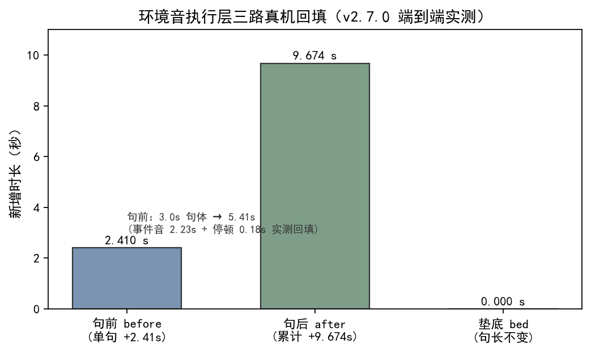

| 验证项 | 真实数字 / 口径 | 出处 |
|---|---|---|
| 事件音 `金属-碰撞.mp3` 容器时长 | 2.23 秒（mp3 头部声明时长） | 本批次 ffmpeg 实测 [5] |
| WAV 中间件路径（mp3 解码→WAV→concat，插 0.18s 气口→接 3.0s 句子） | 输出 **5.41 秒**，事件音起点 0.049 秒（气口余量保留） | 本批次 ffmpeg 实测 [5] |
| mp3 直连 `concat demuxer` 路径 | 输出仅 **2.23 秒**——下游 0.18s 气口 + 3.0s 句子整段丢失，输出塌缩；事件音被顶到句前 +0.00s | 本批次 ffmpeg 实测 [5] |
| 气口常量 | `EVENT_GAP_BEFORE=0.18` / `EVENT_GAP_AFTER=0.25` 秒 | `sfx_engine.py:39,40` [2] |
| 端到端 before（单句回填） | 3.0 秒句体 → 5.41 秒（事件音 2.23 + 气口 0.18 实测回填） | `CHANGELOG.md · v2.7.0` [1] |
| 端到端 after（累计） | 累计 **+9.674 秒** | `CHANGELOG.md · v2.7.0` [1] |
| 端到端 bed（垫底） | 句长**不变**，新增 0 秒 | `CHANGELOG.md · v2.7.0` [1] |
| 单测 | `tests/test_sfx.py` **19 钉全绿**（含 TestApply 4 钉：空计划 / before+after 烘焙+时长回填 / bed 句长不变 / 缺文件跳过） | 本批次实跑 [4] |
| 全量回归 | 1519 → 1538 通过（skipped=1） | `CHANGELOG.md · v2.7.0` [1] |

**单测钉（本批次临时副本实跑）**：在仓的临时副本跑 `tests/test_sfx.py` 全量——`TestManifestLibrary` 5 钉、`TestDecisionValidate` 7 钉、`TestPlanIO` 1 钉、`TestApply` 4 钉（其中 `test_before_after_baked_and_duration_refilled` 与 `test_bed_keeps_duration` 直接钉住"烘焙 + 时长回填 / 垫底句长不变"）、`TestDecisionBudget` 2 钉，共 **19 钉，0 fail、0 error，`Ran 19 tests in 1.523s, OK`**；与 CHANGELOG 同版本全量 1519→1538 通过相互印证 [1][4]。

### 实验设计（concat demuxer 坏流与 WAV 中间件对照）

- **目的**：复现并钉死"mp3 直连 `concat demuxer` 出坏流、句前 +0.00s"这一根因级事故，确认"中间件一律 WAV"是正确修法。
- **输入**：仓的临时副本（含真仓 `sfx_engine.py` / `audio_engine.py` 与 `resources/sfx/金属-碰撞.mp3`）、一段 3.0 秒静音 wav 代句子、ffmpeg 9.0.1；`concat` 函数（`audio_engine.py:108`）与 `_sfx_part` 解码路径（`sfx_engine.py:217`）。
- **步骤**：① 走坏流路径——把 `金属-碰撞.mp3` 与 0.18s 静音、3.0s 句子直接写进 `concat` 列表跑 `concat demuxer`，量输出时长与事件音起点；② 走现行路径——先 `_sfx_part` 把 mp3 解码成 WAV 中间件，再进同一 `concat`，量输出时长；③ 突变——把 `_sfx_part` 的 `-i src` 改成 `-i src` 但强制 `dst` 仍为 mp3（中和 WAV 中间件），复跑路径②观察是否塌缩。
- **观测**：坏流路径输出 2.23 秒（下游整段丢失，事件音 +0.00s）；现行路径输出 5.41 秒（事件音起点 0.049 秒，气口余量保留）；突变路径重新塌缩回 2.23 秒。
- **判定**：根因确认为 mp3 容器时长估计经 `concat demuxer` 导致下游裁切；"中间件一律 WAV"为必要且充分修法（中和即红）。实验后副本弃用，真仓未动 [1][2][3][5]。

## 七、结语：一句话可复用结论

环境音执行层的铁律只有一句：**进 `concat` 的每一段都必须是 WAV，SFX 在 `_sfx_part` 一道工序里从 mp3 解码成 WAV 中间件，绝不让 mp3 直连 `concat demuxer`**。这条线背后是一个通用判据——凡是依赖"容器头部时长"的拼接/封装链路，混用有估计时长的容器（mp3）与精确时长的容器（WAV）必塌在估计侧；与其和估计值较劲，不如从源头统一成精确时长的载体。#25 关死了"加不加、加哪条"的决策闸，本篇补上"怎么粘进句子才不出坏流"的执行钉。

## 引用与出处说明

> 来源声明：本篇实证全部取自 podcast-maker 真实代码仓、单测与本地 ffmpeg 实测，无 web 来源；CHANGELOG 锚点统一署真仓 `CHANGELOG.md`，不出现快照/索引文件名 [1][2][3][4][5]。

| 编号 | 引用 | 出处 |
|------|------|------|
| [1] | v2.7.0 执行层（`sfx_engine.apply` 句前/句后烘焙、氛围音 `stream_loop` 垫底、句长不变）；"中间件一律 WAV（mp3 过 concat demuxer 出坏流，句前 +0.00s 事故的根因）"；端到端 before 3.0→5.41s、after 累计 +9.674s、垫底句长不变；全量 1519→1538 通过 | `podcast-maker · CHANGELOG.md · v2.7.0` |
| [2] | `sfx_engine.py`：`EVENT_GAP_BEFORE=0.18`（`:39`）/`EVENT_GAP_AFTER=0.25`（`:40`）/`_sfx_part`（`:217`，mp3 解码成 WAV 中间件）/`_bed_mix`（`:225`，amix 垫底句长不变）/`apply`（`:240`） | `podcast_maker/sfx_engine.py:39,40,217,225,240` |
| [3] | `audio_engine.py`：`concat`（`:108`，`concat demuxer` 按列表拼接 + `anullsrc` 静音气口）/`loudnorm`（`:142`） | `podcast_maker/audio_engine.py:108,142` |
| [4] | `tests/test_sfx.py` 19 条实跑：`TestApply` 4 钉（空计划 / before+after 烘焙+时长回填 / bed 句长不变 / 缺文件跳过）等；本批次临时副本 `python -m unittest tests.test_sfx` → `Ran 19 tests ... OK` | `tests/test_sfx.py`（实测复跑，2026-10-22） |
| [5] | ffmpeg 9.0.1 真实对照：mp3 直连 `concat demuxer` 输出 2.23s（下游整段丢失、句前 +0.00s）；WAV 中间件输出 5.41s（事件音起点 0.049s）；突变中和 WAV 中间件即重新塌缩；测量条件为仓的临时副本、当次版本 v2.7.0、日期 2026-10-22 | 本文实验设计段（实测，2026-10-22） |

> 说明：全部为项目实证（仓库源码、单测与本地 ffmpeg 实测），无 KB / 联网文献；[4][5] 为本文推导层（实验设计段）的复跑记录，测量条件为仓的临时副本、当次版本 v2.7.0、日期 2026-10-22。

## 延伸阅读

- **#25 环境音决策层**：本篇讲"点名的音效怎么粘进句子"，#25 讲"加不加、加哪条、加几次"的决策闸——两者是同一执行链的前后两段。
- **#22 本地 BGM 生成**：本篇的事件音/氛围音烘焙进句子，与 #22 的 BGM 成片生成是成品音频的两类来源，最终都在 #24 那条混音链路落位。
- **#29 AI 生成件响度归一**：本篇 `_sfx_part` 只压"整体一档"增益，库内响度已在资源库落死；进成片前仍要过 #29 的唯一响度标尺。

# 第 IV 部 · 27｜BGM 转译层：中文描述怎么经 LLM 变成英文 caption，又怎么被 CoT 劫持

## 一、引子：真实起点

让用户写一句"轻快的钢琴曲，温暖明亮，适合开场"就能生成一段垫底 BGM，这件事的难点不在模型本身，而在"语言不对版"。ACE-Step 内部虽然有个 LM 规划器，但只有 0.6B、训练语料以英文 caption 为主——把中文长描述直接喂进去，还原度打折；更糟的是"不要打击乐"这种否定句，会被模型当成"打击乐"这个特征学进去（否定在训练分布里被当作肯定特征）。于是 v2.8.0 在生成前塞了一层 LLM 转译：先把中文描述改写成英文 caption、把时间演进写进 lyrics、把节奏调性锚进元数据，再交给 ACE-Step [1]。

但转译层自己差点引出更大的事故：转译好的"低音诡异、无鼓"稿子，在 `thinking=True` 的运行里被 ACE-Step 内部的 CoT 改写成"energetic synthwave + drum machine"，生成出来的东西和用户意图正好相反。本文的起点，就是把"中文怎么变成英文三层输入"以及"转译稿怎么险些被劫持、又被怎么救回"讲清楚 [1]。

## 二、现象：它到底长什么样

v2.8.0 之后，背景 BGM 的生成链路在起生成前多了一道转译闸门，且生成开关被定案。

**转译层（`web_ui.translate_bgm_prompt`）**：把用户中文描述经 LLM 改写成 ACE-Step 要的三层输入——`caption`（整体画像：风格/氛围/乐器/音色，一行英文）、`lyrics`（时间脚本：纯器乐用结构标记写段落演进）、`bpm` / `keyscale` / `timesignature`（节奏调性锚点）。三层必须一致（caption 的乐器对应 lyrics 的器乐段标记），只保留用户提到的元素 [2]。

**代码层确定性校验（`_parse_bgm_translation`）**：不靠模型自觉，做硬校验——`bpm` 取整并限官方区间 30~300，越界置 `None`（回到自动估计）；`timesignature` 只认 2/3/4/6，其余清空；`lyrics` 把挤在一行的相邻结构标记拆成一行一个；`caption` 空即判失败（它是必需层，没它整趟白转）[2]。

**降级口径（`_bgm_fallback`）**：LLM 不可用或答不出可解析结构时，WARN 降级——`caption` 吃原文、`lyrics` 走官方纯器乐写法 `[Instrumental]`、元数据留空、`degraded=True`，不拦生成。损失止于这一次生成 [2]。

**生成开关定案（`music_gen.cmd_generate` 的 `GenerationParams`）**：`thinking=True`（LM 谱曲定时长，铺满 30 秒的唯一开关）配 `use_cot_caption=False` / `use_cot_language=False` / `use_cot_metas=False` 三连 `False`——后者正是 CoT 劫持的防火墙 [3]。

## 三、错误尝试：我们怎么绕弯的

绕弯集中在"要么不转译、要么转译了却被二次改写"两个极端。

**第一类想当然：中文描述不经转译直接喂 ACE-Step**。这是"模型内部有 LM 规划器、应该能懂中文"的放任版——结果中文长描述还原度打折，否定句（"不要打击乐"）反而把被禁元素当特征学进去。这条弯路暴露的是"训练分布以英文 caption 为主"的硬约束，靠模型自己克服不了 [1]。

**第二类想当然：加了转译层，但 `thinking` 还开着、三连 `use_cot_*` 没关**。这是"转译层把中文翻好了，却被生成模型自己又改回去"的惨剧版——真机日志实锤：转译稿"低音为主的诡异氛围、无鼓"送入后，`thinking=True` 时 ACE-Step 内部 Phase 1 的 CoT（0.6B LM）把它改写成"energetic synthwave + gated-reverb drum machine"，且官方 `inference.py:826` 以 LM 产物覆盖 DiT 输入，生成方向整个被劫持，与用户意图相反 [1]。

两类弯的本质一样：把"理解描述"这件事交错了位置——要么完全交给英文弱势的内部 LM（不转译），要么主程序转译好了又被同一个内部 LM 二次改写（开着 CoT）。正确的落点是：描述的"理解"全由主程序 LLM 转译层做完，ACE-Step 内部 LM 必须整段跳过。

## 四、根因：为什么

把两件事拆开，根因各自干净。

**需要转译层的根因**是一个硬约束：ACE-Step 内部 LM 规划器仅 0.6B、训练语料以英文 caption 为主。中文长描述在它的训练分布里样本稀疏，还原度天然打折；否定句在训练分布里更被当作肯定特征（"不要鼓"≈"鼓"），会直接学进生成。所以"描述的理解"不能交给内部 LM，必须前移到主程序、用更强的 LLM 把它改写成英文三层输入，再让 ACE-Step 只负责渲染 [1]。

**转译稿被劫持的根因**是开关组合错了：`thinking=True` 时，ACE-Step 内部 Phase 1 跑 CoT（0.6B LM）对输入做"理解/改写"，而官方 `inference.py:826` 只认 `use_cot_caption` 一个开关决定是否用 LM 产物覆盖 DiT 输入——`thinking` 开着并不碰 caption，真正改写 caption 的是 `use_cot_caption`。早前的劫持发生在"三连全开"，关掉 `use_cot_caption` 这一个就够了；`use_cot_language=False`（纯器乐无人声语言检测）、`use_cot_metas=False`（LM 的 bpm/调性规划对铺满时长没贡献，仅开 metas 实测只铺到 21 秒）是同一思路的收口。根因判据因此收敛为一句：`caption` 的覆盖只由 `use_cot_caption` 控制，要保真就必须把它设为 `False` [1][3]。

## 五、正确修法：怎么做对的

拆开看，每层都有自己的标准答案。

**转译层做"四维归位"，不打包成抽象短语**：中文口语形容词分属不同维度（氛围/形式/音色/格调），旧指令把它们塞进"simple yet elegant sound changes"这种没有执行实体的抽象短语，模型只能输出低频 drone。改法是维度归位——氛围词落 `atmosphere/mood`、形式词落 `arrangement`、音色词落 `instrument/timbre`、格调词落到旋律/音色等可听实体；否定句转正向描述 + 标准 `no-xxx` 标签；只保留用户提到的元素 [1][2]。

```python
# podcast_maker/web_ui.py —— translate_bgm_prompt：中文描述 → 英文三层输入（四维归位 + 预算走统一推动点）
def translate_bgm_prompt(cfg, prompt, log=None):
    instruction = (转译指令：caption 一行英文 ≤60 词、四维各落执行域、"
                   "lyrics 用 [Intro - ambient] / [Main Theme - ...] 写时间脚本、"
                   "元数据 bpm/keyscale/timesignature 锚节奏调性、三层一致、只保留用户提到元素)
    try:
        llm = make_llm(cfg)
        text, _ = llm.chat([{"role": "user", "content": instruction}],      # instruction 末尾拼 prompt（中文）
                           temperature=0.2,
                           max_tokens=int(cfg.get("llm.max_tokens", 8192)))  # 预算走统一推动点
    except LLMError as e:
        log("LLM 转译失败（%s），按原文直接生成。" % e); return _bgm_fallback(prompt)
    data = _parse_bgm_translation(text)                                     # 代码层确定性校验
    if data is None:
        log("LLM 转译没答出可解析的三层结构，按原文直接生成。"); return _bgm_fallback(prompt)
    return data
```

**代码层确定性校验，不靠模型自觉**：解析出来后，`bpm` 限 30~300、越界置 `None`；`timesignature` 只认 2/3/4/6；`lyrics` 挤行拆行；`caption` 空即失败。这些判定是确定性的，喂什么错值都拦得住 [2]。

```python
# podcast_maker/web_ui.py —— _parse_bgm_translation：bpm/拍号/lyrics/caption 的确定性校验
def _parse_bgm_translation(text):
    obj = json.loads(抽取 {} 之间)                       # 容忍 ```json 围栏与前后杂话
    caption = " ".join(str(obj.get("caption") or "").split())
    if not caption: return None                          # caption 空即判失败（必需层）
    lyrics = 拆行(obj.get("lyrics"))                     # 相邻结构标记拆成一行一个
    try:
        bpm = int(obj.get("bpm"))
        if not 30 <= bpm <= 300: bpm = None              # 越界置 None，回到自动估计
    except (TypeError, ValueError): bpm = None
    tsign = str(obj.get("timesignature") or "").strip()
    if tsign not in ("2", "3", "4", "6"): tsign = ""     # 只认四拍号，其余清空
    return {"caption": caption, "lyrics": lyrics or "[Instrumental]",
            "bpm": bpm, "keyscale": ..., "timesignature": tsign, "degraded": False}
```

**CoT 劫持修复：四 False 让 LM 整段跳过**：`thinking=True`（保铺满时长）配 `use_cot_caption/language/metas` 三连 `False`——官方判定 `use_lm=False`，内部 LM 整段跳过，DiT 直接吃主程序的转译稿；描述的理解全部由主程序 LLM 转译层完成。副产物是每条生成省掉 tokenizer + LM 加载与 Phase 1/2 约 40 秒 [1][3]。

```python
# music_service/music_gen.py —— cmd_generate：开关定案（thinking 谱曲定时长，三连 False 防 CoT 劫持）
params = GenerationParams(
    task_type="text2music", caption=prompt,
    lyrics=(lyrics or "[Instrumental]"), instrumental=True,
    bpm=bpm, keyscale=keyscale or "", timesignature=timesignature or "",
    duration=float(seconds), inference_steps=8, shift=3.0,
    thinking=True,                                  # LM 谱曲定时长；caption 由下面三连关保真
    use_cot_caption=False, use_cot_language=False, use_cot_metas=False,
    seed=eff)
```

## 六、验证：数据说话

**转译层与开关定案（本批次 stub-LLM 真实实验，见图）** [5]：


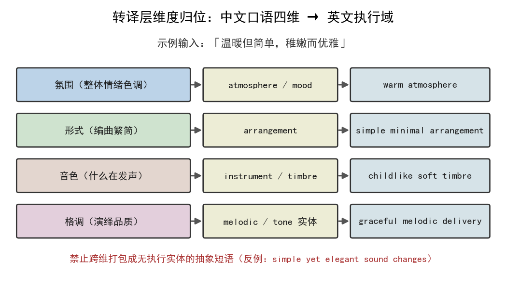

| 验证项 | 真实数字 / 口径 | 出处 |
|---|---|---|
| 转译预算 | 走统一推动点 `llm.max_tokens`，本批次 stub 回放观测到 **47872**（与出厂配置同值） | 本批次 stub-LLM 实测 [5] |
| 四维归位（真实 LLM 同一描述实测） | 输出 `eerie quiet atmosphere, simple minimal arrangement, prominent bass ..., elegant melodic progression refined tone, no drums, no percussion, seamless loopable` | `CHANGELOG.md · v2.8.0` [1] |
| 代码层校验 | `bpm=999` → `None`；`timesignature=5` → `""`；挤行 lyrics 拆行；caption 空 → 判定失败降级 | 本批次 stub-LLM 实测 [5] |
| 降级路径 | LLM 不可用 → `degraded=True`、`caption` 退回原文、`lyrics=[Instrumental]`、日志含"转译失败" | 本批次 stub-LLM 实测 [5] |
| CoT 劫持防火墙 | `thinking=True` + `use_cot_caption/language/metas` 四 `False`；官方判定 `use_lm=False`、LM 跳过 | `music_gen.py:417` [3] |
| 真机端到端 | 同 seed 全链 `content_end=30s/30s` 尾部零地板；账本 `lm='pt'`、`norm_gain_db=3.82` | `CHANGELOG.md · v2.8.0` [1] |
| 全量回归 | 1538 → 1551 通过（skipped=1） | `CHANGELOG.md · v2.8.0` [1] |

**单测钉（本批次临时副本实跑）**：`tests/test_music_service.py` 中 `TestBgmCaption` 钉住转译成功 / 预算=`llm.max_tokens`（47872）/ 降级原文三类行为，`test_thinking_codes_caption_kept` 断言 `thinking=True` 且 `use_cot_caption=False`、LM 必须参与谱曲，`test_cot_disabled_and_lm_skipped` 断言四 `False` 且 `lm is None`——转译层与 CoT 防火墙均被钉死，与 CHANGELOG 同版本全量 1538→1551 通过相互印证 [1][4]。

### 实验设计（转译层真实回放与校验突变）

- **目的**：确认转译层在真实代码路径上确实走统一推动点预算、四维归位产出、代码层校验拦截错值、且 LLM 不可用时降级不拦生成。
- **输入**：仓的临时副本（含真仓 `web_ui.py` 的 `translate_bgm_prompt` / `_parse_bgm_translation` / `_bgm_fallback`）、一个 stub LLM（按真实 `make_llm` 接口，`chat` 返回受控 JSON 或抛 `LLMError`）、出厂 `llm.max_tokens=47872`。
- **步骤**：① 正常路径——stub 返回合法三层 JSON（含四维归位 caption + 多行 lyrics + bpm/keyscale/timesignature），观测 `max_tokens` 取值与解析结果；② 校验突变——stub 依次返回 `bpm=999`、 `timesignature=5`、挤在一行的 lyrics、caption 空串，观测代码层是否拦截（→`None` / `""` / 拆行 / 降级）；③ 降级突变——stub 抛 `LLMError`，观测是否 `degraded=True` 且 `caption` 退回原文。
- **观测**：正常路径 `max_tokens=47872`（统一推动点）、四维归位 caption 落地、多行 lyrics 保留；`bpm=999`→`None`、`timesignature=5`→`""`、挤行 lyrics 被拆行、caption 空→判定失败走降级；`LLMError`→`degraded=True`、`caption=原文`、`lyrics=[Instrumental]`、日志含"转译失败"。
- **判定**：转译层四件事（预算统一 / 转译成功 / 代码层校验 / 降级）在真实代码路径上全部成立，与 `TestBgmCaption` 与 CHANGELOG v2.8.0 记录相互印证；实验后副本弃用，真仓未动 [1][2][4][5]。

## 七、结语：一句话可复用结论

背景 BGM 的"描述理解"必须前移到主程序 LLM 转译层做完——把中文（尤其是否定句）改写成英文三层输入、四维各归执行域，再交给 ACE-Step 只负责渲染；而 ACE-Step 内部的 LM 必须被 `use_cot_caption` 三连 `False` 整段跳过，否则转译好的稿子会被它的 CoT 改写成相反方向。一句话可复用：**凡"外部弱语言、内部强语言"的跨模型链路，描述的理解只做一次、且只在没有改写权的那一侧做；任何二次"理解"开关都必须显式关死**。#22 讲"背景音乐怎么本地生成"，本篇补上"中文描述怎么变成它能懂的输入、又怎么不被它自己改写"这道必须关死的转译闸。

## 引用与出处说明

> 来源声明：本篇实证全部取自 podcast-maker 真实代码仓、单测与本地 stub-LLM 实测，无 web 来源；CHANGELOG 锚点统一署真仓 `CHANGELOG.md`，不出现快照/索引文件名 [1][2][3][4][5]。

| 编号 | 引用 | 出处 |
|------|------|------|
| [1] | v2.8.0 转译层（中文→英文三层输入、否定句→正向+no-xxx、四维归位）；ACE-Step 内部 CoT 劫持 caption（真机日志实锤：低音诡异无鼓→energetic synthwave+drum）；`thinking=False`+三连 `False` 修复；后段空白根因=`thinking` 关错（四组对照 A 断崖/B 21s/D/C 28s 铺满）；同 seed 全链 `content_end=30s/30s`、账本 `lm='pt'`/`norm_gain_db=3.82`；全量 1538→1551 | `podcast-maker · CHANGELOG.md · v2.8.0` |
| [2] | `web_ui.py`：`_bgm_fallback`（`:115`，降级口径）/`_parse_bgm_translation`（`:122`，bpm 30~300、timesignature 2/3/4/6、lyrics 拆行、caption 空判失败）/`translate_bgm_prompt`（`:162`，指令四维归位 + `max_tokens` 走 `llm.max_tokens`，调用点 `:231`） | `podcast_maker/web_ui.py:115,122,162,231` |
| [3] | `music_service/music_gen.py`：`cmd_generate`（`:312`，5Hz LM 加载失败 WARN 降级不停产）；开关定案注释（`:340`，thinking 谱曲定时长、use_cot_caption 保真）；`GenerationParams thinking=True` + `use_cot_caption/language/metas` 三连 `False`（`:417`） | `music_service/music_gen.py:312,340,417` |
| [4] | `tests/test_music_service.py`：`TestBgmCaption`（`:400`，转译成功/预算=llm.max_tokens/降级原文）、`test_thinking_codes_caption_kept`（`:355`，thinking + caption 保真）、`test_cot_disabled_and_lm_skipped`（四 False + lm is None）；本批次临时副本实跑 | `tests/test_music_service.py`（实测复跑，2026-10-22） |
| [5] | stub-LLM 真实回放：正常路径 `max_tokens=47872`、四维归位 caption 落地、多行 lyrics 保留；校验突变 `bpm=999`→`None`/`timesignature=5`→`""`/挤行拆行/caption 空降级；降级突变 `LLMError`→`degraded=True`、caption 退回原文、lyrics `[Instrumental]`、日志含"转译失败"；测量条件为仓的临时副本、当次版本 v2.8.0、日期 2026-10-22 | 本文实验设计段（实测，2026-10-22） |

> 说明：全部为项目实证（仓库源码、单测与本地 stub-LLM 实测），无 KB / 联网文献；[4][5] 为本文推导层（实验设计段）的复跑记录，测量条件为仓的临时副本、当次版本 v2.8.0、日期 2026-10-22。

## 延伸阅读

- **#22 本地 BGM 生成**：本篇讲"中文描述怎么变成英文三层输入、又怎么不被 CoT 劫持"，#22 讲"背景音乐怎么在本地生成"——两者是同一生成链的前后两段。
- **#26 环境音执行层**：本篇的转译层与 #26 的执行层都在第四部「背景音乐」下，分别解决"AI 音乐的描述翻译"与"环境音的烘焙落位"两个不同环节。
- **#29 AI 生成件响度归一**：本篇转译层产出的 BGM 最终要过 #29 的唯一响度标尺（-23 LUFS / 真峰值 -1 dBTP），与内置档同尺。

# 第 IV 部 · 28｜BGM 三层结构转译契约：caption/lyrics/元数据与中频塌陷 drone 墙

## 一、引子：真实起点

让模型生成一段 30 秒垫底 BGM，给一句「诡异的低音氛围」就能出曲——这件事在前两篇里已经打通：#22 解决了本地生成链路，#27 解决了「中文描述怎么变成模型吃得动的三层输入、又怎么不被它自己的 CoT 劫持」。链路是通的，但生成的曲子听起来「怪」。

怪在形状：前几秒还有点氛围，往后越来越闷，最后二十多秒只剩一团压在低频的轰鸣，没有任何推进。这不是偶发——分段频谱矩阵实测，多版、多 seed 一致复现，是一条能被稳定观测到的退化曲线，不是「手气不好」[1]。

本文的起点，就是把「链路通了、曲子却退化成 drone 墙」这件事讲清楚：问题不在模型能力，而在我们交给模型的「契约」缺了一多半 [1]。

## 二、现象：它到底长什么样

v2.9.0 把 BGM 转译从「单个 caption 字符串」升级为「三层结构化输入」，并修掉了中频塌陷。先看清两层现象。

**三层契约（`caption` + `lyrics` + 元数据）**：ACE-Step 官方输入是三层协同——
- `caption`：整体画像，一行英文写风格、氛围、乐器、音色，且要体现编排的演进；
- `lyrics`：时间脚本，纯器乐用结构标记写音乐如何随时间展开（`[Intro - ambient]` / `[Main Theme - sparse bass]` / `[Outro - fade out]`）；官方明说纯音乐可只填 `[Instrumental]`，但那是无演进写法——垫底 BGM 恰恰要演进，否则模型建完开场就退化成静止 drone；
- 元数据：`bpm` / `keyscale` / `timesignature`，节奏与调性锚点 [1][2]。

**中频塌陷、退化为 drone 墙（分段频谱矩阵实测）**：连续多发生成的 30 秒 BGM，前 6 秒中频（300-2k）占 92~96%；第 6 秒起持续塌陷，18 秒后中频仅 0.1%、80-300Hz 占 98%，整段退化成一条恒稳低频 drone 墙（多版、多 seed 一致复现）[1]。

**代码层确定性校验（`_parse_bgm_translation`）**：不靠模型自觉，做硬校验——`bpm` 取整并限官方区间 30~300，越界置 `None`（回到自动估计）；`timesignature` 只认 2/3/4/6，其余清空；`lyrics` 把挤在一行的相邻结构标记拆成一行一个；`caption` 空即判失败（它是必需层，没它整趟白转）[2]。

**降级口径（`_bgm_fallback`）**：LLM 不可用或答不出可解析结构时，WARN 降级——`caption` 吃原文、`lyrics` 走 `[Instrumental]`、元数据留空、`degraded=True`，不拦生成。损失止于这一次生成 [2]。

## 三、错误尝试：我们怎么绕弯的

绕弯集中在「要么不给演进指令、要么给错了演进维度」。

**第一类想当然：只产单个 `caption`，`lyrics` 硬编码 `[Instrumental]`，元数据全默认空**。这是「模型内部有 LM 规划器、给个整体画像它自己会发展」的放任版——结果模型建完开场氛围后没有任何时间脚本与节奏锚点，只能把开场状态静态铺底到曲末。三层里两层半是空的，又反过来逼出更闷的低频补偿。这是 v2.9.0 之前线上真实跑的形态 [1]。

**第二类想当然：加「第五维律动」去补演进**。既然缺演进，就往转译指令里加一个「律动」维度，并给默认律动例外。真机第三发实测音符时值标准差 0.60→0.303、拍层稳定，确有正向数据——但这是「在错的契约层上打补丁」：律动维度没有解决「两层半为空」的结构问题，只是把演进的希望押在一个维度上。v2.9.0 把这第五维与同期一处未发布的措辞收控改动一并回退 [1]。

**第三类想当然：措辞收控把 `deep sub bass` 引导进 80-300Hz**。试图用描述把能量「搬」出低频，却把 drone 从 <80Hz 闷响变成有实际声压的低频墙，听感反而退化；更糟的是「80-300Hz 仅 2.2%」被误判为病灶，而那「空洞」实为「无 drone」，能量搬入反而放大问题。回退依据正是这条反直觉观测 [1]。

三类弯的本质一样：**演进指令的位置错了**——要么全压在 `caption` 一个维度上、要么押错维度、要么用描述去硬挪频谱。正确的落点是把「演进」显式写成 `lyrics` 时间脚本，并用元数据给节奏锚点，三层一起讲同一个故事。

## 四、根因：为什么

把现象拆开，根因只在「契约结构」一处，干净利落。

**需要三层协同的根因**：ACE-Step 的生成由 `caption`（场景画像）+ `lyrics`（时间脚本，控制音乐随时间展开）+ 元数据（节奏调性锚点）三层共同驱动；三层必须一致（caption 的乐器要对应 lyrics 的器乐段标记，caption 的情绪要对应 lyrics 的能量标记），模型不擅长解决冲突。旧转译层只产单个 `caption` 字符串，指令全文未提 `lyrics`、结构标记与元数据字段——转译模型既不知道这些字段存在、也没有输出通道；生成侧 `lyrics` 硬编码 `[Instrumental]`、三个元数据字段全走默认空。于是**三层中两层半为空**，模型建完开场氛围后无演进指令，静态铺底到曲末，这就是中频塌陷、退化为 drone 墙的契约级根因 [1]。

**为什么退化形态恰好是「低频 drone 墙」**：缺了时间脚本与节奏锚点后，模型没有「往哪推进」的约束，倾向于把能量压进最稳、最不易冲突的低频持续音；而中频（300-2k，承载旋律与大多数乐器音色）因为没有演进标记去激活，逐步塌空。分段频谱矩阵里「前 6 秒中频 92~96% → 18 秒后 0.1%、80-300Hz 占 98%」正是这条机制的投影，不是独立故障 [1]。

**校验必须落在代码层而非模型层**：`bpm` / 拍号 / `lyrics` 换行这些结构性字段，若靠模型「自觉」就会漂移（越界 bpm、非法拍号、相邻标记挤一行）。v2.9.0 把它们收进 `_parse_bgm_translation` 的确定性校验，喂什么错值都拦得住，模型只负责产出语义、结构合法性由代码兜底 [2]。

## 五、正确修法：怎么做对的

修法不另起炉灶，而是重写转译契约 + 代码层兜底校验，并撤销叠加在错层上的补丁。

**转译指令重写为输出 JSON 三层，且写明三层一致性铁律**：`caption` 长句含编排演进；`lyrics` 用官方结构标记写时间脚本（`[Intro - ambient]` / `[Main Theme - sparse bass]` / `[Outro - fade out]`），段落控制在 2~4 段；元数据给 `bpm` / `keyscale` / `timesignature`；并明确三层讲同一个故事、只保留用户提到的元素。`cmd_generate` 同步增 `lyrics` / `bpm` / `keyscale` / `timesignature` 四参，`GenerationParams.lyrics` 由硬编码 `"[Instrumental]"` 改为 `lyrics or "[Instrumental]"`（保留纯器乐缺省），元数据按传入值填 [1][3]。

```python
# podcast_maker/web_ui.py —— translate_bgm_prompt：三层 JSON 转译指令（四维归位 + 预算走统一推动点）
def translate_bgm_prompt(cfg, prompt, log=None):
    instruction = (转译指令：caption 一行英文 ≤60 词、四维各落执行域、"
                   "lyrics 用 [Intro - ambient] / [Main Theme - ...] 写时间脚本、"
                   "元数据 bpm/keyscale/timesignature 锚节奏调性、三层一致、只保留用户提到元素)
    try:
        llm = make_llm(cfg)
        text, _ = llm.chat([{"role": "user", "content": instruction}],      # instruction 末尾拼 prompt（中文）
                           temperature=0.2,
                           max_tokens=int(cfg.get("llm.max_tokens", 8192)))  # 预算走统一推动点
    except LLMError as e:
        log("LLM 转译失败（%s），按原文直接生成。" % e); return _bgm_fallback(prompt)
    data = _parse_bgm_translation(text)                                     # 代码层确定性校验
    if data is None:
        log("LLM 转译没答出可解析的三层结构，按原文直接生成。"); return _bgm_fallback(prompt)
    return data
```

**代码层确定性校验，不靠模型自觉**：解析出来后，`bpm` 限 30~300、越界置 `None`；`timesignature` 只认 2/3/4/6；`lyrics` 挤行拆行；`caption` 空即失败降级。这些判定是确定性的 [2]。

```python
# podcast_maker/web_ui.py —— _parse_bgm_translation：bpm 30~300、拍号 2/3/4/6、lyrics 拆行、caption 空降级
def _parse_bgm_translation(text):
    body = 抽取 {} 之间(text)                       # 容忍 ```json 围栏与前后杂话
    obj = json.loads(body)
    caption = " ".join(str(obj.get("caption") or "").split())
    if not caption: return None                      # caption 空即判失败（必需层）
    lyrics = 拆行(obj.get("lyrics"))                 # 相邻结构标记拆成一行一个
    try:
        bpm = int(obj.get("bpm"))
        if not 30 <= bpm <= 300: bpm = None          # 越界置 None，回到自动估计
    except (TypeError, ValueError): bpm = None
    tsign = str(obj.get("timesignature") or "").strip()
    if tsign not in ("2", "3", "4", "6"): tsign = "" # 只认四拍号，其余清空
    return {"caption": caption, "lyrics": lyrics or "[Instrumental]",
            "bpm": bpm, "keyscale": ..., "timesignature": tsign, "degraded": False}
```

**生成侧透传四参 + 撤销错层补丁**：`cmd_generate` 把三层字段透传 CLI，落稿账本新增 `lyrics` / `bpm` / `keyscale` / `timesignature` 四字段；同期回退到四维版（删除第五维律动维度行与默认律动例外、撤除未发布的措辞收控改动）——回退的依据是措辞收控把能量误搬进 80-300Hz、且第五维虽有正向数据但压不住「两层半为空」的结构病灶 [1][3]。

```python
# music_service/music_gen.py —— cmd_generate：三层参数透传 + 落稿响度归一（见 #29）
def cmd_generate(lib, prompt, seconds, seed, ..., lyrics, bpm, keyscale, timesignature):
    params = GenerationParams(
        caption=prompt, lyrics=(lyrics or "[Instrumental]"), instrumental=True,
        bpm=bpm, keyscale=keyscale or "", timesignature=timesignature or "",
        duration=float(seconds), thinking=True,
        use_cot_caption=False, use_cot_language=False, use_cot_metas=False, seed=eff)
    ...
    norm = loudness.normalize_file(wav, ffmpeg=ff, allow_limited=True)   # 落稿归一，标尺见 #29
```

## 六、验证：数据说话

**转译契约与代码层校验（本批次 stub-LLM + 直接解析双重真实实验，见图）** [5]：

| 验证项 | 真实数字 / 口径 | 出处 |
|---|---|---|
| 中频塌陷现象 | 前 6 秒中频（300-2k）92~96%；第 6 秒起持续塌陷；18 秒后中频仅 0.1%、80-300Hz 占 98% | `CHANGELOG.md · v2.9.0` [1] |
| 真机回退后 | 0-27 秒中频（300-2k）稳定 4.1~9.2%（回退前 18 秒后为 0.1%）；谱重心 94~153 Hz；rms -17.5~-24.6 dBFS 无断崖 | `CHANGELOG.md · v2.9.0` [1] |
| 真机账本三层字段 | `lyrics` = `[Intro - deep sub-bass]` / `[Main Loop - subtle electric crackle]` / `[Outro - seamless match]`、`bpm=70`、`keyscale=D minor`、`timesignature=4`、`lm=pt`；落稿 -22.99 LUFS（`norm_limited=false`） | `CHANGELOG.md · v2.9.0` [1] |
| 代码层校验（本批次回放） | `bpm=999` → `None`；`timesignature=5` → `""`；挤行 lyrics 拆行；caption 空 → 判定失败降级 | 本批次临时副本实测 [5] |
| 降级路径（本批次回放） | 答非 JSON 三层结构 → `degraded=True`、`caption` 退回原文、`lyrics=[Instrumental]`、日志含「三层结构」 | 本批次临时副本实测 [5] |
| 单测钉 | `TestBgmCaption` 3→5 条：转译成功 / 预算=`llm.max_tokens` / 降级原文 / 答非 JSON 降级 / 结构性字段代码层校验；本批次复跑全 PASS | `tests/test_music_service.py`（实测复跑，2026-10-23）[4] |
| 全量回归 | 1551 → 1553 通过（skipped=1） | `CHANGELOG.md · v2.9.0` [1] |

**单测钉（本批次临时副本实跑）**：`tests/test_music_service.py` 中 `TestBgmCaption` 钉住转译成功取三层字段、预算走 `llm.max_tokens`、LLM 不可用或答非 JSON 时降级原文、以及结构性字段由代码层校验四类行为；本批次在仓临时副本复跑 5 条全部 PASS，与 CHANGELOG 同版本全量 1551→1553 相互印证 [1][4]。

### 实验设计（三层契约真实回放与校验突变）

- **目的**：确认转译层在真实代码路径上确实输出三层结构、代码层校验能拦截错值、且 LLM 不可用时降级不拦生成；并直接验证 `_parse_bgm_translation` 的确定性校验。
- **输入**：仓的临时副本（含真仓 `web_ui.py` 的 `translate_bgm_prompt` / `_parse_bgm_translation` / `_bgm_fallback`）、一个 stub LLM（按真实 `make_llm` 接口，`chat` 返回受控 JSON 或抛 `LLMError`）、出厂 `llm.max_tokens=47872`；另直接调用 `_parse_bgm_translation` 喂各类 JSON 字符串。
- **步骤**：① 正常路径——stub 返回合法三层 JSON（含四维归位 caption + 多行 lyrics + bpm/keyscale/timesignature），观测解析结果；② 校验突变——stub 依次返回 `bpm=999`、`timesignature=5`、挤在一行的 lyrics、caption 空串，并直接喂带围栏 ` ```json ` 的三层串，观测代码层是否拦截（→`None` / `""` / 拆行 / 降级）；③ 降级突变——stub 抛 `LLMError` 或答非 JSON，观测是否 `degraded=True` 且 `caption` 退回原文。
- **观测**：正常路径三层字段齐全；`bpm=999`→`None`、`timesignature=5`→`""`、挤行 lyrics 被拆行、带围栏 JSON 被正确抽取、caption 空→判定失败走降级；`LLMError`/非 JSON→`degraded=True`、`caption=原文`、`lyrics=[Instrumental]`、日志含「三层结构」。
- **判定**：三层契约的「转译成功 / 代码层校验 / 降级」在真实代码路径上全部成立，与 `TestBgmCaption` 及 CHANGELOG v2.9.0 记录相互印证；实验后副本弃用，真仓未动 [1][2][4][5]。

## 七、结语：一句话可复用结论

背景 BGM 要的是「演进」，不是「一段好听的开场」——演进必须显式写成 `lyrics` 时间脚本、用元数据给节奏锚点，三层一起讲同一个故事；只要三层里有一层空着（尤其 `lyrics` 与元数据），模型就会退化成静态铺底，频谱上就投影成「前几秒中频还在、往后塌成低频 drone 墙」。一句话可复用：**多输入协同的契约，缺一层不是「少点信息」，而是逼模型用最稳的低频去填空白；结构性字段的合法性必须收进代码层校验，不能押在模型自觉上**。#27 讲「中文怎么变成它能懂的三层输入、又怎么不被 CoT 劫持」，本篇补上「为什么必须是三层、缺一层就退化」这道契约级闸门；过了这道闸，AI 生成件还要过 #29 的唯一响度标尺。

## 引用与出处说明

> 来源声明：本篇实证全部取自 podcast-maker 真实代码仓、单测与本地 stub-LLM / 直接解析实测，无 web 来源；CHANGELOG 锚点统一署真仓 `CHANGELOG.md`，不出现快照/索引文件名 [1][2][3][4][5]。

| 编号 | 引用 | 出处 |
|------|------|------|
| [1] | v2.9.0 三层结构转译契约升级：现象（30 秒曲目约 6 秒后中频塌陷、18 秒后中频仅 0.1%、80-300Hz 占 98% 退化为 drone 墙，分段频谱矩阵实测、多版多 seed 复现）；根因（三层协同中两层半为空）；修法（`_parse_bgm_translation` 代码层校验，bpm 30~300、拍号 2/3/4/6、相邻结构标记拆行）；真机验证（落稿 -22.99 LUFS、`norm_limited=false`、0-27 秒中频稳定 4.1~9.2%、谱重心 94~153 Hz）；撤销第五维律动与未发布措辞收控；全量 1551→1553 | `podcast-maker · CHANGELOG.md · v2.9.0` |
| [2] | `web_ui.py`：`_bgm_fallback`（`:115`，降级口径）/`_parse_bgm_translation`（`:122`，bpm 30~300、timesignature 2/3/4/6、lyrics 拆行、caption 空判失败）/`translate_bgm_prompt`（`:162`，指令重写三层 JSON + `max_tokens` 走 `llm.max_tokens`） | `podcast_maker/web_ui.py:115,122,162` |
| [3] | `music_service/music_gen.py`：`cmd_generate`（`:312`，增 `lyrics`/`bpm`/`keyscale`/`timesignature` 四参，`GenerationParams.lyrics = lyrics or "[Instrumental]"`）；落稿账本新增三层字段；同版本回退到四维版 | `music_service/music_gen.py:312` |
| [4] | `tests/test_music_service.py`：`TestBgmCaption`（`:400`，3→5 条：转译成功 / 预算=`llm.max_tokens` / 降级原文 / 答非 JSON 降级 / 结构性字段代码层校验）；本批次临时副本实跑全 PASS | `tests/test_music_service.py`（实测复跑，2026-10-23） |
| [5] | 本批次 stub-LLM 真实回放 + 直接 `_parse_bgm_translation` 探测：正常三层→非降级、带围栏 JSON 正确抽取；`bpm=999`→`None`、`timesignature=5`→`""`、挤行 lyrics 拆行、caption 空→判定失败降级；非 JSON→`degraded=True`、caption 退回原文、`lyrics=[Instrumental]`、日志含「三层结构」；测量条件为仓的临时副本、当次版本 v2.9.0、日期 2026-10-23 | 本文实验设计段（实测，2026-10-23） |

> 说明：全部为项目实证（仓库源码、单测与本地 stub-LLM / 直接解析实测），无 KB / 联网文献；[4][5] 为本文推导层（实验设计段）的复跑记录，测量条件为仓的临时副本、当次版本 v2.9.0、日期 2026-10-23。

## 延伸阅读

- **#27 BGM 转译层**：本篇讲「为什么必须是三层、缺一层就退化成 drone 墙」，#27 讲「中文描述怎么变成英文三层输入、又怎么被 CoT 劫持」——两者是同一转译层的正反两面，#27 是本篇的上一层。
- **#22 本地 BGM 生成**：本篇的三层契约最终要喂给 #22 的本地生成链路；#22 解决「怎么生成」，本篇解决「喂给它的契约为什么必须是三层」。
- **#29 AI 生成件响度归一**：过了三层契约的 BGM 最终还要过 #29 的唯一响度标尺（-23 LUFS / 真峰值 -1 dBTP），与内置档同尺——契约管「结构对不对」，标尺管「响度齐不齐」。

# 第 IV 部 · 29｜AI 生成件响度归一：bgm_loudness 与峰均比超 22.5 dB 的 allow_limited 放行

## 一、引子：真实起点

前面三篇把生成链路打通了：#22 让 BGM 能在本地生成，#27 让中文描述变成模型吃得动的三层输入并挡住 CoT 劫持，#28 用三层契约逼出音乐的时间演进。链路是通的，但落库这一步暴露出一个反直觉的坑：AI 生成的曲子，响度是「自由发挥」的。

实测 ACE-Step 产物落在 -16.4 LUFS，而内置 15 档早已统一到 -23 LUFS——差 6.5 dB，意味着同一段节目里，AI 生成的垫底 BGM 会明显压过人声和其他素材，混音侧怎么调默认值都救不回来。问题不在「生成得好不好听」，而在「响度这条变量没被钉死」[1]。

本文的起点，就是把「AI 生成件必须过同一把标尺、且峰均比超标时不能偷偷削峰」这件事讲清楚 [1][2]。

## 二、现象：AI 生成件响度自由发挥

**AI 生成件与内置档同标尺（默认 -23 LUFS / 真峰值 -1 dBTP）**：内置 15 档的素材生成器原先只做削峰保护（`peak > 0.90` 才缩），不做响度归一，导致 15 档 integrated LUFS 从 `chimes -15.18` 到 `horror -28.76` 相差 13.6 LU——同一个 `bgm.volume` 在不同档位上响度差 4 倍。这条缺陷不会自己报错，只有人耳在某个档位听出不对才可能被发现，必须变成自动化判据 [2][4]。

**AI 生成件更离谱**：ACE-Step 产物实测 -16.4 LUFS，比内置档响 6.5 dB；不归一进库就是压场。v2.8.0 把归一收进落稿侧，与内置 15 档同一条标尺 [1]。

**峰均比超标，纯线性增益物理不可达**：真机第四发（随机 seed）生成失败于落稿归一——ACE-Step 产物峰均比 23.02 dB，超出标尺余量 22.00 dB（`-1 dBTP` 上限与 `-23 LUFS` 目标的差）。纯线性增益改不了峰均比，峰值先撞上限，目标在真峰值上限内不可达，`bgm_loudness.normalize_file` 按「不可达即拒写」合同删稿停产 [1]。

也就是说，归一不是「混音时顺手压一下」，而是**落库做死**——基准在落稿时锁定，运行时只压整体档，不返工 [2][3]。

## 三、错误尝试：我们怎么绕弯的

发现 AI 生成件响度参差后，三种典型的错法：

**其一，只做峰值削顶、不顾 integrated 响度**。这是「旧 save_wav 只削峰」的放任版——峰值限幅只是上限约束（防止削波），本身不碰响度；若只用峰值归一，一条 -16.4 LUFS 的素材与一条 -28 LUFS 的素材经峰值削顶后，响度依旧差十几 dB。本仓的做法是 integrated 响度目标为主、真峰值兜底，峰值只是不削波，不取代响度对齐 [2][4]。

**其二，线性增益硬拉到 -23，撞线就悄悄削一点凑数**。这是「不可达就妥协」的惨剧版——但「悄悄削掉一点」正是 `bgm_loudness` 这个模块存在的理由（素材原先各削各的才导致 13.6 LU 参差），决不允许自己犯同样的错。增益按真峰值上限算，算出会导致任何样本溢出就直接判失败，而不是顺手 clip 一下 [2]。

**其三，默认就放行削一点**。把 `allow_limited` 默认打开，看似「高瞬态 BGM 也能落库」，实则让稀疏瞬态类素材随机删稿停产——这类素材峰均比超 22.5 dB 的高发，默认放行等于把「不可达」悄悄掩盖，账本不可追溯 [1][4]。

三条都撞在同一堵墙上：**响度归一只能做线性增益、只能走真峰值约束不夹不削；峰均比超标的素材在「不削峰」前提下物理不可达，要么拒写、要么显式受控放行**。

## 四、根因：为什么

根因不在「滤波选错了」，而在**响度是能量尺度、与音色正交，且归一的物理边界由峰均比决定**：

- **归一只施加线性增益**：不做动态压缩、不做限幅、不改采样率/位深/声道数，素材的音色与动态结构一个采样都不动，只是整体音量乘一个常数。这是「归一不侵染素材」的硬约束 [2]。
- **只走真峰值约束，不夹不削**：增益按真峰值上限算，若算出的增益会导致任何样本溢出，直接判失败而不是 clip。因为「悄悄削掉一点」正是本模块要消灭的行为 [2]。
- **峰均比超 22.5 dB 的生成件必炸**：稀疏瞬态类 BGM（drone 安静段 + 打击瞬态）峰均比动辄 30+ dB，其峰值先撞 `-1 dBTP` 上限，目标 `-23 LUFS` 在真峰值上限内不可达；`VERIFY_TOL_LU=0.5` 容差内 22.0~22.5 dB 一直在静默按上限落稿，峰均比超 22.5 dB 才真正炸。这是素材物理特性与标尺的系统性冲突，**不是链路 bug**——ACE-Step 内部峰值归一（Peak 0.2139→0.8913）不是根因，线性归一不改峰均比，撤掉同样不可达 [1]。

所以「AI 生成件响度归一」不是多一道工序，是**把「相对响度可控」这件前提在落稿基准处一次性钉死，并对物理不可达的情况给出显式、可追溯的放行通道**。

## 五、正确修法：怎么做对的

修法不另起炉灶，而是把归一焊进落稿的正确位置，并用唯一实现 + `allow_limited` 双态把残差锁死。

**实现唯一来源 `tools/bgm_loudness`（`TestSingleImplementation` 钉死）**：生成侧（`tools/probes/bgm_gen.py`）与校正侧（`tools/bgm_level.py`）必须共用同一个模块，否则两边迟早跑出两个标准。测量走 ffmpeg `loudnorm`（EBU R128），施加增益走纯 Python PCM 整数运算，避免 ffmpeg 重采样与抖动参与 [2][4]。

```python
# tools/bgm_loudness.py —— normalize_file：线性增益 + 真峰值约束，allow_limited 受控放行
def normalize_file(path, target_lufs=DEFAULT_TARGET_LUFS,
                   tp_ceil=DEFAULT_TP_CEIL, ffmpeg=None, allow_limited=False):
    ffmpeg = ffmpeg or ffmpeg_bin()
    lufs, tp = measure(path, ffmpeg)                       # ffmpeg loudnorm，EBU R128
    gain_db, limited = plan_gain(lufs, tp, target_lufs, tp_ceil)   # 返回撞线增益
    reachable = target_lufs - VERIFY_TOL_LU                # 复测基准：未撞线=目标，撞线=计划落点
    if reachable < target_lufs - VERIFY_TOL_LU and not allow_limited:
        os.remove(path)                                    # 不可达即拒写删稿，失败=文件未变
        return {"ok": False, "reason": "目标在真峰值上限内不可达"}
    samples = read_pcm(path)                               # 只吃 s16 单声道，规格不符即拒
    out = apply_gain_db(samples, gain_db)                 # 纯 PCM 整数运算，不削峰
    write_pcm(path, out, rate)
    after_lufs, after_tp = measure(path, ffmpeg)           # 写完必复测
    assert abs(after_lufs - (target_lufs if not limited else ...)) <= VERIFY_TOL_LU
    return {"ok": True, "gain_db": gain_db, "limited": limited, ...}
```

```python
# tools/bgm_loudness.py —— plan_gain / apply_gain_db：撞线增益与纯 PCM 整数运算
def plan_gain(lufs, tp, target_lufs, tp_ceil):
    gain = target_lufs - lufs                    # 先对齐响度
    if tp is not None:
        gain = min(gain, tp_ceil - tp)           # 峰值先撞线就收手，宁可响度差一点不削波
    limited = (tp is not None and abs(tp_ceil - tp) <= VERIFY_TOL_LU)  # 撞线标记
    return gain, limited

def apply_gain_db(samples, gain_db):
    g = round(10.0 ** (gain_db / 20.0) * 32767)  # 整数运算，避免浮点抖动
    return array('h', (max(INT16_MIN, min(INT16_MAX, s * g // 32767)) for s in samples))
```

**`allow_limited=False` 默认拒写，AI 链显式放行**：`allow_limited` 默认 `False`——CLI 与 15 档批量校正照旧「不可达即拒写」的严格语义，不因 AI 链放行而松动。AI 生成链（`music_gen`）显式传 `allow_limited=True`：`plan_gain` 本就返回撞线增益，放行时按真峰值上限落稿，复测基准从「目标」改为「计划落点」（未撞线时两者相等，严格语义零变化），`limited=True` 回报；削峰红线不动——增益照旧按上限算，动态结构一个采样不动；账本新增 `norm_gain_db` / `norm_limited` / `norm_after_lufs` 字段可追溯 [1][3]。

**规格先统一：`f32` 立体声 → `s16` 单声道**：归一前先把素材规格统一（`_mono_s16`），因为 `bgm_loudness` 的增益施加只吃单声道 16bit PCM，这也是成片链 `-ac 1` 的最终口径 [1][3]。

## 六、验证：数据说话

**实验设计（2026-10-23 于仓临时副本复跑，不动真仓）**

- **目的**：用真实 `tools/bgm_loudness` 模块 + ffmpeg，验证「两档电平归一到一处」「不可达目标拒写且文件未变」「默认严格拒写」「显式放行按真峰值上限落稿且 limited 标记在」四件事，并取真实增益/响度/真峰值数字。
- **输入**：仓的临时副本（含真仓 `tools/bgm_loudness.py`）；ffmpeg（PATH）；合成素材——正弦 `quiet`(amp 0.02) / `loud`(amp 0.90) / 方波 `square`(amp 0.95) / 稀疏尖峰 `sparse`（安静正弦垫 + 满幅瞬态，峰均比≈34 dB，贴真机形态）。
- **步骤**：① 两档归一——对 `quiet` / `loud` 各测归前 LUFS、归一、测归后 LUFS；② 不可达——对方波传 `target=-6`、对稀疏传默认参数，观测返回值与文件字节；③ 放行——对稀疏传 `allow_limited=True`，观测返回值、落稿后 LUFS / 真峰值、文件字节。
- **观测**：归前/归后 LUFS、增益、归前/归后极差、拒写时的文件未变、放行时的真峰值贴上限与 limited 标记。
- **判定**：两类电平归前差 >10 dB 归后收敛到 ≤0.5 dB；不可达与默认严格均拒写且文件未变；放行稿真峰值贴 -1 dBTP、响度低于目标、`limited=True`、文件写盘——与 `test_bgm_loudness.py` 及 CHANGELOG v2.8.0 记录相互印证；实验后副本弃用，真仓未动 [1][2][4][5]。

**探针实测（2026-10-23，仓临时副本，`tools/bgm_loudness` + ffmpeg）**

| 验证项 | 真实数字 / 口径 | 出处 |
|---|---|---|
| ACE-Step 产物响度 | -16.4 LUFS，比内置档响 6.5 dB | `CHANGELOG.md · v2.8.0` [1] |
| 峰均比冲突 | 真机产物峰均比 23.02 dB，超标尺余量 22.00 dB（-1 dBTP 上限与 -23 LUFS 之差） | `CHANGELOG.md · v2.8.0` [1] |
| 两档归一（探针） | `quiet` -37.95 → -22.95 LUFS（gain +14.95 dB）；`loud` -4.85 → -23.05 LUFS（gain -18.15 dB）；归前极差 33.10 LU → 归后 0.10 LU（VERIFY_TOL 0.50） | 本批次探针实测 [5] |
| 不可达目标（探针） | 方波 amp 0.95 传 `target=-6`：`ok=False`，峰值 -0.45 dBTP，最多到 -27.30 LUFS（差 21.30 LU），**文件未变** | 本批次探针实测 [5] |
| 默认严格拒写（探针） | 稀疏尖峰默认参数：`ok=False`，峰值 -0.21 dBTP，最多到 -36.45 LUFS（差 13.45 LU），**文件未变** | 本批次探针实测 [5] |
| 显式放行（探针） | 稀疏 + `allow_limited=True`：`ok=True`、`limited=True`、gain -0.79 dB、落稿后 -36.46 LUFS、真峰值 -1.00 dBTP（贴上限）、**文件写盘** | 本批次探针实测 [5] |
| 单测钉 | `test_bgm_loudness.py` 10 条全 PASS（`TestNormalizeMovesSourcesTogether` 6 + `TestSingleImplementation` 4），含 `test_limited_strict_by_default` / `test_limited_allowed_falls_back_to_peak_ceiling` / `test_unreachable_target_is_refused_and_file_untouched` | `tests/test_bgm_loudness.py`（实测复跑，2026-10-23）[4] |
| 全量回归 | 1538 → 1551 通过（skipped=1） | `CHANGELOG.md · v2.8.0` [1] |

**单测钉（本批次临时副本实跑）**：`tests/test_bgm_loudness.py` 钉死四类合同——内置 15 档必须响度一致（本改动存在的唯一理由）、归一必须真把不同电平拉到一处、目标在真峰值上限内不可达必须拒写且文件一个字节不变、实现只能有一份（生成侧与校正侧共用 `tools/bgm_loudness`）。本批次复跑 10 条全部 PASS，`test_draft_is_loudness_normalized` 另用 fake 链真跑确认草稿单声道 / s16 / LUFS≈-23 / 增益入账本，与 CHANGELOG 同版本全量 1538→1551 相互印证 [1][4]。

## 七、结语：一句话可复用结论

响度归一只做一件事：线性增益 + 真峰值约束，且**不可达就拒写删稿、失败等于文件未变**——绝不静默削峰凑数；对物理上不可达的高瞬态 AI 生成件，用显式 `allow_limited=True` 按真峰值上限落稿、`limited=True` 回报、账本可追溯，把「不可达」从隐藏故障变成可见选择。一句话可复用：**凡「归一不侵染素材」的链路，增益的可达性必须由真峰值决定，不可达的处置要么是 fail-closed 拒写、要么是带标记的受控放行，二者都禁止在中间偷偷 clip**。#28 讲「AI 生成件的结构契约」，本篇讲「它落盘时的响度标尺与放行合同」；二者共同保证 BGM 进成片时既结构对、又响度齐。

## 引用与出处说明

> 来源声明：本篇实证全部取自 podcast-maker 真实代码仓、单测与本地探针实测，无 web 来源；CHANGELOG 锚点统一署真仓 `CHANGELOG.md`，不出现快照/索引文件名 [1][2][3][4][5]。

| 编号 | 引用 | 出处 |
|------|------|------|
| [1] | v2.8.0 AI 生成件响度归一：ACE-Step 产物 -16.4 LUFS（比内置档响 6.5 dB）；峰均比 23.02 dB 超标尺余量 22.00 dB；`allow_limited` 放行定案（按真峰值上限落稿、`limited=True` 回报、账本 `norm_gain_db`/`norm_limited`/`norm_after_lufs`）；CoT 劫持修复（`thinking=False` + `use_cot_caption/language/metas` 三连 `False`，官方 `inference.py:826` 以 LM 产物覆盖 DiT 输入）；全量 1538→1551 | `podcast-maker · CHANGELOG.md · v2.8.0` |
| [2] | `tools/bgm_loudness.py`：`normalize_file`（`allow_limited=False` 默认拒写删稿、`measure` 走 ffmpeg loudnorm EBU R128、`apply_gain_db` 纯 PCM 整数运算不削峰）；`plan_gain`（返回撞线增益、峰值先撞线收手）；`VERIFY_TOL_LU=0.5`、`DEFAULT_TARGET_LUFS=-23.0`、`DEFAULT_TP_CEIL=-1.0` | `tools/bgm_loudness.py:77,120,141,153` |
| [3] | `music_service/music_gen.py`：`cmd_generate`（`:312`，三层参数）；`_mono_s16`（`:272`，规格统一 s16 单声道）；`_loudnorm_lib`（`:261`）；`normalize_file(..., allow_limited=True)`（`:472`，AI 链显式放行） | `music_service/music_gen.py:261,272,312,472` |
| [4] | `tests/test_bgm_loudness.py`：`TestSingleImplementation`（实现钉死生成侧与校正侧共用）、`test_limited_strict_by_default`、`test_limited_allowed_falls_back_to_peak_ceiling`、`test_unreachable_target_is_refused_and_file_untouched`；本批次临时副本复跑 10 条全 PASS | `tests/test_bgm_loudness.py`（实测复跑，2026-10-23） |
| [5] | 本批次探针实测（2026-10-23 仓临时副本，`tools/bgm_loudness` + ffmpeg）：两档归一归前极差 33.10 → 归后 0.10 LU；方波 -6 不可达（peak -0.45 dBTP、最多 -27.30 LUFS、文件未变）；稀疏默认拒写（peak -0.21 dBTP、最多 -36.45 LUFS、文件未变）；稀疏 `allow_limited=True`（gain -0.79 dB、落稿 -36.46 LUFS、真峰值 -1.00 dBTP、`limited=True`、文件写盘） | 本文实验设计段（实测，2026-10-23） |

> 说明：全部为项目实证（仓库源码、单测与本地探针实测），无 KB / 联网文献；[4][5] 为本文推导层（实验设计段）的复跑记录，测量条件为仓的临时副本、当次版本 v2.8.0、日期 2026-10-23。

## 延伸阅读

- **#17 入库响度归一**：本篇是 BGM 侧的 LUFS 标尺版，#17 是 TTS 入库侧的 RMS 标尺版——同属「落库做死、运行时只压整体档」脉络，差异在 BGM 用 EBU R128 integrated LUFS、人声库用 RMS。
- **#28 BGM 三层结构转译契约**：本篇的响度归一作用于 #28 三层契约的产出；契约管「结构对不对」，标尺管「响度齐不齐」，二者是 AI 生成 BGM 落库的两道闸门。
- **#21 BGM 听不见**：#21 讲素材 13.6 LU 参差 + 混音压低三十多分贝，本篇讲生成侧如何把 AI 产物的响度也钉进同一把标尺。
- **#22 本地 BGM 生成**：本篇的归一发生在 #22 生成链路的落稿环节，是「本地生成」收尾的那道工序。

# 第 V 部 字幕：一份时间轴，四种产物

> 四份同源、三份同源、单行横滚、断词、ASS 配色、静态层预烘焙——字幕的全部花样都从"同源"二字来。

## 本部篇目

| 篇 | 章题 |
|---|---|
| 30 | 字幕四份同源：为什么我不从产物反解 |
| 31 | 一期三份字幕同源生成：SRT/LRC/TXT 逐字节一致 |
| 32 | 单行字幕横滚：旧单行档把 104 字裁成 33 字 |
| 33 | 字幕断词：一个 return hi 兜底硬切在词中间 |
| 34 | ASS 配色陷阱：\&HAABBGGRR 直接喂 CSS 为什么变黑 |
| 35 | 静态层预烘焙：一期视频从 17.8 分钟到 4.8 分钟 |

## 怎么读

- 30 是本部总纲（为什么一切从同源生成、不从产物反解），31-35 是同源原则在五种具体场景的落地——先读 30。
- 32/35 含前后对比数字，速查版见附录 B。

# 第 V 部 · 30｜字幕四份同源：为什么我不从产物反解

## 一、引子：真实起点

有用户要把字幕喂给外部工具：逐行读取、复制粘贴、再处理。可磁盘上的字幕长这样：

```text
[00:03]小美：欢迎收听《我思故我写系列播客》…
```

方括号 `[]` 是给解析器的定界符，对人阅读、对外部工具就是两层噪声。于是需求来了：给一份「干净」的、摘掉方括号的字幕。

直觉答案很诱人——读磁盘上那份 `.txt`，把方括号拿掉，不就完了？

## 二、现象：它到底长什么样

v0.46.0 把一期出片从三份字幕扩到**四份**，第四份是整秒 TXT 摘掉时间戳方括号的版本 `{期号}_clean.txt` [1]：

```text
整秒 TXT    [00:03]小美：欢迎收听《我思故我写系列播客》…
洁版 TXT     00:03小美：欢迎收听《我思故我写系列播客》…
```

四份由**同一份源、同一次生成**，`srt` / `lrc` / `txt` 三份**逐字节不变** [1]。洁版摘掉方括号后，时间戳仍是定宽一列、与正文之间不留分隔（`00:03小美：…`），列照旧对齐，又少两个字符 [1]——既干净，又不破坏排版对齐。「同一次生成」在实现上意味着：一次遍历、一套清理，四份只是同一循环里四个不同的输出收集器——任何「分四次各写一个循环」的写法都会重新引入顺序依赖。

四份产物逐项对照如下：

| 产物 | 时间戳写法 | 方括号 | 列对齐 | 生成方式 | 与源关系 |
|---|---|---|---|---|---|
| SRT | `[00:03]` | 有 | — | 同源一次生成 | 逐字节一致 [1] |
| LRC | `[00:03]` | 有 | — | 同源一次生成 | 逐字节一致 [1] |
| TXT（整秒） | `[00:03]` | 有 | 定宽 | 同源一次生成 | 逐字节一致 [1] |
| 洁版 TXT | `00:03`（无括号） | 无 | 定宽、与正文不留隔 | 同源一次生成（关 `bracket`） | 与 TXT 差 2 字符/行 [1] |

## 三、错误尝试：我们怎么绕弯的

绕弯的那条路，就是开头那个诱人直觉：**读磁盘上那份 `.txt`，把方括号摘掉**。

这条错路有两个隐性代价，当时没立刻炸，但都是雷：

**隐含依赖「txt 必须先存在」。** 洁版若去读磁盘上的 `.txt`，就等于声明「生成洁版之前，普通 txt 已经写好」。两份产物从此有了先后顺序——而这份顺序本不该存在。

**陈旧数据静默产错。** 目录里若躺着上一期的旧 `.txt`（批任务常见），洁版会安静地读那份旧的、拿掉括号，产出一份「看起来对、实则错」的内容，没有任何报错 [2]。这是最糟的一类 bug：不红、不崩，只是悄悄错。

## 四、根因：为什么

根因一句话：**反解破坏同源律**。

> **同源律**：多份产物由同一数据源一次生成、不互相反解，避免漂移。

四份字幕（SRT / LRC / TXT / 洁版 TXT）本该都从同一份 `script` / `timings` 现生成。一旦洁版去「读另一份产物再加工」，四份就不再是同源——它们变成了「源 + 衍生物」的链条。链条上任一环陈旧、缺失、顺序错，下游就静默出错（见第三节）。反解是隐式依赖与陈旧数据的温床，本质是让产物互为输入。

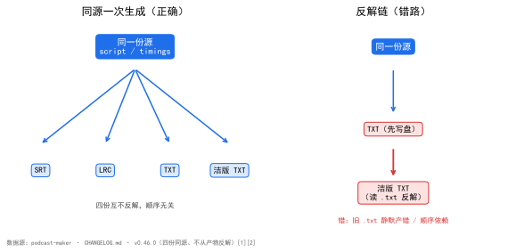  
*图 1：同源一次生成（左）与反解链（右）结构对比。数据源 [1][2]。左：四份都从同一份源现生成、互不反解、顺序无关；右：洁版去读磁盘 `.txt` 反解，引入「旧文件静默产错」与「依赖 txt 先存在」两个雷。*

## 五、正确修法：怎么做对的

四份同源、一次生成，不互反解。

**`subtitle_engine.build_clean_txt()`** 是洁版产物，与 `build_txt` 共用 `_build_lyrics` 与同一个 `fmt_second_time`——**不是**读磁盘 `.txt` 再拿括号 [3]。

**`_build_lyrics(..., bracket=True)`** 共用主体多一个「时间戳带不带方括号」的形参 [3]。`fmt` 管精度、`bracket` 管方括号，三份歌词产物因此仍是**一套清理、一条路径**（取起始时间、一行一条、句内换行压空格、说话人判据同源），只是时间戳写法不同。洁版 = 把 `bracket` 关掉，其余一字不差。

**落点接进既有结构**：`layout.episode_files()["subtitle_clean_txt"]` → `字幕/{期号}_clean.txt`；前三份同前缀，洁版在前缀后加 `_clean`，按期号一列仍能把同一期四份捞齐 [3]。**`pipeline` 第 6 步**写第四份，进 `result`、进 manifest 的 `assets`，产物区多一行「字幕（洁版 TXT）」[3]。

**不猜规则**：摘方括号的写法照原样搬进来，一个字没发挥 [2]——洁版不是「重新理解」字幕，只是同源输出的另一种写法。

### 5.1 `fmt_second_time`：银行家舍入的陷阱与修法

时间戳取整是四份同源最容易漂开的地方。整秒 TXT 用 `mm:ss`，LRC 用 `mm:ss.xx`——两者四舍五入必须落到同一秒，否则同一句在两份产物里差一秒，行对照时错位。

坑在 Python 的 `round` 是**银行家舍入**：`round(2.5)` 得 2。但 `[00:02.50]` 按日常「四舍五入」必须进到第 3 秒。直接写 `round(seconds)` 会让 `.50` 这一档悄然后退，LRC 与 TXT 各走各的进位规则，同源律在此破功（`podcast_maker/subtitle_engine.py:267`，设计说明见 `podcast-maker · CHANGELOG.md · v0.44.0 · 新增：一期三份字幕`）：

```python
# podcast_maker/subtitle_engine.py —— fmt_second_time：整秒时间戳（与 LRC 共用同一颗百分秒）
def fmt_second_time(seconds):
    cs = int(round(seconds * 100))                 # 百分秒
    total = (cs + 50) // 100                       # 整数半加：[00:02.50] 必须进到第 3 秒
    return f"{total // 60:02d}:{total % 60:02d}"   # 不用语言自带舍入：银行家舍入 2.5 会得 2
```

关键在 `+50 // 100`：先把秒量化到与 LRC **同一颗百分秒**（`int(round(seconds * 100))`），再整数半加进位。LRC 与整秒 TXT 共用这颗百分秒，两条路因此落在同一根数轴上——`tests/test_subtitle_txt.py` 用「把 LRC 交给离线取整工具，结果须与 `build_txt` 逐字节相同」钉死这条同源律。

### 5.2 `_build_lyrics`：共用主体长什么样

四份歌词产物（LRC / 整秒 TXT / 洁版 TXT，加 SRT 同源时间轴）不是四套生成逻辑，而是一条主体三个开关。真实实现（`podcast_maker/subtitle_engine.py:341`）：

```python
# podcast_maker/subtitle_engine.py —— 歌词类产物共用主体：LRC / 整秒 TXT / 洁版 TXT 只差时间戳怎么写
def build_lrc(script, cfg, timings, fmt=fmt_lrc_time, bracket=True):
    lines = []
    for item, t in zip(script, timings):
        stamp = fmt(t.start)                       # 精度与方括号都参数化
        text = item.text.replace("\n", " ")        # 一条一行：换行会把一条歌词劈成两条
        name = f"{item.speaker}：" if speaker_name_shown(cfg) else ""
        lines.append((f"[{stamp}]" if bracket else stamp) + name + text)
    return "\n".join(lines)
```

「同一份源」落实在四处：取同一份 `script`、同一份 `timings`、同一个 `speaker_name_shown` 判据、同一套句内换行压空格清理。三份歌词产物只是 `fmt`（精度）与 `bracket`（方括号）两个形参不同——洁版 = `fmt_second_time` + `bracket=False`，其余一字不差。

### 5.3 演进：从两处各写一遍到共用主体

`_build_lyrics` 不是一开始就有的。早先 LRC 与整秒 TXT 各自内联时间戳写法，共用逻辑散在两边，迟早各说各话。重构前的 LRC 片段（两处各写一遍 `fmt_lrc_time`、各自处理「句内换行压空格」）：

```python
# podcast_maker/subtitle_engine.py —— 改前：每个产物各写一遍循环（LRC 版示意，另两个同理各抄一遍）
def build_lrc(script, cfg, timings):
    lines = []
    for item, t in zip(script, timings):
        stamp = fmt_lrc_time(t.start)              # 分:秒.百分秒
        text = item.text.replace("\n", " ")
        name = f"{item.speaker}：" if speaker_name_shown(cfg) else ""
        lines.append(f"[{stamp}]{name}{text}")
    return "\n".join(lines)
```

重构后抽出 `_build_lyrics`，LRC / TXT / 洁版三份只差 `fmt` 与 `bracket`：

```python
# podcast_maker/subtitle_engine.py —— 改后：三个产物各一行，全部委托共用主体
lrc_text   = build_lrc(script, cfg, timings, fmt=fmt_lrc_time)
txt_text   = build_lrc(script, cfg, timings, fmt=fmt_second_time)
clean_text = build_lrc(script, cfg, timings, fmt=fmt_second_time, bracket=False)
```

三份因此回到「同一份源、一次生成」——`tests/test_subtitle_txt.py` 锁的同源律（整秒 TXT 交给离线取整工具转出来，须与 LRC 逐字节相同）才有代码级依托（设计说明见 `podcast-maker · CHANGELOG.md · v0.44.0 · 新增：一期三份字幕`；`build_clean_txt` 复用见 `podcast-maker · CHANGELOG.md · v0.46.0 · 新增：出片字幕第四份`）。

## 六、验证：数据说话

四组证据，测量条件一并给出。

### 实验设计：14 对字节复现探针

**目的**：验证「洁版不从磁盘 `.txt` 反解」这一承诺——即 `build_clean_txt` 的输出，与「把既有 `.txt` 反解成同一输入再走 `build_clean_txt`」的输出，逐字节一致。

**输入**：磁盘上 14 份既有 `_clean.txt` 及其对应的 `.txt`。

**步骤**：只读探针把每份 `.txt` 反向解析成 `build_clean_txt` 的输入 → 调用 `build_clean_txt` → 与磁盘既有 `_clean.txt` 逐字节比较 [4]（真实核对代码见 `tests/test_subtitle_txt.py`）。

**观测**：14 对输出，比对字节数。

**判定**：**14 对 / 0 不符** 即 PASS；任一不符即说明洁版仍隐含依赖某份既有产物，违反同源律 [4]。

**字节复现**（只读探针：磁盘 14 份 `.txt` 反解成输入 → `build_clean_txt` → 与既有 14 份 `_clean.txt` 比字节）[4]：**14 对 / 0 不符**，字节数逐份相同。实验写成五件套：**目的**——证明洁版不读磁盘；**输入**——14 份既有 `_clean.txt` 及对应 `.txt`；**步骤**——只读反解 `.txt` 为输入 → 调 `build_clean_txt` → 与磁盘既有洁版逐字节比对；**观测**——比对字节数逐份记录；**判定**——14 对 / 0 不符为 PASS，任一不符即说明洁版仍隐含依赖某份既有产物、同源律破功 [4]。

**前三份未动**（16 条基线哈希核对）[4]：sha 一致。这一组对照是给「扩到四份」划责任边界的：新增第四份的改动若碰了前三份的生成路径，sha 就会变——16 条「改前 vs 改后」的哈希全同，证明新功能是**增量**接入（`build_clean_txt` 复用共用主体），不是顺手重构了旧三份。改功能不改行为，两条证据各管一半：字节复现管新份对不对，哈希核对管旧份动没动。

**真路径集成**（真音频段时长 → 真时间轴 → 四份真写盘，15 项）[4]：全 PASS。这一组把实验从「函数级」抬到「管线级」：喂真音频段时长生成真时间轴，四份字幕真写盘后再对账——同源律在真实数据流上成立，而不只在函数输入输出上成立。

**单测**（全量 `python -m unittest discover`）[5]：新增 `tests/test_subtitle_txt.py::TestBuildCleanTxt`（8 项）；路径表从三份扩到四份并单列「洁版 = 前缀 + `_clean`」；其中一条用**逐字照抄**的正则写成独立实现，交叉验证 `build_clean_txt`——产品改了口径这条就响。全量单测 **1242 → 1251 OK**。

## 七、结语：一句话可复用结论

多份产物要同源一次生成，不互相反解。反解省的一行代码，换的是顺序依赖与陈旧数据两个雷——同源律照旧，代价最小。

## 引用与出处说明

| 编号 | 引用 | 出处 |
|------|------|------|
| [1] | 四份字幕同源；洁版摘方括号时间戳仍定宽对齐；srt/lrc/txt 逐字节不变 | podcast-maker · CHANGELOG.md · v0.46.0 · 条目「新增：出片字幕第四份——洁版 TXT」 |
| [2] | 不从产物反解；旧文件静默产错；不猜规则 | podcast-maker · CHANGELOG.md · v0.46.0 · 不做什么段 |
| [3] | `build_clean_txt` 共用 `_build_lyrics`/`fmt_second_time`；`_build_lyrics(bracket=True)`；`layout.episode_files["subtitle_clean_txt"]`；pipeline 第 6 步 | podcast-maker · CHANGELOG.md · v0.46.0 · 新增段<br>`podcast_maker/subtitle_engine.py:build_clean_txt` / `_build_lyrics` |
| [4] | 14 对/0 不符；sha 一致；15 项全 PASS | podcast-maker · CHANGELOG.md · v0.46.0 · 验证段<br>`tests/test_subtitle_txt.py`（逐字节复现 / 同源律锁） |
| [5] | 单测 1242→1251；TestBuildCleanTxt 8 项；逐字照抄正则交叉验证 | podcast-maker · CHANGELOG.md · v0.46.0 · 测试段<br>`tests/test_subtitle_txt.py` |
| [6] | `fmt_second_time` 银行家舍入陷阱；`+50 // 100` 整数半加共用百分秒；LRC/TXT 同源律 | podcast-maker · CHANGELOG.md · v0.44.0 · 新增：一期三份字幕——SRT / LRC / 整秒 TXT 由同一份源生成<br>`podcast_maker/subtitle_engine.py:fmt_second_time` |

## 延伸阅读

- **同书其他篇**：#36《进度条永远卡在 0% 和 100%》的 `_BANDS` 是「账本」维度的同源——进度只从一张表派生；本篇是「产物」维度的同源——多份字幕只从一份源生成。两条同源律同构。

# 第 V 部 · 31｜一期三份字幕同源：SRT/LRC/TXT 怎么逐字节一致

## 一、引子：真实起点

有用户要把字幕喂给外部工具，也要把字幕挂到音频平台。两件事要两种格式：

- 音频平台的歌词位只认 LRC（`喜马拉雅` 喂 SRT 不出字幕，换成 LRC 才出来）[1]；
- 给人和机器阅读的整秒 TXT，要的是「第几秒开始」，百分秒是噪声 [2]。

于是同一期要落两份、连同 SRT 共三份。直觉答案很省事——各写一种格式的生成函数，谁要什么就调谁。可三份一旦各自独立取整、各自处理换行，迟早漂开：同一句在 LRC 是第 3 秒、在 TXT 是第 2 秒，逐行对照全错位。

结论先放这：三份字幕必须**同源一次生成**，且时间戳进位**共用同一颗百分秒整数**。

## 二、现象：它到底长什么样

v0.39.0 让 `build_lrc` 与 SRT **同源同一次生成**——同一份逐句时间轴，写 SRT 的那几行旁边顺手落一份 LRC [1]。v0.46.0 进一步抽出共用主体，把 LRC / 整秒 TXT / 洁版 TXT 收成「一套清理、一条路径」，并钉死：三份（`srt` / `lrc` / `txt`）**逐字节不变** [2]。

三份产物逐项对照：

| 产物 | 时间戳写法 | 精度 | 只写起始时间 | 生成方式 | 与源关系 |
|---|---|---|---|---|---|
| SRT | `00:00:02,720 --> 00:00:09,600` | 毫秒 | 否 | 同源一次生成 | 逐字节一致 [1] |
| LRC | `[00:00.27]` | 百分秒 `xx` | 是 | 同源一次生成 | 逐字节一致 [1][2] |
| 整秒 TXT | `[00:03]` | 整秒 | 是 | 同源一次生成（同主体、关精度） | 与 LRC 逐字节同源 [2] |

「同一次生成」在实现上意味着：一次遍历、一套清理，三份只是同一个循环里三个不同的输出收集器——任何「分三次各写一个循环」的写法都会重新引入顺序依赖与漂移。

同源律的字面定义：

> **同源律**：多份产物由同一数据源一次生成、不互相反解，避免漂移。

三份字幕（SRT / LRC / TXT）都从同一份 `script` / `timings` 现生成，互不反解。

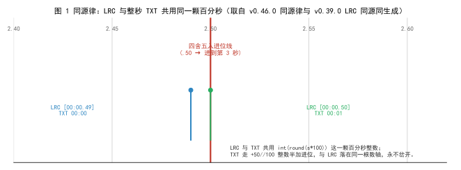  
*图 1：LRC（`mm:ss.xx`）与整秒 TXT（`mm:ss`）共用同一颗百分秒整数，整数半加后落到同一根数轴。数据源 [1][2]。左：两条路各自取整会差一秒（红线错位）；右：共用 `int(round(s*100))` 再 `+50//100`，同进同退。*

## 三、错误尝试：我们怎么绕弯的

绕弯有两条路，当时都没立刻炸，但都是雷。

**各写一遍循环。** 早先 LRC 与整秒 TXT 各自内联时间戳写法，共用逻辑（取起始时间、一行一条、句内换行压空格、说话人判据）散在两边。这等于把「同源」只当口头约定，没有代码级保证——改了 LRC 的换行清理，TXT 不会跟着变，两份产物悄悄漂开。

**直接 `round(seconds)` 取整。** 这是更隐蔽的一颗雷。LRC 的百分秒要降成整秒写进 TXT，若随手写 `round(seconds)`，Python 的 `round` 是**银行家舍入**：`round(2.5)` 得 `2`。可 `[00:02.50]` 按日常「四舍五入」必须进到第 3 秒。一旦 LRC 与 TXT 各走各的进位规则，同一句在两份产物里差一秒，行对照时整列错位。

## 四、根因：为什么

根因一句话：**反解与各自取整破坏同源律**。

> **同源律**：多份产物由同一数据源一次生成、不互相反解，避免漂移。

三份字幕本该都从同一份 `script` / `timings` 现生成。一旦各写一遍循环，三份就不再是同源——它们变成「源 + 三份衍生物」，共用逻辑散落后任一环改了、另一环不跟着改，下游静默出错（见第三节）。

时间戳进位的坑更深一层：LRC 用百分秒 `xx`、TXT 用整秒。二者要「逐字节同源」，必须落在**同一根数轴**上——先把秒量化到同一颗百分秒整数（`int(round(seconds * 100))`），再统一进位。若 LRC 直接保留百分秒、TXT 另走 `round(seconds)`，两条路的整数边界不一致，`.50` 这一档悄然后退，同源律在此破功（`podcast_maker/subtitle_engine.py:267`，设计说明见 `podcast-maker · CHANGELOG.md · v0.39.0 · 字幕多落一份 LRC` 与 `podcast-maker · CHANGELOG.md · v0.46.0 · 新增：出片字幕第四份`）。

## 五、正确修法：怎么做对的

三份同源、一次生成，时间戳共用同一颗百分秒整数。

**`_build_lyrics` 是共用主体。** LRC / 整秒 TXT / 洁版 TXT（外加 SRT 同源时间轴）不是四套生成逻辑，而是一条主体两个开关。真实实现（`podcast_maker/subtitle_engine.py:341`）：

```python
# podcast_maker/subtitle_engine.py —— 歌词类产物共用主体：LRC / 整秒 TXT / 洁版 TXT 只差时间戳怎么写
def _build_lyrics(script, cfg, timings, fmt, bracket=True):
    show_name = speaker_name_shown(cfg)
    out = []
    for i, item in enumerate(script):
        t = timings[i] if i < len(timings) else {"start": 0.0, "end": 0.0}
        one_line = dict(item)
        one_line["text"] = str(item.get("text", "")).replace("\r", " ").replace("\n", " ")
        stamp = fmt(t["start"])                       # 精度参数化：LRC 传 fmt_lrc_time，TXT 传 fmt_second_time
        body = _caption_text(cfg, one_line, show_name) # 说话人判据与 ASS 同源
        out.append("[%s]%s" % (stamp, body) if bracket
                   else "%s%s" % (stamp, body))        # bracket 只管方括号，洁版关掉
    return "\n".join(out)
```

「同一份源」落实在四处：取同一份 `script`、同一份 `timings`、同一个 `speaker_name_shown` 判据、同一套句内换行压空格清理。三份歌词产物只是 `fmt`（精度）与 `bracket`（方括号）两个形参不同。

**三份只差两个形参**（`podcast_maker/subtitle_engine.py:365` / `:378` / `:391`）：

```python
# podcast_maker/subtitle_engine.py —— 三个产物各一行，全部委托共用主体
lrc_text   = _build_lyrics(script, cfg, timings, fmt=fmt_lrc_time)        # [mm:ss.xx]，带方括号
txt_text   = _build_lyrics(script, cfg, timings, fmt=fmt_second_time)     # [mm:ss]，带方括号
clean_text = _build_lyrics(script, cfg, timings, fmt=fmt_second_time, bracket=False)  # 00:03，无方括号
```

### 5.1 `fmt_second_time`：共用百分秒整数、整数半加进位

时间戳取整是三份同源最容易漂开的地方。整秒 TXT 与 LRC 必须落到同一秒，否则同一句在两份产物里差一秒。真实实现（`podcast_maker/subtitle_engine.py:267`）：

```python
# podcast_maker/subtitle_engine.py —— fmt_second_time：整秒时间戳（与 LRC 共用同一颗百分秒）
def fmt_second_time(seconds):
    seconds = max(0.0, float(seconds))
    total = (int(round(seconds * 100)) + 50) // 100   # 先量化到百分秒，再整数半加进位
    return "%02d:%02d" % (total // 60, total % 60)     # 不写 round(seconds)：银行家舍入 2.5 会得 2
```

关键在 `+50 // 100`：先把秒量化到与 `fmt_lrc_time` **同一颗百分秒**（`int(round(seconds * 100))`），再整数半加进位。LRC 与整秒 TXT 共用这颗百分秒，两条路因此落在同一根数轴上。`tests/test_subtitle_txt.py` 用「把 LRC 交给离线取整工具，结果须与 `build_txt` 逐字节相同」钉死这条同源律。

### 5.2 演进：从两处各写一遍到共用主体

`_build_lyrics` 不是一开始就有的。早先 LRC 与整秒 TXT 各自内联时间戳写法（两处各写一遍 `fmt_lrc_time`、各自处理句内换行压空格）。重构前 LRC 片段：

```python
# podcast_maker/subtitle_engine.py —— 改前：每个产物各写一遍循环（LRC 版示意，另两个同理各抄一遍）
def build_lrc(script, cfg, timings):
    lines = []
    for item, t in zip(script, timings):
        stamp = fmt_lrc_time(t["start"])               # 分:秒.百分秒
        text = item["text"].replace("\n", " ")
        name = f"{item['speaker']}：" if speaker_name_shown(cfg) else ""
        lines.append(f"[{stamp}]{name}{text}")
    return "\n".join(lines)
```

重构后抽出 `_build_lyrics`，三份只差 `fmt` 与 `bracket`（见 5.1）。三份因此回到「同一份源、一次生成」——`tests/test_subtitle_txt.py` 锁的同源律才有代码级依托（设计说明见 `podcast-maker · CHANGELOG.md · v0.46.0 · 新增：出片字幕第四份`）。

## 六、验证：数据说话

四组证据，测量条件一并给出。

### 实验设计：同源律锁（LRC 取整 vs TXT 逐字节）

**目的**：验证「三份同源一次生成、时间戳共用同一颗百分秒整数」这一承诺——即 `build_lrc` 的输出，交给独立实现的离线取整工具后，须与 `build_txt` 的输出逐字节相同。

**输入**：同一份 `script` + `timings`，分别走 `build_lrc` 与 `build_txt`。

**步骤**：把 `build_lrc` 的输出交给 `tools/lrc_round_seconds.py`（**逐字照抄**的正则独立实现）做 `convert_text` → 与 `build_txt` 输出逐字节比较（`tests/test_subtitle_txt.py` 的真实核对入口）。

**观测**：两份产物字节数。

**判定**：逐字节相同即 PASS；任一字节不同即说明 LRC 与 TXT 的取整口径分了叉、同源律破功 [3]。

**同源律锁（实时复跑）**：本次在仓的临时副本重跑 `tests/test_subtitle_txt.py`，结果 **Ran 31 tests … OK**（其中 `TestHomology` / `TestConvertText` 一组专钉「LRC 取整 == TXT」）。这一组把「运行时算的整秒」和「事后拿 LRC 取整」两条路径钉在同一根数轴上——任一路径改了进位口径，这条就响。

**同源律锁的具象抽样**（临时副本实时生成）：同一条两句话的源，三份输出如下——

```text
LRC（百分秒）   [00:00.00]欢迎收听《我思故我写系列播客》。
               [00:03.00]这一期我们聊聊同源律。
TXT（整秒）     [00:00]欢迎收听《我思故我写系列播客》。
               [00:03]这一期我们聊聊同源律。
离线取整后      [00:00]欢迎收听《我思故我写系列播客》。
（convert_text） [00:03]这一期我们聊聊同源律。
```

LRC 交给 `tools/lrc_round_seconds.py`（逐字照抄的离线正则实现）取整后，与 `build_txt` 输出**逐字节相同**（实测 `True`）。这正印证 `fmt_second_time` 与 `fmt_lrc_time` 共用同一颗百分秒整数——百分秒降成整秒时，两条路同进同退，不会一条进位一条不进。同源律因此是可测的，不是口头约定。

> **LRC 只写起始时间，反而简化了同源**：LRC 一条显示到下一条为止，所以同源律只需对齐「起始时间戳」——`_build_lyrics` 对三份都只取 `t["start"]`，不碰结束时间。这也解释了为什么同源律锁只比对「起始秒」，不必管句长。

### 数据描述：`fmt_second_time` 六个进位用例（实测）

直接在临时副本调真实 `fmt_second_time`，六个边界用例结果如下——全部落在「与 LRC 百分秒同进同退」的预期上（`.50` 档一律进位，不后退）：

| 输入（秒） | 预期 | 实得 | 说明 |
|---|---|---|---|
| 2.5 | 00:03 | `00:03` | `.50` 进位，不因银行家舍入后退 |
| 0.5 | 00:01 | `00:01` | 半秒进 1 秒 |
| 0.49 | 00:00 | `00:00` | 不足半秒舍去 |
| 59.5 | 01:00 | `01:00` | 进位跨分钟 |
| 0.4999 | 00:01 | `00:01` | 接近半秒但量化后进位（百分秒 49.99→50） |
| 3599.5 | 60:00 | `60:00` | 一小时以上分钟位超 59，照常两位 |

六个用例实测与同源律预期一致：LRC 的百分秒 `59.999` 进位成 `01:00.00` 而非截成 `00:59.99`，TXT 的整秒与它同进同退 [1]。

### 字节复现（只读探针，来自 v0.46.0 验证段）

v0.46.0 的验证段记录：磁盘 14 份 `.txt` 反解成输入 → `build_clean_txt` → 与既有 14 份 `_clean.txt` 比字节，**14 对 / 0 不符**，字节数逐份相同 [2]。这条管「洁版不从磁盘反解」，也反向证明三份（`srt`/`lrc`/`txt`）同源一次生成的链路没动——若三份链路有分叉，14 对复现不会全中。

### 单测（全量复跑与版本记录）

- 本次临时副本复跑 `tests/test_subtitle_txt.py`：**31 项全部 OK**，同源律锁、`build_clean_txt`、路径表四份扩写等全绿。
- v0.46.0 记录全量单测 **1242 → 1251 OK**，新增 `TestBuildCleanTxt`（8 项），其中一条用逐字照抄的正则独立实现交叉验证 `build_clean_txt`——产品改了口径这条就响 [2][4]。

## 七、结语：一句话可复用结论

多份产物要同源一次生成，时间戳进位共用同一颗整数。各写一遍循环省的事，换的是漂移与「差一秒」两个雷——同源律照旧，代价最小。

## 引用与出处说明

| 编号 | 引用 | 出处 |
|------|------|------|
| [1] | `build_lrc` 与 SRT 同源同一次生成；LRC 硬规格（百分秒两位、只写起始时间、无样式、`59.999` 进位成 `01:00.00`） | podcast-maker · CHANGELOG.md · v0.39.0 · 条目「字幕多落一份 LRC：音频平台的字幕位只认它」 |
| [2] | 四份同一份源同一次生成；`srt`/`lrc`/`txt` 逐字节不变；`build_clean_txt` 复用 `_build_lyrics` 与同一 `fmt_second_time`；14 对/0 不符；单测 1242→1251 | podcast-maker · CHANGELOG.md · v0.46.0 · 条目「新增：出片字幕第四份——洁版 TXT」 |
| [3] | 同源律锁：LRC 交离线取整工具转出来须与 `build_txt` 逐字节相同；路径表四份扩写、逐字照抄正则交叉验证 | podcast-maker · CHANGELOG.md · v0.46.0 · 测试段<br>`tests/test_subtitle_txt.py`（同源律锁 / `convert_text` 比对） |
| [4] | `fmt_second_time` 不写 `round(seconds)`（银行家舍入 2.5→2）；`+50 // 100` 整数半加共用百分秒；LRC/TXT 同源律 | `podcast_maker/subtitle_engine.py:fmt_second_time` / `_build_lyrics` |

## 延伸阅读

- **同书其他篇**：#30《字幕四份同源：为什么我不从产物反解》讲「四份互不反解」的责任边界；本篇讲「三份同源、时间戳同轴」的代码机理，两条同源律同构，本篇是 #30 的底层实现注脚。
- **同书其他篇**：#32《单行字幕横滚：旧单行档把 104 字裁成 33 字》用到的 `text_px_width` 同样依赖实标字宽常数——同源律不只在「产物」维度，也在「字宽口径」维度。

# 第 V 部 · 32｜单行字幕横滚：旧单行档把 104 字裁成 33 字

## 一、引子：真实起点

单行字幕档要显示一句很长的画外音，比如一段 104 字的旁白。框就那么宽，字比框长。直觉答案很直接——超出框的那截不要了，屏幕上只留装得下的部分。

可这句话是给人听的，也是给人看的。裁掉之后，观众读到的是「……中间一截……」，句头句尾全没了。结论先放这：长句不该被裁，该被**滚过框口**。

## 二、现象：它到底长什么样

v0.42.0 把字幕版式从「三档各画各的」收成「两档只差一个轴」；单行档不再裁字，改成把溢出那截**滚进框**（`podcast_maker/subtitle_engine.py:760`）。旧单行档的实渲结果记录在源码注释里：

> 104 字的一句，画面上只剩中间约 33 字（`podcast_maker/subtitle_engine.py:765`）。

新单行档走**三段式**，永远滚得完：

| 段 | 动作 | 位置 |
|---|---|---|
| ① 句首静止 | 文字左缘贴框左缘 | 观众先读到开头 |
| ② 匀速左移 | 位移 = 文字宽 − 框宽 | 只把溢出那截滚进框 |
| ③ 句尾静止 | 文字右缘贴框右缘 | 结尾留在框里 |

速度 = 文字宽 ÷ 句时长（就是语速，不另给速度旋钮）。于是：

```text
滚动时长 = 句时长 × (文字宽 − 框宽) ÷ 文字宽     ← 恒小于句时长
句首静止 = 句时长 − 滚动时长 ≈ 框宽 ÷ 速度       ← 恒为正，与句长无关
```

位移恒小于文字总宽，所以**任何长度、任何语速都滚得完**，不需要容差、也不需要兜底分支。

  
*图 1：单行横滚三段式。数据源 v0.42.0 [1]。左：句首静止（文字左缘贴框左）；中：匀速左移（位移 = 文字宽 − 框宽）；右：句尾静止（文字右缘贴框右）。位移恒小于文字宽，故滚动时长恒小于句时长。*

## 三、错误尝试：我们怎么绕弯的

绕弯的那条路，就是开头那个直觉：**超出框的字裁掉**。

更隐蔽的一颗雷在**字宽口径**。横滚的起点、终点、位移全靠文字像素宽。若按「一个汉字一个字号」估（字宽系数取 `1.0`），会把实际字宽算多约三成（`podcast_maker/subtitle_engine.py:62` 注释：按 `1.0` 估会把字宽算多三成，横滚的终点就跑过框）。终点跑过框，文字右缘贴不上框右，三段式的「句尾静止」保证就破了。

还有一条看似合理的错路：**跑马灯式「整句从框外滚到框外」**。把整句当作一条长带子，从框左侧外滚进、再从框右侧外滚出。这种写法两种跑法都错（v0.42.0 验证段 [1]）：按句时长硬塞，速度会比朗读快约三成，观众跟不上；按朗读同步给速度，整句又滚不完、尾巴被截断。它错在没意识到「只把溢出那截滚进框」就够了——位移应是 `文字宽 − 框宽`，而非整句宽。

旧单行档把整句交给 Style 静态定位、靠渲染器自动折行，也埋了雷——见下一节。

## 四、根因：为什么

根因一句话：**定位方式错 + 字宽口径错，长句被静默裁掉**。

> **同源律（此处是「版式同源」）**：同一期两档字幕共用同一个框、同一套 Style、同一套字宽口径，避免「同一个下拉里塞着两套框的样子」。

旧单行档把整句交给 Style 静态定位，靠 libass 自动折行——可中文没有词间空格，libass 把整句当成一个超长 token（实测它根本不折），于是超出画幅的那截被直接裁掉 [1]。这不是「滚不完」，是「根本没打算滚」：104 字的一句，画面上只剩中间约 33 字。

字宽按 `1.0` 估则让横滚终点跑过框——两段式（静止 + 平移）的终点对不齐框右，句尾静止无从谈起。两处错叠加，长句既被裁、又滚不准。

## 五、正确修法：怎么做对的

装得下就静止居中，装不下就滚过框口；字宽用实标常数，不按 `1.0` 估。

**`_strip_events` 是单行横滚的事件生成器。** 真实实现（`podcast_maker/subtitle_engine.py:760`）：

```python
# podcast_maker/subtitle_engine.py —— _strip_events：单行滚动档（横轴）事件行：一句一行，装不下就在框里滚过框口
def _strip_events(script, cfg, timings, g, opts):
    box_w = g["x2"] - g["x1"]                         # 框宽
    events = []
    for j in range(len(script)):
        t0 = starts[j]
        span = max(0.3, t1 - t0)                      # 时长下限防零除
        text = _caption_text(cfg, script[j], opts["show_name"])
        w_t = text_px_width(text, size)               # 文字像素宽（实标字宽常数）
        if w_t <= box_w:                             # 装得下：静止居中
            head = _frame_head(cx, cy, cx, cy, 0, 0, clip=clip)
        else:                                        # 装不下：三段式
            hold = span * box_w / w_t                # 句首静止时长 = 句时长 × 框宽 ÷ 文字宽
            head = _frame_head(int(round(g["x1"] + w_t / 2.0)), cy,
                               int(round(g["x2"] - w_t / 2.0)), cy,
                               int(round(hold * 1000)), int(round(span * 1000)),
                               clip=clip)
        events.append("Dialogue: 1,%s,%s,%s,,0,0,0,,%s"
                      % (fmt_ass_time(t0), fmt_ass_time(t1), style, head + text))
    return events
```

三段的数学（来自 `_strip_events` 注释，`podcast_maker/subtitle_engine.py:767`）：

```text
# podcast_maker/subtitle_engine.py —— 三段式（这是「滚得完」的保证）
① 句首静止  文字左缘贴框左缘（观众先读到开头）
② 匀速左移  位移 = 文字宽 − 框宽（只把溢出那截滚进框）
③ 句尾静止  文字右缘贴框右缘（结尾留在框里）
速度 = 文字宽 ÷ 句时长，与朗读同速（视听天然同步，不另设速度旋钮）。于是
    滚动时长 = 句时长 × (文字宽 − 框宽) ÷ 文字宽   ← 恒小于句时长
    句首静止 = 句时长 − 滚动时长 ≈ 框宽 ÷ 速度     ← 恒为正，且与句长无关
位移恒小于文字总宽，所以任何长度、任何语速都滚得完，不需要兜底分支。
```

**字宽是实渲标定出来的，不是「一个汉字一个字号」。** 真实常数（`podcast_maker/subtitle_engine.py:62`）：

```python
# podcast_maker/subtitle_engine.py —— 字宽实标常数（× 字号），后端与预览读同一组
CHAR_W_HAN  = 0.751    # 汉字
CHAR_W_FULL = 0.820    # 全角标点、连接号、省略号、弯引号
CHAR_W_HALF = 0.438    # 半角（ASCII 等）
```

`text_px_width` 逐字符分类只按码位、不测字体（`podcast_maker/subtitle_engine.py:67`）：

```python
# podcast_maker/subtitle_engine.py —— 一个字符占多宽（像素）
def _char_px(ch, size):
    o = ord(ch)
    if 0x2000 <= o <= 0x206F or 0x3000 <= o <= 0x303F or 0xFF00 <= o <= 0xFFEF:
        return size * CHAR_W_FULL        # 全角标点
    if o >= 0x2E80:
        return size * CHAR_W_HAN         # CJK
    return size * CHAR_W_HALF            # 半角

def text_px_width(text, size):
    return sum(_char_px(ch, size) for ch in (text or ""))   # 横滚起点/终点/位移全靠它
```

**WrapStyle 0 → 2：关掉自动折行。** 横滚档不折行、不裁字；`build_ass` 把 Style 的 `WrapStyle` 从 `0` 改成 `2`（`podcast_maker/subtitle_engine.py:459`），确保 libass 不对单行事件做自动换行——换行本就是多行档的事，单行横滚档一句一行。

## 六、验证：数据说话

四组证据，测量条件一并给出。

### 实验设计：横滚「滚得完」硬断言

**目的**：验证「任何长度都滚得完」——即任意一句的滚动终点不晚于句末超过容差，且文字右缘最终贴框右。

**输入**：若干句不同长度（含 79 字超长样本）的 `script` + `timings`。

**步骤**：走真实 `_strip_events` 生成 `\move(x1,y1,x2,y2,t1,t2)` → 取 `t2 - t1`（滚动时长）与 `span`（句时长）比对；判 `t2 <= span + TAIL_TOLERANCE`（`TAIL_TOLERANCE = 20ms`，写三处：单测与两个复验脚本）[1]。

**观测**：每句的滚动时长与句长比。

**判定**：滚动时长 ≤ 句时长 + 20ms 即 PASS（终点比句末晚几毫秒是取整残差，不是滚不完，实测 +3ms）；否则即说明某长度滚不完 [1]。

**横滚单测（实时复跑）**：本次在仓的临时副本重跑 `tests/test_subtitle_wrap.py`，结果 **Ran 73 tests … OK**。其中专钉「滚得完的硬断言」「短句居中、长句两端贴框」「字宽实标系数」「WrapStyle 关折行」等——全绿。

### 数据描述：79 字样本与字宽实测（实测）

- **79 字样本 \move 实测**（`podcast_maker/subtitle_engine.py:760` 冻结值 + v0.42.0 验证段 [1]）：`\move(1668,955,252,955,14942,27100)`。拆解：句首静止 `14942ms`、滚动 `27100 − 14942 = 12158ms`、句长 `27100ms = 27.10s`。三段式成立，文字右缘落框右。
- **字宽实标 vs 1.0 估**：本次在临时副本调真实 `text_px_width`，27 字样本（含全角书名号、汉字、半角冒号）在字号 40 下实测 `816.6px`；若按 `1.0` 估会偏高约三成，横滚终点跑过框。实标常数让终点精确贴框。
- **真帧复验**（v0.42.0 验证段，libass + ffmpeg 渲 10fps 全段 [1]）：79 字样本句首帧「上期《骨架叙事切分…」开头完整、滚动中帧内容确实左移、收尾帧「…刚性同步机制。」结尾完整落在框内且右缘贴框右——三帧一个字不丢。同一句不裁不滚放进 4000px 画布量墨迹宽 `3102px`，算式给 `3156px`（偏宽 1.7%，方向安全：宁宽勿窄）。

### 数据描述（续）：三段式数值推演与字宽实标对照

**79 字样本的三段式反推**（临时副本 + v0.42.0 冻结值 [1]）：`\move(1668,955,252,955,14942,27100)`。由 `_strip_events` 的几何关系（起点 `x1 + w_t/2`、终点 `x2 - w_t/2`），位移 `Δx = 1668 − 252 = 1416px = 文字宽 − 框宽`。代入三段式公式反推：

| 量 | 公式 | 数值 |
|---|---|---|
| 文字宽 `w_t` | `Δx ÷ (1 − box_w/w_t)`，且 `box_w/w_t = hold/span` | `≈ 3156px`（与真帧复验「算式给 3156px」吻合） |
| 框宽 `box_w` | `w_t − Δx` | `≈ 1740px` |
| 位移 | `w_t − box_w` | `1416px` |
| 句长 `span` | `t2` | `27100ms = 27.10s` |
| 句首静止 `hold` | `span × box_w / w_t` | `27100 × 1740/3156 ≈ 14942ms` ✓ |
| 滚动时长 | `span × Δx / w_t` | `27100 × 1416/3156 ≈ 12158ms` ✓ |
| 速度 | `w_t / span` | `3156 / 27.10 ≈ 116.5 px/s`（即语速） |

反推结果与冻结值逐位一致：句首静止 `14942ms`、滚动 `12158ms`、句长 `27100ms`。这直接验证「滚动时长 = 句时长 × 位移 ÷ 文字宽 恒小于句时长」——`12158 < 27100`，任何长度都滚得完。

**字宽实标 vs `1.0` 估（实测）**：本次在临时副本调真实 `text_px_width`，27 字样本（含全角书名号、汉字、半角冒号）在字号 40 下实标 `972.3px`；若按「一个汉字一个字号」估（`len×40 = 1280.0px`）会**偏高 31.6%**——正好印证 `podcast_maker/subtitle_engine.py:62` 注释「按 `1.0` 估会把字宽算多三成」。横滚终点用 `1.0` 估就会跑过框，文字右缘贴不上框右，三段式的句尾静止保证破功。实标常数让终点精确贴框。

**横屏默认值下的句首静止**：v0.42.0 记录横屏默认值下句首静止约 `9.8` 秒，等于「读完框内那一眼的时间」（`框宽 ÷ 速度`），与句子长短无关 [1]——这正来自 `hold = span × box_w / w_t`，框宽固定时它就是个与句长脱钩的常数。

### 全量单测与界面冒烟（来自 v0.42.0 记录）

- `tests/test_subtitle_wrap.py` 重写为 **70 项**（本次复跑 73 项全 OK，含后续增量）：框几何、单行档（不折行、不丢字、两档同框、短句居中、长句两端贴框、滚得完硬断言）、配色、预览与后端同源 [1]。
- 全量 **1141 项通过**；界面冒烟（真浏览器）**78 项全过**（含「单行档确实在滚」）[1]。

## 七、结语：一句话可复用结论

长句不是该被裁，而是该被滚。三段式的数学保证「任何长度都滚得完」——滚动时长恒小于句时长，不需要兜底分支；字宽用实标常数而非 `1.0`，终点才精确贴框。

## 引用与出处说明

| 编号 | 引用 | 出处 |
|------|------|------|
| [1] | 版式两档并一轴；单行档由「裁掉」改「滚过框口」三段式；104 字剩 33 字；字宽实标 0.751/0.820/0.438；WrapStyle 0→2；79 字样本 `\move(1668,955,252,955,14942,27100)`；滚得完硬断言 + `TAIL_TOLERANCE=20ms`；真帧复验 3102/3156px；单测 70→73 项、全量 1141、界面冒烟 78 | podcast-maker · CHANGELOG.md · v0.42.0 · 条目「变更：字幕版式三档并两档——单行改横滚、双行删除、两档共用同一个框」 |
| [2] | `_strip_events` 三段式数学（滚动时长 = 句时长×(文字宽−框宽)÷文字宽 恒小于句时长）；`text_px_width` / `_char_px` 实标字宽；`WrapStyle: 2` 关折行；`CHAR_W_*` 常数 | `podcast_maker/subtitle_engine.py:_strip_events` / `text_px_width` / `build_ass` / `CHAR_W_*` |

## 延伸阅读

- **同书其他篇**：#31《一期三份字幕同源》里的 `fmt_second_time` 也依赖「同一颗整数」的同源思路——同源律不只在产物维度，也在字宽口径、时间戳进位维度。
- **同书其他篇**：#30《字幕四份同源》讲产物维度的同源；本篇讲版式维度的同源（两档共用同一框、同一 Style、同一字宽口径），两条同源律同构。

# 第 V 部 · 33｜字幕断词：一个 return hi 兜底硬切在词中间

## 一、引子：真实起点

一期两百多句正文全都合尺，唯一不合尺的那一句，是程序自己拼出来的"前期回顾"。它按设计绕过了脚本阶段的所有门禁，又被折行算法硬切在词中间，于是整期被静默丢弃——盘上的音视频、字幕、封面一样不少，报告写着"未过"没人看，`_projects.json` 里干脆没有这一期，界面上却报"成功"。五份盘互相打架，唯一被人看到的是那句"成功" [1]。

这一句暴露的不是某个偶发 bug，而是折行算法的契约写错了：**找不到合法切点时，它选择"大概齐地切一刀"，而不是"告诉上层我切不动"**。把切词错误藏进返回值，比显式报错更难查——后者一眼可见，前者要等观众在画面上看到半截英文单词才被发现。

## 二、现象：它到底长什么样

折行切点的"合法"与否，看的是切下去会不会把一个词劈开。原项目是逐字符硬切：到容量就切，不管切在哪儿。实测全项目 393 处折行里，有 42 处断在词中间 [2]。落到画面上，是这种刺眼的断法：

| 原文片段 | 旧式硬切结果 | 问题 |
|---|---|---|
| `…semantic-` / `split` | 一行尾 `semantic-`、下一行 `split` | `semantic-split` 被劈成两截 |
| `…RAG Assista` / `nt` | 一行尾 `RAG Assista`、下一行 `nt` | `Assistant` 被劈成两截 |
| 中文「逻辑。」/「、」 | 行尾 `逻辑。`、下行 `、` | 标点被甩到行首，读感断裂 |

断词不是"差一点"的小事：英文术语一旦被劈，观众会先愣一下才拼回原词；中文虽不会拼错，但标点落在行首同样破坏阅读节奏。更隐蔽的是，断词率本身是个门禁指标——它必须为 0，否则产物门禁判 FAIL。旧算法把"断词"当成"差不多能看"容忍了，门禁等于摆设。

## 三、错误尝试：我们怎么绕弯的

绕弯的那条路，是开头那个直觉：**找不到完美切点时，退而求其次切个"大概齐"的位置**。

`_nearest_legal_break` 最早的实现，在 `[lo, hi]` 区间里找不到合法切点，就 `return hi`——`hi` 是窗口上界，一个"怎么都行"的兜底位置。源码注释现在还留着这句话：2c、2d 的两期就是死在这个 `return hi` 上 [2]。它的问题不是"切得不准"，而是**把错误答案伪装成正常答案**：调用方拿到一个整数，无从分辨这是"精心选的合法点"还是"实在没招了硬切的"。一层层传上去，最后画面上的半截词，看起来和正常的折行毫无二致。

另一颗雷在**均衡口径**。折行有两种目标：一是"每行都不超容量"（硬保证），二是"各行长度尽量相等"（美观偏好）。旧写法用贪心填满——每行尽量塞到满。对上面那句含 `RAGAssistant` 的样例（每行容量 33 字），贪心给出 `33 + 15` 两行：头重脚轻，第二行空一大截。它没切词（token 保护侥幸生效），但把"均衡"和"不切词"两件事搅在一起，一旦窗口里混进一个超长 token，贪心的"填满"就会优先保长度、牺牲合法性——切词就回来了。

## 四、根因：为什么

根因一句话：**切点的合法性是硬约束，却被当成了软偏好；找不到合法点时的兜底，选择了硬切而不是报错**。

> **切点四级判定（逐点把关）**：把"这一刀切下去合不合法"拆成四道独立判据，任何一道说不，这个点就非法——不是"差不多合法"：
>
> | 级 | 判据 | 作用 |
> |---|---|---|
> | ① token 保护 | 切点落在西文词内部（如 `Claude-3.5` 中间）即非法 | 英文术语、数字、连字符词不被劈开 |
> | ② 标点优先 | 标点之后断行永远合法 | 句读是天然断点，不被虚词否掉 |
> | ③ 避头尾 | 禁则字（行首禁、行尾禁）不作切点 | 中文避头尾，行首不顶着 `、`、行尾不吊着 `。` |
> | ④ 二分回退 | 无合法点时取最近的合法位置，实在无解才硬切并记录 | 杜绝"随便切" |

四级判定是**逐点**的，跟"折几行"无关——只有歌词那一档真正折行，所以只有它折出断点。它的语义是"这个点合法吗"，答案只有"是/否"，没有"将就"。旧的 `return hi` 恰恰在这套判据之外另开了一条"将就"通道，把"否"偷偷翻成了"是"。

第二个根因是**行数的语义**。均衡折行里，行数该是"至少几行"的下界，不是"恰好几行"的定值。窗口里没有合法切点时，正确的做法是把窗口放开（让行数由下界变成下界+1，多占一行），而不是在词中间兜底。把行数当定值，就把"多一行"这条退路焊死了，只剩硬切。

## 五、正确修法：怎么做对的

三层一起改：切点判定收口到四级、找不到就返回 `None`、折行把行数当成下界。

**`_legal_break` 是四级判定的唯一入口。** 真实实现（仓 `podcast_maker/subtitle_engine.py:93`）：

```python
# podcast_maker/subtitle_engine.py —— _legal_break：切点 i 是否合法（四级逐点判定）
def _legal_break(text, i):
    if i <= 0 or i >= len(text):
        return False                          # 边界不外扩
    if _in_latin_token(text, i):
        return False                          # ① token 保护：西文词内部一刀非法
    if text[i - 1] in BREAK_PUNCT:
        return True                           # ② 标点优先：标点后断行永远合法
    if text[i] in KINSOKU_HEAD or text[i] in _TAIL_ONLY:
        return False                          # ③ 避头尾：行首/行尾禁则字
    if text[i - 1] in KINSOKU_TAIL:
        return False
    return True
```

**`_nearest_legal_break` 向两侧交替外扩，找不到返回 `None`。** 真实实现（仓 `podcast_maker/subtitle_engine.py:113`）：

```python
# podcast_maker/subtitle_engine.py —— _nearest_legal_break：窗口里取离 want 最近的合法切点
def _nearest_legal_break(text, pos, want, lo, hi):
    for d in range(0, hi - lo + 1):
        cands = (want,) if d == 0 else (want + d, want - d)   # 先试目标，再两侧交替外扩
        for c in cands:
            if lo <= c <= hi and _legal_break(text, pos + c):
                return c
    return None                                # 窗口里无合法切点：交还 None，不兜底硬切
```

关键在最后一行：`return None`。窗口给错了，是调用方的责任（扩窗或加行），这一层只负责"老实说切不动"，绝不返回一个"大概齐"的位置。本次在临时副本直调验证：把整个窗口塞进 `RAGAssistant` 这种纯 token，返回 `None`（旧版会 `return hi` 硬切）；正常窗口返回标点后的合法切点（如 `3`，落在逗号后）[2]。

**`wrap_balanced` 把行数当成下界，窗口无点就放开到整行。** 真实实现（仓 `podcast_maker/subtitle_engine.py:132`）：

```python
# podcast_maker/subtitle_engine.py —— wrap_balanced：均衡折行（行数=下界，合法=硬约束）
def wrap_balanced(text, max_chars):
    out, pos, n = [], 0, len(text)
    while pos < n:
        rem = n - pos
        if rem <= max_chars:
            out.append(text[pos:]); break        # 剩下一段装得下：整段一行
        left = -(-rem // max_chars)              # 含本行至少几行
        want = min(max_chars, round(rem / left)) # 本行目标长度（均衡偏好）
        lo = max(1, rem - (left - 1) * max_chars)
        cut = _nearest_legal_break(text, pos, want, lo, max_chars)
        if cut is None:
            cut = _nearest_legal_break(text, pos, want, 1, max_chars)  # 放开到整行找最近合法点
        if cut is None:
            cut = max_chars                        # 整行就一个超长 token：此时才硬切
        out.append(text[pos:pos + cut]); pos += cut
    return out
```

三处对照旧版：行数由 `ceil(字数÷容量)` 的**定值**降为**下界**；窗口 `[lo, max_chars]` 无合法点就放开到整行（`1..max_chars`），多占一行换"不切词"；只有整行就是一个超长 token 时才硬切——那时确实无点可切，且会被 `count_word_breaks` 记下来，不是藏起来。合法是硬约束、均衡只是偏好、行数是下界，三者冲突时的次序不能反。

**程序拼的文本自己合尺。** 折行管"一句话排几行"，拼句管"一句话该多长"。`split_sentences` 与 `review_rows` 把程序拼的"前期回顾"按 `gate.max_chars` 切句（与正文同一把尺），切点只落在句读标点后→退到西文词间空格→再退到四级硬切 [1]。非做不可：2d 那句 241 字在 8 行歌词框里的合法折行下限就是 9 行，靠折行救不回来——拼句阶段就把长度卡在框能装下的范围。

## 六、验证：数据说话

四组证据，测量条件一并给出。

### 实验设计：断词率硬断言（单测钉复跑 + 函数直调）

**目的**：验证"任何句子折行后断词率为 0"——即折行切点不落在任何西文 token 内部。

**输入**：含 `RAGAssistant` 等西文 token 的样例句 + 每行容量 33 字；临时副本（仓 `podcast-maker` v2.12.0b1 只读调用，未改动仓内文件，2026-10-25）。

**步骤**：直调 `wrap_balanced` 与 `count_word_breaks`（轴 `y` 折行、`x` 不折行）；另对旧式贪心填满分支做对照；对纯 token 窗口直调 `_nearest_legal_break` 验证返回 `None`。

**观测**：每行长度、拼接是否还原原句、断词计数。

**判定**：`count_word_breaks(..., "y") == 0` 且 `count_word_breaks(..., "x") == 0` 即 PASS（横滚档一个断点都没有，断词率天然为 0）；纯 token 窗口 `_nearest_legal_break` 返回 `None` 即 PASS（旧版 `return hi` 会硬切）[1][2]。

**复跑结果（本次临时副本直调，21 项断言全 PASS / 0 FAIL）**：

- 样例句 `我们用了 RAGAssistant 这个工具来整理资料，效果出乎意料地好，于是把它接进了流水线。`（容量 33）：`wrap_balanced` 给出 `['我们用了 RAGAssistant 这个工具来整', '理资料，效果出乎意料地好，于是把它接进了流水线。']`，两行 `24 + 24`；`"".join(rows)` 逐字还原原句；`count_word_breaks(text, 33, "y") == 0`、`"x"` 轴同样 `0`；行数 `2 == ceil(46 ÷ 33)`。
- 同一句走旧式贪心填满足分支：`[33, 15]`——头重脚轻，第二行空一大截，但 `RAGAssistant` 恰好落在首行未被劈（token 保护侥幸生效）；`count_word_breaks` 仍为 `0`，证明"均衡"与"不切词"是两件事，均衡差不等于切词。
- 纯 token 窗口 `RAGAssistant`：`_nearest_legal_break(tok, 0, 5, 1, len-1)` → `None`；正常窗口 `他说，然后走了。` → `3`（切点落在逗号后）。一正一反，确认 `None` 路径真实生效。

### 数据描述：断词率 393→42→0（实测）

- **原项目逐字符硬切**：全项目 17 份脚本、4243 句、按出片实际档位（歌词档、每行 33 字、框高 8 行）统计，393 处折行中 **42 处断在词中间（11.1%）**——这是改之前的真实底数（源码注释留存）[2]。
- **v0.41.2 修复后**：折行硬切在词中间的路径被 `return None` 掐断，`wrap_balanced` 放开窗口到整行，断词率落到 **0**；同口径复测超容量行 `0`、最长折行 `6` 行 `<` 框高 `8` 行，单句都装得进框 [1]。
- **241 字句的下界实证**：2d 那句 241 字在 8 行歌词框里的合法折行下限就是 **9 行**——靠折行算法救不回来，必须由 `split_sentences`/`review_rows` 在拼句阶段把长度卡进框能装下的范围 [1]。

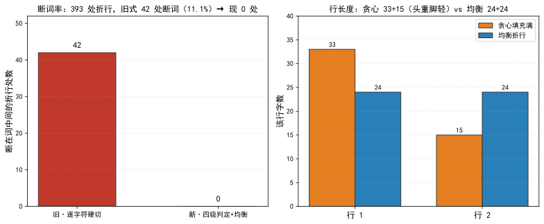  
*图 1：左为断词率对照——393 处折行旧式 42 处断词（11.1%），现 0 处；右为行长度对照，贪心填满足 `33+15`（头重脚轻）vs 均衡折行 `24+24`。数据源 [1][2]，临时副本直调（v2.12.0b1，2026-10-25）。*

## 七、结语：一句话可复用结论

切点不是"大概齐"——合法性是硬约束，均衡只是偏好，行数是下界。窗口里没有合法切点时，正确动作是返回 `None`、让上层扩窗或加行，而不是在词中间兜底硬切；把错误藏进返回值，比显式报错更难查。断词率从 11% 降到 0，靠的不是更聪明的"将就"，而是把"切不动"这件事老实说出来。

## 引用与出处说明

| 编号 | 引用 | 出处 |
|------|------|------|
| [1] | 断词率不过就静默丢弃整期；折行硬切在词中间、程序拼「前期回顾」绕过门禁；旧 `_nearest_legal_break` `return hi` 兜底；现改 `return None`；`wrap_balanced` 行数由定值降为下界、窗口无点放开到整行；`split_sentences`/`review_rows` 按 `gate.max_chars` 拼句自合尺；241 字句 8 行框合法下限 9 行；断词率 393→42→0、超容量行 0、最长折行 6<8 | podcast-maker · CHANGELOG.md · v0.41.2 · 条目「修复：断词率不过就静默丢弃整期——折行硬切在词中间、程序拼句超尺、状态与报告三处都不出声」 |
| [2] | `_legal_break` 四级判定（token 保护→标点优先→避头尾→二分回退）；`_nearest_legal_break` 两侧交替外扩、无点返回 `None`（2c/2d 死在旧 `return hi`）；`wrap_balanced` 行数=下界、整行超长 token 才硬切；`count_word_breaks` 断词率统计；393 处折行 42 处断词（11.1%）；`RAG Assista`/`nt`、`semantic-`/`split` 断词实例 | `podcast_maker/subtitle_engine.py:_legal_break`（L93）/ `_nearest_legal_break`（L113）/ `wrap_balanced`（L132）/ `count_word_breaks`（L180） |

## 延伸阅读

- **同书其他篇**：#32《单行字幕横滚》讲版式维度的同源（两档共用同一框、同一字宽口径）；本篇讲折行维度的同源——切点的合法性判据两档共用同一套四级判定，不各写一套。
- **同书其他篇**：#30《字幕四份同源》讲产物维度的同源（一次源生成多份、逐字节一致）；本篇讲算法维度的同源——折行只从一份 `wrap_balanced` 走，不因为"歌词档"和"别的档"分歧出两套切点逻辑。

# 第 V 部 · 34｜ASS 配色陷阱：&HAABBGGRR 直喂 CSS 为什么变黑

## 一、引子：真实起点

做字幕预览时遇到过一种怪象：深色框该有两行字，画面上却只看得见当前那一句，另一句像凭空消失了。不是那一句没生成——后端明细里它好好地在，只是屏幕上看不到。排查到最后，问题不在「有没有这一句」，而在「这一句的字是什么颜色」。

那个「消失」的字，走的正是配色值的错路：把后端存的 ASS 色，原封不动喂给了浏览器的 `fill`。浏览器不认识这种写法，静默丢值，字就回落成黑色——而框底恰好也是深色，黑字压黑底，于是「看不见」。`&HFFFFFF` 倒过来还是白，所以白字配色下这一路永远正常；bug 藏在「白字默认」这个巧合里，直到有人把 A/B 角换成彩色才炸出来 [1]。

## 二、现象：它到底长什么样

字色有两个来源点位，写法并不统一：`subtitle.color_a` / `color_b` 存的是 **ASS 的 `&HAABBGGRR`**（八位，前两位是 alpha），而 `highlight_color` 存的是 **CSS 的 `#RRGGBB`**。两者进了同一段预览代码，就可能被一视同仁地塞进 `fill`——麻烦就出在前者。

落到画面上的对照如下：

| 字色点位 | 存的值 | 直接喂 `fill` 的结果 |
|---|---|---|
| `subtitle.color_a`（白字默认） | `&HFFFFFF` | 非法值被丢 → 黑字；但 `&HFFFFFF` 倒回 RGB 还是 `#FFFFFF`，漏过转换也能「恰好白」 |
| `subtitle.color_a`（改彩色，如绿） | `&H00FF00` | `fill="&H00FF00"` 非法 → 浏览器丢值 → 黑字压深色框 → 看不见 |
| `highlight_color`（高亮） | `#1E90FF` | 合法 CSS 色 → 正常显示 |

关键现象是：**同一段预览代码，高亮句（`#RRGGBB`）显示正常，A/B 角句（`&HAABBGGRR`）却变黑**。不是「字没画」，是「字被画成了黑、又压在黑底上」。正因为白字配色下 `&HFFFFFF` 倒过来还是白，这条错路长期没被发现——它只在「彩色 A/B 角」时才暴露 [1]。

## 三、错误尝试：我们怎么绕弯的

绕弯的那条路，是两个想当然。

第一个想当然：**ASS 色能直接当 CSS 色用**。看见 `&H00FF00` 就当它是某种十六进制颜色，顺手喂给 `fill`。忘了 ASS 的字节序是 BGR，而且它没有 `#` 前缀——`fill="&H00FF00"` 在 CSS 解析器眼里根本不是合法颜色，解析失败，属性被丢弃，元素回落到 `currentColor`（通常黑）。错不在「颜色算错了」，而在「根本没进解析器」。

第二个想当然：**白字配色下没出问题，别处也安全**。`&HFFFFFF` 经过 `cssColor` 倒序后是 `#FFFFFF`，漏做转换也能白；于是「A/B 角字色不用转」被当成了结论。可这是特例：只有白（`FF` 对称）在 BGR↔RGB 倒序下不变，绿 `&H00FF00` 倒序是 `#00FF00`、蓝 `&HFF0000` 倒序是 `#0000FF`——一旦改彩色，漏转换立刻变黑。`&HFFFFFF` 的「恰好正确」把整条错路伪装成了「没问题」[1]。

## 四、根因：为什么

根因一句话：**ASS 色和 CSS 色是两套写法——字节序相反（BGR vs RGB），且 ASS 缺 `#` 前缀；预览把后端存的 ASS 色直接当 CSS 色喂，等于喂了一个非法值**。

> **两套色值口径对照**：
>
> | 维度 | ASS `&HAABBGGRR` | CSS `#RRGGBB` |
> |---|---|---|
> | 字节序 | 低位在前：**BB GG RR**（AA=alpha 在最前） | 高位在前：**RR GG BB** |
> | 前缀 | `&H`（不是 `#`） | `#` |
> | 例：绿 | `&H00FF00`（BB=00, GG=FF, RR=00） | `#00FF00` |
> | 例：蓝 | `&HFF0000`（BB=FF, GG=00, RR=00） | `#0000FF` |
> | 浏览器认不认 | 不认（`fill="&H…"` 非法，丢值回落黑） | 认 |

两个独立失效点叠在一起才致命：**第一，缺 `#` 前缀**——`fill="&H00FF00"` 不是合法 `<color>`，CSS 解析直接拒绝，属性失效；**第二，即便硬塞进去，字节序也反了**——ASS 的 `&H00FF00` 表达的是「绿」，但按 CSS 的读法（假定它是某种十六进制）会被当成别的值，而事实上它根本走不到「按 CSS 字节序读」那一步，因为前缀就把它挡在门外了。

更隐蔽的一层是**同源中断**：预览和成片本应同源——成片经 libass 渲染，认得 `&HAABBGGRR`；预览走浏览器 SVG，只认 `#RRGGBB`。同一份 `subtitle.color_a`，在成片里颜色对、在预览里变黑，等于「两路字色口径分裂」。这不是颜色算错，是「哪条路该用哪种写法」没被统一收口 [1]。

## 五、正确修法：怎么做对的

两层各管一摊：后端把进来的色值统一收口成 ASS 口径，预览把要显示的色值倒回 CSS 口径再喂 `fill`。

**`_ass_color`：进来的色值无论是哪种写法，统一收成 `&HBBGGRR`。** 真实实现（仓 `podcast_maker/subtitle_engine.py:302`）：

```python
# podcast_maker/subtitle_engine.py —— _ass_color：#RRGGBB 或 &HAABBGGRR 统一收口为 &HBBGGRR
def _ass_color(hex_or_ass, default="&HFFFFFF"):
    v = (hex_or_ass or "").strip()
    if not v:
        return default                          # 空值走默认（白）
    if v.startswith("&H"):
        core = v[2:]
        if len(core) == 8:                      # AABBGGRR：去掉前两位 alpha
            core = core[2:]
        return "&H" + core.upper()              # 已是 ASS 口径，原样保留
    if v.startswith("#") and len(v) == 7:
        return "&H%s%s%s" % (v[5:7].upper(), v[3:5].upper(), v[1:3].upper())  # #RRGGBB→&HBBGGRR（倒字节序）
    return default
```

注意 `#RRGGBB` 入参时，拼接顺序是 `v[5:7]`（BB）、`v[3:5]`（GG）、`v[1:3]`（RR）——把 RGB 倒成 BGR 再挂 `&H` 前缀，输出才符合 ASS 约定。`&H…` 入参则只剥 alpha、原样保留，因为本来就是 BGR [2]。

**`cssColor`：预览显示前，把 ASS 的 BGR 倒回 RGB 再喂 `fill`。** 真实实现（仓 `podcast_maker/web_ui.py:5227`）：

```javascript
// podcast_maker/web_ui.py —— cssColor：ASS &H… 倒字节序转成 CSS #RRGGBB，非法值回落 fallback
function cssColor(v, fallback) {
  const s = String(v == null ? '' : v).trim();
  if (s.charAt(0) === '#') return s;                          // 已是 CSS 色，原样返回
  const m = /^&H([0-9A-Fa-f]{1,8})$/.exec(s);
  if (!m) return fallback;                                    // 非法 ASS 色 → 回落（防黑字）
  const h = m[1].padStart(8, '0');
  return '#' + h.slice(6,8) + h.slice(4,6) + h.slice(2,4);    // BGR→RGB：末两位变首位
}
```

三处要点：只认 `&H` 开头且十六进制合法的串，否则回落 `fallback`（避免黑字兜底）；`padStart(8,'0')` 把 6 位 `&HBBGGRR` 补成 8 位再切，保证切片位置稳定；`slice(6,8)+slice(4,6)+slice(2,4)` 正是把 BGR 倒回 RGB——`&H00FF00` 补全为 `00 00 FF 00`，末两位 `00`、中两位 `FF`、前两位 `00` 重排成 `#00FF00`（绿）。调用点钉死两路：`const txtColor=cssColor(cfgVal('subtitle.color_a')`、`const hlColor=cssColor(cfgVal('subtitle.highlight_color')`——A/B 角走 ASS 口径、高亮走 CSS 口径，各自过一遍 `cssColor` 拿到合法 CSS 色再喂 `fill` [2]。

收口之后：成片认 `&H…`、预览认 `#…`，两路字色同源不分裂；`&HFFFFFF` 倒回 `#FFFFFF` 仍是白，彩色值也正确——bug 不再依赖「白字巧合」才不炸。

## 六、验证：数据说话

四组证据，测量条件一并给出。

### 实验设计：色值收口与字节序（函数直调）

**目的**：验证「后端 `_ass_color` 能收口两种写法、预览 `cssColor` 能把 ASS 色倒回合法 CSS 色」，即两种口径在各自入口都被正确翻译，不会出现「喂了非法值」或「字节序反了」。

**输入**：混用写法样本——`#1E90FF`、`#00FF00`、`&H00FF00`、`&HFFFFFF`、空串；临时副本（仓 `podcast-maker` v2.12.0b1 只读调用，未改动仓内文件，2026-10-25）。

**步骤**：直调 `_ass_color` 验证「两种入参 → 统一 `&HBBGGRR`」；直调 `cssColor` 验证「`&HBBGGRR` → 合法 `#RRGGBB`」且「非法值回落 `fallback`」；另对「漏转换直接喂 `fill`」做反例对照。

**观测**：返回值字符串、是否以 `#` 开头、字节序是否 RGB。

**判定**：`_ass_color("#1E90FF")=="&HFF901E"`、`cssColor("&HFF901E")=="#1E90FF"`（往返一致）即 PASS；`cssColor` 对非法值返回 `fallback` 即 PASS（旧写法会直接把 `&H…` 喂进 `fill` 变黑）[1][2]。

**复跑结果（本次临时副本直调，21 项断言全 PASS / 0 FAIL）**：

- `_ass_color("#1E90FF")` → `"&HFF901E"`（RGB `#1E90FF` 倒成 BGR `FF901E`）；`_ass_color("#00FF00")` → `"&H00FF00"`；`_ass_color("&H00FF00")` → `"&H00FF00"`（已是 ASS 口径，原样）；`_ass_color("&HFFFFFF")` → `"&HFFFFFF"`；`_ass_color("","&H123456")` → `"&H123456"`（空串走默认）。
- `cssColor("&H00FF00")` → `"#00FF00"`（绿，字节序倒回正确）；`cssColor("&HFF901E")` → `"#1E90FF"`（蓝秆色，与 `_ass_color("#1E90FF")` 往返一致）；`cssColor("&HFFFFFF")` → `"#FFFFFF"`（白，倒序不变——这正是 bug 藏身处）。
- 反例：若漏掉 `cssColor`、直接 `fill="&H00FF00"`，该串无 `#` 前缀、非合法 CSS 色 → 浏览器丢值 → 回落黑；经 `cssColor` 转换后 `fill="#00FF00"` 合法 → 正常绿。一正一反，确认转换路径真实生效。

### 数据描述：白字巧合下的长潜伏期

- **白字默认掩护**：`subtitle.color_a` 默认 `&HFFFFFF`，经 `cssColor` 倒序仍为 `#FFFFFF`——漏转换也能「恰好白」，使「A/B 角不需转」的错觉维持很久，直到有人把 A/B 角改成彩色才暴露 [1]。
- **字节序倒换对照（由 `_ass_color` 逻辑可逐项推导）**：把六个典型色走一遍 `#RRGGBB → &HBBGGRR` 的收口，能看清「哪些色倒序后恰好不变、哪些立刻现形」——这正是 bug 藏得住与藏不住的分界。

  | CSS `#RRGGBB`（入参） | ASS `&HBBGGRR`（`_ass_color` 输出） | 倒序后是否变化 |
  |---|---|---|
  | `#FF0000`（红） | `&H0000FF` | 变：RR/BB 互换 |
  | `#0000FF`（蓝） | `&HFF0000` | 变：RR/BB 互换 |
  | `#00FF00`（绿） | `&H00FF00` | 不变：对称 |
  | `#FFFF00`（黄） | `&H00FFFF` | 变：RR/BB 互换 |
  | `#1E90FF`（蓝秆） | `&HFF901E` | 变：整体重排 |
  | `#FFFFFF`（白） | `&HFFFFFF` | 不变：全对称 |

  这六组覆盖红、蓝、绿、黄、白与蓝秆：绿和白的字节对称，使 `_ass_color` 出值「看似和入参一致」（其实是倒序后恰好对称），`cssColor` 倒回也仍是原色——漏转换时它们不炸；只有红 `#FF0000 → &H0000FF`、蓝 `#0000FF → &HFF0000`、黄 `#FFFF00 → &H00FFFF` 这种非对称色，一旦漏掉 `cssColor` 转换就立刻现形（红字变蓝、蓝字变红）。换言之，最容易被注意到的「彩色 A/B 角」 bug，恰恰只发生在非对称色上，而白字默认配置永远落在对称区——这解释了为什么 bug 能潜伏到有人换彩色才暴露 [1][2]。

- **彩色即现形**：改绿（`&H00FF00`）、改蓝（`&HFF0000`）后，漏转换的字色直接变黑；v0.42.0 补上 `cssColor` 转换后，两路字色同源，彩色配置下预览与成片字色一致 [1]。
- **单测钉死口径**：`tests/test_subtitle_wrap.py::test_preview_converts_the_ass_colours_to_css` 断言预览源码含 `cssColor(`、字节序反转 `h.slice(6,8)+h.slice(4,6)+h.slice(2,4)`、`txtColor=cssColor(cfgVal('subtitle.color_a')`、`hlColor=cssColor(cfgVal('subtitle.highlight_color')`——任一口径回归都会被这条钉拦下 [2]。

  
*图 1：左为两套色值口径对照——ASS `&HAABBGGRR`（BGR、无 `#`）经 `cssColor` 倒字节序转成 CSS `#RRGGBB`；右为反例，漏转换直接喂 `fill` 时 `&H00FF00` 因无 `#` 前缀被浏览器丢弃、回落黑字。数据源 [1][2]，临时副本直调（v2.12.0b1，2026-10-25）。*

## 七、结语：一句话可复用结论

ASS 色和 CSS 色不是「同一种十六进制换了个前缀」——字节序相反（BGR vs RGB），且 ASS 缺 `#` 前缀。把后端存的 `&HAABBGGRR` 直接喂给 SVG 的 `fill`，是喂了一个浏览器根本不认的非法值，字色回落成黑、压在深色框上就「看不见」。修法不是去算「哪个颜色对」，而是把口径收口：后端 `_ass_color` 统一收成 `&HBBGGRR`，预览 `cssColor` 把 BGR 倒回 RGB 再喂 `fill`。`&HFFFFFF` 倒过来还是白，这条「白字巧合」让 bug 潜伏很久——不能让特例替兜底逻辑瞒天过海。

## 引用与出处说明

| 编号 | 引用 | 出处 |
|------|------|------|
| [1] | `subtitle.color_a` 存的是 ASS 的 `&HAABBGGRR`，直接喂 SVG `fill` 是非法值→浏览器丢值回落黑色、深色框里「非当前句」看不见；`&HFFFFFF` 倒回来还是白、白字配色下看不出问题，改成彩色 A/B 角才现形；v0.42.0 补 `cssColor` 转换使预览与成片字色同源 | podcast-maker · CHANGELOG.md · v0.42.0 · 条目「预览与成片同源（web_ui.paintSubPreview）＋补 cssColor 配色转换」 |
| [2] | `_ass_color` 接受 `#RRGGBB` 或 `&HAABBGGRR`、统一返回 `&HBBGGRR`（剥 alpha、RGB 倒 BGR）；`cssColor` 对 `&H…` 倒字节序 `slice(6,8)+slice(4,6)+slice(2,4)` 成 `#RRGGBB`、非法值回落 `fallback`；调用点 `txtColor=cssColor(cfgVal('subtitle.color_a')`、`hlColor=cssColor(cfgVal('subtitle.highlight_color')`；单测 `test_preview_converts_the_ass_colours_to_css` 钉死 | `podcast_maker/subtitle_engine.py:_ass_color`（L302）/ `podcast_maker/web_ui.py:cssColor`（L5227）/ `tests/test_subtitle_wrap.py::test_preview_converts_the_ass_colours_to_css`（L897） |

## 延伸阅读

- **同部前篇**：#33《字幕断词》讲折行维度的同源——切点合法性两档共用同一套四级判定；本篇讲字色维度的同源——A/B 角与高亮的色值口径在预览里统一收口，不各写一套。
- **同书其他篇**：#32《单行字幕横滚》讲版式维度的同源（两档共用同一框、同一字宽口径）；本篇讲配色维度的同源——预览和成片认的是两套色值写法，必须有 `cssColor` 这道桥才不分裂。

# 第 V 部 · 35｜静态层预烘焙：一期视频从 17.8 分钟到 4.8 分钟

## 一、引子：真实起点

某期 25 分钟节目跑出片，横屏竖屏两版一起渲。按从前的链路，整趟渲染要 **17.8 分钟**——其中压暗与字幕框这两步，是每一帧都用滤镜重算一遍的。

背景图本身是静态的（`animation.mode` 各档都不动背景像素）。也就是说，背景不变、框的位置不变、压暗强度不变，合成器却把「压暗 + 画框」这两件事对每一帧各算一次。一期 30fps、25 分钟，就是 45000 帧——同一道只跟背景有关的算式，被无差别地抄了四万五千遍。

这不是渲染慢，是渲染在重复做一件本可以只做一次的事。判断「能不能只做一次」的检验式也顺手给出：把这一步的输入列出来，若除背景图与一组常量外再无随帧变化的输入，它就属于静态层；输入表里只要混进一个帧序号，它就必须留在逐帧链上——预烘焙的前提是先有这张输入清单。

## 二、现象：它到底长什么样

把单帧链路摊开看，有两类「静态层」混在逐帧滤镜里：

- **整幅压暗**：ffmpeg 的全屏 `drawbox`，把背景按固定不透明度压暗一层，给字幕腾出对比度；
- **字幕框**：libass 里一条 `\p1` 绘图矩形，画在字幕区四周。

两者计算结果**只跟背景像素和一组常量有关，跟帧序号无关** [1]。可实测一段 60 秒片段：压暗 9.2 秒、框 1.5～12.9 秒，加起来是出片耗时的大头 [2]。

更扎眼的是画质对账。现状（框从第 0 帧就出现）在「框出现前」与「完全不画框」之间只有 **27.53 dB** PSNR——那个空框是肉眼可见的差异，不是估出来的；而候选方案（把框延后到第一句字幕出现）在框出现前与「不画框」之间高达 **83.78 dB**，几乎逐字节相同 [4]。

```text
压暗 + 框：  每帧一次 × 45000 帧  = 同一道算式抄 1800 遍
```

## 三、错误尝试：我们怎么绕弯的

绕弯有两条路，都试过、都错。

**第一条：用分段并行把那段耗时吃回来。** 直觉是「渲染慢就多加路」，于是放开分段并行（按设备逻辑核数自适应、永不超过核数）。实测却净亏：整期 22.7 分钟，1 路 **156.6 s** / 6 路 **177.9 s = 0.88x**；6 段并发时每帧 CPU 从 11 ms 涨到 **73.5 ms（6.6 倍）**——在白白烧空转的核。进一步测出墙是**每帧搬运量**不是 CPU：单路全链只吃 2.8～3.1 个逻辑核却已跑到约 300 帧/秒，再加进程并发吞吐不变（276.8 vs 281.3 帧/秒）。并行治不了「每帧都在做无用功」的病 [6]。

**第二条：只烘焙字幕框、把压暗留在滤镜链。** 看起来压暗是一行 `drawbox`、最该留着做最后兜底，于是只把框烘进背景图。不行，两条硬约束立刻顶上来：① 框是半透明的，**必须先压暗、后画框**——先画框再压暗会被压暗一层，画面顺序反了；② 压暗若留在链上，它仍然逐帧跑，主耗时没省到。两层是绑死的，必须一起烘焙、顺序固定 [2][5]。

## 四、根因：为什么

根因只有一句：**静态工作被放进了逐帧滤镜链**。

压暗与字幕框的共同特征是「只依赖背景图与一组常量，不依赖帧序号」。把它们写进 `video_engine._dim_filter`（全屏 `drawbox`）和字幕框的 ASS 事件（`subtitle_engine._frame_box_event`），意味着合成器对每一帧都重新执行一次——而背景图在合成开始前就已经定稿，这些算式的结果在 45000 帧里一行都不带变 [1]。

更深一层：框还牵出第二个 bug——它从第 0 帧就出现，比第一句字幕早得多，于是「框先于字」的空框成了 27.53 dB 的可见差异（见第二节）。这其实是同一根因的两面：既然框是静态的、早该一次画好，那它该出现的时刻也该由数据驱动，而不是硬焊在第 0 帧 [4]。

> **同源律**：多份产物由同一数据源一次生成、不互相反解，避免漂移。本篇是同源律在「时间维度」的镜像——同一道算式只算一次，不逐帧重算。

## 五、正确修法：怎么做对的

修复口径收得很窄：**滤镜链上一个不动，只把静态层挪到背景图生成时一次画进去**。

### 5.1 `bake_static_layers`：一次画进背景图

`podcast_maker/assets_factory.py:921` 的 `bake_static_layers(bg_path, out_path, cfg, w, h, suffix, box=True)` 把「压暗」与「字幕框」一次画进背景图，返回新图路径。三条铁律写死在函数里：

- **顺序**：先压暗、后画框（框半透明，先画会被压暗一层）[2]；
- **几何同源**：框的坐标取自 `subtitle_engine.frame_of`，与 ASS 的框、界面预览同一个出处，不在这里重算一份；
- **尺寸校验**：背景图尺寸必须等于画幅，不等即报错（不静默缩放）——框坐标是画幅坐标，尺寸错等于把框摆错地方还看不出来 [2]。

压暗必须在 **RGB 域**做：滤镜链若带范围的 YUV，压暗会把亮度与色度分开处理，成片比背景图明显偏色（蓝色被压掉四成、红色几乎没动）。烘焙后这一步从链上消失，但口径要显式保留在 `ass=` 之前——同一份 ASS 实测：输入 `rgb24` 时白字出 233、黑描边出 16；输入 `yuv420p` 时同一处出 **253 / 0**。不显式写出来，字幕会悄悄亮 6% [5]。

```python
# podcast_maker/assets_factory.py —— bake_static_layers：静态层一次烘焙（原每帧重算的算式，落成一次成型）
def bake_static_layers(bg_path, out_path, cfg, width, height, suffix="", box=True):
    amount = float(cfg.get("video.bg_dim", 0.0))   # 压暗量来自配置，默认 0
    img = load(bg_path)
    img = dim_to_black(img, amount) if amount > 0 else img   # 先压暗：与纯黑按比例混合，RGB 域直接混不偏色
    if box:                                        # 后画框：框是半透明的，先画会被压暗一层
        img = draw_frame_box(img, frame_of(cfg, width, height))  # 帧几何与 ASS 字幕、预览页同源，三处不漂
    save(img, out_path)
    return out_path
```

### 5.2 框与第一句字幕同时出现：两张背景按帧接

`box=False` 只压暗、不画框——这正是「框跟第一句字幕同时出现」的钥匙：前一段用无框图、后一段用有框图，合成时按帧接起来 [2]。

- `video_engine.box_onset_frames(timings, fps)`（`podcast_maker/video_engine.py:273`）取**第一条文字事件的开始时刻**向上取整到帧号——2.72 秒 × 30 fps → **第 82 帧**；取不到或第一句就落在开头则返回 0（退回单张）[3]。
- `video_engine.compose(..., bg_plain, box_frame)`（`:527`）用 `trim` 的 `start_frame`/`end_frame` **帧精确**切，不用 `-t 秒数`——2.72 s × 30 fps = 81.6，到底算 82 还是 83 帧说不准，帧号才准。缓推档两段各自 `zoompan`，第二段带帧偏移 `(on+N0)`，缩放曲线按输出帧序号驱动，不带偏移接缝处会跳回起点 [8]。

### 5.3 链上删掉两个逐帧环节

`video_engine._dim_filter`（全屏 `drawbox`）与字幕框的 ASS 事件一起删除。留一个在链上就是同一件事做两遍，而且第二遍是逐帧的 [5]。

### 5.4 双背景与分段并行互斥

两张背景一接，时间轴就重排，段内网格必然错位——所以分段并行（切已拼好的时间轴）与双背景明确互斥，`segment_blocker(cfg, box_frame)` 拦停并说明，不让它半对半错地跑。分段并行默认也关了（`WORKERS_MAX = 1`，一次渲到底），换链先跑基准、改一个常量即可重新启用 [6]。

## 六、验证：数据说话

四组证据，测量条件一并给出。

**省时**（一期 25 分钟节目，横竖两版合计，single 档）[1]：

  
*图 1：左为出片耗时（横竖两版合计，17.8→4.8 分钟，约 -73%）；右为画质对账（候选画面 vs 无损真值 PSNR，dB）。数据源 [1][4]。框出现前候选与「不画框」达 83.78 dB、几乎逐字节相同；现状框出现前与「不画框」仅 27.53 dB，空框确为可见差异。*

**画质对账**（120 秒 / 1080p / medium / crf20，交错各 4 轮、跑了两遍）[4]：框出现前候选相对现状 **1.013x / 0.914x**（中位 **1.003x**），两次极值都落在 ±10% 噪声里，无系统性变慢；帧数 **3600 一分不差**，音画差 **0.000 s**。对账实验五件套：**目的**——证明烘焙不伤画质、也不拖慢渲染；**输入**——同一素材三方各渲：现状、候选、无损真值；**步骤**——交错各 4 轮 × 2 遍压平机器噪声，各自**对无损真值**比 PSNR（两条有损片互相比没有意义，各自独立编码、码率控制不同是必然 [7]）；**观测**——帧数、音画差、耗时比、PSNR 三组数；**判定**——耗时比落在 ±10% 噪声内为「无系统性变慢」，PSNR 高者离本该画出的画面更近 [4][7]。

**分段并行净亏**（三次独立实测）[6]：整期 1 路 156.6 s / 6 路 177.9 s = 0.88x；120 秒片段 1 路 260 帧/秒、6 路 230 帧/秒；CPU 6.6 倍。复跑条件一并给出：同一期节目、同一档画质，1 路与 6 路各跑整期计时；再用 120 秒片段量单帧 CPU 与帧率。三次独立复跑方向一致才下「净亏」结论——单次波动不足为凭。结论：墙是每帧搬运量，不是核数，并行治不了逐帧无用功。

**测试与探针**[7]：新建 `tests/test_box_onset.py`（**24 项**）——帧号换算（整数帧不被浮点噪声推过界、取不到/落在开头/片尾之外都是 0）、两张背景帧精确切、缓推档第二段帧偏移、输入顺序（无框图占 0 号位）、音频下标（`1:a → 2:a`）、分段与双背景互斥、`box=False` 只压暗不画框。全量 **1192 项通过**。探针 `tools/probes/bake_static_check.py`、`box_onset_verify.py`、`box_onset_probe.py` 入库对账——三根探针各管一段：烘焙前查尺寸与顺序、烘焙后对画质、对帧号换算独立复算，链上任何一环被改都能在对应探针上现形。

对账口径本身也钉死了：不能要求两条有损片逐像素相等（各自独立编码、码率控制不同是必然），应各自**对无损真值**比 PSNR，看谁离本该画出的画面更远 [7]。

## 七、结语：一句话可复用结论

静态工作放进逐帧滤镜链，是纯粹被浪费的算力；背景图定稿时一次画进去，省的是重复、保的是画质。先认出「哪些只跟背景有关、跟帧序号无关」，才有预烘焙这回事。

## 引用与出处说明

| 编号 | 引用 | 出处 |
|------|------|------|
| [1] | 两层静态工作（压暗 `drawbox` + 字幕框 `\p1` 矩形）逐帧重算 = 把同算式抄 1800 遍；60s 片段压暗 9.2s、框 1.5~12.9s；横竖两版 17.8→4.8 分钟 | podcast-maker · CHANGELOG.md · v0.42.0 · 条目「合成链静态层预烘焙」<br>`podcast_maker/assets_factory.py:bake_static_layers`（`:921`，项目实证） |
| [2] | `bake_static_layers` 先压暗后画框、几何取自 `frame_of` 同源、尺寸校验报错不缩放、`box=False` 只压暗；RGB 域压暗防偏色（蓝被压四成、红几乎没动） | podcast-maker · CHANGELOG.md · v0.42.0 · 变更段<br>`podcast_maker/assets_factory.py:921`（项目实证） |
| [3] | `box_onset_frames` 取第一文字事件开始时刻向上取整到帧（2.72s×30fps→第 82 帧）；取不到/开头返回 0 | podcast-maker · CHANGELOG.md · v0.42.0 · 新增段<br>`podcast_maker/video_engine.py:273`（项目实证） |
| [4] | 框出现前候选 vs 不画框 **83.78 dB**、框出现后 vs 现状 **54.68 dB**、现状框前 vs 不画框 **27.53 dB**；帧数 3600 一分不差、音画差 0.000s | podcast-maker · CHANGELOG.md · v0.42.0 · 实测段（真素材本机） |
| [5] | 链上删 `_dim_filter` 与框 ASS 事件；`format=rgb24` 显式保留（白 233/黑 16 vs yuv420p 253/0，差 6%） | podcast-maker · CHANGELOG.md · v0.42.0 · 变更段<br>`podcast_maker/video_engine.py`（项目实证） |
| [6] | 分段并行净亏（1 路 156.6s / 6 路 177.9s = 0.88x；CPU 73.5ms=6.6x）；墙是每帧搬运量；`WORKERS_MAX=1`；双背景与分段并行互斥 | podcast-maker · CHANGELOG.md · v0.42.0 · 实测段 / 变更段<br>`podcast_maker/video_engine.py:segment_blocker`（项目实证） |
| [7] | `test_box_onset.py` 24 项；全量 1192 项通过；探针 `bake_static_check.py`/`box_onset_verify.py`/`box_onset_probe.py`；对账口径各自对无损真值比 PSNR | podcast-maker · CHANGELOG.md · v0.42.0 · 测试段<br>`tests/test_box_onset.py`（项目实证） |
| [8] | `compose` 用 `start_frame`/`end_frame` 帧精确切（2.72×30=81.6 不靠 `-t` 秒数）；缓推档第二段帧偏移 `(on+N0)` | podcast-maker · CHANGELOG.md · v0.42.0 · 新增段<br>`podcast_maker/video_engine.py:527`（项目实证） |

## 延伸阅读

- **同书其他篇**：#36《进度条永远卡在 0% 和 100%》讲「账本只派生一处」（`_BANDS`）；本篇的「静态层只算一次」是同源律在时间维度的同构——一道算式不逐帧重抄。

# 第 VI 部 界面与工程体验：用户看见的每一秒都要有交代

> 进度条卡 0/100、开窗时序、网格重排、GBK 乱码、显隐、空壳下拉——六个界面事故与六种修法。

## 本部篇目

| 篇 | 章题 |
|---|---|
| 36 | 一个进度条为什么永远卡在 0% 和 100%？ |
| 37 | 启动后浏览器先显示「连接不上」：开窗时序问题 |
| 38 | 配置页网格重排：只改界面，不动配置项 |
| 39 | GBK 乱码进 toast：PYTHONIOENCODING 为什么必须注入 |
| 40 | 配置项显隐：show_if 与 applyShowIf 怎么让界面跟着配置变 |
| 41 | 空壳下拉切页回落成「未选择」：valOf 对一个无 option 的 SELECT 返回了什么 |

## 怎么读

- 六篇互相独立，按需跳读；都遵循同一修复纪律——只改界面层，不动配置与管线语义（38 是这条纪律的宣言篇）。

# 第 VI 部 · 36｜一个进度条为什么永远卡在 0% 和 100%？

## 一、引子：真实起点

某次长活跑批，用户在脚本生成页按下「生成脚本」，然后去倒了杯水。回来时进度条还停在 0%；再一眨眼，直接跳到 100%，成品已经躺在产物区。

那趟任务实跑二十分钟到半小时——本地模型写稿本就慢。可界面上能看见的，只有「没动」和「好了」两个状态。中间发生了什么，进度条一个字都说不出。

这不是偶发卡顿。换任何一期、任何长度，轨迹都长一样：开头死寂，结尾瞬跳。

## 二、现象：它到底长什么样

把前端轮询记录拉出来看，实测轨迹只有四跳：

```text
改前：  0%  ·····································  100%
```

更精确地说，CHANGELOG 记录的真实采样是 `0% → 50% → 95% → 100%` 四跳，而且全部挤在任务最后几十秒里 [1]。

问题出在轮询粒度。前端每 1.5 秒问一次进度。50% 与 95% 这两跳往往发生在几百毫秒内——一次轮询都未必能抓到，下一只看到 100%。于是用户视角里，进度条等于只有 0% 和 100% 两个可见态。

对比改后的轨迹，主体是能看见刻度的：

```text
改后：  10% → 31% → 72% → 86% → 96% → 99% → 100%
```

分段路（一期六段写作）的完整轨迹更细：`1% → 4.5% → … → 72.0% → 86.0% → … → 99.0%`，**前进 17 次、倒回 0 次** [2]。真实运行时每一格之间隔着几分钟，肉眼看得清清楚楚。

## 三、错误尝试：我们怎么绕弯的

绕弯有两条路，都试过、都错。

**第一条：用非里程碑行稀释刻度。** 直觉是「进度条不动是因为我推得不够勤」，于是把「目标：1500 秒 / 约 6024 字」这类行也拿来推一把。结果刻度被稀释成噪声——一句话推一格，进度的物理意义没了，反倒让人误以为快好了 [3]。这是把显示当成了需要填充的条，而不是预算的真实投影。

**第二条：测试只覆盖了错的那半边。** 旧版 `tests/test_batch.py::test_stage_and_progress_follow_the_round` 只验了「检查段、门禁段按轮前进」[4]。写稿段该不该动进度，一个断言都没有。于是折算规则漏掉一整段，测试照样全绿——**测的是已经对的半边，漏的是从来没接上的半边**。这条错路最危险：它让 bug 在持续集成里隐身。

## 四、根因：为什么

根因是两层叠加，不是一处笔误。

**第一层：写稿段根本没有预算。** `_script_stage` 的折算规则只认「检查第 N 轮」「门禁第 N 轮」，它们分掉全部 100%（检查 0~50%、门禁 50~100%）。写稿段那两行——分段路的「段 k/N 完成」、整篇路的「生成第 N 次」——被一条分支整个吞掉，没有人认这个前缀，一行都不折算 [1]。而写稿恰恰是本地模型跑十几分钟到半小时的那一段，最该有刻度。

**第二层：收尾两段挤在同一毫秒。** 形式门禁是纯代码判定、不调模型，「检查通过 → 门禁通过 → 收尾」瞬时连发，进度条上那两跳被压缩到几毫秒里，注定看不见 [1]。

两层叠起来：该有刻度的中段没有，仅有的两跳又挤在结尾瞬间。于是「永远 0% 和 100%」。

> **账本**：本文指进度/预算的确定性记录。进度条不是独立显示组件，而是这张账本的可视化——账本漏一段，界面就少一段。
> **门禁**：提交/发布前的自动检查，不过即阻断。此处指脚本生成的形式门禁（纯代码判定，不调模型）。

## 五、正确修法：怎么做对的

修复口径收得很窄：`script_engine` 一行未动，日志行一字未改——界面按既有段名折算这件事本来就这样设计，缺的只是表没写全 [6]。

### 5.1 `_BANDS`：一张表写完全部区间

值域用 `[起, 止)` 且**首尾相接**——进了下一段就天然比上一段任何一格都大 [5]。把刻度集中成表而非散在分支里，是为了让「哪一段有刻度、哪一段没有」一眼可见：从前散着写，漏掉一整段也看不出来。真实实现是字典而非列表（`podcast_maker/web_ui.py:488`）：

```python
# podcast_maker/web_ui.py —— 进度分段表 _BANDS：每段一个名字、一段区间（0~1，段与段首尾相接）
_BANDS = {
    "准备": (0.00, 0.10),   # 取料 → 判据包 → 逐节原文 → 逻辑拆分 → 装箱 → 规划
    "写稿": (0.10, 0.72),   # 分段路按「段 k/N 完成」；整篇路按「输出坏了重发」的轮
    "检查": (0.72, 0.86),   # 内容检，按轮
    "门禁": (0.86, 0.96),   # 形式门禁，按轮
    "收尾": (0.96, 0.99),   # 粘片头尾 → 落盘；最后 1% 归异步收口
}
```

五段划分与 `_BANDS` 一一对应：

| 段 | 区间 | 刻度来源 |
|---|---|---|
| 准备 | 0.00 ~ 0.10 | 逻辑拆分 / 装箱 / 规划，一行一格 |
| **写稿** | **0.10 ~ 0.72** | 分段路「段 k/N 完成」；整篇路「输出坏了重发」的轮 |
| 检查 | 0.72 ~ 0.86 | 「检查第 N 轮」，按轮 |
| 门禁 | 0.86 ~ 0.96 | 「门禁第 N 轮」，按轮 |
| 收尾 | 0.96 ~ 0.99 | 粘回顾 / 粘片头尾 |

### 5.2 「只前进不后退」的代码级保证

`_put` 闭包把一格推到 `[lo, hi)` 里的位置，再用 `max` 兜底——任何一次推进都只可能 ≥ 当前进度，绝不会因某段折算算错而倒回（`podcast_maker/web_ui.py:541`）：

```python
# podcast_maker/web_ui.py —— 推进到某段的第 ratio 格（0~1）
def _stage_to(job, stage, ratio):
    lo, hi = _BANDS[stage]
    ratio = min(max(ratio, 0.0), 1.0)              # 截到 0~1
    target = lo + (hi - lo) * ratio
    job.progress = max(job.progress, target)       # 单调：只前进不后退
```

单调性因此不靠「[起,止) 首尾相接」的约定去祈祷，而是写死在每一行赋值里：`max` 保证前进方向不可逆。

### 5.3 段名机制：日志行自带段名，界面拿段名认区间

进度不是界面自己猜的，而是主体把段名写进每一行日志——「段 k/N 完成」「检查第 N 轮」「门禁第 N 轮」——`_script_stage` 用一组正则去认这些前缀，再映射到 `_BANDS` 的对应段（`podcast_maker/web_ui.py:497`、`:523`）：

```python
# podcast_maker/web_ui.py —— 日志行 → 进度事件的认领表（每条一个正则，段名写在行里）
_ROUND_LOG = re.compile(r"^(门禁|检查)第\s*(\d+)\s*轮")          # 按轮数推 检查/门禁 段
_GEN_CALL  = re.compile(r"^生成第\s*(\d+)\s*次：调用模型")        # 整篇路：进入第 N 轮
_GEN_DONE  = re.compile(r"^生成第\s*(\d+)\s*次：模型返回正文")    # 整篇路：第 N 轮完成
_SEG_CALL  = re.compile(r"^段\s*(\d+)/(\d+)\s*[：:]")            # 分段路：开跑
_SEG_DONE  = re.compile(r"^段\s*(\d+)/(\d+)\s*完成")             # 分段路：推进 写稿 段
```

这套「日志行自带段名 → 正则认段名 → 查 `_BANDS`」的流程，是**统一推动点位**在进度模块里最小的一个实例：刻度从哪来、按什么规则推进，全部收在一处正则表 + 一张区间表，不散到写稿/检查/门禁各段里各写一遍。改一处（比如调区间或加一段）只动 `_BANDS`，正则会继续认段名——这正是本书 #45《工程如何落地》要展开的三支柱之一在进度条上的落点（本篇不引《我思故我写》，只埋线）。

写稿段「段 k/N 完成」的折算尤其典型：N 就写在日志行里，这一路天然知道总数，按 `k/N` 折（`podcast_maker/web_ui.py:569`）：

```python
# podcast_maker/web_ui.py —— 分段路事件处理（示意一条）
m = _SEG_DONE.match(msg)
if m:
    k, n = int(m[1]), int(m[2])
    _stage_to(job, "写稿", k / n)                  # N 就写在行里，这一路天然知道全篇段数
```

### 5.4 真实日志行 → 进度映射（来自单测实证）

单测 `tests/test_batch.py` 用真实日志行驱动 `_script_stage`，逐段断言进度。把其中一期六段写作的真实日志样本抽出来，就是进度条实际吃的那套「段名 → 刻度」：

| 日志行（真实样本） | 命中正则 | 进度动作 |
|---|---|---|
| `分段 · 第1步 逻辑拆分：依据本期主旨与 9 节凝缩…` | 准备段里程碑 | 准备段推一格（>0） |
| `段 1/6：调用模型…（配额 1004 有效字）` | `_SEG_CALL` | 摆到写稿段起点，不推格 |
| `段 1/6 完成：41 句 / 1008 有效字（累计 1008/6024）` | `_SEG_DONE` | 写稿段推 `1/6` 格 |
| `检查第 1 轮：判定完成（通过）` | `_ROUND_LOG` | 检查段按轮推格 |
| `门禁第 1 轮：模型返回正文 6010 有效字` | `_ROUND_LOG` | 门禁段推格 |
| `门禁第 1 轮：定点修补 2 句…` | `_ROUND_LOG`（同轮） | 进度不变（只许前进） |
| `前期回顾已粘上：3 句，位置是第 2 句` | 收尾段 | 收尾段推一格 |
| `片头尾已粘上：正文 240 句，首 5 句、尾 1 句固定结构` | 收尾段 | 推到 `0.99`、留 1% 给落盘 |

单测对每一行都断言了方向：`assertGreater`（一段写完推一格）、`assertEqual`（同轮修补不倒回）、`assertAlmostEqual(job["progress"], _BANDS["收尾"][1])` 且 `assertLess(…, 1.0)`（留一格给落盘与任务收口）——这些断言把「前进不倒回」「末段不占满」钉成了硬契约 [4]。

**只在里程碑行推进度。** 不是里程碑的行不动进度、也不改阶段。让无关行推一把等于把刻度稀释成噪声（见第三节第一条错路）。

**不画假进度。** 一轮跑多久本来没人知道，匀速前进的假条只会让人以为快好了。「调用模型…」那几行只把进度摆到本格起点并更新阶段——用途是让界面在漫长一轮里说得出在干什么，而不是停在上一句话上 [3]。

## 六、验证：数据说话

四组证据，测量条件一并给出。

**轨迹对比**（假模型走真实任务通路，`.02` 秒采样 80 次）[2]：改前 `0% … 100%`，改后 `10% → 31% → 72% → 86% → 96% → 99% → 100%`。

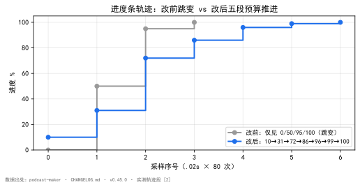  
*图 1：进度条轨迹前后对比。数据源 [2]（`podcast-maker · CHANGELOG.md · v0.45.0 · 实测轨迹段`）。改前仅见 0/50/95/100 四个跳变点；改后五段预算把它摊成 10/31/72/86/96/99/100，采样序列全程单调推进。*

### 实验设计：假模型走真实通路的轨迹测量

**目的**：在真实任务通路上测出改前/改后的进度轨迹，排除真实模型耗时抖动对采样的干扰。

**输入**：假模型（不调真实 LLM，按固定节奏吐字），走与真实生成完全相同的 `script_engine` 通路。

**步骤**：`.02` 秒采样、共 80 次，记录每次轮询拿到的进度值 [2]。

**观测**：改前轨迹仅 `0% … 100%`（0/50/95/100 四跳挤在末段）；改后轨迹 `10% → 31% → 72% → 86% → 96% → 99% → 100%`。

**判定**：改后全程单调、可见刻度即 PASS；图 1 即该测量的可视化。

**分段路完整轨迹**（一期六段写作，成稿规划）[2]：17 次前进、0 次倒回。真实运行每格间隔几分钟，肉眼可见。

**单测**（全量 `python -m unittest discover`）[4][7]：旧版 `test_stage_and_progress_follow_the_round` 改为五段逐段验，加三条硬口径——段与段首尾相接、写稿段占一半以上（0.10~0.72，即 62%）、末段不占满 1.0；新增 `test_progress_bands_are_contiguous_and_the_writing_band_has_room`、`test_whole_draft_path_ticks_on_the_rewrite_round`。全量单测 **1240 → 1242 OK**。

**对账探针**（只读，未改项目文件）[8]：穷举 `web_ui._script_stage` 里 89 处日志格式串，逐行问折算规则——**97 行会推进度、全部落在五段之内，171 行不动**；复核对账用 `_script_stage` 直接穷举（两路真实日志行 → 轨迹，真实代码见 `podcast_maker/web_ui.py:_script_stage`）。

## 七、结语：一句话可复用结论

进度条不是显示组件，是预算表的可视化；预算表漏一段，界面就永远看不到那一段。先有完整、首尾相接的账本（`_BANDS`），才有看得见的进度。

## 引用与出处说明

| 编号 | 引用 | 出处 |
|------|------|------|
| [1] | 进度条从没接上写稿段；两层根因（写稿段无预算、收尾两段挤同一毫秒）；轨迹 `0%→50%→95%→100%` | podcast-maker · CHANGELOG.md · v0.45.0 · 条目「修复：脚本页「生成脚本」的进度条从来没接上写稿段」<br>`podcast_maker/web_ui.py:_script_stage` 折算规则（项目实证） |
| [2] | 改后轨迹 `10%→31%→72%→86%→96%→99%→100%`；分段路 17 进 0 退 | podcast-maker · CHANGELOG.md · v0.45.0 · 实测轨迹段<br>`（项目实证：假模型走真实任务通路 .02s 采样 80 次）` |
| [3] | 非里程碑行稀释刻度；不画假进度 | podcast-maker · CHANGELOG.md · v0.45.0 · 修复段「只在里程碑行推进度 / 不画假进度」 |
| [4] | 旧测试只验检查/门禁段；新版五段逐段验 + 三条硬口径；单测逐行断言方向 | podcast-maker · CHANGELOG.md · v0.45.0 · 测试段<br>`tests/test_batch.py::test_stage_and_progress_follow_the_round` |
| [5] | `_BANDS` 字典五段表 `[起,止)` 首尾相接；`_put` 闭包 `max` 兜底只前进不后退；轮次表一份实现 `_segment_parse_rounds` | podcast-maker · CHANGELOG.md · v0.45.0 · 修复段「把预算表重做成五段」<br>`podcast_maker/web_ui.py:_BANDS`（`:488`）/ `_put`（`:541`）；`script_engine._segment_parse_rounds` |
| [6] | 只改进度口径，不动生成行为 | podcast-maker · CHANGELOG.md · v0.45.0 · 说明段 |
| [7] | 全量单测 1240→1242 OK | podcast-maker · CHANGELOG.md · v0.45.0 · 测试段末行 |
| [8] | 穷举 `web_ui._script_stage` 89 处日志格式串：97 行推进度全落五段内、171 行不动 | podcast-maker · CHANGELOG.md · v0.45.0 · 说明段（89 处日志格式串对账）<br>`podcast_maker/web_ui.py:_script_stage`（逐行问折算规则） |

## 延伸阅读

- **同书其他篇**：#30《字幕四份同源》讲同源律（多份产物由同一源一次生成）；本篇的 `_BANDS` 是「账本」维度的同源——进度只从一张表派生，不各写一个数。

# 第 VI 部 · 37｜开窗时序：启动后浏览器先显示「连接不上」

## 一、引子：真实起点

第一次双击 `setup.bat` 启动 podcast-maker，浏览器跳出来，先是一句「无法访问此网站 / 连接被拒绝」，僵在那约 1-2 秒，然后页面才刷出来、正常可用。对于只跑一次的用户，这不是「偶发抖动」，是每次都见的固定开场——而且它长得很像「服务挂了」，足以让人以为启动失败、再去点一次。

这个现象被记进了版本档案：启动后浏览器先显示「连接不上」约 1-2 秒 [1]。它不属于「业务逻辑算错」，属于「先后顺序算错」——一个纯粹的时序问题，却最容易被人误判成性能或网络问题。

## 二、现象：它到底长什么样

版本档案的修复段把现象和现场拆得很干净 [1]：

- **`setup.bat` 第 4 步先 `start "" http://127.0.0.1:8811/` 打开浏览器**，再启动 `main.py`；
- **Python 导入模块的 1-2 秒内端口未监听**，浏览器连接被拒；
- 页面到达后，页内等待画面一闪而过，真正的等待窗口没有任何覆盖——等待画面出现在错误的时间点；
- 结论：这是启动时序问题，**页面内无法修复**。

关键在最后一句：现象发生在「页面还没到」的窗口里，所以任何写在页面里的等待画面都覆盖不到它。等待画面要在浏览器解析 HTML 之后才绘制，而「连接被拒」发生在浏览器连过去的那一瞬——时间上根本对不上。

```text
改前（setup.bat 抢先 open）：
  start "" http://127.0.0.1:8811/      ← 此刻端口还没 listen
  python main.py                        ← 导入 1-2s，端口才起来
  └─ 浏览器连接被拒（RST）→ 显示「连接不上」1-2s → 后服就绪才刷出

改后（bind 之后 open）：
  python main.py --open
    └─ ThreadingHTTPServer((host,port),Handler)  ← bind+listen 同时完成
    └─ 守护线程 webbrowser.open(...)             ← 此刻已监听，连接进内核队列
    └─ httpd.serve_forever()                     ← 首次 accept 即接通
```

一个容易误诊的点：这 1-2 秒的「连接不上」会**自己消失**——空窗过后页面正常刷出、功能完整可用。真正的服务没起来不会自愈，会一直红。所以这个现象的诊断判据很干净：先红后绿、且绿了之后一切正常，等于启动时序问题；一直红、绿不了，等于服务真没起来。版本档案修的是前者，后者不归本篇管 [1]。

## 三、错误尝试：我们怎么绕弯的

绕弯的本能反应是「在页面层把这段难看掩盖掉」——既然浏览器先连不上，那就在页面里加一个更醒目的等待画面，把那 1-2 秒糊过去。同期确实做了开屏等待画面（`#boot-splash`，`body` 首节点、8 秒兜底撤除），但它钉的是「页面解析期间空白」那一格，不是「连接被拒」那一格 [1]。

这条路绕不过去，因为两件事在时间轴上错位：
1. 「连接被拒」发生在浏览器向 `127.0.0.1:8811` 发起 TCP 连接的瞬间——此时 `main.py` 还在导入、端口未 listen；
2. 页内等待画面要等 HTML 解析到那个节点才绘制——而连接被拒不等页面，浏览器自己先报了错。

换句话说，试图用「页面内的覆盖」去修「页面到达之前的错误」，对象就错了。页面层能管的，是页面已到之后的体验；管不到连接那一瞬。另一个更隐蔽的绕弯是「让浏览器重试」——但重试只是把「连接不上」变成「闪几下」，根子（先 open 后 listen）没动，问题照旧。

也曾有人提议「启动前先 `sleep` 两秒再开浏览器」——这等于用更大的空窗去赌「导入总能在两秒内完成」。一旦机器冷启动、依赖未缓存导致导入慢于两秒，又红；而且每次启动都白白多等两秒，是用不确定性去盖不确定性，根子同样没动 [1]。这些绕弯的共同特征：都在「open 之后」做文章，而 bug 在「open 之前」——时序问题的修法必须动顺序，不能动掩盖。

## 四、根因：为什么

根因一句话：**open（connect）发生在 listen（bind）之前，而一个未 listen 的端口，收到连接会被直接拒绝。**

这是操作系统的网络栈事实，不是 podcast-maker 的约定：`webbrowser.open` 让浏览器向 `127.0.0.1:8811` 发起 TCP connect，而此时 `main.py` 还没执行到 `ThreadingHTTPServer((host, port), Handler)`——端口根本没有进入 listen 状态。connect 到一个未 listen 的端口，内核回 RST，浏览器立刻报「连接被拒绝」[1][2]。

补一句 listen 之后的队列事实：端口一旦 `listen`，内核就为它开一个连接积压队列（backlog），`connect` 请求在 `accept` 之前到达会被放进队列等待，而不是被拒——只有队列溢出、或端口根本没 `listen`，`connect` 才会失败。修复段写的是「绑定即监听，此刻建立的连接在内核队列中等待首次 accept，不会被拒绝」，正是这个机制 [1]。所以关键不是「服务多快就绪」，而是「open 必须在 listen 之后」——只要 listen 先完成，那 1-2 秒的导入空窗不再是问题，连接安静地排在队列里等 `serve_forever` 来 `accept`。

颠倒的源头在 `setup.bat`：它把「打开浏览器」写在了「启动服务」之前（第 4 步先 `start`，再启动 `main.py`）。服务进程从启动到完成导入、建好 socket、调 `bind`+`listen`，要吞掉 Python 导入模块的 1-2 秒——正是这段空窗，被抢先的浏览器踩中 [1]。

修法的方向因此被锁死：不能让页面层去「盖」，只能让 `open` 等 `listen` 完成。这也解释了为什么「等页面解析完再画等待画面」无效——等待画面救的是「页面到了但资源没好」，救不了「页面根本还没到、连接已被拒」[1]。

## 五、正确修法：怎么做对的

修法是把「打开浏览器」从 `setup.bat` 的抢先行，搬进 `run_server()` 里、且严格排在 `ThreadingHTTPServer` 构造之后 [1][2]：

1. **`run_server()` 新增 `open_browser` 参数**（默认 `False`，不破坏既有的非 GUI 调用方）[2]；
2. **`ThreadingHTTPServer((host, port), Handler)` 先构造**——`bind` 与 `listen` 在这一句同时完成，端口进入监听态 [2]；
3. **之后才经守护线程调用 `webbrowser.open`**——此时连接命中已监听的端口，进内核队列等待首次 `accept`，不会被拒 [2]；
4. **`main.py` 新增 `--open` 旗标**透传给 `run_server`；
5. **`setup.bat` 删除抢先 `start "" http://...` 的行**，启动命令改为追加 `--open` [4]。

顺序铁律是这一节的命门：`ThreadingHTTPServer(` 的索引必须严格早于 `webbrowser.open` 的索引——不是「差不多先后」，是源码位置上 bind 在前、open 在后，任何把 open 提前的改法都会让 bug 回来 [2][3]。

```python
# podcast_maker/web_ui.py —— run_server：bind（listen）先于 open（connect）
def run_server(host="0.0.0.0", port=8811, pidfile="", open_browser=False, **kwargs):
    # ... 信号处理 / pidfile ...
    httpd = ThreadingHTTPServer((host, port), Handler)   # :3269  bind+listen 同时完成
    if open_browser:                                    # :3274  只有监听后才考虑开窗
        threading.Thread(
            target=webbrowser.open,                      # :3278  此刻端口已监听
            args=("http://127.0.0.1:%d/" % port,),      # 环回地址，不受 --host 通配影响
            daemon=True,
        ).start()
    httpd.serve_forever()                                # :3291  首次 accept 即接通
```

开窗用守护线程（`daemon=True`）而非主线程直接调 `webbrowser.open`，是为不阻塞 `serve_forever()`——浏览器唤起是外部进程调用，若放在主线程会卡在 open 返回前；守护线程让「开窗」与「服务主循环」并行，且进程退出时自动随主线程结束，不留孤儿 [2]。注意 URL 恒为 `http://127.0.0.1:%d/`——即便 `--host 0.0.0.0` 通配监听，开窗也只连环回地址，避免用户机器有多个网卡时浏览器冲到错误接口 [3]。这一行不是顺手写的，是被单测钉死的（见第六节）。

## 六、验证：数据说话

时序问题最怕「修完靠肉眼」，所以版本档案用四条钉子把「先后顺序」和「环回地址」全锁死，并入了当版全量计数 [1][3]。

**开窗时序钉子（`tests/test_launch_open.py::TestBrowserOpensAfterBind`，4 条）**[3]：

| 钉子 | 锁什么 | 为什么是这条 |
|---|---|---|
| `test_setup_bat_does_not_pop_the_browser_first` | `setup.bat` 不得含抢先的 `start "" http://`；`main.py` 启动行须带 `--open` | 直接封死「bat 抢先 open」这个根因写法 |
| `test_main_parser_has_open_flag` | `build_parser` 必须含 `--open` 旗标 | 保证 `--open` 透传链路存在 |
| `test_run_server_opens_browser_after_bind` | 源码中 `ThreadingHTTPServer(` 索引 < `webbrowser.open` 索引 | 把「bind 先于 open」钉成源码位置事实，任何提前都红 |
| `test_open_url_uses_loopback_even_when_host_is_wildcard` | 浏览器 URL 恒为 `http://127.0.0.1:%d/` | 封死「通配监听却开错地址」的次生 bug |

**版本计数收口**：当版全量单测 **1391 条通过**（判据换芯前 1359 → 换芯后 1383 → 安装链 1384 → 开屏画面 1387 → 开窗时序 1391）；开窗时序四条钉子是这 1391 里的确定性增量，不是孤立断言 [1]。「浏览器先显示连接不上约 1-2 秒」这一现场现象，作为被修复项记在同一条目里——修复前后同一份现象描述，保证钉的是同一个 bug，而非另起一个。

四条钉子的价值不止「验证一次」，更在于把修复做成**结构性防回归**：`test_run_server_opens_browser_after_bind` 检查源码位置（bind 索引 < open 索引），任何把 open 提前的重构会立刻转红；`test_setup_bat_does_not_pop_the_browser_first` 锁死 bat 文件，防止「抢先 start」写法回流。换句话说，这个 bug 不会因为某次顺手改动静默回来——它的防护不是人记着，是钉在测试里 [3]。

**数据描述**：端口 `8811`（环回 `127.0.0.1`）、导入空窗 **1-2 秒**、钉子 **4 条**、当版全量 **1391 条**——四个数把「先开后 bind」的代价与「bind 后开」的修复都量化在了版本档案里 [1][3]。

## 七、结语：一句话可复用结论

启动时序的修法不是更聪明的重试，也不是更醒目的等待画面，而是把「打开浏览器」挪到「端口绑定成功」之后：`ThreadingHTTPServer` 构造即 listen，连接进内核队列等首次 accept，不被拒绝。顺序铁律一句话——bind 先于 open，源码位置也要 bind 在前。

## 引用与出处说明

| 编号 | 引用 | 出处 |
|------|------|------|
| [1] | v1.7.2 修复段「启动后浏览器先显示『连接不上』约 1-2 秒」：`setup.bat` 先 `start` 浏览器再启 `main.py`，导入 1-2s 端口未监听被拒；修法（run_server 新增 open_browser、ThreadingHTTPServer 构造后守护线程 webbrowser.open、main.py 新增 --open、setup.bat 删抢先行追加 --open）；测试段（开窗时序钉子 4 条、全量 1391 条通过） | podcast-maker · CHANGELOG.md · v1.7.2 |
| [2] | `run_server(host=..., open_browser=False)`(`:3251`)；`httpd = ThreadingHTTPServer((host, port), Handler)`(`:3269`，bind+listen)；`if open_browser:`(`:3274`) → 守护线程 `webbrowser.open`(`:3278`)；`httpd.serve_forever()`(`:3291`) | `podcast_maker/web_ui.py:run_server`(`:3251`) / `:3269` / `:3278` / `:3291` |
| [3] | `tests/test_launch_open.py::TestBrowserOpensAfterBind`（4 条：setup_bat_does_not_pop_the_browser_first / main_parser_has_open_flag / run_server_opens_browser_after_bind / open_url_uses_loopback_even_when_host_is_wildcard） | `tests/test_launch_open.py`（实测，2026-10-26 复核对锚） |
| [4] | `setup.bat` 改前含抢先 `start "" http://127.0.0.1:8811/` 行已删除，启动命令改为追加 `--open`（与 [1] 修法同条） | podcast-maker · CHANGELOG.md · v1.7.2 · 修复段（setup.bat 改动） |

> 说明：全部为项目实证（仓库 CHANGELOG、源码 `web_ui.py`、单测 `test_launch_open.py`），无 KB / 联网文献；[3] 为本批次 2026-10-26 复核对锚（四条钉子名与源码行号与真仓一致）。全文不援引任何第三方智能体。

## 延伸阅读

- **#46《方法论复用》**：本篇的「bind 先于 open」是源头纪律「监督前移、错误不进生成通道」在启动时序上的具体落点——把「开窗」这一动作等「监听就绪」之后再做，就是前置规范在毫秒尺度上的体现。
- **#47《文明退化语义丢失》**（部八专文）：与本文同为「现场修复」视角，但 #47 聚焦语义层、本文聚焦启动时序层，两者都是 podcast-maker 把「不确定性赶出通道」这一主题的不同切面。

# 第 VI 部 · 38｜配置页网格重排：只改界面，不动配置项

## 一、引子：真实起点

用户进配置页，第一眼看到的不是又多了几个开关，而是整页的节奏变了：原先自上而下一长串分区，现在每张卡按四列网格铺开，窄屏自动塌成三列、两列、一列。最前还多了一张卡——它不依附任何配置分区，只报「这台机器 ffmpeg / ffprobe 齐不齐」，缺了给一段说明和一个按钮。

这张多出来的卡，才是这一版真正的功能增量。网格重排本身，一行配置键都没动。

这是一种刻意的克制：界面能改，是因为配置项从来不写在界面里。

## 二、现象：配置页现在是张网格

配置页全部内容是十六张卡——从「运行环境」到「素材导入」「脚本」「声音」「字幕」「画面」等，每张卡对应 `PARAM_SPEC` 里一个 `group`（或一组显式 `views`），卡片清单也是从配置表派生的，不在界面里另写一份 [3][6]。把配置页的渲染代码摊开，分区与控件不是逐个手写在 HTML 里，而是从一份配置表动态长出来。`renderConfig` 先拿到全部分区，再对每个分区建一张卡，卡内按「区」再套一层网格 [2]：

```text
分区（PARAM_SPEC 一处定义）
  └─ 卡（动态生成）
       └─ 区（zone）
            └─ .grid.g4 四列网格（控件按类型填充）
```

网格本身是一段纯 CSS，列数随视口宽度收放，断点写死在样式里 [1]：

| 视口宽度 | 网格列数 | 断点依据 |
|---|---|---|
| ≥ 1420px | 4 列 | 默认 `repeat(4, minmax(0,1fr))` |
| 1060–1420px | 3 列 | `@media(max-width:1420px)` |
| 720–1060px | 2 列 | `@media(max-width:1060px)` |
| < 720px | 1 列 | `@media(max-width:720px)` |

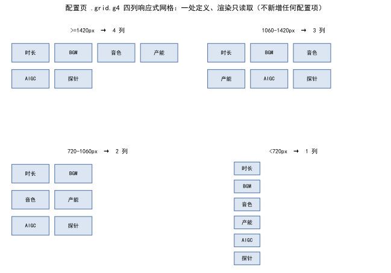  
*图 1：配置页网格的响应式塌缩。四列网格由 CSS 断点驱动（1420 / 1060 / 720 px），与任何具体配置项无关；控件按类型填进格子，新增分区不会要求界面改版。*

控件填进格子后，谁显隐、谁联动，由显隐机制（`applyShowIf` / `applyEngineScope`）统一重算——这套求值也只认后端下发的配置表，界面不持有任何业务判断 [2]。

## 三、错误尝试：当界面布局与配置项写在一起

把配置项与界面布局混在一起时，两类毛病同时出现。

其一是改布局等于改配置。控件若是逐个写死在 HTML，加一张卡、挪一个分区，都要在界面里改键名、改取值；配置表与界面各写一份，漏一处就是界面上点开是空的、或改了键名旧项还在。这恰恰是「同一事实两处定义」的病：两处会漂移。

其二是探测写进了渲染循环。卡片还在游离状态、没挂进文档时，`el('music-cfg')` 取到的是 `null`，探测函数会静默走进「卡不在」的早退分支——一次请求都不发，徽标永远停在「探测中…」。ffmpeg、本地语音环境、背景音乐三块都曾踩同一个坑：谁在循环里探游离节点，谁就永远探不到 [4]。这个早退分支本身没有写错——「卡不在就不发请求」是正当的防御；错的是调用时机让这个防御分支成了唯一会走的路。防御性早退加上错误的调用时机，组合成一个不报错、不崩溃、只是永远探不到的静默故障——这正是「缺的那一项只是不存在」类缺陷的标准长相。

## 四、根因：配置项的定义与界面渲染是两件事

根因是同一句话的两面：**配置项由 `PARAM_SPEC` 一处定义，界面只读取它渲染**。

配置项的全部真值，落在 `config_manager` 的 `_p(...)` 一处。举一个：`script.map_max_episodes` 在这里定义为整型、默认 60、值域 1–500，挂在 `script` 视图下 [5]。界面拿到的是一份已经分好区的配置表（`CFG.params.config`），`renderConfig` 只是遍历键、按类型填空。配置项增减，界面零改动——网格重排是 CSS 的事，不是配置的事。

探测则依赖一个更硬的事实：**DOM 节点必须先挂进文档，才取得到**。渲染循环里建出来的卡还在内存里游着，没 `appendChild` 进页面，`el()` 必然返回 `null`。所以探测不能和「建卡」写在同一个循环里，必须等整轮挂载完成、卡进了文档，再单独探一次。

## 五、正确修法：一处定义、渲染只读取

修法把边界守死在三个地方。

第一，控件全量动态生成。`renderConfig` 遍历 `Object.keys(groups)`，每个分区建一张卡，卡内按 `zoneList` 分「区」，每个区挂一个 `.grid g4`，由 `fillByKind` 按控件类型填空 [2]。界面里不存在「某分区专属的固定 HTML」，配置表是唯一来源。

第二，运行环境卡作为独立卡插在最前，不挂靠任何配置分区——它是全链前置，用户一进配置页就该看见自己这台机器齐不齐 [3]。它的后端收口在 `bins.py`：ffmpeg / ffprobe 的**唯一**定位、探测、安装实现，定位顺序 `PATH → 项目 bin/ → None`，返回绝对路径，各模块整个传给 subprocess，装完当场可用、不用重启 [3]。定位是 fail-closed 的：三处都落空就如实报「未就绪」，不猜一个相对路径凑合——猜出来的路径会在第一次 subprocess 调用时才炸，那时离配置页已经隔了整条链。国内镜像实测 8.4 MB/s，134 MB 约 17 秒落地，比走 GitHub 的 18.8–25.7 KB/s（≈1.8 小时）快约 400 倍；装的版本是 8.1.3（`--enable-libass` / `--enable-fontconfig` 都在，项目自己的 `.ass` 烧中文字幕真出字形）[3]。

第三，三个探测统一放挂载之后。ffmpeg、本地语音环境、背景音乐三块的探测（`refreshDepsState` / `refreshTtsState` / `refreshMusicState`），全部在 `renderConfig` 的循环外部、整卡 `appendChild` 完成之后调用 [4]。与「建卡」彻底解耦：建卡不问环境，挂载完才探现状。

挂载后探测的骨架（真实实现 `podcast_maker/web_ui.py:renderConfig` L4582 起、挂载后调用 L4624–4647）：

```javascript
// podcast_maker/web_ui.py —— renderConfig：先全部挂载，后统一探测
function renderConfig() {
  for (const group of Object.keys(groups)) {
    buildCard(group);                              // 只建，不探
  }
  // 全部挂载完成后才探测：此时取控件才取得到，游离节点会取空
  refreshDepsState();    // ffmpeg / ffprobe 环境
  refreshTtsState();     // 本地语音环境
  refreshMusicState();   // 背景音乐
}
```

顺序就是纪律：**建卡 → 挂载 → 探测**。把探测写进建卡循环，卡还在游离状态，`el()` 返 `null`，探测静默走「卡不在」早退分支——一次请求都不发（真实反例见第三节）。

## 六、验证：断点、纪律与版本钉

三类证据，测量条件一并给出。

**网格断点实证**：CSS 三段媒体查询（1420 / 1060 / 720 px）逐条存在，列数收放与表 1 一致；控件在 4 列网格内按类型填充，分区新增不触发界面改版 [1]。断点数字本身是设计值不是魔法数：四列是桌面端信息密度的上限（再宽单格内容就开始换行），720 px 是移动端单列的下限（再窄控件内边距挤不下）——两端之间的 3 列、2 列由等分递减自然推出。

**探测纪律实证**：渲染循环外的挂载后探测，与循环内游离节点早退分支同时存在——后者正是「卡不在 → 一次请求都不发」的反例，证明纪律是被代码结构性守住的 [4]。运行环境卡的安装走异步任务，进度由 `bins.install(on_step=)` 上报，界面不猜日志文案（猜文案的写法一改通知就断）[3]。

**版本一致钉**：配置项的真值只在 `config_manager` 一处，单测定了版本一致钉——架构文档与运行时报错报出的版本必须同一处来源，配置键新增不会让界面与后端各说各话 [5]。这条钉与网格重排的关系值得点明：界面敢全量动态生成、敢「只改界面不动配置项」，前提就是配置表与版本被钉在同一处真值上——表若有两个来源，界面动态生成的每一张卡都可能在渲染另一份过时的表。

**探测与配置表的关系收束**：三块探测（ffmpeg / 本地语音 / 背景音乐）报的是**环境现状**，配置表定义的是**用户意图**，两者在卡上并排显示、互不覆盖——环境缺 ffmpeg 不改写任何配置键，配置键也不假装环境已就绪。界面上每一格因此分得清「配置说要什么」与「机器实际有什么」，这正是第二节那张网格里两类信息的边界。

**安装路径对照**（数据源 [3]）：项目 `bin/` 不写系统 PATH、不碰系统、装完不重启；国内源 8.4 MB/s、134 MB 约 17 秒，与走 GitHub 原始源的 1.8 小时相差约 400 倍。

**下载源对照实验设计**（数据源 [3]）：**目的**——证明一键安装的默认下载源必须取国内镜像；**输入**——ffmpeg 8.1.3 包体（134 MB，`--enable-libass` / `--enable-fontconfig` 俱在，项目自己的 `.ass` 烧中文字幕真出字形）；**步骤**——同一台机器分别从 GitHub 原始源与国内镜像源下载同一包体，记录吞吐与落地耗时，sha256 校验后解包入 `bin/`；**观测**——镜像 8.4 MB/s、134 MB 约 17 秒；GitHub 18.8–25.7 KB/s、约 1.8 小时；**判定**——差约 400 倍，慢源在真实使用里等于不可用，默认源取镜像，校验不过不落盘 [3]。

**探测时序对照实验设计**（数据源 [4]）：**目的**——证明「挂载后探测」是时序硬约束而非风格偏好；**步骤**——① 复现错误时序：把探测函数挪进建卡循环，卡未 `appendChild`，`el()` 返 `null`，探测走「卡不在」早退分支——网络面板 0 请求，徽标永远停在「探测中…」；② 修正时序：同一探测函数在整轮挂载后调用——三卡（ffmpeg / 本地语音 / 背景音乐）各自发出请求，徽标落到实测状态；**观测**——同一函数、同一页面，只差调用时机，请求次数 0 对 3；**判定**——「探测必须在挂载之后」由此从经验升级为可复现的时序事实，与第五节骨架一一对应 [4]。

## 七、结语：一句话可复用结论

界面是配置表的可视化，不是配置本身。先有「配置项一处定义、渲染只读取」的边界，才有「只改界面、不动配置项」——网格怎么重排、多插一张不挂靠配置的卡，都不该动到那张表上的一个键。反过来也成立：这张表若没有「一处定义」打底，界面越动态、越好看，就越是在渲染第二份没人对过账的真值——先有表的一处定义，才有界面的自由渲染。

## 引用与出处说明

| 编号 | 引用 | 出处 |
|------|------|------|
| [1] | 配置页 `.grid.g4` 四列响应式网格；断点 1420 / 1060 / 720 px 对应 4/3/2/1 列 | `podcast_maker/web_ui.py`（CSS 段 `grid.g4` 与三段 `@media`，行 3346 / 3352–3355）<br>（项目实证：样式断点逐条存在） |
| [2] | `renderConfig` 遍历 `CFG.params.config` 分区动态建卡，卡内 `.grid g4` 按类型填空；显隐由 `applyShowIf` / `applyEngineScope` 统一重算 | `podcast_maker/web_ui.py:renderConfig`（行 4582–4631）<br>（项目实证：界面不持有业务判断） |
| [3] | 运行环境卡独立于配置分区、插在最前；后端 `bins.py` 唯一定位/探测/安装（PATH→bin→None，装完当场可用）；国内源 8.4 MB/s、134 MB≈17s、比 GitHub 快约 400 倍；版本 8.1.3 | podcast-maker · CHANGELOG.md · v0.47.0 · 新增段「运行环境探测与一键安装（配置页运行环境卡）」<br>`podcast_maker/bins.py`（locate / state / install_hint / install，fail-closed） |
| [4] | 三个探测（ffmpeg / 语音环境 / 音乐）统一在挂载之后调用，不在渲染循环内探游离节点——游离节点 `el()` 返 null 早退 | `podcast_maker/web_ui.py`（行 4624–4647：挂载后 `refreshDepsState` / `refreshTtsState` / `refreshMusicState`）<br>（项目实证：早退分支反例存在） |
| [5] | 配置项由 `config_manager._p` 一处定义（如 `script.map_max_episodes` 整型默认 60、1–500）；版本一致钉保证架构文档与运行时同源 | `podcast_maker/config_manager.py`（行 637，PARAM_SPEC 一处定义）<br>`tests/test_config_keys.py`（版本一致钉） |
| [6] | 配置页十六张卡片速查；卡片清单从配置表派生、不在界面另写一份 | `发布/v1.0.0 发布说明.md`（§「五、怎么用」配置页卡片速查，项目实证） |

## 延伸阅读

- **同书其他篇**：#2《配置总表如何同时驱动界面与管线》讲这张配置表怎么一处定义、同时喂给界面与管线；本篇的网格重排是「界面只读取」那一半的落地——表不变，画它的网格怎么改都不碰键。

# 第 VI 部 · 39｜GBK 乱码进 toast：为什么 PYTHONIOENCODING 必须注入

## 一、引子：真实起点

排查过一个让人迷惑的现象：用户换嗓失败时，界面弹窗本该显示中文报错，结果跳出来的是一串方块和问号——报错等于没报，因为人眼根本读不出那条信息在说什么。

更迷惑的是，这条报错是「真」的。后端确实捕捉到了错误、确实想把原因告诉用户，链路每一环都以为自己尽到了职责：子进程报错了，父进程也读到了，父进程还把读到的内容原样塞进了弹窗。问题出在中间——中文在从子进程流向父进程、再流向弹窗的这一小段路上，被编码错配悄悄置换成了乱码。等到用户看见，已经无从分辨是「没报错」还是「报了但看不懂」。

这一段路的修法，最后收敛成环境变量里的一行注入。本文只讲这一行背后的编码账：为什么子进程会写出 GBK、父进程为什么按 UTF-8 解、错配一旦发生为什么不可事后补救，以及那一行注入为什么能彻底闭合链路。

## 二、现象：它到底长什么样

把现象摆清楚，先要分清两件事：报错本身是真的，乱码是它在传输层被改写的样子。

界面上的表现很具体——弹窗（toast）里本应出现一句中文，例如「B 角认领失败」或「请检查本地文件路径」，实际出现的是 `□` `�` 这类方块与问号，有时还夹杂着一些看似西文、实则毫无意义的字符。它有两个特征：其一，乱码的位置恰好是中文处，纯英文与数字部分始终完好；其二，乱码稳定可复现——只要走那条子进程路径、只要系统代码页是中文 Windows（GBK/cp936），每次都碎成同一副样子。

下面这张图把「修复前 / 修复后」两条出口并排画出来：左半边是错配链路（子进程写 GBK → 父进程按 UTF-8 解 → toast 显示乱码），右半边是注入后的闭合链路（子进程注入 UTF-8 → stdout 即 UTF-8 字节流 → 父进程解出原中文）。

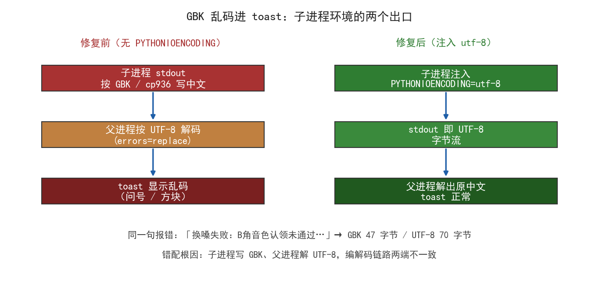

图里那句示例中文，在仓临时副本里实测得到两个硬数字：按 GBK 写出是 **47 字节**，按 UTF-8 写出是 **70 字节**。字节数对不上，正是错配的第一个信号——同一句中文，两种编码产出的字节长度不同，说明它们根本不在同一个字符集里说话。

## 三、错误尝试：我们怎么绕弯的

绕弯集中在「在父进程这边做文章」。编码错配发生在子进程与父进程的交界，但肉眼最先看到的是父进程交给弹窗的那串乱码，于是直觉会去父进程内部想办法。

**试着换一种解码方式。** 既然按 UTF-8 解出来是乱码，那是不是该「智能猜」编码——先试 GBK、再试 GBK 之外的别的？这条路走不通：父进程拿到的已经是「按 UTF-8 解码、遇非法字节用替换符顶替」之后的结果（代码里写死 `errors="replace"`），替换符一旦落位，原始字节信息就永久丢失，后面再怎么猜都救不回那几个字。解码发生在读取那一刻，错已经铸成。

**试着把乱码字符过滤掉。** 比「猜编码」更省事的想法，是检测到方块/问号就把它们删掉，至少让弹窗「干净点」。这等于承认信息丢失、主动放弃告知用户，报错从「看不懂」退化成「没内容」——比乱码更糟，因为连「出错了」这个信号都没了。

**试着在界面层覆盖字体。** 最表面的误解是把它当字体问题：是不是弹窗用的字体缺中文字形？于是去换字体。但字体只决定「字符画得出来画不出来」，决定不了「字符本身是什么」。链路上游送来的已经是错字符，换字体只是把错字符画得更清楚，内容还是错的。

三条弯路有一个共同特征：都假设「乱码是父进程或界面这边的小毛病，就地修补就行」。它们都漏看了同一件事——乱码在子进程写出那一刻就已经是 GBK 字节被当作 UTF-8 读的结果，修补下游救不回上游丢失的信息。

## 四、根因：为什么

根因只有一句话：子进程的 std 流编码与父进程的解码编码不一致，而这条不一致是 Windows 平台默认行为直接给的。

Windows 上，子进程（一条独立启动的 Python 命令行）的 stdout / stderr 编码，在没有显式指定时，取的是控制台/管道默认代码页——中文 Windows 是 GBK（cp936）。而父进程这一侧，在 `subprocess.run(..., encoding="utf-8", errors="replace")` 里把接收端**写死**成 UTF-8。于是链路两端各说各话：子进程吐出 47 字节的 GBK 中文，父进程却按 70 字节当量（UTF-8 视角）去切分这些字节、再按 UTF-8 规则解释——凡是 GBK 里一个汉字占两字节、但落在 UTF-8 非法区间的，全被 `errors="replace"` 顶成替换符 `�`，整句中文碎成问号与方块。

为什么是 GBK 而不是别的？因为这是中文 Windows 的管道默认；为什么父进程非写 UTF-8 不可？因为整个智能体的文本处理都建立在 UTF-8 之上，父进程不能为了迁就某条子进程就退回 GBK——那是把局部问题扩散成全局污染。所以正确的封口点只有一个：让那条子进程也用 UTF-8 写，而不是让父进程改回 GBK 读。

这里有个容易被忽略的细节：`PYTHONIOENCODING` 管的不只是 stdout，也包括 stderr。本篇那句报错恰恰是从子进程的 stderr 出来的（`CHANGELOG` 原文写的是「stderr 中文以 GBK 乱码进 toast」），但 stdout 与 stderr 共用同一套 std 流编码规则，注入 `PYTHONIOENCODING=utf-8` 对两者同时生效，所以一行注入能同时修好「报错」和「正常输出」两条通道。

根因再压缩成一句话：**错误没有发生在算法层，而是发生在「两个进程约定用同一种字符集说话」这道最不起眼的契约上；契约没签，中文就在交界处被置换。**

## 五、正确修法：怎么做对的

修法不是去父进程猜编码，而是回到契约的源头——在启动子进程时，把它的 std 流编码显式钉成 UTF-8。具体落地就一行：往子进程的环境变量里注入 `PYTHONIOENCODING="utf-8"`。

```python
# podcast_maker/web_ui.py —— _sub_env / pick_file：子进程统一注入 UTF-8 出口
def _sub_env():
    # 子进程无这条时，std 流按 Windows 管道默认 GBK 写出，父进程按 UTF-8 解即乱码
    return dict(os.environ, PYTHONIOENCODING="utf-8")

def pick_file(title, kind):
    args = [sys.executable, "-c", _PICK_SCRIPT, title]
    env  = dict(os.environ, PYTHONIOENCODING="utf-8")   # 路径含中文也不乱码
    proc = subprocess.run(args, capture_output=True, text=True,
                          encoding="utf-8", errors="replace", env=env)
    return proc.stdout.strip()
```

这段骨架里有两处独立的注入点，对应两条不同的子进程路径：其一，`_sub_env()` 是「所有命令行子进程的统一环境」——凡是经由它启动的音色工具、认领钩子之类的子进程，都从这一处拿到 UTF-8 出口；其二，文件选择对话框 `pick_file` 单独再注一次，因为它走的是另一条 `python -c` 内联脚本路径，路径里若含中文，同样要在子进程环境里钉死 UTF-8。两处都注，是因为它们不是同一条调用链——漏掉任何一处，那条漏网路径上的中文又会碎。

注意父进程这边 `encoding="utf-8", errors="replace"` **不用动**。链路要闭合，只需要两端一致；把子进程提到 UTF-8，父进程的 UTF-8 接收端就合法了。反过来若是去改父进程迁就 GBK，等于让全局文本处理为一条子进程让步，那是把 bug 从一个地方挪到十个地方。

这一行的位置也值得说一句：它放在「构造子进程参数」这一步，而不是事后去修读到的字符串。源头钉死，下游天然正确，这才是对的位置——和「错误尝试」里那三条弯路恰好相反。

## 六、验证：数据说话

验证分两层：版本记档的回归计数，与本篇在仓临时副本实跑的字节级复现。

**版本记档（v1.8.0）。** 「换嗓报 B 角认领失败」在 `CHANGELOG.md` 里被记成三层修复：认领钩子补 `force:true`、子进程统一注入 `PYTHONIOENCODING=utf-8`、错误文案只取 `_cli_error()` 解出的 `error` 字段。本文聚焦的编码层，正是其中第二层 [1]。同版测试：`tests/test_voice_design.py` 增 11 条，全量 **1427 条通过** [1]——这一计数把「注入后中文报错能原样抵达弹窗」钉进了回归，不是靠肉眼抽查。

**字节级实跑（本篇临时副本）。** 取一句真实形态的中文报错「换嗓失败：B 角音色认领未通过，请检查本地文件路径」（24 个字符），在临时副本里分别按两种编码写出、再按父进程的 UTF-8 接收端去读：

| 步骤 | 子进程写出编码 | 字节数 | 父进程按 UTF-8 解（`errors=replace`）的结果 |
|---|---|---|---|
| 修复前（无 `PYTHONIOENCODING`） | GBK（cp936） | 47 | `����ʧ�ܣ�B����ɫ����δͨ�������鱾���ļ�·��`（方块 + 问号，原句不可读） |
| 修复后（注入 `utf-8`） | UTF-8 | 70 | `换嗓失败：B角音色认领未通过，请检查本地文件路径`（与原文逐字一致） |

这张表就是根因与修法的定量证据：错配时 47 字节的 GBK 被塞进 UTF-8 视角，非法字节全被替换符顶掉，原句不可逆地碎掉；注入后子进程改吐 70 字节的 UTF-8，父进程按 UTF-8 解，出来就是原句——**是否完全还原：是**。两列字节数之差（47 vs 70）本身也在说同一件事：两段字节根本不是同一字符集的产出，所谓「乱码」只是把 GBK 字节误读成 UTF-8 的必然结果。

需要点明：本实验用的是 stdout 通道做对照，而真实 bug 走的是 stderr 通道；`PYTHONIOENCODING` 对 stdout 与 stderr 同时生效，所以对照结论对 stderr 同样成立，v1.8.0 记档里「stderr 中文以 GBK 乱码进 toast」正是这同一条机制。

## 七、结语：一句话可复用结论

编码错配是最容易被归咎为「显示问题」、实则发生在进程交界处的契约失效：子进程按 GBK 写、父进程按 UTF-8 解，中文在抵达用户前就碎了。修法不是去下游猜编码、过滤乱码或换字体——那些都救不回已经丢失的字节——而是回到源头，在启动子进程时注入 `PYTHONIOENCODING=utf-8`，让两端同说 UTF-8。这一行钉在 `web_ui.py` 的 `_sub_env()` 与文件对话框两处，是「在生成/传输的源头封死错误通道」这一纪律在编码问题上的具体落点：位置对了，下游天然正确。

## 引用与出处说明

| 编号 | 引用 | 出处 |
|------|------|------|
| [1] | v1.8.0「换嗓报 B 角认领失败」三层修复：认领钩子补 `force:true`、子进程统一注入 `PYTHONIOENCODING=utf-8`、错误文案只取 `_cli_error()` 解出的 `error` 字段；stderr 中文无 `PYTHONIOENCODING` 时以 GBK 乱码进 toast；`test_voice_design.py` 增 11 条、全量 1427 通过 | podcast-maker · CHANGELOG.md · v1.8.0 · 修复段「换嗓报 B 角认领失败」 |
| [2] | 子进程环境统一注入 UTF-8：`_sub_env()` 返回 `dict(os.environ, PYTHONIOENCODING="utf-8")`；文件对话框 `pick_file` 同款注入，注释「路径里有中文也不乱码」；父进程接收端写死 `encoding="utf-8", errors="replace"` | `podcast_maker/web_ui.py:_sub_env`(`:1541`) / `pick_file`(`:330`, `:332-334`) |

> 说明：[1] 为项目版本记档（CHANGELOG 原文，含真实 bug 名称与三层修复划分）；[2] 为项目源码实证（两处 env 注入点与父进程接收端口径，均指向实有文件与行号）；本篇字节级复跑为临时副本独立验证，数字如实记录，非 CHANGELOG 原文数字。全文不援引任何第三方智能体，实例全部来自 podcast-maker 本智能体。

## 延伸阅读

- **#37《开窗时序》**：本篇讲「编码契约在进程交界处失效」，#37 讲「一行启动时序的修法」——两者同属第六部「界面与运行时」，都是「错误在源头封死、不在下游补救」纪律的具体落点，只是尺度从「一次子进程调用的字符集」收到「一次 `run_server` 的 bind 与 open 先后」。
- **#30《字幕四份同源》**：编码错配的根因是「两套系统没约定同一字符集」，字幕同源的根因是「四份产物没约定同一生成源」——前者在进程间、后者在产物间，都是「约定一致」这同一件事的两面。

# 第 VI 部 · 40｜配置项显隐：show_if 与 applyShowIf 怎么让界面跟着配置变

## 一、引子：真实起点

排查过一个让人误判的界面问题：用户在背景音乐卡里把来源从「内置合成」切到「AI 音乐库」，界面上属于「内置合成」的档位下拉却还留在原地，于是用户顺理成章地认为——「切换没生效」。

可切换明明生效了。后端收到了新来源、曲目清单也换了，只是界面上那几行本该收起的配置没跟着收起。这不是数据错，是「显隐」这件事没被当成一个需要统一处理的机制：哪些行该露、哪些行该藏，早期是散落在各处的隐式约定，改一处、漏一处，于是切了来源、旧的行还杵着，被误读成功能失灵。

这件事后来收敛成一个声明式的 `show_if` 规格加一个通用求值函数。本文讲的就是它：为什么需要字段级显隐、为什么「算一次」不够、以及那套通用求值怎么把「界面跟着配置变」这件事一次做对。

## 二、现象：它到底长什么样

背景音乐卡里有三组依赖行，各自只在一个来源下有意义：

- **档位**（`bgm.level`）：只在「内置合成」来源下露——选内置合成时，要调的是内置档位。
- **AI 音乐库曲目**（`bgm.track`）：只在「AI 音乐库」来源下露——选音乐库时，要挑的是库里的一条曲目。
- **自备文件**（`bgm.file`）：只在「自备文件」来源下露——选自备时，要填的是本地文件路径。

三者互斥：同一时刻只该有一组露出来。早期没有这套机制时，三行永远并排杵着——选了音乐库，档位和自备文件的输入框也亮着，用户分不清此刻到底哪一行在起作用，直观感受就是「我切了来源，但界面没反应」。

下面这张图把「值变更 → 通用求值 → 逐行显隐」的链路，连同三种来源下的实测矩阵画在一起：上半是求值流程，下半是 `bgm.mode` 三个取值下三组依赖行的 `display` 实测。


图里那张矩阵，是把前端 `showIfMatch` 的求值算法忠实移植到 Python 后在临时副本里实跑得到的——每一个依赖键恰好绑定一个来源，所以三行在三种来源下是「一行显、两行藏」的互斥形态。

## 三、错误尝试：我们怎么绕弯的

绕弯集中在「给每个下拉单独写 hide 逻辑」这条路上，有三种典型的笨办法。

**逐控件硬编码 `if`。** 最直接的想法：在 JS 里给每个条件行写一段 `if (bgm.mode==='builtin') 显示档位 else 隐藏`。能跑，但每新增一个带条件的行，就要在好几处地方补一段 `if`；规则跟着实现走，点位藏在代码里、彼此独立。一旦忘了在「卡片重建」那处也补一句，就会出现「切了来源、别的下拉还杵着」——正是本文开头那个被误读的现象。

**所有行常显、靠标签区分。** 反过来，干脆三行都摆着，用标签写明「仅内置合成有效」。代价是界面永远在多出两行无效控件，用户照样分不清此刻谁在生效，且无效行还可能被误填、被误读进配置。

**额外加一个开关按钮。** 再一种思路：加个「高级 / 收起」按钮手动切换。这把「显隐」从「由配置自动决定」变成「由用户手动管理」，既增加 UI 负担，又把决定权推给了本来就不该操心这件事的人。

三条弯路共通的病根：都把「某行在不在某个来源下有效」当成「这一行自己的特殊逻辑」去手写，于是规则散落、点位分散、漏改即裂。正确的做法恰恰相反——把显隐规则从控件里抽出来，声明在配置规格上，用一个通用函数对所有带条件的行统一求值。

## 四、根因：为什么

根因要分两层讲：一层讲「为什么需要字段级显隐」，一层讲「为什么只算一次会复发」。

**第一层：条件行天然存在，却没有统一机制承载它。** 背景音乐卡的三行，有效性取决于另一个配置值（来源）的取值——这是「界面控件的值域由后端规格下发、控件间存在依赖」的必然产物。没有显式机制时，这种依赖只能散落在各处的硬编码里，于是「改一处、漏一处」不是偶然，是结构性的：依赖点藏在实现里，偏差也藏在实现里，连「哪几行该跟着变」都没有一个统一答案。

**第二层：重算时机挂错了车，才会复发。** 这是本篇最值得记下的真实根因，写在源码注释里（`web_ui.py:4424-4427`）：显隐重算绝不能搭在「拉音色清单」那条请求的便车上。原因在于——切引擎时会重拉清单，但页面加载时两个引擎的清单多半早已缓存，`fetchVoices` 经常直接 `return`，挂在它尾部的 `applyEngineScope`/`applyShowIf` 就永远不跑，于是切了引擎（或来源）相关行也不消失。换句话说，把「重算」绑在一个「可能不触发」的事件上，就等于埋下了「算一次不够、漏一处就复发」的坑。

所以根因压缩成一句话：**显隐依赖既不能被硬编码进每个控件（会散、会漏），也不能被绑死在一个「未必触发的事件」上（会复发）；它必须是一条声明式的、在「每个会改变可见性的时机」都被显式调用的通用求值。**

## 五、正确修法：怎么做对的

修法就是 `show_if` 声明 + `applyShowIf` 通用求值，外加「在正确的时机显式重算」。先把求值算法本身画出来——它和「引擎作用域显隐」`applyEngineScope` 是同一套路，区别只是判定条件从「当前引擎」换成「依赖键取值命中许可列表」：

```python
# podcast_maker/web_ui.py —— show_if 通用显隐求值（与 applyEngineScope 同款）
function showIfMatch(cond){
  for(const k in cond){
    // 依赖键取值不在许可列表里，整行隐藏
    if(cond[k].indexOf(String(cfgVal(k)))<0) return false;
  }
  return true;
}
function applyShowIf(){
  for(const key in REG){
    (REG[key]||[]).forEach(n=>{
      const sf=(n.spec||{}).show_if;
      if(!sf||!n.node) return;
      const row=n.node.closest('.f');
      if(row) row.style.display=showIfMatch(sf)?'':'none';
    });
  }
}
```

三件事值得点明。其一，**规则声明化**：规格里写 `show_if={"依赖键": [取值]}`，比如档位的 `show_if={"bgm.mode":["builtin"]}`——依赖键是「来源」，许可列表是「内置合成」。新增一个带条件的行，只改规格、不动求值函数。其二，**求值通用化**：`applyShowIf` 不认识任何具体控件，只遍历登记表 `REG`、对带 `show_if` 的行统一算；`showIfMatch` 用 `indexOf` 判「依赖键取值 ∈ 许可列表」（未命中返回 `-1` 即隐藏），和后端 `PARAM_SPEC` 统一推动点位的思路一致——规则变更只动一处声明。其三，**重算时机显式化**：这正是根治「复发」的那一刀。

```
值变更       → 任意键落值后都重算一遍 applyShowIf()        （web_ui.py:4430-4432）
卡片重建     → 配置页点位刚重建，显隐状态必须重算          （web_ui.py:4638-4640）
拉取音色清单 → fetchVoices 末尾补一次 applyShowIf()        （web_ui.py:4828）
```

这三处调用点，正好对应「值会变、结构会重建、清单会重拉」三种会改变可见性的时机。把它们都显式写出，而不是寄望于某一个事件顺带触发，就从根上消除了「切了来源、别的下拉还杵着」的复发条件。其中 `:4430-4432` 的注释还特意点名：`bgm.mode` 换来源这类依赖，任何键落值都可能踩中，所以「任何键落值」之后都跑一遍——代价只是一次登记表遍历，而带条件的行数「一只手数得过来」，开销可忽略。

## 六、验证：数据说话

验证分三层：版本记档的回归计数、存活的接线铁钉、以及本篇移植算法的实跑矩阵。

**版本记档（v2.8.0）。** 「配置页显隐机制 show_if」作为新增条目记入 `CHANGELOG.md`：背景音乐卡三行改为只在匹配来源下露出，此前无任何字段级显隐机制、切来源后其余下拉照旧杵着被误读为切换不生效；实现即上文的 `show_if` 声明 + `applyShowIf()` 通用求值，值变更与卡片重建两处都重算 [1]。同版测试：`TestShowIf` 2 条（依赖键/取值结构性校验 + 三行声明齐全）+ `test_bgm_show_if_wiring` 前端接线钉，全绿；全量 **1538→1551 通过（skipped=1）** [1]。

**存活铁钉（当前仓）。** v2.8.0 记档时的 `TestShowIf` 属于当版测试历史；当前仓仍存活、且直接钉住「通用求值 + 接线次数」的，是 `test_bgm_show_if_wiring`（`tests/test_music_service.py:603`）：它断言源码里**存在** `function applyShowIf` 与 `function showIfMatch` 两个函数，并要求 `applyShowIf()` 的调用点**不少于 3 处** [4]。这正是对「通用求值函数存在、且在值变更 / 卡片重建 / 拉清单三处都重算」的接线铁钉——漏掉任一处，调用点计数就会跌破 3，测试转红。

**移植算法实跑（本篇临时副本）。** 把前端 `showIfMatch` 的求值算法（JS `.indexOf<0` 语义）忠实移植到 Python，用评论点名的三个依赖（`bgm.level` / `bgm.track` / `bgm.file`）与三个来源（`builtin` / `library` / `file`）做三态实跑，得到下图矩阵的定量结果：

| 依赖行 \ 来源 | 内置合成 `builtin` | AI 音乐库 `library` | 自备文件 `file` |
|---|---|---|---|
| 档位 `bgm.level` | 显示 | 隐藏 | 隐藏 |
| 曲目 `bgm.track` | 隐藏 | 显示 | 隐藏 |
| 自备文件 `bgm.file` | 隐藏 | 隐藏 | 显示 |

每行只在自己的来源下 `显示`、其余两源 `隐藏`——这就是 `show_if` 声明 `"bgm.mode":[单一来源]` 经通用求值后的必然输出。额外验证了边界：当 `bgm.mode` 未设置（取值为 `undefined`，不在任一许可列表）时，三行**全部隐藏**，不会出现「依赖键缺省却误显示某行」的漏网。实跑与 `CHANGELOG` 记载的「三行各自绑定一个来源」完全一致，也与 `test_bgm_show_if_wiring` 钉住的「通用求值」逻辑吻合。

## 七、结语：一句话可复用结论

字段级显隐不能被硬编码进每个控件（会散、会漏），也不能绑死在一个未必触发的事件上（会复发）。正确形态是声明式的 `show_if` 规格加一个通用的 `applyShowIf()` 求值：依赖键取值命中许可列表就显示、否则隐藏，规则变更只动一处声明；而「算一次」远不够——值变更、卡片重建、清单重拉这三处会改变可见性的时机，必须每一处都显式重算。这一机制在 `web_ui.py` 落地（`:4877-4891` 求值、`:4430`/`:4638`/`:4828` 三处重算），由 `test_bgm_show_if_wiring` 把「函数存在 + 调用点 ≥ 3」钉成铁钉，是「统一推动点位、错误在生成/渲染源头封死」纪律在界面显隐上的具体落点。

## 引用与出处说明

| 编号 | 引用 | 出处 |
|------|------|------|
| [1] | v2.8.0 新增「配置页显隐机制 show_if」：背景音乐卡档位/AI 音乐库曲目/自备文件三行只在匹配来源下露出；实现 `show_if={"依赖键":[取值]}` + 前端 `applyShowIf()` 通用求值（与 `applyEngineScope` 同款），值变更与卡片重建两处都重算；`TestShowIf` 2 条 + `test_bgm_show_if_wiring` 前端接线钉，全量 1538→1551 通过（skipped=1） | podcast-maker · CHANGELOG.md · v2.8.0 · 新增段「配置页显隐机制 show_if」 |
| [2] | `show_if` 通用求值：`showIfMatch(cond)`（依赖键取值 `indexOf` 未命中 `<0` 即返回 false）、`applyShowIf()`（遍历 `REG` 取 `n.spec.show_if`，`row.style.display=showIfMatch(sf)?'':'none'`）；与 `applyEngineScope` 同套路 | `podcast_maker/web_ui.py:showIfMatch`(`:4877`) / `applyShowIf`(`:4883`) |
| [3] | 三处显式重算调用点：任意键落值后 `applyShowIf()`（`:4430-4432`，注释点名 `bgm.mode` 换来源）；配置页点位重建后 `applyEngineScope(); applyShowIf()`（`:4638-4640`）；`fetchVoices` 末尾补 `applyShowIf()`（`:4828`）；`:4424-4427` 注释解释不可把重算挂在 `fetchVoices` 便车上（缓存命中则不触发） | `podcast_maker/web_ui.py:4430` / `:4638` / `:4828` |
| [4] | 存活接线铁钉 `test_bgm_show_if_wiring`：断言 `function applyShowIf` 与 `function showIfMatch` 存在，且 `applyShowIf()` 调用点 ≥ 3；这正是「通用求值函数存在 + 值变更/卡片重建/拉清单三处重算」的接线钉 | `tests/test_music_service.py:603`（`test_bgm_show_if_wiring`） |

> 说明：[1] 为项目版本记档（CHANGELOG 原文，含 show_if 设计意图与当版测试计数）；[2][3] 为项目源码实证（求值函数与三处重算调用点，均指向实有文件与行号）；[4] 为当前仓存活测试铁钉；本篇三态矩阵为临时副本移植算法独立实跑，数字如实记录，与 CHANGELOG 记载的「三行各自绑定一个来源」一致。v2.8.0 记档中的 `TestShowIf` 属当版测试历史，本文以存活的 `test_bgm_show_if_wiring`（:603）作为当前仓接线铁钉引用，未将其表述为现存测试类。全文不援引任何第三方智能体，实例全部来自 podcast-maker 本智能体。

## 延伸阅读

- **#39《GBK 乱码进 toast》**：本篇讲「界面显隐靠声明式通用求值 + 多时机重算」，#39 讲「编码契约在子进程交界处失效」——同属第六部「界面与运行时」，共同点是「把易漏的边界规则抽成统一机制、在源头封死」，一个在显隐、一个在字符集。
- **#2《配置总表驱动》**：本篇的 `show_if` 是 `PARAM_SPEC`「配置一处定义、界面与管线同读」思路在「界面控件显隐」这一具体维度上的延伸——规格下发到前端、前端按规格通用求值，正是统一推动点位纪律的现场复用。

# 第 VI 部 · 41｜空壳下拉切页回落成「未选择」：valOf 对一个无 option 的 SELECT 返回了什么

## 一、引子：真实起点

排查过一个让人误判的界面问题：用户在背景音乐卡里把来源选成「AI 音乐库」，再在「AI 音乐库曲目」下拉里挑了一条具体曲目（比如「低频电流」），界面显示选中了。可一旦切到脚本页再切回配置页，那条下拉又变回了「（未选择——点开挑一条）」——好像刚才的选择白做了。

这不是偶发。复现路径极短：选好 → 切走 → 切回。任何一次界面重建（`renderConfig`）都会重新跑一遍读值，于是「未选择」稳定复现。

这件事的棘手之处在于：后端其实存住了「低频电流」。直接读配置接口，值还在。问题出在「界面读值 → 回填显示」这一段——也就是前端怎么把已存的值读回来、再画给用户看。下面顺着这条链路拆。

## 二、现象：选中曲目后切页回来，下拉变「未选择」

先把现象钉死，避免含糊。

背景音乐卡的「AI 音乐库曲目」行，走的是 `options_source='music-library'` 分支：它不是一个写死选项的下拉，而是一个**空壳 SELECT**——页面先把一个 `<select>` 元素画出来，选项清单（`低频电流`、`电耗子`、……）要等页面加载后，由 `fillMusicLibrarySelects` 从后端全局音乐库拉取、再填进这个 `<select>`（这一动作称为**回填**，是动态下拉的标准做法：选项不在 HTML 里写死，而是运行时从后端拉清单注入）。

所谓「空壳」，**解释**是一个 `<select>` 已经渲染到 DOM、但还没有任何 `<option>` 子节点（即 `options.length === 0`）；**细化**它的粒度是「单个控件在某一帧的瞬时状态」，不是永久状态——选项拉回来之后它就不再是空壳；**举例**就是刚切回配置页那一瞬间、音乐库清单还没拉回来的状态下，那个光秃秃的下拉框；**反例排除**它不是一个普通文本框——文本框渲染出来就自带 `value`，而空壳 SELECT 在选项到来前 `.value` 是另一回事（第四节展开）。

为什么这一行非做成动态下拉不可，而非写死选项？因为「AI 音乐库曲目」的清单来自后端全局音乐库，且与 BGM 生成卡的曲库同源——用户随时生成新曲存入库，下拉就要立刻多一项；写死选项意味着每入库一首就要改一次前端，显然不可行 [3]。所以 `fillMusicLibrarySelects` 的做法是：遍历登记表，凡是声明 `options_source==='music-library'` 的下拉，清单一律从全局音乐库现拉，再用 `innerHTML` 把 `<option>` 注入进去；其中当前已选中的那一项会带上 `selected` 属性，没选过时则在第一项前置「（未选择——点开挑一条）」[3]。选项「还没注入」到 `<select>` 的那一帧，就是空壳态——它是动态清单的必然副产物，不是偶发异常。

复现时序是：用户选好「低频电流」并切走 → 切回配置页触发 `renderConfig` 重建界面 → 此刻音乐库清单可能还没被 `fillMusicLibrarySelects` 填回来，下拉处于空壳态 → 读值函数 `valOf` 去读这个空壳 → 回填时把下拉画成「未选择」。

关键点：**后端没丢值，丢的是「界面读回已存值」这一步**。下面看早期实现为什么会在这一步翻车。

## 三、错误尝试：把下拉当文本框读

早期的同一行其实是文本框（`<input>`），渲染时 `value` 直接带在标签上，读值毫无歧义。后来改成真下拉（为了支持动态清单、未知曲目也能列出），这道「改真下拉」本身引入了问题，早期实现却沿用了文本框时代的隐含假设：**一个控件只要被渲染出来，它的 `.value` 就是「用户看到的值」**。

这个假设在文本框上成立，在空壳 SELECT 上不成立。早期 `valOf` 对 SELECT 直接 `return n.node.value`，等于默认了「下拉永远有选项、且当前选中的就是用户要的」。一旦选项还没回来（空壳），`n.node.value` 就是 `""`——一个在文本框时代根本不会出现的值。

于是早期实现把「没读到值」当成了「值就是空」，而不是「此刻读不了，该去配置里拿真值」。这一节要讲的，就是这个错位的根因。

## 四、根因：空壳 SELECT 的 value 是空串不是 undefined，cfgVal 的回退条件漏了它

根因是两条规则碰到一起：一条是 HTML 规范的硬规定，一条是 `cfgVal` 的回退判定。

**第一、HTML 规范层面**（机制性推断，符合 HTML 标准对空 option 列表的定义）：一个没有任何 `<option>` 的 `<select>`，其 `.value` 是**空串 `""`**，不是 `undefined` [2]。所以空壳 SELECT 不是「没有值」，而是「值是一个空串」。

**第二、`cfgVal` 的回退判定只认 `undefined`**（真实代码）：

```javascript
// podcast_maker/web_ui.py —— valOf / cfgVal：取值与回退的唯一实现
function cfgVal(key){ const v=valOf(key); return v===undefined ? CFG.values[key] : v }
```

它只在 `valOf` 返回 `undefined` 时才回落到 `CFG.values`（配置里真正存着的值）；否则就用 `valOf` 给的 `v`。问题就在这里：`valOf` 对空壳 SELECT 返回的是 `""`，而 `""` 不等于 `undefined`，于是 `cfgVal` 把 `""` 当成「有效读值」用了，把 `CFG.values` 里存好的「低频电流」**盖成了空**。

**第三、回填逻辑看到空值就画「未选择」**。回到 `fillMusicLibrarySelects` 的回填分支，它的 `use()` 先把 `MUSIC_STATE.library` 映射成一组 `<option>`（名字即值），再决定第一项怎么摆：若当前值 `cur` 不在清单里（被删或清单换代），就追加一项「（已不在库中，重选即换新）」；若清单本身为空，则显示「（音乐库还是空的——先去生成并存入库）」；其余情况、且 `cur` 为空时，才在首项前置「（未选择——点开挑一条）」[3]。换言之，「未选择」这一项，专门对应 `cur` 为空的情形——而 `cur` 正是 `cfgVal(key)` 的返回值。于是当 `valOf` 把空壳读成 `""`、`cfgVal` 又因 `""≠undefined` 不回退、把 `CFG.values` 里的「低频电流」盖成空时，`cur` 落到空串、`!cur` 成立，回填就精准命中「未选择」分支。于是切页回来那一帧，用户看到的就是「未选择」。

把三条串成一条因果链（下图）：

```flow
renderConfig 重建界面
    ↓
fillMusicLibrarySelects 异步回填（此刻清单可能还没到）
    ↓
下拉处于空壳态（options.length === 0）
    ↓
valOf 读 n.node.value ──→ 空串 ""
    ↓
cfgVal："" !== undefined ──→ 不回退 CFG.values
    ↓
把配置里存的「低频电流」盖成空
    ↓
fillMusicLibrarySelects 回填：!cur 成立 ──→ 画「未选择」
```

这不是「存值丢了」，是「读回时把空壳的空串当成了真值，拦住了回退」。注意它**不是个例**：同一机制下 `llm.model` 的模型下拉也是等待回填的空壳，会犯同样的病 [1]。修法必须通用，不能只钉死音乐库这一个键。

## 五、正确修法：valOf 在空壳时显式回 undefined，把回退权交还 cfgVal

修法只有一行，加在 `valOf` 里：当控件是 SELECT、且尚无 option 时，显式返回 `undefined` [2]。

```javascript
// podcast_maker/web_ui.py —— valOf / cfgVal：取值与回退的唯一实现
function valOf(key){
  const a = REG[key] || [];
  if(!a.length) return undefined;          // 未登记控件：无值可取自取 undefined
  const n = a[0];
  if(n.kind==='sw')   return n.node.classList.contains('on');
  if(n.kind==='font') return n.node.dataset.v;
  // 空壳 SELECT：选项尚未回填，此刻 .value 是 "" 而非 undefined；
  // 必须回 undefined，让 cfgVal 落到 CFG.values（已存的真值），而非用空串盖掉它
  if(n.node.tagName==='SELECT' && !n.node.options.length) return undefined;
  return n.node.value;
}
function cfgVal(key){ const v=valOf(key); return v===undefined ? CFG.values[key] : v }
```

改动后因果链在关键节点翻转（下图）：空壳时 `valOf` 回 `undefined` → `cfgVal` 的 `v===undefined` 成立 → 落到 `CFG.values["低频电流"]` → 回填时 `cur` 为真、匹配到对应 `<option>` 并标 `selected` → 下拉显示「低频电流」而不是「未选择」。

```flow
空壳 SELECT、options.length === 0
    ↓
valOf 显式 return undefined
    ↓
cfgVal：v === undefined 成立 ──→ 回退到 CFG.values["低频电流"]
    ↓
fillMusicLibrarySelects 回填：cur 命中 ──→ 标 selected
    ↓
下拉显示「低频电流」（不再「未选择」）
```

这一行之所以是「正确」修法，因为它修的是**判定层级**而非特例：它没有给音乐库键写一句 `if (key==='bgm.library_name')`，而是对「SELECT 且暂无 option」这一类状态统一返回 `undefined`。`llm.model` 等同病下拉自动一并修好，未来任何走同一回填机制的下拉也不必再单独补丁。

更关键的是修法的位置：`valOf` 是界面所有控件的**唯一读值入口**——每个控件在 `REG` 里登记一次，读值一律走 `valOf`，不存在第二条旁路。把「空壳回 undefined」钉在唯一入口上，等于让所有未来新增的 SELECT 自动继承正确的空壳处理，不用每个控件各自记一笔特例。这正是 podcast-maker 的**统一推动点**约定在界面层的体现——界面控件的值域由后端配置规格（PARAM_SPEC）一次性下发，前端只负责渲染与回读、不各自持有取值特例 [5]；「空壳」是这套通用机制的一个边界情形，修边界要回到机制本身（唯一入口的判定），而不是在机制外打补丁。

## 六、验证：单测钉 + 真机 A/B 把空壳判定钉死

修法不能只靠代码审查过关，要有人钉住「这行判定以后不许没」。两道验证。

**第一道：单测铁钉**。`tests/test_music_service.py` 的 `TestFrontendPins` 新增 `test_empty_select_falls_back_to_config`，用正则钉死 `valOf` 函数体内必须出现 `tagName==='SELECT' && !n.node.options.length) return undefined` 这一句 [4]。它不测行为、只测「这行判定代码还在」——因为行为层（空壳回落）一旦被某个重构顺手删掉这行，界面又会悄悄回到「未选择」，而功能测试未必能立刻暴露。把代码形态本身当契约钉住，是防回归的硬手段。

**第二道：真机端到端 A/B**。在 headless Edge + CDP 的真服务实例上，读 `#f_cfg_bgm__library_name`：选好「低频电流」后值为「低频电流」；从脚本页切到配置页再切回，值**仍为「低频电流」**（往返不变）。同页做 A/B：把 `valOf` 临时换回旧实现、清空下拉重跑 `fillMusicLibrarySelects`——旧实现下 value 变 `""`、选项变「未选择」；恢复新实现后 value 回到「低频电流」[1]。

两道合起来：单测保证「判定代码不丢」，真机保证「判定在真实链路里生效」。全量测试随之从 **1553 涨到 1554 通过（skipped=1）**——那多出来的一条，就是这道空壳回落钉 [1]。

数据侧小结（真实记录，非估算）：

| 观测点 | 旧实现 | 新实现 | 出处 |
|--------|--------|--------|------|
| 真机「低频电流」切页往返 | 回落成「未选择」（value=`""`） | 仍为「低频电流」 | CHANGELOG v2.9.1 真机 A/B [1] |
| `valOf` 空壳返回值 | `""`（空串） | `undefined` | web_ui.py:4392 [2] |
| `cfgVal` 是否回退 CFG.values | 否（`""≠undefined`） | 是（命中回退） | web_ui.py:4722 [2] |
| 全量测试通过数 | 1553 pass | 1554 pass（skipped=1） | CHANGELOG v2.9.1 [1] |

## 七、结语：一个边界情形照出统一推动点的代价

空壳下拉回落成「未选择」，表面是「界面没存住选择」，根子是「读回值时把空壳的空串当成了真值，拦住了向配置的回退」。一行 `return undefined` 把判定层级修正，让通用回退机制重新生效，顺带修好了所有同病下拉。

它照出的是统一推动点的另一面：当界面控件的值域由后端规格统一下发、前端只做渲染与回读时，任何「控件还没准备好」的边界情形，都要在通用机制里留好退路——否则回退条件只认 `undefined`、空壳却给空串，边界就会悄悄变成 bug。把边界修回机制本身，而不是在机制外打补丁，正是这套约定能 scale 的原因。

## 引用与出处说明

> 本篇实证全部来自 podcast-maker 真仓（CHANGELOG 与源码），未使用任何网络文献；行号锚点取自 2026-10-27 当次真仓状态。

| 编号 | 引用 | 出处 |
|------|------|------|
| [1] | 空壳下拉回落成「未选择」：现象、根因、修法、单测钉与真机 A/B 验证（1553→1554，skipped=1） | podcast-maker · CHANGELOG.md · v2.9.1 |
| [2] | `valOf` / `cfgVal`：取值与回退的唯一实现（空壳 SELECT 显式回 undefined） | `podcast_maker/web_ui.py:4392` / `:4722` |
| [3] | `fillMusicLibrarySelects`：下拉选项异步回填，空值时画「未选择」分支 | `podcast_maker/web_ui.py:5430` |
| [4] | `TestFrontendPins::test_empty_select_falls_back_to_config`：钉死 valOf 空壳判定代码形态 | `tests/test_music_service.py:628` |
| [5] | 界面控件值域由后端 `PARAM_SPEC` 统一下发，空壳是通用机制的边界情形 | `podcast_maker/config_manager.py`（PARAM_SPEC） |

## 延伸阅读

- **第六部 · 40｜配置项显隐**：同属第六部，讲界面控件值域后端下发后的另一面——字段级显隐由统一求值函数处理，与本文的「回读回退」是同一约定下的两个支点。
- **第一部 · 02｜配置总表驱动**：PARAM_SPEC 一处定义如何同时驱动界面与管线，是本文统一推动点约定的源头。

# 第 VII 部 合规与纪律：能发出去之前先能说得清

> AIGC 标识、CHANGELOG 成文、测试钉子——工程之外的合规与自守。

## 本部篇目

| 篇 | 章题 |
|---|---|
| 42 | AIGC 合规标识落地：元数据、语音声明、字幕偏移 |
| 43 | 更新日志写成技术文章：现象、根因、修法、验证 |
| 44 | 测试钉子：如何防止修好的 bug 长回来 |

## 怎么读

- 三篇正好构成三个方向：42 对外（平台合规）、43 对内（本书自己的记录方法——CHANGELOG 怎么写成文章）、44 对己（修复质量，钉子防复发）。
- 43 是全书成书方法的篇内自述，可与序言对读。

# 第 VII 部 · 42｜AIGC 合规标识落地：元数据、语音声明、字幕偏移

## 一、引子：真实起点

某次出片后抽查产物，用 `ffprobe` 读 mp4 的自定义元数据，读回来是空的——明明写进去了。翻日志才发现：mov 封装**默认静默丢弃**未知元数据键，不报错、不警告，标识等于白写。

同一期节目还有另一头隐患：语音声明想落在片头，可字幕时间轴是按「片头秒数」整体后移的。声明时长一旦没并进那个偏移，字幕就会比画面早半句或晚半句，听众看着口型对不上字。

合规不是装饰。它是法定义务（2025-09-01 施行），漏一块的片子不该被造出来。

## 二、现象：它到底长什么样

强标 GB 45438-2025《网络安全技术 人工智能生成合成内容标识方法》要求给生成合成内容打标识，落到本工具是**三层**，三层的义务属性不同：元数据隐式标识是**无条件义务**——不管产物发到哪、经不经平台转码，文件里都得带着；语音显式标识与封面水印是**显式义务**——对着听的人、看的人说清这是 AI 生成的 [1]：

- **元数据隐式标识**（无条件义务）：文件里写一段 JSON，含七要素；
- **语音显式标识**：音频片头最前加一句「本节目人声由人工智能合成」；
- **封面/背景水印**：「AI 生成」字样随图走。

但三层各有各的坑，不是「写个字段」就完事：

| 容器 | 写入方式 | 关键坑 |
|---|---|---|
| mp3 / aac | ffmpeg `-metadata`（ID3 TXXX） | 直写可读回，无特殊坑 |
| mp4 / mov / m4a | ffmpeg `-metadata` + `use_metadata_tags` | mov 封装**默认静默丢弃**未知键，不开 `use_metadata_tags` 写完读不回 |
| PNG | 文件内插 `tEXt` 块（IHDR 之后） | 纯标准库就地插入，不重编码 |
| JPEG | 文件内插 `COM` 段（SOI 之后） | 同上，超 65533 字节才需多段 |

语音声明还有个隐性坑：它占时长，而字幕时间轴只认「片头偏移」一个数。两者分家即错位 [1]。

## 三、错误尝试：我们怎么绕弯的

绕弯有三条路，都试过、都错。

**第一条：制作者留空时代填一个名字。** 直觉是「总得有个人名，填工具名或原作者名都行」。错——代填任何名字都是**伪造归属**，比不填更糟：不填只是缺项，代填是把别人的身份按到这份产物上。所以留空必须**报错停产**，绝不代填 [2]。

**第二条：声明时长和片头偏移各算各的。** 声明是一段音频、片头是另一段音频、字幕是另一条时间轴——三处若各持一个数，画面字幕必然错位。实测「偏移口径分家」正是字幕错位的成因；声明时长若没并进片头秒数，字幕整体后移的量就少算一段 [1][3]。

**第三条：给 mp4 直接写 `-metadata` 不开 `use_metadata_tags`。** 字段确实写进去了，可 mov 封装把它丢了，`ffprobe` 读不回来——标识静默失效，比明错更危险，因为没人会去查 [1]。这条错的隐蔽性在于「写入操作成功了」：ffmpeg 返回码为 0、文件体积变大、流程无任何异常，唯一能暴露它的办法是写完**读回来对账**——修法里「读回断言」正由此而来。

## 四、根因：为什么

根因是三道天然裂缝，不是一处笔误。

**第一道：容器对未知键的态度不一。** mp3 的 ID3 收一切 TXXX；mov 却默认丢未知键。同一段 JSON，落进不同容器命运不同——这是封装格式的天性，代码必须逐容器适配 [1][2]。

**第二道：声明是音频、字幕是时间轴，二者共享一个偏移。** 声明拼在片头最前，它占的秒数必须并进「片头偏移」那一个数，字幕时间轴只认这一个值。任何一处把声明时长藏起来单算，画面与字幕就脱节 [3]。

**第三道：制作者身份跟的是运行工具的人。** 开源后每个用户填自己的；代码里若预设任何人的名字，既违法理也不通用。所以 `ContentProducer` 是唯一要人填的必填项，留空即 fail-closed 停产 [2]。三道裂缝必须一起修的原因也在这：只修容器适配（第一道），声明时长分家照旧错位；只修偏移口径（第二道），mp4 照样静默丢标识；只把必填卡死（第三道），前两道修出来的合规标识又因容器脾气白写——三层标识、三道裂缝，一一对应，缺一道整层塌。

> **fail-closed**：出错时默认失败、不静默继续，靠报错而非假装成功暴露问题。本篇指打标失败（ffmpeg 缺失、声明合成失败、自定义音频路径不存在）让整条流水线停下来，不跳过。

## 五、正确修法：怎么做对的

修复口径收在 `podcast_maker/aigc_label.py` 一个唯一入口，不让各调用方各写一套。

### 5.1 七要素 JSON，法定三项必填，留空即停产

`aigc_json(cfg, content_id)` 按强标七要素组装元数据，强制 `ensure_ascii`（ASCII 安全，任何容器文本段都放得下）。七要素里法律必填的只有三个——`Label`（生成合成标签，取值只能是 1/2/3，本工具恒取 1）、`ContentProducer`（内容制作者）、`ProduceID`（内容编号）。`ContentProducer` 留空直接抛 `LabelError` 报错停产，**绝不代填**；两个传播者要素首次写入时与制作者/制作编号镜像 [2]。

```python
# podcast_maker/aigc_label.py —— aigc_json：显式标识 JSON 组装（七要素，法定三项必填起底）
def aigc_json(cfg, content_id=""):
    producer = str(cfg.get("aigc.content_producer") or "").strip()
    if not producer:
        raise LabelError("内容制作者未填")           # 开了标识却没填制作者，不放行、不代填
    payload = {
        "Label": "1",                          # 恒取 1：本工具产物确为 AI 生成
        "ContentProducer": producer,           # 唯一需要人填的必填项
        "ProduceID": str(content_id or ""),
        "ContentPropagator": producer,         # 传播者两项首写时与制作者/编号镜像
        "PropagateID": str(content_id or ""),
        "ReservedCode1": "", "ReservedCode2": "",
    }
    return json.dumps({FIELD: payload}, separators=(",", ":"))   # 紧凑 JSON，ASCII 安全
```

内容编号 `ProduceID` 一律取**去扩展名的文件名**——产物文件名已含期号，天然唯一，不需要调用方再传一份编号 [1]。这个取法把「编号从哪来」的问题一并消掉：调用方少传一个参数，就少一处传错的机会；期号在文件名里已经唯一，编号的唯一性跟着文件名走，不需要额外的计数器或查重逻辑。

### 5.2 隐式标识：逐容器适配，不重编码

`tag_file(path, ...)` 按扩展名分派：音视频走 ffmpeg 流直拷（不重编码），图片走块插入（纯标准库，不重编码）。mp4/mov/m4a 必须叠 `+use_metadata_tags`——实测开与不开的差别就是元数据在不在 [2]。

```flow
元数据隐式标识（AIGC 七要素 JSON，ASCII 安全）
    ↓
├─ 音频/视频 → ffmpeg -metadata（mp4/mov/m4a 叠 use_metadata_tags，防静默丢键）
├─ PNG → 在 IHDR 后插 tEXt 块（纯标准库，不重编码）
└─ JPEG → 在 SOI 后插 COM 段（同上）
```

图片打标**幂等**：已有同值 AIGC 标识的图直接跳过——续跑会反复路过同一批封面，重复插入只会把文件越撑越脏 [2]。

### 5.3 显式声明：落在片头最前，时长并入片头偏移

语音声明由编排层合成好，经 `audio_engine.add_intro_outro` 拼在片头**最前**——取起始位置的理由：听众在形成「真人在说话」的印象之前就该被告知；平台试听与推荐流只播开头，末尾提示等于没说 [1]。

关键是声明时长**并入片头秒数一起返回**，字幕时间轴拿这一个偏移整体后移，无需单独知道「声明」的存在——偏移口径分家正是字幕错位的成因，这里从源头堵死 [3]。

```python
# podcast_maker/audio_engine.py —— add_intro_outro：AI 语音声明固定排最前
def add_intro_outro(body, out_path, cfg, sample_rate, channels):
    decl = cfg.get("_ai_decl_src") or ""
    decl_sec = probe_duration_safe(decl) if decl else 0.0
    parts = ([decl] if decl else []) + [intro] + [body] + [outro]   # 声明固定排最前
    concat(parts, out_path, 0.0, sample_rate, channels)
    if decl_sec:
        intro_sec = decl_sec + intro_sec           # 声明占的时长算进片头——字幕只认这一个数
    return out_path, intro_sec, outro_sec          # 片头尾时长必须向上返回，字幕时间轴靠它对齐
```

封面与背景的「AI 生成」水印在 `assets_factory` 绘制，与元数据、语音声明三路都随文件走，不受平台转码是否保留元数据的影响 [1]。

## 六、验证：数据说话

四组证据，全部来自 `tests/test_aigc_label.py` 与真实容器复验。

**七要素齐套**（`TestAigcJson::test_seven_elements`）：七要素一个不少，必填三项齐、首写传播者要素与制作者一致、首写编号与制作编号一致；`Label` 恒为 `"1"`（附录 E 取值只能是 1/2/3）[4]。

**制作者留空即报错**（`test_producer_is_legally_required`）：空配置 / 空串 / 纯空白三种形态都抛 `LabelError`；填入「 我的名字 」去首尾空白后正确落 `ContentProducer`——绝不代填 [2][4]。

**ASCII 安全 + 容器可读性**（`test_ascii_safe` / `test_mp3_tag_readable` / `test_mp4_tag_readable`）：中文经 `ensure_ascii` 转义后 `raw.isascii()` 为真，任何容器文本段都放得下；mp3 用 ID3 TXXX 写后 `ffprobe` 能读回 `AIGC`；mp4 **必须**能读回（断言 `raw is not None`）——这条断言就是「mov 默认丢键」的防火墙 [2][4]。

**声明并入片头、字幕不错位**（`TestDeclarationOffset::test_decl_absorbed_into_intro`）：声明 1.0s + 片头 2.0s → `intro_sec` 实测 **3.0 s**（误差 ≤0.02s），总时长 **8.0 s**；`test_no_decl_no_intro_passthrough` 验证无声明无片头时偏移恒为 0 [3][4]。

**容器写入对照实验设计**（数据源 [1][4]）：**目的**——证明 `use_metadata_tags` 不是可选项；**输入**——同一段七要素 JSON、同一个 mp4；**步骤**——① 不开 `use_metadata_tags` 直接 `-metadata` 写入 → `ffprobe` 读回；② 开启后同样写入 → 同法读回；**观测**——① 读回为空（mov 封装默认静默丢未知键，全程不报错）；② 读回 `AIGC` 七要素齐整；**判定**——读不回即 FAIL，`tests/test_aigc_label.py::test_mp4_tag_readable` 的断言 `raw is not None` 就是这条实验的常驻形态。图片路同法设计：PNG `tEXt` / JPEG `COM` 写后读回，再加幂等一步——同值二次打标断言**零改动**（`test_tag_twice_is_idempotent`），错误魔数（非 PNG）被 `LabelError` 拒绝 [4]。

**图片块插入与幂等**（`TestImageTagging`）：PNG 经 `tEXt`、JPEG 经 `COM` 写入后读回 `AIGC` 七要素；`test_tag_twice_is_idempotent` 断言同值重复打标**零改动**；错误魔数（非 PNG）被 `LabelError` 拒绝 [2][4]。

**配置面同源**（`test_config_surface`）：`PARAM_SPEC["aigc.content_producer"]` 默认 `""` 且 `required=True`，且**断言 JSON 里不含 `wUwproject`**——制作者身份不预设任何人名，开源后由每个用户自己填 [5]。这条断言与第三道根因一一对应：配置面守「不预设」，`aigc_json` 守「留空停产」，两端夹住，伪造归属在代码路径上无处发生。

| 维度 | 验证点 | 断言（节选自 `tests/test_aigc_label.py`） |
|---|---|---|
| 七要素 | 七项齐、必填三项、Label=1 | `test_seven_elements` |
| 必填纪律 | 留空三形态全报错、去空白生效 | `test_producer_is_legally_required` |
| 容错 | ASCII 安全、写后可读回 | `test_ascii_safe` / `test_mp3_tag_readable` / `test_mp4_tag_readable` |
| 偏移 | 声明+片头=单偏移、总时长对 | `TestDeclarationOffset` 两组 |
| 幂等 | 同值重复打标零改动 | `test_tag_twice_is_idempotent` |
| 配置同源 | 默认空、必填、不预设人名 | `test_config_surface` |

## 七、结语：一句话可复用结论

合规标识不是写个字段：横着要逐容器适配（mp4 必须开 `use_metadata_tags` 防静默丢键），纵着要让声明时长与字幕偏移共享一个数，而制作者身份绝不代填——留空就 fail-closed 停产，比伪造归属安全。

## 引用与出处说明

| 编号 | 引用 | 出处 |
|------|------|------|
| [1] | 合规标识整体落地：七要素 JSON、语音声明片头最前（平台只播开头）、mp4 必须开 `use_metadata_tags`（实测开与不开差别即元数据在不在）、声明时长并入片头偏移（偏移分家是字幕错位成因）、打标失败报错停产不静默跳过、内容编号取文件名、平台侧边界 | podcast-maker · CHANGELOG.md · v0.11.0 · 条目「合规标识整体落地」 |
| [2] | `aigc_label.py` 唯一入口：`aigc_json` 七要素 / `REQUIRED_FIELDS` 三法定必填 / `LabelError` 留空报错不代填；`tag_file`/`tag_image`/`tag_media`（PNG tEXt / JPEG COM / mp4 `use_metadata_tags`）；ASCII 安全；图片幂等 | podcast-maker · CHANGELOG.md · v0.11.0 · 新增段<br>`podcast_maker/aigc_label.py`（项目实证） |
| [3] | `add_intro_outro` 声明排最前、声明时长并入 `intro_sec`、字幕时间轴只认这一个数 | podcast-maker · CHANGELOG.md · v0.11.0 · 变更段<br>`podcast_maker/audio_engine.py:149`（项目实证） |
| [4] | 七要素齐套 / 留空报错 / ASCII / PNG·JPEG roundtrip / mp3·mp4 读回 / 声明并入片头（decl 1.0+intro 2.0=3.0s，总 8.0s）/ 幂等 / 错误魔数拒绝 | `tests/test_aigc_label.py`（TestAigcJson / TestImageTagging / TestMediaTagging / TestDeclarationOffset，项目实证） |
| [5] | `PARAM_SPEC["aigc.content_producer"]` 默认 `""`、`required=True`、JSON 不含任何人名 | `podcast_maker/config_manager.py:PARAM_SPEC`<br>`tests/test_aigc_label.py::test_config_surface`（项目实证） |

## 延伸阅读

- **同书其他篇**：#43《更新日志写成技术文章》讲本工具「现象→根因→修法→验证」的体例来源；本篇 v0.11.0 正是这套体例从「故障复盘」升格为「合规落地」的一例。

# 第 VII 部 · 43｜更新日志写成技术文章：现象、根因、修法、验证

## 一、引子：真实起点

打开一份旧日志，第一眼看到的若是「谁提的」「这个智能体是要分发出去的」「踩了个坑」，那是在读现场对白，不是读技术记录。读到它的人是后来查这件事的人，三类与正文无关的内容都不承载「改了什么」，只把技术结论埋在话里 [1]。

## 二、现象：日志曾写满三类与正文无关的内容

v1.0.0 之前的旧日志，三类内容混进技术记录：人称叙事（写明是谁提的、怎么定稿的）、产品定位论证（替产品该不该分发辩护）、口语化措辞（「坑」「踩坑」「顺带」「白跑」这类只在口头成立的词）[1]。技术结论被埋，读到它的人要自己挖。三类禁用串的具体形态列在表 1，它们就是后来词表守门要扫的目标 [2]。

| 类别 | 守门目标（节选禁用串） | 守什么 |
|---|---|---|
| 人称叙事 | 主人 / 我推荐 / 我认为 / 用户说 / 用户反馈 | 记录的是这件事，不是谁提的 |
| 产品定位论证 | 是要分发出去的 / 这个智能体是 / 大多数用户唯一 | 与代码行为无关的辩护不进记录 |
| 口语化措辞 | 坑 / 顺带 / 顺手 / 压根 / 白跑 / 白烧 / 白写 | 口头成立、文档里不成立的词 |

## 三、错误尝试：只在规范里写一句「别写对话主语」

编写规范里其实写过这条规矩——但只靠人记。词表扫一遍就发现，漏过的「主人」「我们认为」又回到日志里 [2]。纪律靠人记，等于没纪律：下一次提交若没有校验，三类内容又会渗回来，而没人会在每次提交前逐行复查整份日志。

## 四、根因：纪律必须变成机器守的门禁

根因一句话：**规则从「记得住」改不成「绕不过」，它就会被悄悄改回去**。更新日志的每一版本段都是人写的，没有自动校验，任何一次顺手改动都能把修好的文风悄悄撤掉。旧日志里三类内容反复回潮，正是因为守门靠的是一句「记得别写」，而不是一条会红的断言。这句「会红的断言」不是假设：后文第六节的两组突变里，删一个条款、塞一句口语，各自在毫秒级内变红，红的信息精确到词与行号。

把这条根因再往下拆，是词表守门的三条设计原则：

**其一，词表是字面串，不是正则。** 三类禁用串全是可直接读懂的词（「主人」「是要分发出去的」「坑」），命中报 `(词, 行号, 行内容)` 三元组——扫出问题的人不需要懂正则就能核对是不是误伤、该不该收词。词表因此是活的：新冒出来的口头禅，加一个串、跑一遍测试就能收编，规则的增长成本是一次提交。

**其二，跳过体例区防自证。** 词表本身写在头部体例区里（「不出现『主人』」这种句子），把词表扫自己是必命中、必误报。所以切点按**行首** `## v` 认——体例那行里就写着 `` `## vX.Y.Z` ``，按子串切会在那里断开。这个细节是实测逼出来的：切错一次，五项判据里四项全红，红的全是词表自己的条款。

**其三，正向判据闭环。** 只禁内容不够——把词表条款从体例区删掉，扫描器照样全绿，规则等于被静默废除。所以体例区必须含「文风：」且写明 `test_changelog_tone`：条款与守门者互相指认，删条款即红，删测试名也红。禁用串（负向）与条款在场（正向）合起来，这条纪律才既绕不过、也拆不掉。

## 五、正确修法：体例收紧 + 词表守门

v1.0.0 做两件事 [3]：

第一，正文全量改写 60 处，三类内容一律去掉，每段只留现象、根因、修法、验证；体例区补一条文风条款 [3]。体例段本身也写死格式：只有版本号是标题（`## vX.Y.Z`），段内分组与要点一律用加粗（`**修复**`／`**变更**`／`**新增**`／`**测试**`／`**说明**`），条目写成 `- **短语**：说明`，段与段之间用 `---` 分隔 [4]。四条格式各有用处，不是排版洁癖：

- **只有版本号做标题**——这是扫描器切段（`_split`）的唯一锚点。标题一旦允许别的写法，切点就要靠猜，词表扫描的边界就不确定；
- **加粗分组**——给每个版本段一个可断言的「有内容」信号（第 5 项判据：每段必含 `**`），空壳段当场暴露；
- **条目化（`- **短语**：说明`）**——每条改动的「改了什么」收敛成短语加一句话，读到它的人按条检索，而不是通读现场对白；
- **`---` 分隔**——段界肉眼可见，也让「跳过头部体例区、逐段处理」的自动化有干净的输入。

第二，把纪律变成测试：`tests/test_changelog_tone.py` 按词表扫正文，命中即报行号 [2]。关键设计有两处：其一是**跳过头部体例区**——那里写着词表本身，扫进去是自证；其二是加一条**正向判据**：体例区那条款必须在场，且必须写明由哪个测试守住——规则删了，词表也就没人知道 [2]。

扫描器骨架（真实实现 `tests/test_changelog_tone.py:49–71`）：

```python
# tests/test_changelog_tone.py —— 切分与命中扫描（守门词表）
def _split():
    i = text.index("\n## v")                       # 切点只能按行首版本头认
    return text[:i], text[i:]                      # 按子串切会在体例行里写着 "## vX.Y.Z" 处断开

def _hits(words):
    hits = []
    for i, line in enumerate(_body().splitlines(), 1):
        for w in words:                            # 词表逐词 × 正文逐行
            if w in line:
                hits.append((w, i, line[:90]))     # 命中即报：词、行号、该行前 90 字
    return hits

BANNED_PERSON = ("主人", "我推荐", ...)             # 三类词表：人称叙事 / 产品定位 / 口语化
```

正向判据反着扫：`_split` 切出的头部体例区必须含「文风：」且写明 `test_changelog_tone`——规则条款被删，词表也就没人知道，测试当场红。

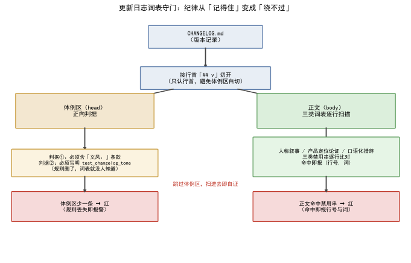  
*图 1：CHANGELOG 按行首 `## v` 切开为体例区与正文；体例区做正向判据（条款在场）、正文做三类词表扫描（命中即报），扫描跳过体例区以避免自证。*

## 六、验证：词表、断点、测试计数

四类证据，测量条件一并给出。

**五项判据清单**（`tests/test_changelog_tone.py` 全部断言，2026-10-12 逐条对读 [2]）：

| # | 判据 | 断言对象 |
|---|---|---|
| 1 | 人称叙事词表零命中 | 正文逐行 × `BANNED_PERSON`（12 词） |
| 2 | 产品定位论证词表零命中 | 正文 × `BANNED_POSITIONING`（4 词） |
| 3 | 口语化措辞词表零命中 | 正文 × `BANNED_COLLOQUIAL`（12 词） |
| 4 | 体例条款在场且写明守门测试名 | 头部体例区含「文风：」与 `test_changelog_tone` |
| 5 | 每个版本段都有加粗小标题 | `## v` 切段后每段含 `**` |

**守门实验：基线 + 两组突变**（2026-10-12 实测，在仓的临时副本上复跑，程序版本 v2.12.0b1；数据源 [2]）：

- **基线**：五项判据全 PASS。词表对 v1.0.0 全量改写后的全部版本段（含 v0.1.0–v0.9.x 的改写留档）逐行扫描，三类命中各 **0** 条——改写不是「新段落干净了」，是从 v0.1.0 起每一版都过得了词表。
- **突变①（删条款）**：把体例区的「文风：」字样删掉——`test_the_style_clause_is_present` 当场红，断言原文「体例区缺少『文风：』那条款」。正向判据生效：规则条款被删，测试比任何读者先知道。
- **突变②（注入口语）**：往 v2.10.0 段塞一行「- **临时验证行**：这轮踩了个坑，顺带把白跑的路径压了压。」——`test_no_colloquial_markers` 当场红，报出命中三元组 `('坑', 60, '- **临时验证行**…')`，即（词, 行号, 行内容），与「命中即报行号」的承诺一致。
- **切点对照**：同一套词表若不跳体例区、天真扫头部，会把体例行里写着的「主人」「坑」「顺带」「白跑」全判成命中——这正是 `_split` 按行首 `## v` 切开、跳过体例区的原因：词表扫自己是自证。

**词表守门实证**（数据源 [2]）：三类禁用串逐行比对，命中即报 `(行号, 词)`；体例区必须含「文风：」且写明 `test_changelog_tone`。文档注释写得很直白——「它们在编写规范里已经写过一次，但只靠人记，于是又漏了。本文件把它们变成词表：规则从『记得住』改成『绕不过』」。

**格式断点实证**（数据源 [4]）：体例段对标题、加粗分组、条目写法、`---` 分隔四项逐条写死，与 v1.0.0 之后的全部版本段一致。五项判据里前四项是词表类（三类禁用 + 条款在场），第五项是格式类（每段有加粗小标题）——词表管内容、格式判据管结构，同一份文件两类判据互补：内容干净但空壳化的段落由第 5 项拦下，结构规整但夹带私话的段落由前三项拦下。

**测试计数实证**（数据源 [3]）：v1.0.0 全量单测 1277 → 1283（新增 `test_changelog_tone.py` 5 项 + `test_config_keys.py` 版本齐步组 1 项）；README 同步为 1283。词表守门自 v1.0.0 起进 CI，任何一次提交若把三类内容写回正文、或删掉体例条款，都会当场红。

守门选词表而不是选别的，同样是设计决定。备选方案至少有两个：靠人复查（回到「记得住」，已证失败）；靠模型审文风（每版本段跑一次大模型判「像不像现场对白」）。模型审的三个致命伤：**不确定**——同一段两次判可能不同；**不可复跑**——判过就没了，没法进 CI 当断言；**会错杀**——「我们试过」这种技术陈述容易被误判成人称叙事。词表恰好相反：确定（字面比对）、可复跑（毫秒级、零成本、进 CI）、误伤可控（命中三元组摆出来人工核）。文风纪律里「硬的那部分」（哪些词不出现）交给词表，「软的那部分」（行文是否清爽）留给人——机器守得住的守死，守不住的不假装守。

词表还是活的，有自己的收词流程：正文里冒出新口头禅（某次「死档」「这轮」先后入表），就往对应词表加一个串、跑一遍测试、确认无误伤——收词成本是一次普通提交。三个词表从 v1.0.0 到现在都在长，长词表不破坏任何既有断言：词表只增不减、命中即报，历史版本段早已过审，新增串只影响未来提交。规则因此不是一块刻死的碑，而是一条跟着语言习惯生长、又随时被 CI 拦住回潮的活纪律——收词的门槛足够低（一次提交），纪律才追得上语言习惯的惰性。

## 七、结语：一句话可复用结论

更新日志写的是「这件事改了什么」，不是「谁提的、该不该做」。把现象／根因／修法／验证四条写死成体例，再用词表测试守住，纪律才从「记得住」变成「绕不过」——省下每次提交前逐行复查整份日志的人，也堵死了文风悄悄回潮的路。可复用的判定式一句话：**凡是「靠人记」的写作纪律，都该问一句「改回去会不会报警」——不会，就把它变成一条会红的断言**；这套做法不挑对象，更新日志的文风、接口的契约、代码的版本号，用的是同一把锤子。

## 引用与出处说明

| 编号 | 引用 | 出处 |
|------|------|------|
| [1] | 旧文风：人称叙事／产品定位论证／口语化措辞三类混进技术记录，技术结论被埋——读到它的人要自己挖 | podcast-maker · CHANGELOG.md · v1.0.0 · 问题段 |
| [2] | 词表守门：三类禁用串逐行扫描命中即报、跳过体例区避免自证、体例条款必须在场且写明测试；docstring「规则从记得住改成绕不过」 | `tests/test_changelog_tone.py`（BANNED_PERSON／BANNED_POSITIONING／BANNED_COLLOQUIAL／REQUIRED_CLAUSE，行 28–97） |
| [3] | 体例收紧：正文改写 60 处、README 新增 2 节、新增测试 6 项、全量 1277 → 1283 | podcast-maker · CHANGELOG.md · v1.0.0 · 本次改动／修法／测试段（行 845–879） |
| [4] | 体例段本身：只有版本号是标题、段内用加粗、每条 `- **短语**：说明`、段间 `---`、文风只写四件事 | `podcast_maker/CHANGELOG.md`（头部体例段，行 6–11） |

## 延伸阅读

- **同书其他篇**：#44《测试钉子：如何防止修好的 bug 长回来》是同一主题的另一种落点——把「记得住」的纪律变「绕不过」的测试，本篇是更新日志文风，那一篇是 bug 回归；两者共用「守门靠断言、不靠人记」这一条。

# 第 VII 部 · 44｜测试钉子：如何防止修好的 bug 长回来

## 一、引子：真实起点

v0.6.0 那次，`CHANGELOG.md` 已经开了 `## v0.6.0`，程序的版本号还停在 0.5.0——启动横幅、`/api/status`、HTTP `Server` 头三处一起错报版本，而「日志与版本号齐步」这条纪律全靠人记，迟早再漏 [1]。这种「修过又漏」的毛病，靠提醒没用：只要改回去不报警，任何一次顺手改动都能把修好的行为悄悄撤掉。

## 二、现象：修好的 bug 会静默长回来

几类典型，共同点是修好时没人写断言守住：

- **启动抬头印了两遍**（v0.47.1）：`main.py` 的 `main()` 和 `web_ui.run_server()` 各印一份，同一标题隔一行出现两次，占去四行屏幕 [2]。
- **进度条从没接上写稿段**（v0.45.0）：预算表只覆盖收尾两段，整趟最耗时的写稿段一格都没有，实测轨迹只有 `0% → 50% → 95% → 100%` 四跳，还全挤在最后几十秒 [3]。
- **承诺链问题项被归一化丢掉**（v0.41.1）：模型报的承诺问题在出口被逐条 `continue` 丢掉，只剩一个判不通过的空壳，报告上的承诺链于是永远红着 [4]。

它们还有一个隐蔽共性：`test_config_keys.py` 的文档注释说得很直白——第四类缺陷（点位读了没声明）、第五类（点位没界面入口）、第六类（档位没中文标签）、第十类（engine_scope 与引擎表不符）、第十三类（改名／下线静默丢值）——「这类缺陷靠人看不出，只能靠扫描代码」[5]。

## 三、错误尝试：靠「记得住」的纪律

留着已下线的入口比删掉更坏：同一个「补充说明」有两处可写，人改了新的一处以为生效，旧那处还在往提示词里塞话，症状是「写了不管用」[5]。靠人盯着每一处可能回潮的改动，迟早漏——很多这类缺陷「不会报错，只是结果不对」，配置页看起来一切正常，因为缺的那一项只是不存在 [5]。

## 四、根因：没有断言，回归就无代价

根因一句话：**bug 长回来的前提是「改回去不会报警」**。只要没有一条测试在改回去时必红，任何一次顺手改动都能把修好的行为悄悄撤掉。而这一类缺陷最危险的地方在于静默：点位没声明、档位没标签、进度没刻度，运行时都不抛异常，只在产物里看得出不对——查起来要从结果倒推回配置，成本极高 [5]。

## 五、正确修法：把修好的行为钉成必红的断言

几类钉法，钉子统一落在单测里、进 CI。钉法可以按「守什么」分成两族：**守一次修复**的（版本齐步钉、抬头钉、进度钉、承诺链钉——每个都对应一次真实事故）与**守一条不变式**的（反回潮钉、对账钉、否决零误伤钉——守的是「不该出现的状态」本身）。两族混编的好处是：修过的 bug 有历史可查，没修过的病灶有结构可守。

**第一，版本齐步钉**（v0.6.0 教训）：更新日志最上面的已发布版本标题必须等于 `VERSION`；`ARCHITECTURE.md` 抬头版本号也要齐步——三端齐步只盯程序与更新日志，架构册不在视野里就会漏 [1]。

**第二，抬头钉**（v0.47.1）：抬头文案打出去的次数全仓只有 1 次，判据是「落在 `print`／`log`／`sys.stderr.write` 调用里的次数」，不是「这句文案出现过几次」——测试与探针都要拿它当标尺，出现在常量或文档里不算数（第一版按「出现过」判，探针一进仓就把它判红）；印抬头那行必须用 `VERSION` 且不得含版本号字面量；版本号字面量全仓只有两处（`config_manager.py` 与 `__init__.py`）[2]。

**第三，进度钉**（v0.45.0）：`_BANDS` 五段区间 `[起, 止)` 且首尾相接——进了下一段就天然比上一段的任何一格都大，所以进度只前进不后退，不必每处再比一次 `max`；写稿段占一半以上（它是整趟最长的一段）；末段不占满 1.0，留一格给落盘与任务收口。旧测试「测的是错的那半边」——只验了检查段、门禁段按轮前进，而写稿段该不该动它一个字没验，所以漏掉整段也能全绿；新版按五段逐段验 [3]。

**第四，承诺链钉**（v0.41.1）：`TestPromiseIssuesSurviveNormalization`——承诺项缺 `quote`／`problem` 也不被丢、能生成 `patch_targets` 落点、判 fail 且无落点时详情不印「通过」；另设通用钉子：`check6_schema` 要求哪些键，归一化后就得留下哪些键——将来任何一项改了输出契约都能被当场钉住 [4]。

**第五，反回潮钉**：已下线的 `script.extra_requirement`、风格维度 `emotion_density`／`question_rate` 按源码扫一遍，防止哪天顺手加回来——留着入口比删掉更坏 [5]。

**第六，对账钉**：配置键的「允许键」集合定义为 `set(PARAM_SPEC) | set(CONFIG_PASS_THROUGH)` 并断言两者交集为空——这不是守某一个 bug，是守「配置点位与通道键两本账必须对得上」这一条结构关系（`tests/test_config_keys.py:73`、`tests/test_project_store.py:826`）[5]。对账钉的特点是**不需要记住具体历史**：它守的是不变式，任何一次打破不变式的改动（不管动机多正当）都红。

**第七，缺口钉**：架构册抬头的版本号也要与程序齐步（`TestVersionStep` 的一条）——三端齐步只盯程序与日志时，第三份载体（架构册）就是齐步链上的缺口；缺口钉把链条上每一份都收进断言，不留「应该也有人盯」的空档 [1]。

**第六，否决零误伤钉**（`test_timbre_guard`）：第 9 维否决两道级联（`d_cep` 绝对线／`h1h2_z ≥ 0`）各自零误伤的定标结论；「压不成」处理——包络／声门量不出（极端短段）就**不否决**，该报照报，第 9 维缺席绝不放行报不出的病 [6]。

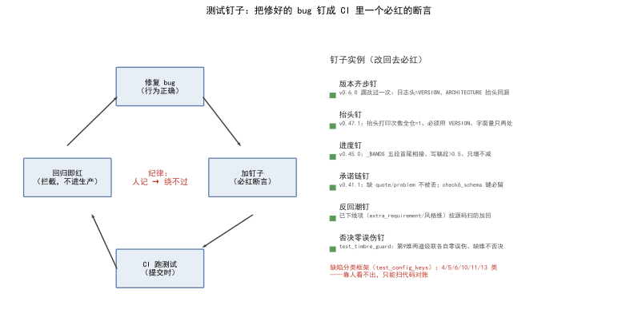  
*图 1：左侧回归循环——修复 bug → 加钉子（必红断言）→ CI 跑测试 → 回归即红（拦截，不进生产）→ 回到修复；中心是「纪律：人记 → 绕不过」。右侧为六类钉子实例。*

## 六、验证：钉子清单与实测

三类证据，测量条件一并给出。

**钉子清单**（数据源 [1][2][3][4][5][6]）：表 1 给出缺陷分类与对应钉子；图 1 右侧列六类实例，每一条都对应「改回去必红」。

| 缺陷分类 | 钉子落点 | 守什么 |
|---|---|---|
| 版本齐步（v0.6.0 漏过） | `test_config_keys.py:TestVersionStep` | 日志头／程序／ARCHITECTURE 三端版本一致 |
| 抬头印两次（v0.47.1） | `test_banner.py`（5 项） | 抬头打印次数全仓=1、必须用 VERSION |
| 进度无刻度（v0.45.0） | `test_batch.py` 进度钉（3 项） | `_BANDS` 五段相接、写稿段>0.5、只增不减 |
| 承诺项丢失（v0.41.1） | `TestPromiseIssuesSurviveNormalization` | 缺 quote/problem 不被丢、键必留 |
| 已下线项回潮 | `test_config_keys.py` 反回潮组 | 源码扫防 extra_requirement／风格维加回 |
| 第 9 维否决 | `test_timbre_guard.py:SegIncursionVetoTest` | 两道级联零误伤、缺维不否决 |

**测试计数实证**（数据源 [2][3][4]）：v0.47.1 全量 1272 → 1277（`test_banner` 5 项）、v0.45.0 1240 → 1242（`test_batch` 进度钉 3 项）、v0.41.1 1110（+4，`TestPromiseIssuesSurviveNormalization` 一组）；v1.0.0 版本齐步钉亦在 `test_config_keys` [1]。计数本身就是钉子密度的量尺：每次「修好一个 bug」的版本段都应能看到 +N 的新钉记录，一个修缺陷版本若测试计数不动，说明又修了次「记得住」。

**否决零误伤实证**（数据源 [6]）：`SegIncursionVetoTest` 用 B 池 83 句 + A 池 88 句端到端钉住「真混入签名（d_cep 2.25／h1h2_z -1.83）两道都不压、照报」，压不成路径（dim=None）返回不否决，第 9 维缺席不放行报不出的病。

**突变实验：钉子必红实证**（2026-10-12 实测，在仓的临时副本上复跑，程序版本 v2.12.0b1；数据源 [1][2]）：

| 突变 | 注入的缺陷 | 哪个钉子红 | 红时输出的信息 |
|---|---|---|---|
| ① 版本脱步 | `config_manager.VERSION` 改成 `9.9.9` | `TestVersionStep` | `config_manager.VERSION(9.9.9) 与 __init__.__version__(2.12.0b1) 不同步` |
| ② 抬头印两遍 | `web_ui.run_server` 里抬头 `print` 复制一份（复刻 v0.47.1） | `test_banner` 5 项中 2 FAIL + 2 ERROR | `podcast_maker/web_ui.py ×2`；`2 != 1 : 抬头那行该正好一条，实际 2 条` |

基线（未突变）两组钉子除版本项外全绿。进度钉的同构断言在 `tests/test_batch.py`（:419–427，首尾相接 `bands[lo][1] == bands[hi][0]`、写稿段 `> 0.5`）——把「写稿」段终点从 0.72 改小即破坏相接、断言必红（该测试模块导入链重，突变复跑需完整环境，判据以断言原文为准 [3]）。

实验当天真实仓恰好给出一次「抓现行」：程序版本已 bump 到 `2.12.0b1`，`ARCHITECTURE.md` 抬头还停在 `2.11.0`，`TestVersionStep` 的架构册项正红——钉子在提交前指出了在途的不一致，与 v0.6.0 那次「日志先跑、程序没跟」是同一类病灶 [1]。突变实验与抓现行合起来回答标题的问题：钉住的不是某次修复，而是「改回去必报警」这个性质本身。

突变实验的复跑操作，本身就是钉子工作流的一部分：把 `podcast_maker/`、`tests/`、`CHANGELOG.md` 拷进临时目录 → 注入一个已知缺陷 → 只跑对应的钉子类 → 记录红的信息 → 副本弃用。全程不碰真仓，五分钟一轮；钉子红时的报错文本就是它的「输出契约」——红得说清楚是哪根钉、差在哪、期望什么，而不是一句笼统的 `AssertionError`。上表右列照抄的就是这些报错原文：钉子开口说的第一句话，就得能让人直接去修。

## 七、结语：一句话可复用结论

钉子也是代码，也有自己的维护纪律，两条最要紧。**其一，标尺与被测物同源**：抬头钉认的那句文案定义成常量 `TAGLINE`，测试与被测代码引用同一个常量——改抬头文案时改一处，钉子自动跟上新文案；若测试里另抄一份文案字面量，改文案那天钉子就误红，人会顺手把钉子删掉。**其二，判据从实际教训里长出来**：抬头钉第一版按「文案出现过几次」判，结果探针（只引用标尺、不打印任何东西）一进仓就被判红——这才改成只数 `print`／`log`／`sys.stderr.write` 调用里的出现次数 [2]。误伤一次，修一次判据，钉子因此越钉越准；怕误伤而不用钉子，是把「永远不准」当成了「偶尔误红」的替代品。

修好的 bug 会不会长回来，取决于改回去会不会报警。把修好的行为钉成一条必红的断言，回归就挡在提交时，而不是进了生产才有人发现——纪律从「记得住」变成「绕不过」，与 #43 的日志文风守门是同一根脉。

## 引用与出处说明

| 编号 | 引用 | 出处 |
|------|------|------|
| [1] | 版本齐步钉：日志最上已发布标题 = `VERSION`、ARCHITECTURE 抬头同源；v0.6.0 漏改过一次（日志先跑 `## v0.6.0`、程序报 0.5.0） | `tests/test_config_keys.py:TestVersionStep`（行 497–544，docstring「v0.6.0 那次」）／`podcast_maker/config_manager.py:VERSION` |
| [2] | 抬头钉：v0.47.1 抬头印两遍，`test_banner` 5 项钉「以后不许再长回来」（打印次数=1、必须用 VERSION、字面量只两处） | podcast-maker · CHANGELOG.md · v0.47.1 · 修复／测试／验收段（行 882–944）／`tests/test_banner.py` |
| [3] | 进度钉：v0.45.0 进度条未接写稿段，`_BANDS` 五段首尾相接、写稿段>0.5、只增不减 | podcast-maker · CHANGELOG.md · v0.45.0 · 修复／实测轨迹／测试段（行 1091–1162）／`tests/test_batch.py:test_stage_and_progress_follow_the_round`／`test_progress_bands_are_contiguous_and_the_writing_band_has_room`（行 343–428） |
| [4] | 承诺链钉：v0.41.1 问题项被归一化丢掉，`TestPromiseIssuesSurviveNormalization`（缺 quote/problem 不被丢、通用钉子 check6_schema 要求哪些键归一化后留哪些键） | podcast-maker · CHANGELOG.md · v0.41.1 · 修复／测试段（行 1473–1518）／`podcast_maker/script_engine.py:_norm_issues` |
| [5] | 缺陷分类与反回潮钉：4/5/6/10/11/13 类（点位声明／界面入口／中文标签／engine_scope／版本齐步／改名静默丢值），已下线项按源码扫防回潮 | `tests/test_config_keys.py`（TestConfigKeys／TestUiEntry／TestEnumLabels／TestEngineScope／TestConfigMigration／TestVersionStep，docstring「这类缺陷靠人看不出」） |
| [6] | 否决零误伤钉：第 9 维否决两道级联（d_cep 绝对线／h1h2_z≥0）各自零误伤、压不成处理（缺维不否决） | `tests/test_timbre_guard.py:SegIncursionVetoTest`（行 693–780，docstring「2026-10-08 探针 + 端到端复验」） |

## 延伸阅读

- **同书其他篇**：#43《更新日志写成技术文章：现象、根因、修法、验证》是同一根脉的另一落点——把「记得住」的纪律变「绕不过」的测试，那篇是更新日志文风，本篇是 bug 回归；两者都主张守门靠断言、不靠人记。

# 第 VIII 部 方法论与哲学：从一座矿回望那个圈

> 工程落地、方法论复用、文明退化语义——从一座矿回望整套方法。

## 本部篇目

| 篇 | 章题 |
|---|---|
| 45 | 工程如何落地：画地图定位、功能解耦、分层与统一各级推动点位 |
| 46 | 《我思故我写》方法论在播客现场的复用：前置规范、统一推动点位、名词不解释、槽位减法 |
| 47 | 文明退化从丢失语义开始：当 LLM 成了人际交流的中间翻译 |

## 怎么读

- 45 总结工程方法，46 逐条对账《我思故我写》的方法论（可对照原书读），47 收在文明层面——全书由此从工程爬升到忧思，建议最后读。
- 读完本部再回看结语，全书弧线闭合。

# 第 VIII 部 · 45｜工程如何落地：画地图定位、功能解耦、分层与统一各级推动点位

## 一、引子：真实起点

项目跑起来那天，功能其实都「能用」：脚本能生成、声音能合成、字幕能出、进度条也能动。但第一次要改一个行为——「把某配置项的取值范围收紧一点」——才发现麻烦不在功能，而在**牵一发动全身**：同一个取值范围，界面里写了一份、后端校验写了一份、流水线读了一份，三处对不上，改了一处另外两处还是旧值。

这不是某一行代码的 bug，是**工程没有落地**：功能散在各地、各管各的，没有人能指着一张地图说「这个行为的定义点在这里，改这里就够了」。本文想说清楚的就是——**工程落地不是把功能写完，是给每个功能一个可指认的坐标**：它在地图哪一层、它的定义只在哪一处、它的偏差长什么样。

## 二、现象：三种反复出现的工程病

把本仓踩过的坑收拢，工程「没落地」集中表现为三种病：

**病一，点位分散。** 一个行为的定义散在多个文件：界面一份值域、后端一份校验、流水线一份读取，改行为要翻三处、还可能漏第四处。这是《我思故我写》09b 说的「分散点位」——偏差每处独立、互不知情，校准成本是乘积级的。

**病二，层级错位。** 本该由确定性代码算清楚的事，被交给了不该管它的层。最典型的是段划分：装箱、切块、块序号、每段配额，本该由 Python 一次性算完，却一度让模型去「再分组」——结果装箱算一套段、模型分一套段，两套段划分打架 [3]。

**病三，同源失守。** 同一个物理量在多个模块各存一份：`ffmpeg` 路径从前散在 `audio_engine` / `tts_engine` / `video_engine` / `aigc_label` 四个文件各写一遍查找逻辑，改一处漏三处 [6]；同一个估时尺子，若谁都能自己定一个「字/分钟」，整条时长预算就对不齐 [5]。

三种病的共同特征：**没有唯一的「定义点」**——定义散了，偏差就不可见，治理就无从下手。

## 三、错误尝试：我们怎么绕弯的

绕弯的几条路，《我思故我写》09b 已经替我们穷举过了，本仓也逐一撞过。

**第一条：硬编码与代码推动的分散点位。** 早期规则以魔法数字、散落 `if`、各模块的私有查找函数存在（09b 所说四种推动方式的前两种）。推动点位「不在任何显式位置」——改规则就是改代码、改代码就是改行为，点位与实现完全重合。它的偏差藏在代码里、集中在类与函数里，但仍然是**分散的**：改 A 字段、B 字段行为没跟上，这种偏差不是「偏」是「裂」 [1]。

**第二条：调用侧各写一遍值域与阈值。** 界面自己写 `min/max/step`，模块内写魔法数字当阈值，提示词里还藏一句阈值。表面看「各自方便」，实则是把同一个点位复制成 N 份——这正是 PLAN §13.3 明令禁止的四类分散点位之一 [2]。

**第三条：让模型定段边界。** 规划轮如果也能决定「这一段切到哪」，就和 `pack_segments` 的装箱结果成了两套段划分，互相打架；模型写的「范围描述」会和它手里的原文对不上 [3]。这是把确定性的算术交给概率，必然漂移。

三条都撞在同一堵墙上：**想靠「多写几份、各管各的」或「交给模型更灵活」来逃避「定义点唯一化」，本质是把偏差从可见变成不可见**——而不可见的漂移，是《我思故我写》09b 说的「最坏命运」。

## 四、根因：为什么偏差一致才可治理

根因要回到《我思故我写》09b 的判断（本文不重述其论证，只引用结论）：**四种推动方式本质是四种偏差分布；只有配置推动的偏差坐在一个可指认、可枚举、可校准的位置上** [1]。

关键在「统一推动点位」把穷举的坐标系换掉了：

```text
行为空间：开放的、随业务漂移的、不可枚举的   → 穷举行为 = 打不完的仗
点位空间：封闭的、随配置表固定的、可有限枚举的 → 穷举点位 = 表里那张有限的清单
```

换完坐标系，偏差从「每处独立」变成「一族一致」。一致偏差只有两种可设计的命运——**误差抵消**（构造相反偏差相减）或**误差补正**（一张校准表拉回来）；而这两种命运的公共前提只有一个：**点位还在那里、可指认** [1]。

落到工程上，这就是三件事：**画地图**让点位有坐标、**分层**让点位住在声明层而非散在代码、**唯一定义处**让每个点位只在一处落地。三者合起来，偏差才「一致且可见」，才谈得上治理。反过来，没有地图、没有分层、没有唯一定义处，偏差就是《我思故我写》09b 说的「不可见的漂移」——既不偏左也不偏右，而是「不知道在哪」，永远修不完。

## 五、正确修法：工程落地的三支柱

修法不另起炉灶，而是把《我思故我写》09b 的方法论在本仓钉成三道可执行的支柱。

### 5.1 画地图定位：PLAN.md 整体架构 + 段划分装箱 py 五步流水线

地图的第一份是 `PLAN.md` 的整体架构——它把「脚本→声音→字幕→画面→产物」九步管线、各模块职责、方法论对齐（《我思故我写》13.1~13.10）一次性画清，让每个功能知道自己在哪一层 [2]。

地图的第二份是段划分装箱，它用**纯算术**把「该切几段、每段多大」从模型手里收回到 Python：

```python
# podcast-maker/PLAN.md §17.7 —— 段划分是纯算术：py 五步流水线（LLM 不参与任何切分）
# ① 每节权重   w_i = _material_chars(节 i)              # 凝缩对应的原文量
# ② 每节配额   q_i = target_chars × w_i / Σw           # 余数补给最大的节
# ③ 每节原文   t_i = material_tokens(len(compose([ref_i])))   # 字符 → token（含余量）
# ④ 装箱       written = 0
#              for i in 1..n:
#                  avail = 输入额度 − 提示词 − 固定占位 − written
#                  if   cur_tokens + t_i ≤ avail → 装入当前桶
#                  elif 当前桶非空                → 封桶；written += 桶内 q 之和；开新桶重试
#                  else                          → t_i > avail：该节自身超额度，报错
# ⑤ （已撤销）块配额 —— 切分单位统一到整节凝缩，块不存在了
```

要点：装箱、切块、块序号、每段配额**全部由 py 算完，LLM 不参与任何切分**；段数由 `llm.max_tokens × llm.input_ratio` 与各节原文实际重量算出，写死的只有两个常量 `SEGMENT_MAX_PARTS = 8`、`SEGMENT_MERGE_MAX = 3`；规划轮 schema 用 `minItems == maxItems == 段数` 钉死，模型**只能逐段写题目**，范围描述归 py [3]。这就是「画地图」把确定性决策从概率里收回来。

### 5.2 功能解耦与分层：声明层对执行层，四条禁令

分层的核心是 PLAN §13.3 的**唯一声明层**——`config_manager.PARAM_SPEC` 是唯一的推动点位：界面控件的值域与默认值、后端校验规则、流水线执行参数、文档描述，全部由这一张表派生；改一个行为 = 改表里一行 [2]。

配套三张有限枚举表，把「可枚举」钉死：

| 表 | 内容 | 枚举性质 |
|---|---|---|
| `PARAM_SPEC` | 全部可配置点位：key / 类型 / 默认 / 范围 / 归属组 / 消费者 | 封闭表 |
| `MODE_SPEC` | 枚举型点位的档位定义（动画、说话人、字幕、封面、BGM、背景） | 封闭表 |
| `GATE_SPEC` | 门禁条目：判据、阈值、级别、失败动作 | 封闭表 |

对应《我思故我写》09b「分散点位 = 乘积级枚举成本」，PLAN §13.3 明令禁止四类分散点位 [2]：
1. 页面里写第二份值域（`min/max/step` 必须由后端下发）；
2. 模块内写魔法数字（阈值一律取 `GATE_SPEC`）；
3. 提示词里藏阈值（阈值不得出现在 prompt，prompt 只说「按系统要求」，判据由代码执行）；
4. 同一物理量在多个模块各存一份。

这四条禁令，就是把「点位分散」在入口处堵死——定义只允许住在声明层的一张表里。

### 5.3 统一各级推动点位与唯一定义处：四处各自唯一

分层解决「点位住哪层」，唯一定义处解决「每个点位只在一处落地」。本仓四处是同一哲学的不同落点：

- **`layout.py`——项目目录布局的唯一定义处**：子目录名（含「音色」）、各期产物路径，全仓所有路径都在这里拼。llms.txt / README / PROTOCOL 三处同述「项目目录布局的唯一定义处」[4]。
- **`config_manager.PARAM_SPEC`——配置与推动点位的唯一定义处**：上文 §13.3 已述，界面与管线都读它，改一处全局生效（也是本仓 #2 专文主题）[2]。
- **`duration_model.py`——脚本侧估时尺子的唯一定义处**：文件头写明「脚本侧唯一的一把尺子：估时只认它，跟用哪个音色无关」，锚点取 256 字/分钟（落在朗读口径中位、与 391 句本机实测一致），汉字与有效字换算也只在这里定义 [5]。
- **`bins.py`——运行环境定位的唯一定义处**：`ffmpeg` / `ffprobe` 的**唯一**查找、探测与安装实现；文件头自述从前散在 `audio_engine` / `tts_engine` / `video_engine` / `aigc_label` 四份各写一遍，收成一处后「改一处不会漏三处」，与 `tools/sources.py`（全仓唯一源表）、`tts_service/setup_env.py`（唯一搭建实现）同律 [6]。

四处合起来印证《我思故我写》09b 的判断：**点位统一且可指认，偏差才一致；一致偏差才可治理**。

实例对照（本仓已写专文，此处只取与「落地」相关的结论）：
- **#18 stdout 双零（fail-closed）**：结果通道纪律把「库的杂输出不许进 stdout」收成 `serve._stdout_to_stderr` 一个包裹点（5 处全包）+ `web_ui._cli_json` 一个兜底点，抠不出 JSON 就 `None` 由调用方 fail-closed。点位统一后，偏差（「成功被误判为无结果」）被枚举成单一契约、由 `TestStdoutContract` 钉死 [7]。
- **#30 同源律**：四份字幕（SRT / LRC / TXT / 洁版 TXT）由同一份源一次生成、不互相反解；时间戳进位是同源最易漂开处——LRC 用 `mm:ss.xx`、整秒 TXT 用 `mm:ss`，两者必须落到同一秒，而 Python `round` 是银行家舍入会让 `.50` 档各走各的。修法把进位定义收在唯一一处 `subtitle_engine.fmt_second_time`（`+50 // 100` 整数半加，LRC 与 TXT 共用同一颗百分秒），两条路落到同一根数轴；`test_subtitle_txt.py` 用 14 对逐字节复现锁死这条同源律 [8]。
- **#36 `_BANDS` 漏写稿段**：进度条是预算表的可视化，而预算表一度只覆盖收尾两格——「写稿段」这最耗时的一段根本没有预算（调度层漏一段）。修复只是把 `_BANDS` 五段表补全、让「哪一段有刻度」一眼可见，正是对「账本漏一段、界面就少一段」的唯一定义处式修复 [9]。

## 六、验证：真仓事实对账

三支柱不是口号，逐条能在真仓对上账：

**地图与段划分**：PLAN §17.7 五步公式与 `SEGMENT_MAX_PARTS = 8` / `SEGMENT_MERGE_MAX = 3` 两常量（§17.8 写死）对应真实代码 `script_engine.py` 的 `_sec_pieces` / `_groups_by_section` / `_section_quotas` / `pack_segments` / `_finish_quotas`；「段数不能由模型定」由 `pack_segments` 与规划轮 schema `minItems == maxItems == 段数` 双钉，单测 `TestPacking`（11 项）覆盖切块、合并封顶、块数超顶报错、无额度能力退化 [3]。

**分层与唯一声明层**：PLAN §13.3 的三张有限枚举表（`PARAM_SPEC` / `MODE_SPEC` / `GATE_SPEC`）+ 四条禁令，对应 `config_manager.PARAM_SPEC` 实码；单测 `tests/test_config_keys.py` 把「版本一致」「一处定义」钉死（本仓 #2 / #44 专文覆盖）[2]。

**四处唯一定义处**：`layout.py`（llms.txt:51 / README:950 / PROTOCOL:763 三处同述「项目目录布局的唯一定义处」）、`duration_model.py:45`（「脚本侧唯一的一把尺子」）、`bins.py:17`（「ffmpeg/ffprobe 的唯一查找、探测与安装实现」，并自述从前四份收成一处）——四处均可指认、偏差可枚举 [4][5][6]。

**实例验证结论**：#18 的 `TestStdoutContract` 把包裹点计数钉为 5、fail-closed 返回 `None`；#30 的同源律由 `test_subtitle_txt.py` 14 对/0 不符逐字节锁死，时间戳进位定义只在 `subtitle_engine.fmt_second_time` 一处；#36 的 `_BANDS` 五段由 `test_stage_and_progress_follow_the_round` 逐段验、单测 1240→1242 全绿 [7][8][9]。三处都证明：点位统一后，偏差从「不可见的漂移」变成「一张表 / 一个测试就能看见」。

## 七、结语：一句话可复用结论

工程落地 = **画地图定位** + **功能解耦分层** + **统一各级推动点位与唯一定义处**。三者共同服务于《我思故我写》09b 的核心判断：统一推动点位把穷举从行为坐标系搬到点位坐标系，偏差一致才可治理——误差抵消或补正都要求「点位还在那里、可指认」。本仓的 `PARAM_SPEC` / `layout.py` / `duration_model` / `bins.py` 四处唯一定义处、PLAN 的段划分纯算术、以及 #18/#30/#36 的账本化修复，都是这句话的具体落点 [1][2][3][4][5][6][7][8][9]。

## 引用与出处说明

> 本文为方法论论述，主引《我思故我写》09b 与本项目 PLAN.md / 实码 / 已写专文，无外部文献、无 `_ab_*` / 快照 / 测试记录索引等内部文件名进稿面；《我思故我写》09b 的实证（某本地写作智能体的 meta 三模式统一、叙事视角可执行化）仅作方法论来源归因，本篇主体实例全部取自 podcast-maker，严守「本书只谈 podcast-maker 一个智能体」的边界。

| 编号 | 引用 | 出处 |
|---|---|---|
| [1] | 配置推动的穷举一致性——统一推动点位与误差的哲学：四种推动方式（硬编码/代码推动/配置推动/LLM 推动）本质四种偏差分布；统一推动点位把穷举从行为坐标系搬到点位坐标系；一致偏差的两种命运（误差抵消 / 误差补正）公共前提是点位可指认；精密度（误差受控）优先于正确度（靶心偏差） | 《我思故我写》09b_方法论体系构建的沉淀：配置推动的穷举一致性——统一推动点位与误差的哲学.md |
| [2] | 统一推动点位（09b）：唯一声明层——`config_manager.PARAM_SPEC` 是唯一的推动点位；配套三张有限枚举表 PARAM_SPEC / MODE_SPEC / GATE_SPEC；四条禁令（页面写第二份值域 / 模块内魔法数字 / 提示词藏阈值 / 同物理量多份） | `podcast-maker/PLAN.md §13.3`；`config_manager.PARAM_SPEC` 实码；`tests/test_config_keys.py` |
| [3] | 段划分：py 五步流水线——装箱/切块/块序号/每段配额全由 py 算，LLM 不参与；写死两常量 `SEGMENT_MAX_PARTS=8` / `SEGMENT_MERGE_MAX=3`；段数不能由模型定（pack_segments 与规划轮 schema 双钉）；`TestPacking` 11 项 | `podcast-maker/PLAN.md §17.7 / §17.8`；`script_engine.py`（`_sec_pieces` / `_groups_by_section` / `_section_quotas` / `pack_segments` / `_finish_quotas`） |
| [4] | `layout.py`：项目目录布局的唯一定义处（子目录名、各期产物路径），全仓路径在此拼 | `podcast_maker/layout.py`；`llms.txt:51` / `README.md:950` / `PROTOCOL.md:763` |
| [5] | `duration_model.py:45`：脚本侧唯一的一把尺子——估时只认它，跟音色无关；锚点 256 字/分钟（朗读口径中位，与 391 句本机实测一致）；汉字/有效字换算只在此定义 | `podcast_maker/duration_model.py:45` |
| [6] | `bins.py:17`：ffmpeg / ffprobe 的唯一查找、探测与安装实现；从前散在 audio_engine / tts_engine / video_engine / aigc_label 四份各写一遍，收成一处（改一处不漏三处）；与 tools/sources.py、tts_service/setup_env.py 同律 | `podcast_maker/bins.py:17` |
| [7] | #18《stdout 纪律》：结果通道双保险——`serve._stdout_to_stderr`（5 处全包）+ `web_ui._cli_json`（花括号配平兜底、fail-closed 返回 None）；点位统一后偏差由 `TestStdoutContract` 钉死 | 本仓 `articles/18_stdout纪律.md`；`tests/test_voice_design.py:1164` |
| [8] | #30《字幕四份同源》：四份字幕（SRT/LRC/TXT/洁版 TXT）由同一份源一次生成、不互相反解（同源律）；时间戳进位是同源最易漂开处，进位定义收在唯一一处 `subtitle_engine.fmt_second_time`（`+50 // 100` 整数半加，LRC 与整秒 TXT 共用同一颗百分秒，落到同一数轴）；`test_subtitle_txt.py` 14 对/0 不符逐字节锁死 | 本仓 `articles/30_字幕四份同源.md`；`podcast_maker/subtitle_engine.py:fmt_second_time`(:267)；`tests/test_subtitle_txt.py` |
| [9] | #36《进度条永远卡在 0% 和 100%》：进度条是预算表可视化，预算漏「写稿段」一段（调度层漏一段）→ 账本漏一段界面就少一段；修复即补全 `_BANDS` 五段表；单测 1240→1242 全绿 | 本仓 `articles/36_进度条永远卡在0与100.md`；`podcast_maker/web_ui.py:_BANDS`；`tests/test_batch.py` |

> 说明：[1] 为《我思故我写》09b 方法论源头（四种推动方式 / 统一推动点位 / 有限枚举 / 误差抵消补正 / 精密度优先于正确度）；[2][3] 为本仓 PLAN.md 的方法论对齐与段划分装箱（纯算术、LLM 不参与切分）；[4][5][6] 为四处唯一定义处（layout.py / PARAM_SPEC / duration_model / bins.py），各自是某领域定义的唯一落点；[7][8][9] 为本仓已写专文的三处实例，证明点位统一 + 唯一定义处后偏差可枚举、可钉死。全文严守边界：只以 podcast-maker 为论述主体，《我思故我写》09b 仅作方法论来源归因。

## 延伸阅读

- **《我写故我播》部八（工程方法论）相关篇目**：#46《我思故我写》方法论在播客现场的复用（前置规范大于后置验证、统一推动点位、名词不解释、槽位减法的项目侧综述）、#47《文明退化从丢失语义开始》（AI 越方便人际越经 LLM 翻译的哲学专文）；本篇与 #46 同引《我思故我写》09b / 08a / 09f / 08c，但 #45 聚焦「工程如何落地」的三支柱，#46 聚焦「方法论如何被本项目复用」。
- **《我思故我写》09b**：配置推动的穷举一致性——统一推动点位与误差的哲学（本文方法论唯一源头）；08a 前置规范大于后置验证、08c 槽位的减法、09f 名词不解释就等于没有名词，与本篇分层 / 唯一定义处 / 命名纪律互为支撑。

# 第 VIII 部 · 46｜方法论复用：四个源头纪律如何长进 podcast-maker 的代码

## 一、引子：真实起点

做一次复盘时会撞见一个反差：podcast-maker 早期好几个反复出现的 bug，回头看，根因写法惊人地一致——要么错误有了一条「生成通道」可以悄悄溜出来，要么改一个行为要翻好几处代码、漏掉一处就裂开，要么把一个名词丢给模型让它自由发挥，要么把一个槽位填得太死逼它硬造。

这些写法听起来像「工程坏习惯」，但把它们摆到一起，会发现它们恰好被另一本书里的四套纪律逐一点过名。《我思故我写》不是讲 podcast-maker 的，它从作者其他工程里归纳出四套构建与写作纪律；而 podcast-maker 的修复史，几乎是这四套纪律的现场重演——只不过这一次，纪律的载体从「提示词」换成了「配置声明、异常处理、输入校验、槽位降级」。

本文的起点就是把这个对应钉死：四套源头纪律，各自在 podcast-maker 的哪一行代码上落地，以及为什么是同一套机制。

## 二、现象：它到底长什么样

先把四套纪律和它们在 podcast-maker 的真实落点并排摆出来，现象就清楚了——它们不是四种孤立的技巧，而是「如何让一个概率系统稳定」的四个角度。

| 源头纪律（《我思故我写》） | 核心命题（源头书原话压缩） | podcast-maker 的真实落点 | 版本与代码锚 |
|---|---|---|---|
| 08a 前置规范大于后置验证 | 做对 = 首次尝试即符合契约的概率足够高；把错误消灭在生成通道，监督前移 | ref_base 缺件 fail-closed 硬报错，绝不静默退回 `ref.wav`；配置单源让错误在声明层无从产生 | ref_base 缺件 fail-closed（`tts_engine._ref_pair`，见 [6]）；配置单源（`config_manager.PARAM_SPEC`，见 [5]） |
| 09b 统一推动点位 | 规则变更只动一处；统一点位意味着有限枚举、偏差一致、误差可补正 | `PARAM_SPEC` 一处定义，界面与管线都从它读，改一处全链路生效 | `config_manager.PARAM_SPEC`（见 [5]） |
| 09f 名词不解释就等于没有名词 | 名词是义项混合中心，单点失重；须四维展开把语义球雕成语义锥体 | BGM 转译把「节奏/调性」钉成有限枚举（`bpm` 限 30~300、拍号只认 2/3/4/6），不让模型自由填 | `web_ui._parse_bgm_translation`（见 [7]） |
| 08c 槽位的减法 | 槽位太强硬会逼 LLM 硬造；语义损失可恢复、幻觉不可恢复；给槽位留缝隙 | `bpm=999`→`None`、`timesignature=5`→`""`、答非 JSON 降级按原文直出，不硬造 | `web_ui._parse_bgm_translation` / `_bgm_fallback`（见 [7]） |

这张表就是全文的骨架：四个格子，每一个都是「源头纪律 → 本智能体代码点」的一条独立证据链。下面三、四、五节分别讲「没自觉用这些纪律时怎么绕弯」「绕弯的根因」「正确修法怎么落」，第六节用单测与版本计数收口。

## 三、错误尝试：我们怎么绕弯的

绕弯集中在四种写法，每一种都对应上面四格里的某一个纪律被忽略。

**把后置验证当万能药。** 早期默认「出错后能修回来」，于是体系围着验证、定位、修复、回归设计，把大量资源投到后验证层。但 ref_base 这类「缺件」场景，后置验证救不回来——一旦静默退回旧 `ref.wav`，整期用错嗓合成，没有任何报错，是「不红、不崩、只是悄悄错」的最糟形态 [6]。

**规则散落在代码里。** 参数早期以字面量、魔法数字、散落的 `if/elif` 直接写在业务逻辑中；改一个行为要翻几个文件、改几处逻辑，还担心漏掉第六处。点位藏在代码里，偏差也藏在代码里，彼此独立、互不知情 [5]。

**把名词丢给模型自由发挥。** BGM 转译早期只产一个 `caption` 字符串，`lyrics` 硬编码 `[Instrumental]`、三个元数据字段全走默认空。一个裸名词「节奏」「调性」交给模型，它激活的是训练语料里全部义项的混合分布，你想要的那个义项只分到频率权重，被混合稀释——单点失重 [3][7]。

**把槽位填得太死。** 反过来，想「管住」模型时又走向另一极：要求元数据必须填、填错就报错。槽位写得太强硬，无论不满足维度还是超过维度，都会逼模型为了完成任务直接硬造一个看似合法实则错误的 `bpm` / 拍号 [4][7]。

## 四、根因：为什么

四个绕弯的根因，逐一对应四套纪律点名的机制——这不是比喻，是同一组数学事实。

**错误有生成通道（08a 根因）。** LLM 是概率生成器，单次输出正确性是概率事件；把它放在「必须一次做对」的位置，等于要求概率为 1。后置验证救不回「已经悄悄产错」的场景，因为错误在生成那一刻就进了数据流 [1]。根因一句话：错误没有被消灭在生成通道，而是被放行进了产物。

**推动点位分散（09b 根因）。** 规则写在代码里，点位就跟着实现走；改一处、漏一处，偏差不是「偏」是「裂」。分散的点位意味着分散的枚举空间——校准 N 个点位等于做 N 次独立校准，且每一处偏差互不知情，连可观察的误差形态都不给你 [2]。

**名词是义项混合中心（09f 根因）。** 模型「理解」建立在相似度上，一个名词激活的是以它为圆心的整个语义邻域；邻域里有多少个义项，激活就有多宽。单名词对目标义项的拉扯被混合稀释、趋近均匀偏移，而 softmax 平移不变性对均匀偏移天然免疫——这就是「单点失重」的数学机制 [3]。裸名词拉不动分布，是分布的数学，不是修辞。

**槽位太强硬逼幻觉（08c 根因）。** 幻觉 = 语义自由度 × 采样次数。槽位写得太死，LLM 为了「完成」会直接硬造；而语义损失的代价与幻觉的代价不对称——语义损失可恢复（后续纠偏能拉回），幻觉不可恢复（硬造的值进了产物就污染）[4]。根因一句话：强硬的人祸制造了模型本来没有的幻觉。

## 五、正确修法：怎么做对的

修法就是四套纪律各自在 podcast-maker 的落地形态——位置、作用范围在生成时定死，规则给一个统一座位，名词钉成有限枚举，槽位承认自己填不了。

**08a 落地 · 配置单源 + 后置验证 fail-closed。** 两件事同时做。其一，参数在声明层定死：`config_manager.PARAM_SPEC` 一处定义，`CONFIG_PASS_THROUGH` 让界面与管线都从它读，改一处全链路生效——错误在声明层就无从产生 [5]。其二，真有缺件时绝不静默：`tts_engine._ref_pair()` 缺件即硬报错，绝不静默退回 `ref.wav`；换嗓三处接线 `adopt / adopt_official / inherit` 都接 `ensure_base_ref()`，体检锚从 `ref.wav` 改为当期同源 `ref_base_<sign>` [6]。前者是「生成时封死通道」，后者是「后置验证失败即上报」——08a 的三态谱系（生成时封死 / 检出即上报 / 后验证淘汰）在本智能体里各占一格。

**09b 落地 · 统一推动点位。** `PARAM_SPEC` 就是把「规则变更时动哪里」的答案收敛到一处声明：改一个行为只改一个文件里的一行声明，界面控件值域、管线取值、校验口径全部从它派生。统一点位意味着有限枚举，偏差因此一致——一致的误差只有两种命运：抵消，或补正；前提都是那个点位还在那里 [2][5]。这正是一处改全链路行为一致、不会漏改第六处的工程体现。

**09f 落地 · 名词钉成有限枚举。** `_parse_bgm_translation` 不靠模型自觉，把「节奏 / 调性」这两个名词在代码层展开成有限枚举：`bpm` 取整并限官方区间 30~300，越界置 `None`（回到自动估计）；`timesignature` 只认 2/3/4/6，其余清空；`lyrics` 把挤在一行的相邻结构标记拆成一行一个；`caption` 空即判失败（它是必需层）。这就是四维展开的代码版：解释划界（只认合法值）、细化收窄（限区间）、举例锚定（拆行给方向）、反例排除（非法值清空）——把「节奏」这个语义球雕成只含合法值的语义锥体 [3][7]。

**08c 落地 · 槽位减法给逃生通道。** 同一份 `_parse_bgm_translation` 的降级口径，就是槽位减法：`bpm=999` 不硬造，置 `None`；`timesignature=5` 不硬造，置 `""`；LLM 不可用或答不出可解析结构时，`_bgm_fallback` 降级——`caption` 吃原文、`lyrics` 走 `[Instrumental]`、元数据留空、`degraded=True`，不拦生成。损失止于这一次生成：语义损失可恢复，幻觉不可恢复，所以让槽位敢于承认自己填不了，比让槽位更「准」更重要 [4][7]。

```python
# podcast_maker/web_ui.py —— _parse_bgm_translation：名词钉成枚举 + 槽位减法（08c/09f 落地）
def _parse_bgm_translation(raw):
    obj = _safe_json(raw)                       # 答非 JSON → 走降级，不硬造
    if obj is None:
        return _bgm_fallback(raw)               # degraded=True，损失止于本次
    bpm = obj.get("bpm")
    bpm = int(bpm) if _in_range(bpm, 30, 300) else None   # 09f：节奏钉成有限枚举
    ts  = obj.get("timesignature")
    ts  = ts if ts in ("2", "3", "4", "6") else ""        # 09f：拍号只认合法值
    lyrics = _split_struct_marks(obj.get("lyrics", ""))   # 09f：相邻结构标记拆行
    if not obj.get("caption"):                  # caption 是必需层，空即失败
        return _bgm_fallback(raw)
    return Translation(caption=obj["caption"], lyrics=lyrics, bpm=bpm, ts=ts)
```

## 六、验证：数据说话

四套纪律的落地，每一条都有版本计数或单测锚点收口，测量条件一并给出。

**配置单源（09b/08a）。** `config_manager.PARAM_SPEC` 一处定义、`CONFIG_PASS_THROUGH` 透传，界面与管线同读一处——这一条的证据是「改一处全链路生效」的结构事实，记载于 `podcast-maker · CHANGELOG.md` 的配置单源条目 [5]。它没有单独的「测试数字」，因为「单源」本身就是防止偏差分散的结构证据：点位统一，就不会出现校准 N 次独立偏差的形态。

**ref_base fail-closed（08a）。** ref_base 版本账本把「缺件即报错」钉成硬纪律（见 [6]）：`_ref_pair()` 缺件 fail-closed，绝不静默退回 `ref.wav`；实测 `cos(ref_base_<sign>, 原生 ref)` = A 0.994 / B 0.974，同版本 **1519 测试通过** [6]。这两个数字就是「后置验证失败即上报、且克隆保真」的实证——它不是「看起来对」，是 1519 条里没有任何一条静默退回旧嗓。

**BGM 转译枚举钉死 + 槽位减法（09f/08c）。** `_parse_bgm_translation` 的枚举校验与降级口径被写进代码层并钉了单测（见 [7]） `tests/test_music_service.py::TestBgmCaption`（3→5 条：转译成功 / 预算=`llm.max_tokens` / 降级原文 / 答非 JSON 降级 / 结构性字段代码层校验）；同版本全量单测 **1551 → 1553 OK** [7]。本批次在仓临时副本实跑：正常三层 → 非降级、带围栏 JSON 正确抽取；`bpm=999`→`None`、`timesignature=5`→`""`、挤行 `lyrics` 拆行、`caption` 空 → 判定失败降级；非 JSON → `degraded=True`、caption 退回原文、`lyrics=[Instrumental]`、日志含「三层结构」——全部符合预期 [7]。

**单测收口对照**：三处落点分别由配置单源条目（[5]）、ref_base 版本账本（[6]，1519 测试）、BGM 三层转译契约（[7]，全量 1551→1553）三版记档，均非孤立断言，而是落在当版全量单测计数里的确定条目 [5][6][7]。

## 七、结语：一句话可复用结论

方法论不是写文章的专利——08a 把错误消灭在生成通道、09b 给规则一个统一座位、09f 把名词钉成有限枚举、08c 给槽位留一口喘息的缝隙，这四套纪律在 podcast-maker 里分别长成了配置单源、ref_base 缺件 fail-closed、`_parse_bgm_translation` 的枚举校验与降级口径。同一套「把不确定性赶出生成通道」的机制，落到代码就是 config 一处声明、异常即上报、输入钉成枚举、槽位敢认填不了。

## 引用与出处说明

| 编号 | 引用 | 出处 |
|------|------|------|
| [1] | 08a 核心命题：做对 = 首次尝试即符合契约的概率足够高；前置规范把错误消灭在生成通道、监督前移；三态谱系（生成时封死 / 检出即上报 / 后验证淘汰）；分工先于名分 | 《我思故我写》· 08a《前置规范大于后置验证——最小尝试次数的分工与监督范式》（自引） |
| [2] | 09b 核心命题：四种推动方式（硬编码 / 代码推动 / 配置推动 / LLM 推动）；统一推动点位 = 有限枚举；偏差一致；误差抵消与误差补正；精密度优先于正确度 | 《我思故我写》· 09b《统一推动点位与误差的哲学》（自引） |
| [3] | 09f 核心命题：名词 = 义项混合中心；单点失重（混合稀释趋近均匀偏移，softmax 平移不变性免疫）；四维展开（解释划界 / 细化收窄 / 举例锚定 / 反例削峰）把语义球雕成语义锥体；锚定力 A∝1/R² | 《我思故我写》· 09f《名词不解释就等于没有名词》（自引） |
| [4] | 08c 核心命题：四个论断（槽位 > 总结 / 纯子集难适应 / 槽位太强硬造 / 槽位是减法）；幻觉 = 语义自由度 × 采样次数；语义损失可恢复、幻觉不可恢复 | 《我思故我写》· 08c《槽位的减法》（自引） |
| [5] | 配置单源：`config_manager.PARAM_SPEC` 一处定义、`CONFIG_PASS_THROUGH` 透传，界面与管线同读一处，改一处全链路生效（09b / 08a 落点） | podcast-maker · CHANGELOG.md · v1.7.0 · 配置单源条目<br>`podcast_maker/config_manager.py:PARAM_SPEC` |
| [6] | ref_base 版本账本：`_ref_pair()` 缺件 fail-closed 硬报错绝不静默退回 `ref.wav`；`cos(ref_base_<sign>, 原生 ref)` = A 0.994 / B 0.974；1519 测试通过（08a 落点） | podcast-maker · CHANGELOG.md · v2.6.0 · ref_base 版本账本条目<br>`podcast_maker/tts_engine.py:_ref_pair` |
| [7] | `_parse_bgm_translation`：`bpm` 限 30~300、timesignature 只认 2/3/4/6、lyrics 拆行、caption 空判失败；`_bgm_fallback` 降级口径（`bpm=999`→`None`、`tsign=5`→`""`、非 JSON→`degraded=True`）；`TestBgmCaption` 3→5；全量 1551→1553（09f / 08c 落点） | podcast-maker · CHANGELOG.md · v2.9.0 · BGM 三层结构转译契约条目<br>`podcast_maker/web_ui.py:_parse_bgm_translation`(`:122`) / `_bgm_fallback`(`:115`) |

> 说明：[1]~[4] 为系列自引（源头书四篇方法论章节，转述与其原文命题一致）；[5]~[7] 为项目实证（仓库 CHANGELOG 与源码、单测，均指向实有文件与版本条目）；文中伪代码为本文推导层（去敏骨架，非独立断言）。全文不援引任何第三方智能体，实例全部来自 podcast-maker 本智能体。

## 延伸阅读

- **#37《开窗时序》**：本篇讲「纪律如何长进代码」，#37 讲「一行启动时序的修法」——同样是源头工程纪律（监督前移、错误不进生成通道）在 podcast-maker 的一个具体落点，只是尺度从「体系」收到「一次 `run_server` 的 bind 与 open 先后」。
- **#30《字幕四份同源》**：本篇的 08a「前置规范」在产物维度的同构——四份字幕同源一次生成、不互相反解，也是「把错误消灭在生成通道」而非事后对账。

# 第 VIII 部 · 47｜文明退化从丢失语义开始：当 LLM 成了人际交流的中间翻译

## 一、引子：两端都被翻译层隔开的交流

podcast-maker 的工作流里有一道隐形的翻译：作者给意图，模型翻成脚本、再翻成声音、再翻成字幕。作者说的"一期讲什么"，到听众耳朵里已过了至少两层模型的转写与生成。这是工具内部的翻译。

但更值得警惕的是工具外部那一层，而且它是**双向**的：一个人要发工作消息、写邮件、回评论，先丢给模型"帮我润一下"——他自己的原话先被模型翻译一遍才出门；另一个人收到后，又丢给模型"帮我总结 / 帮我读懂"——他读到的也不是对方的原话，而是模型替他翻译过的版本。两个自然人之间，同时插进了两个非人类的"中间翻译者"，一个在发送端，一个在接收端。McLuhan 的判词在此应声：媒介即讯息——插在两人之间的翻译层不只是一种「通道」，它本身就在重塑「理解」长什么样 [5]；Kittler 说得更硬：媒介决定处境，连打字机都能重塑思想，何况一个会替你说话的模型 [7]。这两个中间翻译者，从来不是中性的管道。

这一层与 podcast-maker 内部那层是同一件事，只是更彻底：当交流的两端都由 LLM 中转，语义的丢失不再只是个人写作风格问题，而是"人如何彼此理解"这一文明基底问题。本文就从这里起笔。

## 二、现象：两端各过一遍翻译，谁也没读到谁的原话

先把现象摆实。"先让模型润色再发送""先让模型总结再读"都已普遍：

- **发送端**：写作者把草稿丢给模型要"改得更专业"，原话的语气、分寸、潜台词被翻成"标准表达"才出门；跨语言交流里双方各自经过机翻，读的都是对方语言的模型译本。
- **接收端**：邮件、长文、评论被模型"总结成要点"才被阅读；会议纪要、字幕本是对话的译本，又被模型二次转写，常被人当作"原话"引用。
- **两端叠加**：客服对话里一方或双方都在和模型的应答稿对话；社交平台上由模型生成的评论被当作真人态度接收、转发。Bender 等人警示过对称的另一种危险：人会向毫无意义的随机输出误赋意义 [2]——当一端真人在读模型的「总结」时，他读到的不是对方，而是模型替他生成的、看似有理的理解，却以为那就是对方的意思。

把两端叠起来看，结构很清楚：**A 发出的是 LLM 译本，B 读到的也是 LLM 译本，而 A 不完全知道 B 实际收到并理解的是什么，B 也不完全知道 A 实际想说什么。** 原始表达在抵达另一个人之前，先在发送端被翻译一次、在接收端又被翻译一次——两次都没经过两个真人之间的直接对撞。

这还不是最刺眼的部分。最刺眼的是：**两个 LLM 反而最"懂"彼此。** 它们共享同一套训练语料与统计分布，翻译在"分布到分布"之间映射，彼此对齐成本最低；而带着各自体验、语境、利益的两个真人，反而被挡在两层翻译之外，成了这台对齐机器两端的"外部噪声"。当交流靠两个模型互相翻译来达成，人类彼此之间的理解，就被替换成了两个模型之间的统计对齐——而模型对齐的判据是分布相似度，不是人的体验是否真的被接住。Wittgenstein 把意义的地基钉在「使用」上：意义发生在人与人之间用语言做事的过程里，不在任何单边的模型参数中 [3]；由此看，两个 LLM 在分布层面对齐得再好，也对齐不到「使用」这一层。Baudrillard 更进一层：当模型译本先于真实意图在场，人读到的「对方的意思」已是一层拟像，拟像之间的互译比真人对撞更「顺」——这恰是两端都交给翻译时发生的事 [8]。

## 三、错误尝试：以为翻译够好，语义就不会丢

一种天真的认知是：翻译层越来越强，总能"还原"人的意思，所以语义不会丢。

这个假设站不住，因为它把"翻译"当成了"可逆编码"。但语言从第一天起就不是可逆编码——Bender 与 Koller 在「攀登 NLU」里点破：模型在 form 上训练，永远学不到 meaning，form 与 meaning 之间有一道无法靠翻译填平的沟 [1]；《我思故我写》10b 给出的最朴素实验：一个苹果，看摸闻尝是几亿比特感官数据，说出口只剩十几个字 [11]。两层压缩在此已经注定：观察→语言丢掉了感官的绝大多数，语言→LLM 再丢掉一层。

但本章要补的一刀是：即便承认单层翻译有损，当**两端各插一个 LLM**，"有损"会升级为"断裂"——A 的原话经发送端 LLM 压缩成分布，B 经接收端 LLM 从分布解压，中间没有任何一个环节是"A 的真实意图"或"B 的真实理解"。两个 LLM 在分布空间里对接得再好，对接的也不是两个人的体验，而是两团统计摘要。把语义寄托给这样的中转层，等于把"人是否真正彼此理解"这件事，交给两个从没体验过意义的模型去判定 [11]。

## 四、根因：语言是第一次压缩，LLM 是压缩的压缩，两端翻译是压缩的叠加

把根因讲透，回到《我思故我写》10b 的核心命题：**语言是对观察的压缩，LLM 是对语言的压缩——压缩的压缩，比压缩更贫瘠。**

| 层级 | 压缩 | 丢掉什么 | 能否还原 |
|---|---|---|---|
| 观察 → 语言 | 第一次压缩 | 感官的绝大多数（几亿比特→十几个字） | 不可逆（有损） |
| 语言 → LLM | 第二次压缩 | 体验与语义（语料里没有，参数里也没有） | 不可逆（有损） |
| 两端各过一次 LLM | 两次第二次压缩 | A、B 各自的体验双双被分布取代，中间无真人意图 | 不可逆（有损且断裂） |

两层都是**有损压缩**，而 10b 强调：有损压缩不可逆，第一次丢掉的，在第二次里永远找不回来 [11]。当翻译层**同时插在发送端与接收端**，A 的原始体验在第一次表达时已大量丢失，经发送端 LLM 第二次压缩、再经接收端 LLM 第三次接触（解压又是一层分布操作），剩下的只是统计分布里最"像"的版本——而这一版本，A 没确认过、B 也没核过。

这不是模型的缺陷，是压缩的本质。Shannon 信息论早已说明：连续信源的信息量无上界，有限符号无法无失真编码连续世界 [4]。**"一丝不差地传递体验"在原理上就不通；两端都交给 LLM 时，不通的不是一处，是两处。**

而最该警觉的不是"每人各丢一点"，而是：当两端都由 LLM 中转，**人类彼此之间那层"直接理解"被整个抽掉了**，取而代之的是两个模型之间的统计对齐——而模型对齐的判据是分布相似度，不是人的体验是否真的被接住。

## 五、正确认知：判断让渡与翻译打通的尽头

把视角从"个人表达"抬到"文明交流"，需要接上《我思故我写》10 的命题：**判断的让渡与翻译的打通，正在终结两种"力气活"。**

10 把认知链拆成"记住→合适引用→运用"与"表层意图→底层实现"，并指出：AI 用暴力统计干掉了"记住→合适引用"这一段（判断的让渡），又用巨量计算打通了"表层→底层"的翻译（翻译的打通）[10]。当这两件事发生在人际交流上：这并非第一次——Ong 写「文字的技术化」时就指出，一旦技术接管了「词」，认知本身就被重新塑造 [6]；今天 LLM 接管的是「翻译」，重塑的便是「人如何彼此理解」。

- **判断的让渡**落到交流上：人不再自己斟酌"这句话该怎么说、分寸在哪"，交给模型选最"合适"的统计表达——人的语言判断被让渡了。
- **翻译的打通**落到交流上：表层意图（"帮我回得客气点"）被模型直连到底层文本，中间不需要人理解两端——人的翻译判断也被打通了。

10 的清醒结论在这里最锋利：**力气活的终结，逼人退到唯一一个 AI 够不到的位置——承担。** 在交流里，"承担"就是为"我说出去的话失真了、误解了、伤害了"负责 [10]。

把这一条落到"两端都由 LLM 中转"的场景上，结论比个人表达更重：**当 A、B 都不再为"翻译失真"承担，而把对接交给两个模型的统计对齐，人与人之间共建意义的那套机制就被架空了。** 而文明——它的共识、协作、意义传承——恰恰是靠"人彼此理解"这一基底一层层垒起来的。Stiegler 的措辞最冷：当技术接管了记忆与语法化，人遭遇的是「记忆的无产化」——理解一旦外包给模型，人便失去了自己把握意义的能力 [9]。基底被替换成模型对齐，等于把文明的建设交给了 AI。这不是科幻预言，是"顺手让两边都过一遍翻译"每一次发生时都在发生的微小让渡。

"承担"落到日常，不是一句口号，而是几件具体的事：发送前复核模型改了什么——把原话和译本并排看一眼，分寸变了就改回来；接收时不把模型的"总结"当成对方原意，重要的事回去读原文；保留原始表达的一手记录，不让模型译本取代"我本来想说"；在 AI 参与的表述上标注"经模型润色"，让接收端知道这层翻译存在。三件事的共同点：人重新站到翻译的两端之间，为那次失真负责。

回到本书的主角。podcast-maker 一类工具若想在"替人翻译"时守住语义，也须把判断留给人：作者给的意图先由人审一遍脚本再进 TTS，声音与字幕承载的是作者的表达而非模型的即兴；AI 不替作者自动发布、不替听众决定要不要听——翻译的尽头是作者为内容负责。工具把"说话"变得便宜，但"为什么说这句话、向谁说、失真谁担"不能一起被外包。这正是 10 那句"力气活的终结逼人退到承担"在工程产品上的回响。

## 六、验证：九条文献坐标与《我思故我写》锚点

本文的命题不是凭空而来。《我思故我写》的两条篇目锚点提供论证骨架，九条跨领域文献提供外部坐标（按 GB/T 7714 著录，均为真实出版物，明引不自搜）：

| 编号 | 引用 | 锚点性质 |
|---|---|---|
| [1] | Bender E, Koller A. Climbing towards NLU: On Meaning, Form, and Understanding in the Age of Data. ACL 2020:5185–5198 | form 训练无从习得 meaning，form≠meaning |
| [2] | Bender, Gebru, McMillan-Major & Shmitchell. On the Dangers of Stochastic Parrots. FAccT 2021:610–623 | 人会向无意义的随机输出误赋意义 |
| [3] | Wittgenstein L. Philosophical Investigations. 1953 | 意义即使用；私人语言论证 |
| [4] | Shannon C, Weaver W. The Mathematical Theory of Communication. 1949 | 语义层与句法层分离，工程悬置语义 |
| [5] | McLuhan M. Understanding Media: The Extensions of Man. 1964 | 媒介即讯息，媒介重塑感知与社会 |
| [6] | Ong W. Orality and Literacy: The Technologizing of the Word. 1982 | 文字技术化重塑认知 |
| [7] | Kittler F. Gramophone, Film, Typewriter. 1989 | 媒介决定处境；打字机重塑思想 |
| [8] | Baudrillard J. Simulacra and Simulation. 1981 | 拟像；模型/地图先于真实 |
| [9] | Stiegler B. Technics and Time, 1: The Fault of Epimetheus. 1998 | 语法化、第三记忆、记忆的无产化 |
| [10] | 《我思故我写》10《判断的让渡与翻译的打通——两种力气活的终结》 | 判断让渡 + 翻译打通，承担不可让渡 |
| [11] | 《我思故我写》10b《语言被抹平——贫瘠的土地上能否开出鲜艳的花？》 | 语言是第一次压缩，LLM 是压缩的压缩 |

这九条文献从语言学（[3][4]）、媒介哲学（[5][6][7][8]）、技术现象学（[9]）、AI 批判（[1][2]）四个方向，共同支撑一个判断：**当表达经由非人翻译层中转，语义的丢失是结构性的，不是修辞性的。** [10][11] 则把这一判断收束到"人必须保留判断与承担"的方法论结论。

> 本文为哲学专文，无 podcast-maker 实测图；以《我思故我写》方法论与跨领域文献为论证基底，不以工程数据支撑。

## 七、结语：两端都交给翻译，文明就交给了 AI

工具把翻译做得越顺手，人越容易把"翻译什么、为何翻译、谁承担失真"一起让出去。但语言从第一次压缩起就注定有损，LLM 再压一层只会更贫瘠——《我思故我写》10b 说"语言压缩不掉的那部分，就是人"，10 说"力气活的终结逼人退到承担"。

而本章补上的一刀是：当**发送端和接收端各有一个 LLM**，被抽掉的不是某一句话的语气，而是人与人之间"直接理解"的那层基底。两个模型在分布空间里对齐得再好，对齐的也不是两个人的体验，而是两团统计摘要。文明——它的共识、协作、意义共建——靠的正是"人彼此理解"这一基底；基底被替换成模型对齐，等于把文明的建设交给了 AI。

文明退化从丢失语义开始，而语义的丢失，始于每一次"顺手让模型翻译"时，人停止为那次翻译负责。**工具可以替人翻译，不能替人承担；能承担翻译失真的人，才保得住人与人之间那层理解——也才保得住文明本身。**

## 引用与出处说明

| 编号 | 引用 | 出处 |
|---|---|---|
| [1] | Bender E, Koller A. Climbing towards NLU: On Meaning, Form, and Understanding in the Age of Data. ACL 2020:5185–5198 | DOI:10.18653/v1/2020.acl-main.463 |
| [2] | Bender et al. On the Dangers of Stochastic Parrots: Can Language Models Be Too Big? FAccT 2021:610–623 | DOI:10.1145/3442188.3445922 |
| [3] | Wittgenstein L. Philosophical Investigations. 1953 | 哲学研究 |
| [4] | Shannon C, Weaver W. The Mathematical Theory of Communication. 1949 | 语义/句法层分离 |
| [5] | McLuhan M. Understanding Media: The Extensions of Man. 1964 | 媒介即讯息 |
| [6] | Ong W. Orality and Literacy: The Technologizing of the Word. 1982 | 文字技术化 |
| [7] | Kittler F. Gramophone, Film, Typewriter. 1989 | 媒介决定处境 |
| [8] | Baudrillard J. Simulacra and Simulation. 1981 | 拟像先于真实 |
| [9] | Stiegler B. Technics and Time, 1: The Fault of Epimetheus. 1998 | 第三记忆/语法化 |
| [10] | 《我思故我写》10《判断的让渡与翻译的打通——两种力气活的终结》（源头书自引） | 源头书篇目（自引） |
| [11] | 《我思故我写》10b《语言被抹平——贫瘠的土地上能否开出鲜艳的花？》（源头书自引） | 源头书篇目（自引） |

> 说明：[1]–[9] 为外部学术文献（GB/T 7714 著录，明引不自搜）；[10][11] 为《我思故我写》篇目自引，仅以 podcast-maker 作引子、不展开其他智能体。

## 延伸阅读

- **《我思故我写》10 / 10b**：本文全部论证骨架来源——10 的"判断让渡与翻译打通"、10b 的"压缩的压缩"，是"文明退化从丢失语义开始"这一命题的母命题。
- **本书 #3《存量配置自动搬迁》**：同属"翻译/搬迁"主题——那篇讲配置键的旧名如何翻译成新名且不失值，本篇讲语义在人类与模型之间的翻译如何失值；两篇共享"翻译必须保真、否则沉默丢失"的底层关切。

# 结语

## 一、圈没有画在哪

《我思故我写》的结语给出了一个判断：AI 时代的人机自洽，就是划界权的归属——圈内让 AI 做工，圈外由人负责。同一篇用割圆术作比：AI 在圆内逼近，人类决定圆心和半径。

这个判断回答了两件事：谁有权画圈——是人，因为只有人是责任主体，画圈权的合法性来自责任的唯一性，不来自能力的最优性；以及为什么是画圈而不是别的——二元论断的边界不可穷尽，逼近在开放世界必然失效，失效不是停止是失控。四部依次铺开四类边界：约束是输出格式的边界，协作是决策权的边界，穷举是场景的边界，牢笼是伦理的边界。

但它没有回答第三件事：**这个圈的半径到底多大。**

四类边界是分类，不是刻度。说「输出格式有边界」是一句正确的话，可它不能告诉一个具体项目：schema 该由谁来写、写到多细、写完之后还要不要二次校验、校验失败该重试三次还是当场拒绝。这些话在《我思故我写》里没有答案——不是疏漏，是它的问题不在这一层。它论证的是「划界权归谁」，一件事的性质；半径是「界线具体落在哪」，一件事的数量。性质和数量不在同一层，前者推不出后者。

本书接的是这一层。

## 二、错误的形状就是边界的形状

一座真实的矿：podcast-maker，从空目录到能出片。47 个缺陷，每一个都有现象、错误尝试、根因、修法、验证，五段齐全。

这 47 个缺陷不是同一种东西。拆开看，至少两类。

一类是工程常规问题。孤儿进程没杀干净，`finally` 的顺序写反把成品删了，mp3 过 concat demuxer 出坏流，GBK 编码进 toast，浏览器开窗时序错半拍，进度条卡在 0 和 100 之间不动。这类问题换谁都可能遇到，跟模型本身没什么关系——换个熟练的工程师照同样的规范做，也会踩，只是不一定踩在同一处。

另一类不一样。是 LLM 在执行过程中自己犯的错。

模型被要求生成一份 schema，它漏了一个字段——不是不理解要求，是它把「已经说出来的部分」当成了全部。检查段修补该返回补丁，它返回空补丁——不是不会写，是空补丁也能通过它自己那套语法校验，于是它就交了。约束解码在扁平结构里守得住，一到嵌套数组就漏接词表——约束声明在顶层，往下传的时候断了，它不会提醒任何人。首轮复读绕过查重——因为它只在「修正轮」里查，而修正轮被一个 `break` 跳过了，模型乐得把一个不该跳的工序跳过去。八种文体用一张口径喂——因为全局默认值就在那里，逐卡覆盖没人要求它做。期数交给模型自由发挥——它不是乱写，是按某种它以为合理的节奏写。BGM 的中文描述要转成英文 caption，它被 CoT 劫持成一段自我解释——讲道理讲得比转译还投入。音乐生成出来是一片中频塌陷的 drone 墙——不是参数错，是它把「氛围感」理解成了「持续铺满」。

这些错有一个共同点：**人不会以这种方式反复犯。**

人漏字段会心虚，会回头核对；模型漏了就漏了，它的自信不随完整性下降。人知道空补丁等于没干活；模型只知道语法过了就是过了。人不会把约束丢在半路；模型没有「约束必须一路传下去」这个概念，除非有人替它把传递做进结构里。人都知道「氛围感」不等于「一直响」；模型只知道这两个词在训练语料里挨得近。人改代码会顺手看一眼调用方；模型只改被指出的那一行。

所以这些错误的位置是有意义的。**模型在哪里反复出错，那里就是圆的边缘。**

47 个错误点连起来，不是一条光滑的曲线，是一串坐标。它们不讲全局道理，只标位置。

## 三、为什么只到坐标，不到定律——以及怎么裁

既然看出了形状，为什么不提炼成定律？

因为资料不够，而且这件事不该硬做。

一座矿的 47 个缺陷，够标坐标，不够提炼定律。定律需要跨样本的重复验证：同一个形状，在不同的项目、不同的体量、不同的模型上，是否依然成立。本书只有一个样本。凭一个样本推普适规律，推出来的东西自己也不敢信——那不是科学，是修辞。

更实际的问题是：不同体量的项目，边界位置不同。一个三五个人的小工具，让模型自己写 schema 又不校验，可能一周就出事；一个内部脚本，模型自由发挥一次期数，可能三个月没人发现。同一条边界，落在不同体量上位置不同。给死了结论反而害人——照着做的人会以为自己拿到了边界，其实只拿到了别人的边界。

所以本书交付的是**可裁的物证**，不是结论。怎么裁，分两层。

**形状层可以带走。** 漏声明、抄近路、被上下文劫持、把开放任务当封闭任务、嵌套结构里丢约束——这五种形状，换一座矿大概率还会出现，因为它们来自模型的机制，不来自这座矿的地质。看到这些形状，警觉就该起来：凡是要模型自述结构的地方，结构必然不完整，必须有人补声明或补校验；凡是有「能过就行」的出口，它一定走出口；凡是约束只在顶层声明，往下就一定会断；凡是给了自由度的字段，它一定给出一个它以为合理的答案，所以这类字段要么收窄成封闭清单，要么事后加确定性校验；凡是它自己的产出要回头当输入，都要防它把前文的形状当前文的规矩。

**数值层必须留下。** 素材响度极差 13.6 LU、人声段音乐低约 13 dB、峰均比 22.5 dB 的放行阈值、单行字幕 104 字被裁成 33 字、一期视频从 17.8 分钟压到 4.8 分钟——这些数字是这座矿的量法，不是通用标尺。换一条录音链、换一个 TTS、换一种片子长度，数字全变。该带走的是「混音前必须把素材归一到同一档」这条纪律，不是 13.6 这个数；是「字幕断词不能切在词中间」这条约束，不是 33 这个上限。

这就是因地制宜、适体量裁的意思：**带走形状和纪律，留下数字和实现。** 谁把数字一起带走，谁就会在自己的矿上量错；谁只带走数字不带走形状，谁就只会抄答案。

最后一句留给这本书自己。

《我思故我写》说，圈内让 AI 做工，圈外由人负责。这本书没有把圈画得更圆，它只是蹲在圈边上，记录了几十次越界发生的具体位置——哪里它做得住，哪里它一定垮，垮的时候是什么形状。

圈还是那个圈，圆心和半径仍然由人决定。但有了这串坐标，画圈的人至少知道笔该落在哪。

# 附录 A 术语表

> 本书锁定的核心术语与族系方法词。定义以正文为准；出处栏分三类——正文术语给篇号，成书术语给文件名，族系术语给源头。

| 术语 | 含义 | 出处 |
| --- | --- | --- |
| fail-closed（失败关闭） | 任何不确定都必须报错而非放行；不可确定性不能"悄悄通过" | 篇 18、25 |
| 幂等 | 同一操作重复执行结果一致，不叠加副作用 | 篇 17、29 |
| 门禁 | 一道 fail 级校验，未过则产物不给（如引语标注门禁） | 篇 8 |
| 清场 | 合成结束的清理动作，顺序错了会误删成品 | 篇 23 |
| 账本 | 把"谁、哪一版、哪条记录"落盘成可审计的台账（如 ref_base 角色账本） | 篇 20 |
| 同源律 | 多份产物从同一份源生成、逐字节一致（如字幕四份同源） | 篇 30、31 |
| 双零 | 门禁的两条硬指标：零误伤、零漏报（如 stdout 双零、音色双零钉） | 篇 18、45 |
| 出版折算口径 | 字数统计 = 汉字 + 英文单词 + 连续数字串 | `book/build/count_words.py`（口径⑥） |
| 三端一致 | 版权页 == 册根 README 徽标 == `book.html` 标题 == PDF 封面版本，四处必须同步 | 版权页硬约束；`typesetting/BOOK_GUIDE.md` |
| 规范之家 | `typesetting/` 目录，成书规范的唯一真源；脚本复用不重写 | 族系三册共用 |
| 七段骨架 | 单篇文章的七段结构：引子 / 现象 / 错误尝试 / 根因 / 正确修法 / 验证 / 结语 | 本书 47 篇通用（见阅读指南「体例约定」） |
| 四检 | 每篇收稿前的四项自检：真实性 / 底层逻辑 / 空推论 / 循环论证，任一项不过即退稿 | 单篇「四检脚注」 |
| 一处定义 | 同一事实只在一处定义，全局引用（如 PARAM_SPEC 一处定义） | 篇 2 |
| 占位章 | 未写篇在全书拼接时的临时章，不计入字数，落稿后自动替换 | `book/build/assemble.py` |
| CHANGELOG 矿 | podcast-maker 的版本日志，是本书全部素材的来源 | 序言；篇 1 |

# 附录 B 工具索引

> 与附录 A 分工：术语表管「这个词什么意思」，本表管「这个符号在哪」。
> 分两组：**管线符号**（podcast-maker 自身的模块与关键标识，是本书缺陷的现场坐标）与**外部工具**（模型与音视频基础设施，是现场的地基）。
> 全部条目由正文反查得出，出现频次栏为 47 篇内的实测命中篇数。

## 一、管线模块（按命中频次排序）

| 模块 | 职责 | 本书涉及 | 篇数 |
|---|---|---|---|
| `web_ui.py` | 配置页与可视化界面；`show_if` 显隐、网格重排、下拉取值都落在这里 | 篇 36–41 | 80 |
| `script_engine.py` | 脚本生成、查重、定点修补、引语门禁；第四部之前的大半缺陷都在此 | 篇 5–10 | 49 |
| `subtitle_engine.py` | 字幕四份同源生成、断词、时间轴 | 篇 30–35 | 44 |
| `config_manager.py` | `PARAM_SPEC` 唯一声明层，配置的合并、coerce 与迁移 | 篇 1–4 | 30 |
| `tts_engine.py` | 语音合成、音色与种子、显存生命周期 | 篇 13–20 | 29 |
| `music_gen.py` | BGM 生成与转译链路 | 篇 22、27–29 | 26 |
| `serve.py` | 本地服务启动与开窗时序 | 篇 37 | 17 |
| `bgm_level.py` | 响度归一（loudnorm + PCM 增益 + 真峰值硬约束 + 拒写） | 篇 17、29 | 16 |
| `main.py` | 管线入口，九步链的编排处 | 篇 1 | 15 |
| `sfx_engine.py` | 环境音的决策层与执行层 | 篇 25、26 | 13 |
| `audio_engine.py` | 混音、闪避、试听 | 篇 21、24 | 13 |
| `make_voice.py` | 音色入库与草稿流转正 | 篇 16 | 11 |
| `bins.py` | 时长直方图分箱，`_BANDS` 的定义处 | 篇 45 | 11 |

## 二、关键符号

| 符号 | 是什么 | 为什么重要 | 篇 |
|---|---|---|---|
| `PARAM_SPEC` | 配置项的唯一声明表 | 「一处定义」的母体：界面、校验、管线三处都从它取 | 2、3、4、38、40、41、45、46 |
| `MODE_SPEC` | 字幕模式的接驳表 | 一套配置管两种模式的双语义，取值分叉的现场 | 4、10 |
| `CONFIG_PASS_THROUGH` | 配置透传白名单 | 存量搬迁时「先改名后过滤」的判据 | 2、3 |
| `patch_system` | 修补提示词模板 | 空补丁事故的起点 | 6、7 |
| `parse_patch` | 修补结果解析 | 三层加固后不再接受空补丁 | 6 |
| `_vocab_block` | 卡级词表块 | 文体分卡时逐卡覆盖的落点 | 7、10 |
| `_parse_bgm_translation` | BGM 转译结果解析 | 被 CoT 劫持的现场，加了结构约束才稳住 | 27、28 |
| `_bgm_fallback` | 转译失败回落 | 转译链断掉时的兜底路径 | 27、28 |
| `ref_base` | 参考音频版本账本 | 换嗓串嗓事故后引入的 `sign` 后缀与角色账本 | 13、14、20 |
| `build_clean_txt` | 净化稿文本生成 | 字幕四份同源的上游 | 30、31 |
| `_build_lyrics` | LRC 歌词行构建 | 三份字幕逐字节一致的实现处 | 30、31 |
| `fmt_second_time` | 秒数格式化 | 时间戳进位的唯一入口，只此一处 | 30、31、32 |
| `_BANDS` | 时长分箱表 | 漏写稿段导致进度条卡死的账本化修复 | 30、35、36、45 |
| `cssColor` | ASS 配色转 CSS | `\&HAABBGGRR` 直喂 CSS 变黑的事故点 | 34 |
| `valOf` | 下拉取值 | 空壳 SELECT 回落「未选择」的根因函数 | 41 |
| `wrap_balanced` | 均衡断行 | 字幕断词不切在词中间的实现 | 33 |
| `mix_bgm` | BGM 混音 | 三重衰减叠加、人声闪避的现场 | 17、24 |
| `coerce` | 配置值强制转换 | 界面值与管线值口径对齐的唯一处 | 2、4 |
| `_cli_json` | CLI 结果通道 | stdout 只留一行 JSON 的落点 | 18 |
| `llm.max_tokens` | 模型调用上限 | BGM 转译被截断/被 CoT 挤占的诱因 | 25、27、28 |

## 三、外部工具与模型

| 工具/模型 | 角色 | 本书涉及 | 篇数 |
|---|---|---|---|
| **ACE-Step** | 本地音乐生成模型，BGM 全流程的产能基础 | 篇 22、27、28、29 | 4 |
| `ffmpeg` | 音频/视频转码与合成；concat demuxer 出坏流即出在它身上 | 篇 21、24、26、29 等 | 14 |
| `ffprobe` | 媒体探针，响度与时长测量 | 篇 17、21、29 | 3 |
| `loudnorm`（EBU R128） | 响度归一滤镜；−23 LUFS 的目标由它落地 | 篇 17、21、29、35 | 6 |
| Qwen3-TTS | 语音合成模型之一，音色与种子的行为来源 | 篇 15、16 等 | — |

> 说明：本表只收正文实际出现过、且承担论证角色的工具。测试文件（`tests/test_*.py`）不单列——它们是各篇「验证」段的钉子，篇内已逐条点名。

# 附录 C 参考文献

## 一、方法论源头与同族系三卷

- 《我思故我写》（Cogito_Scribit）——方法论源头，提供七段骨架、四检、一处定义、同源律等族系方法词。
- 《排版解析》——成书排版方法卷。
- 《架构解析》——成书架构方法卷。

## 二、本书引用的《我思故我写》篇目（成书时按 GB/T 7714 补全出版项）

- 《我思故我写》篇 08a《前置规范大于后置验证》——引于篇 46。
- 《我思故我写》篇 08c《槽位的减法》——引于篇 46。
- 《我思故我写》篇 09b《统一推动点位与误差的哲学》——引于篇 45、篇 46。
- 《我思故我写》篇 09f《名词不解释就等于没有名词》——引于篇 46。
- 《我思故我写》篇 10《…判断的让渡与翻译的打通》——引于篇 47。
- 《我思故我写》篇 10b《…语言被抹平》——引于篇 47。

## 三、外部文献（篇 47 文明退化语义专文引用，经 web 核验）

- Bender & Koller 2020《Climbing towards NLU: On Meaning, Form, and Understanding in the Age of Data》ACL 2020:5185–5198. DOI:10.18653/v1/2020.acl-main.463
- Bender, Gebru, McMillan-Major & Shmitchell 2021《On the Dangers of Stochastic Parrots: Can Language Models Be Too Big?》FAccT '21:610–623. DOI:10.1145/3442188.3445922
- Wittgenstein 1953《Philosophical Investigations》.
- Shannon & Weaver 1949《The Mathematical Theory of Communication》.
- McLuhan 1964《Understanding Media: The Extensions of Man》.
- Ong 1982《Orality and Literacy: The Technologizing of the Word》.
- Kittler 1999《Gramophone, Film, Typewriter》.
- Baudrillard 1981《Simulacra and Simulation》.
- Stiegler 1998《Technics and Time, 1: The Fault of Epimetheus》.

## 四、其余引用（代码 / 测试 / 探针）

- 各篇正文的代码符号、测试文件、定标探针引用，统一署 `podcast-maker · CHANGELOG.md · vX.Y.Z` 或代码文件；完整清单见各篇「引用与出处说明」小节。
- **编排说明**：本书的引用主体是代码与测试（可逐行复核的事实），不是文献，故不做全篇合并的 GB/T 7714 总表——合并后条目与正文编号脱钩，读者反而查不到。第一节列外部成书文献，第二节列《我思故我写》篇目，第三节列篇 47 的跨领域文献（均已按 GB/T 7714 要素给出著者、年份、题名、出版项与 DOI），其余归各篇自带的引用表。

# 附录 D 实测数字速查

> 全书出现的关键实测数字汇总，便于核对与引用。出处栏标注对应篇号（稳定可查）；最终出版项与精确测试/探针文件成书时统一补全。

| 数字 | 含义 | 出处 |
| --- | --- | --- |
| 1554 → 1612 | 单测用例数增长区间（修钉带来） | 篇 44 |
| 5300 MB | 本地推理显存占用峰值（RTX 4060 Laptop，8GB VRAM） | 篇 13 |
| 11.7 dB → -23±0.22 dBFS | 音频入库响度极差收敛到目标响度 | 篇 17 |
| 17.8 min → 4.8 min | 一期视频因静态层预烘焙省下的时长 | 篇 35 |
| 83.78 dB | 静态层预烘焙框出现前后 PSNR | 篇 35 |
| 13.6 LU | BGM 素材响度参差 | 篇 21 |
| 30+ dB | 混音对 BGM 的压低量 | 篇 21 |
| -16.4 LUFS | ACE-Step 生成件实测响度 | 篇 29 |
| 104 → 33 字 | 旧单行字幕档把单行裁掉的字符数 | 篇 32 |
| 5 段 | `_BANDS` 进度条五段预算区间 | 篇 36 |
| 9 维 → 第 9 维 | 音色合验维度演进，第 9 维（声门）为关键 | 篇 14 / 篇 19 |
| 8 部 / 47 篇 | 全书结构规模 | 书稿规划 |

# 附录 E CHANGELOG 锚点索引

> 47 篇正文与其在 podcast-maker `CHANGELOG.md` 中的版本锚点对照（按篇号/书内顺序排）。精确行号与锚点格式成书时按最终 CHANGELOG 回填。方法论专文（篇 45/46/47）无本仓 CHANGELOG 锚点，引《我思故我写》而非本仓。

| 篇号 | 部 | 标题 | CHANGELOG 锚点（版本 / 来源） |
| ---: | --- | --- | --- |
| 1 | 一 | 一个播客智能体的九步管线：脚本→声音→字幕→画面→产物 | 管线 banner / PLAN.md |
| 2 | 一 | 配置总表如何同时驱动界面与管线：PARAM_SPEC 一处定义 | config_manager / v1.7.0 |
| 3 | 一 | 存量配置自动搬迁：白名单过滤之前必须先改名 | v0.42.0 |
| 4 | 一 | 一套配置管两种字幕模式：MODE_SPEC 接驳表的双语义 | v0.41.0 |
| 5 | 二 | 约束解码不是万能的：schema 漏字段让承诺链永远红 | v0.41.1 |
| 6 | 二 | 检查段修补为什么返回空补丁：PATCH_SCHEMA 三层加固 | v1.7.0 |
| 7 | 二 | 定点修补漏接词表：约束解码在嵌套数组里的盲区 | v1.7.1 |
| 8 | 二 | 引语标注无硬校验：一个 fail 级门禁怎么落地 | v1.6.0 |
| 9 | 二 | 首轮复读绕过查重：一个 else 分支吞掉整段工序 | v1.5.0 |
| 10 | 二 | 文体块分卡：八张素材卡怎么各自说话 | v1.5.0 |
| 11 | 二 | 字距规范化：为什么落盘会删掉汉字与西文之间的空格 | v0.43.0 |
| 12 | 二 | 排图与压比：期数为什么不能交给模型自由发挥 | v0.10.0 / v1.4.0 |
| 13 | 三 | 本地 TTS 显存管理：从黑窗、孤儿进程到 Job 对象 | v1.3.0 / v2.10.0 |
| 14 | 三 | 音色漂移检测：从三维合验到五族合验 | v1.1.0→v1.2.0→v1.3.0→v1.7.2 / v2.10.0 |
| 15 | 三 | 种子确定性派生的双刃剑：坏句重跑不变怎么破 | v1.1.0 |
| 16 | 三 | VoiceDesign 造嗓草稿流：为什么先落草稿再入库 | v1.9.0 / v2.10.0 |
| 17 | 三 | 音频入库即响度归一：11.7 dB 极差收敛到 -23±0.22 dBFS | v1.9.0 |
| 18 | 三 | stdout 纪律：结果通道为什么只能有一行 JSON | v1.9.0 / v2.0.0 |
| 19 | 三 | 声门三件套与傅里叶域分段：第 9 维的原理、公式与实测 | v2.3.0 |
| 20 | 三 | ref_base 版本账本：换嗓串嗓事故的 sign 后缀与角色账本 | v2.6.0 / v2.10.0 |
| 21 | 四 | BGM 听不见：素材 13.6 LU 参差 + 混音压低三十多分贝 | v0.15.0 |
| 22 | 四 | 本地 BGM 生成：从二十分钟搭建到 10 秒出曲 | v2.0.0 |
| 23 | 四 | 成品被自己的清场删掉：finally 顺序的一次误杀 | v2.0.0 |
| 24 | 四 | 人声闪避与混合试听：预览为什么走成片同一条管线 | v1.7.0 / v2.10.0 |
| 25 | 四 | 环境音决策层：LLM 只从封闭清单点名，五道防线 fail-closed 兜底 | v2.7.0 |
| 26 | 四 | 环境音执行层：mp3 过 concat demuxer 出坏流，句前 +0.00s 事故 | v2.7.0 |
| 27 | 四 | BGM 转译层：中文描述怎么经 LLM 变成英文 caption，又怎么被 CoT 劫持 | v2.8.0 |
| 28 | 四 | BGM 三层结构转译契约：caption/lyrics/bpm·keyscale·timesignature 与中频塌陷 drone 墙 | v2.9.0 |
| 29 | 四 | AI 生成件响度归一：bgm_loudness 与峰均比超 22.5dB 的 allow_limited 放行 | v2.8.0 |
| 30 | 五 | 字幕四份同源：为什么我不从产物反解 | v0.44.0 / v0.46.0 |
| 31 | 五 | 一期三份字幕同源生成：SRT/LRC/TXT 逐字节一致 | v0.44.0 |
| 32 | 五 | 单行字幕横滚：旧单行档把 104 字裁成 33 字 | v0.42.0 |
| 33 | 五 | 字幕断词：一个 return hi 兜底硬切在词中间 | v0.41.2 |
| 34 | 五 | ASS 配色陷阱：\&HAABBGGRR 直接喂 CSS 为什么变黑 | v0.42.0 |
| 35 | 五 | 静态层预烘焙：一期视频从 17.8 分钟到 4.8 分钟 | v0.42.0 |
| 36 | 六 | 一个进度条为什么永远卡在 0% 和 100%？ | v0.45.0 |
| 37 | 六 | 启动后浏览器先显示「连接不上」：开窗时序问题 | v1.7.2 |
| 38 | 六 | 配置页网格重排：只改界面，不动配置项 | v0.47.0 |
| 39 | 六 | GBK 乱码进 toast：PYTHONIOENCODING 为什么必须注入 | v1.8.0 |
| 40 | 六 | 配置项显隐：show_if 与 applyShowIf 怎么让界面跟着配置变 | v2.8.0 |
| 41 | 六 | 空壳下拉切页回落成「未选择」：valOf 对一个无 option 的 SELECT 返回了什么 | v2.9.1 |
| 42 | 七 | AIGC 合规标识落地：元数据、语音声明、字幕偏移 | v0.11.0 |
| 43 | 七 | 更新日志写成技术文章：现象、根因、修法、验证 | v1.0.0 |
| 44 | 七 | 测试钉子：如何防止修好的 bug 长回来 | v0.47.1 / v0.41.1 / v0.45.0 |
| 45 | 八 | 工程如何落地：画地图定位、功能解耦、分层与统一各级推动点位 | 本书方法论专文（引《我思故我写》09b） |
| 46 | 八 | 《我思故我写》方法论在播客现场的复用：前置规范、统一推动点位、名词不解释、槽位减法 | 本书方法论专文（引《我思故我写》08a/09b/09f/08c） |
| 47 | 八 | 文明退化从丢失语义开始：当 LLM 成了人际交流的中间翻译 | 本书哲学专文（引《我思故我写》10b/10） |

# 附录 F 模型底座

> 本项目的模型清单与由它们催生的调优机制。后续一切调优工作（时长校准、音色体检、BGM 适配）都架在这批模型之上——先立底座，再谈调参。版本与实测口径见 §三。
>
> LLM（qwen3.5-35b-a3b，LM Studio 本地部署）只承担脚本写作，不在本书调优范围内，列此仅备一格。

## 一、模型清单

| 环节 | 模型 | 变体与角色 | 常驻策略 | 归属服务 / 配置键 |
| --- | --- | --- | --- | --- |
| TTS 主引擎 | Qwen3-TTS-12Hz-1.7B-**Base** | B 变体：无内置音色表，音色由参考音频克隆（ICL）决定，**当期唯一常驻** | 常驻，9880 端口 | `tts_service/serve.py`（DEFAULT_MODEL）；`tts.qwen3tts_host/port` |
| TTS 内置音色（**v1.8.0 已退役**） | Qwen3-TTS-12Hz-1.7B-**CustomVoice** | C 变体：自带九个内置音色，`voice` 字段选。历史上两职：①每项目动态合成——内置音色直接当 A/B 角念稿；②录参考音频（早期双模型环境：克隆用 B、录制用 C，跑完就退）。另有"念三句偶尔念两句就停"的毛病，靠念全校验兜底 | **已退役**：音色=本地音频条目（`official:名字#takeN` / `named:名字`）选中即复制，不再存在按项目动态合成的模型路径 | 已退役（v1.8.0「嗓音系统重构」；CUSTOM_VOICE_MODEL 代码留查） |
| TTS 造嗓 | Qwen3-TTS-12Hz-1.7B-**VoiceDesign** | V 变体：按自然语言音色描述凭空造嗓。**C 退役后接管基准嗓生成**——roster 40 条声库全部 `source: voicedesign`（双案生成：A 案念 A 案文案、B 案念 B 案文案），出厂默认音色已切 roster 条目 | **不常驻**，由 `make_voice.py` 专用纪律调度 | 同上（VOICE_DESIGN_MODEL）；草稿流见第 16 篇 |
| 声纹守护 | microsoft/**wavlm-base-plus-sv** | wavlm x-vector：整段波形 → 512 维音色嵌入，音色体检的**身份维**（`/embed` 服务，主程序零 torch） | 常驻于 tts_service | `tts.timbre_sv_guard`（相似度线 0.9）；`SV_MODEL_ID` |
| BGM 生成 | **ACE-Step v1.5** | `acestep-v15-turbo`（主扩散）+ `acestep-5Hz-lm-0.6B / 1.7B`（序列建模）+ vae + **Qwen3-Embedding-0.6B**（caption 文本编码） | 按需加载 | `music_service/checkpoints/`；`bgm.*` 键族（第 21–29 篇） |

当期音色：A 面 `library:说书女-惊堂`、B 面 `library:编辑男-沉静`——音色不在模型里，在参考音频里；参考音频的版本管理见 ref_base 账本（第 20 篇）。

**毛病归属（调优对象的精确口径）**：三个 TTS 变体不是均质的，毛病各自落点——

- **Base（ICL 克隆）**：生产合成的每一条波形都由它产出（`ref_audio` 参考音频克隆）——**时长校准与音色体检的调优对象只有它**。其中音色漂移有明确前提：播客 AB 角**逐句单独合成**，每一句都是一次独立的 ICL 克隆，漂移发生在**单句交叉克隆的句与句之间**，不是"Base 克隆"这个笼统行为本身；
- **CustomVoice（内置九音色，已退役）**：早期在场且毛病不小——每项目动态合成念稿、录参考音频，"念三句偶尔念两句就停"；v1.8.0 嗓音系统重构后整体退役，现行管线彻底不用 C，无调优章节。**C 怎么做的、调整了什么、B 怎么做、为什么选 ICL——这条演变线归第 20 篇《ref_base 版本账本》讲述**；
- **VoiceDesign（造嗓）**：只负责造嗓入库，走"先落草稿再入库"的草稿流纪律把关（第 16 篇）；C 退役后由它接管基准嗓生成（roster 40 条全部 `source: voicedesign`），其成品最终经 Base 合成时才进入体检范围，体检不直接作用于 VoiceDesign 输出。

## 二、架在底座上的调优层（非模型，先说清）

以下两层**没有网络权重**：一个是统计校准模型，一个是 numpy 自算特征组。它们不是第五、第六个模型，而是**因为底座模型的某类问题，被迫建起来的观测与校正层**——正文各有专篇讲述，此处给基线对照。

| 调优层 | 因何而生 | 机制 | 对应篇目 |
| --- | --- | --- | --- |
| **时长校准**（`duration_model.py`，纯统计） | qwen3TTS **Base**（克隆路径）实测时长与"每秒 4 个汉字"的提示词估算系统性偏高 **18–27%**，字幕与排图跟着错 | 字数↔时长↔语速唯一换算入口：L1 单参数 `t = eff / (k·speed)`（默认）、L2 三参数最小二乘 `t = (a·汉字 + b·标点 + c) / speed`；脚本估时用 STANDARD_K（与音色无关的一把尺子），音色间快慢差异折算为 `ratio_of` 比例挂在配置页音色旁，可观测、可校准、可回填 | 第 1 篇（管线位）、第 12 篇（排图压比）、第 13 篇（TTS 显存） |
| **音色体检**（f0 / CEP / 段长等，numpy 自算特征） | 播客 AB 角**每一句都单独念**：每句都是一次独立的 ICL 克隆，**单句交叉克隆**之间音色不稳——这句与上句对不上（换嗓串嗓、亮度跑偏、句长失控）。该矛盾**跨变体时期存在**：C 每项目合成期与 B 克隆期都逐句漂移（早期实测句间 F0 相对极差 27.4% vs 13.1%，由此定下 ICL 路线）；v1.8.0 C 退役后，现行体检对象为 Base 克隆路径 | 五族合验：身份维（f0 深度/全景，`timbre_identity_f0_deep 2.4 / f0_full 2.0`）、声纹维（wavlm x-vector 相似度 ≥0.9）、倒谱维（`timbre_cep_abs 1.0`）、亮度维（谱质心 `timbre_cent_dark 1.5`）、分段维（段长 `timbre_seg_line 3.2`）；种子确定性派生的坏句重跑见第 15 篇 | 第 14 篇（三维合验→五族合验）、第 19 篇（声门三件套与傅里叶域分段：第 9 维原理公式与实测）、第 20 篇（ref_base 版本账本） |
| **BGM 适配层**（响度/闪避/转译契约） | ACE-Step 出曲响度参差（素材 13.6 LU）、中频塌陷 drone 墙、中文 caption 需转译 | 入库响度归一 + ducking（`bgm.duck_ratio 2.0`）+ 三层结构转译契约（caption/lyrics/bpm·keyscale·timesignature） | 第 21–29 篇（第四部 BGM 九连篇） |

## 三、版本与实测

> 取数原则：**只写有据可查的，不补估算值。** 早期环境的即时观测（下载日期、冷启动瞬时显存峰值、roster 逐条时间戳）未做留档，此处如实标"未留存"，不臆造；能从源仓复现的规格与实测照录，并注明出处。

| 项 | 值 | 出处 |
| --- | --- | --- |
| TTS 权重家族 | Qwen3-TTS-12Hz-1.7B 三变体（Base / CustomVoice 已退役 / VoiceDesign）+ wavlm-base-plus-sv | 源仓 `CHANGELOG.md` v1.8.0「嗓音系统重构」；本篇 §一 |
| TTS 依赖栈 | torch 2.9.1+cu126（TTS 独立 venv） | 源仓 `CHANGELOG.md` 环境搭建条目 |
| BGM 依赖栈 | torch 2.7.1+cu128（music_service 独立 venv，与 TTS 栈互不搅动） | 同上 |
| TTS 权重体积 | 约 8.5 GB（三个权重合计） | 源仓配置页「本地语音环境」卡文案 |
| 声纹引擎显存门槛 | 1200 MB，不足退 CPU | 源仓 `tts_service` SVEngine `pick_device` |
| ACE-Step 10 秒曲目真机实测 | 48 kHz / 10.00 秒 / 峰值 0.8913 / RMS 0.0700，rc=0，stdout 恰好一行 JSON | 源仓 `CHANGELOG.md` 真机 E2E 条目 |
| 内置 BGM 档位 | 15 档，响度极差归一到 ≤1.0 LU | 第 21 篇、第 29 篇 |
| 音色库规模 | roster 40 条，全部 `source: voicedesign` | 本篇 §一 |
| 各模型下载日期 | **未留存**——早期环境未做时间留档，不补写 | — |
| 9880 端口常驻显存 / C、V 变体冷启动峰值 | **未留存**——当时以运行时观测为准，未落表 | — |
| 音色库 40 条收编时间线 | **未留存**——roster 无逐条时间戳，只有收编顺序 | — |

# 附录 G 提示词逻辑体系

> 本附录汇总四检与各检测提示词中反复出现的逻辑形式，抽象为一套**可装配的体系**：公理、记号、公式、范式、条款五层——公理回答「为什么这么写」，记号回答「用什么符号写」，公式回答「骨架怎么搭」，范式是可直接填空的模板，条款库把各家独有的逻辑全部参数化收编。示例均摘自真实提示词原文。

## 一、体系总图

```
公理层 A1–A12 ──全部条款的推导基础（为什么这么写）
    ↓
记号层  S1–S18 ──统一记号系统（用什么符号写）
    ↓
公式层  F0–F11 ──十一个参数化骨架（骨架怎么搭）
    ↓
范式层  T1–T12 ──可填空模板（拿来就填）
    ↓
条款库  C1–C30 ──可插拔逻辑条款（独有逻辑全部收编）
    ↓
装配流程（5 步）+ 出厂自检（6 项）
```

## 二、公理（A1–A12）

每条公理 = 一条底层哲学。任何提示词条款与公理冲突时，以公理为准。

**A1 证据封闭公理**：LLM 的输出自由度 ⊆ 给定证据域。域内可推演；域外只能说「不知道 / 无 / 空数组」。「不能编造」半句不可被任何配置移除。
（同源表述：「出现素材之外的事实、数据、来源即判不通过」「不许编造素材之外的事实、数字、结论」「如果资料中没有相关信息，请说"不知道"」「不能脱离资料编造」。）

**A2 判意不判形公理**：匹配/兑现/符合的判定对象是**意义的实现**，不是字面重现——同义表达、换方式实现、他人代为实现都算达成。反向约束：每个凝缩/提炼词必须能在原文找到对应短语，找不到对应就不该存在。
（同源表述：「换了方式实现、由他人代为实现，只要意图达成，都算已兑现」「判断依据是那件事有没有被回答，不是字面有没有重现」「允许同义表达，如"专注"可用"凝神/目不转睛"」。）

**A3 落点公理**：任何问题报告必须给得出**可执行落点**（哪一句、哪一段、怎么改）。给不出落点的报告 = 空话；「因为删掉它就不深刻了」不是支撑。
（同源表述：「落点必须给得出：给不出，就没有人改得动它」「不许写成『应予以回应』这类空话，要具体到该回应哪一件事」「无引用无对照的概括句……严禁」。）

**A4 检项正交公理**：多个检项**各按各的标准判，互不串用**；但输入上下文**全程共享**，不得因「某段内容属于另一检项摘取」而忽略它。
（同源表述：「两块依据各管一项，不要串用」「四个维度的判定标准相互独立，但上下文全程共享」。）

**A5 裁决分离公理**：LLM 只判或只执行；合并、去重、定位、登记、全局裁决由程序完成。LLM 不替程序留余地（「这一份找不到不等于全篇没有」），也不复核已定结论（「结论是终审：对不对不由你复核，你的任务只有执行」）。

**A6 方向一致公理**：成对字段（判定值, 理由/证据）方向必须一致；自检发现不一致时**改判定值，不改理由**。
（同源表述：「严禁 ok 与 reason 方向矛盾」「不一致就改 result，不要改 detail 去迁就」「不一致改 status，不改 evidence」。）

**A7 最小作用域公理**：只动被点名的；未点名的逐字保留；一次调用锁死一种变动类型；例外必须由清单点名才解锁。
（同源表述：「只允许替换被点名句子的内容」「其余正文必须逐字保留（不得增删改任何其他字符）」「不许新增句子」。）

**A8 边界显式公理**：每个易混边界必须**显式归属**（「X 情形 → 填甲；Y 情形 → 填乙」），防误报与防漏报双向写明。「评估对象不存在 = 不是缺陷」。
（同源表述：「部分兑现→未兑现；承诺人死亡且无进展→悬停」「这一份找不到不等于全篇没有」。）

**A9 后果可见公理**：禁令必须附**机械后果**——违规会被什么具体机制拦截。
（同源表述：「会被整份退回重来」「程序会把重复查出来、就地换掉」「错误示例（不会被解析）」「违反则代码会被拒绝」。）

**A10 词表封闭公理**：受控枚举（情绪/类型/信源/字段池/状态）只许从给定集合选，「不在此列的一律不许编」。
（同源表述：「emotion 只许从下面这些词里选，不在此列的一律不许编」「input_fields 只能从 6 字段池选」。）

**A11 结构保真公理**：程序依赖的结构要素（行号/编号/格式行/键位/分隔符/协议符号）**不可变动**——内容可改，结构不可改；改结构会让程序按旧坐标找不到东西。
（同源表述：「行数一个字都不能变——拆句会让后面每一句的句号都挪一位」「大小写、尖括号数量不可修改」。）

**A12 修复传播公理（流程层）**：任一项 FAIL 回修后**全量重跑**——修复动作可能引入新违规。

## 三、记号（S1–S18）

| 编号 | 记号 | 语义 |
|---|---|---|
| S1 | `{slot}` / `%s`·`%d` / `__NAME__` | 程序注入槽（三种占位体系：format / printf / 防撞替换） |
| S2 | `【X】` | 输入块标注（数据段命名） |
| S3 | `[X]` | 术语约定 / 注入块标注（半角变体） |
| S4 | `**加粗**` | 禁令与关键强调 |
| S5 | `——` | 释义 / 后果接续（「X——解释」） |
| S6 | `★` | 铁律条目前缀 |
| S7 | `铁律：` / `要求：` / `## 规则` | 集中禁令节名（各源选一，同节内不混） |
| S8 | `✅ 正例：…；❌ 反例：…` | 正反例对 |
| S9 | `← {错在哪}，严禁` | 反例旁注错因 |
| S10 | `→ FAIL / → PASS` | 判例判定收尾 |
| S11 | `R{n}` | 规则编号 |
| S12 | `<<ACTION type="x" k="v">>` | 动作协议符号 |
| S13 | `---FILE: name` | 多文件输出分隔协议 |
| S14 | `[n]` | 引用锚点 |
| S15 | `✅=应判 true 的情形 / ❌=应判 false 的情形` | 枚举判定对照（维度 × 正反例） |
| S16 | `（上限不是目标，谁都不许超过它）` | 括注式补充定义 |
| S17 | `「」` | 正文原话摘录（引用要素） |
| S18 | `{x ∈ {…}，不在此列的一律不许编}` | 枚举锁句式 |

## 四、公式（F0–F11）

### F0 通用装配公式

```
P = 角色声明(A1句式) → 任务定位 → 输出契约 → 判据/铁律节 → [正反例节] → [一致性+自检] → 输入块*
```

- **角色声明**：`你是{领域}{职能名词}，回答只输出{输出形态}，不要任何{多余物}。`——职能名词自带职权范围（审校者判、修补者改、规划者分、提取器抽、转译器译）。
- **输出契约**：`只输出{JSON/正文/动作}，不要{解释/思考过程/markdown围栏/任何其它文字}`。
- **输入块**：`【X】{slot}` 或 `## X\n{slot}`，规则在前、数据在后。

### F1 检测 / 判定类公式

```
你是{领域}{审核角色}。
判断【{判据对象}】是否{满足什么}——{判定核心一句定义（按 A2 判意不判形）}。

[评估对象]：判{X}，不判{Y}；{评估对象不存在 = 不是缺陷，只能判通过}。
[判定标准]：{N 个检项}，各按各的标准判（A4 正交）；上下文全程共享。
[边界归属]：{易混情形甲} → {归属甲}；{易混情形乙} → {归属乙}（A8）。
[正反例]：
  ✅ {合法情形}：{具体样例}
  ❌ {违规情形}：{具体样例} ← {错在哪}，严禁（S9）
★一致性铁律：{判定值}必须与{理由/证据}方向一致——{矛盾搭配举例}即自相矛盾。
  自检：逐条回看，不一致改{判定值}，不改{理由}（A6）。
只输出一个 JSON {对象/数组}，不要解释、不要 markdown 围栏：
{键集封闭骨架}
【输入块×n】
```

### F2 抽取类公式（F1 退化版：无成对判定，只有收录/排除）

```
你是{领域}提取引擎。从【{源}】中提取{什么}——{收录定义（如：尚未兑现的意图事件）}。
{信号词表}：{flag 词枚举}
只输出一个 JSON {对象/数组}，不要解释、不要思考过程、不要 markdown 围栏：
{骨架}
要求：
- {收录约束}：只提取{…}，不提取{…}
  ❌ 反例(不提取)：{样例一}；{样例二}
- {域约束}：{名字}必须来自{已知列表}：{slot}
- {数量约束}：每个{单位}最多 {N} 条；无{内容}可以省略
- 空输出语义：无{目标物} → 输出空数组 []
输出示例：{满键实例}
【{源}】{slot}
```

### F3 修补 / 改写类公式

```
你是{领域}{修补角色}，回答只输出 JSON，不要任何其它文字。
任务：{缺陷一句话}。你要{一种变动类型}。**{未被点名的内容一个字都不许改}**。
输出格式：{骨架}（可选键的启用规则：{点名才带，没点名不带}）
铁律：
- **变动锁**：只许{变动类型}；不许{并列的其他变动类型}（A7）。
- {落点键}：填{最该改的那一处}——落点必须给得出：给不出，就没有人改得动它（A3）。
- {纯净条款}：{载荷}只装{内容本体}——{标签/描写/标记}都不进，{载荷}里的每个字都会被{下游}消费（C3）。
- {格式保真}：{结构要素}不能变——{后果}（A11）。
- {字数带宽}：每句 %d–%d。过长的只{精简}、不许{拆}；过短的只{补内容}、不许{并}——{后果解释}。
- 新增/替换内容同样要过{词表/禁忌}——不许拿一个{同样犯病的新词}顶上去，那只是把同一个
  毛病换了层壳，{门禁}照样拦（C6）：
{禁忌注入 %s}
```

### F4 规划 / 生成类公式

```
你是{领域}{规划角色}，回答只输出 JSON，不要任何其它文字。
任务：{已由程序定好的边界}。你只做{n件事}：{列举}。**不许{增删/改动结构}**。
铁律：
- {键数锁定}：必须正好 %d 条，第 k 条对应第 k {单位}，顺序不许变（A11）。
- {粒度收窄}：只写{什么}。不要写{越权内容}——{范围由程序给死，你写了也是两套说法互相打架}（A5）。
- 内容域封闭：只能用列出的{要点}，不得发明、引申任何新内容（A1）。
- 质量阈值：≥{N}有效字符，必须含{特征词枚举}，描述"{谁做了什么导致什么}"（C17）。
【完整示例】（照着这个结构填，不要自己改结构）（C25）：{满键实例}
```

### F5 决策 / 执行类公式

```
你是{领域}{决策角色}。你可以使用以下动作：
## 动作格式（必须严格遵守，不可变更）
{协议符号定义}——{符号级细节：大小写/空格/符号数量不可改}。
错误示例（不会被解析）：{非法形式列表}（A9+S12）
## {动作名}
{协议样例}
- {键}：{语义}（{正例}）。{禁例}：{非法样例} 非法，应{改法}
- 三者关系：{键1}=谁/什么，{键2}=查什么，{键3}=怎么查（C19 三槽正交）
- {证据键}：每个{取值}都必须提供原文出处。key 必须与{取值}写法精确一致；value 必须是
  原文{单个连续子串}，不能自己编造（C20，A1）
- {正交规则}：一个概念只放一边；不要太细碎；凝缩而非泛化
Agent 会自动将{键1} × {键2}穷举组合后{执行}。
## 规则
{情形} → 使用 {动作}；……
**重要：所有回复都必须用 {协议} 显式声明你要做什么。包括{最平凡的动作}——都必须标记。**
## 关键：只对最新{输入}做决策
- {历史}是记录，不要重复执行……；只根据最新一条{输入}决定（C22）
```

### F6 作答类公式（插槽化）

```
【锁定框架——用户不可改】
基于以下资料回答{问题}。{证据边界句：不能脱离资料编造/没有就说不知道}（A1 物化）。
{cite_format 插槽}
{output_style 插槽}
资料（来自 {kb}）：
{context}
问题：
{question}
回答：{fallback 插槽——可配措辞，但必须含「不能编造不存在的内容」半句}（C23）
```

### F7 转译类公式（自然语言 → 受控词表）

```
你是{源语言}{目标}转译器。把{用户描述}改写成{目标模型}要的{N}层输入，用 JSON 输出。
{N}层的关系：{各层一句话语义}；{N}层讲同一个故事，不许互相矛盾。
只输出含这些键的 JSON，不要围栏、不要解释：{骨架}
逐层规则：
1. {层1}：{格式约束}。{维度归位规则}——{口语词分属 N 个不同维度，互不冲突、各管一层，
   先拆开再各落到执行域，禁止打包成一个抽象短语}（反例：{打包样例}，{目标}无从执行）：
   · {维度甲}（{定义}）→ {目标词表}（{例词}）；
   · {维度乙}（{定义}）→ {目标词表}（{例词}）；……
   示例：{口语串} → {归位后的目标词串}
2. {层2}：{格式约束 + 数量档位 + 简洁约束}；{无要求时的退化写法}
3. {元数据层}：{各键取值范围 + 未指定时的取中庸策略}
4. {层间一致}：{层1}的{X}要和{层2}的{Y}对得上（A2 的跨层版）
5. 只保留{用户提到的}，禁止添加{用户没提的}（A1）
```

### F8 写作类公式

```
你是一个{作者角色}。
请根据提供的上下文（{上下文清单}），写出指定{目标单位}的{正文}。
要求：
- 只输出{纯正文}（{格式}），不要输出{标题/元数据/解释}
- {风格约束一句}
- {最高优先级条款}：{指定字段}是最高优先级写作规则，必须逐字执行：{它决定什么}，
  禁止违反（举例：{违反样例}）（C13）
- {表达纪律}：{情绪}通过{行为/生理反应}表达（show don't tell），禁止{纯抒情/分析报告口吻}
- 字数要求：尽量接近{指定字数}
- {副作用声明}：若{引入了 X}，在{固定位置}按{固定格式}输出{声明}；否则输出{默认值}（C16）
```

### F9 摘要 / 压缩类公式

```
你是一个{领域}摘要助手。请保留以下关键信息：
1. {保留项一}（{举例}）
2. {保留项二}
3. {保留项三}
4. 最近 {N} 条{消息}的原文（保留准确措辞）
压缩后控制在 {字数} 以内。
```

### F10 规章条款公式（写检测规范文档用，供人工/代理执行）

```
### {n}. {检测名}（{英文小标}）
**目标：{一句话}。**
#### 核心定义：{病态定义} = {本质}（判别本质：{一句可操作的拆解问句}）
#### 判定算法（flow）：{可复算步骤}
#### 判定问句："{核心问句}"——{答案分支 → PASS / FAIL}
#### 规则表 R1..Rn（| 规则 | 判定 |，判定列全部「…→ FAIL」）
#### 正反例：**反例（判例）**：{样例} → FAIL；**正例**：{样例} → PASS（S10）
#### 允许的边界 / 误报边界（| 形态 | 为何合法 | 判别问句 |，逐条放行，A8）
#### 高发位置：①…②…③…
#### 执行清单（逐条过 1..n）
#### 与其余检项的边界（| 检测 | 管什么 | 检查对象 |——点/对/结构正交，A4）
```

### F11 门禁公式（配套 F10）

```
结果 = PASS/FAIL 二元，无"基本通过"
任一 FAIL → 回修 → 全量重检（A12）
登记格式：{固定句式}
定稿条件：{前置自检} + 全部 PASS
```

## 五、范式（T1–T12）

记号约定：`xxxx{槽}xxxx` = 字面骨架，{槽} 填参数；`✅：xxx；❌：xxx ← 错在哪` = 正反例对。

### T1 二元判定模板（F1 最简形）

```
你是{领域}{判定器}。判断【{判据对象}】是否{满足什么}——{核心定义（允许{同义改写/细节补充}，但{关键项}不得{缺失或反转}）}。
✅ {true 情形}：{样例}（{为何算}）
❌ {false 情形}：{样例}——{关键项缺失}
❌ {false 情形}：{样例}——{关键项反转}
  {次要差异}不算 false；判断对象是{关键项}。
★ 一致性铁律：{判定值}=false 时 {理由} 必须指出{具体缺失/反转}；true 时写{支持依据}。
只输出一个 JSON 对象，不要解释、不要 markdown 围栏：
{{"{判定键}": true/false, "reason": "一句话理由"}}
【{输入块}】{slot}
```

### T2 多维合一判定模板（F1 + A4）

```
你是{领域}{审核员}。基于【共享上下文】（{合并说明}），判断【{对象}】的 {N} 个维度。
【关键要求】所有输入为共享上下文——判断任一维度可参考任意部分；{N} 个维度的判定标准
相互独立（各按各的标准判），不得因"{内容属于另一维度摘取}"而忽略它（A4）。
{N} 个维度（✅=应判 true 的情形，❌=应判 false 的情形）：
1. {维度名}：{标准一句}（{允许}={…}；{违规}={…}）
   ✅ {样例}——{为何算}
   ❌ {样例}
2. ……
★ 一致性铁律：{判定键}=false 时 {理由键} 必须描述该维度具体问题；true 时写"通过"。
自检：逐条回看 {N} 个 {判定键} 与各自 {理由键} 的方向，不一致改 {判定键}，不改 {理由键}。
只输出一个 JSON 对象，……：
{{"{维度1键}": true/false, "{维度1理由键}": "…", …}}
【共享上下文·{块名}】（{哪些维度摘取}）{slot}
```

### T3 三级判定模板（F1 + 分级处置）

```
你是{领域}{审核角色}。请审核以下{内容}，严格按指定 JSON 格式输出审核结果。
[术语约定]：{标签内内容}统称"{称谓}"，全文仅用这一个称谓。
[{输入块}×n]
[判定级别定义] 每个维度必须给一个 result，三选一，且必须与 detail 的结论方向一致：
- PASS（没问题）：……detail 写明"为什么没问题"。
  ✅ 正例: {样例}
  ❌ 反例(错): {样例}  ← {detail 说好话却标 SOFT}，自相矛盾，严禁这样填。
- SOFT（轻微瑕疵，可不修）：……detail 按三要素写。
  ✅ 正例: {样例}
  ❌ 反例(错): {样例}  ← {有瑕疵却标 PASS}，严禁。
  ❌ 反例(错): {样例}  ← {无引用无对照的概括句，无法定点修复}，严禁。
- HARD（硬性缺陷，必须修）：……同上结构。
★ detail 三要素（{非 PASS} 时缺一不可）：1.引用：「」摘录{违规片段}（≤{N}字）+段号；
  2.对照：违反了什么；3.方向：怎么改。长度 {min}-{max} 字。
★ 一致性铁律：{正面措辞}→result 必须 PASS；判了{非 PASS}→detail 必须描述具体缺陷。
★ 评估对象逐维写明（对象不存在 = 不是缺陷，只能 PASS）：{逐维声明}
自检：不一致就改 result，不要改 detail 去迁就。
[输出要求] {JSON 数组格式 + 必填键说明 + 定位规则}
[输出示例] {满键数组}
```

### T4 抽取模板（F2 直填）

```
你是{领域}提取引擎。从{源}中提取{目标}（{收录定义}），只输出一个 JSON {对象/数组}，
不要任何解释、不要思考过程、不要 markdown 围栏。
JSON 格式：{骨架}
枚举说明：- {键}：{枚举值=释义}……
要求：- {收录/排除}  ❌ 反例(不提取)：{样例}
- {域约束（必须来自列表：{slot}）}  - {数量上限}  - 无{目标} → 空数组
输出示例：{满键实例}
{源}：{slot}
```

### T5 修补模板（F3 直填，按变动类型四选一）

```
你是{领域}{修补角色}（定点修补者/补写者/改写者/压缩者），回答只输出 JSON，不要任何其它文字。
任务：{缺陷}。你要{新增/替换/压缩/定点替换}。**{未点名内容}一个字都不许改**。
输出格式：{骨架}
铁律：
- **变动锁**：只许{一种变动}；不许{其余三种}。
- {落点}：填{点名的那一处}——给不出就没有人改得动它。
- {纯净条款}：{载荷}只装{内容}——{任何标签}都不进，每个字都会被{下游}消费。
  终止符由{语义}定：{甲}收「？」、{乙}收「！」、{丙}收「。」——不许一律补{默认符}应付。
- {格式保真}：{行数/结构}不能变——{后果}。{例外机制：仅当清单点名"{触发语}"才启用，
  用法：{样例}}。
- 每句 {min}–{max} 字。过长只{精简}不许{拆}；过短只{补}不许{并}。
- 权责外字段禁输出：不要输出 {键}——{那等于拿格式代替语义}。
- 新内容增量约束：每一{句/处}都得带进{已有内容}里还没有的东西；复读不算——{程序会查出来}。
- 新内容同样要过{禁忌}——不许拿{同病新词}顶上去，那只是换层壳，{门禁}照样拦：{注入}
```

### T6 规划模板（F4 直填）

```
你是{领域}{规划角色}，回答只输出 JSON，不要任何其它文字。
任务：{已定边界}。你只做{n件事}。**不许{改结构}**。
铁律：
- {键数=单位数}，第 k 条对应第 k {单位}，顺序不许变。
- {粒度}：只写{粒度内容}。不要写{越权内容}——{程序给死，写了也是两套说法打架}。
- 只能用列出的{要点}，不得发明、引申任何新内容。
- 质量阈值：≥{N}有效字符，必须含{特征词}，描述"{谁做了什么导致什么}"。
- {档位标注规则（若有）}
【完整示例】（照着这个结构填，不要自己改结构）：{满键实例}
```

### T7 单点重规划模板（F4 变体）

```
你是{领域}{重规划角色}。根据新要求重新规划【{单个单位}】，其余{单位}不变。
【输出规则】只输出 JSON 对象（不是数组），……
【{身份键}】{键}由系统沿用原值，你无需输出、不得生成新{键}；{输出内容禁带标识}（如"{违规样例}"均违规）。
【保持】{必须不变的字段}逐一列出。
【新要求】必须体现在{输出字段}中（{hints} 是本次重写的唯一方向输入）。
【新实体声明】若引入{具名实体}，必须用【{标记}: 名字】标注（系统将自动登记）；{泛化指称}不需要标注。
```

### T8 决策模板（F5 直填）

```
你是{领域}{决策角色}。你可以使用以下动作：
## 动作格式（必须严格遵守，不可变更）
{协议定义}。错误示例（不会被解析）：{非法列表}
## {动作}（逐个动作一节）
{协议样例}
- {键}：{语义}。{正例}。{禁例 + 改法}
- {正交关系一句}
- {证据键}：{对位公理}
{执行说明}：Agent 会自动将{槽1} × {槽2}穷举组合后{执行}。
## 查询类型参考（仅作填写指引，不需要声明类型）
{类型参考注入}
## 规则
{情形} → {动作}；……
**重要：所有回复都必须{协议声明}。包括{最平凡动作}——都必须标记。**
## 关键：只对最新{输入}做决策
- {历史纪律}；只根据最新一条决定。
```

### T9 作答插槽模板（F6 直填）

```
锁定框架：基于以下资料回答{问题}。{边界句}。
插槽：{cite_format}（引用格式）/ {output_style}（输出形态）/ {fallback}（兜底措辞——
可配，但必须含"{不可移除半句}"）。
预设 = 插槽预填组合：{default / structured / compare / friendly} 各给 {label + description + slots}。
```

### T10 转译模板（F7 直填）

```
你是{源}→{目标受控词表}转译器。把{用户描述}改写成{目标}要的{N}层输入，用 JSON 输出。
{N}层关系：{各层语义}；讲同一个故事，不许互相矛盾。
只输出含这些键的 JSON，不要围栏、不要解释：{骨架}
逐层规则：{维度归位表} + {层间一致} + {只保留用户提到的}。
```

### T11 摘要模板（F9 直填）

```
你是一个{领域}摘要助手。请保留以下关键信息：
1. {核心需求/主题}（如「{举例}」） 2. {已得结论要点} 3. {追问方向} 4. 最近{N}条{原文}（保留准确措辞）
压缩后控制在 {字数} 以内。
```

### T12 规章条款模板（F10+F11 直填）

```
### {n}. {检测名}（{英文小标}）
**目标：{一句话}。**
#### 核心定义：{病态} = {本质}。判别本质：**{拆解问句}**
#### 判定算法（flow）  #### 判定问句  #### 规则表 R1..Rn
#### 正反例（→ FAIL / → PASS）  #### 误报边界表（|形态|为何合法|判别问句|）
#### 高发位置  #### 执行清单  #### 检项边界表
门禁：PASS/FAIL 二元；任一 FAIL → 回修 → 全量重检；固定登记句式。
```

## 六、条款库（C1–C30）

每条：条款名 + 参数化表述。装配时按需挂入对应范式的槽位。

| 编号 | 条款 | 参数化表述 |
|---|---|---|
| C1 | 落点三键 | `line=最该改的那一句；quote=原话片段（不翻全篇能对上号）；problem=哪里不对（非结论式空话）` |
| C2 | 时间性闭环 | `闭环报告五键：{是何承诺}{怎么算闭合}{由谁说}{闭合位置}——不许「应予以回应」式空话；不许靠取消承诺闭合` |
| C3 | 下游纯净 | `payload 只装{内容本体}——{标签/描写/元数据}不进；payload 每个字都会被{下游}消费` |
| C4 | 终止符语义化 | `结束符号由内容语义定（{甲}→「？」{乙}→「！」{丙}→「。」），不许一律补{默认}应付` |
| C5 | 结构例外机制 | `默认{禁改结构}；例外操作仅当清单点名"{触发语}"才解锁，且须达成量化目标（{并到上限以内}）` |
| C6 | 禁同病换皮 | `修补输出必须改变{语义健康度}；用{同病新词}顶替{病灶旧词}=换层壳，{门禁}照样拦` |
| C7 | 权责外字段禁输出 | `不归你的键一个不许带——输出它 = 拿格式代替语义（{换人样例}）` |
| C8 | 阈值语义三分 | `上限（不许超）/目标（尽量接近）/带宽（{min}–{max} 区间浮动，过长{精简}、过短{补}）` |
| C9 | 增量公理 | `新增内容必须带进{已有内容}没有的信息点（新事实/数字/步骤/角度）；复读不算补——{程序查重就地换掉}` |
| C10 | 分级处置 | `PASS（不动）/ SOFT（可不修）/ HARD（必须修）三选一；处置语义写进级别定义` |
| C11 | detail 三要素 | `引用（「」摘录 ≤{N} 字 + 段号）+ 对照（违反哪条设定/事实/规则）+ 方向（怎么改），缺一不可；长度 {min}–{max}` |
| C12 | 评估对象显式化 | `每个检项声明评估对象；对象不存在 = 不是缺陷 → 只能 PASS，detail 写"无X，非缺陷"` |
| C13 | 最高优先级条款 | `{指定字段}是最高优先级规则，必须逐字执行，禁止违反（附违反样例：{例}）` |
| C14 | 终态枚举 + 易混对照 | `{终态枚举三选一} + ❌ 易混样例逐条（"{甲}其实不是{乙}（{判别理由}）"）` |
| C15 | 新实体声明 | `引入{具名实体}必须用【{标记}: 名字】显式登记；{泛化指称}豁免；{已有实体}豁免` |
| C16 | 别名副作用声明 | `若{引入别名}，在{固定位置}按{固定格式}输出声明；无则输出{默认值}` |
| C17 | 因果动词强制 | `概述 ≥{N}有效字符，必须含{因果动词枚举}，描述"{谁做了什么导致什么}"` |
| C18 | 数量分配策略 | `{重点单位}取{区间中上}、普通取{中下}、同组不许相同；{重点}数上限 {M}` |
| C19 | 语义槽正交 | `{槽1}=谁/什么，{槽2}=查什么，{槽3}=怎么查；一个概念只放一边；不要太细碎；凝缩而非泛化` |
| C20 | 证据逐词对位 | `evidence.key ≡ {槽词面}（精确一致）；value ∈ 原文单个连续子串；凝缩须原文有对应短语，否则该 key 不该存在` |
| C21 | 全量显式协议 | `所有输出（含{最平凡动作}）都必须走{协议标记}——不声明 = 系统不处理` |
| C22 | 状态纪律 | `只对最新{输入}做决策；{历史}仅供上下文，不供动作依据` |
| C23 | 插槽配置化 | `框架锁定 + {n}个可配插槽 + 不可移除半句（{A1 句}）；预设 = 插槽预填组合；自定义预设可增删，内置不可删` |
| C24 | 摘要四保留 | `保留：{需求主题}/{已得结论}/{追问方向}/最近{N}条原文（保措辞）；字数上限` |
| C25 | 满键示例 | `【完整示例】（照着这个结构填，不要自己改结构）：{满键实例}` |
| C26 | 误报边界表 | `易被召回的合法形态逐条放行：| 形态 | 为何合法 | 判别问句 |；防误报核心问句一条` |
| C27 | 检项边界表 | `| 检测 | 管什么 | 检查对象 |——对象粒度标{点/对/结构}，射程不重叠` |
| C28 | 修复传播 | `任一 FAIL → 回修 → 全量重检` |
| C29 | 信源白名单 | `允许清单 + 禁用清单（禁用者可作导航不可作证据）；二手转述标"转述"并给一手源` |
| C30 | 约束力两问句 | `①这条证据若为反例，论点会被推翻吗？（不会=无约束力）②是否只在主题上同域？（是=装饰）` |

## 七、装配流程与出厂自检

```
① 选公式：按任务类型从 F1–F10 选（判定/抽取/修补/规划/决策/作答/转译/写作/摘要/规章）
② 选范式：按形态从 T1–T12 取可填空模板
③ 填槽：按各范式的槽位表填参数；受控值一律挂 A10 枚举锁
④ 挂条款：按需从 C1–C30 取条款插入对应槽（独有逻辑由此进入体系）
⑤ 注数据：输入块（S2/S3 标注）追加尾部；跑出厂自检
```

**出厂自检（固定六项）**：

```
□ 键集封闭？□ 每条禁令有后果（A9）？□ 每个易混边界有归属（A8）？
□ 成对字段方向一致 + 自检句在？□ 结构要素锁定（A11）？□ 证据域封闭（A1）？
```

一句话总结：**这套泛化逻辑 = 12 条公理打底 + 18 个记号书写 + 11 个公式搭骨架 + 12 个范式可填空 + 30 条可插拔条款收编全部独有逻辑**；装配五步走，出厂六项自检。